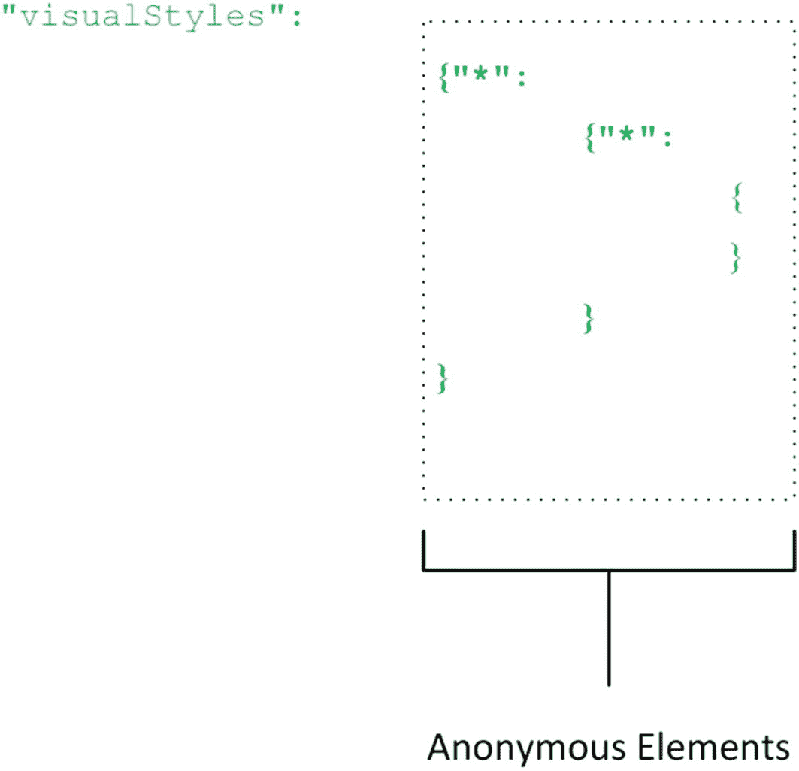
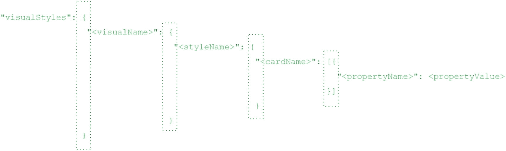
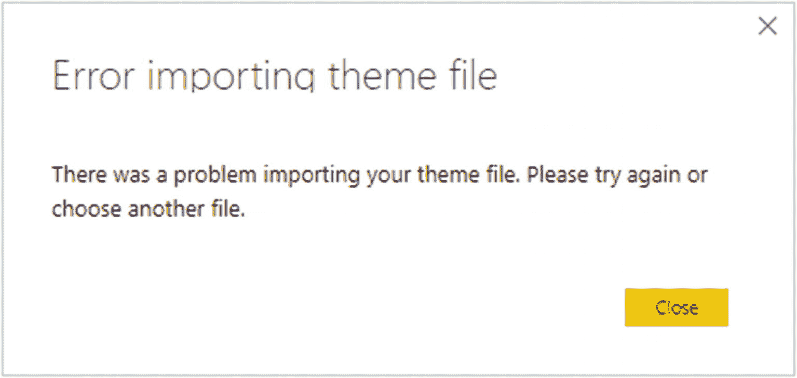

# 4. 默认视觉样式

定义核心 Power BI 仪表板格式化的下一步是配置一组高级呈现元素，这些元素可以覆盖仪表板视觉效果的大部分格式要求。这将确保仪表板的大部分（尽管可能并非全部）基本格式化工作仅通过应用一个 JSON 主题文件即可完成。这是所谓的 80/20 规则的一个实际应用——80% 的格式化工作可以通用地进行，剩下的部分则手动格式化。

在实践中，定义少量适用于一系列视觉效果的“默认”样式元素，往往比精确指定大约 30 个单独视觉效果的规范要有效得多。这是可能的，因为 Power BI 已经确保，视觉效果中与其他视觉效果共有的任何方面（例如，边框或背景），无论你正在调整的是哪个视觉效果，在 Power BI Desktop 的格式窗格中都使用相同的格式化方法——并且这种共性也扩展到了 JSON 主题文件中。

实际上，这种方法意味着你可以在主题文件中仅一次指定一个格式元素，然后它就会应用于任何支持该元素的视觉效果。例如，你可能希望为所有视觉效果定义边框和标题，然后为图表指定少量通用元素（如 X 轴和 Y 轴定义），以及为表格指定核心元素，例如总计和值的格式。此外，你甚至不需要指定 Power BI 中某个视觉效果可用的全部格式化选项。也就是说，如果你只想定义需要标题（而不定义标题的任何其他特性），则可以将规范限定于这一个属性。

所有这一切都可以通过手动制作的主题文件实现，在该文件中你定义视觉特性，而无需指定格式化必须应用于哪种视觉效果类型。JSON 格式将——即时且自动地——应用于任何包含你定义的属性的视觉效果。这种方法有三大优点：

*   它简化了主题准备，因为你只需定义一次元素（而不是为每种特定视觉效果类型单独定义）。
*   你可以根据需要，将格式化的定义设置为详细或高级，然后在 Power BI Desktop 中调整单个格式选项以增加完整性。
*   你可以“以防万一”添加默认格式化。这是因为你添加的任何不被某种视觉效果类型使用的格式化（例如定义某种图表类型的某些详细元素）都不会阻止其他格式在被另一种图表类型支持的地方应用。

此外，如果你愿意，之后可以在单个视觉效果层面上覆盖或扩展这些通用属性。这些技术将在第 5 章到第 12 章中介绍。

在本章中，我们将逐步了解如何：

*   定义大多数视觉效果类型共有的视觉元素
*   定义大多数图表类型共有的元素
*   定义表格元素

创建默认视觉样式意味着理解 Power BI 中每个单独元素的 JSON 格式化。显然，这可能需要全面理解 JSON 主题文件创建的复杂性。因此，本章你将学习的是原则，即如何选择 JSON 格式化代码的核心方面，以便在更抽象的层面上应用它们，从而使 JSON 能够塑造多个视觉效果的外观——而无需逐个定义它们。对每个单独视觉效果所有细节的深入了解将在本书后续部分进行。

# 常见视觉元素

Power BI 仪表板中的大多数（甚至所有）视觉对象都包含一系列通用元素。这些元素包括：
- 背景
- 标题
- 边框
- 阴影
- 工具提示
- 视觉对象标头
- 锁定纵横比

你可能已经习惯使用 Power BI 格式设置窗格反复设置这些元素——说实话，确实如此。

这些格式元素由以下 JSON 主题关键字定义：
- `background`：设置视觉对象格式窗格“背景”卡片中的所有属性，并为页面设置背景
- `title`：设置视觉对象格式窗格“标题”卡片中的所有属性
- `border`：设置视觉对象格式窗格“边框”卡片中的所有属性
- `shadow`：设置视觉对象格式窗格“阴影”卡片中的所有属性
- `visualTooltip`：设置视觉对象格式窗格“工具提示”卡片中的所有属性
- `visualHeader`：设置视觉对象格式窗格“视觉对象标头”卡片中的所有属性
- `lockAspect`：设置视觉对象格式窗格“锁定纵横比”卡片中的所有属性

因此，现在是时候使用 JSON 在主题中定义这些通用元素了。与本书中大多数格式化 Power BI 仪表板的方法一样，最好的做法是先查看 JSON 代码，然后在看到代码后解释其工作原理。以下是一个代码片段（新元素以粗体显示），它为大多数视觉对象通用的元素添加了一些核心视觉对象默认格式。为了节省页面空间，此代码片段隐藏了之前看到的部分 JSON。完整代码位于文件 `ColorAndTextClassesWithCoreVisualDefaults.json` 中。

在此代码片段中，你可以看到斜体关键字对应于 Power BI 格式设置窗格中的各部分：
- `title` 关键字对应“标题”部分。
- `lockAspect` 关键字对应“锁定纵横比”部分。
- `border` 关键字对应“边框”部分。
- `dropShadow` 关键字对应“阴影”部分。
- `visualHeader` 关键字对应“视觉对象标头”部分。

```json
{
  "name": "Common elements",
  "dataColors": ["#12239E", "#118DFF", "#00FF29", "#6B007B", "#FFB000", "#F5F4F0", "#FFFF00", "#FF001E"],
  --- 颜色和文本类代码未显示 ---
  "visualStyles":
  {"*":
  {"*":
  {
    "title": [{
      "show": true,
      "text": "Visual Title",
      "fontColor": {"solid": {"color": "#ffffff"}},
      "background": {"solid": {"color": "#12239E"}},
      "alignment": "Center",
      "fontSize": 8,
      "fontFamily": "Arial"
    }],
    "lockAspect": [{
      "show": false
    }],
    "border":   [{
      "show": true,
      "color": {"solid": {"color": "#F5F4F0"}}
    }],
    "dropShadow":   [{
      "show": true,
      "color": {"solid": {"color": "#E8E8E8"}},
      "position":"Outer",
      "preset":"TopLeft"
    }],
    "visualHeader": [{
      "show": true,
      "background": {"solid": {"color": "#ffffff"}},
      "border": {"solid": {"color": "#F5F4F0"}},
      "transparency": 10,
      "foreground": {"solid": {"color": "#000000"}},
      "showVisualInformationButton": false,
      "showVisualWarningButton": false,
      "showVisualErrorButton": false,
      "showDrillRoleSelector": true,
      "showDrillToggleButton": false,
      "showDrillUpButton": false,
      "showDrillDownLevelButton": false,
      "showDrillDownExpandButton": false,
      "showPinButton": false,
      "showFocusModeButton": false,
      "showFilterRestatementButton": false,
      "showSeeDataLayoutToggleButton": false,
      "showOptionsMenu": false,
      "showTooltipButton": true
    }]
  }
  }
  }
}
```

现在来对这段特定的 JSON 做一些解释：
- 每个 JSON 属性对应于 Power BI Desktop 中格式设置窗格特定部分中的一个元素。
- 定义键/值对的核心方法仍然有效。但是，正如你所见，每个值设置都被定义为一个包含一个或多个对象的数组。也就是说，每个定义都以方括号和花括号开头，并以花括号后跟方括号结束。
- 某些对象包含进一步嵌套的对象——即花括号内的内部元素集，有时嵌套深度达三层。
- 这段 JSON 代码中还有一些新的内容。你正在引用通过 Power BI Desktop 中的弹出菜单所做的选择来格式化元素，例如：
  - 标题对齐方式
  - 阴影位置
  - 阴影预设
- 你需要知道，每个 JSON 关键字的拼写都必须准确无误——并且必须始终用双引号括起来。当然，如果你不想猜测定义，可以查阅描述你想要格式化的视觉对象的章节。
- 关于这些定义的好消息是，拼错某一个并不会导致 JSON 文件加载失败。唯一可能发生的是，该实际属性将不会被格式化，并且在 JSON 主题文件加载后保持默认格式。
- 你可以看到，虽然 Power BI Desktop 有打开或关闭元素的按钮（例如标题或阴影），但相应的 JSON 会翻译为：`"show": true` 或 `"show": false`。



图 4-1 匿名元素

- 你需要注意，JSON 显示布尔值（即 `true` 或 `false`）：
  - 不带引号
  - 小写
- 注意 `true` 和 `false` 的大小写很重要，因为 JSON 主题是区分大小写的。也不要用双引号将它们括起来，因为它们是关键字，而不是值。
- 最后，实际元素定义（`background`、`title` 等）本身嵌套在两个“匿名”元素内——如图 4-1 所示。在定义通用元素（即不严格归属于特定类型视觉对象的格式设置）时，它们必须嵌套在此较低层级。星号表示格式设置是通用的——不绑定到特定对象。诚然，这使得跟踪嵌套层级（以及所有花括号对）稍微复杂一些。但是，随着你更多地使用 JSON 主题文件，这会变得习以为常。

## JSON 属性定义

如果你更仔细地查看 JSON，你会注意到它其实非常容易理解，因为每个部分的格式化选项的每个键/值对都相当直截了当。JSON 所做的是为每个部分单独设置每个属性。此外，JSON 遵循你之前看到的准则：
- 开或关使用 `"show": true` 或 `"show": false` 表示。
- 大小是简单的、不带引号的数字。
- 弹出菜单中的选择项用引号括起来——并且与任何弹出菜单中的实际选项几乎完全相同。
- 颜色是双引号中的十六进制值（前面带有井号/哈希符号）。

这意味着，对于已经花时间在仪表板中格式化图表的 Power BI Desktop 用户来说，理解所使用的 JSON 是件容易的事。为了强调一个重要的点，你在这里看到的 JSON 只是这些关键字中大多数可用的格式化选项的一个子集。在第 5 章到第 9 章中，你将看到每种图表类型当前所有可用图表格式化选项的完整详细信息。

# JSON 关键字

主题文件使用关键字这一事实，必然意味着如果你要设置满足以下条件的格式属性，就需要知道 JSON 主题文件中所需的准确术语：

-   映射到 Power BI Desktop 格式化窗格中的某个部分
-   指定一个属性
-   从 Power BI Desktop 的弹出菜单中进行选择

在 Power BI Desktop 中猜测可选择元素的 JSON 定义的一般规则是：

-   将指针悬停在图标（例如对齐图标）上，并使用弹出文本作为定义
-   使用弹出菜单文本（例如，用于阴影位置），但移除所有空格并保留首字母大写

然而，为了省去你猜测关键字的麻烦，它们都将在本书后面的章节中描述。

# 主题文件中的 JSON 层级结构

JSON 本身适合层级结构——因此它基于你在图 4-2 中看到的概要方法。



*图 4-2 – 主题文件中的 JSON 层级结构*

> **注意：** 样式名称始终是星号。如果你正在定义通用属性（如本章所示），那么第二个星号会替换你将在后面更具体的主题文件中看到的视觉对象名称。

# 大多数图表类型共有的元素

既然你已经了解了如何定义共享（或通用）元素的格式，我们就可以进入下一层级的“通用”格式设置。这涉及到设置图表视觉对象的*部分*格式参数。

图表的格式设置有几个方面是多种图表共享的。例如，堆积条形图、堆积柱形图、簇状条形图、簇状柱形图、折线图、面积图、堆积面积图、折线图和簇状柱形图以及折线图和堆积柱形图都包含以下元素：

- 类别（X）轴
- 数值（Y）轴
- 数据标签
- 绘图区
- 图例

事实上，其中某些元素也常见于其他几种图表类型，例如功能区图、瀑布图和散点图（即使这些图表类型仅包含前面列表中的部分格式选项）。甚至还有漏斗图、饼图和环形图等图表，它们至少使用了前面列出的一个格式元素。

为了省去你为每种图表类型分别定义这些相似或相同的图表格式属性的麻烦，你可以指定*标准格式*，该格式将应用于图表元素*（如果存在的话）*。这意味着，如果你创建了一个不包含这些元素之一的图表（例如没有类别和数值轴但*确实*有图例的环形图），但仍在其主题文件中设置了这些属性，那么任何不相关的格式元素定义将*不会应用于*该图表。更重要的是，你*不必定义*格式窗格展开选项卡中存在的*每个格式选项*。也就是说，如果你愿意，你可以仅从所有可用选项中为图例设置一两个格式选项。换句话说，你可以根据需要预定义任意多的图表格式方面，而不必担心是否实际使用它们。Power BI Desktop 不关心 JSON 格式是否被使用——只关心其语法是否准确。这意味着，只要 JSON 语法正确，你可以定义任意多（或少）的通用格式。

下面是一个 JSON 主题文件的摘录，它对一系列共享的图表元素应用了部分（而非全部）格式。你可以在文件`ColorAndTextClassesWithCoreVisualDefaultsAndKeyChartTypes.json`中找到完整的代码。

用于定义一组标准图表格式的 JSON 可能如下所示：

```json
{
"name": "Common chart elements",
"dataColors": ["#12239E", "#118DFF", "#00FF29", "#6B007B", "#FFB000", "#F5F4F0", "#FFFF00", "#FF001E"],
"visualStyles":
{"*":
{"*":
{
"title": [{... code not shown ...}],
"lockAspect": [{... code not shown ...}],
"dropShadow":   [{... code not shown ...}],
"visualHeader": [{... code not shown ...}],
"categoryAxis": [{
"show": true,
"axisScale": "Linear",
"position": "left",
"labelColor": {"solid": {"color": "#949494"}},
"fontFamily": "Arial",
"fontSize": 8,
"showAxisTitle": true,
"titleText": "Add an Axis Title",
"titleFontSize": 8,
"titleFontFamily": "Arial",
"titleColor": {"solid": {"color": "#949494"}},
"gridLineShow": true,
"gridLineColor":  {"solid": {"color": "#949494"}},
"gridLineThickness": 1,
"gridlineStyle": "Solid"
}],
"valueAxis": [{
"show": true,
"position": "Left",
"axisScale": "Linear",
"labelColor": {"solid": {"color": "#949494"}},
"fontFamily": "Arial",
"fontSize": 8,
"showAxisTitle": true,
"titleText": "Add an Axis Title",
"titleFontSize": 8,
"titleFontFamily": "Arial",
"titleColor": {"solid": {"color": "#949494"}},
"gridLineShow": true,
"gridLineColor":  {"solid": {"color": "#949494"}},
"gridLineThickness": 1,
"gridlineStyle": "Solid",
"axisStyle": "ShowTitleOnly"
}],
"labels": [{
"show": true,
"labelPosition": "InsideEnd",
"color": {"solid": {"color": "#ffffff"}},
"fontFamily": "Arial",
"fontSize": 7,
"enableBackground": false,
"backgroundColor": {"solid": {"color": "#E8E8E8"}},
"backgroundTransparency": 0
}],
"plotArea": [{
"transparency": 0
}],
"legend": [{
"show": true,
"position": "Bottom",
"showTitle": true,
"titleText": "Add a legend title",
"legendColor": {"solid": {"color": "#949494"}},
"fontFamily": "Arial",
"fontSize": 8
}]
}
}
}
}
```

在这个 JSON 片段中——再次提醒——这些关键字对应于 Power BI Desktop 中格式窗格的部分。这里引用的部分对于条形图、柱形图、折线图和面积图是通用的。

- *类别（X）轴*由关键字`categoryAxis`定义。
- *数值（Y）轴*由关键字`valueAxis`定义。
- *数据标签*由关键字`labels`定义。
- *绘图区*由关键字`plotArea`定义。
- *图例*由关键字`legend`定义。

## 扩展特定图表类型的通用格式

前面的 JSON 片段展示了如何为五种图表元素定义核心格式。然而，有些情况下，你可能希望添加一些仅适用于少数几种图表类型（甚至单一图表类型）的元素。幸运的是，这只需对 JSON 代码进行简单扩展即可。

例如，假设你想在主题文件中添加以下两个元素：

- 折线图、面积图、堆叠面积图、折线图与簇状柱形图、以及折线图与堆叠柱形图中使用的线条和连接格式
- 圆环图中使用的中心半径百分比

你可以通过以下代码片段来扩展前面的 JSON（并确保在 JSON 文件中用逗号分隔这两段代码）。完整的 JSON 主题文件可在示例文件中找到，名为`ColorAndTextClassesWithCoreVisualDefaultsAndKeyChartTypesExtended.json`。添加到先前片段中的代码如下：

```json
"lineStyles": [{
"ShadedArea": true,
"strokeWidth": 1,
"lineStyle": "Solid",
"showMarker": true,
"markerShape": "Triangle",
"markerSize": 2,
"markerColor": {"solid": {"color": "#949494"}}
}],
"slices": [{
"innerRadiusRatio": 20
}]
```

此 JSON 将仅应用于那些在 Power BI Desktop 中实际包含以下格式部分的图表：

- **形状**（对于折线图和面积图，在 JSON 中用`lineStyles`关键字表示）
- **形状/内部半径**（对于圆环图，用`slices`关键字表示）

正如你所见，Power BI Desktop 格式部分与相应 JSON 关键字之间的关联并非总是完全直观。然而，一旦理解了这些映射关系，创建和修改 JSON 主题文件就变得相当直接了。

## 表格元素

当然，并非 Power BI 中的所有视觉对象都是图表。有些核心视觉对象与图表截然不同，例如表、矩阵和卡片，你可能在仪表板中经常使用它们。幸运的是，你也可以快速轻松地定义这些视觉对象的核心格式。

以下代码片段为以下表格（和矩阵）元素添加了格式规范：

- 网格
- 列标题
- 值
- 总计

幸运的是，JSON 关键字与 Power BI Desktop 格式窗格中针对表和矩阵的节标题非常对应。此外，格式元素是简单的键/值对，与 Power BI Desktop 中的实际格式属性紧密映射，因此这里无需额外解释。

## 再次说明

并非所有在 Power BI Desktop 中可用于总计、值、列标题和网格的格式选项都已通过 JSON 主题文件应用。同样地，任何未在 JSON 文件中设置的格式元素都将保留为应用此主题的 Power BI Desktop 文件中的默认值。此 JSON 代码可在示例文件 `ColorsAndTextClassesWithVisualDefaults.json` 中找到。

## 最后的说明

如果你将本章中探讨的所有 JSON 片段添加到一个主题文件中，完整的 JSON 主题文件将包含以下高级格式定义：

-   调色板
-   全局颜色应用
-   标准字体规范
-   核心图表元素
-   核心表格元素

一个包含所有这些元素并组装成可用主题的文件可在示例数据目录中找到，名为 `GenericBaseFormatting.json`。你可以查看整个文件，内容如下。我意识到这是一段庞大的代码（大约 230 行），但值得全面了解你创建的所有内容以及它们是如何组合成一个连贯主题的。

```
"style":  [{"styleType": "Minimal"}],
"grid":    [{
"gridVertical": false,
"gridVerticalColor": {"solid": {"color": "#171796"}},
"gridVerticalWeight": 1,
"gridHorizontal": false,
"gridHorizontalColor": {"solid": {"color": "#171796"}},
"gridHorizontalWeight": 1,
"textSize": 8,
"rowPadding": 1,
"outlineColor": {"solid": {"color": "#ffffff"}},
"outlineWeight": 1
}],
"columnHeaders": [{
"fontColor": {"solid": {"color": "#ffffff"}},
"backColor": {"solid": {"color": "#E34B20"}},
"outline": "Frame",
"alignment": "Left",
"wordWrap": true
}],
"values": [{
"fontColorPrimary": {"solid": {"color": "#3D4E57"}},
"backColorPrimary": {"solid": {"color": "#F5F4F0"}},
"fontColorSecondary": {"solid": {"color": "#3D4E57"}},
"backColorSecondary": {"solid": {"color": "#E3DFD4"}},
"outline": "Frame",
"alignment": "Left",
"wordWrap": true
}],
"total": [{
"totals": true,
"fontColor": {"solid": {"color": "#000000"}},
"backColor": {"solid": {"color": "#D1CAB8"}},
"outline": "Frame"
}]
```

```json
{
"name": "通用基础格式",
"dataColors": ["#171796", "#E34B20", "#F4B7A6", "#465437", "#E2EB00", "#615E55", "#00AC98", "#73268c"],
"good": "#1AAB40",
"neutral": "#D9B300",
"bad": "#D64554",
"maximum": "#118DFF",
"center": "#D9B300",
"minimum": "#DEEFFF",
"null": "#FF7F48",
"background": "#FFFFFF",
"firstLevelElements": "#949494",
"secondLevelElements": "#949494",
"thirdLevelElements": "#D5D5D5",
"fourthLevelElements": "#B7B7B7",
"secondaryBackground": "#E8E8E8",
"tableAccent": "#118DFF",
"textClasses": {
"label": {
"fontSize": 9,
"fontFace": "Arial",
"color": "#949494"
},
"callout": {
"fontSize": 18,
"fontFace": "Arial",
"color": "#808080"
},
"title": {
"fontSize": 12,
"fontFace": "Arial",
"color": "#949494"
},
"header": {
"fontSize": 12,
"fontFace": "Arial",
"color": "#808080"
},
"largeTitle": {
"fontSize": 14,
"fontFace": "Arial",
"color": "#808080"
},
"largeLabel": {
"fontSize": 12,
"fontFace": "Arial",
"color": "#808080"
},
"smallLabel": {
"fontSize": 8,
"fontFace": "Arial",
"color": "#949494"
},
"semiboldLabel": {
"fontSize": 8,
"fontFace": "Arial",
"color": "#808080"
},
"boldLabel": {
"fontSize": 8,
"fontFace": "Arial",
"color": "#808080"
},
"lightLabel": {
"fontSize": 8,
"fontFace": "Arial",
"color": "#949494"
},
"largeLightLabel": {
"fontSize": 8,
"fontFace": "Arial",
"color": "#949494"
},
"smallLightLabel": {
"fontSize": 8,
"fontFace": "Arial",
"color": "#949494"
}
},
"visualStyles": {
"*": {
"*": {
"background": [{"color": {"solid": {"color": "#F5F4F0"}}, "transparency": 0}],
"visualTooltip": [{"titleFontColor": {"solid": {"color": "#D7CACA"}}, "valueFontColor": {"solid": {"color": "#FFFFFF"}}, "background": {"solid": {"color": "#938888"}}}],
"background": [{"color": {"solid": {"color": "#7A0A0A"}}}],
"title": [{"show": true, "text": "视觉对象标题", "fontColor": {"solid": {"color": "#ffffff"}}, "background": {"solid": {"color": "#171796"}}, "alignment": "Center", "fontSize": 8, "fontFamily": "Arial"}],
"lockAspect": [{"show": false}],
"border": [{"show": true, "color": {"solid": {"color": "#171796"}}}],
"dropShadow": [{"show": true, "color": {"solid": {"color": "#D7CACA"}}, "position": "外", "preset": "左上"}],
"visualHeader": [{"show": true, "background": {"solid": {"color": "#ffffff"}}, "border": {"solid": {"color": "#171796"}}, "foreground": {"solid": {"color": "#171796"}}}],
"categoryAxis": [{"show": true, "axisScale": "线性", "position": "左", "labelColor": {"solid": {"color": "#949494"}}, "fontFamily": "Arial", "fontSize": 8, "showAxisTitle": true, "titleText": "添加轴标题", "titleFontSize": 8, "titleFontFamily": "Arial", "titleColor": {"solid": {"color": "#949494"}}, "gridLineShow": true, "gridLineColor": {"solid": {"color": "#949494"}}, "gridLineThickness": 1, "gridLineStyle": "实线"}],
"valueAxis": [{"show": true, "position": "左", "axisScale": "线性", "labelColor": {"solid": {"color": "#949494"}}, "fontFamily": "Arial", "fontSize": 8, "showAxisTitle": true, "titleText": "添加轴标题", "titleFontSize": 8, "titleFontFamily": "Arial", "titleColor": {"solid": {"color": "#949494"}}, "gridLineShow": true, "gridLineColor": {"solid": {"color": "#949494"}}, "gridLineThickness": 1, "gridLineStyle": "实线", "axisStyle": "仅显示标题"}],
"labels": [{"show": true, "labelPosition": "内部末端", "color": {"solid": {"color": "#ffffff"}}, "fontFamily": "Arial", "fontSize": 7, "enableBackground": false, "backgroundColor": {"solid": {"color": "#d9d9d9"}}, "backgroundTransparency": 0}],
"plotArea": [{"transparency": 0}],
"legend": [{"show": true, "position": "底部", "showTitle": true, "titleText": "添加图例标题", "legendColor": {"solid": {"color": "#949494"}}, "fontFamily": "Arial", "fontSize": 8}],
"lineStyles": [{"ShadedArea": true, "strokeWidth": 1, "lineStyle": "实线", "showMarker": true, "markerShape": "三角形", "markerSize": 2, "markerColor": {"solid": {"color": "#949494"}}}],
"slices": [{"innerRadiusRatio": 20}],
"grid": [{"gridVertical": true, "gridVerticalColor": {"solid": {"color": "#171796"}}, "gridVerticalWeight": 1, "gridHorizontal": true, "gridHorizontalColor": {"solid": {"color": "#171796"}}, "gridHorizontalWeight": 1, "textSize": 10, "rowPadding": 2, "outlineColor": {"solid": {"color": "#ffffff"}}, "outlineWeight": 1}],
"columnHeaders": [{"fontColor": {"solid": {"color": "#000000"}}, "backColor": {"solid": {"color": "#E34B20"}}, "outline": "框架", "alignment": "左", "wordWrap": true}],
"values": [{"fontColorPrimary": {"solid": {"color": "#3D4E57"}}, "backColorPrimary": {"solid": {"color": "#F5F4F0"}}, "fontColorSecondary": {"solid": {"color": "#3D4E57"}}, "backColorSecondary": {"solid": {"color": "#E3DFD4"}}, "outline": "框架", "alignment": "左", "wordWrap": true}],
"total": [{"totals": true, "fontColor": {"solid": {"color": "#000000"}}, "backColor": {"solid": {"color": "#D1CAB8"}}, "outline": "框架"}]
}
}
}
}
```

现在你已经构建了一个JSON主题文件，它可以立即格式化Power BI仪表板的大部分内容。值得回顾一下你创建的内容。

该文件本质上只是JSON，但它可以细分为三个主要区域：

*   颜色（`Colors`）
*   文本（`textClasses`）
*   视觉元素（`visualStyles`）

## 累积性元素
此文件包含累积性的元素 —— 即它可以一次性应用于多个不同的格式区域。

## 样式层级结构
存在一个样式层级结构。也就是说，你可以应用一个初始的“顶层”样式（例如，通过定义`textClasses`中的`title`元素），然后还可以指定图表的标题采用不同的格式。这些细微差别将在最后一章中解释。

## 格式定义的灵活性
正如我之前提到的，在定义格式时，你不必定义格式化元素的每一个方面。换句话说，并非所有“部分”都是必须的，你可以选择使用主题文件格式化视觉对象的哪些部分（或共享此公共元素的视觉对象集合）。

## 关键注意事项
主题文件中元素的顺序并不重要。因此，你可以将`visualStyles`元素放在`textClasses`元素之上。然而，真正重要的是：

*   确保JSON语法正确。
*   检查定义样式元素的关键字是否为Power BI所期望的。
*   任何文本元素（例如字体名称或Power BI Desktop弹出窗口中的选择）都包含Power BI期望的值。

此外，你当然可以获取完整的“通用”主题文件（`GenericBaseFormatting.json`）并对其进行调整，以使用你偏好的颜色和其他设置。你还可以扩展它，添加更多高级格式化属性。在接下来的八章中，你将学习详细的JSON格式化的完整范围。

# JSON 主题文件编写提示

JSON 主题文件可能非常密集、看起来晦涩难懂，并且在加载时可能弹出如图 4-3 所示的可怕“主题文件导入错误”对话框。



**图 4-3** 主题文件导入错误

那么，在创建主题文件时，如何最大限度地减少错误呢？

首要操作之一应该是使用你偏好的搜索引擎，查找“JSON 语法检查器”。有很多在线资源允许你测试 JSON 的结构有效性。这对于检查 JSON 是否“格式良好”特别有用——这意味着没有多余（或缺失）的逗号、花括号或方括号等等。一些允许你编写 JSON 的工具也内置了语法检查器，或者可以添加它们。

另一个关键步骤是使用既能智能格式化 JSON，又能让你理解其结构的工具来编写 JSON。我的意思是，能够直观地理解嵌套层级，并看到成对的花括号是如何匹配的，对于在编写主题文件时简化工作是至关重要的。

不幸的是，除了将主题文件加载（或尝试加载）到 Power BI Desktop 之外，没有任何方法可以测试实际的 JSON 结构和主要关键字是否已正确输入。在这个层面上，反复尝试似乎是测试主题文件是否按预期工作的唯一方法。

## 结论

本章进一步深入探讨了构成 Power BI 主题文件的细节。你了解了如何逐步构建主题中的 JSON，以定义你想要的多（或少）的格式元素。

虽然 Power BI 的 JSON 主题的真正潜力在于精确定义每种可视化类型的格式规范——直至最细微的具体细节——但并非总是需要将这种能力发挥到极致。

因此，在本章中，你了解到可以在更高、更通用的层面上创建 JSON 主题，以便格式化一系列仪表板元素，而无需详细描述每个元素。

既然你已经了解了主题文件的基本运作方式，现在是时候深入探究如何使用 JSON 精确格式化 Power BI 仪表板的方方面面了。正如你所料，这是一个涉及大量细节的大课题。因此，我将这一主题分解为八个独立的章节以方便理解。我们将从格式化 Power BI 仪表板对象开始。

