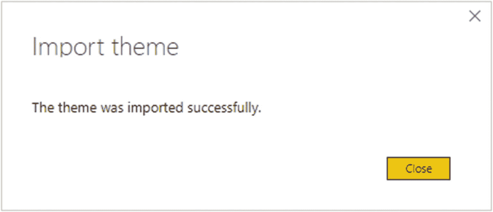
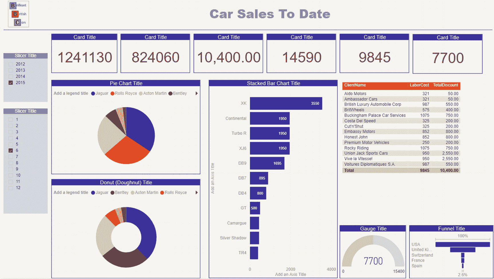

# 应用主题

在探讨如何创建你自己的主题之前，最好先提醒你一下主题能够产生的深远影响。希望这能激励你学习更多知识，并鼓励你创建自己的主题文件。

例如，以图 1-2 所示的一个非常简单的仪表板为例。（这是示例文件中的 `SampleDashboard.pbix` 文件）。

图 1-2 一个未格式化的仪表板

这个仪表板完全是“普通样式”。也就是说，完全没有应用任何格式。试想一下，如果这个仪表板是一个 15 页的报告，而你需要让它不仅看起来赏心悦目，还要符合公司标准。在最坏的情况下，这可能需要耗费数小时。

然而，你很幸运地拥有一个定义了所有公司标准的主题 JSON 文件。应用它，你只需要这么做：

图 1-3 主题文件导入成功

1. 单击“视图”以激活“视图”功能区。
2. 单击“主题”弹出菜单。
3. 单击“浏览主题”。
4. 导航到示例文件并选择主题文件（本例中为 `BaseTheme.json`）。
5. 单击“打开”。几秒钟后，您将看到图 1-3 中的对话框。
6. 单击“关闭”。

就是这样！你的仪表板（每个页面上的每个对象）现在已瞬间完成格式化。结果如图 1-4 所示。

图 1-4 应用主题文件后的仪表板

现在，你可以根据需要添加任何最终的格式设置，以在单个元素级别覆盖主题（毕竟，主题是节省时间的工具，而非束缚）。最终结果几乎是确定无疑的：你节省了大量添加视觉呈现细节的时间，并确保了你的仪表板符合统一的外观和风格。

**注意**

你在此示例中应用的主题文件，其目的并非展示仪表板设计的精妙之处，也非基于前沿的设计原则。相反，它的设计目的只是为了说明使用主题文件重新格式化整个仪表板是多么快速和简单。

