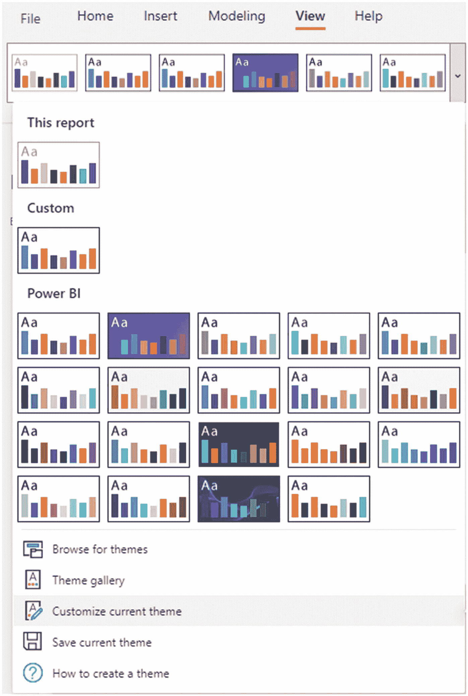
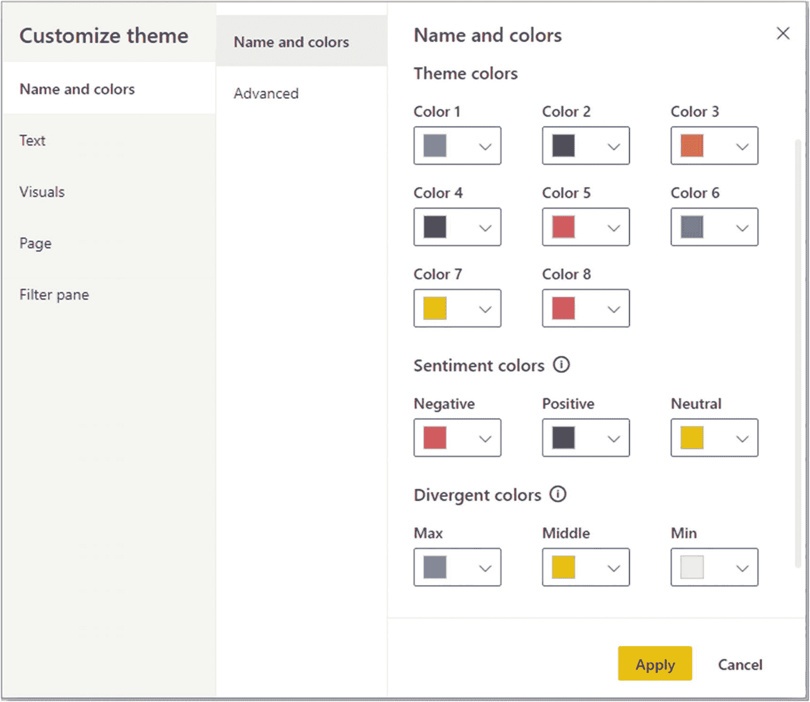

# 2. 在 Power BI Desktop 中创建并自定义主题

如果你并非 IT 背景出身（或者以前从未使用过 JSON 文件），并且一想到要手工编写复杂的文本结构就感到恐惧，那么现在可以放松并深呼吸了，因为定义一个简单而强大的 Power BI 主题文件异常容易——**无需编写或修改一行代码**。

这是因为 Power BI Desktop 允许你（通过几次点击）指定一组核心格式属性，这些属性将应用于整个仪表板。不仅如此，一旦你定义了这些属性，Power BI Desktop 会自动为你生成 JSON 主题文件，以便你将其用于其他仪表板或与同事共享。所有这些操作都是通过“视图”菜单中“主题”按钮的`自定义当前主题`选项完成的。

虽然这种方法无法让你精确设计每种可视化类型的每一个格式属性，但它能让你在最多几分钟内创建出一种标准的演示风格——随后你可以以此主题为基础进行进一步开发。更重要的是，由此生成的主题文件是了解 JSON 主题如何在 Power BI 中运作的绝佳入门材料。

但请注意，通过 Power BI Desktop 界面创建主题*无法*达到使用“手工编写”的 JSON 所能实现的精细演示级别。因此，最好将你在本章中学到的技巧既视为对主题主题的实用入门，也视为一种极快的方法，用于开发可应用于整个仪表板的简单样式原则。

为了给这个过程提供一些结构，这种直接在 Power BI Desktop 中进行的“交互式主题生成”将你可以更改的主题元素分为以下五个类别：

*   **名称和颜色**：在此处你可以为主题命名，并指定仪表板中使用的调色板和主要颜色。
*   **文本**：在此处你可以为仪表板中的各种元素定义核心文本属性，例如字体、字号和颜色。
*   **视觉对象**：在此处你可以指定所有视觉对象的关键公共属性。
*   **页面**：在此处你可以设置仪表板页面的基本属性。
*   **筛选器窗格**：允许你指定筛选器窗格的显示方式。

你不必指定 Power BI Desktop 在“自定义当前主题”对话框中提供的每个选项。你可以更改几个选项，或者重置所有可用选项（以及介于两者之间的任何步骤）。

## 创建简单主题

作为入门，让我们创建一个非常简单的 JSON 主题文件，该文件会更改 Power BI Desktop 用于颜色选择的调色板中的几种颜色。

图 2-1 “主题”弹出窗口

1.  激活“视图”菜单。
2.  点击“主题”的弹出按钮。你将看到类似于图 2-1 所示的选项。

图 2-2 “自定义主题”对话框

1.  点击“自定义当前主题”。将出现如图 2-2 所示的对话框。
2.  在该对话框中，为前几个“主题颜色”选择不同的颜色（这些颜色对应于标准 Power BI 调色板中的颜色，从第三列开始从左到右排列）。值得注意的是，你无法更改调色板中的前两种（单色）颜色。
3.  点击“应用”。所选颜色将应用到当前仪表板。
4.  点击“视图”➤“主题”➤“保存当前主题”。将出现“另存为”对话框。
5.  浏览到合适的目录，并为主题文件输入一个名称。此文件*必须*具有`.json`扩展名。
6.  点击“保存”。

就这样！现在你拥有一个功能完善的 JSON 主题文件，可以将其应用于其他仪表板。只需在应用了此主题文件的仪表板中，显示任意元素的“颜色”弹出窗口，即可看到主题的效果。你会看到可用颜色的第一行已更改为你在前面步骤 4 中选择的颜色（嗯，前两种颜色除外，它们将始终为白色和黑色）。

幸运的是，你刚才所做的选择并非一成不变。因此，你可以随时通过重复刚才的过程、选择任何可用选项并重新保存主题文件来更改主题设置。

**注意**

当你重新保存主题文件时，Power BI Desktop **不会**记住你上次使用的名称，并且默认会使用`Theme.json`。如果你想更新现有文件，请记得在点击“保存”之前选择之前的文件名。当然，你需要确认希望覆盖现有文件。