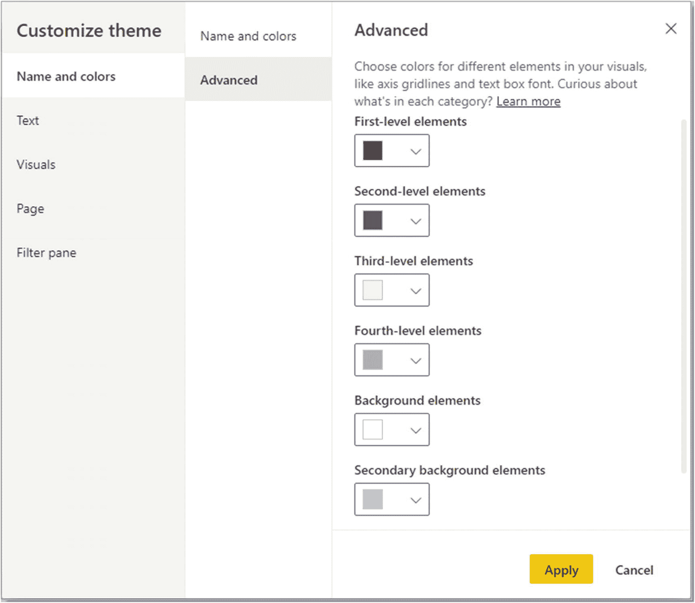
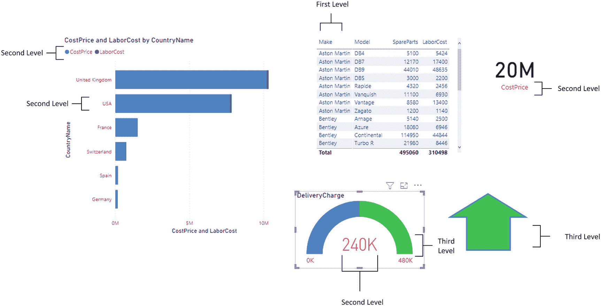
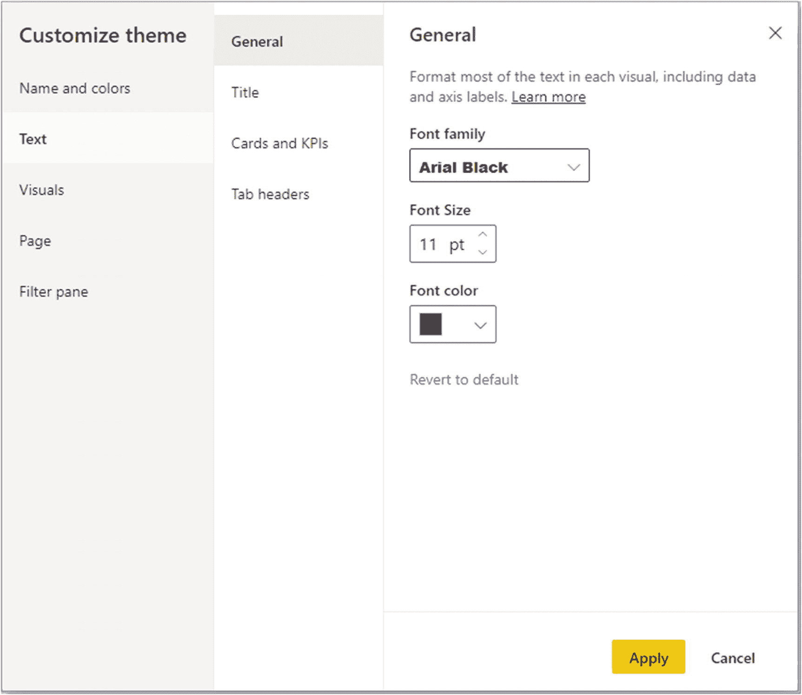
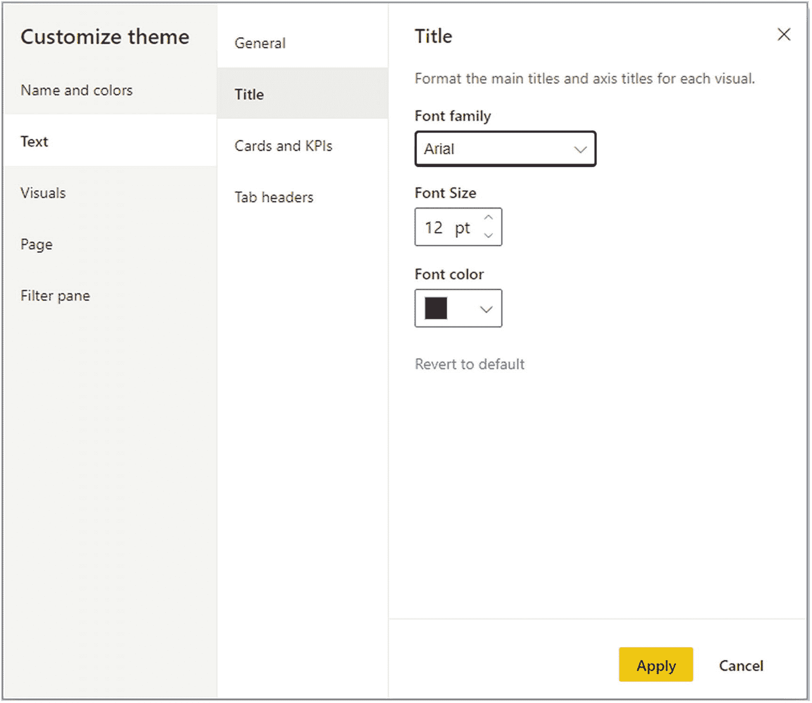
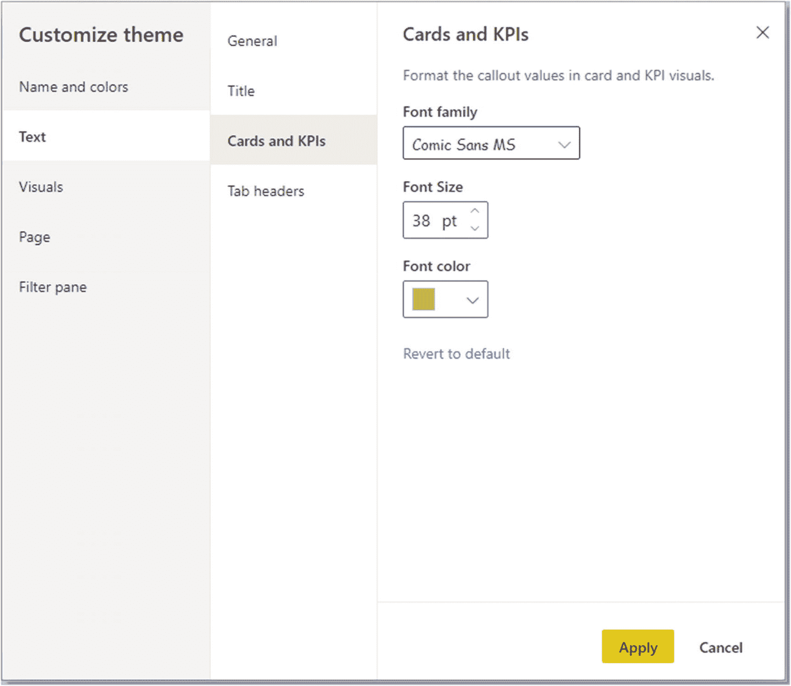
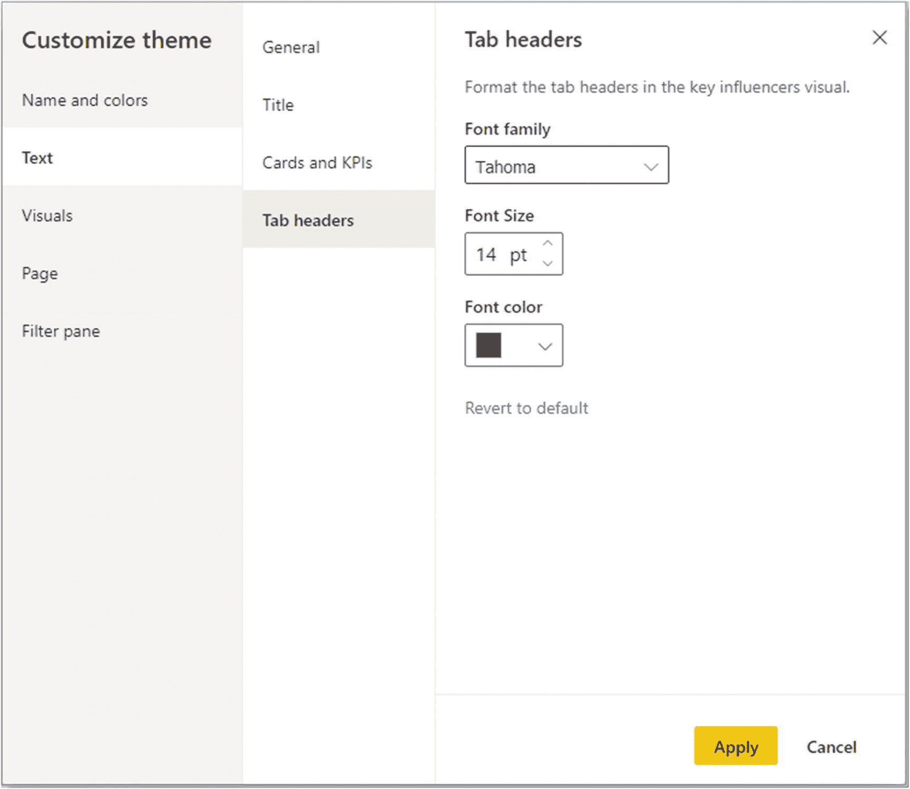
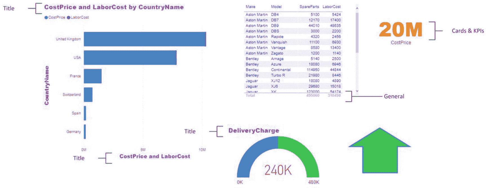

# 名称和颜色设置

自定义主题所能定义的内容远不止调色板。因此，在解释了基础知识之后，现在是时候回顾一下使用 Power BI Desktop 主题界面时所有可用的自定义选项了。这些选项都出现在图 2-2 所示的对话框中。

图 2-3 “自定义主题/高级”选项卡

- **名称**：此字段位于“自定义主题/名称和颜色”选项卡的顶部（尽管在图 2-2 中不可见），允许您在 JSON 文件内部添加文本描述。这对于跟踪主题定义的演变，或简单地提醒您某个特定主题的用途非常有用。

- **情绪颜色**：这些颜色用于 KPI 和瀑布图，以指示正面、负面或中性结果。

- **发散颜色**：这些颜色用于条件格式，以显示数据何时落在一个范围内。

- **高级**（颜色）：高级选项允许您设置一系列六种颜色，这些颜色将应用于广泛的 Power BI 仪表板元素。您可以在图 2-3 中看到“自定义主题/高级”选项卡。

由于这些颜色元素的名称有些抽象，以下是每个颜色设置将修改的元素的完整列表：

- **一级元素**：（数据点外部标签背景色、趋势线颜色、文本框默认颜色、表和矩阵值及总计字体颜色、数据条轴线颜色、卡片数据标签、仪表标注值颜色、KPI 目标颜色、KPI 文本颜色、切片器项目颜色（焦点模式时）、切片器下拉项字体颜色、切片器数字输入字体颜色、切片器标题字体颜色、散点图比率线颜色、折线图预测线颜色、地图引导线颜色、筛选器窗格和卡片文本颜色）

- **二级元素**：“浅色”次要文本类、标签颜色、图例标签颜色、坐标轴标签颜色、表和矩阵标题字体颜色、仪表目标和目标引导线颜色、KPI 趋势轴颜色、切片器滑块颜色、切片器项目字体颜色、切片器轮廓颜色、折线图悬停颜色、多行卡片标题颜色、带状图表描边颜色、形状地图边框颜色、按钮文本字体颜色、按钮图标线条颜色、按钮轮廓颜色

- **三级元素**：坐标轴网格线颜色、表和矩阵网格颜色、切片器标题背景色（焦点模式时）、多行卡片轮廓颜色、形状填充颜色、仪表弧背景颜色、已应用筛选器卡片背景颜色、禁用按钮轮廓颜色

- **四级元素**：图例暗色、卡片类别标签颜色、多行卡片类别标签颜色、多行卡片条形颜色、漏斗图转换比描边颜色、禁用按钮文本字体颜色、禁用按钮图标线条颜色

- **背景元素**：（数据点内部标签背景色、切片器下拉项背景颜色、环形图描边颜色、矩形树图描边颜色、组合图背景颜色、按钮填充颜色、筛选器窗格和可用筛选器卡片背景颜色）

- **次要背景元素**：表和矩阵网格轮廓颜色、形状地图默认颜色、带状图表丝带填充颜色（当“匹配系列”选项关闭时）、当背景未设置为 `FFFFFF` 时，禁用按钮填充颜色和禁用按钮轮廓颜色

为了让您了解这些格式是如何应用的，请看图 2-4。请注意，此仪表板并非完整参考——它仅旨在向您展示通用颜色设置原则的工作原理。

图 2-4 高级颜色自定义结构分解

## 文本设置

正如您可能期望的那样，还有一组文本格式可以定义为自定义主题的一部分。同样，为了使定义元素更容易，它们被细分为若干（此处为四个）不同的元素。这些子元素是：

- **常规**：格式化表和矩阵列标题、矩阵行标题、表和矩阵网格、表和矩阵值

- **标题**：格式化类别轴标题、数值轴标题、多行卡片标题、切片器标题

- **卡片和 KPI**：格式化卡片数据标签、KPI 指示器

- **选项卡标题**：格式化关键影响因素标题

与这些子元素之一对应的每个表格都允许您设置：

- 字体
- 字号
- 字体颜色

让我们逐一查看这些子元素。

“自定义主题/文本/常规”选项卡如图 2-5 所示。

图 2-5 “自定义主题/文本/常规”选项卡

**注意**：正如您将在后续章节中看到的，此设置对应于 JSON 中的 `label` 元素。

“自定义主题/文本/标题”选项卡如图 2-6 所示。

图 2-6 “自定义主题/文本/标题”选项卡

**注意**：正如您将在后续章节中看到的，此设置对应于 JSON 主题中的 `title` 元素。

“自定义主题/文本/卡片和 KPI”选项卡如图 2-7 所示。

图 2-7 “自定义主题/文本/卡片和 KPI”选项卡

**注意**：正如您将在后续章节中看到的，此设置对应于 JSON 中的 `callout` 元素。

“自定义主题/文本/选项卡标题”选项卡如图 2-8 所示。

图 2-8 “自定义主题/文本/选项卡标题”选项卡

**注意**：正如您将在后续章节中看到的，此设置对应于 JSON 中的 `header` 元素。

为了让您了解这些文本格式是如何应用的，请看图 2-9。请注意，此图示并非完整参考——同样，其目的仅仅是向您展示通用颜色设置原则的工作原理。

图 2-9 高级文本自定义结构分解

**注意**：您可以从图中看到，在名称和颜色部分定义的颜色会覆盖在文本部分设置的颜色。

