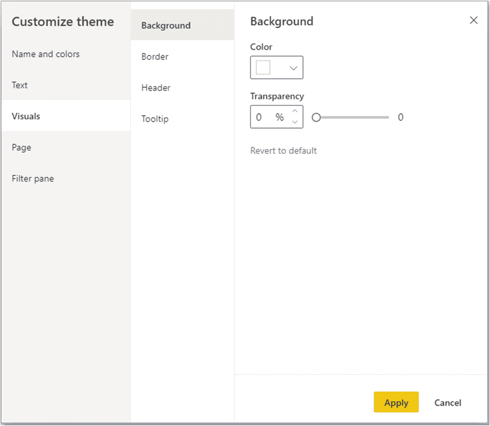
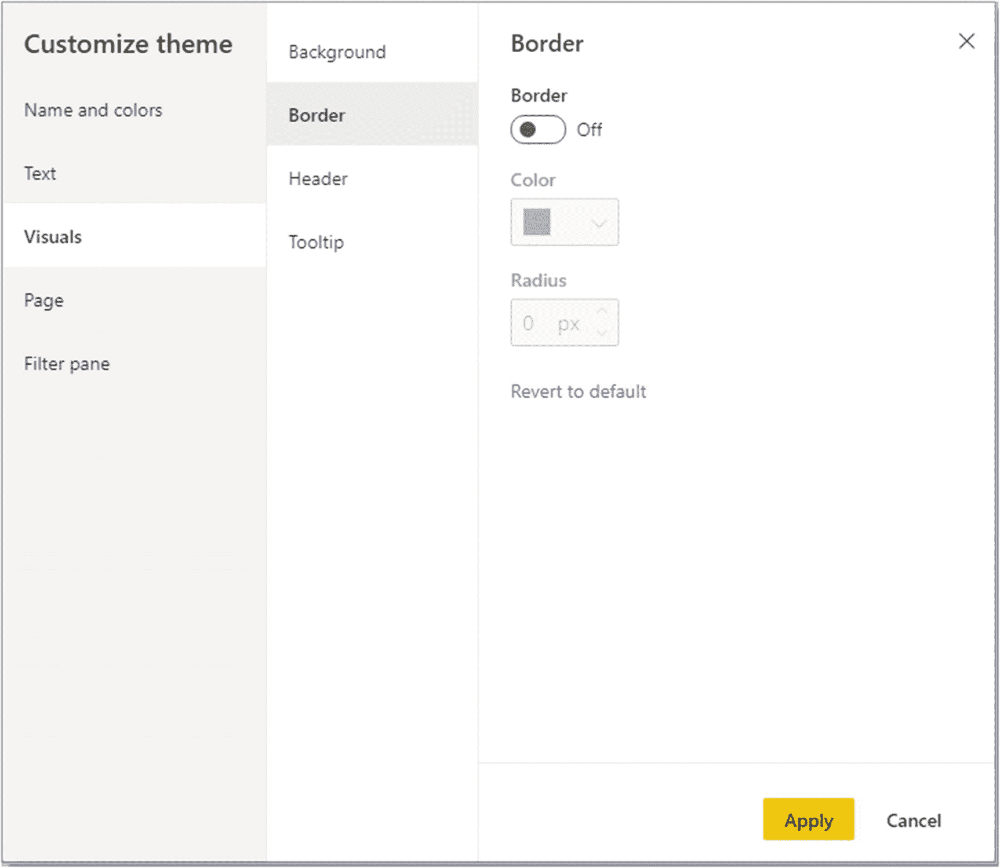
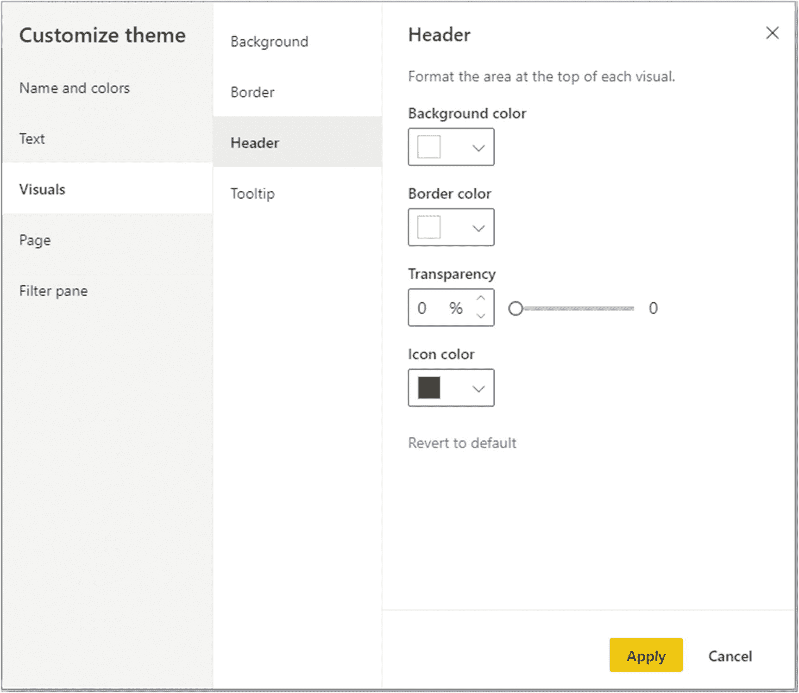
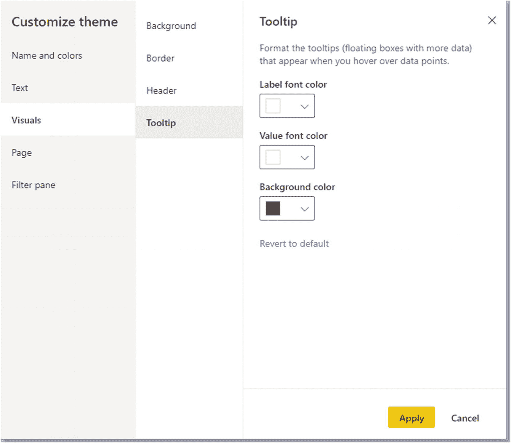
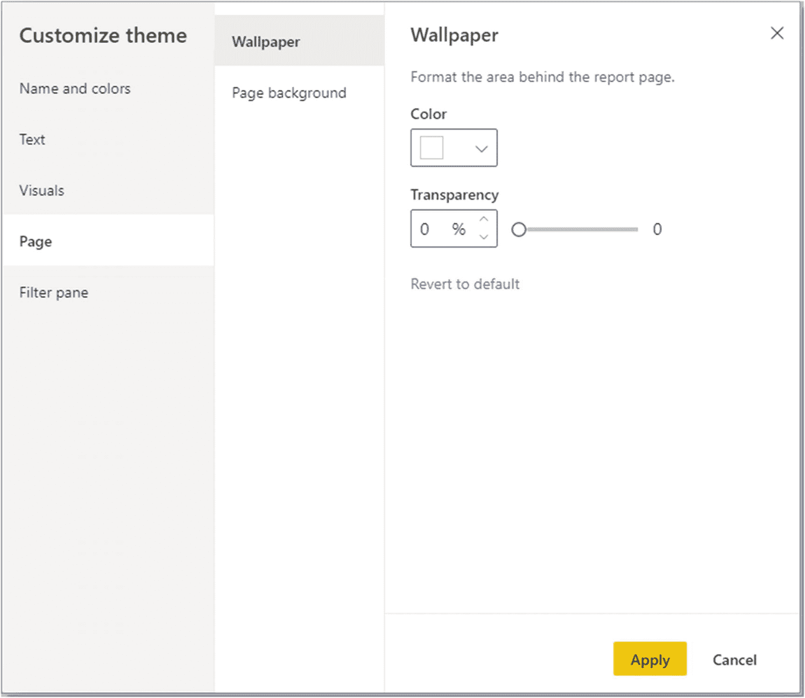
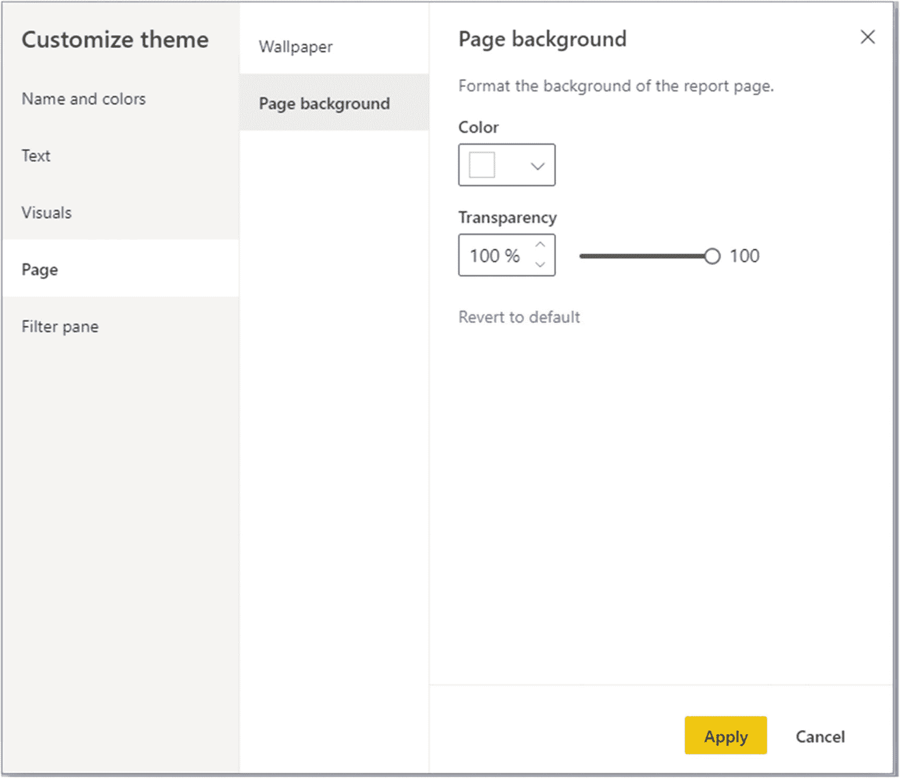
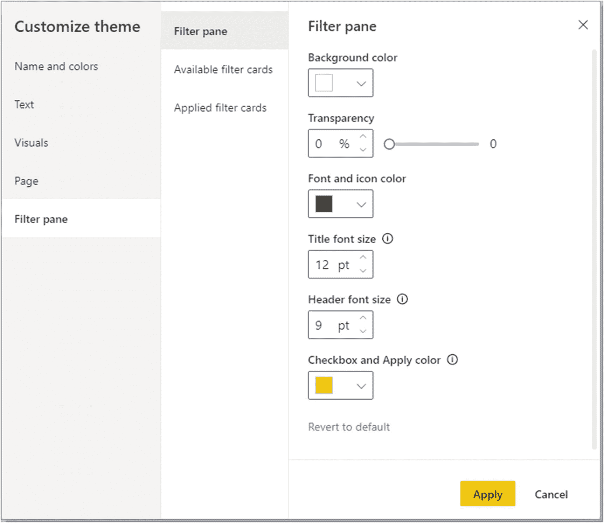
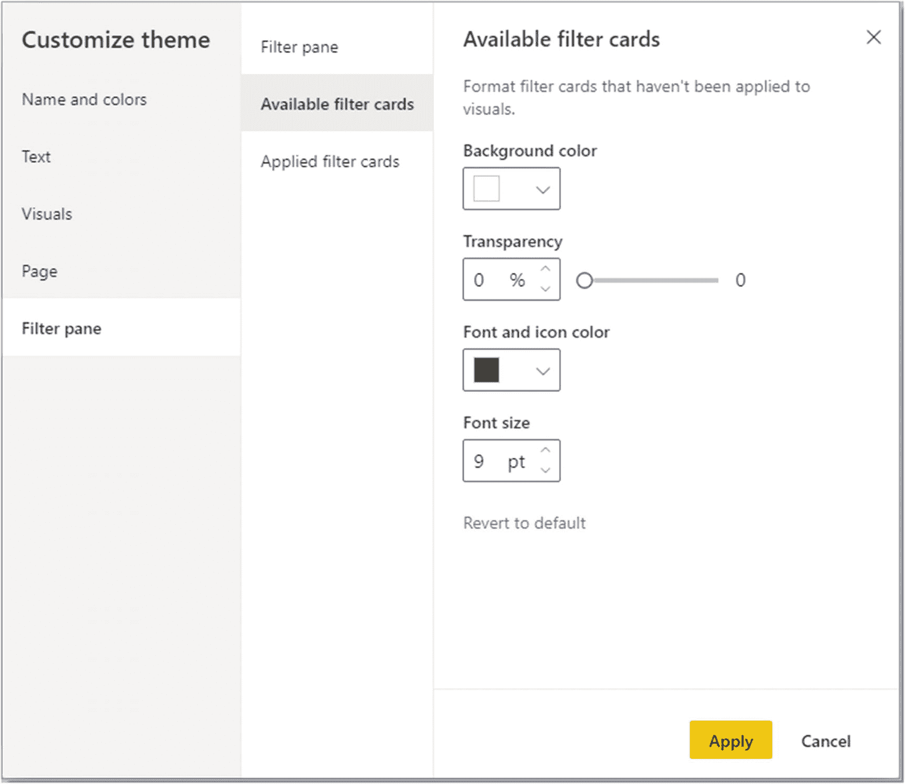
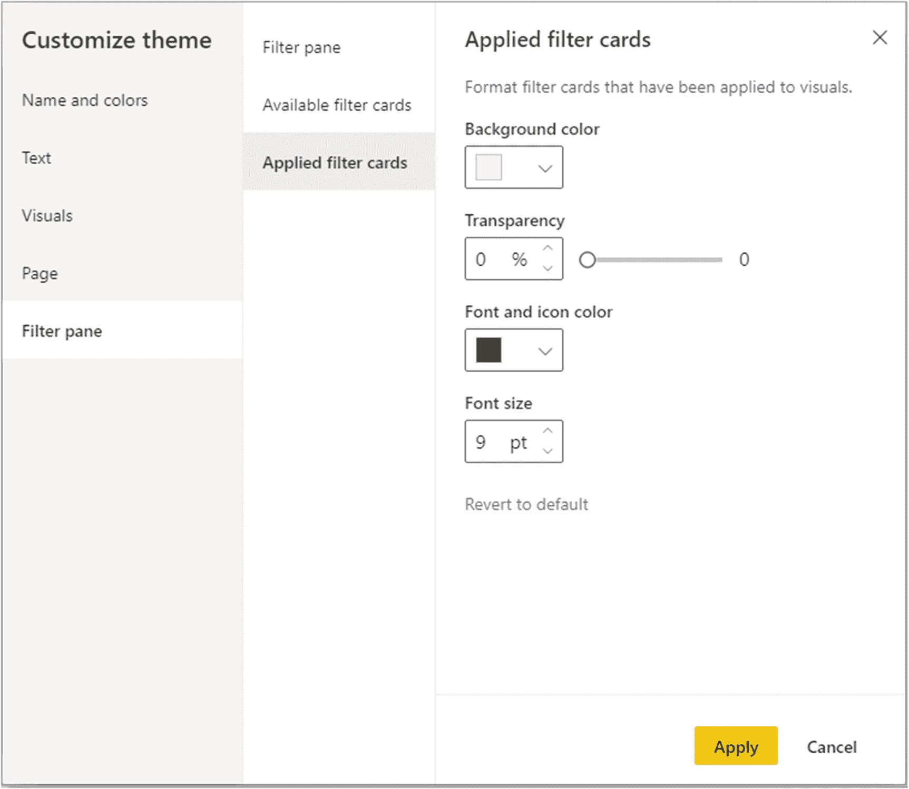

# 视觉设置

Power BI 中的所有视觉对象都包含一组核心元素，你可以全局定义其格式。这确保了你在仪表板中创建的所有内置视觉对象具有标准的外观和风格。你可以定义的元素包括：

- `Background`：视觉对象的背景色和透明度
- `Border`：视觉对象的边框属性
- `Header`：视觉对象标头（包括其可见性）
- `Tooltip`：弹出式工具提示元素的颜色

这些元素中的每一个都与你在 Power BI Desktop 的格式窗格中格式化视觉对象时习惯使用的标准卡片（也称为元素或部分）非常对应。它们显示了你可能调整过多次的相同属性，但呈现方式略有不同。

让我们通过查看 `Customize theme` 对话框的 `Visuals` 部分中的四个选项卡，详细了解这些设置的自定义方式。

`Customize theme/Visuals/Background` 选项卡如图 2-10 所示。此选项卡允许你设置所有视觉对象的背景色以及透明度级别。

图 2-10 `Customize theme/Visuals/Background` 选项卡

`Customize theme/Visuals/Border` 选项卡如图 2-11 所示。如你所料，此选项卡允许你指定是否需要边框，如果需要，应使用何种颜色。你还可以通过设置半径数值来定义圆角边框。

图 2-11 `Customize theme/Visuals/Border` 选项卡

`Customize theme/Visuals/Header` 选项卡（如图 2-12 所示）允许你设置所有视觉对象标头的基本属性。具体来说，你可以定义：

图 2-12 `Customize theme/Visuals/Header` 选项卡

- 标头背景色
- 标头边框颜色
- 标头透明度
- 标头中图标的颜色

`Customize theme/Visuals/Tooltip` 选项卡使你可以定义所有弹出式工具提示的背景、标签和数值字体颜色。如图 2-13 所示。

图 2-13 `Customize theme/Visuals/Tooltip` 选项卡

## 页面设置

在使用 Power BI Desktop 创建 JSON 主题文件时，有两个关于页面格式的设置你可以进行修改。它们是：

- 墙纸（页面本身以外的区域）
- 页面背景（任何视觉对象下方页面的颜色）

可以通过 `Customize theme/Page` 对话框访问这些设置。

`Customize theme/Page/Wallpaper` 选项卡如图 2-14 所示。

图 2-14 `Customize theme/Page/Wallpaper` 选项卡

如图 2-15 `Customize theme/Page/Page background` 选项卡所示，你还可以设置页面背景的颜色和透明度。

图 2-15 `Customize theme/Page/Page background` 选项卡

## 筛选器窗格设置

你可以定义的自定义主题的最后一个方面涉及筛选器窗格。相当合乎逻辑地，它分为三个区域：

- 筛选器窗格本身
- 可用的筛选器卡片
- 已应用的筛选器卡片

你可以使用的第一个窗格是 `Customize theme/Filter pane/Filter pane` 选项卡。它包含以下可定义的选项：

- 背景色
- 透明度
- 字体和图标颜色
- 标题字号
- 标头字号
- 复选框和应用颜色

你可以在图 2-16 中看到这一点。

图 2-16 `Customize theme/Filter pane/Filter pane` 选项卡

你可以使用的第二个窗格（如图 2-17 所示）是 `Customize theme/Filter pane/Available filter cards` 选项卡。它包含以下可定义选项（针对筛选器窗格内的筛选器卡片）：

图 2-17 `Customize theme/Filter pane/Available filter cards` 选项卡

- 背景色
- 透明度
- 字体和图标颜色
- 字号

此对话框中你可以使用的最后一个窗格是 `Customize theme/Filter pane/Applied filter cards` 选项卡。此选项卡设置筛选器窗格中任何活动筛选器的格式。此窗格（你可以在图 2-18 中看到）包含在设置筛选器时定义筛选器卡片的选项。它们是：

图 2-18 `Customize theme/Filter pane/Applied filter cards` 选项卡

- 背景色
- 透明度
- 字体和图标颜色
- 字号

> **注意**：设置完所有想要的选项后，请记得单击 `Apply` 按钮，然后选择 `View` ➤ `Themes` ➤ `Save current theme` 来保存包含你设置的 JSON 文件。

## 关于交互式主题文件创建的总体评价

现在你已经了解了如何使用 Power BI Desktop 创建主题文件，后退一步思考你所取得的成就是一个好主意。

- 你无需编写任何代码就定义了一个高级主题文件。
- 你完全以交互方式完成了此操作。

实际上，就这个过程而言，有一个重要的收获值得记住：

- 你使用 Power BI Desktop 创建的主题文件完整性较低——并且*粒度差得多*——远不如你自己编写的 JSON 文件。不过，你可以使用将在本书剩余章节中学到的技术来扩展此文件。

