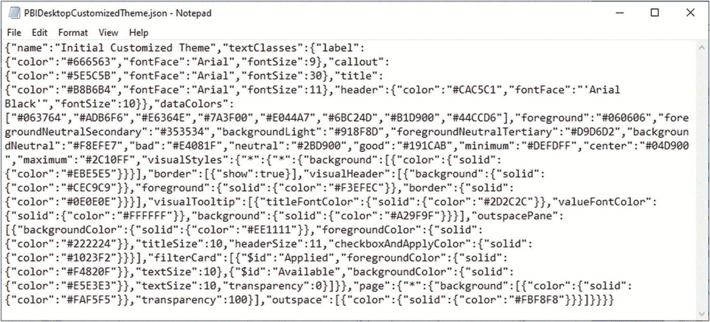

# 关于主题文件

你已经创建了一个 JSON 格式的自定义主题文件。但这具体是什么样的呢？嗯，示例文件`PBIDesktopCustomizedTheme.json`可供参考。你可以在图 2-19 中看到它的样子。



*图 2-19：由 Power BI Desktop 创建的 JSON 文件*

我相信你会同意，Power BI Desktop 生成的 JSON 非常难看且难以阅读。不过，有一些方法可以让 JSON 看起来更美观、更易读。

为了让生成的主题文件中的 JSON 更易于阅读，我建议你使用搜索引擎，搜索类似“JSON 美化”的内容。你会找到许多网站，只需点击几下，就能将这样的 JSON 转化为一个更美观的版本。

几秒钟后，生成的 JSON 看起来就会像下面代码片段中展示的那样：

```
{
"name": "初始自定义主题",
"textClasses": {
"label": { "color": "#666563", "fontFace": "Arial", "fontSize": 9 },
"callout": { "color": "#5E5C5B", "fontFace": "Arial", "fontSize": 30 },
"title": { "color": "#B8B6B4", "fontFace": "Arial", "fontSize": 11 },
"header": { "color": "#CAC5C1", "fontFace": "'Arial Black'", "fontSize": 10 }
},
"dataColors": ["#063764", "#ADB6F6", "#E6364E", "#7A3F00", "#E044A7", "#6BC24D", "#B1D900", "#44CCD6"],
"foreground": "#060606",
"foregroundNeutralSecondary": "#353534",
"backgroundLight": "#918F8D",
"foregroundNeutralTertiary": "#D9D6D2",
"backgroundNeutral": "#F8EFE7",
"bad": "#E4081F",
"neutral": "#2BD900",
"good": "#191CAB",
"minimum": "#DEFDFF",
"center": "#04D900",
"maximum": "#2C10FF",
"visualStyles": {
"*": {
"*": {
"background": [{ "color": { "solid": { "color": "#EBE5E5" } } }],
"border": [{ "show": true }],
"visualHeader": [{
"background": { "solid": { "color": "#CEC9C9" } },
"foreground": { "solid": { "color": "#F3EFEC" } },
"border": { "solid": { "color": "#0E0E0E" } }
}],
"visualTooltip": [{
"titleFontColor": { "solid": { "color": "#2D2C2C" } },
"valueFontColor": { "solid": { "color": "#FFFFFF" } },
"background": { "solid": { "color": "#A29F9F" } }
}],
"outspacePane": [{
"backgroundColor": { "solid": { "color": "#EE1111" } },
"foregroundColor": { "solid": { "color": "#222224" } },
"titleSize": 10,
"headerSize": 11,
"checkboxAndApplyColor": { "solid": { "color": "#1023F2" } }
}],
"filterCard": [
{ "$id": "已应用", "foregroundColor": { "solid": { "color": "#F4820F" } }, "textSize": 10 },
{ "$id": "可用", "backgroundColor": { "solid": { "color": "#E5E3E3" } }, "textSize": 10, "transparency": 0 }
]
}
},
"page": {
"*": {
"background": [{ "color": { "solid": { "color": "#FAF5F5" } }, "transparency": 100 }],
"outspace": [{ "color": { "solid": { "color": "#FBF8F8" } } }]
}
}
}
```

该文件作为示例文件`PBIDesktopCustomizedTheme_Prettified.json`提供。

我知道很多读者看到这样的代码时会感到眼花缭乱。不过，请相信我（并继续阅读），你很快不仅能理解这样的 JSON，还能自己创建它。在这个阶段，关键要点是，你所设置的各种元素（颜色、文本定义等）都存在于 JSON 文件中，连同实际的定义。究竟哪个 JSON 对应哪个格式化元素，则是本书剩余部分要讲述的内容。

你可能很想知道创建自定义主题的所有努力会带来什么结果。那么，图 2-20 展示了一个仪表板页面，其中已应用了主题文件`PBIDesktopCustomizedTheme.json`（如果你还记得第 1 章的内容，操作是依次选择`视图 ➤ 主题 ➤ 浏览主题`）。绝对没有应用其他特定的格式——也就是说，所有格式都源自 JSON 文件，并应用于所有已添加的视觉对象，以及底层页面和筛选器窗格。


*图 2-20：应用了自定义主题的 Power BI 仪表板*

当使用 Power BI Desktop 界面创建自己的 JSON 主题时，你需要注意以下几点：

- Power BI Desktop *仅*为你修改的任何元素创建 JSON。它不会创建一个定义所有可通过`自定义当前主题`对话框设置的元素的主题文件。也就是说，JSON 输出将不会包含你在各个对话框中*未*修改的任何设置。这使得主题文件更简单、更简洁。
- 现在，任何主题文件都可以应用于现有或空白的 Power BI Desktop 文件，只需依次选择`视图 ➤ 主题 ➤ 浏览主题`，然后导航到你之前保存的 JSON 文件即可。
- 如果某个元素*尚未*使用 Power BI Desktop 中的`格式`窗格进行格式化，主题文件才会应用格式。对于你想要移除之前应用的自定义格式的每个视觉对象中的每个卡片名称，你需要单击`恢复默认设置`。