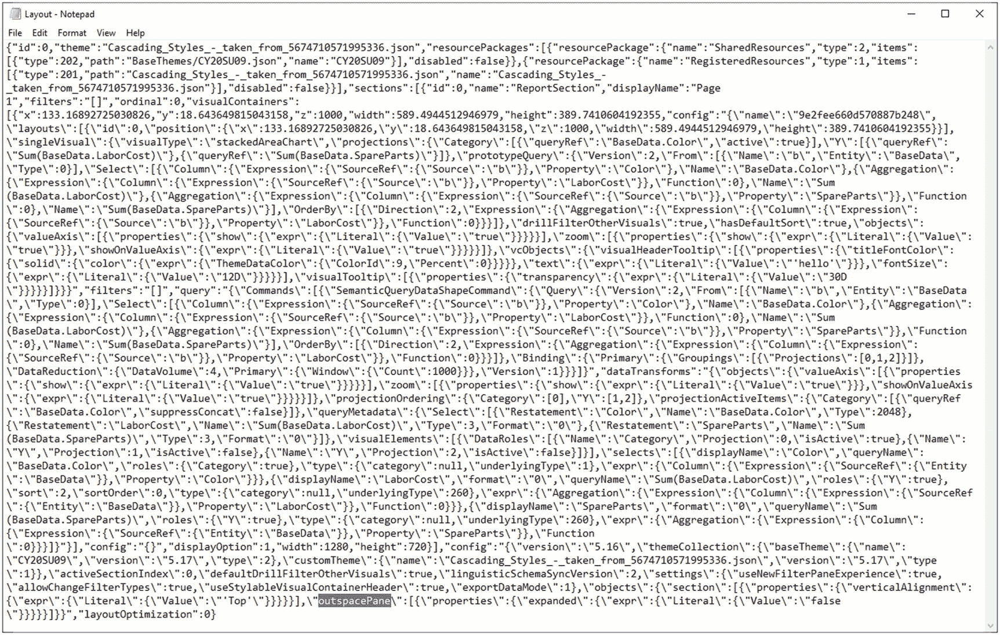

# 12. 仪表板样式

在本章中，你将结束对可以使用主题文件格式化的各种对象的探索。这将涉及查看最后两个可视化对象以及两个严格来说并非可视化对象的元素。这四个元素是：

- 操作按钮

- 切片器

- 页面

- 筛选器窗格

包含这些元素完整 `JSON` 代码的示例文件可以从 `Apress` 网站下载。

为了总结本章，我不仅想描述如何注释主题文件，还想描述如何实际发现 `Power BI` 用于 `JSON` 映射的关键字。这将使你能够跟上 `Power BI` 的变化和发展，并随着产品的演进和新的格式化功能的增加来更新你的 `JSON` 文件。

# 操作按钮

操作按钮的格式设置方式与主题文件中的其他视觉元素完全相同。

## 格式属性

指定操作按钮格式属性的关键字是 `actionButton`。

表 12-1 概述了可用于操作按钮格式设置的 JSON 关键字。

**表 12-1** 操作按钮关键字

| 关键字 | 格式设置区域 |
| --- | --- |
| `general` | 常规 |
| `text` | 按钮文本 |
| `icon` | 图标 |
| `outline` | 轮廓 |
| `fill` | 填充 |
| `title` | 标题 |
| `background` | 背景 |
| `lockAspect` | 锁定纵横比 |
| `border` | 边框 |
| `dropShadow` | 阴影 |
| `visualHeader` | 视觉标头 |

以下代码片段给出了操作按钮格式设置的 JSON 主题。它的长度惊人，因为多个元素可以根据按钮状态进行不同的格式设置。这实际上会倍增代码中的某些子部分。

```
"actionButton":
{"*":
{
"text": [{
"show": true},
{
"$id": "default",
"text": "Button Text",
"fontColor": {"solid": {"color": "#808080"}},
"padding": 3,
"verticalAlignment": "middle",
"horizontalAlignment": "center",
"fontSize": 10,
"fontFamily": "Arial"
},
{
"$id": "hover",
"text": "Hover button Text",
"fontColor": {"solid": {"color": "#808080"}},
"padding": 3,
"verticalAlignment": "middle",
"horizontalAlignment": "center",
"fontSize": 10,
"fontFamily": "Arial"
},
{
"$id": "selected",
"text": "Press button Text",
"fontColor": {"solid": {"color": "#808080"}},
"padding": 3,
"verticalAlignment": "middle",
"horizontalAlignment": "center",
"fontSize": 10,
"fontFamily": "Arial"
},
{
"$id": "disabled",
"text": "Disabled button Text",
"fontColor": {"solid": {"color": "#808080"}},
"padding": 3,
"verticalAlignment": "middle",
"horizontalAlignment": "center",
"fontSize": 10,
"fontFamily": "Arial"
}],
"icon": [{
"show": true
},
{
"$id": "default",
"shapeType": "help",
"padding": 3,
"verticalAlignment": "middle",
"horizontalAlignment": "center",
"lineColor": {"solid": {"color": "#F5F4F0"}},
"lineTransparency": 10,
"lineWeight": 2
},
{
"$id": "hover",
"shapeType": "help",
"padding": 3,
"verticalAlignment": "middle",
"horizontalAlignment": "center",
"lineColor": {"solid": {"color": "#F5F4F0"}},
"lineTransparency": 10,
"lineWeight": 2
},
{
"$id": "selected",
"shapeType": "help",
"padding": 3,
"verticalAlignment": "middle",
"horizontalAlignment": "center",
"lineColor": {"solid": {"color": "#F5F4F0"}},
"lineTransparency": 10,
"lineWeight": 2
},
{
"$id": "disabled",
"shapeType": "help",
"padding": 3,
"verticalAlignment": "middle",
"horizontalAlignment": "center",
"lineColor": {"solid": {"color": "#F5F4F0"}},
"lineTransparency": 10,
"lineWeight": 2
}],
"outline": [{
"show": true
},
{
"$id": "default",
"lineColor": {"solid": {"color": "#F5F4F0"}},
"transparency": 10,
"weight": 2,
"roundEdge": 3
},
{
"$id": "hover",
"lineColor": {"solid": {"color": "#F5F4F0"}},
"transparency": 5,
"weight": 2,
"roundEdge": 3
},
{
"$id": "selected",
"lineColor": {"solid": {"color": "#F5F4F0"}},
"transparency": 15,
"weight": 2,
"roundEdge": 3
},
{
"$id": "disabled",
"lineColor": {"solid": {"color": "#F5F4F0"}},
"transparency": 20,
"weight": 2,
"roundEdge": 3
}],
"fill":
[{
"show":true
},
{
"$id": "default",
"transparency": 0,
"fillColor": {"solid":{"color":"#949494"}}
},
{
"$id": "hover",
"transparency": 0,
"fillColor": {"solid":{"color":"#949494"}}
},
{
"$id": "selected",
"transparency": 0,
"fillColor": {"solid":{"color":"#111111"}}
},
{
"$id": "disabled",
"transparency": 0,
"fillColor": {"solid":{"color":"#111111"}}
}],
"title": [{...代码未显示...}],
"background": [{...代码未显示...}],
"lockAspect": [{...代码未显示...}],
"border": [{...代码未显示...}],
"dropShadow": [{...代码未显示...}],
"visualHeader": [{...代码未显示...}]
}
}
```

首先值得注意的是，您可以为 `icon`、`fill` 和 `text` 设置属性，以反映以下四种按钮状态的不同设置：

- 默认
- 悬停
- 按下
- 禁用

## 按钮状态

引入了一个新概念——按钮状态——这会影响主题文件 JSON 中的对象嵌套。实际上，在操作按钮的每个主要元素内部都应用了一层额外的嵌套。

每种状态都使用 JSON 中定义按钮状态的 `$id` 关键字来定义。对于 JSON 中指定了 `$id` 关键字的两个部分（`text` 和 `icon`），您需要使用表 12-2 中显示的值之一。这样做的结果是，JSON 中会有*四个*几乎相同的子部分来描述文本和图标的格式设置——每个按钮状态对应一个。

**表 12-2** 按钮状态选项

| 值 | 格式弹出选项 |
| --- | --- |
| `default` | 默认状态 |
| `hover` | 悬停时 |
| `selected` | 按下时 |
| `disabled` | 已禁用 |

描述按钮文本区域的 `text` 关键字使用表 12-3 中显示的关键字。

**表 12-3** 按钮文本区域的关键字映射

| 元素 | 关键字 |
| --- | --- |
| 按钮文本 | `show` |
| 按钮文本 | `text` |
| 字体颜色 | `fontColor` |

## 切片器格式设置

正如你所料，切片器的格式也可以在主题文件中进行设置。指定切片器格式属性的关键字是 `slicer`。

表 12-9 概述了可在切片器格式设置中使用的 JSON 关键字。

**表 12-9 切片器关键字**

| 关键字 | 格式设置部分 |
| --- | --- |
| `general` | 常规 |
| `slicerHeader` | 切片器标头 |
| `numericInputStyle` | 数字输入 |
| `slider` | 滑块 |
| `selection` | 选择控件 |
| `header` | 标头 |
| `date` | 日期 |
| `items` | 项 |
| `title` | 标题 |
| `background` | 背景 |
| `lockAspect` | 锁定纵横比 |
| `border` | 边框 |
| `dropShadow` | 阴影 |
| `visualHeader` | 视觉对象标头 |

需要记住的是，在 Power BI Desktop 中，并非所有切片器部分的定义元素都会同时可见，这取决于你定义的切片器类型。不过，你仍然可以使用相应的关键字在主题文件中指定所有可用的选项。

以下代码片段展示了用于格式化切片器的 JSON：

```json
"slicer":
{"*":
{
"general":  [{
"outlineColor": {"solid": {"color": "#909090"}},
"outlineWeight": 1,
"orientation": "Horizontal",
"responsive": false
}],
"selection": [{
"show": true,
"singleSelect": true,
"strictSingleSelect": false,
"selectAllCheckboxEnabled": false
}],
"header":   [{
"show": false,
"text": "Slicer Text",
"fontColor": {"solid": {"color": "#ffffff"}},
"background": {"solid": {"color": "#7A8C97"}},
"outline": "None",
"textSize": 9,
"fontFamily": "Arial"
}],
"numericInputStyle":[{
"fontColor": {"solid": {"color": "#ffffff"}},
"backgroundColor": {"solid": {"color": "#B7B7B7"}},
"fontSize": 9,
"fontFamily": "Arial"
}],
"slider":   [{
"color": {"solid": { "color": "#F5F4F0"} }
}],
"items":    [{
"fontColor": {"solid": {"color": "#F5F4F0"}},
"backgroundColor": {"solid": {"color": "#B7B7B7"}},
"outline": "None",
"textSize": 8,
"fontFamily": "Arial"
}],
"title": [{... code not shown ...}],
"background": [{... code not shown ...}],
"lockAspect": [{... code not shown ...}],
"border": [{... code not shown ...}],
"dropShadow": [{... code not shown ...}],
"visualHeader": [{... code not shown ...}]
}
}
```

### `general` 关键字

描述选择控件部分的 `general` 关键字使用了表 12-10 中所示的关键字。

**表 12-10 常规部分的关键字映射**

| 元素 | 关键字 |
| --- | --- |
| 轮廓线颜色 | `outlineColor` |
| 轮廓线粗细 | `outlineWeight` |
| 方向 | `orientation` |
| 响应式 | `responsive` |

### `selection` 关键字

描述选择控件部分的 `selection` 关键字使用了表 12-11 中所示的关键字。

**表 12-11 选择控件部分的关键字映射**

| 元素 | 关键字 |
| --- | --- |
| 选择控件 | `show` |
| 单选 | `singleSelect` |
| 按住 CTRL 键多选 | `strictSingleSelect` |
| 显示“全选”选项 | `selectAllCheckboxEnabled` |

### `header` 关键字

描述标头部分的 `header` 关键字使用了表 12-12 中所示的关键字。

**表 12-12 切片器标头部分的关键字映射**

| 元素 | 关键字 |
| --- | --- |
| 切片器标头 | `show` |
| 标题文本 | `text` |
| 字体颜色 | `fontColor` |
| 背景 | `background` |
| 轮廓线 | `outline` |
| 文本大小 | `textSize` |
| 字体系列 | `fontFamily` |

### `numericInputStyle` 关键字

描述数字输入部分的 `numericInputStyle` 关键字使用了表 12-13 中所示的关键字。

**表 12-13 数字输入部分的关键字映射**

| 元素 | 关键字 |
| --- | --- |
| 字体颜色 | `fontColor` |
| 背景 | `backgroundColor` |
| 文本大小 | `textSize` |
| 字体系列 | `fontFamily` |

### `slider` 关键字

描述滑块部分的 `slider` 关键字使用了表 12-14 中所示的关键字。

**表 12-14 滑块部分的元素关键字映射**

| 元素 | 关键字 |
| --- | --- |
| 滑块 | `show` |
| 颜色 | `color` |

### `items` 关键字

描述项部分的 `items` 关键字使用了表 12-15 中所示的关键字。

**表 12-15 项部分的关键字映射**

| 元素 | 关键字 |
| --- | --- |
| 字体颜色 | `fontColor` |
| 背景 | `backgroundColor` |
| 大纲 | `outline` |
| 文本大小 | `textSize` |
| 字体系列 | `fontFamily` |


| 背景 | `backgroundColor` |

| 轮廓线 | `outline` |

| 文本大小 | `textSize` |

| 字体系列 | `fontFamily` |

你可以在示例文件`Attributes_Slicer.json`中找到相应的JSON代码。

标头和项的轮廓线选项见表 6-10。

方向选项见表 7-15。


# 筛选窗格

令人惊讶的是——毕竟它并非可视化对象——但你也可以像在 Power BI Desktop 中交互式设置格式一样，在主题文件中设置筛选窗格的格式。

没有单个关键词用于引入筛选窗格的格式属性。这是因为筛选窗格的格式是在`通用格式`级别设置的。你首次在第 4 章中遇到了这个概念。实际上，如果需要快速回顾通用格式的概念，建议参考第 4 章。

筛选窗格的格式在此级别使用两个关键词定义。它们是：

* `outspacePane`

* `filterCard`

表 12-16 概述了可在筛选窗格格式中使用的 JSON 关键词。

**表 12-16** 切片器关键词

| 关键词 | 格式部分 |
| --- | --- |
| `outspacePane` | 筛选窗格 |
| `filterCard` | 筛选卡片 |

```json
"visualStyles":
{"*":
{"*":
{
"outspacePane": [{
"backgroundColor": {"solid": {"color": "#999999"}},
"transparency": 30,
"foregroundColor": {"solid": {"color": "#374649"}},
"titleSize": 18,
"headerSize": 12,
"fontFamily": "Arial",
"border": true,
"borderColor": {"solid": {"color": "#909090"}},
"width": 190,
"checkboxAndApplyColor": {"solid": {"color": "#374649"}},
"searchTextSize": 11,
"inputBoxColor": {"solid": {"color": "#ffffff"}}
}],
"filterCard": [{
"$id": "Applied",
"backgroundColor": {"solid": {"color": "#171796"}},
"transparency": 0,
"border": true,
"borderColor": {"solid": {"color": "#909090"}},
"foregroundColor": {"solid": {"color": "#ffffff"}},
"textSize": 10,
"fontFamily": "Arial",
"inputBoxColor": {"solid": {"color": "#C8C8C8"}}
},
{
"$id": "Available",
"backgroundColor": {"solid": {"color": "#171796"}},
"transparency": 40,
"border": true,
"borderColor": {"solid": {"color": "#909090"}},
"foregroundColor": {"solid": {"color": "#ffffff"}},
"textSize": 9,
"fontFamily": "Arial",
"inputBoxColor": {"solid": {"color": "#777777"}}
}]
}
}
}
}
```

## `outspacePane` 关键词

描述筛选窗格部分的 `outspacePane` 关键词使用了表 12-17 中所示的关键词。

**表 12-17** 筛选窗格部分的关键词映射

| 元素 | 关键词 |
| --- | --- |
| 背景颜色 | `backgroundColor` |
| 透明度 | `transparency` |
| 字体和图标颜色 | `foregroundColor` |
| 标题文本字号 | `titleSize` |
| 表头文本字号 | `headerSize` |
| 字体系列 | `fontFamily` |
| 边框 | `border` |
| 边框颜色 | `borderColor` |
| 宽度 | `width` |
| 复选框和应用颜色 | `checkboxAndApplyColor` |
| 搜索文本字号 | `searchTextSize` |
| 输入框颜色 | `inputBoxColor` |

## `filterCard` 关键词

在查看这些元素和关键词之前，值得注意的是，有两种类型的筛选卡片：

* 已应用

* 未应用

它们分别代表已应用或未应用筛选器的卡片。

这两种筛选卡片状态通过 `$id` 关键词引入。这意味着为每种筛选器状态（正如你在本章前面看到的操作按钮状态那样）重复了 JSON 代码。

在定义筛选卡片类型的 JSON 中，`$id` 关键词使用了表 12-18 中所示的关键词。

**表 12-18** 按钮状态选项

| 值 | 格式弹出选项 |
| --- | --- |
| `Applied` | 已应用 |
| `Available` | 可用 |

描述筛选卡片部分的 `filterCard` 关键词使用了表 12-19 中所示的关键词。

**表 12-19** 筛选卡片部分的关键词映射

| 元素 | 关键词 |
| --- | --- |
| 背景颜色 | `backgroundColor` |
| 透明度 | `transparency` |
| 边框 | `border` |
| 边框颜色 | `borderColor` |
| 字体和图标颜色 | `foregroundColor` |
| 文本字号 | `textSize` |
| 字体系列 | `fontFamily` |
| 输入框颜色 | `inputBoxColor` |

你可以在示例文件 `Attributes_FilterCard.json` 中找到此 JSON 代码。

# 页面格式

页面背景也可以使用主题文件进行格式设置。与格式窗格类似，这（就主题文件而言）被视为`通用`格式元素而非特定格式元素，因此作为文件中通用视觉样式的一部分出现。

表 12-20 概述了可用于页面格式的 JSON 关键词，以及 Power BI Desktop 格式窗格中与每个关键词对应的部分。

**表 12-20** 页面格式关键词

| 关键词 | 格式部分 |
| --- | --- |
| `background` | 页面背景 |
| `displayArea` | 页面对齐 |
| `outspace` | 壁纸 |

页面格式的代码可在示例文件 `Attributes_Page.json` 中找到。你可以在以下代码片段中看到完整代码（用于说明页面格式在文件结构中的位置）：

```json
{
  "name": "Page formatting",
  "dataColors": ["#12239E", "#118DFF", "#00FF29", "#6B007B", "#FFB000", "#F5F4F0", "#FFFF00", "#FF001E"],
  "visualStyles":
  {
    "*":
    {"*":
      {
        "page":
        {"*":
          {
            "background":
            [{
              "color": {"solid": {"color": "#F5F4F0"}},
              "transparency": 0
            }],
            "displayArea":
            [{
              "verticalAlignment": "Middle"
            }],
            "outspace":
            [{
              "color": {"solid": {"color": "#F5F4F0"}},
              "transparency": 20
            }]
          }
        }
      }
    }
  }
}
```

描述页面背景部分的 `background` 关键词使用了表 12-21 中所示的关键词。

**表 12-21** 页面背景的关键词映射

| 元素 | 关键词 |
| --- | --- |
| 颜色 | `color` |
| 透明度 | `transparency` |

描述页面对齐部分的 `displayArea` 关键词使用了表 12-22 中所示的关键词。

**表 12-22** 页面对齐的关键词映射

| 元素 | 关键词 |
| --- | --- |
| 垂直对齐 | `verticalAlignment` |

描述壁纸部分的 `outspace` 关键词使用了表 12-23 中所示的关键词。

**表 12-23** 壁纸的关键词映射

| 元素 | 关键词 |
| --- | --- |
| 颜色 | `color` |
| 透明度 | `transparency` |

在用于设置页面对齐的 JSON 中，`verticalAlignment` 关键词需要表 12-24 中所示的其中一个属性。

**表 12-24** 图例位置选项

| 值 | 格式弹出选项 |
| --- | --- |
| `Top` | 顶部 |
| `Middle` | 居中 |

## 向主题文件添加注释

不幸的是，主题文件中使用的 JSON 并不像大多数编程语言那样支持添加注释。因此，你不能像在某些编程语言中那样，使用 `//` 或 `/* … */` 或 `- -` 在 JSON 代码中或代码后引入注释。

虽然这无疑是一种限制，但有一种变通方法可能会对你有用。那就是创建你自己的关键字，并用它们来引入注释，为文件添加注解。你可以在下面的代码片段中看到一个示例，其中在主题文件的可视化样式格式化部分顶部添加了几条注释：

```json
"visualStyles":
{
  "myNotesForOneSubject" : "Currently you can add notes like this",
  "Notes" : "It apparently has to be here in the structure",
```

另一个技巧是在特定可视化对象的格式设置开头添加注释，如下所示：

```json
"textbox":
{"*" :
  {
    "myTextboxNotes" : "Currently you can add notes like this",
    "title":    [{ ... CODE OMITTED ... }]
  }
}
```

你需要知道，这种方法是不受官方支持的，虽然目前它有效，但将来可能会失效。此外，我建议你创造一些极不可能被 Power BI 未来版本使用到的关键字。这样，就能最大程度地降低因产品演变而引发故障的风险。

当你创建多个主题文件时，另一个有用的想法是利用 `name` 字段为主题文件添加标题信息。你可以在下面的代码片段中看到示例：

```json
"name": "Generic Base Formatting add lots of comments to explain why this is used, when it was created etc"
```

但是，你无法在注释内部添加换行符或回车符。而且，我也建议避免使用单引号或双引号。尽管如此，如果你的主题文件集合开始增多，在主题文件顶部添加注释会特别有用，因为与通过阅读 JSON 来尝试回忆某个主题的具体细节相比，它能让你更容易地追踪这些文件。

## 分析 Power BI Desktop 文件的内容

随着 Power BI 的发展，新功能将不可避免地增加，这也意味着会有新的格式设置可能性。因此，你可能需要发现新的关键字和/或它们的属性。

具体操作步骤如下：

1.  创建一个 Power BI Desktop 文件，其中包含你想要扩展其 JSON 格式设置的可视化对象。
2.  手动设置新增属性的格式（这意味着它们会出现在 Power BI Desktop 文件中 – 默认格式不会出现）。
3.  保存 Power BI Desktop 文件。
4.  将 Power BI Desktop 文件解压到一个文件夹中。
5.  打开你解压 Power BI Desktop 文件的文件夹。
6.  打开名为 `Report` 的文件夹。
7.  使用文本编辑器打开名为 `Layout` 的文件。

你会看到一段——很大程度上难以理解的——文本，它实际上包含了你在第 2 步中设置了格式的元素对应的 JSON 格式设置。现在的技巧是找到你设置过格式的内容，从而找到 Power BI 用于主题文件的关键字。需要提醒你的是，这可能需要练习和耐心！

你可以在图 12-1 中看到报告内容的示例。请注意，`outspacePane` 关键字已被高亮显示，这样你就能看到它的属性在底层 Power BI Desktop 文件中的呈现方式。



**图 12-1**

一个 `.PBIX` 文件的部分内容

## 结论

至此，你已概览了可以在 Power BI 中使用 JSON 主题文件进行格式设置的各种对象。在本章中，你学习了如何使用与前几章相同的方法来设置操作按钮、切片器、页面本身和筛选器窗格的格式。

我现在只剩下最后一个流程要解释——如何在主题文件中创建级联样式。你将在下一章（即最后一章）中学习到这一点。

