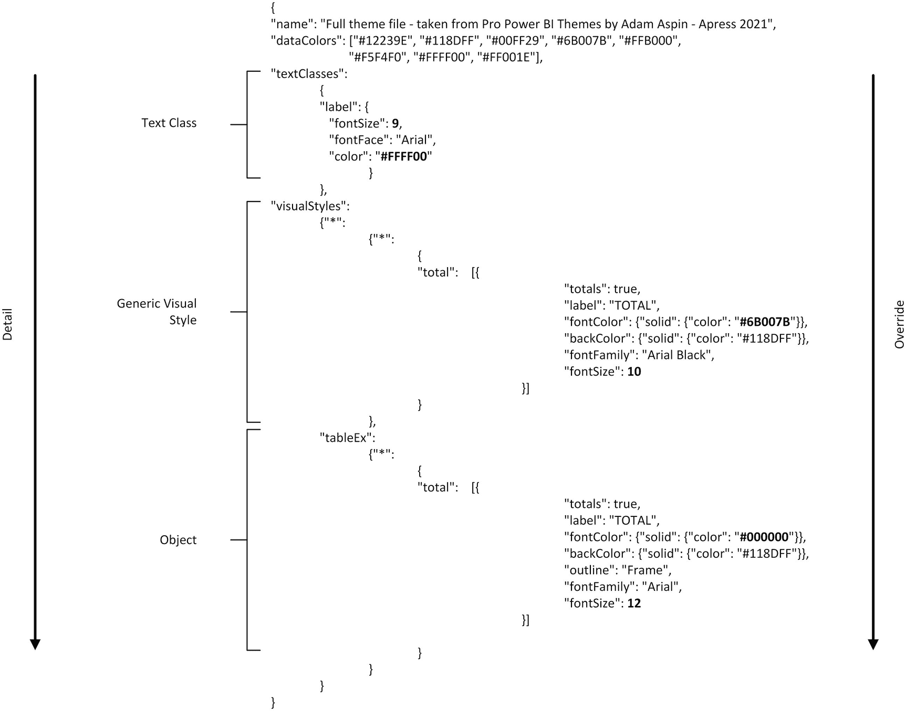
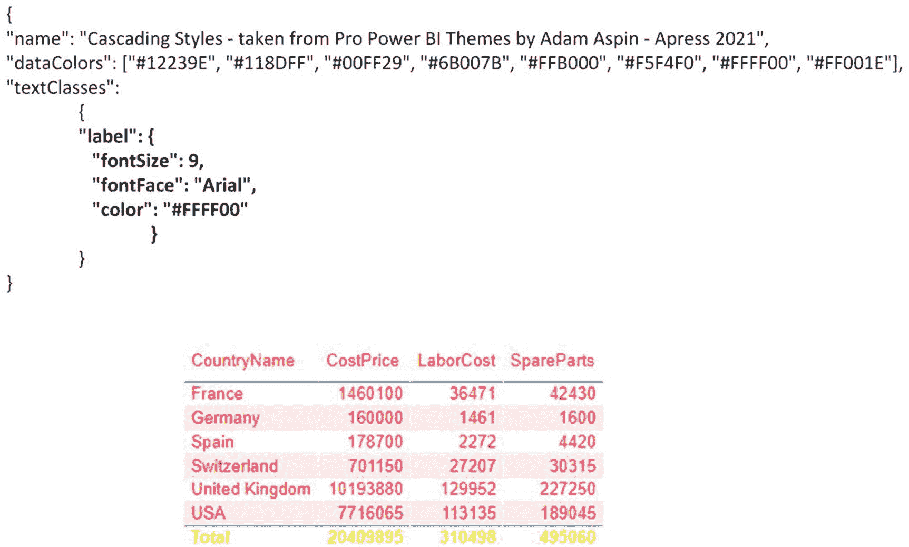
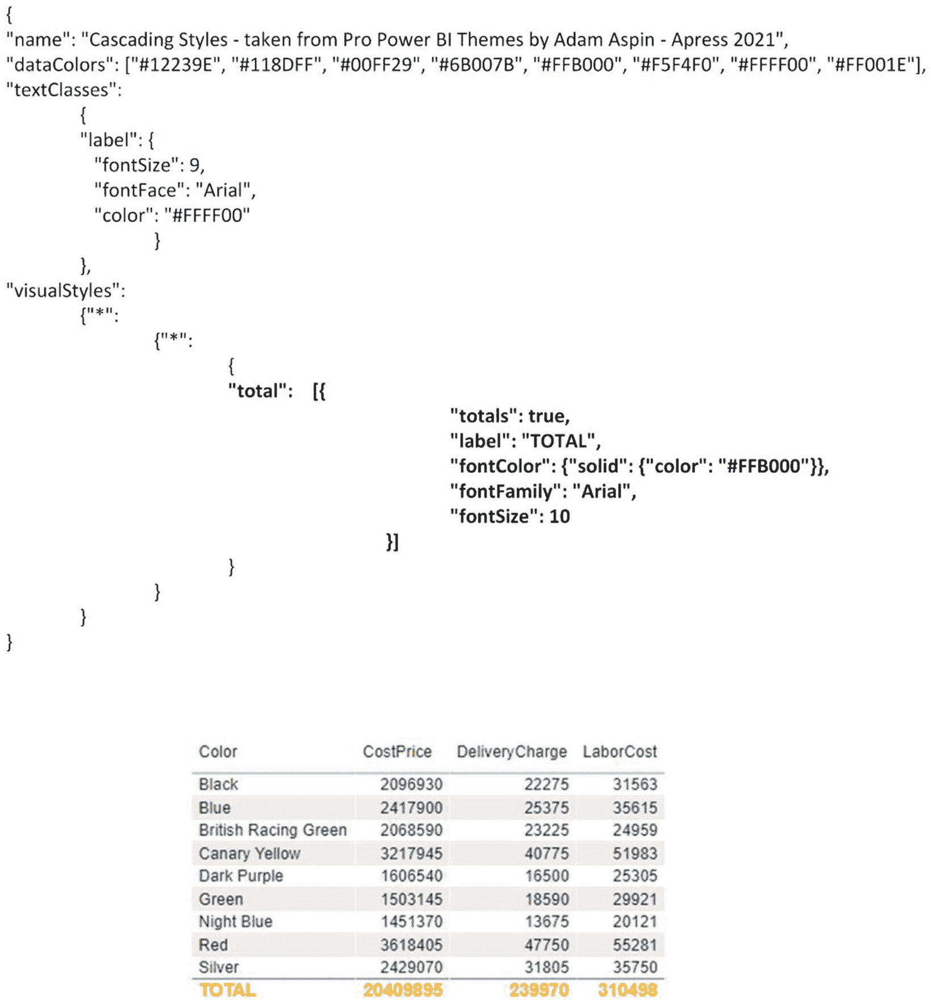
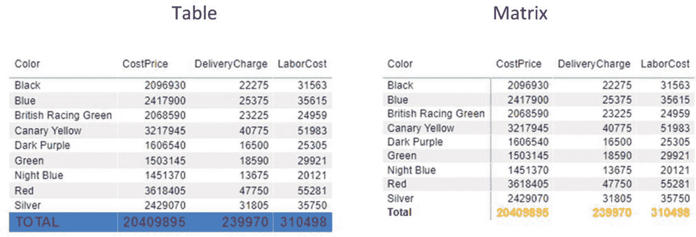
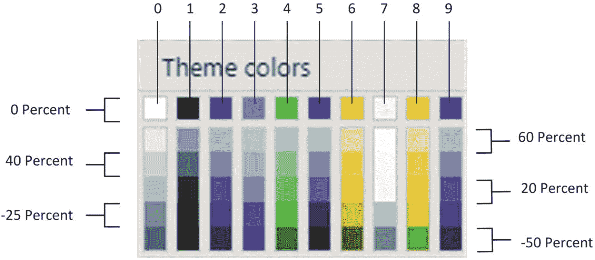

# 13. 级联样式

在本书中，你已经看到可以在多个层级使用 JSON 样式来定义可视化外观。学习曲线的最后一部分是理解样式如何从高级定义向下级联到逐渐精细的规格。理解这一点将让你在创建主题文件时节省时间，因为你实际上能够一次定义多个呈现属性——而不必为每个可视化对象定义所有细微之处。

这些“级联样式”通过两种不同的方式实现：

- 文本定义从通用样式定义向下级联到特定的可视化格式定义。
- 颜色从调色板设置向下级联，可用于主题文件中任何可以应用颜色的地方。

# 样式层级

首先要记住的是，你可以在四个可能的层级上定义呈现元素。这四个层级分别是：

- 元素级别
- 文本类
- 通用视觉样式
- 特定视觉样式

这种方法存在严格的层级关系。也就是说，在元素级别设定的任何规范将一直有效，直到被文本类覆盖。文本类可以通过定义通用视觉样式的设置来进一步细化，而通用视觉样式又可以被重新定义为特定视觉样式的一部分。

这种级联样式方法之所以可行，是因为样式层级从广泛范围逐步过渡到高度限制性。如果你还记得第 2 章的内容，定义一级元素会涵盖一系列视觉属性。在第 3 章中，你看到文本类更加聚焦——这种趋势一直延续到对某个特定视觉的某一方面的详细定义。

然而，你需要知道层级关系并不总是完整的。我的意思是，并非所有内容都能在元素级别进行设置（许多视觉格式化的方面并未被元素选项所涵盖）。同样，文本类也不能涵盖格式化的所有方面——并且这两个层级之间存在一些重叠。

与创建主题文件的所有方面一样，通过一个示例来理解是最好的方式。

例如，以你可以在表格中格式化的合计为例。这些合计可以在前面提到的四个层级中的三个层级（全部或部分）进行定义。表 13-1 对此进行了说明。

**表 13-1** 列标题格式化

| 层级                | 定义              |
|----------------------|-------------------|
| 文本类               | `Label`             |
| 通用视觉样式         | `Total`             |
| 特定视觉样式         | `tableEx`           |

`textClasses` 部分允许你指定一个 `label` 元素。这涵盖了（除其他外）表格和矩阵中的合计。如果你在此处指定了字号和颜色，它将设置（除其他外）表格和矩阵中使用的合计的颜色。

然后，你可以选择在主题文件的通用定义层级设置一些更具体的元素（例如字体颜色和大小）。这是通过使用 `total` 关键字和相关元素完成的。这将在视觉对象中使用此关键字的地方设置合计，这意味着在表格和矩阵视觉对象中，并将覆盖使用文本类设置的任何内容（在此示例中，包括字号和颜色）。但是，它不会覆盖使用 `label` 文本类设置的任何其他元素。

最后，你可以设置仅适用于表格视觉对象的格式化。你在第 6 章中已经看到过这一点。此处的任何具体设置都将覆盖合计的通用格式化——但仅在表格中，而非矩阵中。

图 13-1 更直观地展示了这一点。



**图 13-1** 样式层级

你可以在图 13-1 中看到颜色被设置了三次：

- `FFFF00`（黄色）在文本类层级
- `F5F4F0`（橙色）在表格和矩阵合计的通用层级
- `6B007B`（紫色）用于表格合计

你还会注意到字号也被设置了三次：

- 9 磅在文本类层级
- 10 磅在表格和矩阵合计的通用层级
- 12 磅（黑色）用于表格合计

表格和矩阵的合计由 `label` 文本类设置。这还设置了表格和矩阵中合计的字体和大小，以及其他元素（完整列表也可在第 2 章中找到）。

然后，表格和矩阵的合计被*覆盖*——并且它们呈现的其他方面也被定义——作为通用样式定义的一部分（请记住，这是嵌套在星号对象内部，而不是特定的视觉对象内部）。

最后，表格（而非矩阵）的合计按照你在第 6 章中看到的解释进行定义。这发生在最深、最详细的层级。

你可能会问，这在实际中意味着什么。那么，让我们来看看通过逐步应用更详细的格式化所产生的效果，你可以在 JSON 主题文件 `CascadingText.json` 中看到这些效果。

首先，这是一个仅应用文本类（本例中为 `label`）的 JSON。该类设置了表格和矩阵中合计的格式化，如图 13-2 所示，其中合计为黄色，9 磅。



**图 13-2** 应用文本类

在图 13-3 中，通过为 `total` 添加一个通用样式，对该 JSON 进行了扩充。这具有覆盖文本类所设置字体属性的效果。你可以在图 13-4 中看到这一点，其中合计为橙色，10 磅。



**图 13-3** 应用通用样式

然而，值得注意的是，文本类设置的任何其他属性不受通用样式定义的影响。

最后，我们可以应用之前在图 13-1 中显示的完整 JSON。这覆盖了合计的格式化——但仅适用于*表格*，*而不适用于矩阵*。你可以在图 13-4 中看到这一点，其中合计为紫色，12 磅，仅限表格。



**图 13-4** 应用特定样式

定义一个在多个层级混合格式化的结构化主题文件可能需要投入大量的时间和精力。然而，前期的投入无疑会使主题更新更加容易和快捷得多。这是因为你通常可以通过在通用格式化层级进行单一更改，就能重置多个视觉对象的一大堆属性——同时保留某些视觉对象的高度特定格式化。这还可以确保你的仪表板具有高度的呈现一致性。

如果你决定采用这种创建主题文件的方法，我有一些建议，你可能在实践中会觉得有用：

- 专注于主题定义的通用层级——甚至可以完全忽略文本类。这种方法允许你以清晰、易于理解和审查的方式定义标准化属性。
- 除非你特意为某个特定视觉对象在较低层级添加覆盖，否则只在一个层级应用属性。换句话说，避免重复。
- 只应用你真正需要在全局上定义的元素到通用层级。没有必要设置所有能设置的内容，然后在特定视觉对象层级覆盖大部分。
- 在定义通用格式化时，通常没有必要为一个元素设置每一个属性。同样，只应用你需要在全局上设置的属性即可。

# 整合所有元素

主题创建本质上是一个实践性问题。因此，通过几个具体的主题文件示例，能帮助你更好地理解“标准”主题文件（其中所有内容都是单独定义的）与级联主题文件之间的区别。

如果你查看可下载的 JSON 文件，会找到：

- `FullTheme.json`：此文件包含所有视觉元素的完整格式定义。只有页面和筛选器窗格定义是在通用级别设置的。
- `CascadingTheme.json`：这是一个示例，展示了如何先定义一系列通用元素，然后再为某些视觉元素定义高度具体的自定义格式。
- `FullThemeWithClasses.json`：此文件包含所有视觉元素的完整格式定义。只有页面和筛选器窗格定义是在通用级别设置的。此外，文件中还添加了颜色和文本类。

我在此不会展示所有三个文件的 JSON 内容，因为它们合起来有几千行 JSON 代码。不过，我建议你查看一下，以便理解不同的方法。它们也很可能对你来说是一个很好的基础，可以用来改编你自己的主题文件。

# 应用级联调色板颜色

到目前为止，在本书中，每当应用颜色时，你看到的都是“硬编码”的十六进制值。虽然这绝对是设置颜色的最简单方法，但这样做可能会使更改整个主题文件中的颜色变得非常费力。如果你已经创建了一组定义了所有可能对象的完整 JSON，尤其如此。实际上，这种方法可能会导致你花费数小时进行复制/替换工作来重置颜色。之后，通常还需要花费数小时来测试应用了主题后的数十种视觉类型。

幸运的是，颜色也可以在主题文件中进行级联。这使得在实践中修改颜色设置变得更加容易。

设置级联颜色设置的工作原理如下：

- **首先**，按照常规方式，通过定义八个可变颜色来设置调色板。这意味着你可以从 60 种颜色中进行选择（调色板中的十列乘以六行）。你不仅拥有一系列可用的颜色，而且它们还是基于十种核心颜色的变体——这意味着颜色选择通常更加和谐。

- **其次**，在引用这些颜色时，**不要使用它们的十六进制引用**，而是使用**它们在调色板中的位置**。

第二部分是新的，其工作原理如下。

通常，你可能会像这样使用颜色引用：

```
{"solid": {"color": "#999999"}}
```

为了确保颜色引用能够级联，你应该使用如下所示的 JSON：

```
{"solid": {"color": {"expr":{"ThemeDataColor":{"ColorId": 9, "Percent": -0.5}}}}}
```

由于这段 JSON 乍看起来有些难以理解，让我们来看看它的结构。

只有十六进制引用部分发生了变化——它变成了：

```
{"expr":{"ThemeDataColor":{"ColorId": 9, "Percent": -0.5}}}
```

这里使用的三个关键词在表 13-2 中进行了解释。

**表 13-2** 调色板颜色级联引用

| 关键词 | 定义 |
| --- | --- |
| `ThemeDataColor` | 指示将使用调色板 |
| `ColorId` | 定义要使用的调色板列 |
| `Percent` | 对所选颜色应用百分比强度 |

嵌套结构如下所示：

```
{"solid":
{"color":
{"expr":
{"ThemeDataColor":
{"ColorId": 5, "Percent": -0.25}
}
}
}
}
```

需要稍加解释的两个主要内容是：

- `ColorId`

- `Percent`

`ColorId` 是一个数值，代表调色板中的列。它是从零开始计数的，并且从左到右应用。这意味着所有 10 列颜色的编号为 0 到 9。

因此，有趣的是，JSON 关键词 `ThemeDataColor` 0 对应调色板中的第一列（定义为白色），`ThemeDataColor` 1 对应调色板中的第二列（定义为黑色），`ThemeDataColor` 2 对应调色板中的第三列（令人困惑的是，调色板弹出窗口将其描述为主题颜色 1），依此类推。这是一个你需要慢慢习惯的事情。

同样，在调色板中，每种调色板颜色的*深浅*定义为（从上到下）：

- 亮 60%

- 亮 40%

- 亮 20%

- 暗 25%

- 暗 50%

这些由 JSON 关键词 `Percent` 的数值表示。然而（同样有点令人困惑的是），调色板中较浅的色调设置为正数，而较深的色调设置为负数。

此映射关系如图 13-5 所示。



**图 13-5** 调色板与主题数据颜色的对应关系

要从调色板的某一行中选择颜色，你需要设置一个与所需深浅对应的百分比数值。如你所见，较浅的色调设置为正值，较深的色调设置为负值。

作为示例，要应用调色板中倒数第二列的第二行，百分比数值将为`0.6`，如下代码片段所示：

```
{"solid": {"color": {"expr":{"ThemeDataColor":{"ColorId": 8, "Percent": 0.6}}}}}
```

要应用第七列（即你能设置的第五列）的底行，百分比数值将为 `-0.5`，如下代码片段所示：

```
{"solid": {"color": {"expr":{"ThemeDataColor":{"ColorId": 6, "Percent": -0.5}}}}}
```

需要强调的是，较浅的色调为正数，较深的色调为负数。

如果你想要应用调色板顶行显示的基本颜色，则只需将百分比数值设为 `0`，如下所示：

```
{"solid": {"color": {"expr":{"ThemeDataColor":{"ColorId": 6, "Percent": 0}}}}}
```

基于调色板的颜色可以在以下几个可能的关键词之后应用：

- `Color`

- `Background`

- `Title font color`

- `Background font color`

- `Value font color`

- 实际上，在 JSON 主题文件中设置颜色的任何地方都可以

然而，级联颜色引用 *不能* 应用于简单的颜色定义，例如文本类和基本颜色（`firstLevelElements` 等）。

有趣的是，在实际的 JSON 中，你可以定义初始主题颜色的 *任意百分比变体*，而不必局限于调色板使用的百分比。因此，例如，你可以像这样定义主题颜色的变体：

```
{"solid": {"color": {"expr":{"ThemeDataColor":{"ColorId": 5, "Percent": -0.37}}}}}
```

这为你基于原始调色板提供了广泛的潜在色调范围。

作为级联颜色的示例，请查看以下 JSON 代码。该代码可以在文件 `CascadingColors.json` 中找到。

```
{
"name": "Cascading Colors",
"dataColors": ["#12239E", "#118DFF", "#00FF29", "#6B007B", "#FFB000", "#F5F4F0", "#FFFF00", "#FF001E"],
"visualStyles":
{"*":
{"*":
{
"total":
[{
"totals": true,
"label": "TOTAL",
"fontColor": {"solid": {"color": {"expr":{"ThemeDataColor":{"ColorId": 9, "Percent": -0.5}}}}},
"fontFamily": "Arial",
"fontSize": 10
}]
}
},
"tableEx":
{"*":
{
"total":
[{
"totals": true,
"label": "TOTAL",
"fontColor": {"solid": {"color": {"expr":{"ThemeDataColor":{"ColorId": 8, "Percent": 0.6}}}}},
"backColor": {"solid": {"color": {"expr":{"ThemeDataColor":{"ColorId": 9, "Percent": 0.35}}}}},
"outline": "Frame",
"fontFamily": "Arial",
"fontSize": 12
}]
}
}
}
}
```

在这个 JSON 中：

- 通用总计字体颜色的字体颜色设置为比调色板最后一列（最右侧）深 50%。这对应于调色板的底行。

- 表格总计字体颜色的字体颜色设置为比调色板最后一列（最右侧）的初始颜色亮 60%。这对应于调色板的第二行。

- 表格总计背景颜色的字体颜色设置为比调色板倒数第二列的初始颜色亮 35%。这是一个自定义色调，无法在调色板中直接获得。

一旦你在主题文件中以这种方式设置了颜色，更改整个主题的颜色就会变得异常简单。你只需修改八个调色板颜色初始定义中的颜色——主题中的所有颜色都会更新，以反映新的核心颜色选择。

## 结论

在本章中，你学习了如何通过定义级联样式元素和颜色应用来加速仪表板格式化。你学习了如何使用更高级别、更通用的样式定义来定义视觉格式化，然后使用针对特定视觉元素的定制定义来完成（甚至覆盖）这些定义。你还了解了如何使用样式层次结构应用属性定义。

然后，你学习了如何创建级联颜色定义，使你可以将颜色选择关联回调色板。这使你能够避免硬编码颜色选择，并为你的主题文件带来新的灵活性。

至此，你已完成了 Power BI 主题的探索。希望你享受阅读本书的过程，并且它能在你创建 Power BI 仪表板时帮助你节省时间。

### 索引

#### 面积图

##### Attributes_AreaChart.json

- 坐标轴

- 位置选项

- 类别关键字

- 网格线样式选项

- 关键字

- 标签位置选项

- 标签关键字

- 图例关键字

- 图例位置选项

- 绘图区

- 关键字

- 样式选项

- 汇总关键字
- 单位选项
- 数值关键字
- 缩放关键字

### 卡片视觉样式

#### `Attributes_Card.json`

- 类别标签
- 数据驱动型视觉对象
- 数据标签
- 格式元素

#### 多行卡片

##### `Attributes_MultiRowCard.json`

- 卡片元素
- 卡片标题
- 数据标签
- 格式元素
- 轮廓样式选项
- 工具提示
- `wordWrap` 关键字

### 级联样式

- 元素
- 调色板颜色（参见`调色板颜色`）
- 样式层级方法

#### `CascadingText.json` 文件

- 列标题
- 格式元素
- 通用样式
- 特定样式
- 样式层级
- 文本类
- `textClasses` 部分
- 主题文件
- 主题文件

### 簇状条形图

#### `Attributes_ClusteredBarChart.json`

- 类别关键字
- 类别轴
  - 位置选项
  - 网格线样式选项
- 关键字
- 标签位置选项
- 标签关键字
- 图例关键字
- 图例位置选项
- 绘图区
  - 关键字
  - 位置选项
  - 样式选项
- 汇总关键字
- 单位选项
- 值轴
  - 显示单位选项
- 数值关键字
- 缩放关键字

### 簇状柱形图

#### `Attributes_ClusteredColumnChart.json`

- 类别关键字
- 类别轴
  - 位置选项
  - 显示单位选项
  - 网格线样式选项
- 关键字
- 标签位置选项
- 标签关键字
- 图例
  - 位置选项
- 绘图区
  - 关键字
- 源代码
- 样式选项
- 汇总关键字
- 单位选项
- 数值关键字
- 缩放关键字

### 复杂图表类型

#### 面积图

##### `Attributes_StackedAreaChart.json`

- 关键字

#### PBIX 文件元素

#### 折线图和簇状柱形图

##### `Attributes_LineAndClusteredColumnChart.json`

- 关键字
- 源代码

#### 折线图和堆积柱形图

- JSON 描述
- 关键字
- 关键字
- 图例位置选项
- 线条样式关键字
- Y 轴部分

#### 散点图

- 关键字
- 标记形状选项
- 形状部分
- 源代码
- X 轴部分
- Y 轴部分

#### 堆积条形图

- 差异
- 关键字
- 源代码

#### 堆积柱形图

##### `Attributes_HundredPercentStackedColumnChart.json`

- 差异
- 关键字

### 仪表板样式

#### 操作按钮

- 填充部分
- 水平对齐选项
- 图标部分
- 关键字
- 轮廓
- 源代码
- 状态选项
- 文本部分
- 垂直对齐选项

#### 筛选器窗格

- 按钮状态选项
- 元素
- 筛选器卡片部分
- 关键字
- `outspacePane` 关键字
- 源代码

#### 页面格式

- 背景
  - 关键字
- 图例位置选项
- 页面对齐
- 源代码
- 壁纸
  - 部分内容

#### 切片器

- 常规部分
- 标题部分
- 项目部分
- 关键字
- 数字输入部分
- 选择控件部分
- 滑块部分
- 源代码
- 主题文件

### 分解树视觉对象

- AI 模式选项
- 分析部分
- 类别标签部分
- 连接器类型选项
- 数据条部分
- 默认操作选项
- 密度选项
- 关键字
- 标签部分
- 级别标题部分
- 缩放类型选项
- 源代码
- 树部分

### 环形图

### 漏斗图

- 类别标签部分
- 转化率标签部分
- 数据颜色部分
- 关键字
- 标签部分
- 源代码
- 样式选项

### 仪表

- 标注值部分
- 数据颜色部分
- 关键字
- 标签和目标
  - 显示标签部分
- 源代码
- 目标部分

### 高级主题定义

- 优势
- 颜色自定义
- 通用格式元素
- JSON 概念
- 调色板颜色
- 准备/标准化
- 文本类

### 交互式主题生成

### JavaScript 对象表示法 (JSON)

- 数组
- 颜色主题文件
- 数据交换格式
- 数据类型
- 外部文件
- 通用格式元素
- 映射文件
- 嵌套对象
- 对象
- 调色板颜色
- `PBIDesktopCustomizedTheme.json`
  - 源代码
- 文本属性
- 基于文本的格式
- 视觉样式属性定义

#### `GenericBaseFormatting.json`

- 层级结构
- 关键字
- 主题文件导入错误

### 关键影响因素视觉对象

- 分析部分
- 钻取视觉颜色部分
- 元素
- 关键字
- 图例位置选项
- 源代码
- 视觉颜色部分

### 关键绩效指标 (KPI)

- 颜色编码部分
- 方向选项
- 距离标签选项
- 目标方向选项
- 目标部分
- 指标部分
- 关键字
- 源代码
- 趋势轴部分

### 折线图

#### `Attributes_LineChart.json`

- `axisScale` 关键字
- 轴样式选项
- `axisType` 关键字
- 条形图/柱形图
- 类别轴
  - 位置选项
  - 网格线样式选项
- 连接类型选项
- 关键字
- 标签位置选项
- `legend` 关键字
- 图例位置选项
- `lineStyle` 关键字
- 标记形状选项
- 形状
- 单位选项
- X 轴部分
- Y 轴部分
- 缩放选项

### 地图

#### `Attributes_Map.json`

- 气泡部分
- 类别标签部分
- 控件部分
- 着色地图
  - 热力图部分
  - 关键字
- 形状地图
  - 关键字
  - 图例位置选项
  - 投影选项
  - 源代码
  - 缩放部分
- 标准元素
- 样式选项
- 样式部分
- 类型

### 矩阵视觉样式

#### `Attributes_Matrix.json`

- 列标题
- 元素/关键字
- `rowHeaders` 关键字
- `rowSubTotalPosition` 关键字
- `subTotals` 关键字

### 对象视觉样式定义

- 填充
  - 元素
- 图像
  - 线条元素
- 旋转关键字
- 形状
  - 文本框（参见`文本框`）

### 调色板颜色

- 数组包含
  - 属性
- `CascadingColors.json` 文件
- 颜色修改
- 数据颜色
  - 定义
  - 说明
- JSON 结构
  - 关键字
  - 映射
- 嵌套结构
- 呈现
- 参考
- 要求

### 饼图

#### `Attributes_PieChart.json`

- 详细信息标签部分
- 关键字
- 位置选项
- 样式选项

### Python 视觉对象

### 带状图

- 数据标签部分
- 关键字
- 图例关键字
- 带状部分
- 源代码
- X 轴部分

### R 脚本视觉对象

### 堆积条形图

#### `Attributes_StackedColumnChart.json`

- `axisStyle` 关键字
- `categoryAxis` 关键字
- 数据标签
- 显示单位选项
- 根本差异
- 网格线选项
- JSON 规范
- 关键字
- 标签位置选项
- `legend` 关键字
- 图例位置选项
- 绘图区
- 位置选项
- 源代码
- 总计标签
- `valueAxis` 关键字
- 缩放滑块

### 标准图表格式

### 表视觉样式

- 列标题
- 元素
- `grid` 关键字
- JSON 主题
- 关键字
- 源代码
- 样式选项
- 汇总
- 值

### 文本框

- 对齐选项
- 背景部分
- `border` 关键字
- 格式窗格
- `lockAspect` 关键字
- 位置选项
- `preset` 关键字
- `shadow` 关键字
- 源代码
- 主题文件
- `title` 关键字
- `visualHeader` 关键字

### 主题

- 方法
- 类别
- 颜色选择
- 自定义
- 仪表板
- 定义
- 不同级别
- 筛选器窗格
- 格式窗格
- 数据标签
  - 定义
  - 元素
- 导入格式
- 交互式创建
- JSON 文件
- 名称/颜色选择
  - 自定义主题/高级选项卡元素
  - 高级颜色自定义界面
- 页面格式

# 背景选项卡

## 定义

# 壁纸选项卡

## 文本设置过程

# 卡片/KPI 选项卡

# 常规选项卡

# 高级自定义

# 子元素选项卡

# 标题

# 表信息

# 标题选项卡

# 未格式化的仪表板视觉对象创建

- 背景选项卡
- 边框选项卡
- 元素
- 标题选项卡
- 工具提示选项卡

## 树状图

### `Attributes_Treemap.json`

- 类别标签部分
- 数据标签部分
- 元素
- 关键字
- `V`

## 视觉样式

- `匿名元素方法`
- `图表格式类型`
- `代码解释`
- 核心格式
- 图表类型
- 定义
- 元素
- 格式窗格
- 高级格式定义
- `JSON` 属性定义
  - 层级结构
  - 关键字
- 关键字
- 源代码
- 表元素
- 技术
- 主题文件导入错误
- `W, X, Y, Z`

## 瀑布图

- 关键字
- 标签部分
- 情感颜色部分
- 源代码
- 值轴样式选项
- X 轴部分
- Y 轴部分