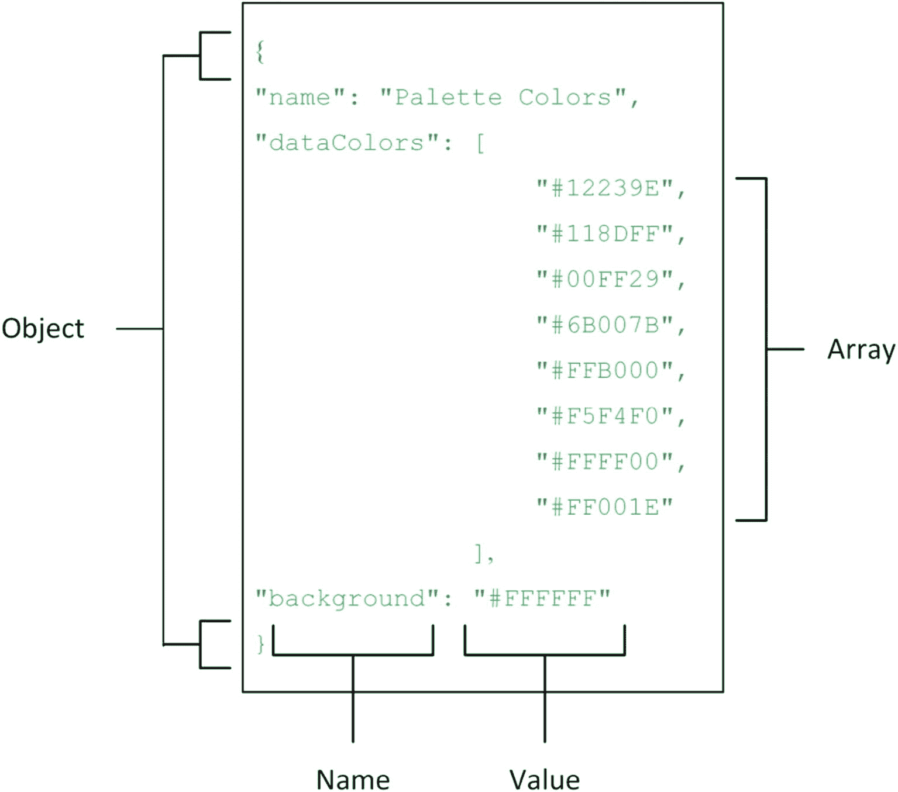

# 3. 高级主题定义

现在，是时候卷起袖子，准备深入探索 Power BI 主题的引擎了。从现在开始，你将直接在 JSON 中创建和修改主题文件的元素，这些元素将控制 Power BI 仪表板的外观。

为了开启你的 Power BI 主题之旅，本章将探讨最高层级的主题定义。这包括创建通用的主题设置，这些设置可以全局应用于多个视觉对象共同的属性，或者实际上，应用于仪表板中几乎每个对象。例如，这可能意味着设置列标题或轴标题的文本属性，而无论具体的视觉对象类型是什么。

这种方法有三个主要优点：
- 首先，它相对容易。
- 其次，它适用于多个元素——因此你无需在主题文件中重复指定多次（每个视觉对象类型一次）。
- 最后，由于这种方法仅设置仪表板各方面的默认格式，你可以像以前使用格式窗格设置最终展示一样，对单个视觉对象的格式进行微调和完善。

更重要的是，设置这些高级元素可能就是你为一系列仪表板设置整体展示效果所需要做的全部工作。你需要在深入（且可能耗时）准备 JSON 文件和提供一个能解决 80-90% 需求的快速方案之间进行权衡。在这种情况下，设置一个高级的、更通用的格式通常是一个完全有效的解决方案。当然，一旦应用了高级样式，你可以随后调整任何需要进一步准备和标准化的视觉对象的 JSON 格式——正如你将在后续章节中发现的那样。

这些更高级别的主题定义涵盖设置：
- 调色板颜色
- 通用颜色
- 通用文本属性

Power BI 将这些主题称为“通用类”。它们非常值得学习，因为它们不仅是介绍 Power BI 主题工作原理的绝佳途径，而且你还可以在日常使用 Power BI 的工作中应用它们。

## 什么是 JSON？

不过，让我们先（非常）简短地了解一下一些 JSON 基础知识。毕竟，你可能以前从未接触过这种格式。如果你已经了解 JSON，可以随意跳过本书中关于 JSON 的章节。如果不是这种情况，我建议你花些时间掌握 JSON 是什么以及它是如何工作的基本概念，因为它对于 Power BI 中的主题定义至关重要。

在上一章中，我们大量提到了 JSON，但从未解释过它是什么，或者 Power BI 为什么使用它。JSON 是 JavaScript Object Notation 的缩写。它是一种轻量级的数据交换格式，对于系统间的数据交换非常可靠，同时又易于人类理解（至少在一定程度上）。它可以被广泛地结构化，同时仍然保持足够的灵活性来存储复杂信息。对于 Power BI 主题而言，这意味着定义了 Power BI 仪表板元素的格式化方式。有趣的是，当用于定义 Power BI 主题文件时，JSON 中的 J 代表 JavaScript 这一点并不重要，因为在此上下文中，JSON 仅仅是一种定义仪表板展示样式的方式。因此，在 Power BI 的上下文中，真正需要记住的关键词是 Object（对象）和 Notation（表示法），因为 JSON 描述了仪表板视觉对象（对象）的格式（表示法）。

JSON 是一个庞大的主题，因此本书只会介绍创建主题文件所需的 JSON 知识。同时，我打算循序渐进地进行，只在需要时才描述所需的 JSON 知识，而不是一口气全部解释清楚。事实上，我将使用一系列文本框来解释必要的 JSON 概念——从这第一个开始，如下所示。

**JSON 基础知识**
- JSON 基于名称/值对的概念。也就是说，它定义了一个名称以及描述该名称的内容（它的值）。
- JSON 使用冒号将名称与其关联的值分隔开。
- JSON 基于对象的概念——在最高层级，整个主题本身就是一个对象。
- 对象可以包含其他（嵌套的）对象。
- 所有对象都用花括号（如果你喜欢的话，也可以叫大括号）`{}` 括起来。
- JSON 使用逗号来分隔元素列表。
- JSON 可以包含数组。这些是用方括号 `[]` 括起来的元素列表。
- JSON 规定文本和数字的输入方式不同。

## 调色板颜色

现在，你将创建你的第一个 Power BI 主题文件。它将非常简单。事实上，从包含示例文件的目录中加载示例文件 `PaletteColors.json` 并对其进行修改，比尝试从头开始手动重新创建整个文件要容易得多。实际上，这是我在创建主题文件时建议你尽可能使用的一种技巧——从能用的东西开始，然后调整和/或扩展它以适合你的新需求。

图 3-1 显示了示例文件 `PaletteColors.json`。

图 3-1 设置调色板的 JSON

该主题文件包含三个核心的 JSON 结构：
- 花括号，用于括起整个 JSON 对象。
- 名称/值对（`name`、`dataColors` 和 `background` 是名称——每种情况下冒号后面的文本是值）。
- 一个数组（方括号内以逗号分隔的十六进制颜色列表）。这里，整个数组就是该名称/值对的值。

由于这是你第一次接触主题文件，我更愿意解释它所包含的一切，因为这将帮助你理解 JSON 是如何工作的。

### JSON 对象
整个 JSON “对象”（如此称呼）必须以左花括号开始，并以右花括号结束。理想情况下，在起始的左花括号之前和结束的右花括号之后不应存在任何文本——不过，只要你没有添加任何额外的文本，添加额外的空行是没问题的。

在顶层花括号对内部，可能还有更多嵌套的花括号对，用于定义其他对象。实际上，当你检查更复杂的 JSON 主题文件时，你会看到这样的例子。