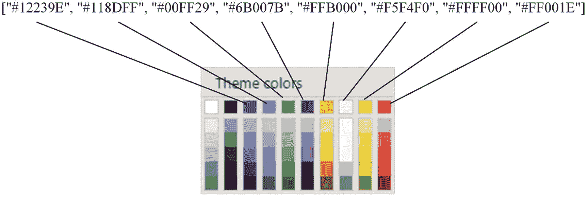

# JSON 数组

定义 JSON 文件中 `dataColors` 部分的值有多个。这是因为 Power BI 调色板包含十个元素。前两个是固定不变的（白色和黑色），而其他八个可以由用户定义。

这八个元素（最多——你可以选择设置更少的元素，其余的保留为默认值）在主题文件中被设置为一个数组。这意味着元素列表是：

* 用方括号括起来

* 用逗号分隔——最后一个元素后没有逗号

元素本身可以是全数字或全文本——这取决于数组包含的信息种类。

## JSON 呈现方式

JSON 代码的显示方式可以有无限多种。你刚才看到的代码也可以像这样显示：

```
{
"name": "Intro Theme",
"dataColors": ["#12239E", "#118DFF", "#00FF29", "#6B007B", "#FFB000", "#F5F4F0", "#FFFF00", "#FF001E"],
"background": "#FFFFFF"
}
```

或者像这样（这只是其中一种方式）：

```
{"name": "Intro Theme", "dataColors": ["#12239E", "#118DFF", "#00FF29", "#6B007B", "#FFB000", "#F5F4F0", "#FFFF00", "#FF001E"], "background": "#FFFFFF"}
```

虽然更紧凑的 JSON 代码可能占用页面更少的空间，但我更喜欢通过包含大量的换行、缩进和空白来使代码尽可能易读。这更容易理解主题文件与“格式”窗格中可见的格式元素之间的关联——以及 JSON 文件所映射到的内容。

那么，你在这个小主题文件中创建了什么呢？很简单，你定义了基础调色板，每次你想在 Power BI 仪表板中应用颜色时，该调色板都会出现。你可以在图 3-2 中看到这一点，其中主题文件 `dataColors` 数组中的十六进制颜色定义定义了调色板元素。



`图 3-2` 映射主题文件中的调色板