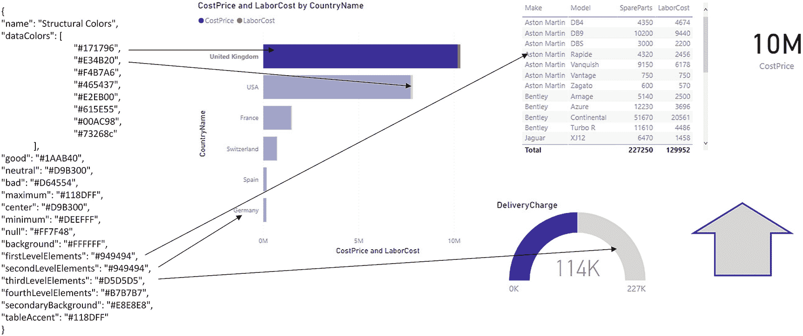
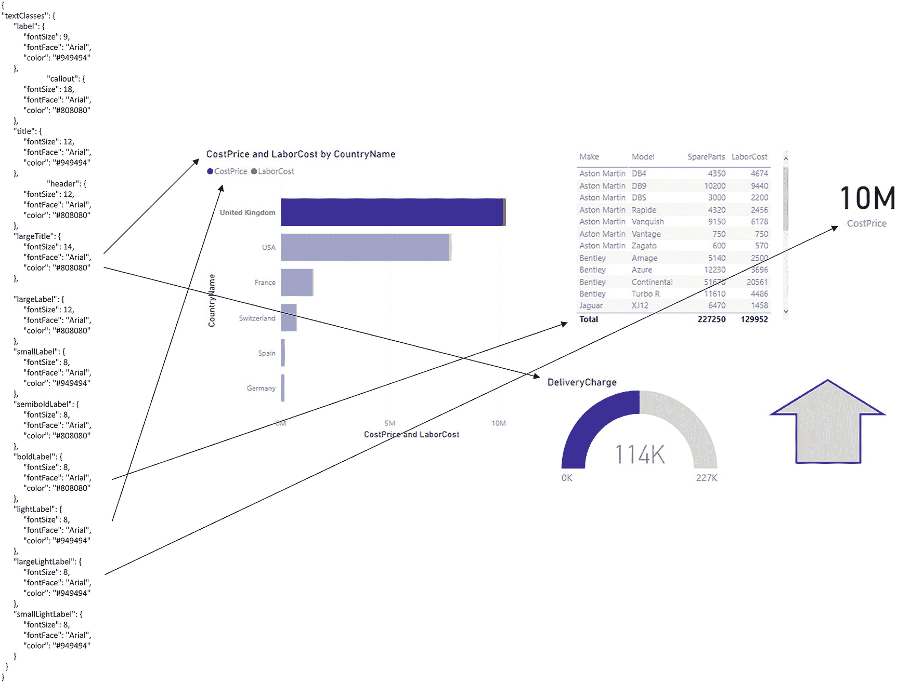
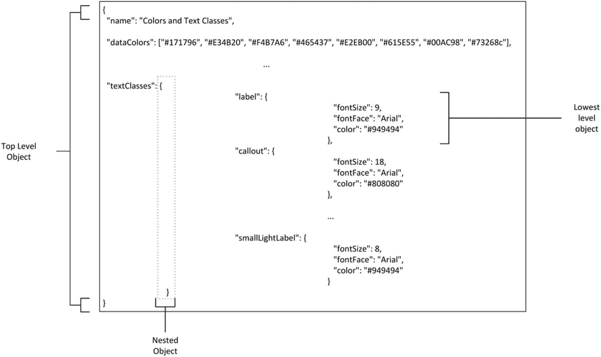

# 通用颜色（颜色类）

在看过一个基础的JSON主题文件后，现在该通过添加一些进一步的通用格式化元素来扩展它了。这些元素将添加上一章中使用`Customize current theme`（自定义当前主题）功能以交互方式添加的情感色和高级颜色，以及另一个无法通过Power BI Desktop界面添加的元素——`tableAccent`（表格强调色）。

您可以在示例文件目录中找到此文件，名为`StructuralColors.JSON`。添加到您之前看到的初始文件中的代码以粗体显示。

```json
{
    "name": "Structural Colors",
    "dataColors": ["#171796", "#E34B20", "#F4B7A6", "#465437", "#E2EB00", "#615E55", "#00AC98", "#73268c"],
    "good": "#1AAB40",
    "neutral": "#D9B300",
    "bad": "#D64554",
    "maximum": "#118DFF",
    "center": "#D9B300",
    "minimum": "#DEEFFF",
    "null": "#FF7F48",
    "background": "#FFFFFF",
    "firstLevelElements": "#949494",
    "secondLevelElements": "#949494",
    "thirdLevelElements": "#D5D5D5",
    "fourthLevelElements": "#B7B7B7",
    "secondaryBackground": "#E8E8E8",
    "tableAccent": "#118DFF"
}
```

如您所见，此文件扩展了简单文件`IntroTheme.json`所遵循的原则。即：

* 整个文件内容包含在一对花括号内。
* 每个定义都是一个名称/值对。
* 除最后一个定义外，所有定义均以逗号结尾。

所有颜色定义（调色板除外）的名称/值对都很简单：

* 左侧是颜色属性的名称（关键字）
* 冒号后的右侧是用于应用所选颜色的十六进制颜色参考

由于上一章已解释了大部分这些颜色元素，此处不再重复其定义。唯一新增的是：

* `tableAccent`（表格强调色）：此元素覆盖表格和矩阵网格轮廓颜色。

值得注意的是，您可以按任意顺序输入这些元素（至少对于像这样的简单JSON文件而言）。逗号分隔是需要记住并严格应用的关键点。换句话说，除最后一个属性定义外，每个属性定义都必须以逗号结尾。

有趣的是，您可以看到较长（且更复杂）的关键字采用驼峰式大小写——即它们以小写字符开头，但较长关键字中的每个单词首字母大写。

### 注意

如果您打算创建一个“前卫的”深色主题（包含黑色或深色背景元素），那么请务必也将其他结构颜色和主要文本类颜色的值设置为浅色——否则许多元素将无法阅读。

如果您现在将此主题应用于仪表板（您自己的仪表板或来自示例文件的示例仪表板`SampleDashboard.pbix`），您将看到几行JSON代码提供了多少格式。

为了让这一点更清晰，请查看图3-3，其中展示了JSON主题中定义的一些颜色是如何应用于Power BI Desktop仪表板的。



**图3-3** 高级颜色自定义

如果您想进行实验，可以修改一些十六进制颜色参考并重新应用主题，以体会使用主题文件时进行一系列更改是多么容易。

## 通用文本属性（文本类）

在上一章中，您使用Power BI Desktop创建了一个定义了四种文本格式的主题文件。这些格式（`label`（标签）、`callout`（标注）、`title`（标题）和`header`（页眉））被用于一系列可视化对象来定义核心文本格式。无论多么有用，这些只是您可以使用主题文件定义的部分通用文本设置。您还可以手动向主题文件添加另外八种设置，以便为仪表板添加更广泛的标准化文本格式。这可以避免您在Power BI中逐个可视化对象地手动格式化一系列文本属性。

让我们来看一个JSON主题文件，它将通用文本类添加到了本章迄今为止所见到的调色板和通用颜色中。此文件名为`ColorsAndTextClasses.json`，可在示例文件中找到。添加的JSON代码在以下代码片段中以粗体显示：

```json
{
    "name": "Colors and Text Classes",
    "dataColors": ["#171796", "#E34B20", "#F4B7A6", "#465437", "#E2EB00", "#615E55", "#00AC98", "#73268c"],
    "background": "#FFFFFF",
    "good": "#1AAB40",
    "neutral": "#D9B300",
    "bad": "#D64554",
    "maximum": "#118DFF",
    "center": "#D9B300",
    "minimum": "#DEEFFF",
    "null": "#FF7F48",
    "firstLevelElements": "#949494",
    "secondLevelElements": "#949494",
    "thirdLevelElements": "#D5D5D5",
    "fourthLevelElements": "#B7B7B7",
    "secondaryBackground": "#E8E8E8",
    "tableAccent": "#118DFF",
    "textClasses": {
        "label": {
            "fontSize": 9,
            "fontFace": "Arial",
            "color": "#949494"
        },
        "callout": {
            "fontSize": 18,
            "fontFace": "Arial",
            "color": "#808080"
        },
        "title": {
            "fontSize": 12,
            "fontFace": "Arial",
            "color": "#949494"
        },
        "header": {
            "fontSize": 12,
            "fontFace": "Arial",
            "color": "#808080"
        },
        "largeTitle": {
            "fontSize": 14,
            "fontFace": "Arial",
            "color": "#808080"
        },
        "largeLabel": {
            "fontSize": 12,
            "fontFace": "Arial",
            "color": "#808080"
        },
        "smallLabel": {
            "fontSize": 8,
            "fontFace": "Arial",
            "color": "#949494"
        },
        "semiboldLabel": {
            "fontSize": 8,
            "fontFace": "Arial",
            "color": "#808080"
        },
        "boldLabel": {
            "fontSize": 8,
            "fontFace": "Arial",
            "color": "#808080"
        },
        "lightLabel": {
            "fontSize": 8,
            "fontFace": "Arial",
            "color": "#949494"
        },
        "largeLightLabel": {
            "fontSize": 8,
            "fontFace": "Arial",
            "color": "#949494"
        },
        "smallLightLabel": {
            "fontSize": 8,
            "fontFace": "Arial",
            "color": "#949494"
        }
    }
}
```

那么，您到底看到的是什么？本质上，这是一组用于一系列可视化对象以定义文本格式的关键字。其中四个已在上一章中解释过，因为它们可以使用Power BI Desktop以交互方式创建。它们是`label`（标签）、`callout`（标注）、`title`（标题）和`header`（页眉）——因此我不再重复它们所应用的文本元素。

然而，其他的则需要一些解释。以下列表定义了每个JSON关键字设置哪个仪表板元素：

* `largeTitle`（大标题）：可视化标题
* `largeLabel`（大标签）：多行卡片数据标签
* `smallLabel`（小标签）：参考线标签、切片器日期范围标签、切片器数字输入文本样式、切片器搜索框、关键影响因素影响者文本
* `semiboldLabel`（半粗体标签）：关键影响因素概要文本
* `boldLabel`（粗体标签）：矩阵小计、矩阵总计、表格合计
* `lightLabel`（细体标签）：图例文本、按钮文本、类别轴标签、漏斗图、图表数据标签、漏斗图转化率标签、仪表目标值、散点图类别标签、切片器项目
* `largeLightLabel`（大号细体标签）：卡片类别标签、仪表标签、多行卡片类别标签
* `smallLightLabel`（小号细体标签）：数据标签、值轴标签

为了使 JSON 主题文件中的元素与其在 Power BI 仪表板中的应用之间的关联更易于理解，请查看图 3-4，其中展示了 JSON 主题中定义的一些文本规范是如何应用于 Power BI 仪表板的。



**图 3-4** 高级文本自定义

请注意，此图*并非*每个文本类应用范围的完整呈现，但它确实勾勒出了文本类的工作方式。

JSON 结构也需要一些解释，因为这是你第一次在主题文件中遇到嵌套对象（即，花括号内包含另一组花括号）。

如你所见，其核心原则依然是键/值对——也就是一个关键字和一个定义。然而，这次的*定义*稍微复杂一些，因为它并非关键字后冒号后面的单个元素，而是一个完整的对象。

你可以在图 3-5 中看到这种示意。



**图 3-5**

嵌套的 JSON 对象

需要注意的要点是：

*   这次，每个定义都是一个独立的、嵌套的对象，以*花括号*开始和结束。

*   每个对象内部都包含一系列键/值对，这些键/值对之间用*逗号分隔*（并且在最后一个键/值对之后没有逗号）。

*   构成文本定义的键/值对，与更简单的键/值对一样，在“外层”级别与其他键/值对之间用*逗号分隔*。

*   *数字不应包含在双引号内*。由于 Power BI 始终期望字体以磅（points）为单位定义，因此你只需指定字体大小的数字即可（无需指定“pt”或类似内容）。

*   你引用的任何*字体*的*拼写必须与 Windows 期望的完全一致*，并且当然必须存在于托管 Power BI 仪表板的系统中。

## JSON 数据类型

任何值（名称/值对中冒号后面的部分）都必须是可识别的 JSON 数据类型。

JSON 可用的数据类型集是有限的：

*   数字（`Number`）

*   字符串（`String`）

*   布尔值（`Boolean`）

*   对象（`Objects`）

*   数组（`Array`）

*   空值（`Null`）

*数字*可以是整数、浮点数或小数。它们*不应*包含在引号内。

*字符串*（或文本或字符）可以是任何文本，并且*必须*包含在双引号内。

*布尔值*简单地表示 true 或 false，并且必须用小写的 *true* 或 *false* 表示（例如，不能使用 yes/no 或 0/1）。

JSON 元素可以是一个嵌套对象——它本身包含更多元素，例如键/值对。

*数组*是一系列元素（字符串、数字、对象，甚至其他数组）。

当你想定义一个完全空的值时，应将其定义为 *null*（小写，不带引号）。

## 结论

本章带你踏上了创建和修改自定义 JSON 主题文件的旅程。你了解了如何在主题文件中以 JSON 形式添加颜色定义和通用文本属性。

希望从本章开头简短文件到最终完整主题文件的演进过程，能让你相信构建 JSON 主题文件不必复杂或困难。由于主题文件的结构基于清晰的逻辑，稍加练习你就能转向更高级的格式定义。像本章中看到的那些具有默认视觉样式的简单主题，随后可以通过为各种类型的视觉效果添加标准元素的规范来进行扩展。这将是下一章的主题。