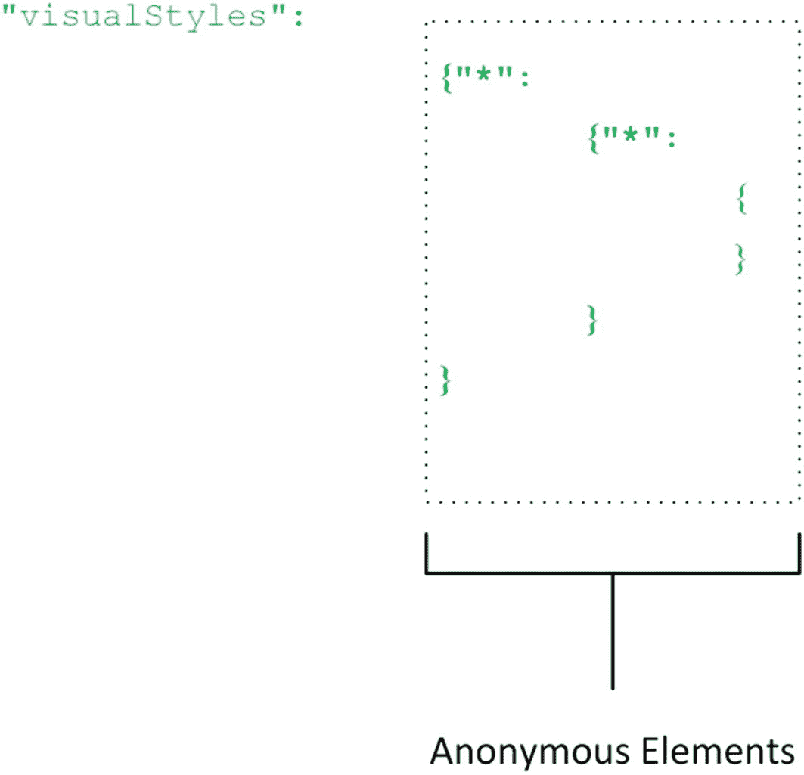

# 常见视觉元素

Power BI 仪表板中的大多数（甚至所有）视觉对象都包含一系列通用元素。这些元素包括：
- 背景
- 标题
- 边框
- 阴影
- 工具提示
- 视觉对象标头
- 锁定纵横比

你可能已经习惯使用 Power BI 格式设置窗格反复设置这些元素——说实话，确实如此。

这些格式元素由以下 JSON 主题关键字定义：
- `background`：设置视觉对象格式窗格“背景”卡片中的所有属性，并为页面设置背景
- `title`：设置视觉对象格式窗格“标题”卡片中的所有属性
- `border`：设置视觉对象格式窗格“边框”卡片中的所有属性
- `shadow`：设置视觉对象格式窗格“阴影”卡片中的所有属性
- `visualTooltip`：设置视觉对象格式窗格“工具提示”卡片中的所有属性
- `visualHeader`：设置视觉对象格式窗格“视觉对象标头”卡片中的所有属性
- `lockAspect`：设置视觉对象格式窗格“锁定纵横比”卡片中的所有属性

因此，现在是时候使用 JSON 在主题中定义这些通用元素了。与本书中大多数格式化 Power BI 仪表板的方法一样，最好的做法是先查看 JSON 代码，然后在看到代码后解释其工作原理。以下是一个代码片段（新元素以粗体显示），它为大多数视觉对象通用的元素添加了一些核心视觉对象默认格式。为了节省页面空间，此代码片段隐藏了之前看到的部分 JSON。完整代码位于文件 `ColorAndTextClassesWithCoreVisualDefaults.json` 中。

在此代码片段中，你可以看到斜体关键字对应于 Power BI 格式设置窗格中的各部分：
- `title` 关键字对应“标题”部分。
- `lockAspect` 关键字对应“锁定纵横比”部分。
- `border` 关键字对应“边框”部分。
- `dropShadow` 关键字对应“阴影”部分。
- `visualHeader` 关键字对应“视觉对象标头”部分。

```json
{
  "name": "Common elements",
  "dataColors": ["#12239E", "#118DFF", "#00FF29", "#6B007B", "#FFB000", "#F5F4F0", "#FFFF00", "#FF001E"],
  --- 颜色和文本类代码未显示 ---
  "visualStyles":
  {"*":
  {"*":
  {
    "title": [{
      "show": true,
      "text": "Visual Title",
      "fontColor": {"solid": {"color": "#ffffff"}},
      "background": {"solid": {"color": "#12239E"}},
      "alignment": "Center",
      "fontSize": 8,
      "fontFamily": "Arial"
    }],
    "lockAspect": [{
      "show": false
    }],
    "border":   [{
      "show": true,
      "color": {"solid": {"color": "#F5F4F0"}}
    }],
    "dropShadow":   [{
      "show": true,
      "color": {"solid": {"color": "#E8E8E8"}},
      "position":"Outer",
      "preset":"TopLeft"
    }],
    "visualHeader": [{
      "show": true,
      "background": {"solid": {"color": "#ffffff"}},
      "border": {"solid": {"color": "#F5F4F0"}},
      "transparency": 10,
      "foreground": {"solid": {"color": "#000000"}},
      "showVisualInformationButton": false,
      "showVisualWarningButton": false,
      "showVisualErrorButton": false,
      "showDrillRoleSelector": true,
      "showDrillToggleButton": false,
      "showDrillUpButton": false,
      "showDrillDownLevelButton": false,
      "showDrillDownExpandButton": false,
      "showPinButton": false,
      "showFocusModeButton": false,
      "showFilterRestatementButton": false,
      "showSeeDataLayoutToggleButton": false,
      "showOptionsMenu": false,
      "showTooltipButton": true
    }]
  }
  }
  }
}
```

现在来对这段特定的 JSON 做一些解释：
- 每个 JSON 属性对应于 Power BI Desktop 中格式设置窗格特定部分中的一个元素。
- 定义键/值对的核心方法仍然有效。但是，正如你所见，每个值设置都被定义为一个包含一个或多个对象的数组。也就是说，每个定义都以方括号和花括号开头，并以花括号后跟方括号结束。
- 某些对象包含进一步嵌套的对象——即花括号内的内部元素集，有时嵌套深度达三层。
- 这段 JSON 代码中还有一些新的内容。你正在引用通过 Power BI Desktop 中的弹出菜单所做的选择来格式化元素，例如：
  - 标题对齐方式
  - 阴影位置
  - 阴影预设
- 你需要知道，每个 JSON 关键字的拼写都必须准确无误——并且必须始终用双引号括起来。当然，如果你不想猜测定义，可以查阅描述你想要格式化的视觉对象的章节。
- 关于这些定义的好消息是，拼错某一个并不会导致 JSON 文件加载失败。唯一可能发生的是，该实际属性将不会被格式化，并且在 JSON 主题文件加载后保持默认格式。
- 你可以看到，虽然 Power BI Desktop 有打开或关闭元素的按钮（例如标题或阴影），但相应的 JSON 会翻译为：`"show": true` 或 `"show": false`。



图 4-1 匿名元素

- 你需要注意，JSON 显示布尔值（即 `true` 或 `false`）：
  - 不带引号
  - 小写
- 注意 `true` 和 `false` 的大小写很重要，因为 JSON 主题是区分大小写的。也不要用双引号将它们括起来，因为它们是关键字，而不是值。
- 最后，实际元素定义（`background`、`title` 等）本身嵌套在两个“匿名”元素内——如图 4-1 所示。在定义通用元素（即不严格归属于特定类型视觉对象的格式设置）时，它们必须嵌套在此较低层级。星号表示格式设置是通用的——不绑定到特定对象。诚然，这使得跟踪嵌套层级（以及所有花括号对）稍微复杂一些。但是，随着你更多地使用 JSON 主题文件，这会变得习以为常。

## JSON 属性定义

如果你更仔细地查看 JSON，你会注意到它其实非常容易理解，因为每个部分的格式化选项的每个键/值对都相当直截了当。JSON 所做的是为每个部分单独设置每个属性。此外，JSON 遵循你之前看到的准则：
- 开或关使用 `"show": true` 或 `"show": false` 表示。
- 大小是简单的、不带引号的数字。
- 弹出菜单中的选择项用引号括起来——并且与任何弹出菜单中的实际选项几乎完全相同。
- 颜色是双引号中的十六进制值（前面带有井号/哈希符号）。

这意味着，对于已经花时间在仪表板中格式化图表的 Power BI Desktop 用户来说，理解所使用的 JSON 是件容易的事。为了强调一个重要的点，你在这里看到的 JSON 只是这些关键字中大多数可用的格式化选项的一个子集。在第 5 章到第 9 章中，你将看到每种图表类型当前所有可用图表格式化选项的完整详细信息。