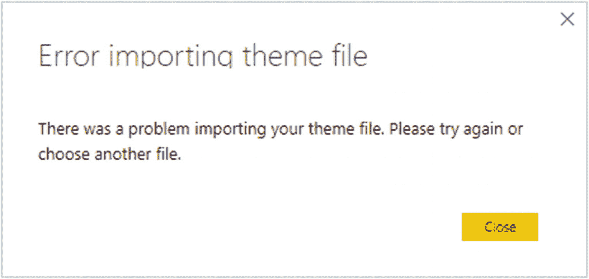

# JSON 主题文件编写提示

JSON 主题文件可能非常密集、看起来晦涩难懂，并且在加载时可能弹出如图 4-3 所示的可怕“主题文件导入错误”对话框。

**图 4-3** 主题文件导入错误

那么，在创建主题文件时，如何最大限度地减少错误呢？

首要操作之一应该是使用你偏好的搜索引擎，查找“JSON 语法检查器”。有很多在线资源允许你测试 JSON 的结构有效性。这对于检查 JSON 是否“格式良好”特别有用——这意味着没有多余（或缺失）的逗号、花括号或方括号等等。一些允许你编写 JSON 的工具也内置了语法检查器，或者可以添加它们。

另一个关键步骤是使用既能智能格式化 JSON，又能让你理解其结构的工具来编写 JSON。我的意思是，能够直观地理解嵌套层级，并看到成对的花括号是如何匹配的，对于在编写主题文件时简化工作是至关重要的。

不幸的是，除了将主题文件加载（或尝试加载）到 Power BI Desktop 之外，没有任何方法可以测试实际的 JSON 结构和主要关键字是否已正确输入。在这个层面上，反复尝试似乎是测试主题文件是否按预期工作的唯一方法。

## 结论

本章进一步深入探讨了构成 Power BI 主题文件的细节。你了解了如何逐步构建主题中的 JSON，以定义你想要的多（或少）的格式元素。

虽然 Power BI 的 JSON 主题的真正潜力在于精确定义每种可视化类型的格式规范——直至最细微的具体细节——但并非总是需要将这种能力发挥到极致。

因此，在本章中，你了解到可以在更高、更通用的层面上创建 JSON 主题，以便格式化一系列仪表板元素，而无需详细描述每个元素。

既然你已经了解了主题文件的基本运作方式，现在是时候深入探究如何使用 JSON 精确格式化 Power BI 仪表板的方方面面了。正如你所料，这是一个涉及大量细节的大课题。因此，我将这一主题分解为八个独立的章节以方便理解。我们将从格式化 Power BI 仪表板对象开始。