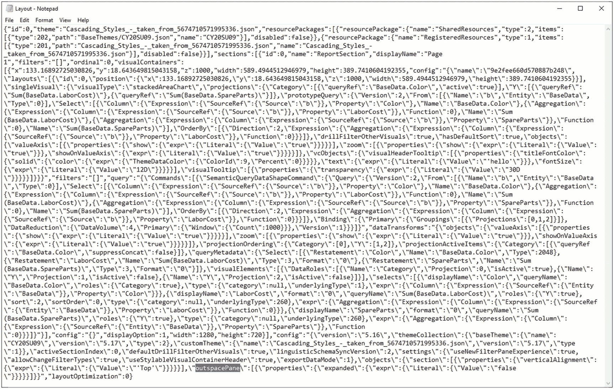

# 页面格式

页面背景也可以使用主题文件进行格式设置。与格式窗格类似，这（就主题文件而言）被视为**通用**格式元素而非特定格式元素，因此作为文件中通用视觉样式的一部分出现。

表 12-20 概述了可用于页面格式的 JSON 关键词，以及 Power BI Desktop 格式窗格中与每个关键词对应的部分。

**表 12-20** 页面格式关键词

| 关键词 | 格式部分 |
| --- | --- |
| `background` | 页面背景 |
| `displayArea` | 页面对齐 |
| `outspace` | 壁纸 |

页面格式的代码可在示例文件 `Attributes_Page.json` 中找到。你可以在以下代码片段中看到完整代码（用于说明页面格式在文件结构中的位置）：

```
{
"name": "Page formatting",
"dataColors": ["#12239E", "#118DFF", "#00FF29", "#6B007B", "#FFB000", "#F5F4F0", "#FFFF00", "#FF001E"],
"visualStyles":
{
"*":
{"*":
{
"page":
{"*":
{
"background":
[{
"color": {"solid": {"color": "#F5F4F0"}},
"transparency": 0
}],
"displayArea":
[{
"verticalAlignment": "Middle"
}],
"outspace":
[{
"color": {"solid": {"color": "#F5F4F0"}}
"transparency": 20
}]
}
}
}
}
}
}
```

描述页面背景部分的 `background` 关键词使用了表 12-21 中所示的关键词。

**表 12-21** 页面背景的关键词映射

| 元素 | 关键词 |
| --- | --- |
| 颜色 | `color` |
| 透明度 | `transparency` |

描述页面对齐部分的 `displayArea` 关键词使用了表 12-22 中所示的关键词。

**表 12-22** 页面对齐的关键词映射

| 元素 | 关键词 |
| --- | --- |
| 垂直对齐 | `verticalAlignment` |

描述壁纸部分的 `outspace` 关键词使用了表 12-23 中所示的关键词。

**表 12-23** 壁纸的关键词映射

| 元素 | 关键词 |
| --- | --- |
| 颜色 | `color` |
| 透明度 | `transparency` |

在用于设置页面对齐的 JSON 中，`verticalAlignment` 关键词需要表 12-24 中所示的其中一个属性。

**表 12-24** 图例位置选项

| 值 | 格式弹出选项 |
| --- | --- |
| `Top` | 顶部 |
| `Middle` | 居中 |


## 向主题文件添加注释

不幸的是，主题文件中使用的 JSON 并不像大多数编程语言那样支持添加注释。因此，你不能像在某些编程语言中那样，使用 `//` 或 `/* … */` 或 `- -` 在 JSON 代码中或代码后引入注释。

虽然这无疑是一种限制，但有一种变通方法可能会对你有用。那就是创建你自己的关键字，并用它们来引入注释，为文件添加注解。你可以在下面的代码片段中看到一个示例，其中在主题文件的可视化样式格式化部分顶部添加了几条注释：

```
"visualStyles":
{
"myNotesForOneSubject" : "Currently you can add notes like this",
"Notes" : "It apparently has to be here in the structure",
```

另一个技巧是在特定可视化对象的格式设置开头添加注释，如下所示：

```
"textbox":
{"*" :
{
"myTextboxNotes" : "Currently you can add notes like this",
"title":    [{ ... CODE OMITTED ... }]
```

你需要知道，这种方法是不受官方支持的，虽然目前它有效，但将来可能会失效。此外，我建议你创造一些极不可能被 Power BI 未来版本使用到的关键字。这样，就能最大程度地降低因产品演变而引发故障的风险。

当你创建多个主题文件时，另一个有用的想法是利用 `name` 字段为主题文件添加标题信息。你可以在下面的代码片段中看到示例：

```
"name": "Generic Base Formatting add lots of comments to explain why this is used, when it was created etc"
```

但是，你无法在注释内部添加换行符或回车符。而且，我也建议避免使用单引号或双引号。尽管如此，如果你的主题文件集合开始增多，在主题文件顶部添加注释会特别有用，因为与通过阅读 JSON 来尝试回忆某个主题的具体细节相比，它能让你更容易地追踪这些文件。

## 分析 Power BI Desktop 文件的内容

随着 Power BI 的发展，新功能将不可避免地增加，这也意味着会有新的格式设置可能性。因此，你可能需要发现新的关键字和/或它们的属性。

具体操作步骤如下：

1.  创建一个 Power BI Desktop 文件，其中包含你想要扩展其 JSON 格式设置的可视化对象。

2.  手动设置新增属性的格式（这意味着它们会出现在 Power BI Desktop 文件中 – 默认格式不会出现）。

3.  保存 Power BI Desktop 文件。

4.  将 Power BI Desktop 文件解压到一个文件夹中。

5.  打开你解压 Power BI Desktop 文件的文件夹。

6.  打开名为 `Report` 的文件夹。

7.  使用文本编辑器打开名为 `Layout` 的文件。

你会看到一段——很大程度上难以理解的——文本，它实际上包含了你在第 2 步中设置了格式的元素对应的 JSON 格式设置。现在的技巧是找到你设置过格式的内容，从而找到 Power BI 用于主题文件的关键字。需要提醒你的是，这可能需要练习和耐心！

你可以在图 12-1 中看到报告内容的示例。请注意，`outspacePane` 关键字已被高亮显示，这样你就能看到它的属性在底层 Power BI Desktop 文件中的呈现方式。



图 12-1
一个 `.PBIX` 文件的部分内容

## 结论

至此，你已概览了可以在 Power BI 中使用 JSON 主题文件进行格式设置的各种对象。在本章中，你学习了如何使用与前几章相同的方法来设置操作按钮、切片器、页面本身和筛选器窗格的格式。

我现在只剩下最后一个流程要解释——如何在主题文件中创建级联样式。你将在下一章（即最后一章）中学习到这一点。

