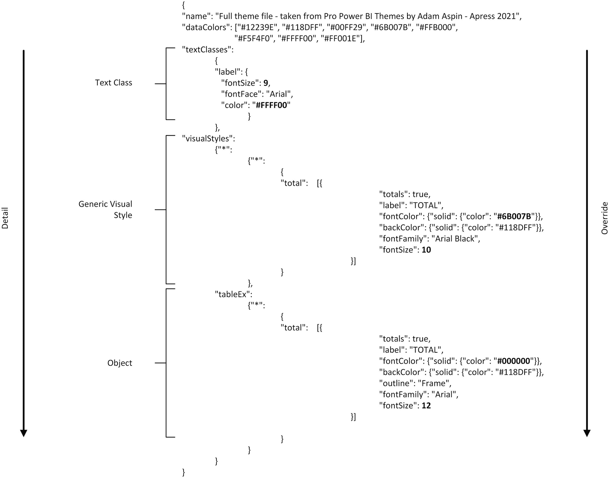
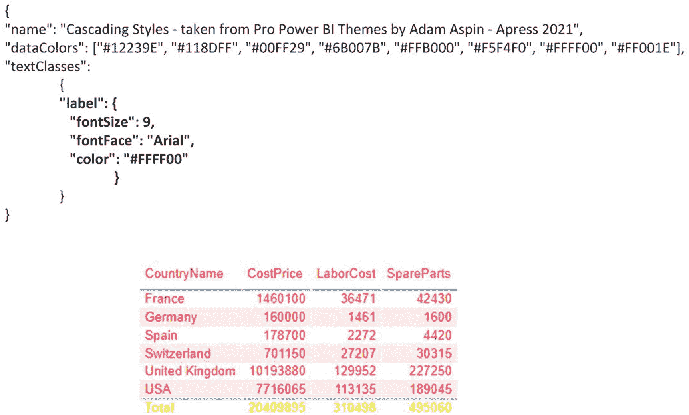
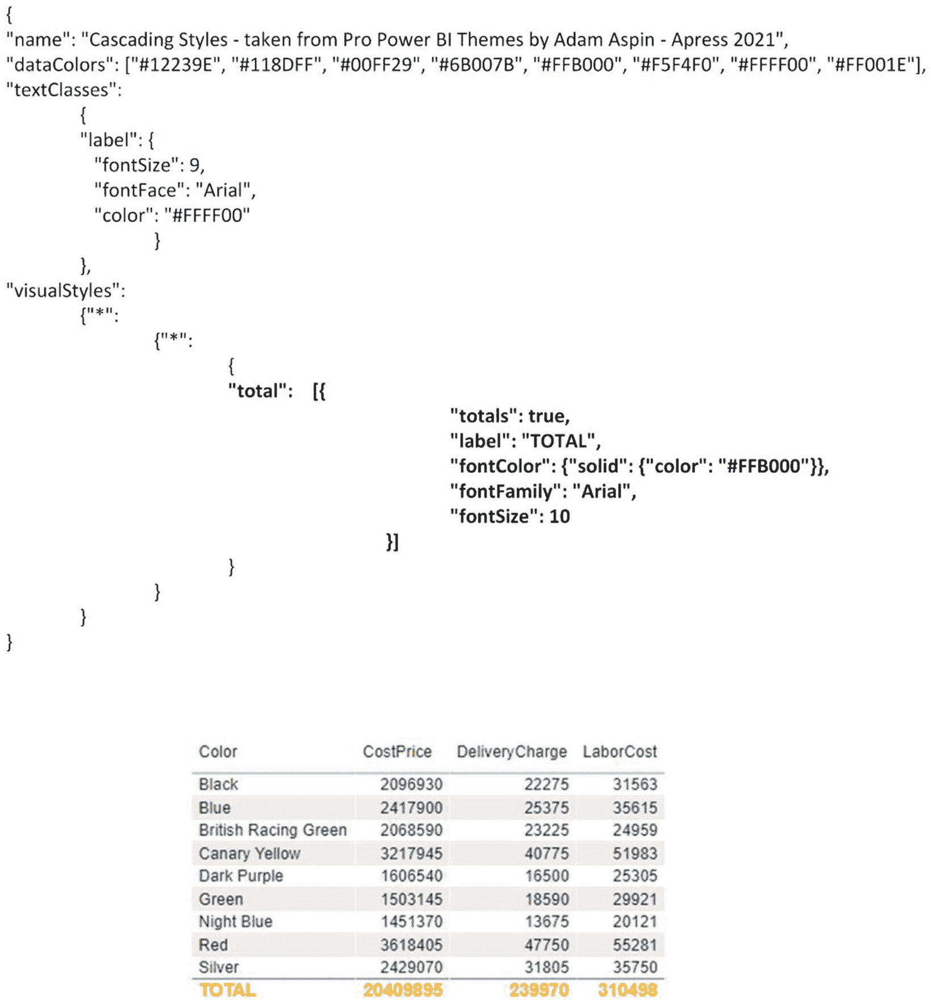
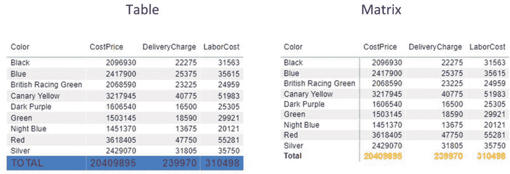

# 样式层级

首先要记住的是，你可以在四个可能的层级上定义呈现元素。这四个层级分别是：

- 元素级别
- 文本类
- 通用视觉样式
- 特定视觉样式

这种方法存在严格的层级关系。也就是说，在元素级别设定的任何规范将一直有效，直到被文本类覆盖。文本类可以通过定义通用视觉样式的设置来进一步细化，而通用视觉样式又可以被重新定义为特定视觉样式的一部分。

这种级联样式方法之所以可行，是因为样式层级从广泛范围逐步过渡到高度限制性。如果你还记得第 2 章的内容，定义一级元素会涵盖一系列视觉属性。在第 3 章中，你看到文本类更加聚焦——这种趋势一直延续到对某个特定视觉的某一方面的详细定义。

然而，你需要知道层级关系并不总是完整的。我的意思是，并非所有内容都能在元素级别进行设置（许多视觉格式化的方面并未被元素选项所涵盖）。同样，文本类也不能涵盖格式化的所有方面——并且这两个层级之间存在一些重叠。

与创建主题文件的所有方面一样，通过一个示例来理解是最好的方式。

例如，以你可以在表格中格式化的合计为例。这些合计可以在前面提到的四个层级中的三个层级（全部或部分）进行定义。表 13-1 对此进行了说明。

**表 13-1** 列标题格式化

| 层级                | 定义              |
|----------------------|-------------------|
| 文本类               | Label             |
| 通用视觉样式         | Total             |
| 特定视觉样式         | tableEx           |

`textClasses` 部分允许你指定一个 `label` 元素。这涵盖了（除其他外）表格和矩阵中的合计。如果你在此处指定了字号和颜色，它将设置（除其他外）表格和矩阵中使用的合计的颜色。

然后，你可以选择在主题文件的通用定义层级设置一些更具体的元素（例如字体颜色和大小）。这是通过使用 `total` 关键字和相关元素完成的。这将在视觉对象中使用此关键字的地方设置合计，这意味着在表格和矩阵视觉对象中，并将覆盖使用文本类设置的任何内容（在此示例中，包括字号和颜色）。但是，它*不会*覆盖使用 `label` 文本类设置的任何其他元素。

最后，你可以设置仅适用于表格视觉对象的格式化。你在第 6 章中已经看到过这一点。此处的任何具体设置都将覆盖合计的通用格式化——但*仅在表格中，而非矩阵中*。

图 13-1 更直观地展示了这一点。

**图 13-1** 样式层级

你可以在图 13-1 中看到颜色被设置了三次：

- `FFFF00`（黄色）在文本类层级
- `F5F4F0`（橙色）在表格和矩阵合计的通用层级
- `6B007B`（紫色）用于表格合计

你还会注意到字号也被设置了三次：

- 9 磅在文本类层级
- 10 磅在表格和矩阵合计的通用层级
- 12 磅（黑色）用于表格合计

表格和矩阵的合计由 `label` 文本类设置。这还设置了表格和矩阵中合计的字体和大小，以及其他元素（完整列表也可在第 2 章中找到）。

然后，表格和矩阵的合计被*覆盖*——并且它们呈现的其他方面也被定义——作为通用样式定义的一部分（请记住，这是嵌套在星号对象内部，而不是特定的视觉对象内部）。

最后，表格（而非矩阵）的合计按照你在第 6 章中看到的解释进行定义。这发生在最深、最详细的层级。

你可能会问，这在实际中意味着什么。那么，让我们来看看通过逐步应用更详细的格式化所产生的效果，你可以在 JSON 主题文件 `CascadingText.json` 中看到这些效果。

首先，这是一个仅应用文本类（本例中为 `label`）的 JSON。该类设置了表格和矩阵中合计的格式化，如图 13-2 所示，其中合计为黄色，9 磅。

**图 13-2** 应用文本类

在图 13-3 中，通过为 `total` 添加一个通用样式，对该 JSON 进行了扩充。这具有覆盖文本类所设置字体属性的效果。你可以在图 13-4 中看到这一点，其中合计为橙色，10 磅。

**图 13-3** 应用通用样式

然而，值得注意的是，文本类设置的任何其他属性不受通用样式定义的影响。

最后，我们可以应用之前在图 13-1 中显示的完整 JSON。这覆盖了合计的格式化——但仅适用于*表格*，*而不适用于矩阵*。你可以在图 13-4 中看到这一点，其中合计为紫色，12 磅，*仅限表格*。

**图 13-4** 应用特定样式

定义一个在多个层级混合格式化的结构化主题文件可能需要投入大量的时间和精力。然而，前期的投入无疑会使主题更新更加容易和快捷得多。这是因为你通常可以通过在通用格式化层级进行单一更改，就能重置多个视觉对象的一大堆属性——同时保留某些视觉对象的高度特定格式化。这还可以确保你的仪表板具有高度的呈现一致性。

如果你决定采用这种创建主题文件的方法，我有一些建议，你可能在实践中会觉得有用：

- 专注于主题定义的通用层级——甚至可以完全忽略文本类。这种方法允许你以清晰、易于理解和审查的方式定义标准化属性。
- 除非你特意为某个特定视觉对象在较低层级添加覆盖，否则只在一个层级应用属性。换句话说，避免重复。
- 只应用你真正需要在全局上定义的元素到通用层级。没有必要设置所有能设置的内容，然后在特定视觉对象层级覆盖大部分。
- 在定义通用格式化时，通常没有必要为一个元素设置每一个属性。同样，只应用你需要在全局上设置的属性即可。

