# 3. Analytics Cloud 构建器

> 在新的信息社会中，正因为数据如此之多，直觉才变得愈发有价值。 — [约翰·奈斯比特](http://en.wikipedia.org/wiki/John_Naisbitt#_blank%23John%20Naisbitt%20wiki)

美国作家兼演讲家约翰·奈斯比特在其未来趋势研究中备受推崇。他延伸了爱因斯坦的结论——“唯一真正有价值的东西是直觉”，强调了在数据爆炸和丰富的时代，人类直觉的重要性。一个直观的用户界面来探索数据和开发可视化至关重要，而这正是 Salesforce Analytics Cloud 的关键优势之一。

在第 2 章中，我们介绍了 Salesforce Analytics Cloud 中提供的各种可视化。在本章中，我们将重点介绍如何使用 Analytics Cloud 构建器设计仪表盘。

我们将首先使用一个简单的数据集，从头开始逐步创建一个仪表盘。然后，我们将讨论关于设计可视化的最佳实践主题。还将演示如何通过移动设备创建数据集和仪表盘，随后介绍使用 SAQL 进行的高级仪表盘开发。

## 构建一个简单仪表盘

在本节中，我们将首先进行一个逐步的仪表盘构建练习。所有数据集和 JSON 模板都可以从 [`www.apress.com/9781484212042`](http://www.apress.com/9781484212042) 下载，并点击 `Source Code` 选项卡。您可以跟随我们逐步讲解的示例进行操作。

### 加载数据集

我们使用的数据集是一个来自美国联邦航空局（FAA）公共数据库的 `.csv` 文件，记录了鸟击统计数据。它包含了每一起记录的鸟击事件信息，包括事故机场、海拔高度、飞机制造商和型号、位置、飞行日期和时间、损坏情况、航空公司、始发州、飞行阶段、天气条件、野生动物体型以及物种等。

图 3-1 是原始数据集在 Microsoft Excel 中的屏幕截图。请注意，并非所有数据列都已显示。

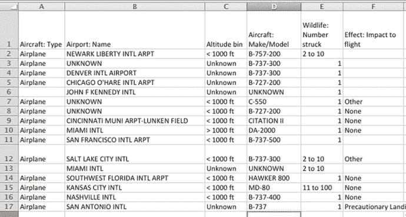
图 3-1. 原始鸟击数据集

我们使用 Analytics Cloud 的数据加载器用户界面（UI）将数据集上传到系统。步骤如下：

从 Analytics Explorer 主页点击屏幕右上角的“创建”（Create）按钮。按“应用”（App），创建一个名为 `Book Apps` 的应用。然后再次点击“创建”按钮并选择 `Dataset`（参见图 3-2）。

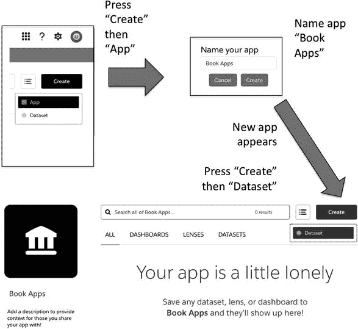
图 3-2. 创建应用和数据集

点击“选择数据源”（Select a Data Source）菜单下的 `CSV` 按钮（参见图 3-3）。

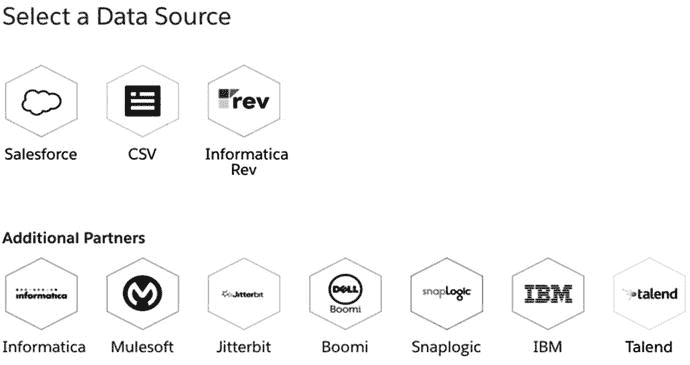
图 3-3. 选择数据源

在 `Dataset Name` 文本框中输入“鸟击”（Bird Strike）。从下拉列表中选择希望数据集所在的应用名称。在本例中，我们已经创建了一个名为 `Book Apps` 的应用。回顾一下，我们在第 2 章中介绍了如何使用“创建”按钮来创建应用。点击 `Select file or drag files here` 并导航到数据集位置。系统将自动生成一个 JSON 格式的元数据文件，您可以下载并根据需要修改。或者，您也可以上传自己的元数据文件作为数据集定义（参见图 3-4）。

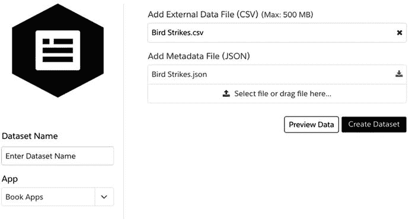
图 3-4. 输入数据集元数据

点击 `Create Dataset` 按钮，您的数据集将被上传到 Analytics Cloud。数据集通常会立即创建，但通常会有一条消息显示“您的数据集将在 1 小时内创建完成”。

一旦系统完成数据加载过程，您的数据集将出现在 Analytics Cloud Explorer 中供使用。您可以通过创建数据集时所在的应用包装器，或者点击顶部的 `DATASETS` 选项卡来导航到数据集。点击“鸟击”数据集以查看新数据集（参见图 3-5）。

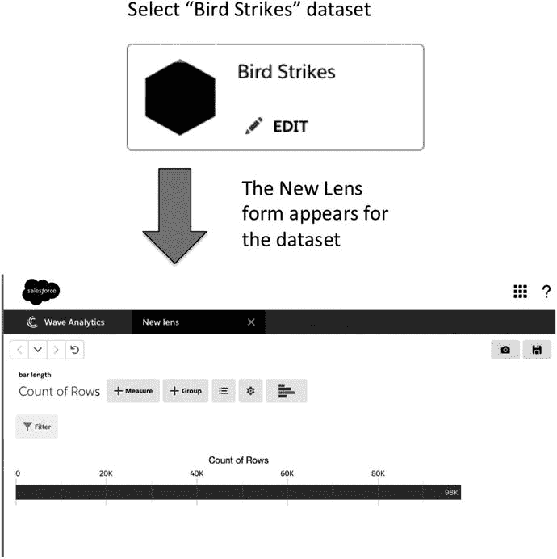
图 3-5. 选择“鸟击”数据集进行查看

# 创建仪表盘

现在数据集已上传，是时候通过创建我们的仪表盘来探索数据了。第一步是创建将构成我们仪表盘的透镜。以下是关于如何创建透镜以及如何将其包含在仪表盘设计器中的分步说明。

我们首先点击本章上一节中创建的数据集“鸟击”。我们点击“+分组”（`+Group`）按钮，并从维度列表中选择“天气状况：天空”（`Conditions: Sky`）（参见图 3-6）。

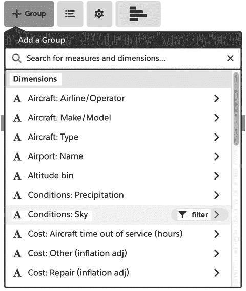

图 3-6. 按条件创建分组：天空

图 3-7 中的图表将根据“天气状况：天空”维度中的唯一值数量显示。

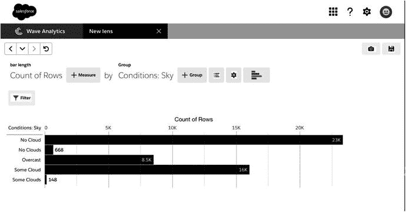

图 3-7. 按天空条件分组的透镜

点击屏幕右上角的相机按钮 。您刚刚创建的透镜将被“剪裁”到仪表盘设计器中。

在仪表盘设计器屏幕（图 3-8）中，您会在左侧面板看到您剪裁的透镜。点击顶部小部件栏上的“切换”（`Toggle`）小部件类型，然后点击左侧的透镜，将 `Conditions_Sky_1` 透镜添加到切换小部件中。

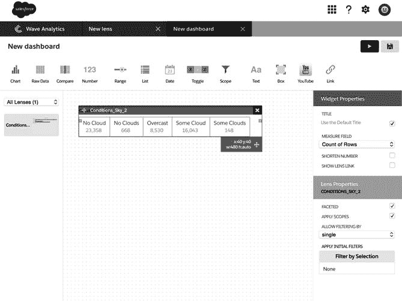

图 3-8. 天空状况切换小部件

返回透镜选项卡（图 3-9），点击“天气状况：天空”分组并将其替换为“时间：一天中的时段”（`When: Time of Day`）维度。通过移除“天气状况：天空”分组来完成此操作。将鼠标悬停在分组上，点击分组右上角的“x”。然后点击“+分组”按钮并添加“时间：一天中的时段”。

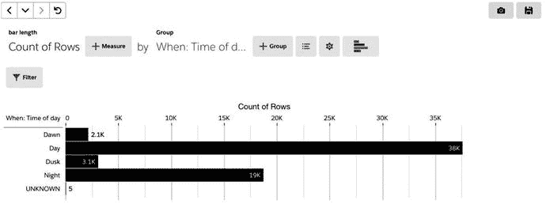

图 3-9. 按一天中的时段分组的透镜

重复步骤 3 和 4，将新透镜 `When_Time_of_Day_2` 剪裁到设计器中。将其添加到一个新的切换小部件中，该小部件位于第一个切换按钮的右侧。请注意，新剪裁的透镜始终位于仪表盘设计器左侧显示的透镜堆栈顶部。

返回透镜选项卡，点击分组按钮并将其替换为“野生动物：体型”（`Wildlife: Size`）。将可视化类型更改为环形图（参见图 3-10）。

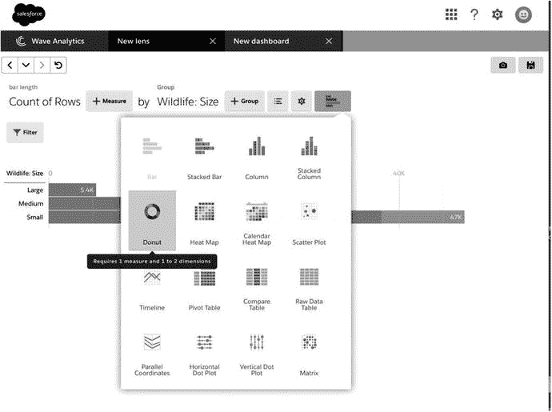

图 3-10. 野生动物体型的透镜图表

重复步骤 3 和 4，将透镜剪裁到仪表盘设计器中。这次选择一个“图表”（`Chart`）小部件类型，并将其放置在“天气状况：天空”切换按钮下方。

重复步骤 7 和 8，创建另一个环形图以显示“野生动物：物种”（`Wildlife: Species`）细分。定义过滤器以排除“未知”（unknown）类型的动物物种。要创建排除过滤器，请点击过滤器“野生动物：物种”，然后滚动到列表底部。您会在列表底部看到“更多”（more）。点击更多以列出更多物种。再次滚动到列表底部，然后点击更多。重复滚动并点击更多，直到到达列表末尾。在过滤器顶部，有一个用于选择“全部”（All）项目的控件。点击它，以选择所有物种。滚动到物种并取消选择所有以“unknown”开头的项目。如图 3-11 所示。

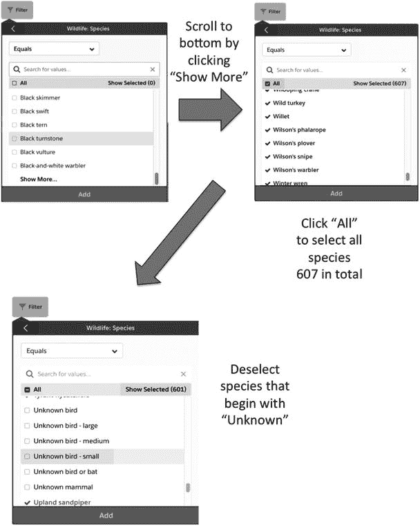

图 3-11. 过滤未知物种

定义另一个过滤器，以包含发生次数超过 100 次的物种。按下过滤器按钮，选择行数（count of rows），以及“大于或等于”（`Greater Than Or Equal To`）。然后输入 100，并点击“添加”（`Add`）。（参见图 3-12）。

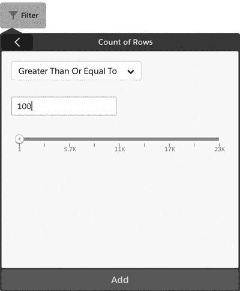

图 3-12。设定事件数量 >= 100

图 3-13 展示了应用所有筛选器后透镜的显示效果。

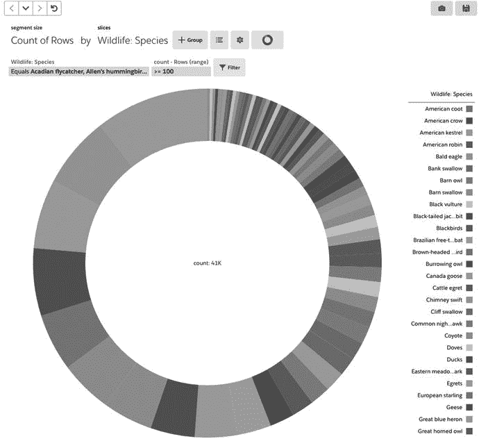

图 3-13. 野生动物种类透镜图表

到目前为止，您应该已经熟悉如何修改透镜以添加新维度并裁剪透镜，具体操作如步骤 7 和 8 所示。重复此过程，为飞行器和飞行员信息添加透镜和图表小组件，如图 3-14 所示。请注意，您应该使用水平条形图，而不是透镜构建器中的环形图。为以下度量创建全部四个垂直图表：
- 平均速度（`IAS`），单位：节
- 最大速度（`IAS`），单位：节
- 距机场的平均英里数
- 距机场的最大英里数

以及以下维度：
- 飞行员是否收到鸟类或野生动物警告？
- 高度区间

透镜构建完成后，将其裁剪并添加至仪表板底部。请注意，所有四个水平图表均被裁剪。在仪表板设计器中，仅需一个图表小组件即可包含这些内容。这种在透镜构建器中组合多个小组件的方法，是构建仪表板时一种有用的分组技巧。

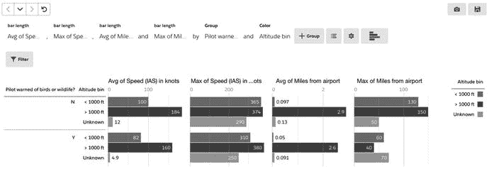

图 3-14. 飞行器和飞行员信息的图表小组件

现在，仪表板设计器的布局如图 3-15 所示。在仪表板设计器的右侧，选中任意小组件时都会出现属性选择器。使用“显示图例”选择器为每个环形图显示图例。

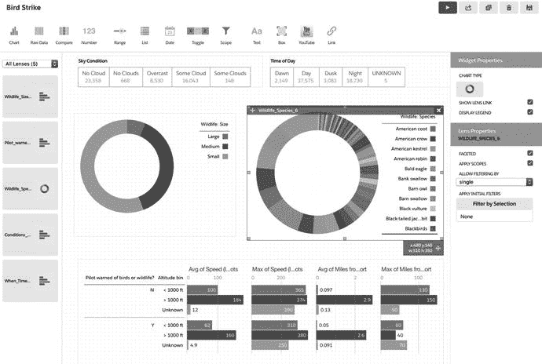

图 3-15. 鸟击仪表板设计器视图

点击绿色的“运行”按钮，图 3-16 将展示“鸟击”仪表板的最终成品。

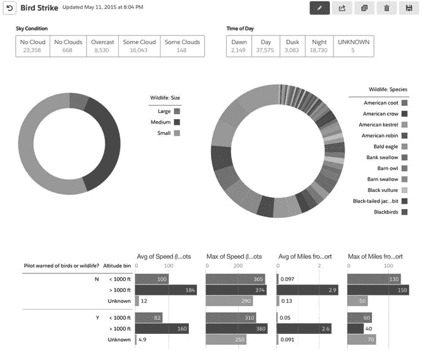

图 3-16. 鸟击仪表板视图

对于熟悉所用数据的人来说，整个仪表板的创建不超过 15 分钟。如果您不熟悉数据集包含的内容，还可以使用透镜界面中的分组和度量功能来探索数据。这些易于使用的方法非常直观，有助于发现数据的隐藏趋势，包括高阶基数、属性分布以及意想不到的关联。

## 仪表板设计美学

现在我们已经熟悉了如何在 Salesforce Analytics Cloud 中创建简单仪表板并探索数据。在下一节中，我们将探讨仪表板设计的基本原理。

### 设计美观仪表板的步骤

Salesforce 以打造卓越的客户体验为傲。Salesforce Analytics Cloud 也不例外。正如我们在之前的多个示例中所见，Salesforce Analytics Cloud 的可视化能力极具吸引力，而与系统交互时的动画效果更是令人赞叹。然而，仅有可视化效果并不能成就优秀的仪表板和分析解决方案。在本节中，我们将介绍一些关于设计有效且有意义的分析输出的技巧和最佳实践。

#### 理解用户问题

BI 开发人员和分析师在确定其应用程序的使用场景时，常犯的错误是关注那些缺乏相关性或分析价值的指标。好消息是，Salesforce Analytics Cloud 本质上是自助服务式的。业务分析师可以通过直观的用户界面探索数据集、设计可视化效果并分享输出。不过，在某些情况下，您可能需要为团队成员设计仪表板。

为了设计有效的输出，第一步是理解业务驱动因素，并确定您的用户关心什么。不要猜测用户认为什么重要，而是直接询问他们，以找出关键的信息需求。许多现代社交网络网站（如 Facebook）都使用这种策略来了解其广告商的需求，并根据反馈发布用户界面更新。

#### 用户目标

用户体验设计不应采用静态方法，因为人类对信息的需求以及消费所呈现信息的方式各不相同。对一个人有效的方法可能对另一个人无效。最有效的方法是预测特定的体验并塑造某些行为。此外，一个深思熟虑的设计必须针对不同角色或用户群体的目标、价值观和决策过程进行调整。

#### 可用性

用户体验和可用性经常被混为一谈，但它们是两个不同的概念。用户体验关注的是用户在使用系统时的感受，而可用性则关乎界面的用户友好性和效率。

可用性和用户体验也并非完全无关。可用性是用户体验的重要组成部分，在创造有效且愉悦的体验中发挥着重要作用。除可用性外，人因工程、心理学、信息架构以及以用户为中心的设计原则通常也会对用户体验产生重大影响。

### 设计原则

以下是为分析解决方案设计出色用户体验时需要考虑的一些基本设计原则。

**原则一：确保可读性。** 文本和背景应使用高对比度。例如，白色或浅黄色背景上的黑色文本更易于阅读。此外，字体大小应足够大，以便在标准显示器上清晰可读。

## 设计原则

**原则二：考虑设备形态。** 字体和图表显示的大小应基于设备而定。针对 iPad、iPhone 和网页端，要设计不同的可视化和显示方案，并定义其默认及首选的布局。

**原则三：用视觉元素突出重点。** 对于您打算展示的实际数据，应使用特别大的字符，而非标签和说明文字。我们处理信息的方式取决于信息呈现给我们的方式。有效利用粗体、字号、密度和动态效果，来激发我们的视觉敏感度。尽量使用图表而非数字表格。记住，一图胜千言，而每一个词也是一幅图画。

**原则四：考虑年龄因素。** 避免使用年轻用户来评估尺寸和对比度决策。相反，应在您可能预期到的年龄最大的用户群体上测试所有设计。老花眼是一种眼睛逐渐丧失聚焦近处物体能力的自然现象，通常是衰老过程中令人烦恼的一部分。老花眼通常在 40 岁出头到中期开始变得明显，并持续恶化直到大约 65 岁。要留意不同年龄在视觉消费需求上的差异。

**原则五：选择简洁的字体。** 虽然手写体被认为具有美学价值，但往往缺乏可读性。人眼对锐利的边缘反应更佳。因此，应避免使用边缘柔化的抗锯齿字体，尤其是在小字号情况下。

**原则六：合理规划布局与显示顺序。** 聚焦关键指标，然后逐步深入到更高级别的细节。将相似的图表对齐以便于比较。平衡自上而下与自下而上的思维方式：在顶部放置关键绩效指标的概览，并巧妙使用警报来推动行动。

**原则七：避免常见错误**，比如在未理解实际需求之前就急于选择工具。另一个常见陷阱是局限于传统 BI 工具的思维框架，从而限制了数据探索和发现的能力。

**原则八：选择优质照片或图片。** 图片讲述故事的能力胜过千言万语，因此为仪表板选择一张好图片至关重要。使用连贯、单一的画面，不要使用由其他小照片拼贴而成的照片。此外，尽量使用颜色和色调不超过 3-4 种的图片。否则，它就会分散注意力。使用清晰的图像。示例仪表板上的标题图像尺寸为 1420 像素 x 150 像素，分辨率为 300 ppi。避免使用分辨率较低的图像。不要拉伸图像，因为会导致图像变形和视觉干扰。如果您要在这些图像上添加文本或数字，请提供具有足够对比度的背景，以确保文字清晰可读。

## Mobile Dashboard Designer

在了解了这些设计原则之后，让我们来看看移动仪表板设计器。Salesforce Analytics Cloud 从第一天起就支持移动端。通过简单的页面布局配置，Lenses 和仪表板即可在 iPad、iPhone 和 Apple Watch 等移动设备上使用。此外，移动设备不仅仅是可视化工具。您还可以使用移动设备执行构建和设计功能，包括数据集上传和仪表板设计。在本节中，我们将通过一个分步用例，向您展示如何使用移动设备通过数据集创建仪表板。

### 通过移动设备上传数据集

您可以通过多种方式使用移动设备将数据集上传到 Analytics Cloud。可以通过电子邮件附件、云服务（如 `Dropbox` 或 Salesforce Files）中的文件来完成。在我们的示例中，我们将演示如何使用 `Dropbox` 将数据集上传到 Analytics Cloud。

在您的 iPhone 上打开“Dropbox”应用，并导航到包含`“Infant Mortality.csv”`的文件夹（见图 3-17）。

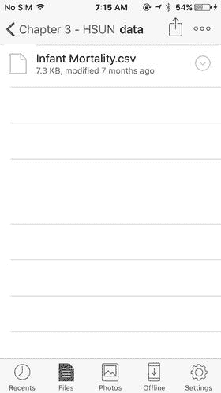

**图 3-17.** 包含本章所用文件的 Dropbox 应用

在图 3-17 所示的 Dropbox 显示界面中，选择名为`“Infant Mortality”`的文件。将显示文件信息界面（见图 3-18）。

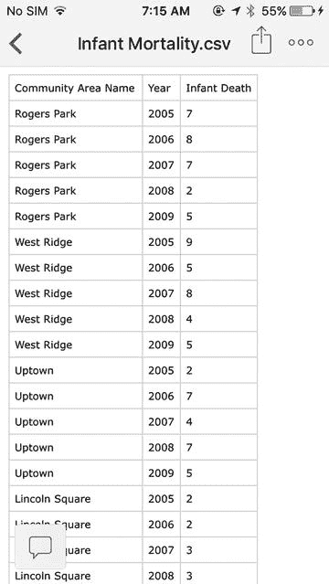

**图 3-18.** 文件信息视图

在图 3-18 所示的文件信息界面中，点击屏幕右上角的图标 ，然后选择“Copy to `Wave Analytics`”图标，如图 3-19 所示。

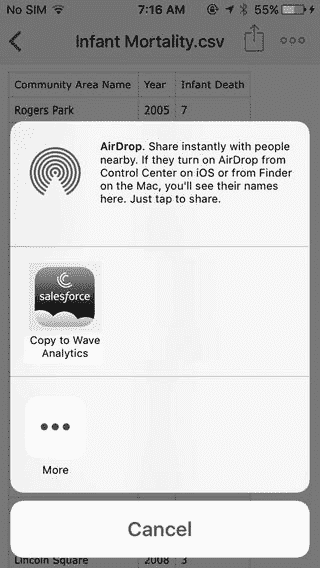

**图 3-19.** 将文件上传到 Salesforce Analytics Cloud

将出现一个数据连接器弹出窗口，如图 3-20 所示。您可以滚动，并指示不希望再次看到此窗口。在图 3-20 中，按下“next”。

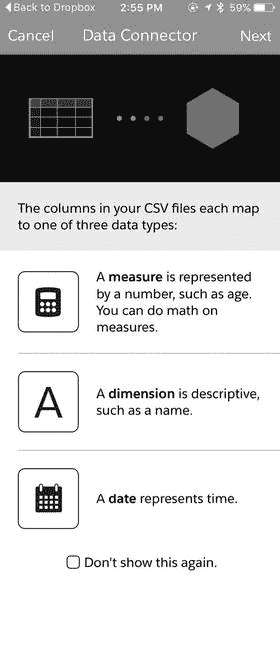

**图 3-20.** 数据连接器弹出窗口

将`“Year”`属性的字段类型更改为`“Dimension”`。见图 3-21。

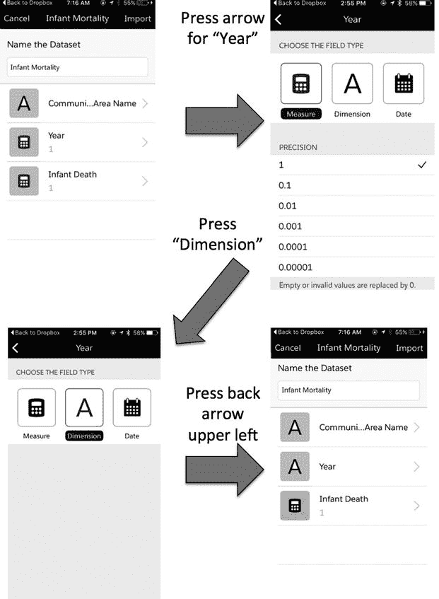

**图 3-21.** 将年份从度量更改为维度

将数据集的名称设置为`“Infant Mortality”`，然后点击`“Import”`（见图 3-21）。导入过程开始，如图 3-22 所示。当导入完成时，点击“Done”。


**图 3-22.** 导入完成

点击“Done”后，您将看到创建的数据集（见图 3-23）。按下数据集名称旁边的`“i”`，即可看到相关选项：通过按`“Open”`打开一个 Lens，或按`“Create”`启动仪表板设计器。按`“Create”`，为本章的下一项练习（涉及创建移动仪表板）做好准备。

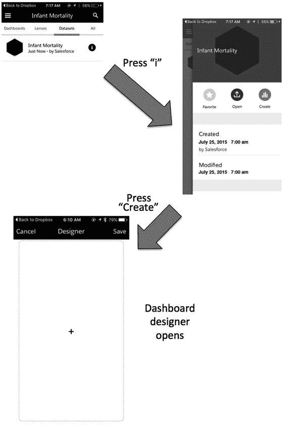

**图 3-23.** 数据集已就绪，按“Create”启动仪表板设计器

### 使用移动设计器创建仪表板

数据集创建完成后，接下来就是创建仪表板了。

您可以关闭探索界面，导航至“婴儿死亡率”数据集。长按该数据集一两秒，仪表板设计器界面将会显示（见图 3-24）。按下屏幕中央的“+”号，即可向仪表板添加组件（见图 3-25）。

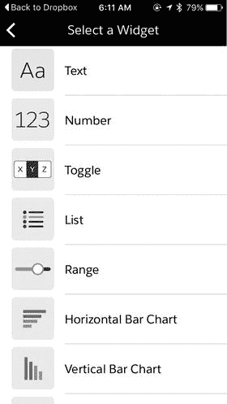

图 3-25

选择组件类型


图 3-24

仪表板设计器

在组件选择界面，首先选择“切换”字段，并选取维度“年份”（见图 3-26）。

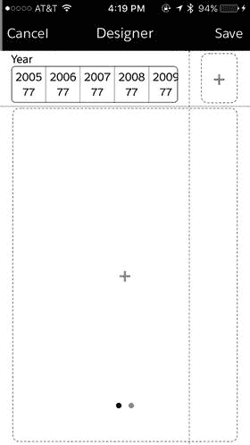

图 3-26

年份维度的切换字段

使用名为“婴儿死亡”的度量指标的 `avg`、`max` 和 `min` 函数，添加 3 个“单数值”组件（见图 3-27）。

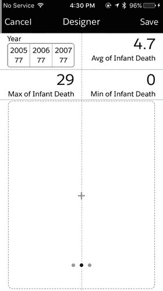

图 3-27

单数值组件

继续添加一个“V 形柱状图”，以显示按“社区区域名称”分组的婴儿死亡率信息。保存仪表板，然后查看仪表板，如图 3-28 所示。您也可以使用 `view` 功能将视图从柱状图更改为环形图显示，如图 3-29 中的图表所示。

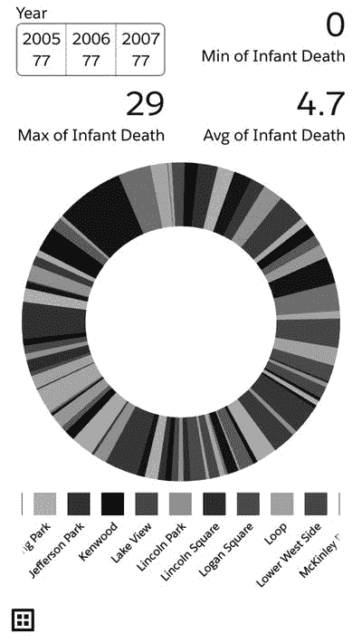

图 3-29

使用环形图探索新视图

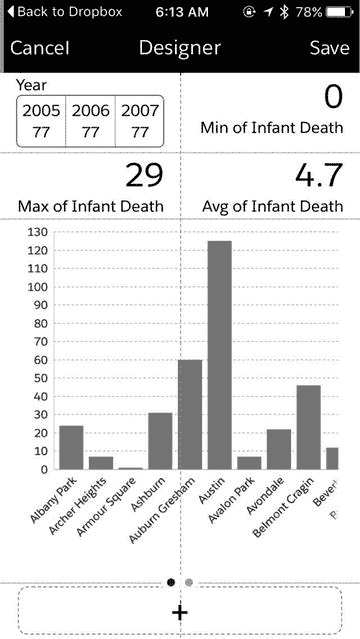

图 3-28

带有柱状图组件的仪表板

使用配有 Salesforce Analytics 的移动设备创建仪表板既快速又简单。我们上面的快速示例从加载数据到生成仪表板只需不到 15 分钟。该界面直观且功能强大，业务分析师可以完全通过手机探索数据集并设计可视化。如需保存仪表板，请按右上角的“保存”按钮，并为仪表板命名。

## 高级仪表板

除了拖放功能外，Salesforce Analytics Cloud 还提供了丰富的功能，用于更高级的仪表板设计和开发。在本节中，我们将探讨这些高级功能及其使用方法。首先，我们来分析一下 Salesforce Analytics 仪表板的组成。

### 仪表板的解剖结构

Salesforce Analytics Cloud 仪表板本质上是一个 JSON 文档，其中包含仪表板各个组件的定义以及它们之间的连接方式。它由两类信息组成：

- **系统元数据**：包括诸如 `UID`、仪表板名称和描述等信息。
- **仪表板状态**：这是存储仪表板设计重要信息的地方，包括 `步骤`、`组件` 和 `布局`。

您可以通过 JSON 文件配置和修改仪表板的不同方面。但是，**不建议**您通过 JSON 文件修改任何系统元数据。

如本章前面部分所述，创建和修改仪表板最便捷的方法是通过 Web 交互或在移动设备上使用仪表板设计器。但是，如需创建具有数据联接或选择绑定等功能的更高级仪表板，则可能需要修改仪表板定义的 JSON 文件。

### 仪表板状态

位于仪表板 JSON 文件中标签名 `state` 下的部分即为仪表板状态。它包含我们之前提到的子部分，包括 `步骤`、`组件` 和 `布局`。`步骤` 部分包含了通过仪表板资源管理器从透镜中剪裁出的所有查询。每个 `步骤` 通过 `name` 字段链接到一个 `组件` 或绑定到另一个 `步骤`。`组件` 部分定义了仪表板内的所有组件。`布局` 部分包含了页面和列布局的定义。

### 组件

动态组件类型通常代表每个查询步骤。不同的组件类型包括 `图表`、`原始数据表`、`比较表`、`数字`、`范围`、`列表`、`日期`、`切换` 和 `全局筛选器`。

还有一些静态组件，如 `文本`、`方框`、`YouTube` 和 `链接`，这些可由仪表板作者配置。诸如 `size`、`position` 和 `name` 等参数可以在设计器/生成器界面右侧面板的组件属性中设置。

### 步骤

`步骤` 包含查询，这些查询可以是来自资源管理器的剪裁，也可以是手动编写的 `SAQL`，或者是通过静态步骤生成的。步骤上的选择可以分面化，也可以绑定到仪表板内的其他步骤。我们将在本章下一节介绍一个选择绑定的示例。选择模式、起始值、是否分面化以及使用全局筛选器都可以作为步骤属性的一部分进行设置。

### 布局画布

当前仪表板中布局画布的实现是固定大小的，在一个页面上使用绝对定位。未来的增强功能将包括响应式网格、移动设备布局和模板。

### JSON 文件的使用

以下是您可能需要更新 JSON 文件的一些场景示例：

- 指定一个 `SAQL` 查询，并指定该查询与其他步骤之间的关系
- 使用指定的值列表填充选择器，而不是从查询中获取
- 使用手动绑定覆盖默认的分面，手动指定步骤之间的关系
- 设置查询限制
- 为值表指定列

有关 JSON 文件的更多信息，请参考“Analytics Cloud 仪表板 JSON 参考指南”。

### 使用 SAQL 的高级仪表板

`SAQL` 脚本由一系列语句组成，这些语句由关键字（如 `filter`、`group` 和 `order`）、标识符、字面量或特殊字符构成。语句可以跨越多行，并且必须以分号结尾。`SAQL` 是声明式的，这意味着您描述您想要从查询中获得什么。然后，查询引擎将决定如何高效地提供这些信息。`SAQL` 是可组合的。每个语句都有一个结果，您可以将语句链接在一起。`SAQL` 受到了 Pig Latin 编程语言的影响，但是它们的实现有所不同。

在下一节中，我们将向您展示一个使用 JSON 和 `SAQL` 进行高级仪表板开发的示例。

### 在 Designer 中创建仪表板

本示例使用的数据集名为“消费者支出”，如果你想跟着操作，可以从 [`www.apress.com/9781484212042`](http://www.apress.com/9781484212042) 下载。我们将首先使用透镜探索器和 Designer 裁剪功能创建一个仪表板。然后，我们创建以下三个透镜：`Age`、`Category` 以及按 `Item` 分组、按 `Sum of Value` 降序排列的 `Sum of Value`。我们将它们裁剪到 Designer，并添加到 2 个列表组件和 1 个图表组件中。图 3-30 展示了仪表板的设计视图。请务必保存仪表板，以免丢失工作成果。

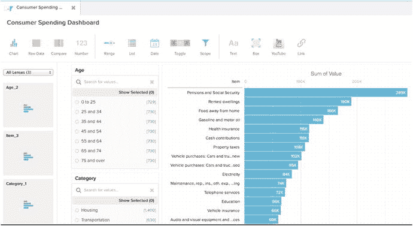
**图 3-30.** 消费者支出仪表板设计视图

我们的目标是仅显示基于年龄选择的前 5 个类别。为了实现这一目标，我们将按照以下步骤修改仪表板的 JSON 定义。

1.  **获取 SAQL 语句**：使用“消费者支出”数据集创建一个透镜。定义一个度量，对“Value”进行“Sum”求和，并按“Category”分组，然后降序排列。使用“Age”维度创建一个筛选器，并选择两个随机年龄组。点击“List”图标，然后选择“</> Edit SAQL Query”。请注意，Salesforce 目前正在修订编辑 SAQL 查询的方法。如果你在编辑 SAQL 查询时遇到困难，应联系 Wave 支持部门以获取帮助（参见图 3-31）。

    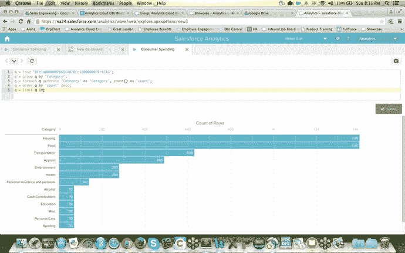
    **图 3-31.** SAQL 语句窗口

2.  将 SAQL 语句复制并粘贴到一个文本文件中。删除换行符（或断行），使语句成为一行，如下所示：

    ```
    q = load "0Fb1a000000PB6QCAW/0Fc1a000000PBrfCAG";q = filter q by 'Age' == "0 to 25";q = group q by 'Category';q = foreach q generate 'Category' as 'Category', sum('Value') as 'sum_Value', count() as 'count';q = order q by 'sum_Value' desc;q = limit q 2000;
    ```

    保存文本文件以备后用。

3.  通过将 URL 中的“explore”替换为“lens”，导航到透镜配置页面，如下所示：

    `https://[domain].salesforce.com/analytics/wave/web/explore.apexp` ➤ `https://[domain].salesforce.com/analytics/wave/web/lens.apexp`

4.  选择仪表板透镜，你的仪表板 JSON 文件将显示在右侧的文本框中（参见图 3-32）。

    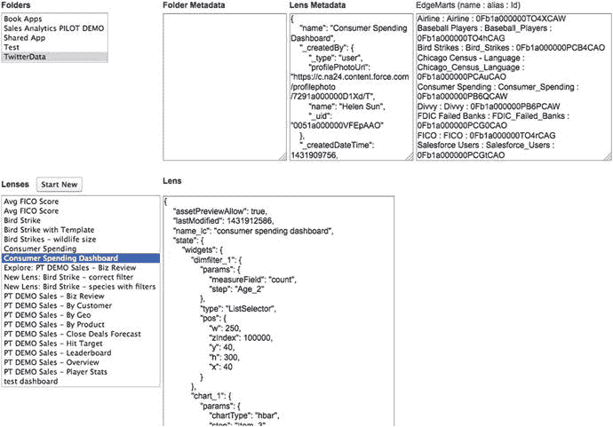
    **图 3-32.** 配置窗口

5.  选中 JSON 文本，将其复制并粘贴到你选择的 JSON 编辑器中。我们将使用 Sublime Text。在 JSON 文件的“state”部分中，找到“steps”。找到名为“Catogory_1”的步骤及其下方的“query”部分。添加以下行（pigql 文本来自我们在步骤 2 中复制并粘贴到文本文件中的 SAQL 语句）。

    ```
    "pigql":"q = load \"0Fb1a000000PB6QCAW/0Fc1a000000PBrfCAG\";q = filter q by 'Age' == \"0 to 25\";q = group q by 'Category';q = foreach q generate 'Category' as 'Category', sum('Value') as 'sum_Value', count() as 'count';q = order q by 'sum_Value' desc;q = limit q 2000;",
    ```

6.  将整个 JSON 文件复制并粘贴到 Analytics Cloud 屏幕的透镜文本框中，然后点击“Update Lens”。返回 Analytics 主页并刷新仪表板，以确保 pigql 语句正常工作。

7.  返回 JSON 文件并进行以下更新：
    - 将 `'Age' == "0 to 25"` 更改为 `'Age' in {{selection(Age_2)}}`。这称为选择绑定。它本质上告诉 pigql 使用“Age_2”步骤的选择结果作为类别选择中 Age 的筛选条件。
    - 将 `limit q 2000` 更改为 `limit q 5`。这是为了将结果数量限制为基于年龄组选择的消费者支出金额最高的前 5 个类别。

8.  替换为新 JSON 文件，然后点击“Update Lens”。

9.  刷新仪表板，你应该能够看到年龄组选择将更新类别列表组件，如图 3-33 所示。

    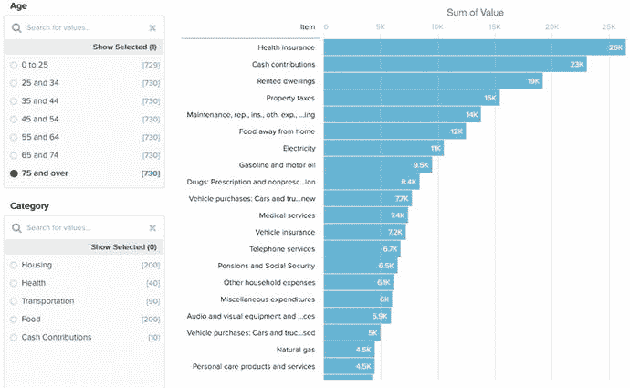
    **图 3-33.** 动态选择绑定

### 总结

虽然数据很重要，但如果没有分析，其价值就微乎其微。在这个新的数据时代，人们常常会对收集和共享的数据量呈爆炸式增长感到震惊。理解关键的业务驱动因素和痛点有助于业务分析师评估需要哪些洞察。阿尔伯特·爱因斯坦曾说过，我们不可能总是衡量我们想要计算的东西，但这并不妨碍我们不断探索获取所需数据的新方法，他这话颇有道理。

分析解决方案的成功在很大程度上依赖于人类的直觉以及提出明智问题的能力，无论是针对业务利益相关者，还是在分析方法中针对数据本身。恰当地提出业务问题对于避免有缺陷的分析和错误的结论至关重要。

`Salesforce Analytics Cloud` 是一款独特的基于云的分析工具，它使你的知识工作者能够探索数据、设计有效的可视化并生成洞察。

