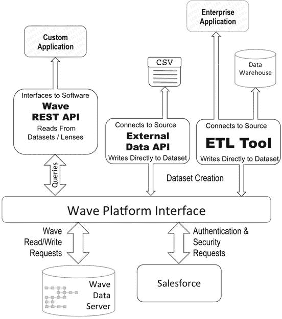
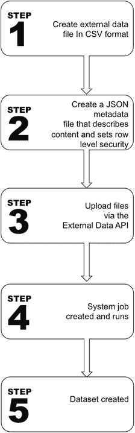
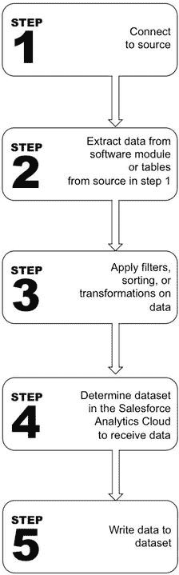
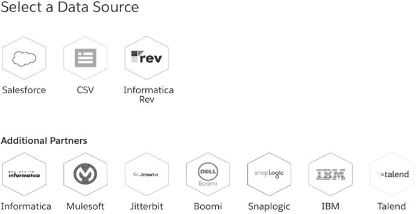

## 4. Salesforce Analytics 平台

> 知己知彼，百战不殆。 ——孙子，《孙子兵法》

在孙子不朽的巨著《孙子兵法》中，最看重的是了解自身能力和即将面临的挑战。对于商业组织及其分析软件而言也是如此。如果你了解自己的软件和数据，就能最大限度地利用它来解决特定的问题。在前三章中，我们介绍了将数据加载到 `Salesforce Analytics Cloud` 中最简单的、用户可操作的方法。现在，我们将探讨将数据从不同来源移动到 `Salesforce Analytics Cloud` 数据集的方法。

本书介绍的大部分内容涉及日常业务用户感兴趣的功能，使他们能够创建分析仪表板。然而，本章将解释 `Salesforce Analytics Cloud` 提供的一些高级功能，这些功能通常属于开发人员和 IT 专业人员的领域。这里描述的功能相对较新，当然有些可能会发生变化；尽管如此，这或许有助于你审视自己的选项。

**注意：** 所提供的信息基于目前可用的内容。它不是一份深入的技术指南，而是一张帮助你概览这些技术的路线图。有关完整的技术细节，读者应查阅相应的技术文档和媒体资料。

### 数据集成方法

顶尖技术研究公司的分析师认为，数据集成是大多数分析软件面临的一项挑战。然而，将数据（包括数据发现产品中的数据）导入分析软件，对于高效使用该软件至关重要。幸运的是，`Salesforce Analytics` 引擎允许通过桌面客户端或移动界面，以及标准的用户可访问方法，实现数据集成。

向 `Salesforce Analytic Cloud` 写入数据有两种方法，读取数据则有一种方法。`External Data API` 和 `提取-转换-加载` (ETL) 工具用于写入数据；`Wave REST API` 用于读取数据。每种方法服务于不同的需求，因此在决定使用哪种方法之前，理解其特性至关重要。图 4-1 概述了这些方法。

-   `External Data API`：`External Data API` 用于创建数据集。对于希望在不使用 ETL 工具等企业软件的情况下加载大量数据的公司来说，它是首选。例如，这可能是开发特定产品的公司采用的方法；他们拥有自定义软件开发能力，并且员工中有熟悉常规 `REST API` 开发的软件开发者。

-   ETL 工具：`提取-转换-加载` (ETL) 工具通过图形界面、调度功能以及对几乎所有类型数据源连接的支持，使数据集成更加容易。它们通常具有连接到 `SAP` 或 `NetSuite` 等企业软件平台的预构建连接器，从而简化了数据访问。其优点是开发时间短；然而，ETL 工具可能成本高昂。仅为了与 `Salesforce Analytics Cloud` 集成数据而购买 ETL 工具，其合理性难以证明。组织应检查其现有的 `Salesforce partner` ETL 工具，以确定它们是否原生支持 `Salesforce Analytics Cloud`。

-   `Wave REST API`：`Wave REST API` 用于从 `Salesforce Analytics Cloud` 读取数据（相较于 ETL 工具和 `External Data API` 作为获取数据的方式）。开发使用 `Salesforce Analytics Cloud` 产品的公司会使用 `Wave REST API`。这些产品可以是具备商业智能能力的移动应用程序或桌面产品。具有自定义软件开发能力的公司可以使用 `Wave REST API` 构建从 `Salesforce Analytics Cloud` 检索数据的应用程序。

图 4-1. `Salesforce Analytics Cloud` 的数据集成方法

现在，让我们更详细地看看每种方法。

### 外部数据 API

`External Data API` 提供了将外部数据集成到 `Salesforce Analytics Cloud` 中的能力。外部数据直接加载到数据集中，然后可用于查询，或用于移动端或桌面端使用 `Salesforce Analytics Cloud`。为使用 `External Data API`，需遵循以下步骤，如图 4-2 所示。

图 4-2. 使用 `External Data API` 进行数据集成的步骤

### 第 1 步：创建 .CSV 文件

无论来源如何，所有数据都需转换为 `.csv` 格式并写入文件，以便使用 `External Data API` 加载到 `Salesforce Analytics Cloud` 中。作为一项编程任务，这通常很容易，但必须注意确保创建的文件不要太大（请参阅下面的“使用限制”）。如果数据源包含逗号或 `CR/LF`，则还必须注意使用引号标识符。任何被引号标识符包围的字段值中的引号都需要用另一组引号进行转义；例如，`“Don't ““quote”” me.”`。

### 第 2 步：创建 JSON 元数据

`JSON` 元数据文件描述数据，以便在加载每一行时，`Salesforce Analytics Cloud` 能够确定每一列的数据类型。要创建此文件，您需要将第 1 步中创建的 `.csv` 文件的每个字段标识为日期、数字或字符串。此文件还决定是否以及如何对每一行应用安全策略。`Salesforce Analytic Cloud` 维护一份专门记录此元数据的文档，因此开发人员应参考此文档以充分理解 `JSON` 格式。

### 第 3 步：上传文件

此步骤包含两部分。第一部分是连接到 `Salesforce`。有多种方法可以验证 `Salesforce` 身份，任何一种都可以。根据 `Salesforce` 的说法，可以使用传统的基于 `SOAP` 的身份验证方法，也可以使用较新的基于 `REST` 的方法来建立连接。

第二部分涉及使用一个名为 `InsightsExternalData` 的对象上传文件。`Salesforce` 要求将大于 10MB 的文件分成 10MB 的“块”，然后使用 `InsightsExternalData` 对象进行上传。

### 第 4 步：创建并运行系统任务

此任务在上传完成后自动创建，无需开发人员启动。系统任务将处理 `.csv` 文件数据和 `JSON` 元数据。

### 第 5 步：创建数据集

数据集创建是第 4 步的结果，因此也无需开发人员启动。数据集创建完成后，即可在 `Salesforce Analytics Cloud` 中使用。

### 使用限制

根据本文撰写时的最新信息，`External Data API` 存在某些限制，并且这些限制可能会发生变化。如果您需要扩展对 `External Data API` 的使用，请联系 `Salesforce`。限制如下：

-   在滚动 24 小时内，最多可上传 50 个文件用于所有外部数据上传。

-   每个文件的最大文件大小为 40G。

-   字段的最大字符数为 32K。

-   每条记录的最大字段数为 5K。

-   一条记录中所有字段的最大字符数为 400K。

前两个限制最为严格，尤其是第 1 条。在大多数情况下，其他限制不太可能引起关注。

### 支持文档

`Salesforce` 提供了许多供开发人员参考的文档，以实现 `External Data API`。这些文档提供了高度的细节，具体如下：

-   `Analytics Cloud External Data API Developer's Guide`：描述了整体流程，并提供了 `C` 编程语言的一些代码示例。包含有关 `InsightsExternalData` 对象的信息。

-   `Analytics Cloud External Data Format Reference`：描述了第 2 步中讨论所需的 `JSON` 格式。

## 提取-转换-加载工具

**`提取-转换-加载`** (ETL) 工具在信息技术领域得到广泛应用，是最常用的 IT 软件类别之一。许多公司提供 ETL 工具，大多数功能丰富，能够连接到几乎任何类型的数据源，包括后台企业软件、关系数据库、平面文件以及通过 API 提供的数据。ETL 工具还能够在不需要软件开发者的情况下实现数据转换。图 4-3 显示了将 ETL 工具与 `Salesforce Analytics Cloud` 结合使用时的一般流程。

图 4-3. 使用 ETL 工具向 `Salesforce Analytics Cloud` 写入数据的步骤

对于大多数用户来说，配置 ETL 软件是一项相对简单的任务。我们来讨论一些细节。

### 步骤 1：连接数据源

大多数 ETL 软件包都宣称能够连接数百种类型的数据源。此步骤旨在连接其中一种数据源，通常只需提供数据源的主机名、用户名和密码即可。

### 步骤 2：提取数据

此步骤成功的关键在于，需要有一位熟悉源数据、了解应使用哪些表或其他实体的开发人员或分析师。要成功完成此步骤，步骤 1 中的用户名必须具有访问源表或实体的权限或安全特权。

### 步骤 3：排序、筛选和转换

大多数 ETL 软件包都提供了图形化方式，用于将源数据映射到目标列、转换数据以及过滤掉不需要的值范围。对于 `Salesforce Analytics Cloud`，在此步骤中，您需要确保每列的数据类型正确，并选择数据集中的列名称。

### 步骤 4：确定数据集

您在 `Salesforce Analytics Cloud` 中选择将要接收数据的数据集。如果该数据集不存在，则会创建它。在此步骤中，您需要指定数据的写入方法，其中可能包括先删除现有数据再写入，或追加到现有数据集。

### 步骤 5：写入数据集

您将数据写入 `Salesforce Analytics Cloud`。但在执行此操作之前，您需要先验证身份登录到 `Salesforce`。当 ETL 工具通过身份验证后，它便会直接写入 `Salesforce Analytics Cloud`。此步骤假设您使用的 ETL 工具原生支持 `Salesforce Analytics Cloud`。为确保获得原生支持，请从支持 `Salesforce Analytics Cloud` 的 ETL 供应商中选择一个。查找这些供应商最简单的方法之一是在 `Salesforce Analytics Cloud` 的数据集创建页面上，如图 4-4 所示。

图 4-4. 数据集创建页面上的合作伙伴列表

在图 4-4 所示的公司中，Informatica、Mulesoft、Jitterbit、Dell Boomi、Snaplogic 和 Talend 都拥有强大的 ETL 产品线，并专注于该技术领域。IBM 拥有多款产品可与 `Salesforce Analytics Cloud` 集成，其功能远不止 ETL 工具。

`Salesforce Analytics Cloud` 的优势之一在于，`Salesforce` 确保其产品与其他 IT 公司的产品建立合作关系。许多合作伙伴都提供了白皮书、演示视频和交互式网站，用以展示其产品如何与 `Salesforce Analytics Cloud` 集成。

## Wave REST API

如前所述，Wave REST API 是一种从 `Salesforce Analytics Cloud` 检索数据的工具。截至撰写本文时，Wave REST API 仍是 `Salesforce` 的一个试点项目，尚未向公众普遍开放。有意参与 Wave REST API 试点项目的人士应联系 `Salesforce`。

您可能想知道 REST 这个缩写词的含义。它代表“表述性状态转移”，是一种用于在万维网上公开 API 的分布式计算标准方法。REST 正逐步取代一种称为 SOAP 的较旧的分布式计算方法。

## 本章小结

本章介绍了两种技术，用于将来自 `Salesforce` 之外不同源的数据移动到 `Salesforce Analytics Cloud` 的数据集中。我们首先探讨的技术是外部数据 API，其主要针对客户解决方案开发。第二种技术是原生支持 `Salesforce Analytics Cloud` 的 ETL 工具。ETL 工具是将数据导入 `Salesforce Analytics Cloud` 的最简单途径，但它们需要投入成本。此外，正确使用 ETL 工具需要专业知识，这也是一个需要考虑的因素。

我们还研究了一种用于从 `Salesforce Analytics Cloud` 检索数据的技术，即 Wave REST API。虽然目前尚未向公众开放，但组织可以申请参与试点项目。

