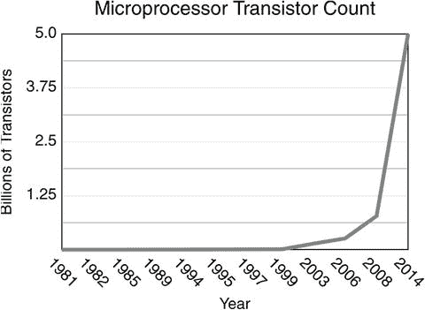
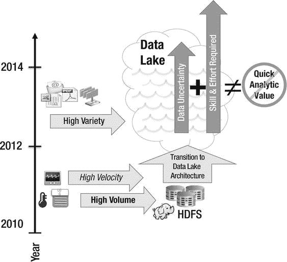
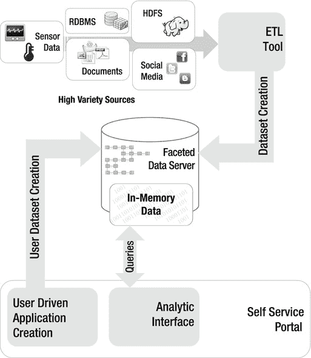
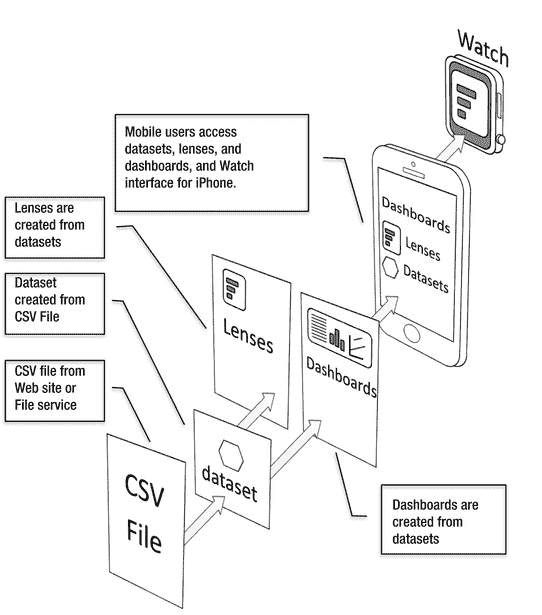
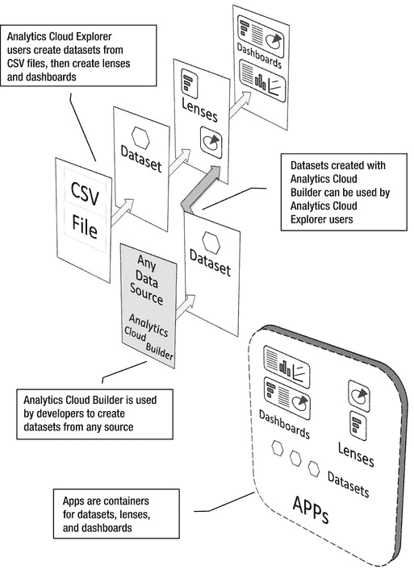

# 第 1 章 Salesforce 分析云概述

电子补充材料：本章在线版本（doi:`10.​1007/​978-1-4842-1203-5_​1`）包含补充材料，仅供授权用户使用。

> 知道去哪里寻找信息并懂得如何利用它——这就是成功的秘诀。 ——阿尔伯特·爱因斯坦

爱因斯坦在这句简洁引文中表达的观点，揭示了我们与生俱来获取和理解信息的需求。这是因为信息能帮助我们做出不受偏见或错误判断影响的决策。可以说，正是这种思想催生了计算机——最初发明计算机就是为了更快地进行数学计算。随着计算机的发展，创新策略和技术也不断演进，使计算机中的信息能更便捷地用于决策。这些策略涵盖从统计方法到促进数据快速检索的存储技术，以及可视化技术。

本书将介绍 `Salesforce Analytics Cloud` ——这项能高效利用信息的最新科技之一。`Salesforce Analytics Cloud` 属于被称为"数据发现"产品的类别；这是研究该技术领域的调研机构常用的术语。`Salesforce Analytics Cloud` 拥有高性能存储基础设施，可实现快速数据检索和高级可视化，让信息能被迅速理解——所有这些都依托于支撑 `Salesforce` 产品成功的云端基础设施。但在深入探讨 `Salesforce Analytics Cloud` 之前，我们先来了解该产品的背景，并通过讨论报告与分析中的计算机及技术，来审视数据发现产品。

## 商业智能与报告系统的演进

随着计算机演变为信息管理系统，它们在商业领域的应用日益广泛。早期的计算机将数据存储在简单的平面文件中。随着数据量不断增长，需要更高效、更有组织的数据存储方式，这催生了关系型数据库。关系型数据库能够高效存储事务型数据，但不易于查询或挖掘。为了能轻松、快速分析事务型数据库中的信息以用于报告和分析，数据仓库和商业智能（BI）工具应运而生。20 多年来，这些数据仓库和工具为典型问题提供了可靠的答案，并且在可预见的未来仍将继续使用。

在此期间，随着微处理器（所有计算机的中央"大脑"）性能的提升，计算机技术以惊人速度发展。20 世纪 80 年代标志着个人计算机在商业领域的应用开端：1981 年 IBM 推出个人计算机，采用 Intel 8088 微处理器，总共有 29,000 个晶体管（晶体管是微处理器中使用的电子开关）。到 80 年代末，英特尔公司推出了 80486，这是其首款晶体管数量超过 100 万个的微处理器。到 2014 年，英特尔微处理器的晶体管数量已超过 55 亿。图`1-1`展示了自第一台个人计算机问世以来晶体管使用量的惊人增长速率。

图 1-1. 1981 年至 2014 年英特尔微处理器晶体管数量

英特尔已交付超过 2 亿颗微处理器，其晶体管总数超过 5 京，换句话说，地球上每个人对应的 CPU 晶体管数量超过 700 万个。然而，微处理器早已不再局限于个人计算机，而是渗透到我们生活的几乎方方面面——智能手机和可穿戴健康监测设备等个人设备、汽车控制功能、以及监测家庭用电的"智能"电表。因此，如此惊人的计算能力产生同样惊人的数据量也就不足为奇了。

全球范围内的计算机网络主要通过互联网实现了前所未有的信息共享。互联网催生了在我们日常生活中占据重要地位的通信媒介：电子邮件、社交媒体、以及信息性或销售类网站。所有这些数据的一个共同点是它们位于我们之前提到的事务型数据库之外，BI 工具难以对其进行报告和分析。过去十年间这类数据的增长意味着，与个人和组织相关的数据中有 80%到 90%位于事务型数据库之外——在很大程度上超出了我们的触及范围。

这些数据大多被归类为非结构化或半结构化数据，因为它们缺乏结构化数据源（如关系型数据库）中那种严格定义的数据类型和明确的数据模型。非结构和半结构化数据不具备结构化数据源的静态字段或组织特征。表`1-1`列出了属于各类别的数据源示例。

表 1-1. 数据类型、特征及示例

| 数据类型 | 特征 | 示例 |
| --- | --- | --- |
| 结构化数据 | 具有包含行和列的矩形表定义，以及表之间参照完整性的数据模型 | 关系型数据库（`RDBMS`） |
| 半结构化数据 | 松散定义的数据模型，内部结构 | `XML`、`CSV`、电子表格文件（`Excel`）、`JSON` |
| 非结构化数据 | 无数据模型 | 文档、电子邮件、社交媒体、博客、客户评论、包括图像文件和视频在内的媒体文件 |

## 数据多样性的挑战

来自众多不同来源的这些非结构化和半结构化数据造成了数据管理难题，因为数据量及其产生速率已超出关系型数据库的处理能力。具备这些属性的数据被称为"大数据"，而大数据最重要的属性通常被称为"3V"：即异常庞大的数据量（Volume）、数据产生的速度（Velocity）以及数据来源的广泛多样性（Variety）。为应对大数据带来的挑战，一类旨在存储大数据的集群文件系统技术引起了广泛关注。其中最为人熟知的技术是 `Hadoop` 分布式文件系统（`HDFS`），可通过 `Apache` 基金会获取为 `Apache Hadoop`；它能够应对大数据的容量和速度问题。

`HDFS` 可部署在低成本硬件上，低廉的前期成本促使人们使用 `HDFS` 来聚合所有数据——不仅包括大数据，还包括来自 `ERP` 和 `CRM` 等事务系统的数据，甚至数据仓库中的数据。这些庞大的数据集合有时被称为"数据湖"，因为数据只是被简单"投入"其中以供后续使用。

这就引出了当前创建数据湖的组织面临的挑战：很难从数据湖中获得分析价值，且速度难以满足利益相关者和客户的需求与期望。有两个障碍阻碍着组织从其大数据投资中获取价值。

### 数据不确定性

图 1-2 展示了向数据湖演进的历程。从大数据中获取价值的第一个障碍是数据不确定性，它源于数据的“多样性”方面。在 2010 年左右`HDFS`诞生的早期，人们倾向于关注大数据的容量和速度特性，因为当时的首要挑战仅仅是如何存储大量快速生成的数据。事实证明，数据的多样性充满了问题，也是导致数据不确定性的根源。大多数组织都习惯于与数据仓库相关的范式，在数据仓库中，通常只有少数几个高价值数据源。这些数据源是已知的，并且通常有完善的文档记录。相比之下，大多数数据湖拥有来自数百个数据源的数据。

从数据分析师或用户的角度来看，关于哪些数据可用以及正在聚合的数据的价值存在高度的不确定性。对于传统的商业智能和数据仓库解决方案而言，解决这种不确定性所需时间的 80%都花在了前期任务上（例如，需求收集、数据建模、数据清理和构建数据仓库）。当我们考虑到数据湖中将包含数百个数据源（其中大部分产生非结构化数据）时，所需的时间只会增加。大量数据源的影响，再乘以前期任务所花费的时间，使得数据不确定性成为一个长期问题。

图 1-2. 数据湖的演进过程

### 人才稀缺

从大数据中获取价值的第二个障碍是缺乏能够处理这些数据源的专业人员。精通大数据工作的数据科学家和程序员供不应求。从`HDFS`中提取信息所需的工具和编程知识的复杂性相当高，因此，有人倡议使用像`SQL`这样不那么复杂的工具来访问大数据。然而，这种方法在使大数据更易于访问或解决数据不确定性的挑战方面，基本上收效甚微。这个人才问题不容易解决，因为我们不能指望数据科学家或程序员的供给能在短期内增加。鉴于这两个障碍，更好的策略是重新思考当前处理大数据的方法，并重新考虑我们如何处理非结构化数据。

## 数据发现

为了摆脱对数据科学家和开发人员的依赖，一个显而易见的解决方案是提供能够让用户克服数据不确定性障碍的界面。业务分析师、数据分析师和领域专家习惯于使用工具，而不是命令行界面或代码编辑器，因此这些界面必须是图形化且直观的。

这些工具的总体目标是让用户能够执行一些原本由数据科学家完成的基本任务。查看数据源记录计数、检查数据随时间或其它维度的分布情况、以及确定数据的整体质量，这些都是可以使用数据发现工具完成的基本任务。借助这些数据发现工具的能力，数据得以“民主化”，用户也能成为“公民数据科学家”。

要理解这是如何实现的，让我们以`Salesforce Analytics Cloud`为重点，检视一下数据发现工具的一些最显著的特性。图 1-3 展示了一个数据发现平台的简单逻辑图。

图 1-3. 数据发现平台的逻辑图

### 自助式应用开发和分析界面

`Salesforce Analytics Cloud`配备了一个自助服务门户，允许用户配置自己的数据集，然后创建使用这些数据集的分析应用。对于更复杂的数据源，程序员可以创建数据集并将其提供给门户用户使用。

`Salesforce Analytics Cloud`的分析能力依赖于其可视化工具，这些工具使用户能够轻松理解数据；用户还可以通过点击可视化的某一部分并观察其它可视化或表格组件发生的变化来进行细化调整。通过这种方式，`Salesforce Analytics Cloud`能够执行描述性分析，回答“发生了什么？”的问题；它更擅长于诊断性分析，同样也能回答“为什么会发生？”的问题。

### 数据服务器

`Salesforce Analytics Cloud` 配备了一个专为促进分析和数据发现而设计的数据服务器。不要将此数据服务器与关系型数据库服务器混淆；它在存储数据以及建立数据间关系的方式上截然不同。

该数据服务器的设计基于分面数据模型，即从源捕获的每条记录都作为独立记录存储，记录中的每一列都成为该记录的一个属性或“分面”。每个分面都建立了索引，从而支持快速检索。

`Salesforce Analytics Cloud` 支持数据的实时探索，这涉及到实时浏览数据集中的所有记录。在此类实时探索期间，当从数据服务器查询数据时，记录会保存在内存中。数据发现数据服务器的这种内存特性对于在实时数据探索中实现高性能至关重要。

### 数据加载接口与 API

`Salesforce Analytics Cloud` 提供了多种加载数据的方法。终端用户可以通过 Web 用户界面创建数据集并将数据加载其中。`Salesforce Analytics Cloud` 也提供了用于加载数据的 Web 服务。具体来说，`Salesforce Analytics Cloud` 既支持经典的基于 `XML` 的简单对象访问协议（也称 `SOAP`），也支持表述性状态转移（也称 `REST`）。

对提取转换加载（`ETL`）工具的支持主要通过用于将数据加载到 `Wave` 数据服务器中的 Web 服务提供。许多其他数据发现产品要求客户购买和使用专门为其数据发现产品开发的 `ETL` 工具。由于 `Salesforce` 与其他 IT 产品公司建立了合作关系，因此广泛的 `ETL` 产品都支持 `Salesforce Analytics Cloud`。

`Salesforce Analytics Cloud` 是一个完整的技术解决方案，用于捕获和存储数据，并从中获取分析价值。`Salesforce Analytics Cloud` 对源数据的多样性没有要求，并且擅长处理结构化和非结构化数据。将此与像 `HDFS` 这样仅提供存储解决方案的大数据相关技术进行比较，就不难理解为什么像 `Salesforce Analytics Cloud` 这样的数据发现产品能够获得如此高的采用率了。根据领先的技术研究公司 `Gartner Inc.` 的数据，数据发现产品现在主导着商业智能和分析工具的所有新支出。

### 数据湖的替代方案

对于正在寻找策略来管理其 80%到 90%的半结构化或非结构化数据（这些数据可以与来自结构化来源的数据共存）的组织来说，`Salesforce Analytics Cloud` 是一个替代方案。没有任何数据发现解决方案具备 `HDFS` 那样的容量，因此它不适合捕获海量数据。然而，对于那些不具有高数据量或高速度特性的非结构化数据，`Salesforce Analytics Cloud` 可以作为将这些数据倾倒进数据湖的一种替代方案。

这种方案的优势在于，许多数据源可以加载到 `Salesforce Analytics Cloud` 的数据集中，而几乎不需要 IT 人员的参与。通过 `Salesforce Analytics Cloud`，用户可以创建应用程序来提供图形和表格查看工具，这些工具的开发周期很短，通常只需几个小时。

`Salesforce Analytics Cloud` 还可以用于针对完全事务性的数据源开发仪表板和快速报表。使用数据发现工具，比使用传统的商业智能和报表工具更容易“完成最后一英里”。用户不再那么倾向于通过在 `Microsoft Excel` 等办公工具中运行即席查询来创建“不合规”的业务流程以进行分析，而是会转而使用 `Salesforce Analytics Cloud`。

### Salesforce Analytics Cloud 简介

让我们更仔细地了解一下 `Salesforce Analytics Cloud`，并看看它的两个主要平台：移动端和桌面端。请记住，这些信息仅仅是功能的概述，更详细的内容将在第 2 章、第 3 章和第 4 章中介绍。

### 移动端平台

`Salesforce Analytics Cloud` 强调移动优先，提供了“随时随地的分析”。现在，分析功能触手可及。在 2007 年 `苹果 iPhone` 发布的激动人心的日子里，`史蒂夫·乔布斯` 强调，`iPhone` 是你能够塞进牛仔裤后兜里的东西，一个始终可用的移动计算平台，距离你不会比你的钱包或钥匙更远。

自 `iPhone` 发布以来，移动访问一直是云计算最引人注目的应用之一，它利用触摸显示屏提供连接到基于云的基础设施的丰富界面——然而这个基础设施对用户来说是透明的。智能手机及其直系后代平板电脑，主要用于消费数据，这主要是因为在小屏幕和屏幕键盘上创建内容很困难。然而，随着用户开始将这些设备视为数字生活中的主要界面，软件设计师们通过提供具有复杂内容创建能力的移动应用程序来响应这一趋势。`Salesforce Analytics Cloud` 顺应了这一趋势，允许用户上传数据、创建数据视图，然后将这些视图整合到仪表板中。

通过 `Salesforce Analytics Cloud` 移动应用，用户可以从逗号分隔值（`.csv`）文件、制表符分隔值文件（`TSV`）、`Microsoft Excel` 文件以及包含这些文件类型的压缩包中配置数据集。这些文件可以从移动设备上访问，包括来自网站、电子邮件附件以及诸如 `Dropbox` 和 `Salesforce` 文件等文件存储库服务的文件。创建数据集后，用户可以创建“透镜”，即通过过滤器和排序形成的视图。这些透镜包含图形或表格组件，可在移动设备上查看。在移动设备上也可以访问和创建仪表板；它们是透镜的集合，提供数据的多种或组合视图。用户可以通过截取图形元素屏幕截图或从表格组件发送 `.csv` 提取文件来与他人分享他们的发现。

2015 年 4 月，`苹果` 发布了 `苹果手表`，`苹果` 称其为“有史以来最个性化的设备”。`Salesforce Analytics Cloud` 有一个适用于 `苹果手表` 的应用，可以访问仪表板或透镜，允许用户使用手表的触摸屏界面和数码表冠来浏览数据。

图 1-4 展示了 `Salesforce Analytics Cloud` 用于移动分析体验的主要组件。

图 1-4.

`Salesforce Analytics Cloud` 用于移动端的组件

### 桌面端平台

图 1-5 展示了 `Salesforce Analytics Cloud` 桌面端功能的组件。

图 1-5.

`Salesforce Analytics Cloud` 用于桌面端的组件

`Salesforce Analytics Cloud` 桌面端界面是 `Analytics Cloud Explorer`，它允许用户创建和使用数据发现应用程序及仪表板。它可以通过网页浏览器访问，提供了移动端界面具备的所有功能，以及在组织和开发能力方面的额外特性。`Analytics Cloud Explorer` 拥有与移动应用相同的功能，此外还能从 `Salesforce` 对象创建数据集。创建数据集后，可以对其进行探索，允许用户深入挖掘和过滤数据。在探索数据的过程中，用户可以创建透镜，这些透镜也可以在移动应用上使用。

`Analytics Cloud Explorer` 的额外功能包括使用带有图形和表格元素的编辑器，以及用于创建文本框、其他图形元素和超链接的小部件从透镜创建仪表板。在仪表板内部，当用户对其中一个组件的数据集进行深入挖掘时，仪表板中的所有其他组件都会随之更新。换句话说，如果用户精炼了任何数据，仪表板中的所有其他组件都会更改以反映这种精炼。这个强大的功能允许使用仪表板内的所有控件对数据进行协调探索，并促进数据发现。

`Analytics Cloud Explorer` 中最高级别的抽象是应用（apps），它可以包含许多仪表板、透镜和数据集。应用可以被视为所有这些对象的容器，主要用作分组或打包机制。应用内部可以包含仪表板、透镜和数据集。应用的内容由用户自行决定。例如，围绕气象数据开发数据发现分析的用户，可能会在应用中包含来自 `NOAA` 的数据集，以及相关的仪表板和透镜，但也可以包含来自学术来源的数据集或由美国境外气象机构收集的数据。

### Salesforce Analytics Cloud 的优势

如今，数据发现产品对于分析和商业智能领域来说当然并不新鲜，当 `Salesforce Analytics Cloud` 于 2014 年进入一个已经拥挤的市场时，这可能被视为一个劣势。然而，由于入市较晚，`Salesforce Analytics Cloud` 反而避免了早期数据发现产品所经历的陷阱和局限性。

### 云架构

Salesforce分析云具有一些独特的功能，使其有别于其他数据发现产品。例如，自推出以来，它一直是100%基于云的。许多其他数据发现产品拥有复杂且精细的基础设施，面向“本地”安装；它们必须由系统管理员安装和维护。同样，用于添加新功能或修复错误的补丁和升级需要计划停机，并且在安装到旧的生产系统之前必须进行彻底测试。如果数据发现系统是关键任务系统，则必须安装和维护一个辅助系统以提供高可用性，这可能涉及负载均衡器等复杂的网络组件。

基于云的Salesforce分析云消除了复杂的本地基础设施，以及随之而来的高可用性的额外复杂性。补丁和更新会持续应用到Salesforce分析云，因此您始终使用的是最新版本。

### 移动优先

Salesforce分析云的一个独特功能是其移动优先的方法。Salesforce分析云在设计时就考虑到了移动用户，支持使用智能手机和平板电脑。移动用户可以完全在这些移动设备上创建数据集和应用程序。Salesforce分析云还能让用户在Apple Watch上使用图形和数据发现功能，并且是目前唯一具备此功能的数据发现产品。

### 与Salesforce生态系统的集成

对于使用Salesforce销售和服务云的组织，可以轻松地从Salesforce对象构建数据集——并且这些数据集可以与任何其他数据源结合。用户可以与Salesforce生态系统中的其他用户共享数据发现应用程序，包括Salesforce社交企业云Chatter。这种媒介允许快速无缝地共享结果，并消除了截取图形屏幕截图或提取数据以共享结果的需要。

Salesforce在其合作伙伴生态系统中拥有广泛的技术公司网络。这个生态系统使那些已经投资了分析工具和基础设施的组织能够通过Salesforce分析云增强其投资。这与其他需要为其产品使用专有ETL工具的数据发现供应商形成了对比。

## 结论

在本介绍性章节中，我们定义并描述了数据发现，并展示了为什么对于某些类型的数据，它是构建数据湖的一个有吸引力的替代方案。我们探讨了数据发现的通用特性，然后研究了Salesforce分析云如何提供扩展的发现工具。现在，我们准备在接下来的三章中详细研究Salesforce分析云。这些章节之后，将是一些包含特定行业用例的章节，演示如何应用Salesforce分析云高效且有效地提供分析价值。

以下是本书的章节，分为两部分。

**第一部分：Salesforce分析云完全指南**

第一部分包括第1章到第4章。第1章提供了简要的概述和介绍。第2章涵盖了分析云资源管理器，而第3章提供了关于分析云构建器的深入教程，并涵盖了数据集、透镜、仪表板和应用程序的创建。第4章面向将使用集成工具在Salesforce分析云Wave平台中创建分析应用程序的开发人员。

**第二部分：使用Salesforce分析云的业务分析解决方案**

第二部分包括第5章到第7章。第5章首先讨论了关键决策制定和数据发现，然后转向一个制造业用例。第6章侧重于移动数据发现，并研究了一家拥有成熟销售运营的公司。第7章涵盖了高级数据获取和数据处理，包括数据整理和清洗等概念，并以使用Python编程语言执行数据处理的示例作为结尾。