# 2. Salesforce 分析云资源管理器

> 我听到的我会忘记，我看到的我会记住，我做到的我会理解。——孔子

中国古代哲学家孔子教导我们要做行动者，这是获取知识的途径。如果你已经读到这里，那么你很可能对 Salesforce 分析云和数据发现不仅仅是有兴趣而已。你可能正在考虑尝试使用 Salesforce 分析云。好消息是，使用 Salesforce 分析云成为一名行动者并不困难。事实上，本章所涵盖的正是如何使用 Salesforce 分析云资源管理器。

## 什么是云资源管理器？

Salesforce 分析云资源管理器——或者我们称之为云资源管理器——是用户界面。基本上，它是 Salesforce 分析云的用户体验。它允许用户通过上传数据、创建图形和仪表板，并将这些内容打包成应用程序来创建数据发现应用程序。

云资源管理器有两种主要的服务器访问方式供用户使用。第一种是在 Web 浏览器中运行的桌面客户端；第二种是通过移动设备运行。移动设备可以是 Apple iPhone 或 Apple iPad。事实上，Apple iPhone 用户甚至可以在 Apple Watch 上有限制地使用云资源管理器。用户无需专门使用任何一种设备；云资源管理器用户也可以在桌面客户端上创建项目，然后在 iPhone 或 iPad 上查看。

在本章中，我们将详细研究云资源管理器，解释其主要元素及其提供的功能。在此过程中，我们将使用一个简单的数据集和 `Wave`，并展示一些使用云资源管理器进行数据呈现的例子。这将让您最好地了解云资源管理器能实现什么，进而了解整个 Salesforce 分析云的能力。我们将以对云资源管理器功能的讨论来结束本章，以帮助您决定 Salesforce 分析云是否适合您的用途。

### Salesforce 分析云的两种版本

Salesforce 分析云有两个版本，各自面向不同的受众。此处不涉及定价，因为价格随时可能变动；如有定价相关问题，请联系您的销售代表。这两个版本如下所述。

#### Wave 分析应用

这是 Salesforce 分析云的“轻量”版本，仅允许用户在 Salesforce 数据上执行数据探索。它不允许用户将自己的数据上传至 Salesforce 分析云的数据集中。这个较简单的版本面向那些只想将 Salesforce 分析云与 Salesforce 数据结合使用的销售经理和个人用户。它被宣传为“即开即用”，并且非常易于使用。

此版本的用户被限制在总数据集为 2500 万行以内。不过，他们可以自定义仪表板，并从 `Cloud Explorer` 将数据共享到 Salesforce `Chatter`，或通过电子邮件共享。

#### Wave 分析平台

此版本的 Salesforce 分析云本质上提供了 Salesforce 分析云的完整功能。用户可以使用 `.csv` 文件或包括 ETL 工具在内的多种其他方法，将自己的数据上传到数据集中。（我们将在第 4 章中介绍 ETL 工具。）程序员可以通过应用程序编程接口（`API`）将数据加载到 Salesforce 分析云中，并且它具有更通用的数据发现能力；本质上，它可以被视为其他供应商提供的数据发现产品的替代方案。`Wave` 分析平台是本书的重点，所有的用例和示例都说明了如何从非 Salesforce 数据源创建项目。

此平台对每位用户的总数据行数限制为 1 亿行。Salesforce 为该平台提供了 24/7 全天候支持，以及无限的免费培训和专属的“成功代表”，以确保客户获得良好体验。

### `Cloud Explorer` 入门

即使您只是在试用评估 Salesforce CRM，Salesforce 也使得尝试 `Wave` 相对容易。要试用 `Wave`，您必须创建一个具有 `Wave` 分析权限的权限组，然后将此权限集分配给用户。此过程在 Salesforce `Wave` 联机帮助中有详细说明，因此我们在此不赘述步骤。

#### 启动 `Cloud Explorer`

权限集配置好后，用户即可从控制台右上角的 Salesforce 应用程序菜单启动 `Wave` 分析。如图 2-1 所示。

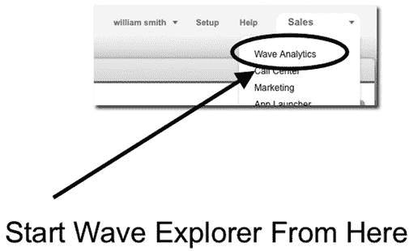

图 2-1. 从 Salesforce 控制台启动 `Cloud Explorer`

一旦 `Cloud Explorer` 启动，您将看到主屏幕，并可以开始使用此产品的功能。这些可能性如图 2-2 所示。

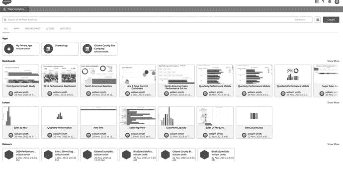

图 2-2. `Cloud Explorer` 主屏幕

主屏幕中间是一个允许您按名称搜索对象的框。搜索栏下方是 `Cloud Explorer` 中四个主要对象的选项卡：数据集、透镜、仪表板和应用程序。

首先创建数据集。从数据集中创建透镜；透镜用于创建在仪表板编辑器中操作的数据视图。请注意，如果底层数据发生变化，数据视图也会随之改变。主屏幕右上角有两个按钮，如图 2-3 的特写视图所示。

图 2-3. `Cloud Explorer` 主屏幕右上角的按钮

左侧按钮切换到 `Cloud Explorer` 中所有对象的紧凑列表视图；此列表对于拥有大量对象的用户非常有用。该按钮也可用于切换回缩略图视图。

右侧按钮用于创建数据集和应用程序，如图 2-4 所示。

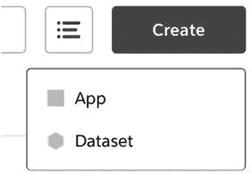

图 2-4. `Cloud Explorer` 的创建按钮，用于创建应用程序或数据集

创建数据集是使用 `Cloud Explorer` 和创建对象的第一步。按下此按钮后，您将看到如图 2-5 所示的屏幕。

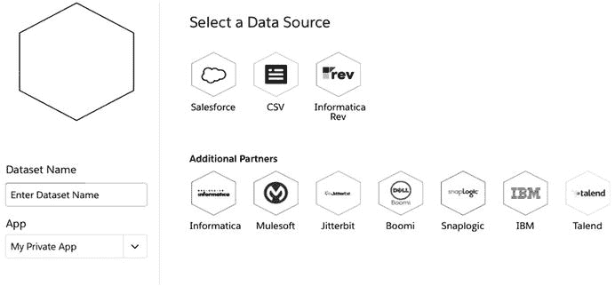

图 2-5. 创建数据集的屏幕

我们将在第 3 章中详细讨论实际创建数据集的过程。现在，让我们继续检查 `Cloud Explorer` 中的每种对象类型。我们从数据集开始。

### 数据集

数据集是数据的容器。Salesforce 分析云中使用的所有数据都保存在数据集中。这些数据集驻留在基于云的服务器上，该服务器在后台运行，为 `Cloud Explorer` 应用程序提供数据。`Wave` 数据服务器是性能的关键；它能够快速摄取包含数千行数据的数据——事实上，只需几分钟。一旦创建了数据集，`Wave` 会实时快速执行该数据的聚合、过滤、排序和呈现，并将其提供给 `Wave` 用户界面。

放入 `Wave` 数据服务器的数据存储在一个“分面”数据库中，其唯一目的是支持数据的快速检索；最重要的是，它是一个响应迅速的用户界面。除了 `Wave` 用户界面或 `API` 之外，无法通过任何其他方式访问放入 `Wave` 服务器的数据。也就是说，不能在数据服务器中修改记录。实际上，可以对 `Wave` 数据服务器执行的操作只有三个：创建数据集、更新数据集和删除数据集。

此外，进入 `Wave` 的数据是“单向”的。`Wave` 服务器并非通用目的；实际上，没有实用的方法可以像对传统数据库服务器那样对 `Wave` 数据服务器运行查询。

#### 数据集的行级安全

保护数据安全始终是数据库方面的一个关注点。例如，某些记录可能很敏感，不应被所有人查看。默认情况下，用户可以访问数据集中的所有数据，但 `Cloud Explorer` 具有行级安全功能，可以限制对某些记录的访问。

要实现行级安全，您需要为您希望限制访问的每个数据集定义一个谓词或过滤器。我们不会在本章中介绍安全谓词，但将在第 4 章中提及它们。

### 透镜

透镜是数据集中数据的视图。开发视图是在 `Cloud Builder` 内执行的多步骤过程，这在第 3 章中会介绍。一旦透镜完成，它可以单独使用，也可以集成到仪表板中。为了更好地理解透镜，我们更详细地介绍视图的要素。

### 度量

Salesforce Analytics Cloud 主要针对数值数据执行分析。因此，`度量`（Measures）是可聚合的数值数据。要开始创建透镜，您首先需要从数据集中选择一个感兴趣的 `度量`，并同时选择一种聚合方式。`度量` 可用的聚合方式包括：求和、平均值、最大值、最小值和唯一值。您还可以根据任何 `度量` 或维度的 `记录计数` 来创建 `度量`。

`度量` 是通过透镜中的 `+Measure` 按钮创建的，如图 2-6 所示。创建 `度量` 时，用户需从数据集中选择一个 `度量`，并指定一种聚合方式。

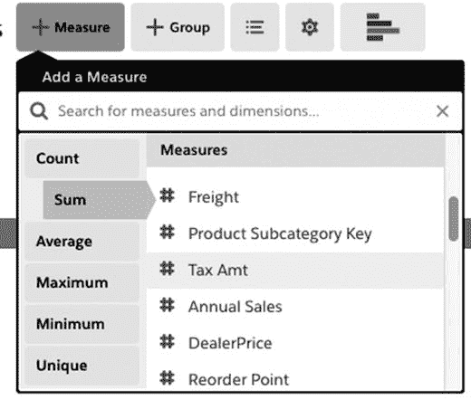

图 2-6. 向透镜添加 `度量`

当至少选中一个 `度量` 后，您就可以向该透镜添加维度了。维度将在下一节中介绍。

### 维度

维度是度量的属性；它们提供了一种细化和分组度量的方法。维度可以由文本或数值数据组成。创建数据集时，`Cloud Builder` 会将所有纯数值列指定为度量，但您可以将其更改为维度。不过，当一个列被指定为维度后，就无法再改回度量。由于这种不可逆性，如果您希望将同一列同时用作维度和度量，则需要复制该列，并将其一个副本指定为维度，另一个指定为度量。

要将维度应用于透镜，请使用 `+Group` 按钮，如图 2-7 所示。

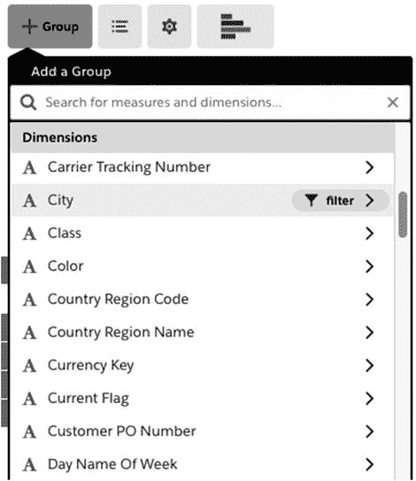
图 2-7. 向透镜添加维度

当维度被添加到透镜后，您可以通过点击选择器消息框右侧的“筛选器”按钮来指定一个筛选条件。`Cloud Builder` 会显示该筛选器可能的取值。例如，图 2-8 展示了一个月份数字筛选器，其中选中了月份 1 和 2（一月和二月）。

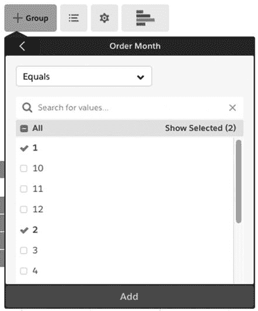
图 2-8. 向透镜添加月份维度

### 日期

在创建透镜时，日期的使用方式与维度类似。然而，日期是 `Cloud Explorer` 中的一种特殊数据类型。当您选择一个日期用于数据分组时，可以选择一个粒度级别，如图 2-9 所示。

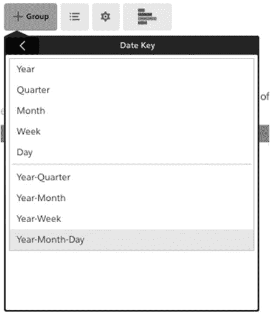
图 2-9. 为透镜选择日期选项

### 综合运用

现在，让我们看一个在 `Cloud Builder` 中创建图表演示文稿的示例。用于构建此示例图形的数据集是从公开来源收集的美国所有核电站列表。我们选择了水平条形图，这是最常见的图表演示类型之一。该条形图有两个维度。第一个是核电站建设许可证的签发日期。此数据集包含完整日期，但出于演示目的，我们只选择了月份和年份，由维度的前三个字符表示。还有两个三字符值：`pwr` 代表压水反应堆，`bwr` 代表沸水反应堆。我们选择的度量是 `Licensed Mwt`，它表示核电站的总输出功率（单位是兆瓦）。这个完成的条形图如图 2-10 所示。

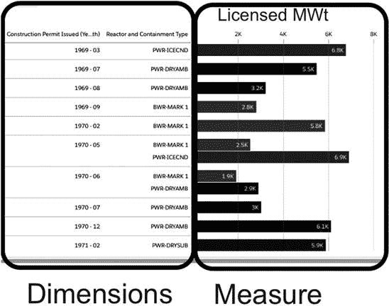
图 2-10. 展示核电站数据的选项

如果您只想查看拥有压水反应堆（`pwr`）的电站，可以对“反应堆和安全壳类型”应用一个筛选器，如图 2-11 所示。

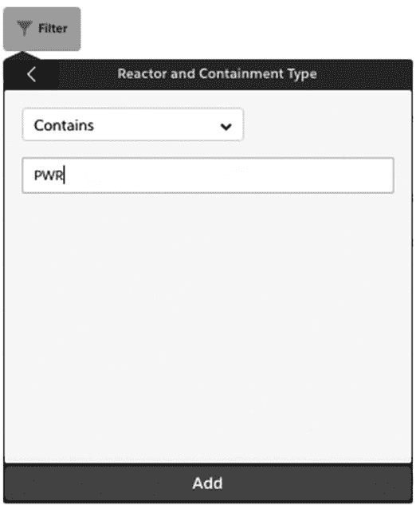
图 2-11. 对反应堆类型维度应用筛选器

现在，图形将只显示维度为 `pwr` 的电站列表，如图 2-12 所示。

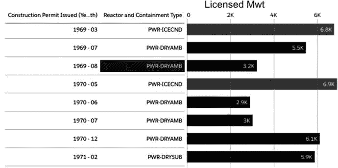
图 2-12. 应用反应堆类型筛选器后的数据展示

### 边做边学

还记得本章开头那句引用的孔子箴言，告诫我们要做“践行者”吗？`Wave` 使得在透镜中尝试不同的图表类型变得非常容易，并且通过实验找到最适合您需求的图表类型是很有启发性的。还有表格类型，包括原始数据转储、对比表格和数据透视表。图 2-13 展示了一个对比表格的示例。这种展示方式允许您更改列名，从而可以将不同的度量放在一起显示，一个作为数值，一个作为图形。

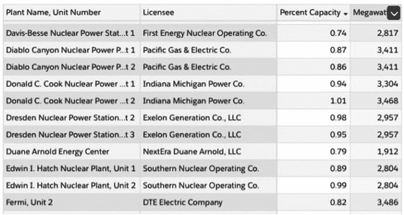
图 2-13. 对比表格

### 透镜修改历史、撤销和重放

在您试用透镜时，可以通过使用 `Cloud Builder` 屏幕左上角的按钮来随时撤销您的更改或查看透镜的修改历史。例如，图 2-14 显示了“历史”、“后退”和“前进”按钮。请注意，当您按下“历史”按钮时，会列出所有已进行的更改；如果将光标悬停在某个历史记录项上，则会显示与该更改关联的透镜版本的缩略图。

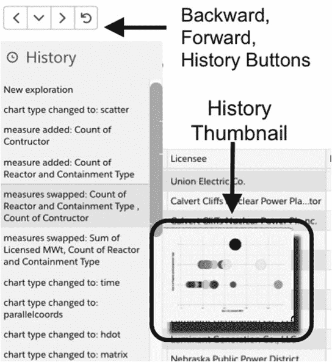
图 2-14. 前进、后退和历史按钮，以及透镜历史缩略图

### 探索数据

当您使用透镜时，请注意您通常可以点击图表中的任何值，以显示一个标记为 `Drill Into This By…` 的子菜单。利用此功能，如图 2-15 所示，您可以选择另一个维度，从而进一步细化您的数据。点击任何一个维度都会打开透镜的一个新版本。当然，您可以使用前面提到的“后退”按钮返回到先前版本。

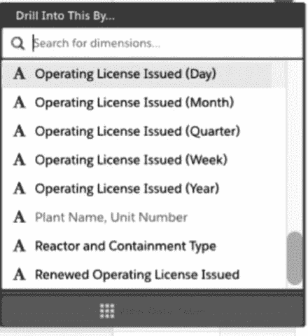
图 2-15. 使用 `Drill Into This By…` 屏幕进行数据探索

### 移动端透镜创建

您可以在 `iPhone` 和 `iPad` 应用程序上创建透镜，其功能与桌面客户端类似。这包括深入探索数据的能力。第 6 章将展示一个利用 `Salesforce Analytics Cloud` 移动端功能的用例。

## 仪表板

`Cloud Explorer` 的仪表板使您能够将多个图形或其他数据可视化内容组合到单个视图中。仪表板包含一个专注于美学的网格编辑器，从而使您能够制作视觉上吸引人且在对客户演示中有用的展示文稿。

您还可以使用仪表板来促进任何数据探索。当您在仪表板的某个小组件上做出选择时，它会允许您细化数据，并且此更改会反映在所有其他仪表板小组件上。本书将在多个地方演示此功能，因此您将能够看到它的实际应用。现在，让我们来看看仪表板上可用的一些小组件。

### 组件

通俗来说，各种类型的组件是构成仪表盘的工具。图 2-16 展示了在 `Cloud Builder` 中可以找到的组件。

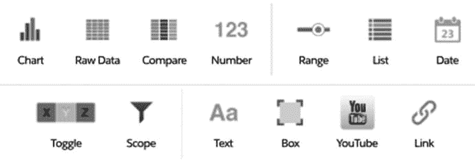
图 2-16. Cloud Builder 中可用的组件

组件有三种基本类型：数据展示类、选择器类和显示类。

#### 数据展示组件

这些组件都用于展示来自数据透镜的数据。它们根据各自用途具有不同的能力，因此有些组件适用于多个度量，而另一些则只适用于单个度量。

#### 图表组件

图表组件提供的图表类型与您构建数据透镜时可用的图表类型相同。在构建仪表盘时，您可以随时更改图表类型，因此不受构建数据透镜时所用图表类型的限制。

当您选择一个组件时，`Cloud Builder` 屏幕的右侧会弹出一个属性窗口。其中有一个默认属性标记为 `"faceted"`。如果您取消选择某个组件的 `"faceted"` 属性，那么当您使用其他组件应用任何细化筛选时，该组件上的数据将不会随之变化。`faceted` 属性如图 2-17 所示。

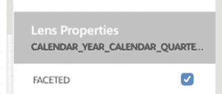
图 2-17. `faceted` 属性默认被选中

#### 原始数据组件

顾名思义，该组件允许您查看来自数据透镜的电子表格样式的数据表。您可以根据需要移除列、调整列的位置，以及根据某一列的数据对表格进行排序。要在仪表盘中使用原始数据组件，您必须先使用原始数据组件创建一个数据透镜。

#### 比较表组件

图 2-13 中展示了一个比较表的示例。请注意，比较表与原始数据组件有同样的要求：您必须先在一个数据透镜中创建一个比较数据组件，然后才能在仪表盘中将其使用。

#### 数值组件

数值组件用于在仪表盘上显示单个数值。要使用数值组件，您必须创建一个包含度量和聚合、且未应用任何分组或维度的数据透镜。数值对于显示汇总数据（如总销售额或其他合计总数）非常有用。

#### 切换组件

切换组件既是维度的选择器，也是度量的展示组件。它可用于对维度应用细化筛选，也可展示与该维度关联的聚合数据。切换组件是功能最强大、用途最广的组件之一，在本书提供的示例中被广泛使用。

### 选择器组件

以下组件基于数据类型提供了直观的数据细化方法。

#### 日期组件

日期组件用于选择日期范围，并且必须与来自数据透镜的日期数据一起使用。日期组件是一个强大的选择工具，因为它提供了许多不同的日期选择方式，如图 2-18 所示，包括按季度、月份或周选择。

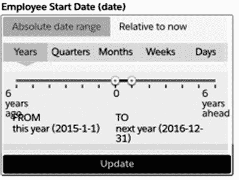
图 2-18. 日期组件

#### 范围组件

# Salesforce Analytics Cloud

范围组件如图 2-19 所示。它用于选择一个数值范围来细化度量。要使用范围组件，您必须创建一个包含度量和聚合、且未应用任何分组或维度的数据透镜。

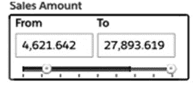
图 2-19. 范围组件

## 显示组件

这些组件仅用于显示，且只能在设计时进行修改。

### 范围指示组件

范围指示组件展示应用于数据透镜数据的筛选器。它不允许更改筛选条件，仅是一种展示机制。图 2-20 展示了范围指示组件，其中对日期数据应用了筛选以选择第一季度，并对区域维度应用了筛选以仅选择美国和加拿大。

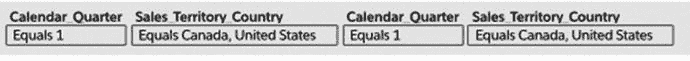
图 2-20. 范围指示组件

### 文本组件

文本组件允许您向仪表盘添加标题、说明或关于数据的注释。您可以使用此组件更改字体大小和文本颜色。

### 方框组件

方框组件允许您向仪表盘添加一个阴影区域，用于在视觉上将组件分组，或突出显示仪表盘的某些方面。

## 仪表盘开发周期

所有仪表盘都基于数据透镜的数据构建，您必须首先开发一个数据透镜以生成数据视图，然后才能被仪表盘组件使用。此工作流将在第 3 章中演示，但此处我们进行简要总结。

当您在 Cloud Builder 中找到数据后，可以使用 Cloud Builder 屏幕右上角的按钮来“`clip`”数据，使其可供仪表盘使用。此按钮如图 2-21 所示。

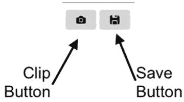
图 2-21. `Clip` 和 `Save` 按钮

请注意，仪表盘和数据透镜构建器都有一个 `Save` 按钮。您应经常使用它来保存对仪表盘或数据透镜的更改。请注意，Cloud Builder 中的更改不会自动保存，因此如果您不经常使用 `Save` 按钮，可能会丢失工作成果。另外，保存数据透镜仅保存与该数据透镜关联的查询；它不会保留数据快照。

一旦您裁剪了数据透镜，就可以进入仪表盘编辑器来使用数据透镜的数据。当您裁剪一个数据透镜时，如果与该数据透镜关联的仪表盘尚不存在，则会创建一个新的仪表盘。您可以通过仪表盘左侧的控件查看仪表盘中的所有数据透镜数据，如图 2-22 所示。通过此控件，您可以删除任何未被组件使用的数据透镜数据，并选择要由组件使用的数据透镜数据。

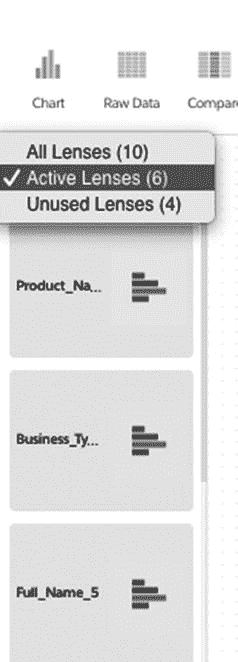
图 2-22. 仪表盘构建器中的数据透镜数据浏览器

要使用数据透镜数据，请从工具栏中选择一个组件；它将出现在仪表盘构建器上。其数据可与此组件一起使用的数据透镜将在数据透镜数据浏览器中高亮显示。您选择要使用其数据的数据透镜，并将其拖拽到组件上。如图 2-23 所示，并在第 3 章中有更详细的描述。

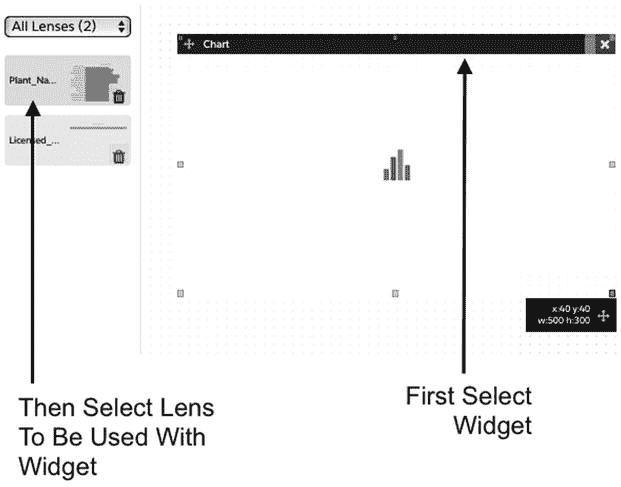
图 2-23. 将数据透镜数据与组件关联

## 链接回数据透镜

在仪表盘上，组件有一个按钮，允许您链接回与该组件一起使用的数据透镜。此按钮如图 2-24 所示。单击此按钮将立即打开数据透镜以供查看。当基于仪表盘中使用的同一数据透镜创建新的数据透镜时，这是一个有用的工具。

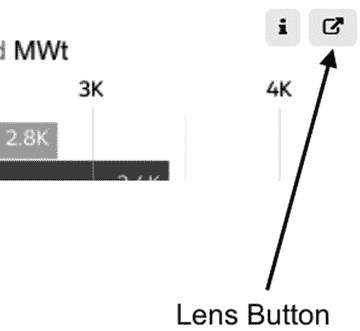
图 2-24. 用于查看先前数据透镜的数据透镜按钮

您可以禁用 `Lens` 按钮，这样做的原因有多种。例如，您可能希望防止用户无意中单击它，或者防止他们浏览数据透镜的数据。`Lens` 按钮的禁用属性如图 2-25 所示。

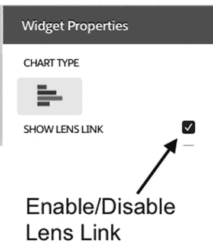
图 2-25. 启用/禁用 `Lens` 按钮

您可能已经注意到图 2-23 中带有一个 `"i"` 的按钮。您可以使用此按钮显示组件的相关数据透镜信息。

## 仪表盘小结

通过本节涵盖的信息，您应该能够开始创建自己的仪表盘了。关于仪表盘的更多信息，请参阅第 3 章。第 5 章和第 6 章提供了展示仪表盘使用的用例。

## 应用程序

Cloud Explorer 的最后一个主要元素是其应用程序。应用程序允许您将仪表盘、透镜和数据集打包在一起。除了容器功能外，这些应用程序本身没有其他固有特性，因此也没有对应的编辑器。应用程序是通过前面图 2-4 中显示的 `Create` 按钮创建的。

当您为对象使用 `Save` 按钮时，可以将其与某个应用程序关联。数据集可以通过编辑并更改其关联的应用程序来与应用程序关联。一个应用程序可以包含任意数量的数据集、仪表盘和透镜。

### 我的私有应用程序

Cloud Explorer 中有一个默认应用程序，名为 `My Private App`。顾名思义，其他用户无法看到此应用程序中的任何内容。这是所有对象的默认 `Save` 位置，也是一个暂存区域或草稿本，您应在对象准备就绪供公开使用之前，将它们存储在此处。

### 共享按钮

应用程序、透镜和仪表盘都有一个 `Share` 按钮，您应该已经注意到了。`Share` 按钮用于与拥有 Salesforce 登录凭据的其他用户共享对象。应用程序的 `Share` 按钮如图 2-26 所示。

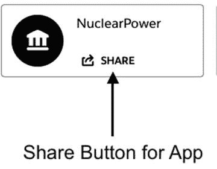
图 2-26. 应用程序的 `Share` 按钮

点击 `Share` 按钮将打开图 2-27 所示的消息框。此消息框的功能是共享和协作的常用方式，允许您选择要共享的单个用户或您组织中的特定人员级别。例如，您可以发布到 Salesforce 动态、截取屏幕截图，并获取一个 URL，以便与您允许查看该应用程序的用户共享。这种协作功能使得在 Salesforce Analytics Cloud 中共享您的数据发现工作变得非常简单。请注意，共享屏幕截图会创建一个图形快照，可以与非 Salesforce Analytics Cloud 用户共享。但是，无法与这些用户共享仪表盘或透镜。

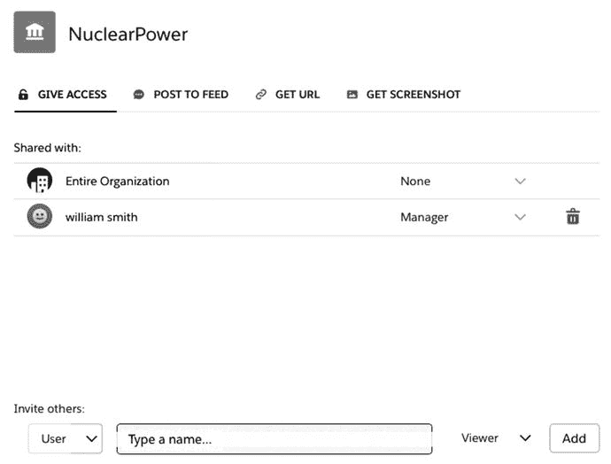
图 2-27. 应用程序的共享选项

### 演练数据

Cloud Explorer 可以在移动设备上访问“演练数据”，您可以用它来熟悉 Cloud Explorer。这些数据由不同的应用程序组成，因此您可以看到其所有元素的良好示例。

## Wave 的不足之处

您可能正在评估 Wave 是否适合作为数据发现产品，因此指出可能构成障碍的方面非常重要。

### 文本处理与分析

Wave 本质上是一个只能对数值数据执行基本聚合的产品。它不具备执行文本处理的能力，并且缺乏用于文本分析的可视化（例如标签云）。Wave 可以将文本用作其可视化中的维度，但在此上下文中，其目的仅是为数值数据提供意义。

为了说明这一点，假设您有一个简单的电子表格，按品牌和型号对汽车的四分之一英里时间进行排名，那么汽车的名称将简单地作为图表上的图例或轴标签呈现在数值数据旁边。Wave 无法对汽车名称执行演示。Wave 也缺乏对文本数据执行搜索的能力。因此，如果您的数据集是一个包含六十多年生产的汽车的长长列表，您将无法搜索任何汽车的名称。但是，您可以对文本进行筛选，在某些情况下这可能会满足您的需求。

### 地图与地理空间数据

Wave 在其可视化控件或小部件中无法处理地理空间数据。如果您正在寻找一款带有地图组件、允许通过点击地图来选择和细化数据的数据发现产品，那么您可能需要考虑其他数据发现产品。

### 高级数学与统计函数

高级数学函数在 Wave 中不可用。通常，数据发现产品并不普遍具备此功能，因此，如果您正在设计需要更复杂数学函数（如标准差或移动平均值）的应用程序或工作流，则应在将数据加载到 Wave 之前对这些数据进行计算。

## 结论

本章探讨了 Salesforce Analytics Cloud 中最面向用户的部分，即 Cloud Explorer。这里介绍了 Cloud Explorer 的主要元素，包括数据集、透镜、仪表盘和应用程序。同时提供了帮助初学者开始使用 Cloud Explorer 的信息，随后回顾了 Cloud Explorer 的共享能力及其一些局限性。

请记住孔子的建议：要成为一名“践行者”以获取知识。凭借本章提供的信息，您可以迈出成为 Cloud Explorer 践行者的第一步。