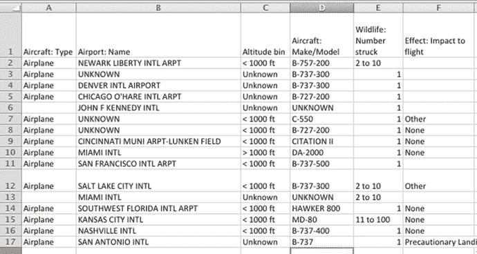
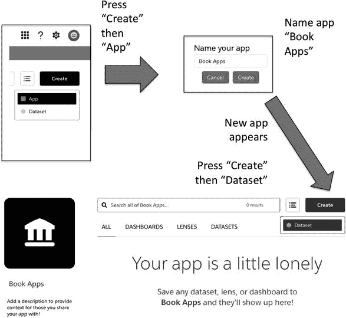
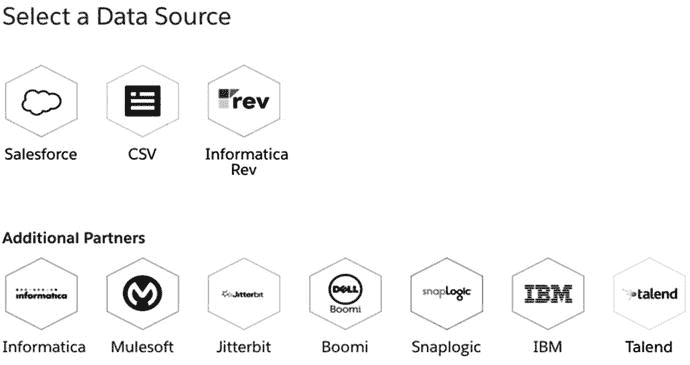
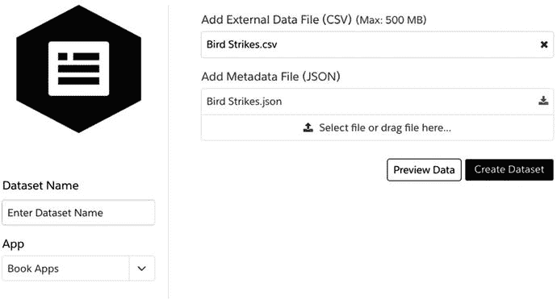
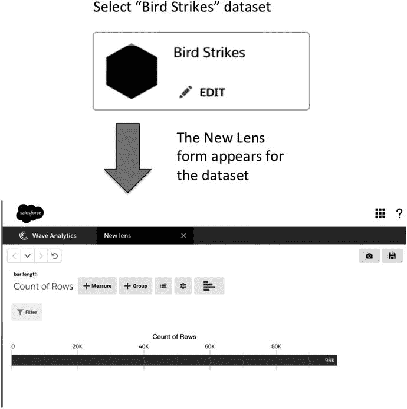

# 3. Analytics Cloud 构建器

> 在新的信息社会中，正因为数据如此之多，直觉才变得愈发有价值。 — [约翰·奈斯比特](http://en.wikipedia.org/wiki/John_Naisbitt#_blank%23John%20Naisbitt%20wiki)

美国作家兼演讲家约翰·奈斯比特在其未来趋势研究中备受推崇。他延伸了爱因斯坦的结论——“唯一真正有价值的东西是直觉”，强调了在数据爆炸和丰富的时代，人类直觉的重要性。一个直观的用户界面来探索数据和开发可视化至关重要，而这正是 Salesforce Analytics Cloud 的关键优势之一。

在第 2 章中，我们介绍了 Salesforce Analytics Cloud 中提供的各种可视化。在本章中，我们将重点介绍如何使用 Analytics Cloud 构建器设计仪表盘。

我们将首先使用一个简单的数据集，从头开始逐步创建一个仪表盘。然后，我们将讨论关于设计可视化的最佳实践主题。还将演示如何通过移动设备创建数据集和仪表盘，随后介绍使用 SAQL 进行的高级仪表盘开发。

## 构建一个简单仪表盘

在本节中，我们将首先进行一个逐步的仪表盘构建练习。所有数据集和 JSON 模板都可以从 [`www.apress.com/9781484212042`](http://www.apress.com/9781484212042) 下载，并点击 `Source Code` 选项卡。您可以跟随我们逐步讲解的示例进行操作。

### 加载数据集

我们使用的数据集是一个来自美国联邦航空局（FAA）公共数据库的 `.csv` 文件，记录了鸟击统计数据。它包含了每一起记录的鸟击事件信息，包括事故机场、海拔高度、飞机制造商和型号、位置、飞行日期和时间、损坏情况、航空公司、始发州、飞行阶段、天气条件、野生动物体型以及物种等。

图 3-1 是原始数据集在 Microsoft Excel 中的屏幕截图。请注意，并非所有数据列都已显示。

图 3-1. 原始鸟击数据集

我们使用 Analytics Cloud 的数据加载器用户界面（UI）将数据集上传到系统。步骤如下：

从 Analytics Explorer 主页点击屏幕右上角的“创建”（Create）按钮。按“应用”（App），创建一个名为 `Book Apps` 的应用。然后再次点击“创建”按钮并选择 `Dataset`（参见图 3-2）。

图 3-2. 创建应用和数据集

点击“选择数据源”（Select a Data Source）菜单下的 `CSV` 按钮（参见图 3-3）。

图 3-3. 选择数据源

在 `Dataset Name` 文本框中输入“鸟击”（Bird Strike）。从下拉列表中选择希望数据集所在的应用名称。在本例中，我们已经创建了一个名为 `Book Apps` 的应用。回顾一下，我们在第 2 章中介绍了如何使用“创建”按钮来创建应用。点击 `Select file or drag files here` 并导航到数据集位置。系统将自动生成一个 JSON 格式的元数据文件，您可以下载并根据需要修改。或者，您也可以上传自己的元数据文件作为数据集定义（参见图 3-4）。

图 3-4. 输入数据集元数据

点击 `Create Dataset` 按钮，您的数据集将被上传到 Analytics Cloud。数据集通常会立即创建，但通常会有一条消息显示“您的数据集将在 1 小时内创建完成”。

一旦系统完成数据加载过程，您的数据集将出现在 Analytics Cloud Explorer 中供使用。您可以通过创建数据集时所在的应用包装器，或者点击顶部的 `DATASETS` 选项卡来导航到数据集。点击“鸟击”数据集以查看新数据集（参见图 3-5）。

图 3-5. 选择“鸟击”数据集进行查看