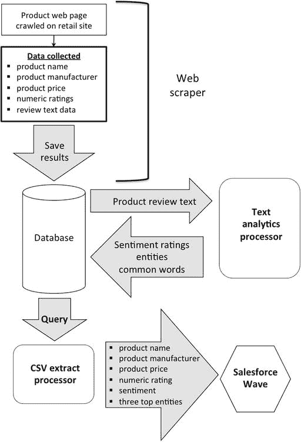
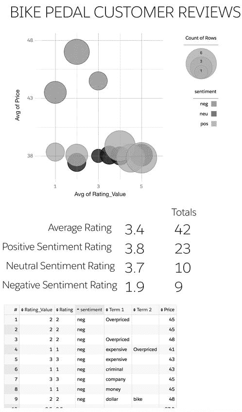
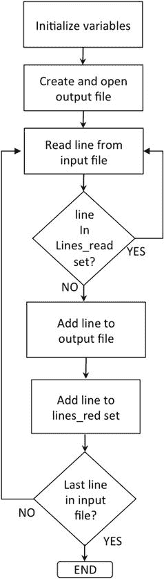

## 7. 高级数据采集与处理

> 知晓最小之事与最大之事。最浅之事与最深之事。——宫本武藏，《五轮书》

宫本武藏是一位日本剑术大师，在 60 场决斗中未尝败绩。武藏的成功植根于一种深刻的哲学思想，即力求对大小事物有完整的认知。信息技术亦是如此。培养并维持对广泛技术主题的理解，意味着当问题出现时，你将拥有更多的知识和技能来攻克它们，并为这些问题制定创新的解决方案。

本着这种理念，本章我们将脱离严格局限于 `Salesforce Analytics Cloud` 的讨论，对用于采集数据的一些工具和技术进行概述。随后将讨论数据处理以及使数据可用于诸如 `Salesforce Analytics Cloud` 等分析产品的数据处理工具。这些工具的目的在于使数据可供像 `Salesforce Analytics Cloud` 这样的分析产品使用。本章的主要目标是提高对这些替代方案的认识，以便你在需要时可以使用它们。

本章的后半部分将介绍 `Python` 语言，并提供两个使用 `Python` 清理数据以供可能在 `Salesforce Analytics Cloud` 中使用的示例。

### 数据采集——工具与技术

有三种类型的工具可提供三种不同的能力。我们将从一般意义上描述这些工具，而不关注具体的供应商产品，因为可供考虑的供应商实在太多。

#### 网络爬虫（Web Scrapers）

网络爬虫用于从网站收集信息。既有商业版也有开源版的网络爬虫可用。一些商业网络爬虫还具有从诸如 Microsoft Excel 电子表格或 `.pdf` 表单等文档中收集信息的附加功能。

网络爬虫利用网页的文档结构来提取特定项目。一些先进的商业网络爬虫拥有可视化界面，允许在很少或无需编程的情况下开发自动化抓取程序。这些网络爬虫可以发现网页的文档结构，并在网站上以覆盖层的形式显示字段。

网络爬虫非常适合从结构不随内容变化而变化的网站中提取信息。网络爬虫的一个常见用途是从像亚马逊这样的在线零售商处提取产品的评论和反馈。例如，网络爬虫可以提取整个类别中每个产品的所有意见数据，包括客户评论和满意度评级。

网络爬虫收集选定的信息后，会将其保存为各种格式，包括 `.csv` 文件。许多商业网络爬虫可以写入关系数据库。

#### 网络爬虫（Web Crawlers）

网络爬虫以编程方式从网站收集信息。它们可以跟踪网页上的超链接，深入网站的多层页面。它们可用于调查公司的网站，非常适合进行竞争研究。一些商业爬虫还提供爬取文件系统和 `ftp` 服务器的能力，以查找诸如 `.pdf` 文件、Word 文档和 Excel 电子表格等办公文档类型，然后从中提取信息。

网络爬虫与网络抓取工具的不同之处在于，它会从网站收集所有文本信息，而不仅仅是特定项目。大多数网络爬虫都有深度设置，用于指定超链接导航的程度。为爬取深度设置更高的数值意味着你会收集更多的数据——但也需要更长的运行时间。网络爬虫通常有一个“礼貌”设置，用于限制向被抓取网站发送请求的速度，以免使这些网络服务器不堪重负。

爬虫往往从网站提取大量信息，因此如果不使用其他工具，可能难以管理。文本分析处理器（如下所述）通常用于处理网络爬虫获取的数据。

### 文本分析处理器

文本分析处理器是独立的应用软件，能够接收来自任何来源的文本，并定位文本中特定实体，例如人物、地点和事物。它们省去了分析大量文本数据的繁琐工作。许多文本分析处理器还提供情感分析功能，或是对一段文本的正面、中性或负面状态进行概述。此功能在处理消费者对产品的评论时通常会被应用。文本分析处理器还可以汇总来自网页抓取程序和网络爬虫的输出结果。

### 这些工具的应用

那么，这些工具是如何应用于数据采集的呢？让我们探讨一个设计模式，以我们对某网络零售商数据进行的消费者研究为例。前述工具用于提取数据，这些数据随后可被整合到 `Salesforce Analytics Cloud` 中，从而显示公司产品的总体评分及其价格。这个设计模式如图 7-1 所示。



`图 7-1.` 网页抓取程序和文本分析处理器的设计模式

尽管 `Salesforce Analytics Cloud` 主要面向数值数据，但它仍可用于分析来自网页抓取程序的数据。网页抓取程序提取价格和数值评分，这些数据都是数字。文本分析处理器则使用情感分析来确定产品评论是正面、中性还是负面的。由 `.csv` 提取处理器处理的查询包含每条评论的一条记录。

图 7-2 显示了一个在 `Salesforce Analytics Cloud` 中使用这些客户评论数据创建的仪表盘。



图 7-2. 根据客户评论数据创建的仪表盘

该仪表盘提供了数据的清晰概览。支付超过 40 美元购买该产品的客户留下了负面评论。然而，很明显，情感倾向与评分之间没有相关性。正面和中性情感的平均评分值仅相差 0.1。最终，原始数据揭示了一个故事，证实了负面情绪、低评分和价格之间的相关性，并提取了诸如“价格过高”、“昂贵”，甚至“可恶”等词汇。

请注意，评分和价格在数据集中既被用作维度，也被用作度量。这是因为，当一个数值度量被用作维度时，它有时可以揭示关于另一个不同数值度量的洞察。在此案例中，价格同时作为维度和度量，为评分提供了洞察。

## 数据处理——术语与概念

如本章开头所述，理解数据处理的本质以及特定技术的使用方法非常有价值。简而言之，数据处理是对数据的操作，使其变得有用。`Salesforce Analytics Cloud` 和其他工具只有在数据经过处理后才能使用数据。正如我们从第 4 章中所知，`Salesforce Analytics Cloud` 只能使用 `.csv` 格式的数据。但是，还必须进行其他数据处理，以确保 `Salesforce Analytics Cloud` 中的透镜和仪表盘包含有意义且准确的数据。

为了更好地理解数据处理，让我们回顾一些与之相关的术语和概念。这些概念包括数据整理、数据标准、数据质量和数据清洗，以及数据标准的强制执行。

### 数据整理

数据整理是指将数据从一种格式转换为另一种格式，以使数据可用。它通常从一个手动原型设计阶段开始，并最终形成一套定义明确的步骤序列。例如，`Twitter` 以 `JSON` 文档的形式提供推文数据。如果你想把来自 `Twitter` 的数据放入 `Salesforce Analytics Cloud`，你需要先将 `Twitter` 中的可用字段提取到 `.csv` 文件中，然后才能将其放入数据集。

### 数据标准

数据标准是关于组织内部或管理机构持有的数据格式的规则。数据标准确保任何系统中的数据在格式和内容上保持一致。因此，数据标准通常在数据被使用之前，在用户输入数据或从外部来源接收数据时执行。

例如，来自供应商或卖家的许多数据源使用不同的缩写来表示州名或道路类型等事物。为了确保一致性，地址数据中的所有路名都可能被更改为 `"Rd."`，而所有街名都被转换为 `"St."`。

### 数据质量

数据质量是数据符合数据标准的程度，并且没有损坏或不完整的记录。碎片化且不完整的数据被认为是低数据质量的，其对数据标准的合规性水平也较低。

### 数据清洗

数据清洗是检测并从数据中移除损坏或不完整记录的过程。数据清洗可以与数据整理（见上文）结合进行。数据清洗还可能涉及删除重复记录和执行数据标准。数据清洗产生高质量的数据。在对数据进行数据清洗之前，这些数据通常被称为“脏数据”。通过数据清洗，脏数据变得“干净”。

## Python：一种用于数据处理的编程语言

如果你参加了足够多的会议演讲，你就会意识到，并非所有与数据处理相关的任务都能在第 4 章讨论的 `ETL` 工具、数据库服务器端编程或 `Java` 的范围内完成。`Python` 已成为连接众多以数据为中心的应用程序的金线。它成为许多 `IT` 专业人士的选择，因为它是一种可用于数据清洗和整理的技术。

在 2015 年商业智能、仓储与分析峰会上，许多思想领袖发表了涉及使用 `Python` 加载或转换数据的演讲。在此次会议的演讲中，`Python` 并未取代 `ETL` 工具或数据库服务器端编程的功能，而是提供了其他平台所缺乏的功能或连接性。在 `Java` 和 `Microsoft Visual Basic` 等众多流行编程语言中，为什么 `Python` 在与数据处理相关的任务中变得如此受欢迎？当你审视 `Python` 的优势时，就不难理解了。

### 可读性与易用性

许多编程语言使用特殊字符作为代码块和语句的分隔符。例如，在“C”编程语言中，花括号（`"{"` 和 `"}"`）用于指定代码块，分号用于指定行尾。即使是在最基本的“Hello, World”类型的程序中，你也无法摆脱这些特殊字符，如下所示：

```
{
    printf("Hello,
World");
}
```

程序员通常使用缩进来组织代码。`Python` 避免使用特殊字符，而是使用缩进来指定代码块，因为大多数程序员已经使用缩进来组织代码。在 `Python` 中，“Hello, World”示例简化为如下版本，没有特殊字符。

```
print "Hello, World!"
```

这种可读性使得 `Python` 易于学习和使用，尤其是对于那些并非全职程序员，但需要执行数据处理任务的人——例如业务分析师和数据库管理员。

### 简单性

多数编程语言会随时间不断扩展和演变，并提供了多种完成任务的方式。`PERL` 编程语言就是一个很好的例子。`PERL` 的设计哲学可以用一句话概括：“总有不止一种方法去实现它”（`TMTOWTDI`）。而 `Python` 的哲学则拒斥这种方式。相反，`Python` 的核心理念是：“应该有一种——并且最好只有一种——显而易见的方式去做事。”这一哲学让 `Python` 比 `PERL` 等语言更易于学习和使用。

### 可移植性

`Python` 在 `Red Hat` 和 `SUSE` 等常用的企业级 `Linux` 操作系统上默认安装。它预装在 `Mac OSX` 上，也可以轻松安装在 `Microsoft Windows` 上。它同样是 `Solaris`（`Sun` 公司的 `Unix` 版本）的标准组件，并能方便地安装在 `IBM AIX UNIX` 上。凭借这种可移植性，`Python` 代码可以在工作站上开发和原型设计，然后迁移至企业级服务器。

### 设计与调试

`Python` 配备了一个命令行解释器，可以轻松测试和调试任何单个命令或命令序列。这消除了完全在编辑器中开发代码的必要，允许在解释器中逐行测试简单程序。

### 多功能性

曾几何时，需要电池才能工作的产品会用“电池已附”来表明产品开箱即用、百分之百就绪。你可以将 `Python` 视为“电池已附”的编程语言。它有丰富的功能库，能够满足任何类型的编程需求，包括数据处理。本章稍后会介绍其中一部分，但可以确信的是，`Python` 拥有连接任何数据源并执行几乎任何计算或数据操作活动的库。这很大程度上得益于 `Python` 强大的用户社区，这个社区包括开源软件开发者、大学以及私营企业。

`Python` 在顶尖软件开发者中获得了广泛认可。部分原因在于 `Python` 遵循了计算机语言设计的正确计算机科学原理。这促使麻省理工学院（`MIT`）在其“计算机科学与编程导论”课程中采用 `Python`。此外，许多大型机构广泛使用 `Python`，包括 `Google`、`NASA` 和 `CERN`。`Python` 既被高技能开发者用于庞大复杂的项目，又让业余程序员也能轻松掌握。

### 教学资源可获得性

有许多免费且提供出色教学的 `Python` 学习网站和视频。上述 `MIT` 的课程提供了在线视频。`Google` 也提供在线 `Python` 教学。如果你考虑使用 `Python`，不妨先看看这些资源。

### 成本

如前所述，成本常常是组织避免使用 `ETL` 工具进行数据处理的原因。`Python` 的许可和使用完全免费。`Python` 功能丰富的库同样免费使用。你可以使用任何编辑器（包括许多免费编辑器）来开发 `Python` 代码。一些优秀的 `Python` 编辑器提供更全面的语法高亮功能，每用户成本不到 100 美元。

## 两个 Python 使用实例

下面来看两个使用 `Python` 进行数据处理——更具体地说，数据清洗——的例子。`Python` 同样适用于数据处理的其他方面，例如数据整理，但为了保持示例简洁，我们聚焦于数据清洗。注意：如果你对代码或编程不感兴趣，可能会觉得这些例子不适合你。然而，每位读者至少应浏览一下这些示例，以感受如何用极少的 `Python` 代码完成大量工作。

### 数据清洗示例 1

第 6 章 展示了渥太华县自行车公司的数据。使用的数据是从 `ERP` 系统中提取的销售数据，保存在一个 `.csv` 文件中，该文件被加载到苹果 `iPad` 上的 `Dropbox` 中，随后再加载到 `Salesforce` 分析云中。如果文件中存在重复记录，将会是一个问题，因为它会打乱仪表盘上计算的所有汇总值。为消除这一潜在问题，我们使用一个 `Python` 脚本来检测并删除重复行。该脚本如下面的程序清单所示。图 7-3 是该程序的流程图。

# Python 数据清洗与模糊匹配

## 数据清洗示例 1

```
#!/usr/bin/python
inputFile="/u01/import/csv/OttawaCountyBikes_dirty.csv"
outputFile="/u01/export/csv/OttawaCountyBikes.csv"
#  清理脏 ERP 数据
lines_read = set() # 保存已“见过”的行
# 打开输出文件用于写入
outfile = open(outputFile, "w")
# 打开包含脏数据的文件用于读取
for line_just_read in open(inputFile, "r"):
    # 判断刚读取的行是否不在 lines_read 集合中
    if line_just_read not in lines_read:
        # 如果行未被见过，则将其写入输出文件
        outfile.write(line_just_read)
        # 将刚读取的行添加到 lines_seen 集合
        lines_seen.add(line_just_read)
outfile.close()
```



`图 7-3.` Python 示例 1 数据清洗流程图

在示例 1 中，有一个包含脏数据的文件，因为该文件可能存在重复行。数据来源于渥太华县自行车公司的 ERP 系统，且该公司拥有确保 ERP 中数据质量的标准，因此我们只需担心重复记录。程序中，`inputFile` 变量指向包含未经清洗数据的文件 `OttawaCountyBikes_dirty.csv`。下表逐行追踪了该程序的工作方式。

| 行号 | 说明 |
| --- | --- |
| 2 | 变量 `inputFile` 是包含脏数据的输入文件名。 |
| 3 | 变量 `outputFile` 是清洗后数据的输出文件名。 |
| 4 | 声明一个 `set()` 类型的变量 `lines_read`。`set` 类型会保留每一行处理过的记录，并用于与新行进行比较。 |
| 7 | 打开输出文件用于写入。 |
| 9 | 打开输入文件读取待清洗的数据，并循环遍历文件中所有行，将每一行存储在变量 `line` 中。 |
| 12 | 判断刚读取的 `line` 是否在集合 `last_read` 中。如果该行在 `last_read` 中，则说明是重复行，不会写入输出文件；如果不在 `last_read` 中，则说明是唯一的，将其写入输出文件。 |
| 20 | 处理完成后关闭输出文件。 |

这个相对简单的程序利用了 Python 的高级数据类型（如 `set`）以及以紧凑形式进行这些类型比较的能力。声明为 `set` 的变量是 `lines_read`，它包含了每一行已被检查过的记录。`set` 数据类型包含一个 `.add` 方法，在我们的示例中用于添加行。忽略注释，该程序仅包含九行可执行代码，并高效地完成了删除重复记录的任务。

## 数据清洗示例 2

在本示例中，我们将使用示例 1 中同样用到的渥太华县自行车公司的数据。回顾第 6 章的内容可知，渥太华县自行车公司的产品分为四类：自行车、自行车零部件、服装和配件。其中，服装和配件这两类产品的分销可能涉及二级分销商。二级分销商从仓库采购产品，然后再分销给转售商。部分转售商是在线店铺，其销售范围可覆盖全美各地。这种非传统渠道日益兴起，导致销售额大幅增长。然而，有关在线销售产品的信息处理起来一直很困难。

一家零售情报服务商提供了一个数据源文件，其中包含产品名称以及购买地的地理信息，包括城市、州和邮政编码。在线商家时常会不经意地更改产品名称，而城市、州和邮政编码信息的格式也往往不统一。为了理解这些数据，我们使用一个开源库来对两个数据集进行模糊逻辑比对。这个库名为 `Fuzzywuzzy`，但在使用它之前，我们先来看看在 Python 中安装新库有多简单。

### 安装新库

Python 的一个吸引人之处在于，可以轻松安装新库来实现新功能。在本示例中，我们要安装用于执行模糊逻辑比对的 `Fuzzywuzzy` 库。为此，我们使用 Python 包管理器 `pip`。`pip` 是一个能让包轻松安装的包管理器。

安装新包的语法很简单：

```
$ pip install <包名>
```

下面展示了用于安装 `Fuzzywuzzy` 的命令及其输出结果：

```
$ pip install fuzzywuzzy
正在收集 fuzzywuzzy
  下载 fuzzywuzzy-0.8.0.tar.gz
正在安装已收集的包：fuzzywuzzy
  正在运行 setup.py 以安装 fuzzywuzzy
已成功安装 fuzzywuzzy-0.8.0
```

该操作是在 Red Hat Linux 上执行的，但在 Mac OSX 上同样有效。`pip` 在 Python 中默认并未安装，但安装它很容易——只需运行以下命令：

```
sudo easy_install pip
```

### 使用模糊逻辑进行数据匹配

`Fuzzywuzzy` 可以比对两个值并返回一个百分比匹配度。让我们通过 Python 命令行执行几个命令，来看看它是如何工作的。

我们启动 Python 并直接输入展示的值，以便试验和原型化我们使用模糊逻辑匹配的方法。首先，声明两个变量。第一个变量 `prodNameRef` 包含渥太华县自行车公司数据库中的产品名称。第二个变量 `prodNameComp` 包含前面提到的零售情报服务商提供的产品名称。

`Fuzzywuzzy` 库有一个名为 `fuzz` 的命名空间，用于访问其所有方法。命名空间是在 Python 代码中引用库时使用的名称。

我们使用一个名为 `token_sort_ratio` 的方法来比较这两个变量。在第一次测试中，两个变量包含完全相同的数据，返回值为 100，这意味着两个变量中的数据完全匹配。

```
>>> prodNameRef="ML Road Frame-W - Yellow"
>>> prodNameComp="ML Road Frame-W - Yellow"
>>> fuzz.token_sort_ratio(prodNameRef, prodNameComp)
100
```

零售情报服务商提供的另一个产品名称值与渥太华县自行车公司数据库中的值并不十分接近：

```
>>> prodNameRef="ML Road Frame-W - Yellow"
>>> prodNameComp ="Road Frame-W - Yel"
>>> fuzz.token_sort_ratio(prodNameRef,prodNameComp)
84
```

对于这个值，我们得到了 84，表示 84% 的匹配度。在接下来的测试中，没有出现颜色信息：

```
>>> prodNameRef="ML Road Frame-W - Yellow"
>>> prodNameComp ="Road Frame-W"
>>> fuzz.token_sort_ratio(prodNameRef,prodNameComp)
71
```

71% 的匹配度并不可靠，因为该产品的描述中还有黑色和银色等其他颜色。80% 以上的匹配度表明匹配度很高。掌握了这一点之后，我们可以读取零售情报服务商数据中的每一行数据，并将其与渥太华县自行车公司数据库中的每个值进行比对，直到找到匹配项。

## 数据匹配程序

为了在零售情报服务数据中查找匹配项，会将一个包含正确产品名称的 `.csv` 文件与另一个来自零售情报服务的产品名称 `.csv` 文件进行比较。以下展示了包含正确产品名称的 `.csv` 文件的前十行：

```
HL Mountain Frame - Black,Components
HL Mountain Frame - Silver,Components
ML Road Frame - Red,Components
LL Road Frame - Red,Components
LL Road Frame - Black,Components
HL Road Frame - Red,Components
LL Mountain Front Wheel,Components
ML Mountain Front Wheel,Components
LL Mountain Handlebars,Components
ML Mountain Handlebars,Components
```

接下来展示的是零售情报数据文件的前十行：

这是脏数据；其中的产品名称可能不正确。它还包含每个商品销售地的城市名、州缩写和邮政编码。不过，在本示例中，我们只清理产品名称。

请注意，脏数据中的名称看起来像是被截断或更改过的，例如“Mountain Frame – Bl”，其中“Bl”通常代表黑色。通过使用模糊匹配，我们能够将这样的记录与正确的产品名称配对。下面的程序会循环遍历零售情报数据和参考数据，并使用 `fuzz.token_sort_ratio` 对这两组数据进行比较。变量 `strongMatch` 用于存储最低匹配标准，并将其设置为 80%。

这个程序比上一个示例要长，因此我们不逐行解释。程序的输出会显示在屏幕或控制台上，而不是保存到文件中。这样做是为了我们可以检查程序是否确实能在两个数据集之间找到良好的匹配。一旦验证通过，就可以修改程序，将其写入一个 `.csv` 文件，该文件可用于在 Salesforce Analytics Cloud 中创建数据集。

## 示例程序

```
#!/usr/bin/python
from fuzzywuzzy import fuzz
from fuzzywuzzy import process
inputFileRef="/u01/import/csv/listComponents.csv"
inputFileCompare="/u01/import/csv/compareProductsList.csv"
outputFile="/u01/output/OttawaCountyBikesProductsList.txt"
strongMatch = 80
# open scrape file and put in a list
fp = open(inputFileRef, 'Ur')
ref_data_list = []
for line in fp:
   ref_data_list.append(line.strip().split(','))
     # open
     fp = open(inputFileCompare, 'Ur')
     comp_data_list = []
     for line in fp:
             comp_data_list.append(line.strip().split(','))
     outfile = open(outputFile, "w")
     for l in ref_data_list:
             a_list = str(l).split(",")
             prodNameRef=a_list[0]
             for line in comp_data_list:
                     #print(line)
                     comp_data_list = str(line).split(",")
                     prodNameComp=comp_data_list[0]
                     prodComp = fuzz.token_sort_ratio(prodNameRef,prodNameComp)
                     if prodComp >= strongMatch:
                             print "----------------------------------------------"
                             print "Ref   %s " % prodNameRef.strip('[')
                             print "Comp  %s  " % prodNameComp.strip('[')
                             print "Match %s " % prodComp
outfile.close()
```

## 输出结果

程序的输出如下所示：

```
----------------------------------------------
Ref   'HL Mountain Frame - Black'
Comp  'Mountain Frame - Bl'
Match 85
----------------------------------------------
Ref   'HL Mountain Frame - Silver'
Comp  'HL Mountain Frame - Silver'
Match 100
----------------------------------------------
Ref   'ML Road Frame - Red'
Comp  'ML Road Frme - R'
Match 90
----------------------------------------------
Ref   'ML Road Frame - Red'
Comp  'LL Road Frame - Red'
Match 94
----------------------------------------------
Ref   'ML Mountain Frame - Black'
Comp  'Mountain Frame - Bl'
Match 85
----------------------------------------------
Ref   'HL Mountain Front Wheel'
Comp  'ML Mountain Front Wheel'
Match 96
----------------------------------------------
Ref   'LL Mountain Frame - Black'
Comp  'Mountain Frame - Bl'
Match 85
----------------------------------------------
Ref   'LL Mountain Frame - Silver'
Comp  'HL Mountain Frame - Silver'
Match 96
----------------------------------------------
Ref   'ML Mountain Frame-W - Silver'
Comp  'HL Mountain Frame - Silver'
Match 92
```

这个示例展示了 Python 在使用 Fuzzywuzzy 这类库进行原型设计方面的能力（通过命令行操作），随后开发程序以验证基本方法。下一步，通过将清洗后的数据写入一个 `.csv` 文件，在 Salesforce Analytics Cloud 中创建数据集。

## Python 资源

由于其多功能性和易用性，Python 已被 IT 专业人士广泛使用。如果您有兴趣了解更多关于 Python 的知识，可以访问网站 [`http://www.learnpython.org`](http://www.learnpython.org/)，该网站提供免费的在线教程，您可以在网络浏览器中运行 Python 代码。本章前面提到的教学资源也非常适合初学者。

Python 之所以成为数据处理领域的优秀语言，原因之一在于互联网上提供了丰富的代码示例和库。如果您面临特定的数据处理任务，只需使用互联网搜索引擎，就能轻松找到满足需求的 Python 代码示例或库。查找 Python 库的最佳资源是 Python 包索引（PyPI）。PyPI 在 Python 程序员中也被称为“奶酪店”（Cheeseshop）。您可以通过以下网址找到 PyPI：[`https://pypi.python.org/pypi`](https://pypi.python.org/pypi)。

PyPI 包含了超过 70,000 个软件包的列表，这些软件包经过整理并分类。其中有超过 2,000 个库可用于文本处理。PyPI 还具有强大的搜索功能。在第二个示例中，我们使用了一个名为 `Fuzzywuzzy` 的库来执行模糊逻辑数据匹配。在 PyPI 上搜索“fuzzy”，您可以找到其他基于模糊逻辑的 Python 库。

## 结论

本章考察了三种类型的软件工具，它们提供了与数据采集相关的三种能力。展示了 Salesforce Analytics Cloud 中的一个示例仪表板，以突出两种软件工具。我们还讨论了数据处理，并定义了用于描述三种数据处理活动的术语：数据整理、数据处理和数据标准实施。

本章的后半部分介绍了 Python 编程语言，随后是两个使用 Python 进行数据清洗的示例。掌握了本章介绍的工具后，您可以从网络源和文件系统中采集数据，并对数据执行处理，以便将其导入 Salesforce Analytics Cloud。

# 内容排版

## A, B

### 美观仪表板设计

- 设计原则
- 目标
- 步骤
- 可用性
- 用户问题
- 分析云构建器（参见仪表板设计）

## C

### 云探索者应用

- 我的私人应用
- 数据展示
- 分享按钮
- 紧凑列表视图
- 仪表板开发周期
- 链接回透镜
- 小组件（参见小组件）
- 总结

### 数据集功能

- 透镜比较表
- 数据探索
- 日期
- 维度
- 图形表示
- 度量

### 移动端透镜修改

- Salesforce 控制台
- Wave Analytics 应用
- Wave Analytics 平台
- Wave 缺乏地理空间数据
- 地图
- 数学函数
- 统计函数
- 文本分析
- 文本处理

### 认知偏差

- 过度自信偏差
- 近期偏差
- 沉没成本偏差

## D

### 仪表板设计

- 美观（参见美观仪表板）
- 结构
  - 仪表板状态部分
  - 动态小组件
  - `JSON` 文件
  - 布局画布
  - 查询类型
  - 图表小组件
  - 仪表板视图
  - 数据集加载

### 分析探索器主页

- 元数据
- Microsoft `Excel`
- 选择菜单
- 查看数据集
- 数据集设计器视图
- 维度列表
- 过滤器定义
- 分组与替换选项卡
- `JSON` 定义

### 移动端仪表板设计器

- 仪表板创建
- 数据集
- `SAQL` 脚本
- 配置窗口

### 消费者支出设计器

- 动态选择绑定
- `JSON` 文件与更新
- 关键字
- `pigql` 语句
- 语句窗口
- 切换小组件
- 唯一值
- 垂直图表
- 可视化类型

### 仪表板开发周期

- 条形图
- 贡献者细分
- 深入分析
- 第一季度增长研究
- 销售区域
- 堆叠条形图
  - 经销商数据
  - 销售绩效
  - 销售区域切换

### 数据采集

- 客户评价数据
- 设计模式
- 文本分析处理器
- 网络爬虫
- 网络抓取工具

### 数据清洗

- 流程图
- 安装

### 数据集成方法

- `ETL` 工具连接
- 数据提取
- 数据集合映射
- 源数据

### 外部数据 `API`

- `CSV` 格式
- 数据集创建
- `JSON` 元数据文件
- 限制
- 支持文档
- 系统任务过程
- 上传文件
- `Wave REST API`

### 数据匹配

- 模糊逻辑
- 智能服务

### 数据处理

- 数据清洗
- 数据质量
- 数据标准
- 数据整理
- `Python` 数据清洗（参见数据清洗）
- 数据匹配（参见数据匹配）
- 资源成本

### 设计与调试

- 教学网站
- 可移植性
- 可读性
- 简洁性
- 多功能性

### 数据集

- 数据类型
  - 小数位数
  - 描述性数据
  - 错误
  - 定量数据
  - 时间数据

### 设计与调试

- `Dropbox` 应用

## E, F

### 企业资源规划 (`ERP`)

### 提取转换加载 (`ETL`) 工具

- 连接
- 数据提取
- 数据集合映射
- 源数据

## G, H, I, J

### 玻璃公司

- 公司级报告
- 设施级报告
  - 气泡图
  - 认知偏差
  - 每日生产报告
  - 电气数据
  - 维护技术员
  - 操作员
  - 生产管理团队
  - 制造过程
    - 自动控制 vs 计算机技术
    - 数据网络
    - 玻璃制造早期仪器
    - 统计过程控制
  - 工厂经理
  - 性能结构与设施
    - 封装
    - 制造
    - 浮法玻璃厂
    - 组织结构
    - 吞吐量
  - `KPI`
    - 正常运行时间 `KPI`
    - 产量 `KPI`

## K, L

### 关键绩效指标 (`KPI`)

## M, N, O

### 制造执行系统 (`MES`)

### 移动端仪表板设计器

- 仪表板创建
  - 条形图小组件
  - 仪表板设计器
  - 甜甜圈图
  - 数值小组件
  - 切换字段小组件
  - 数据集
  - 仪表板设计器数据连接器
  - 弹出窗口
  - `Dropbox` 应用
  - 字段类型与属性
  - 文件信息视图
  - 导入完成
  - 上传文件

## P, Q, R

### 可移植性

## S, T

### Salesforce 分析云

- 架构
- 生态系统
- 移动端数据发现
- 数据湖
- 数据服务器
- 开发与分析接口
- 加载接口与 `API`
- 数据不确定性
- 桌面平台
- 移动平台
- 稀缺性

### 安全与文件共享服务

### 简洁性

## U

### 用例

- 模型架构
- 仪表板
- 数据类型（参见数据类型）
- `Dropbox` 应用
- 透镜
- 用例图
  - 数据发现
  - 日期数据
  - 产品数据
  - 经销商数据
  - 销售额数据
- 传统方法
- 备选方案
  - 台式计算机
  - 报告

### 用户界面 (`UI`)

## V

### 多功能性

## W, X, Y, Z

### 小组件

- 数据展示小组件
  - 图表
  - 比较表
  - 原始数据
  - 切换显示小组件
  - 范围框
  - 文本选择器小组件
  - 数据范围