# 第 5 章 关键决策制定与 Salesforce Analytics Cloud

> 没有数据，任何人所做任何事都可以自由宣称成功。 ——安格斯·迪顿，《大逃离》

在其 2015 年出版的著作《大逃离：健康、财富与不平等的起源》的前言中，诺贝尔奖得主、经济学家安格斯·迪顿指出，在缺乏支持性数据的情况下宣称成功，在我们当今世界司空见惯，这常常导致人们对负责维护和保护我们社会福利的机构和组织缺乏信心。为了支持其书中的结论和陈述，迪顿总是提供数据、数据的来源，并说明这些来源的可信度（或不可信度）。

利用数据来支持决策和得出结论是进行关键决策制定的基础。能够做出更好、更快决策并有效执行的公司，几乎总能超越竞争对手。对于做出重大、高价值的选择而言，这一事实显而易见。关键决策可能包括推出新产品或将生产基地迁往亚洲，因为这些决策涉及大量资源和显著风险。

不那么明显的是那些周复一周做出的、同样重要但没那么引人注目的决策。这类决策通常是运营性的，由一线或接近一线的员工制定和执行。这些同等重要的决策所产生的净影响可能等同于花费或节省数千甚至数百万美元。然而，我们身处信息技术的数据丰富时代，我们的目标是尽可能多地捕获信息，并利用分析来促进这种数据驱动的决策制定。我们如何应对这一挑战？

由于需要做出的决策如此之多，而能够执行必要分析的数据科学家又短缺，因此出现了一种趋势，即使用数据发现产品，让普通用户——凡夫俗子——也能执行数据分析。在本章中，我们聚焦于一个用例，来演示如何使用此类工具来制定许多日常决策。我们的用例是一家既自行制造玻璃，又用该玻璃制造各种产品的公司。

## 关键决策与认知偏差

在深入探讨具体用例之前，我们先来审视关键决策的本质，并思考为何如此多的人在这方面表现欠佳。在探讨关键决策这一话题时，思想领袖们指出，做出正确决策的最大障碍在于**偏见**。作为独立的决策者，我们都会受到认知偏差的影响——即我们固守的某些假设，这些假设会变成阻碍我们理性决策的思维模式。认知偏差有多种表现形式，以下列举几例。

-   **近因偏差** 这种偏差是指我们倾向于过度受最近经历的影响。例如，许多人认为 2007 年的金融危机是银行系统历史上最严重的失败；然而，对`FDIC`而言，20 世纪 80 年代末的储贷危机造成的损失要惨重得多。这一事实可以通过查阅`FDIC`公开可得的数据轻易得到证实。
-   **沉没成本偏差** 这种偏差源于我们倾向于在错误投资上追加投入。公司常常投资于最终被证明存在缺陷的技术，然后耗费过多的人力资本去试图让这些技术运作起来。
-   **过度自信偏差** 那些通过运气或特殊情境获得成功，而未曾经历逆境的人，往往会表现出过度自信。这导致他们在决策时忽略应有的审慎和风险评估。例如，`IBM`曾一度在计算机行业占据主导地位，以至于人们难以想象该公司会失去其地位。当`IBM`推出个人电脑时，它采用了任何人都能复制的开放式架构，使用了`Intel`提供的微处理器，并安装了`Microsoft`提供的操作系统。`IBM`相信其市场主导地位能阻止他人竞争，但短时间内，`Compaq`就生产出了第一台与`IBM PC`兼容的机器（或称克隆机）。`IBM`的过度自信最终帮助`Microsoft`和`Intel`成为个人电脑时代最大的两家科技公司。在谈到`IBM`决定制造开放式架构个人电脑这一重大决策时，`Microsoft`创始人`比尔·盖茨`将成功描述为一种威胁，这种威胁会愚弄聪明人，让他们相信自己不可能失败。

像`Salesforce Analytics Cloud`这样的数据发现产品，通过让我们最大程度地利用数据来避免偏见，从而助力关键决策。这些产品消除了导致我们在决策中犯错的种种因素，并帮助我们避免像认知偏差这样的陷阱。在本章的用例中，我们将看到如何利用这样的工具来更好地管理制造运营，并在多个层面评估人员绩效。

## 用例中的制造商

我们的制造业示例包含多个不同的数据域，我们将详细探讨其中两个。第一个域涉及与监控和控制生产过程相关的仪表与控制数据。第二个域涉及制造设施的性能，包括设施层面和整个公司层面。我们重点介绍这两个不同的域，以说明`Salesforce Analytics Cloud`如何轻松处理从工厂车间到董事会的任何数据。

由于部分读者可能不熟悉制造工艺，或与典型制造相关的仪表与控制数据，这里有必要提供一些背景信息。例如，您可能听说过被大肆宣传的术语`物联网`，或称`IoT`。这指的是拥有以太网连接能力的大量设备，从空调到飞机，无所不包。在推广大数据相关技术的应用时，供应商和技术布道者指出，`IoT`产生的数据速度比历史上任何时候都快。那些已涉足制造业的人可能对此数据产生速率已有切身体会，因为制造设施几十年来一直在其关系型数据库中积累此类数据。

为了介绍这个领域，让我们以玻璃制造工艺为例，重点关注其中涉及的仪表与控制数据。图`5-1`是该工艺的历史概述。最终，我们将利用这些背景信息来介绍玻璃制造设施的类型及其相关的运营数据，以及`Salesforce Analytics Cloud`如何在这两个领域中运作，为决策提供更完善的依据。

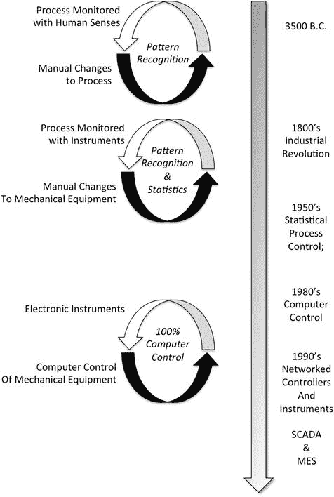

**图 5-1.** 玻璃制造数据与控制简史

### 早期玻璃制造

早在公元前 3500 年，古埃及和美索不达米亚就开始制造玻璃，而中国则在公元前 1600 年就开始制作瓷器。在那个时代，没有机器；工艺涉及手工熔化并成型二氧化硅，由玻璃工匠调节热量强度并控制气流。早期的玻璃制造依赖于工匠监控的技能——这些技能是通过多年的学徒生涯习得的。这些工匠依靠对材料模式的识别能力，在直觉层面做出决定。如今，艺术玻璃仍以这种方式生产，但大部分商业玻璃制品是工业化生产的。

### 早期仪表化与增强的统计过程控制

几个世纪以来，对模式识别的依赖让位于现代制造工艺，这不仅仅发生在玻璃制造领域，而是涵盖了所有类型的生产。人们使用仪表来测量工艺过程中材料的基本物理属性，如温度、压力和气流，使工厂工人能够通过简单的开关设备（如电机），或通过打开/关闭阀门来控制温度，从而手动改变工艺输入。

到了 20 世纪 50 年代，来自制造业仪表的物理测量值与统计分析相结合，产生了监控系统，从而对产品质量施加了更多控制。这一创新最著名的例子是`统计过程控制`，或称`SPC`，由`W. 爱德华兹·戴明`在战后的日本率先倡导。到 20 世纪 80 年代，美国制造商也采用了`SPC`。它代表了 20 世纪制造业最重要的变革之一，开创了制造业质量的新纪元。`SPC`也是数据如何驱动决策的一个早期典范。

### 计算机技术实现的自动化控制

20 世纪 80 年代，计算机技术开始在多个不同领域对制造流程控制产生影响。这些技术使得制造流程的控制更加精确。仪器仪表与基本控制装置（如电磁阀，一种磁性开关）或更复杂的控制装置（如可变流量控制阀）相结合，利用基于微处理器的小型控制器实现了“闭环控制”。这里的“回路”指的是由控制器的输入和输出形成的环路，以控制器为一端，工艺设备为另一端构成一个循环。这些控制器实现了对制造流程前所未有的控制。

20 世纪 80 年代，可编程控制器问世，为制造流程控制提供了一个灵活、易编程的平台。这些可编程控制器最初旨在提供一种基于计算机的方法，来复制工程师和电工用于执行离散控制的逻辑图，其中制造流程中仅有数字输入和输出。后来的可编程控制器版本复制了回路控制器的功能，但也能控制具有数百个输入和输出的系统。

### 数据网络实现更高集成度

20 世纪 90 年代，出现了用于仪器仪表的网络，作为配置和监控这些仪器的一种方式。这些仪器网络还简化了仪表的接线，只需在生产线上所有仪表之间铺设一根数据通信电缆。仪表不仅能指示物理属性，还能报告其“健康状况”，并允许更改设备的运行参数。例如，光电传感器通常需要调整，以确保当物体经过其前方时能正确感应。而现在，可以通过仪器数据网络对该光电传感器进行调整。

电动机是制造过程中最关键的元素之一，电机控制器通常被称为“驱动器”。（我们将在本章后面讨论驱动器。）设备网络也用于这些驱动器，允许通过网络进行配置，并提供完整的运行数据，包括转速、电流以及电机是否及何时会发生故障。

20 多年来，来自仪器仪表和可编程控制器的数据一直被收集并存储在数据库中，利用称为监控与数据采集（SCADA）系统和制造执行系统（MES）的监控系统来实现。图 5-2 展示了 SCADA 和 MES 系统如何与刚刚讨论的控制器和仪器仪表联网。

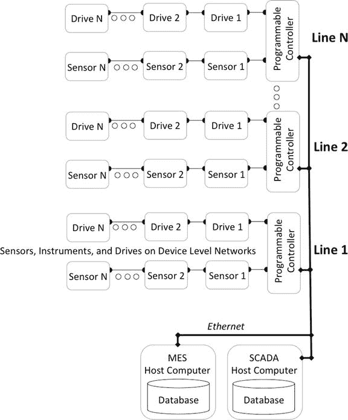

图 5-2. SCADA 和 MES 网络

SCADA 系统获取并存储仪器仪表和控制器数据，以便日后审查，从而确定任何问题的根本原因或故障发生的时间。SCADA 和 MES 系统都获取数据，使其能够显示制造流程的性能、跟踪产品批次以及记录原材料消耗情况。

## 公司结构与设施

让我们来考察一些制造公司以及这些公司中常见的设施类型。参与制造的组织通常拥有许多包含主要制造流程的设施。例如，我们案例中的玻璃公司拥有三种类型的设施：浮法玻璃厂、玻璃加工厂和汽车包边厂。让我们逐一考察这些设施。

### 浮法玻璃厂

浮法玻璃厂是从原材料制造玻璃的设施。这些工厂将硅砂和纯碱在大型熔炉中熔化，生产出巨大的连续玻璃带，然后切割成矩形片材。之后将其运往其他设施，用于制造汽车车窗以及住宅和建筑用的玻璃窗。这些浮法玻璃厂通常拥有一两条长达数百码的熔炉生产线。浮法玻璃厂因其生产玻璃的制造工艺而得名。在该工艺中，熔融玻璃从熔炉中流出，进入熔融锡槽冷却，从而确保玻璃两面清澈平坦。

浮法玻璃厂比加工厂大很多倍，并且消耗大量用于熔化原材料的天然气。工厂必须每天 24 小时连续运行，以维持工艺的稳定性。当生产线上发生设备故障时，玻璃生产继续进行，玻璃被压碎并重新送入熔炉，直到维修完成。这里的正常运行时间指标是生产线生产出可用玻璃的时间百分比。设备停机时间会降低这个百分比，但其他事件，例如产品换型，也会降低它。也就是说，有时需要改变所生产玻璃的厚度或色调。进行这些生产变更可能会使生产线不稳定数小时甚至数天，导致停机以及产生过于易碎而无法切割的回收玻璃。因此，限制换型次数可以最大化工厂的正常运行时间。

### 玻璃加工厂

在我们示例制造商的一些玻璃加工厂中，通过将玻璃板切割成特定形状、磨平边缘并将玻璃弯曲以匹配目标汽车车型的轮廓来制造汽车车窗。其运营重点与浮法玻璃厂截然不同。不是单一的大型工序，而是有许多小型生产线，每条生产线通常执行单一任务。其中一条生产线上发生设备故障不仅会影响该生产线的正常运行时间，还会影响整个工厂的产量。

加工厂必须关注产品质量，因为用于汽车的玻璃必须没有缺陷。在浮法玻璃厂中，质量问题是显而易见的——通常是气泡或可见缺陷，很容易通过激光检测发现；有缺陷的片材会立即报废。然而，在加工厂中，质量问题可能更难发现。通常只有在汽车玻璃片生产完成后才能发现。如果有缺陷的汽车玻璃片到达客户手中，工厂将面临退单以及可能的质量声誉损失，最终导致失去该客户。

### 汽车包边厂

我们示例制造商的第三种设施类型操作简单：将汽车玻璃用聚合物包边，以增加强度并便于在汽车装配线上安装。本章不涉及此类设施。

### 公司工厂的组织结构

图 5-3 展示的是我们案例中玻璃公司的组织结构。

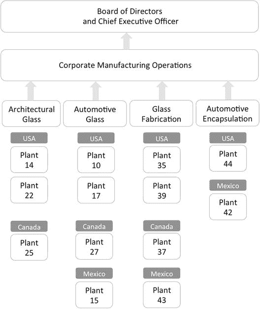

图 5-3. 玻璃公司的组织结构

如图 5-3 所示，共有七家浮法玻璃厂，生产用于汽车和建筑用途的玻璃。汽车玻璃经过着色处理用于汽车，部分玻璃还具备阻挡紫外线以保护汽车内饰的特性。此外，还有四家玻璃加工厂和两家汽车包边厂。

在接下来的章节中，我们将审视这些工厂的数据，并使用 **Salesforce 分析云**创建仪表板，以提供有用的数据可视化展示。回顾 第 1 章 可知，Salesforce 分析云支持两种基本类型的分析：描述性分析（回答“发生了什么？”的问题）和诊断性分析（回答“为什么发生？”的问题）。让我们看看一些真实数据，并了解如何执行描述性和诊断性分析。

## 关键绩效指标

在我们的案例中，有一个专注于管理所有制造工厂的领导团队。该团队由各工厂的管理层和公司总部的经理组成。团队专注于运营与规划，每天监控各工厂的运营情况，做出关键决策以最大化绩效和盈利能力，并沟通结果。监控基于被归类为关键绩效指标（**KPI**）的数据，其中包括吞吐量、良品率和正常运行时间。

-   **吞吐量：** 吞吐量 KPI 是流经生产线的零件数量或物料量。生产线通常存在瓶颈，如果改进成本足够低，那么避免这些瓶颈的改进措施可以带来盈利。如果生产线上的设备频繁停机，显然会导致吞吐量下降。对于任何生产线而言，其吞吐能力都基于设计和运营历史而被充分了解。
-   **良品率：** 良品率 KPI 是制造出的可用产品的百分比。在大多数生产线上，实现 100% 的良品率是不可能的；制造过程总会产生一些废品。生产线的末端是质量检验环节，由机器或人工完成。例如，生产汽车车窗的生产线，其末端会进行外观问题检验，尤其是划痕。任何有划痕的车窗都必须被废弃，从而降低了该生产线的良品率。为了计算良品率，我们执行以下计算：`良品率 % = 生产的合格零件数 / 吞吐量`。因质量问题而被废弃的产品百分比有时被称为废品率。
-   **正常运行时间：** 理想情况下，生产线上的设备从不停止运行，但这当然是不可能的。设备总是会出故障并需要维修。制造工厂配备有维修人员，负责维修发生故障的设备，并对设备进行预防性维护以降低故障概率。

现在，让我们看一个在 **Salesforce 分析云**中创建的仪表板，用于报告这些吞吐量、良品率和正常运行时间参数。

## 工厂级报告

图 5-3 中所示的 35 号工厂是一家玻璃加工厂，使用来自浮法玻璃厂的玻璃生产汽车车窗。该工厂连续运转，由生产管理团队负责监控绩效。一个 24 小时周期内有三个班次，第一班从早上 8:00 开始，第二班从下午 4:00 开始，第三班从午夜 12:00 开始。

共有四条生产线在运行。作为生产管理团队一员的轮班领班是现场管理者，负责做出关键的、每分钟的决策，以确保所有四条生产线都能以最佳状态运行。**SCADA** 系统对操作四条生产线的可编程控制器进行大量数据采集。利用这些信息，**SCADA** 能够报告每条生产线的良品率、吞吐量和正常运行时间。每天，生产管理团队都会使用 **Salesforce 分析云**中的仪表板查看前三个班次发生的情况。仪表板的屏幕截图如图 5-4 所示。

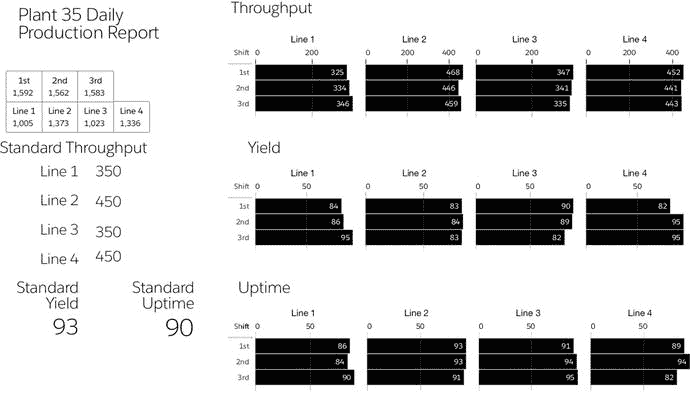

图 5-4. 35 号工厂的每日生产报告

图 5-5 和 5-6 分别展示了图 5-4 仪表板左侧和右侧更易读的视图。

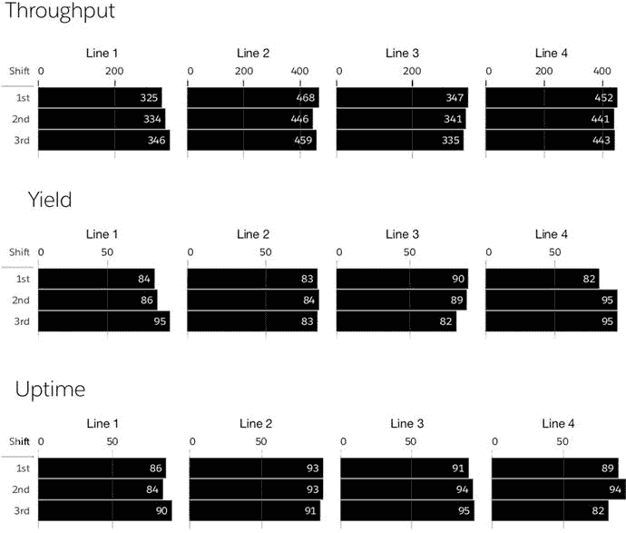

图 5-6. 35 号工厂每日生产报告（右侧）

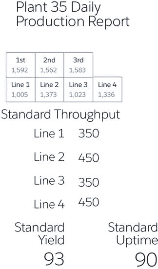

图 5-5. 35 号工厂每日生产报告（左侧）

在这个工厂，1 号线和 3 号线是相同的，2 号线和 4 号线也是相同的。因此，如果两条生产线都以最佳状态运行，那么 1 号线和 3 号线的生产报告应该非常接近。仪表板显示了良品率、吞吐量和正常运行时间这些 **KPI** 的“标准”数字；这些是生产线每天应能达到的最低绩效数字。然而，图 5-6 显示 1 号线在第一班和第二班期间遇到了困难。

仪表板设有切换小部件，以便用户可以选择生产线进行更仔细的查看。由于 1 号线出现了问题，我们按下 1 号线的切换小部件；结果显示在图 5-7 中。

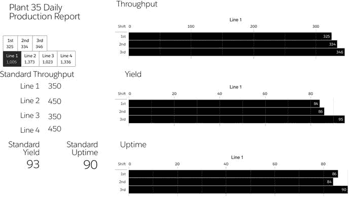

图 5-7. 使用切换小部件选择的 1 号线视图

### 机器问题诊断

影响 1 号生产线的问题在第三班次开始时已得到纠正，此后生产性能恢复正常。然而，在之前的两个班次期间，操作员曾尝试自行解决问题，但未能成功。第三班次的班组长注意到仪表板上的下行趋势，并召来了维护人员。

一名维护技术员确定问题在于传送带上一个齿轮箱的润滑油位异常偏低。（稍后我们将看到，该维护技术员使用了在 Wave Analytics 中开发的仪表板来精确定位问题。）简单解释一下，齿轮箱连接在电机上，电机又连接到一个用于控制其速度的驱动器上。该驱动器连接到一个设备级网络。由可编程控制器从驱动器收集诊断信息，数据最终存储在 SCADA 系统中。对于每条传送带，都有一个用于重置可编程控制器中的控制逻辑并清除任何驱动器故障的按钮。图 5-8 描绘了 1 号生产线上一条传送带的这些组件。

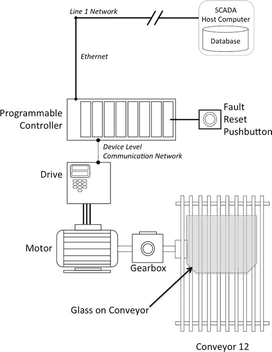
*图 5-8. 1 号生产线传送带的机械和控制设备*

操作员倾向于使用重置按钮来快速清除故障，他们并不总是确定传送带停止的原因。因此，故障常常被归咎于一个可能并不存在的错误原因。然而，追踪此类故障对于改进性能至关重要；优化维护实践有助于解决这类反复出现的问题。对于因齿轮箱润滑油位低而导致的 1 号生产线驱动器故障，预防性维护应包括检查这些润滑油位。

然而，在这个实例中，维护人员能够利用从 1 号生产线驱动器收集的数据（这些数据可在仪表板中获取）诊断出此问题。其原理如下：为每个驱动器维护一个平均电流读数，该读数基于过去三个月内根据经验收集的数据。SCADA 系统还会计算每个班次的平均电流，以及最高和最低电流读数。图 5-9 描绘了为每条传送带收集的数据流。

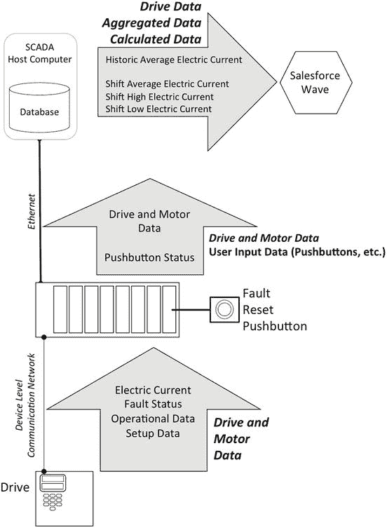
*图 5-9. 传送带运行监控的数据流*

收集到的电气数据被整合到图 5-10 所示的仪表板中。该仪表板显示了为所有三个班次收集的所有电流数据。因此，仪表板可以轻松识别出任何电流过高的驱动器。气泡图会精确标出任何电流持续高于正常值的驱动器。（解释一下，电流高差值是指驱动器的平均电流与某个班次记录的最高电流之间的差值。）左侧的气泡表示正常运行中的驱动器；右侧的气泡显示异常，应进行调查。

在此案例中，气泡图提供了三个班次的数据，如图 5-10 所示。维护技术员看到了右侧的两个气泡，并选择查看与之相关的附加信息。这两个气泡都显示传送带 12 的电流读数较高，这引导该维护技术员去检查与传送带 12 相关的机械系统，并最终发现了齿轮箱润滑油位过低的问题。

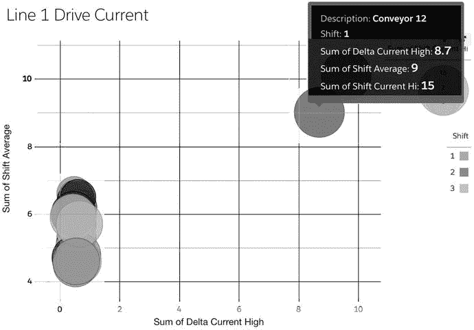
*图 5-10. 1 号生产线第一班次电流使用情况仪表板*

### 用数据消除认知偏差

这个用例展示了如何使用数据来消除在解决机器故障问题时的认知偏差。生产工人有强烈的动机保持生产线运转，因此他们倾向于快速清除故障并“猜测”故障原因。然而，他们的猜测通常基于最近的经验，可能是在其他生产线上的经验，因此是前面提到的近因偏差的一个典型例子。可以理解的是，工厂管理层出于希望保持生产线运转的愿望，会迅速为这种做法辩护，但最终这种方法对性能是有害的。在这个例子中，数据被用来找到了问题的真正原因。

## 公司级报告

现在让我们看一些涉及公司级数据使用的例子。如图 5-3 所示，我们的玻璃公司在工厂层面和公司总部都有一个公司层级结构。这些领导岗位的人员更替是正常的，因此为正在“熟悉情况”的经理提供快速参考，可以使这些过渡更容易。玻璃公司没有将这些信息放入已发布的纸质手册中，而是使用一个仪表板，根据每天的玻璃产量（以吨计），提供浮法玻璃制造工厂的快速摘要。

这个摘要的引人之处在于它的多功能性。在桌面客户端上，有一个仪表板允许根据国家、玻璃产品类型和工厂编号进行细化筛选。图 5-11 显示了此桌面网页浏览器仪表板。

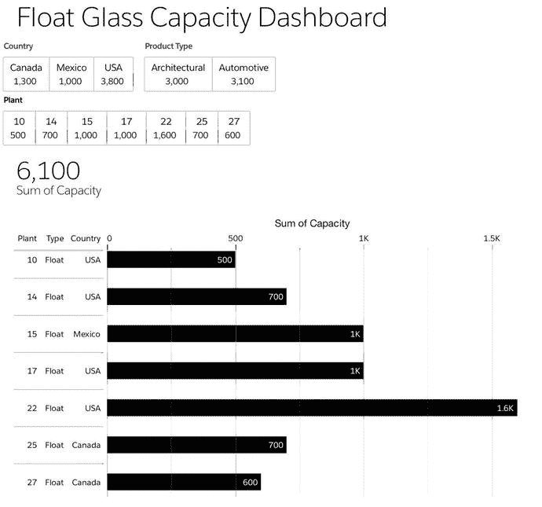
*图 5-11. 浮法玻璃产能仪表板*

当经理选择美国作为国家时，仪表板会变为图 5-12 所示的样子。

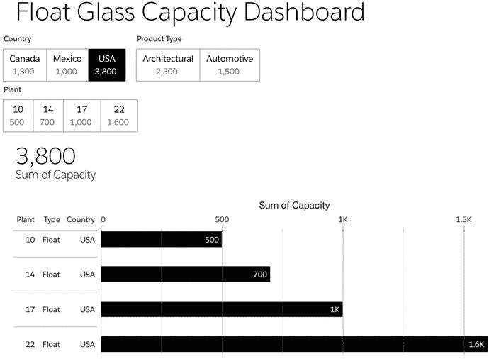
*图 5-12. 美国浮法玻璃产能仪表板*

该仪表板也可在 Apple iPhone 和 Apple Watch 上使用，如图 5-13 所示。

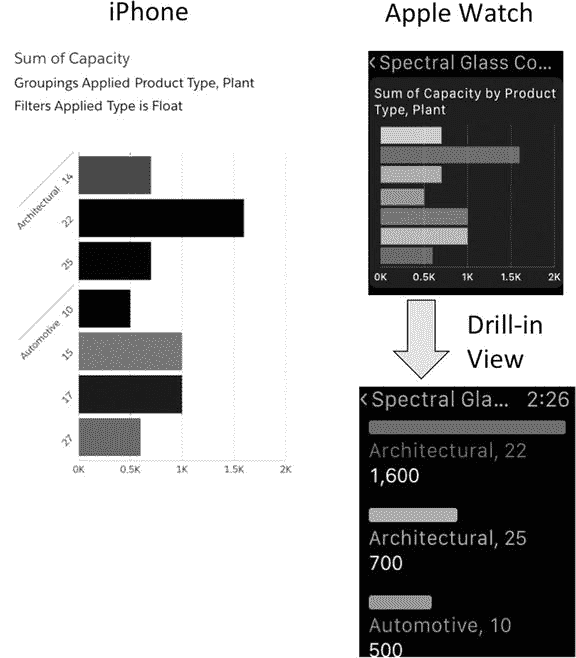
*图 5-13. 浮法玻璃产能仪表板（左：iPhone 版；右：Apple Watch 版）*

这个显示产能的简单仪表板可以基于一个 Excel 电子表格的数据集创建，并且可以在几分钟内完成。这种速度使得 Salesforce Analytics Cloud 成为让有价值信息可用的最快捷方式，其用户界面允许在台式机或移动设备上轻松细化数据。但让我们来看一些这方面的例子。

### 评估工厂经理绩效

在大多数大型企业中，工厂经理负责制造设施，而企业领导层会持续评估这些工厂经理的绩效。通常，一整年的关键绩效指标（KPI）被用来评估他们的表现。`Salesforce Analytics Cloud`使得这项任务变得简单。

例如，我们玻璃公司浮法玻璃工厂的良率、运行时间和吞吐量等绩效数据被收集到一个仪表盘中，如图 5-11 所示。这些数据通过使用日历热力图小部件获得，这是一种强大的可视化工具，允许一眼查看大量数据。在此仪表盘上，显示了浮法玻璃工厂的良率、运行时间和吞吐量 KPI，以及换产次数。小部件上的深色方块表示更高的数值和更好的性能。每个小部件的上方是该 KPI 在整个公司的平均值。

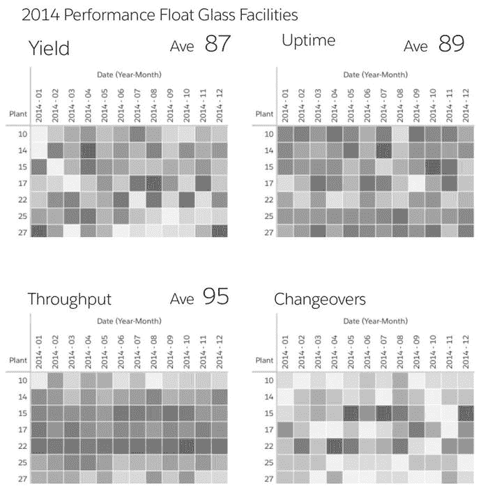

图 5-14. 2014 年工厂绩效仪表盘，使用日历热力图小部件

用户只需将光标放在任何一个方块上，就可以获得热力图上相关 KPI 的值。显示的数据包括年份和月份、KPI 以及工厂编号。例如，在图 5-15 中，显示了 22 号工厂的吞吐量 KPI。

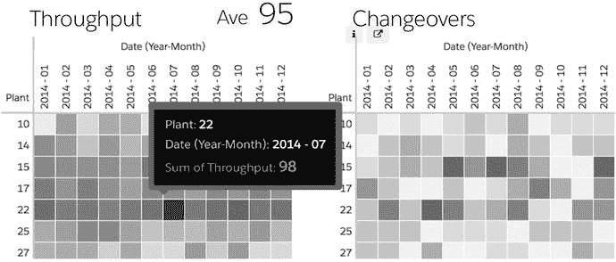

图 5-15. 2014 年 7 月 22 号工厂的吞吐量数据

当所生产玻璃的某个方面发生改变时，工厂就会进行产品换产。这些换产记录在仪表盘右下角的热力图中。通常，换产涉及玻璃厚度或颜色的改变，并且往往意味着生产停机。普遍认为换产可能不利于工厂的生产目标，然而，有些工厂，如 22 号工厂，尽管换产次数很多，却依然表现出色。这是怎么回事呢？

2014 年 7 月，发生了五次换产，都是关于玻璃厚度的改变；不过，其吞吐量和良率数据表现良好，吞吐量达到了 98%，良率达到了 93%。这些积极的结果在仪表盘上一目了然——这清楚地证明了 22 号工厂的工厂经理表现卓越。这位工厂经理非但没有惧怕产品换产，反而向他的团队发起挑战，要求他们找到管理换产的创造性方法，并为达到卓越生产数据提供了奖金形式的激励。这一策略取得了成效，22 号工厂成为整个公司效仿的榜样。

传统上，企业管理层依赖电子表格来分析绩效，但这种方法没有`Salesforce Analytics Cloud`那样的灵活性。后者的仪表盘提供了紧凑、全面的视图，可以动态更新，并且具备细化数据的能力。图 5-16 展示了当管理者点击热力图中的一个方块时，如何细化此仪表盘上的数据。

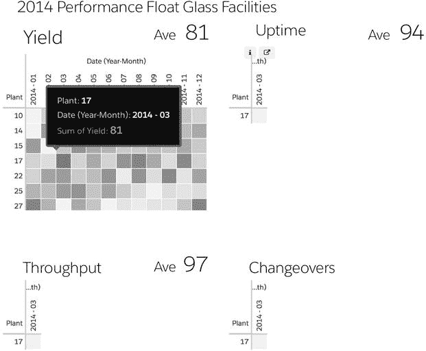

图 5-16. 选择 2014 年 3 月数据时，17 号工厂的低良率数据

在此期间，尽管图 5-16 中选定的工厂运行时间为 94%，吞吐量为 97%，但其良率仅为 81%。当然，这些数字并非总是管理不善的指标；有时是玻璃熔炉的使用寿命即将结束或需要重建。17 号工厂的玻璃熔炉上次重建是在 1994 年，因此这里存在这种可能性。无论如何，这类数字令人担忧，并将引发企业管理层的进一步深入研究，但很可能正是因为仪表盘的可读性，这些问题才得以引起注意。

在本章前面，我们讨论了认知偏见以及数据驱动决策如何能够消除这种认知偏见。对工厂绩效和工厂管理的评估常常会受到这种认知偏见的影响。例如，一位最近在换产总是导致生产数据下降的工厂工作过的管理者，往往会倾向于制定避免换产的排程，以确保生产数据得以维持。这是近因偏差的一个例子。当然，避免换产的缺点是无法灵活地满足市场对产品的需求，导致客户寻找其他供应商。看看 22 号工厂的高绩效，可以推断出换产是可以管理的，这已在数据中得到证实。

## 结论

正如本章所讨论的，认知偏见可能导致管理层基于不完整或不准确的数据做出不合逻辑的决策；这些决策满足了情感需求或实现了证明自己正确的愿望。每个人都会做出一些错误的决定，或者基于不完整或不准确的信息做出决策；我们都受到认知偏见的影响，却没有意识到它的存在。

然而，`Salesforce Analytics Cloud`几乎有能力消除认知偏见。我们以一家玻璃公司为例，展示了如何通过快速简便的方式呈现数据，帮助管理者正确诊断设备故障和生产放缓的原因。我们对比了该公司两个工厂的情况，数据揭示了一家工厂成功应对了换产挑战，而另一家工厂的生产数据则不那么令人满意。每个案例的数据都呈现在仪表盘中，便于轻松获取更多细节进行评估和比较。

我们还看到了`Salesforce Analytics Cloud`如何更高级地应用于组织内部的人员绩效评估。这展示了`Salesforce Analytics Cloud`的多功能性，尤其是它在任何情况下都能发挥作用的能力，以及使用户能够在坚实数据的支持下，创造性地做出日常决策的能力。

