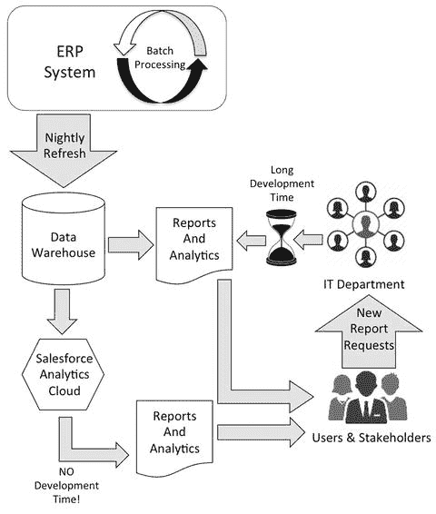
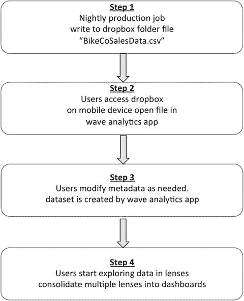
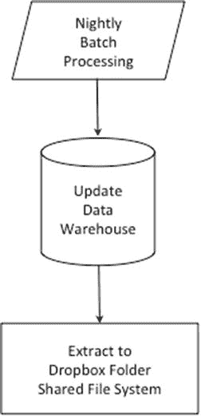
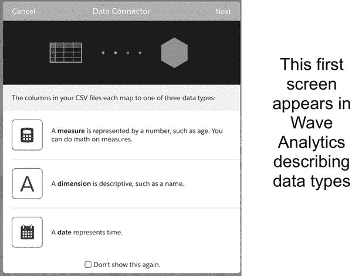
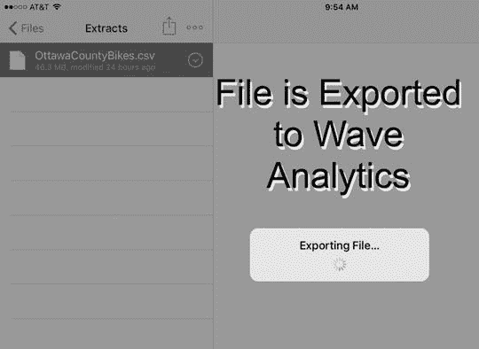
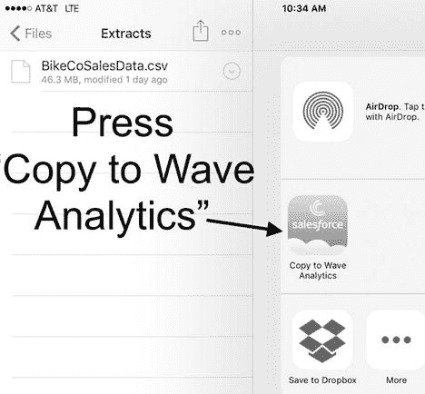
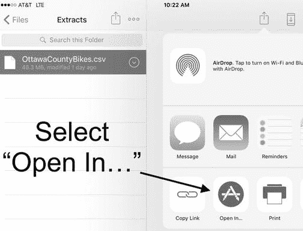
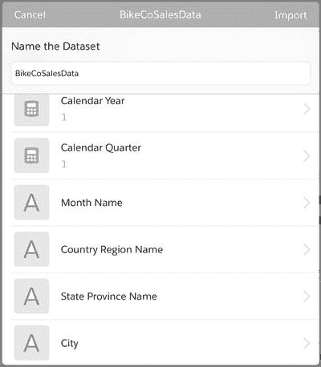
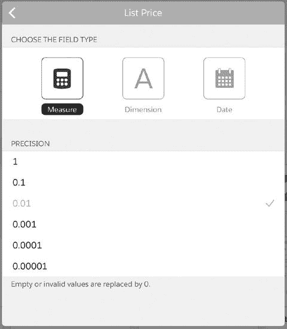
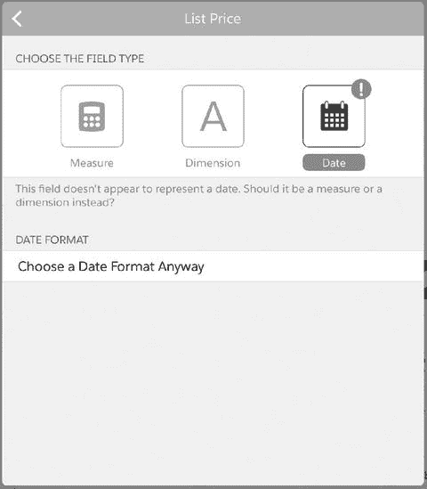

# 6. 移动企业数据发现

> 今天的好计划胜过明天的完美计划。 ——小乔治·史密斯·巴顿将军

二战期间最著名的将领之一便是乔治·巴顿，上述引言出自他之口。这句话反映了巴顿最被世人熟知的特点：基于尽可能充分的信息采取行动，而非过度分析局势。巴顿强烈反对固守阵地或建立固定防御工事，他要求部队持续向前推进。鉴于巴顿的核心价值观，他若置身当今，定会对专业人士通过智能手机和平板电脑获得的移动计算能力感到如鱼得水。移动设备使这些专业人士能够在办公室以外的地方高效工作，因为这些设备不再需要被束缚在办公桌上才能发挥作用。在本章中，我们将考察一家中等规模的自行车公司——渥太华县自行车公司，并探讨 Salesforce 分析云如何使其员工能够通过移动设备使用现有的决策支持系统数据，从而更深入地洞察公司的销售业绩。

数据发现使关键业务利益相关者能够在决策中使用数据；这一点在前面的章节中已强调过，并将贯穿本书始终。在当今的商业环境中，借助流行的移动设备和 Salesforce 分析云，掌握绩效状况从未如此简单。由于 Salesforce 分析云采用“移动优先”的方法，用户可以通过平板电脑、智能手机乃至 Apple Watch 访问数据发现功能。此外，用户还可以完全通过移动界面轻松创建自己的应用程序。在本章中，讨论的所有可视化内容均来自 Salesforce 分析云的平板电脑或智能手机版本。

## 用例概述

我们关于渥太华县自行车公司的用例展示了，一家遵循传统报告方法的公司如何从 Salesforce 分析云中受益。渥太华县自行车公司自大约 15 年前成立以来，一直采用规范化、标准化的企业计算方法。该公司拥有一套企业资源规划（ERP）系统来管理业务的各个方面，包括人力资源、薪资和财务等基本业务功能。该 ERP 系统还具备管理销售运营、物流和渠道管理的功能。来自 ERP 系统的数据被汇集到一个数据仓库中。该数据仓库提供了历史数据的全面视图，这些数据存储在经过索引、反规范化的表中，以便于快速检索。数据仓库中的数据表是公司用于运营报告的许多报告的数据来源。这些报告由业务分析师使用报告工具进行编排和格式化。

### 传统报告方法

渥太华县自行车公司所采用的方法，是多年来让报告能够送达业务用户和利益相关者手中的常用方法。这种历史悠久的方法通过业务分析师、报告编写者和利益相关者之间的协作，生成可靠的报告。业务分析师和报告编写者隶属于信息技术部门内的一个集中式报告开发团队。该部门经常积压大量关于新报告或修改现有报告的请求。关键决策者往往能够使他们的请求获得“优先处理”，“插队”到可能已经等待了一段时间的管理人员前面。有时，为了打破报告生成请求的僵局，各部门会雇佣自己的报告编写者和分析师来满足自身需求。当这些部门继续雇佣更多的 IT 资源，如开发人员、数据库管理员和云应用管理员时，这些专属的报告编写者和分析师有时会成为该部门“影子 IT”运动的开端。从长远来看，这种碎片化可能是有害的，并且可能偏离公司整体的 IT 目标，如数据标准、安全和架构治理。

通常，已经在报告或分析工具上投入了大量资金的公司不愿考虑在这方面进行新的投资。报告和分析工具的年支持成本很高，占产品原始成本的 20% 到 25%。一些公司可能通过并购，或者因为某个工具是 ERP 系统或其他企业软件捆绑购买的一部分，无意中获得了许多报告工具。当公司拥有过多报告工具时，其中一些工具被弃用而浪费了最初的资本投资，这并不罕见。

### 传统方法的替代方案

图 6-1 展示了报告和分析解决方案的传统方法，并显示了 Salesforce 分析云如何提供一种替代方案。

*图 6-1. 传统报告方法及作为替代方案的 Salesforce 分析云*

即使对于那些过去与报告和商业智能工具有过痛苦经历的公司来说，决定采用 Salesforce 分析云也是轻而易举的。Salesforce 分析云百分之百基于订阅，无需前期资本投资。订阅允许按两个类别购买个人许可证，这使得成本易于控制，公司只需为其所需的功能付费。

大多数商业智能平台都需要台式计算机来开发和查看报告。台式计算机购买成本高昂，且维护困难。它们还面临着来自病毒和恶意软件的安全威胁，这在处理潜在敏感数据时是不理想的。此外，报告查看应用程序通常基于浏览器，并且可能与在不同操作系统版本上运行的不同浏览器存在兼容性问题。这可能导致高昂的支持成本，并在用户无法访问其报告时引发不满。借助 Salesforce 分析云的移动优先方法，平板电脑和智能手机等移动设备可用于创建报告和商业智能应用程序。移动设备本质上比台式计算机更安全，因为其操作系统与应用程序是隔离的。从可用性的角度来看，几乎每个人都很熟悉移动设备，并且移动设备上常用的手势，如点击、滑动和捏合，在所有应用程序（包括 Salesforce 分析云）中都很常见。通常，移动应用程序所需的培训量比桌面应用程序少一个数量级，并且通常可以通过在线视频或教程完成。平板电脑和智能手机还具有便携性的优势，尤其是那些具有蜂窝网络连接功能的设备。

也许 Salesforce 分析云最大的优势在于探索数据的能力。使用传统的报告工具，无法探索数据，要修改任何报告以揭示数据的新方面，都需要向业务分析师或报告开发人员提出请求。然而，使用 Salesforce 分析云，用户可以完全掌控自己的报告和商业智能体验，并且可以随意钻取数据，以及过滤和组织数据。

## 用例架构

虽然可以使用提取-转换-加载（ETL）工具将几乎任何数据源与 `Salesforce Analytics Cloud` 集成，但 `Salesforce Analytics Cloud` 的一个关键特性是能够立即投入使用，无需复杂且昂贵的集成。在我们的示例中，渥太华县自行车公司的 IT 部门安排从其数据仓库中提取数据到公司 `Dropbox` 文件夹的进程。该提取进程将一个 `.csv`（逗号分隔值）文件写入 `Dropbox` 文件夹。在其移动设备上安装了 `Dropbox` 应用程序的用户随后可以访问此 `.csv` 文件并创建自己的应用程序。

> **注意**：`Dropbox` 是一种流行的基于云的文件系统，可以从 Mac、PC 和移动设备访问。甚至还有针对主要 Linux 发行版的驱动程序。`Dropbox` 是此类产品中的一员，其他产品还包括 `Google Drive` 和 `Microsoft OneDrive`。这些应用程序中的任何一个都能够向 `Salesforce Analytics Cloud` 提供文件。

渥太华县自行车公司的用户创建自己应用程序的工作流程如图 6-2 所示。

*图 6-2. 加载用例数据的工作流程*

让我们仔细看看这些步骤中的每一步。

## 步骤 1 – 输出到 `.CSV` 文件

这是唯一属于 IT 部门职责范围的步骤。大多数 IT 部门通常维护着在非工作时间运行批处理进程的调度系统。调度系统能够按特定顺序、在特定时间运行与企业软件相关的程序或进程。调度系统还能够运行自定义开发的进程。这些进程可以在任何平台上开发，包括提取-转换-加载（ETL）软件包，或者使用 `COBOL`、`Microsoft Visual Basic`、`Java` 或 `Python` 等编程语言开发。图 6-3 展示了此过程中的第一步。

*图 6-3. 生成提取文件的批处理步骤*

批处理涉及 ERP 系统数据的大批量处理，包括来自薪资、财务和应收账款的数据。批处理完成后，报告系统数据库（如数据仓库）会使用最新数据进行更新。报告系统数据库更新后，会生成报告，以便用户能在下一个工作日查看。此外，还会以常见格式（如 `.csv` 和 JSON）创建提取文件。在我们的示例中，此时会为我们的用例创建 `BikeCoSalesData.csv` 文件。

## 步骤 2 – 用户在 Dropbox 上访问 `.CSV` 文件

步骤 2 涉及渥太华县自行车公司的用户在其移动设备上访问 `Dropbox` 应用程序以提取 `BikeCoSalesData.csv` 文件。这类似于 第 2 章 中展示的数据集创建，但不同之处在于，这里我们使用 `Dropbox` iPad 应用程序作为数据集创建的起点。在 `Dropbox` 共享文件系统中，有一个名为 `Extracts` 的文件夹。此文件夹中包含 `BikeCoSalesData.csv` 文件。用户选择此文件，然后点击 `在...中打开` 按钮。此按钮会列出所有能够打开 `BikeCoSalesData.csv` 数据文件的应用程序。应用程序列表出现在 `在...中打开` 按钮上方，其中包含一个 `复制到 Wave Analytics` 按钮。用户随后选择此按钮，将 `.csv` 文件加载到 `Salesforce Analytics Cloud` iPad 应用程序中。

图 6-4、6-5、6-6 和 6-7 所示的屏幕截图展示了所涉及的一系列步骤。

# Salesforce Analytics Cloud 数据集导入与使用指南

*图 6-7. 文件加载期间 Salesforce Analytics Cloud 中出现的第一个屏幕*

*图 6-6. 指示文件正在导出的消息*

*图 6-5. `复制到 Wave Analytics` 按钮*

*图 6-4. `在...中打开` 按钮*

## 第三步 – 修改元数据并创建数据集

第三步涉及在 Salesforce Analytics Cloud 中实际创建数据集。在图 6-7 中，消息框右上角有一个“下一步”按钮。按下此按钮将打开元数据编辑器。在此编辑器中，`OttawaCountyBikes.csv` 中的每一列都被映射到三种数据类型之一。让我们快速介绍这三种数据类型：

- **度量** 是定量数据，在 Salesforce Analytics Cloud 中，用户可以针对一个或多个维度分析这些数据。度量必须为数值型数据，因为在 Salesforce Analytics Cloud 中，会对度量执行数学运算。
- **维度** 由描述性数据组成，我们通过维度来评估度量。例如，对于总销售额这一度量，其一个维度可能是地理区域，例如州或省。
- **日期** 代表时间，其格式必须能被 Salesforce Analytics Cloud 识别为时间数据。通常，从企业软件数据库提取的数据格式是正确的。通常，此数据类型仅包含日期信息，不包含时间信息。

通常，导入过程能正确判断数据类型。但在某些情况下，用户可能希望修改数据类型。以 `OttawaCountyBikes.csv` 文件中的数据为例，其中包含完全由数字组成的季度数字。导入过程会将其分配为度量，但我们实际上希望将其用作维度。当导入过程发现字段纯粹是数字时，它会自动将该字段设为度量。由于季度数字是数据的属性，并为数据中的度量增加意义，因此需要将其更改为维度。使用图 6-8 所示的元数据编辑器，我们可以通过单击向右箭头并选择“度量”，将“日历季度”更改为度量。

*图 6-8. 用于更改数据类型的表单*

有时谨慎审查度量要使用的小数位数是明智的。注意这一点可以使数据更具可读性，如图 6-9 中“标价”所示。我们选择了两位小数，因为标价总是以元和分的金额表示。

*图 6-9. 更改度量的小数位数*

字段类型选择的另一个有趣之处在于它能防止用户做出错误选择。例如，在图 6-10 中，我们尝试将“标价”更改为日期类型，但导入过程提示此操作可能不正确。

*图 6-10. 显示了日期字段类型选择错误的提示*

在此消息框中还可以修改数据集的名称。例如，`.csv` 文件的名称是数据集的默认名称，但用户可以自由选择其他名称。

一旦我们对数据类型满意，就可以通过按下消息框右上角的“导入”按钮来启动导入过程。在导入数据集时，会依次出现一个指示正在进行的消息框，随后是一个指示数据集创建成功的消息框。小型数据集通常可以立即使用，但较大的数据集可能需要一个小时才能就绪。

## 第四步 – 创建透镜和仪表板

数据集创建完成后，用户可以立即开始探索数据，首先创建透镜。本书的第 2 章已对此内容进行了介绍，因此此处不再讨论。

## 用例中使用的数据

我们已经介绍了数据集的创建，现在来看看为渥太华县自行车公司提取的数据，以及用户如何通过使用 Salesforce Analytics Cloud 来获取洞察。

此用例中的数据涉及销售业绩。渥太华县自行车公司销售各类自行车、配件和自行车零部件，以及骑行服装。其销售通过三种类型的实体进行：专业自行车店、增值经销商和仓库。数据集中的每一行数据都记录了单个交易以及与这些交易相关的销售功能。此数据集中的列包括以下可在 Salesforce Analytics Cloud 中使用的数据。

### 销售金额数据

- `银行名称`：处理交易的金融机构。
- `运费`：运费成本。
- `折扣金额`：给予的折扣。
- `产品总成本`：产品总成本。
- `销售金额`：销售额。
- `税额`：与销售相关的税款金额。

### 日期数据

- `订单日期`：一个或多个产品的订购日期。
- `日历季度`：订单日期所在的年份季度。
- `日历年份`：订单数据所在的年份。

### 产品数据

- `产品名称`：所售产品的名称。
- `产品线`：三个值之一：山地车、公路车或旅行车。
- `产品类别`：四个值之一：自行车、组件、配件或服装。
- `产品子类别`：众多值之一，用于更精确地标识产品。可能的几个值包括链条、刹车、帽子、头盔和山地车。

### 经销商数据

- `全名`：渥太华县自行车公司中负责此次销售的销售代表。
- `经销商名称`：发起销售的公司的名称。
- `经销商类型`：三个值之一：专业自行车店、增值经销商和仓库。
- `销售区域-国家`：销售区域所在的国家。
- `销售区域-地区`：销售区域国家内的地区。
- `州/省名称`：州或省的名称。
- `城市`：州或省内的城市。