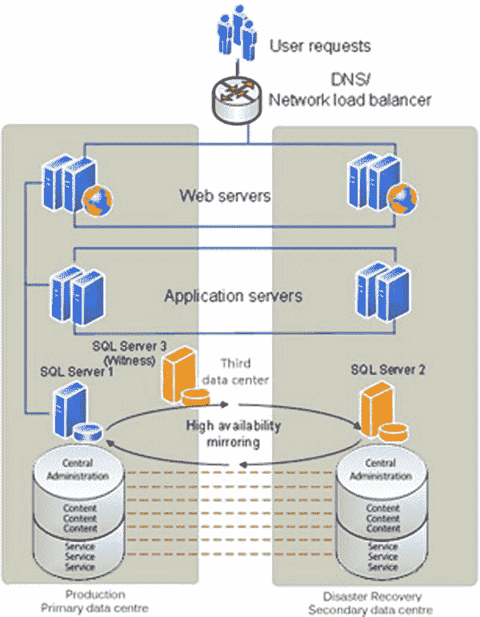
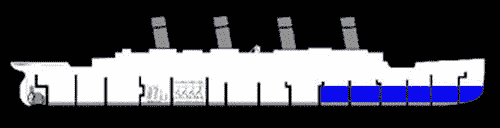
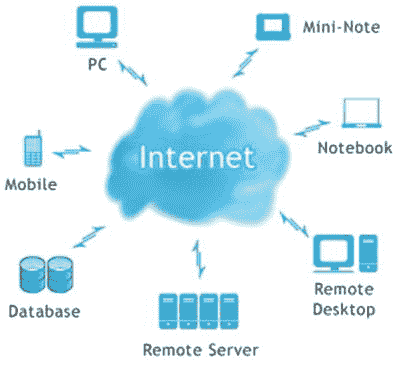
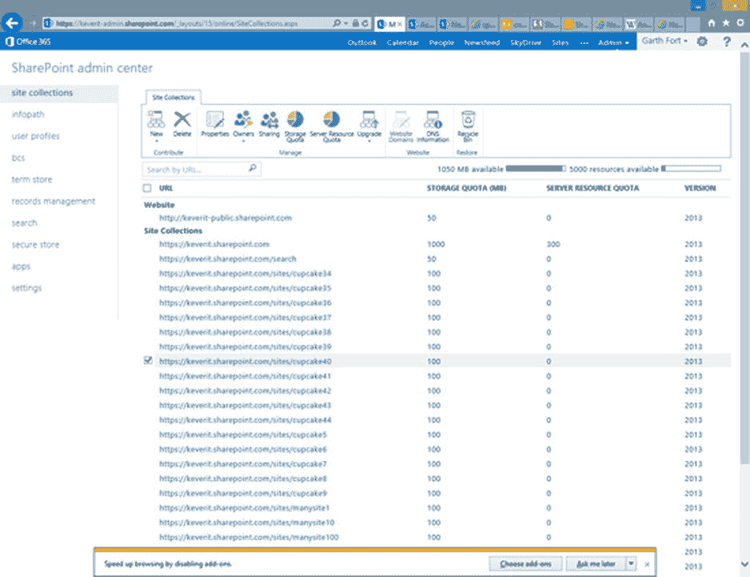
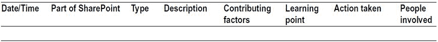
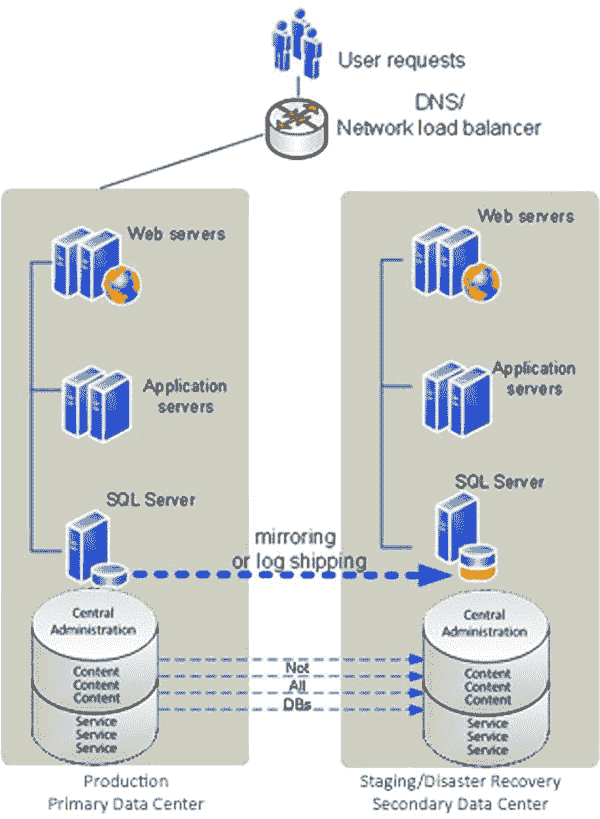
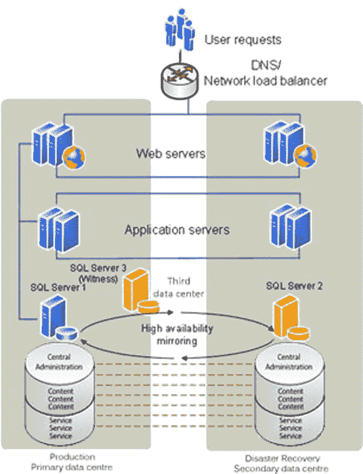
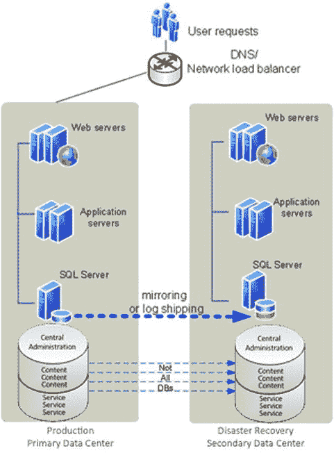

# 第一章：远离灾难

早在 2001 年我的第一个 SharePoint 工作中，我就花了数小时从内部域备份、复制并恢复 SharePoint 安装到用户可通过互联网访问的域中。这并非备份策略，而是一种将内容发布到互联网同时保证内网安全的粗糙方法。但它使系统非常容易发生故障。每次内容更新后，我都必须在非工作时间手动用更新后的暂存 SPS 2001 覆盖生产环境的 SPS 2001，这样用户第二天才能看到更改。这很快变成了每晚都要进行的工作。我至今仍然记得每次运行命令覆盖生产场并使其更新时那种恐惧的感觉。我会盯着那个光标，等待它做出决定（我当时觉得它太漫不经心了）来让一切保持一致。当它成功运行，我能看到更改时，我会如释重负地松一口气。当它失败、我需要排查问题时，我仍然能感受到那种轻微的恐慌。问题通常很容易修复——通常是我漏掉了某个步骤——但有时是网络或存储数据的 Exchange 服务器发生了更改，或者是 Windows 安全方面的问题。

## 灾难从未远离，只在一键之遥

灾难从未远离，只在一键之遥。即使在当时，我也知道这种做法并非完成工作的最佳方式。这毫无意义，但我还是每天都这么做。整个流程已经获得管理层的批准，他们认为这在纸面上看起来既安全又审慎，但实际上效率低下，简直是随时可能爆发的灾难。最终，我离开去寻找更好的工作。或许他们至今仍在沿用那种内容部署方式。

也许你目前也处于类似境地：你知道所在组织用来保护自身的流程和规程并不现实，也无法持续。事实上，它们可能正在引发它们本应防范的问题。又或者灾难已经发生，你正在分析如何改进。无论如何，这本书旨在引导你思考需要采取哪些措施，以使你的 `SharePoint` 场尽可能抵抗故障，并帮助你规划在发生故障时该怎么做，以最大限度降低损失，甚至因出色的恢复能力而赢得赞誉。最理想的情况是，灾难成为成功的契机，而非一连串失败的连锁反应。你能驾驭巨龙，而非被其摧毁吗？

本章将讨论以下主题：

- IT 灾难的隐性成本。
- 灾难发生的原因。
- 关键灾难恢复概念：恢复时间目标和恢复点目标。
- 关键平台概念：网络、云、`IaaS` 和 `SaaS`。
- 角色与职责。
- 成功的衡量标准。
- 一些应用场景、选项和潜在解决方案。

## 失败的真实代价

本书聚焦于两个不同但相关的概念：高可用性（`HA`）和灾难恢复（`DR`）。它们有时被统称为服务连续性管理（`SCM`）。虽然 `SCM` 侧重于灾难发生后以 IT 服务为主的恢复，但随着 IT 系统对整个业务运营日益关键，许多企业也开始评估系统故障对组织本身的影响。

无论你的核心业务是什么，它都以某种形式依赖于技术。可能是机械设备，也可能是 IT 系统。IT 系统已成为许多类型企业的核心，但业务管理者和所有者并未跟上变化的步伐。以下是一个关于核心技术如何对多种公司变得重要的例子。

2008 年，星巴克关闭了其全美所有门店三小时，以重新培训咖啡师制作浓缩咖啡。此举导致其损失了 6500 万美元的收入。这疯狂吗？他们是有意为之；他们意识到公司正在以门店数量为代价牺牲质量。他们扩张得太快，以至于正在失去星巴克品牌闻名遐迩的核心：在舒适的咖啡馆里提供优质的咖啡。他们预见到短期的表面成功最终会在长期内毁掉他们。门店更多了，但进店的人却更少了。停工三小时的短期成本远低于若不改进核心流程所将承受的损失。制作浓缩咖啡看似小事，但它是最众多的员工频繁执行的任务。如果这些员工不能每次都做出高品质的浓缩咖啡，公司长期而言注定失败。先聚焦这一流程，是改善整体业务实践的一步。这表明星巴克明白，为了生存，他们需要改进，不仅仅是扩张。

在这个例子中，技能标准下降被视为停产的原因。这是有计划的，但它突显了当企业无法交付其产品时所需的代价。你的 `SharePoint` 场产生生产力。它通过使共享信息的用户活动更高效来实现这一点。如果其中的信息丢失或共享过程中断，`SharePoint` 就毫无价值。更糟糕的是，它可能严重损害你企业的运作能力。

人们常说，认知即现实。即使只丢失了少量数据或少量生产时间，组织的一些信誉也可能随之丧失。声誉需要多年建立，但可能在数天内毁于一旦。如果你或你客户日益宝贵的信息从你的 `SharePoint` 基础设施中丢失或被窃，代价可能确实非常高昂。你的声誉可能永远无法恢复。

不良认知会导致品牌侵蚀。IT 系统现在已是许多企业品牌的重要组成部分，而不仅仅隐藏在某处的后台房间。对许多公司而言，该品牌依赖于消费者对其技术的信心。品牌侵蚀可能意味着收入损失，甚至法律风险。2011 年针对索尼 PlayStation 网络的攻击导致 1 亿个账户被黑（史上第四大），将让索尼付出巨额真金白银的代价。加拿大代表 100 万用户提起的一项集体诉讼索赔金额高达 10 亿美元。如果苹果公司没有迅速反应（在最初否认之后）来补偿客户，那么 `iOS4` 被感知到的天线问题可能会让苹果付出多大代价？

像星巴克、索尼和苹果这样的大公司知道，技术不仅仅是它们销售产品的一部分，更是它们身份的核心。如果你忽视了业务的核心，它就会失败。全面失败的代价远高于理解和投资于员工每天依赖的技术所需的代价。`SharePoint` 已不仅仅是一个为了与其他用户共享而有序放置文档的有用场所。它现在已是许多用户日常任务的数据存储库。它已成为许多企业的核心技术平台，并且应当被如此对待。

## 灾难发生的原因及如何预防

在 IT 领域，有一种观念认为，更多的文档、流程和规程意味着更好的文档、流程和规程——就像认为更多星巴克门店意味着星巴克经营得更好一样。事实上，恰恰相反。围绕 `HA` 和 `DR`（实际上所有治理）的流程应遵循这样的原则：完美不是无可增添，而是无可删减时才达到的。良好的实践需要不断的修订和调整。最后，做实际工作的人应该拥有这些流程并维护它们。在太多企业中，制定政策和规程的人远离实际工作，因此相关文档不切实际，容易被忽视或导致失败。

## 成功/失败

`SharePoint` 场就像任何复杂系统一样：我们不能指望凭借随意的行动就能侥幸获得一个稳定、安全的协作平台。但现实是，我们的大多数流程和规程都是被动应对、临时凑合的解决方案，最终因为没时间或没资源想出更好的办法而长期延续下去。事实上，在这种情况下，我们采用“智能设计”会比“演化”更有利，因为我们能够解读小事件，从而比大自然更早地预见未来。同时，“侥幸过关”危险地教给我们一些相似但相反的东西：如果你不断成功，这最终会导致你失败。那么谁是对的，我们又如何将其应用于 `SharePoint` 架构的治理呢？

Gartner 几年前的一项研究表明，我们过于强调仅通过硬件和软件来实现平台的高可用性，而 `80%` 的系统故障是由人为错误或缺乏适当的变更管理流程造成的。那么，是什么样的思维过程导致我们忽视“侥幸过关”，并认为成功越多，失败的可能性就越小呢？

如果我们不小心，成功可能导致失败。我们认为，因为之前侥幸没有失败，我们就总会走运。我们的警惕性降低，忽视了那些最终会在足够长的时间后引发大问题的警示信号。

研究显示，每发生 30 次未遂事件，就会发生一次轻微事故；而每 30 次轻微事故中，就有一件会演变为严重事故。`SharePoint` 场拥有捕获日志的监控软件，但这些软件只能捕获我们指示其捕获的内容；我们需要自行阅读和解析这些日志。问题在于，没有分配足够的时间来查找系统中的微小裂缝，或调查未遂事件的根本原因。

但一个更具危害性的失败原因是，当流程薄弱时，监控系统的人员会不断地为这些糟糕的流程进行补救。那些对流程负责的人并未持续审查流程以使其保持最新。那些不拥有流程的人则没有将问题上报；相反，他们提出快速修复方案，以维持短期运转。他们迟早会感到疲惫、沮丧或厌倦，或者在事情真正出问题之前就离职了。到那时再想阻止真正的重大灾难（`FUBAR`）就为时已晚了。

因此，管理层绝不能忽视这样一个事实：基层员工正在满负荷工作以维持系统运转，但这并非长久之计。同样，基层员工也必须挺身而出，报告那些会导致系统故障和数据丢失的情况。

失败是成功所必需的吗？我认为，每个流程都必须在其能力范围内做到最好，同时要认识到它需要被持续测试和改进。这就是治理的精髓：人们主动承担变革的责任，并以建设性的方式应对它。政策的不断演进是必需的。

你的 `SharePoint` 项目：会沉没还是浮起？

让我们用一个比喻——这也是我将在本书中反复提及的。你的 `SharePoint` 项目就像一艘邮轮的航行。它会是一艘安全的现代船舶，还是命运多舛的 `泰坦尼克号`？你的邮轮公司投入巨资建造了一个能够横跨大西洋的巨大金属块。你的 `SharePoint` 农场就像那艘船。这个农场可以部署在本地、云端，或两者的混合体。你有一个目标，并对它所能取得的成就抱有远大抱负。你知道，要使其成功，你需要一队能干的船员来管理它，以及众多快乐的付费乘客。

这个比喻假设了一件不可避免的事情：船会沉没。说你的 `SharePoint` 实施必然会失败，这公平吗？当然不，但你仍应现实地规划它失败的可能性。无法设想失败，必然会让你比那些预判了所有可能出错之处及应对措施的人更加脆弱。这就是为什么船上要有救生艇演习——因为它们有助于预防灾难。承认灾难确实会发生，并不是在招引灾难。事实上，恰恰相反；它降低了灾难发生的可能性，因为它有助于揭示基础设施中的弱点，并促成制定灾难发生时可更快恢复的现实计划。

# SharePoint 高可用性与灾难恢复

图 1-1 展示了一个典型的 `SharePoint` 农场。请注意，超过一半的服务器是冗余的。只要一台 `Web` 前端、一台应用服务器和一台 `SQL` 服务器保持运行，这个农场就仍能工作。让我们回到 `泰坦尼克号` 的隐喻上来。它的船体被设计成具有多个隔舱；建造者称，即使多个隔舱被撞破，船仍能漂浮。事实上，由于设计上的这种远见，曾有船只在正面撞击冰山后幸存下来。

图 1-1. 典型的高可用性本地部署 `SharePoint` 农场

因此，技术让专家们相信，非常大的船舶可以超越物理定律。不知何故，它被广泛认为不仅是海上最大、最豪华的邮轮，而且几乎是永不沉没的。而我们都知道了结局。这个故事在当时是极轰动的新闻，现在依然如此。如今的媒体与 100 年前的媒体并无不同；他们喜欢大故事。`泰坦尼克号` 之所以如此引人入胜，是因为它是世界上最大的客轮，首航即载满了富人与穷人——它是现代性与社会的一个隐喻。

也许你的 `SharePoint` 部署也会受到媒体关注，出于同样的原因，你会希望它进展顺利。也许它只受到内部观众的关注，但它的成败仍然非常显眼，因为它涉及你组织中的各类用户。这无疑是进行试点和原型验证的绝佳理由，但真正的完整系统终有一天需要上线和启航。

## 高可用性：水密隔舱

高可用性是一个 `IT` 术语，指为确保你的 `SharePoint` 农场无论发生什么都不会“沉没”所做的努力——它的弹性和质量足以应对损伤并保持运行。当事情出错时自动启动的系统被称为 `故障转移系统`。在我这个比喻中，它们就像那些关闭以使得隔舱水密的水密门（参见图 1-2）。这些门可以手动触发，但如果隔舱内的水位上升到一定水平，它们也会自动启动。在 `SharePoint` 中，集群、负载均衡和镜像提供了这种故障转移和弹性。但它们也可能被压垮。

图 1-2. `R.M.S.泰坦尼克号` 上的高可用性

在大多数 `IT` 系统中，人们很容易不经过多主动思考就提供最低限度甚至推荐水平的弹性。在 `泰坦尼克号` 上，16 个隔舱超出了贸易委员会的要求；问题在于，一艘船上的 16 个水密立方体对船员（管理员）和乘客（业务用户）来说很不方便。隔舱之间有许多门，方便人们在这些屏障之间自由移动。结果，安全性被便利性所取代。这也是 `SharePoint` 中高可用系统失败的常见原因。失败通常发生在匆忙应用更新和系统例行改进时。高可用系统越复杂，就有越多可能出错的运动部件。

在 `SharePoint` 农场中，你可以通过多种选项来实现高可用性。通常采用以下几种方式的组合。每种方式将在本书后面章节详细说明：

- `SQL` 镜像：同步维护数据库副本。*同步* 意味着数据始终同时保持一致。
- `SQL` 集群：将 `SQL` 实例分布到多台机器上。*实例* 是一组服务器，表现为单一 `SQL` 服务器。
- `SQL` 日志传送：将数据备份到文件，并异步还原到另一个 `SQL` 实例。*异步* 意味着数据在不同时间点并不完全一致，日志从一个实例移动到另一个实例会有数小时的延迟。
- 多数据中心（`DC`）：将服务器群组部署在不同地理位置、独立场所中。例如，`Office 365` 在欧洲、中东和非洲（`EMEA`）区域的数据中心位于都柏林，但阿姆斯特丹也有另一个数据中心。
- 负载平衡：通过软件或硬件，使多台服务器使用虚拟 `IP` 地址，从而看似拥有相同的 `IP` 地址。
- 扩展场：将场中的部分服务器托管在不同的数据中心。
- `SAN` 复制：同步维护数据副本。
- 冗余灾难恢复场：在另一地点准备第二个场，随时准备替换生产场。本章稍后将对此进行更详细的说明。
- 可用区与区域：在 `Amazon Web Services` 中使用，它们类似于服务器和数据中心。

## 灾难恢复

灾难恢复是指当问题已经发生时应该采取的措施。对于 `SharePoint` 场来说，当用户开始失去访问权限、性能或数据时，就是灾难发生点。这也可能发生在安全受到威胁时。本质上，这是指系统完整性被破坏。你已经撞上了冰山。对于 `泰坦尼克号` 来说，灾难恢复过程就是救生艇演习和救生艇本身。对于 `SharePoint` 场来说，它涉及为准备和经历灾难恢复而制定的流程、策略和程序。因此，这是从检测到问题那一刻起，对后续行动进行的规划。请注意，这可能不是问题开始发生的精确时间，而仅仅是它被检测到的时间。错误检测和报告将在第 7 章中进一步详细讨论。

在 `泰坦尼克号` 上，救生艇数量不足，是因为人们相信由于其水密隔舱，这艘船永不沉没。同时，人们认为在船只沉没时，船员需要很长时间才能装载所有救生艇（`泰坦尼克号` 可容纳超过 3500 人，尽管沉没时船上只有约 2500 人）。最后，当时的法规已经过时；该船在法律上是合规的，但实际上即使救生艇全部满员，其容量也不到所需的一半。过度依赖文档和推荐方法并不总是足够的。

## 恢复时间目标与恢复点目标

用于评估灾难恢复解决方案的两个常用指标是：恢复时间目标（`RTO`），衡量系统灾难发生到系统再次正常运行之间的时间；以及恢复点目标（`RPO`），衡量最新备份到系统灾难之间的时间，代表系统可以恢复到的最接近的历史时间点。这些指标将在服务水平协议（`SLA`）中设定，该协议是提供商必须遵守的法律文件。例如，作为 `Office 365` 一部分的 `SharePoint Online`，在发生灾难时设定的 `RPO` 和 `RTO` 如下：

> “12 小时 `RPO`：微软保护组织的 `SharePoint Online` 数据，并保存一份时间点等于或早于 12 小时的数据副本。
>
> 24 小时 `RTO`：如果灾难使主数据中心瘫痪，组织将能够在服务中断后的 24 小时内恢复服务。”

然而，这只是标准级别，企业级的要求更高：

> “1 小时 `RPO`：微软保护您的 `SharePoint Online` 数据，并保存一份时间点等于或早于 1 小时的数据副本。
>
> 6 小时 `RTO`：如果灾难使托管数据中心瘫痪，组织将能够在服务中断后的 6 小时内恢复服务。”

## 网络与云

将您的网络或云想象成海洋。它广阔、不可预测，且充满了危险的事物，其中大部分是管理员无法控制的。存在拒绝服务攻击、人为错误、硬件故障、自然灾害以及各种可能危害您系统的事件。在第 4 章中，我将描述可能损害系统完整性的事件类型，以及如何缓解这些事件。

## IaaS 与 SaaS

基础设施即服务（`IaaS`）和软件即服务（`SaaS`）更强调高可用性而非灾难恢复。自然，保持系统持续运行比从故障中恢复更有意义。对于 `IaaS`，高可用性更多掌握在租户手中。而对于 `SaaS`，例如 `Office 365` 中的 `SharePoint Online`，您更依赖提供商来维持系统运行。我的比喻是：`IaaS` 像是船员，您负有培训和保障乘客安全的职责。而 `SaaS` 更像乘客，依赖提供商来保障您的安全。

例如，对于像 `Amazon Web Services`（`AWS`）这样的 `IaaS` 提供商，租户能够将实例部署在多个位置。这些位置由区域和可用区组成。可用区是独立的位置，设计上与其他可用区的故障隔离，并提供同一区域内与其他可用区之间低成本、低延迟的网络连接。可以将它们想象成您的水密隔舱。

通过在单独的可用区中启动实例（在您的场景中，即您的 `SharePoint` 服务器），您可以保护应用程序免受单个位置故障的影响。还有区域。区域由一个或多个可用区组成，在地理上分布，位于不同的地理区域或国家。通过将实例分布在这些区域中，您将获得更强的弹性。

对于像 `Office 365` 这样的 `SaaS` 示例，如果平台出现问题，您对应对问题的控制权较小。可以想象成乘客自带救生衣。我将在第 10 章中更详细地介绍如何获得更多控制权。

## 云端 SharePoint

`IT` 世界正在发生变化，计算、网络和存储资源正从本地网络迁移到互联网上。`SharePoint` 已经是基于 Web 的，因此是云计算的良好候选者。从设置和管理角度来看，它拥有一个日益增长且复杂的服务体系结构。此外，许多公司很乐意省去内部技能管理的成本，更不用说将 `Exchange` 迁移到云端的机会了。这不会一蹴而就，但确实意味着在本地托管 `SharePoint` 场不再是唯一的选择。出于这个原因，我将为那些不熟悉它们的人概述新的云选项。

从前，网络图中用一朵云的图片来表示互联网（见图 1-3）。这就是我们现在使用 `云` 这个术语的原因。它有种“此处有龙”的感觉。（在欧洲人发现世界大片区域之前，地图上的大面积空白会被标注为“此处有龙”，如图 1-4 所示。这是一种填充无法理解之空白区域的方式。这种知识的缺乏带来了恐惧，因此出现了龙的图案。）在这个比喻中，龙代表着自满——一种源于恐惧的虚张声势。云对商业有着诸多益处。它不久将被视为有待发现和探索的新世界，而非未知的危险。

图 1-3. 云是互联网的隐喻

图 1-4. 龙是地图上未勘明区域的隐喻

将你的 SharePoint 基础设施或软件迁移到云端时，存在一种风险：过度信任平台提供商会自动处理所有高可用性和灾难恢复选项。在大多数情况下，他们确实提供了优秀的工具来管理你的基础设施，但你必须仍然知道如何使用它们。事实是，最终责任仍然在于数据所有者，他们需要理解各种选项，并根据自身需求和预算选择最佳方案。

取代适当、健康的恐惧的是危险的自满，这种自满源于不愿掌控基础设施。想当然地认为别人会处理一切，这样更容易。我亲爱的读者，我认为你购买这本书，是因为你不想被这股巨大的自满所吞噬。

## 为什么基础设施要迁移到云端？

我们生活在一个联系更紧密的世界。Wi-Fi、智能手机、平板电脑、笔记本和笔记本电脑让员工更具移动性，连接选择也更加丰富。人们通过互联网能够访问如此多的信息，沟通如此便捷，以至于他们现在期望能够随时随地、使用任何设备、同样轻松地访问自己的工作数据。

云技术进入商业领域的另一个主要因素，是虚拟化和低成本硬件等技术，它们使得资源商品化到了如同电力、水或燃气等其他公用事业的程度。SharePoint 需要大量的硬件和容量。标准构建包括三个场：开发、测试和生产。如果你想要，例如每个场中有三个 Web 前端服务器、两个应用服务器和一个 SQL 集群，SharePoint 还需要大量的软件和许可证。

`SharePoint Online (SPO)` 使得为访问付费变得更加简单。不需要在硬件、软件和许可证上进行大量前期投资。组织只需注册，然后按每用户每月付费即可。他们甚至可以邀请网络外部的用户；这只需要一个如 Hotmail 的 LiveID 账户或现有的 Office 365 账户。这使得与网络外部的合作伙伴或客户的协作变得如此简单。这也使得从小规模起步并逐步增加用户变得容易得多——并且前期用户许可的成本也低得多。移除用户许可证也更容易，因为每个用户每 30 天需要重新验证一次；因此，一旦 30 天的许可证过期，如果你不想付费，就无需再支付。无需购买和配置大量服务器，并计算出你需要哪些服务器和软件许可证。这从来都是一门极其复杂和神秘的技艺，任何简化都非常受欢迎。诚然，仍有一系列用户许可证可供选择，但选项更加清晰，更容易确定你想要什么。

许可证的定价方式也不同。对于 SharePoint Online，现在是按用户付费，而非按设备付费。SharePoint 2013 的客户端访问许可证 (CAL) 是按设备计算的，所以如果你从家庭、办公室和移动设备访问，理论上你需要三个许可证，而大多数组织并不会为此做规划。使用 SPO，一个用户可以连接最多五台设备，但只算作一台设备——在这个互联时代，这是一种更现实的方法，也是微软通过将 Lync、SharePoint 和 Exchange 集成到其 Windows Mobile 平台所依赖的策略。

理论上，管理员将不再需要安装补丁。当然，微软仍会为平台打补丁，但这不再是对客户端测试和更新本地服务器的管理负担。单点登录确实需要在本地部署 ADFS 和目录同步，以及 Office Professional Plus 和 Office 365 桌面版，这些可能仍然需要打补丁。但这仍然比维护一整套 SharePoint 和 SQL 服务器要少。

另一个重要的变化是版本的概念变得不那么重要了。在线应用程序在逐步改进。例如，人们不会运行不同版本的 Gmail。因此，不再需要每隔两三年就升级到最新版本的 SharePoint 来获取最新功能、保持与其他软件的兼容性以及维持产品的支持。

SPO 的缺点都源于它是一个与其他租户共享的环境，并且你因此对基础设施的直接访问权限较少。这意味着不允许使用强大的脚本工具 `PowerShell`（用于自动化管理任务和更改场设置）。就像租住一栋房子里的公寓一样，你改变可能影响所有租户的事情的能力有限，因此无法访问管理中心站点，也不允许使用场级解决方案。

## SharePoint 管理员会消失吗？

不会，但他们必须进化。SharePoint 曾经更像制造业，关乎制造和管理真实的事物：服务器和软件。现在它更像一个服务行业，重点在于交付用户满意度。满足业务需求一直是技术的目的，但现在重点是通过倾听用户需求并帮助他们使用 SharePoint 来满足这些需求，从而更快速、更直接地实现这一目标。SharePoint 更像 Word 而非 Exchange。其价值来自于用户和管理员知道如何使用它。此外，仍然有资源管理、用户管理和配额管理，以及通过 SharePoint Designer 满足品牌要求和声明式工作流的需求。最后，通过沙盒解决方案（尽管已弃用），仍然可以通过 Visual Studio 开发编译代码解决方案。此外，还有 SharePoint 应用商店，可以购买和安装增强功能。这些都需要管理员来管理。

## SharePoint 是一个复杂的巨兽

迁移到云端使得搭建 SharePoint 的技术方面变得简单许多。SharePoint 2013 比 SharePoint 2010 或 Microsoft Office SharePoint Server (MOSS) 2007 更复杂——而 2007 又比 SPS 2003 和 SPS 2001 复杂。这主要是因为现在的服务本身作为应用程序运行。因此，搭建一个 SharePoint 场可能意味着要规划超过 15 个数据库，并学习如何配置至少同样多的服务。SharePoint Online 消除了部分复杂性，因为你只能访问有限数量的服务。这是因为 SharePoint Online 基础设施对所有租户都是标准化的；见图 1-5。这就像是亨利·福特采用的“任何顾客都可以将汽车漆成他喜欢的任何颜色，只要是黑色的就行”的方法。

图 1-5. `SharePoint Online` 的标准管理界面

您仍需自行理解可用的选项，以及不同决策的利弊。这些决策将影响系统的完整性。本书旨在帮助您了解所有选项，以便您做出明智的选择。

## 避免灾难的实用步骤

*失去的艺术并不难掌握；*

*太多事物似乎都满含意图，*

*注定要失去，以至于它们的丧失并非灾难*

—— 伊丽莎白·毕肖普《一种艺术》

您是否认为您的 SharePoint 实现充满了成为灾难的意图？这是您需要向那些能够采取措施避免灾难的人传达的信息。必须采取实际行动，承担真正的责任。同时，还需要达成共识；将此事视为孤胆英雄为获得认可而挣扎固然诱人，但避免灾难的方式需要团队合作。失去的艺术并不难掌握。成功的艺术则困难得多，但这里有一些实用步骤。

### 您将扮演什么角色？

考虑您将扮演的角色至关重要，无论是在系统搭建阶段，还是在灾难发生后的清理阶段。在创建 SharePoint 部署的过程中，有许多不同的角色和职责分配给不同的人；在灾难发生时，也必须分配一系列角色和职责。要确保这些工作不会以临时凑合的方式完成。

一旦灾难发生，每个人起初都会被牵连，并且会进行调查以查明原因，以及谁（如果有）应承担部分责任。如果您的“船”沉了，您会扮演哪个角色？

* 努力减轻灾难影响的工程师/管理员？

* 惊慌失措且无助的乘客/用户？

* 看到船在下沉却只顾自救的人？

* 还是无私地尽力拯救一切的英雄？

### 利益相关者与策略

SharePoint 的所有权很复杂。内容由业务部门的用户拥有。网站和网站集由网站所有者管理。服务器场或租户由 IT 人员拥有。品牌设计和外观感受由市场部门拥有。人们总是想拥有所有权，却不愿承担随之而来的责任。当事情出错时，他们尤其不想承担责任。因此，实现良好高可用性和灾难恢复实践的第一步，就是确定谁对什么负责。

SharePoint 的所有权本质上是一个协作过程。创建良好的高可用性和灾难恢复实践需要提前进行规划和承诺。这也会带来一个能够帮助组织实现其最高目标的共享解决方案。必须有人领导这个过程并以身作则：承担责任并接受问责，而不仅仅是在足够长的时间内拥有这个过程以获取功劳，然后转向其他能推动其职业发展的事情。亲爱的读者，那个人就是您。如果不是，那为什么不是？如果您所在的组织中没有人愿意为良好的高可用性和灾难恢复实践负责，您应该站出来。这不仅仅是为了名誉或荣耀，而是因为您是一位专业人士，一个成熟的人。

下一步是创建一个跨职能小组，每月或每六周开会一次，首先就组织试图达成的目标达成共识。没有共同的理解，您就无法获得对解决方案的共同承诺。没有共同的承诺，良好的高可用性和灾难恢复实践最终将会失败。该小组必须每两到三个月开会一次，重新审视良好的高可用性和灾难恢复实践，确保它们仍然符合当前需求。

## 依赖关系

该小组必须重点关注以下关键依赖关系：

*   可靠性将是衡量新 SharePoint 解决方案成功与否的关键指标。它能推动用户采用，并维护用户已积累的宝贵数据。

*   需要基础设施所有者、信息架构所有者和内容所有者的承诺，以确保实践保持最新。责任应保留在所有者层面，而非上一级，因为这种脱节会导致错误。

*   内容需要应用元数据和内容类型（它们是信息架构的一部分），以利用 SharePoint 内部的优势，识别出可能非常有价值的内容，这些内容需要独立于其他内容之外的高可用性和灾难恢复策略。

*   良好的高可用性和灾难恢复实践需要投入时间和金钱，但它们的代价远低于零可用性和零灾难恢复。没有这些投入，就不可能有良好的实践。

### 成功的明确衡量标准：报告、分析与预防

仅凭尚未发生灾难这一事实来衡量成功是不够的。我认为，由观察者报告“侥幸脱险”事件是许多行业和组织中一种行之有效的减少错误的技术，应该应用于 `SharePoint` 系统的管理。错误日志只能告诉我们有限的信息。大多数问题是人们每天都能意识到的。必须有一个地方来记录这些观察结果。这必须是一个以透明方式跟踪这些“侥幸脱险”事件的日志：每个人都应该能够读取日志。不强制要求记录观察者是谁，但如果人们愿意署名会更好。这应开始培养一种信任的环境。必须让所有人清楚，日志的目的不是为了追责，而是为了防止安全漏洞或系统停运。表 1-1 展示了一个可以作为 `SharePoint` 列表维护的简单示例表格。

表 1-1. 您的 `SharePoint` 服务器场的“侥幸脱险”日志表格

以下是一些需要与跨职能小组讨论和审查的问题。这类问题在实际场景中应用时，能够帮助尽早发现并解决任何问题。

*   是否存在任何模式或趋势？
*   每个人是否都有能力胜任其被分配的角色？
*   这次“侥幸脱险”事件是否会与其他“侥幸脱险”事件结合，形成导致实际系统故障的问题链？
*   解决这个问题需要哪些资源？

### 应用场景：系统正在变慢

爱尔兰的 `Ingenious Solutions` 公司遇到了 `SharePoint` 的问题。用户报告性能比平时慢。他们联系了支持部门，但支持部门无法提供帮助。同样，基础设施团队表示会调查，但之后再无下文。

管理层成员也注意到了这个问题，最终其中一位成员向基础设施主管询问了此事。这时，SQL 服务器管理员表示 SQL 服务器已达容量上限，他已经为此抱怨了几个月，但没有人采取任何行动。

基础设施团队告诉管理层，用户向 `SharePoint` 中放入了太多内容，删除不需要的内容是用户的责任。目前没有任何关于哪些内容必须归档或删除，甚至一开始应该将什么放入 `SharePoint` 的策略。共享驱动器也满了，因此人们把所有东西都放到了 `SharePoint` 中。

内容所有者回应说，所有内容都是必要的，提供更多空间是基础设施团队的工作。管理层意识到他们需要购买更多容量，但他们没有为此做出规划；当他们看到成本上升时，为了避免向高层管理人员承认他们犯了错误，并且需要更多资金来维持 `SharePoint` 的运行，他们最终什么也没做。

## 解决方案

最终，公司士气受到了影响。然后有一天，整个农场停止了工作。冗余的前端、应用和 SQL 服务器都无济于事，因为问题并非由软件或硬件引起。而是因为人们没有对自己那部分解决方案承担责任。灾难发生后，`SharePoint` 离线了将近一周，期间紧急释放了一些空间才让系统重新运转起来。

高层管理人员聘请了一家咨询公司来解决问题。他们很快找出了真正的问题：缺乏责任感或主人翁意识。然而，他们说服管理层，解决方案是购买一套新的、昂贵且时髦的内容管理解决方案，并付费让他们提供支持。他们只负责搭建新系统和一些基础培训。于是，这个过程又从头开始了。

毫无例外，这形成了一个失败的循环，而识别这个循环是第一步。在这个例子中，共享驱动器被填满了，所以引入了 `SharePoint` 作为解决方案。然后它也被填满了，于是又引入了最新的时髦方案。

高层管理人员应该将跨职能团队召集起来，成员需包括以下群体的代表：
- 内容所有者
- 网站管理员
- 管理层
- 支持团队
- 基础设施团队

他们需要共同努力，就问题出在哪里达成共识。他们应该进行沟通，不相互指责。高层管理人员应指定一人来引导并主导这个过程，确保其按计划推进，并在制定出行动方案之前让所有相关方都参与其中。

这应该是一个建设性的过程，其结论是每个成员都对自己在问题中所扮演的角色承担责任。

- 内容所有者负责：除非内容是为已商定的明确业务流程而存在，否则不上传到 `SharePoint`。如果这些流程不明，则必须加以定义。他们还负责定期删除不再需要的内容。这样做的好处是保持搜索结果的关联性，加快导航速度，并减少系统杂乱。
- 网站管理员负责：维护网站的配额，并归档和删除不再需要的网站。
- 管理层负责：提供足够的资金，防止系统因资源耗尽而停摆。他们还负责为用户、网站管理员和支持人员提供培训资源。
- 支持团队负责：提醒用户和网站管理员及时删除不需要的内容。如果需要删除但需归档的内容，则向基础设施团队报告。
- 基础设施团队负责：建立一套用于归档内容的系统并使用该系统。他们还定期监控容量；如果达到特定阈值，比如存储容量的 `25%`，就向管理层报告。

## 高层管理人员的责任是什么？

高层管理人员的角色是保持对整个流程的所有权。他们不能简单地将此分包给外部咨询公司。如果他们发现自己不理解所涉及的技术，就需要参加必要的培训以了解相关问题。技术如今对每个组织的品牌、士气和财务健康都至关重要。它如此重要，不能指望事情会一成不变地继续下去而置之不理。问题是，事情确实会变——这会耗费金钱，甚至可能导致优秀员工流失。

完成这些步骤之后，应建立“未遂事件日志”。组织中的任何人都可以贡献内容，但管理层应每周审查该日志，并在每月的 `SharePoint` 跨职能小组会议上讨论所有要点。确保这些会议召开并处理未遂事件是高层管理人员的职责。在这个例子中，症状是性能缓慢，原因是多方面的：糟糕的内容保留策略、缺乏培训、以及容量或预算不足。真正的原因是对 IT 流程在业务中的重要性缺乏关注。解决方案是高层管理人员主动承担责任，创建必要的流程，以防止此类问题再次发生。

## 技术只是一个工具

你是否注意到，在这个例子中我几乎没有提到任何技术细节？我没有深入讨论 `SharePoint` 场的结构、有多少前端服务器、应用服务器，甚至是集群中的 SQL 服务器。我没有谈论镜像与集群相比的优势，或者两者结合使用。我没有提及扩展场、灾难恢复场、SQL 备份或磁带备份。这是因为所有这些都无关紧要。我们假设，无论是谁最初搭建了 `SharePoint` 场，都遵循了微软关于创建高可用性 `SharePoint` 场的详尽文档，或者雇佣了知道如何指定硬件和软件、然后安装和配置 `SharePoint` 场的人。问题在于一些更难衡量的东西——而无法衡量的东西就无法管理。在这个例子中，农场并非因技术而失败，而是因为人。

人们倾向于将高可用性和灾难恢复视为纯粹的技术领域。在我看来，技术是最容易管理的一部分（尽管掌握它仍需要大量工作——而且我认为没有人能完全掌握）。许多公司兜售的理念是，你可以购买一个神奇的解决方案来解决高可用性和灾难恢复的问题，他们用于监控或备份农场的技能或工具意味着你绝不会丢失访问权限或数据。

问题的根源在于，`SharePoint` 本身只是一个工具，就像锤子、汽车或电话一样。微软销售它，但如何使用它，以及更重要的是，如何管理它使其持续工作并满足你的需求，取决于你自己。

微软设计、制造并分发 `SharePoint`。合作伙伴销售它。第三方为其提供附加组件。咨询公司安装、配置并提供支持。他们还开发和设计自定义功能。培训公司向你展示默认功能如何工作。但最终，要由工具的所有者来充分发挥其潜力，并以使其保持有用的方式维护它。

## 应用场景：事情从不简单

例子往往简单明了。但它们试图说明的现实世界却是复杂而不清晰的。复杂性和不清晰是我们所有人试图解决大多数公司高可用性和灾难恢复问题时面临的主要障碍。如果一个问题的框架很简单，通常解决起来也很简单。以下是一个场景，其中涉及了导致糟糕的高可用性和灾难恢复决策的混乱状况。

`超级结构` 是一家 IaaS 公司。他们的客户 `花之俏` 与他们签约，委托设计一个高可用且可恢复的 `SharePoint 2010` 场。然后他们改变了主意，要求搭建一个 `SharePoint 2013` 场。`超级结构` 没有 `SharePoint 2013` 的经验，因此他们将专业工作分包给了一家外部咨询公司 `聪明顾问`。他们还分包了 `闪亮开发` 来提供自定义编码。

# 经过漫长且详尽的过程，解决方案架构终于达成共识。之所以耗时良久，是因为直接参与人员多达 15 至 20 人（分别来自四家公司）。期间召开了多次会议，产出了大量文档。一份详细设计被制定出来，所有服务器也均已安装并配置完毕。

两个月后，Fancy Flowers 公司的一位项目经理注意到，她关于高可用性和灾难恢复的设想——即拉伸场——并未体现在解决方案架构中。在会议纪要里，她看到大家都同意这个方向。实际上，Clever Consultants 公司的解决方案架构师曾争辩说，跨两个数据中心部署拉伸场只能提供有限程度的高可用性，因为 SAN 仍位于第一个数据中心。如果该数据中心宕机，场也会随之宕机。Super Structure 公司则指出，Fancy Flowers 公司购买的 SLA 是其最高等级，按照该方案进行恢复所需时间过长。解决方案架构中实际给出的方案是在第二个数据中心建立一个灾难恢复场。但 Fancy Flowers 公司坚持要求将此标记为“第二阶段的一部分”，因此该方案虽在解决方案架构中有所描述，却并未在详细设计中真正实施。

在这个后期阶段，Fancy Flowers 公司的项目经理提出异议，称这不是他们当初商定的方案。她认为灾难恢复场的成本没有必要，尽管她对 SharePoint 知之甚少，却仍坚持必须按她的方式执行。Dashing Development 公司选择置身事外，因为 Fancy Flowers 是他们的客户，他们不想失去为其设计定制品牌和 Web 部件这单业务。

现在，讨论在 15 到 20 人之间激烈进行，焦点集中在 SLA 的含义以及应该如何交付服务上。Super Structure 公司提出了第三种方案：日志传送，并将临时场迁移到第二个数据中心，使其兼作灾难恢复场。这意味着需要从零开始卸载并重新安装这个场，因为所有账户和机器名称都包含数据中心名称。此外，日志传送还意味着网络需要更多容量来存储日志。有人提到了镜像，关于 SharePoint 2013 中哪些数据库可以、应该以及不应该进行镜像，引发了大量争论。讨论陷入了僵局，似乎没有人愿意或能够做出最终决定。最终，他们什么也没做。后来，当地一条河流决堤，摧毁了数据中心。由于缺乏适当的灾难恢复计划，所有人相互起诉，这让他们损失惨重，而他们却仍都坚信自己当初是对的。

## 一些术语

在继续之前，我先解释一些在高可用性和灾难恢复背景下有用的术语。

- **SAN**：可由 SQL 或 Windows 使用的存储。
- **延迟**：数据从一台服务器传输到另一台服务器所需的时间。低延迟（1 毫秒）是理想状态。
- **数据中心**：容纳大量服务器的大楼。主数据中心和辅助数据中心通常相距不到 100 公里，因为光纤长度超过这个距离后，效率会开始下降，从而导致延迟增加。
- **复制**：在场之间复制数据。
- **镜像**：几乎实时地制作数据的副本，如同镜子一样。这被称为同步，意味着“同时发生”。由于必须持续进行，这需要大量的系统资源。
- **日志传送**：将 SQL 数据备份到文件服务器，然后将其还原到另一个 SQL 服务器。这被称为异步，因为复制不是即时完成的。通常，日志备份可能在下午 6 点完成，但还原会在六小时后进行。这是因为将 SQL 数据库备份到文件服务器可能需要两个小时，将它们复制到另一个数据中心内的文件服务器需要两个小时，再将数据还原到场中又需要两个小时。
- **热、温、冷备用**：如果备用系统能在几分钟或更短时间内投入运行，则称为热备用。如果需要几分钟或几小时，则称为温备用。如果需要很多小时或几天，则称为冷备用。这些并非精确术语。

## 选项总结

在后面的第 4 章中，我将更详细地探讨这些选择的相对优缺点；我还会解释如何实施它们。现在，以下是本场景中选项的总结。

### 选项 1：日志传送/镜像

这是 Super Structure 公司提出的选项。作为一家 IaaS 公司，他们有 Windows 和 SQL Server 的经验，但缺乏 SharePoint 的经验，因此他们提议将部分数据库进行镜像或日志传送到辅助数据中心，并将原计划用于暂存新代码的场兼作灾难恢复场。此计划包括在两个数据中心内设置独立的 Web 服务器、应用程序服务器和 SQL 服务器。在 SharePoint 中，只有部分数据库可以启用日志传送，并且由于它们是不同的场，配置数据库不会被复制（我将在第 4 章中详述这一点）。在图 1-6 中，您可以看到一些内容数据库和服务数据库正在被复制，而同一场中的服务器位于不同的数据中心。表 1-2 列举了此方法的优缺点。

图 1-6. 具有镜像或日志传送功能的 SharePoint 场

表 1-2. 具有镜像或日志传送功能的 SharePoint 场的优缺点

| 优点 | 缺点 |
| --- | --- |
| 为 SQL Server 提供高可用性和灾难恢复的标准方法。 | SAN 未复制到辅助数据中心。SAN 镜像/复制成本高达数百万美元。 |
| 异步：提供数小时或数天内可用的冷备用。 | 日志不会在主服务器和镜像服务器之间实时复制，因此对性能没有负面影响。 |
| 成本与收益之间的折衷方案。 | 在复制到灾难恢复场期间，需要文件服务器空间来保存日志。 |

### 选项 2：拉伸场

Figure 1-7 展示了 Fancy Flowers 想要的架构。他们并未明确指定镜像技术，因为他们不了解日志传送与镜像之间的区别，但若要实现 SQL 层的最高可用性，镜像会是一个好主意。主数据中心和辅助数据中心均设有 Web 前端服务器、应用服务器和 SQL 服务器。所有服务器都位于同一个服务器场中。然而，此图遗漏了一个重要细节，Super Structure 并未向 Fancy Flowers 说明：SAN。整个服务器场的存储仍位于主数据中心。因此，如果该数据中心不可用，那么此前所做的种种扩展努力都将徒劳无功。复制 SAN 是可行的，但成本极高——远高于在辅助数据中心建立独立的灾难恢复服务器场。但 Fancy Flowers 对此方案志在必得，毫不退让。Table 1-3 展示了此方法的优缺点。

Figure 1-7. 采用镜像技术的 SharePoint 扩展服务器场

Table 1-3. SharePoint 扩展服务器场的优缺点

| 优点 | 缺点 |
| --- | --- |
| 在 SLA 中对应最高级别的可用性。 | SAN 需复制到辅助数据中心。SAN 镜像/复制成本高达数百万美元。 |
| 提供高可用性和灾难恢复。 | 从系统资源角度看，镜像成本高昂。 |
| 同步，因此可在数秒或数分钟内实现热备可用性。 | 对扩展服务器场的支持在 SharePoint 2013 中已被弃用，但目前在有限条件下重新获得支持。SQL Server 与前端 Web 服务器之间的单向延迟必须小于 1 毫秒，且带宽至少为 1 Gbps。 |

### 选项 3：灾难恢复服务器场

选项 3 如 Figure 1-8 所示，与选项 1 几乎完全相同，唯一的区别在于此处的灾难恢复服务器场仅用于灾难恢复目的，并不用于自定义开发的暂存环境。这是 Clever Consultants 最初提出的方案，但因额外成本被 Fancy Flowers 否决。然而，该方案的成本低于 SAN 复制，并且无疑比完全没有灾难恢复要好得多。Table 1-4 展示了此选项的优缺点。

Figure 1-8. 灾难恢复服务器场

Table 1-4. SharePoint 组合式暂存/灾难恢复服务器场的优缺点

| 优点 | 缺点 |
| --- | --- |
| 在 SLA 中对应高级别的可用性。 | SAN 需复制到辅助数据中心。SAN 镜像/复制成本高达数百万美元。 |
| 提供高可用性和灾难恢复。 | 从系统资源角度看，镜像成本高昂。 |
| 异步，因此可在数分钟或数小时内实现温备可用性。 | 成本高于无灾难恢复服务器场。即使未使用，也需为第二个服务器场及其容量付费。 |
| 故障转移后性能水平保持不变。 | 在复制到灾难恢复服务器场期间，需要文件服务器空间来保存日志。 |
| 数据库层通过异步日志传送实现。 | 日志不是在主体服务器与镜像服务器之间实时复制，因此对性能无负面影响。 |
| 不依赖数据中心之间的持续连接。 | 需要维护/修补辅助服务器场以使其与主服务器场保持一致。 |

## 解决方案

这是一个典型场景，原因在于涉及多方人员以及多种技术选项。此处的失败是因为涉及人员过多，且没有一个人具备足够的知识或权威来做出决策。共有四方参与者，各自动机不同，且彼此之间缺乏合作。将灾难归咎于河流很容易，但实际上，糟糕的项目管理才是灾难的真正根源。

组织因缺乏做出技术决策的专业知识而将工作分包给其他公司的情况并不少见。以下是四个参与方的详细信息：

## 案例分析与总结

- **Fancy Flowers**：他们想要最安全的解决方案，但同时要求最便宜的价格。他们不接受灾难恢复成本高昂的现实，也不明白在不了解技术的情况下自行设计解决方案是灾难的根源。作为客户，他们对所有决策拥有否决权；此外，他们在解决方案架构达成一致后又推翻决定，导致了混乱。

- **Super Structure**：他们具备基础设施方面的专业知识，但 SharePoint 需要专家级知识，而这正是他们所欠缺的。当他们需要向 Fancy Flowers 交付 SLA 时，他们退回到了自己熟悉的领域：将 SQL Server 日志传送作为解决方案。

- **Clever Consultants**：他们处于两难境地。他们对解决方案架构负有责任，但却缺乏推动其方案通过的权威。最终，他们妥协了自己最初推荐的灾难恢复服务器场方案，以使解决方案获得批准。

- **Dashing Development**：他们在整个过程中保持中立，并成功避免了任何指责。他们的目标是维持与 Fancy Flowers 的良好关系，因此决定既不帮忙也不添乱。

需要有一个人对整个流程拥有权威，以做出最终决策。这个人应该是 Super Structure 中更高级别的管理者。他们本应确切决定 SLA 中所需的内容，并清晰地列出可供 Fancy Flowers 选择的方案，包括各自的成本及优缺点。他们本可以从 Clever Consultants 那里收集这些信息。可选方案如下：
- 日志传送/镜像
- 扩展服务器场
- 灾难恢复服务器场

有了清晰的选择和各自的成本，Fancy Flowers 本可以做出决策，灾难也就可以避免了。

## 总结

要保护您的内容，您必须了解自己的技术并认识到其对组织的重要性。必须分配角色并承担责任。此外，应该有一种方法来记录未遂事件，以便能够捕捉并处理它们。SharePoint 不仅仅是一个技术平台，它在某种程度上也为用户所拥有。用户和管理层必须在其治理中发挥作用。

