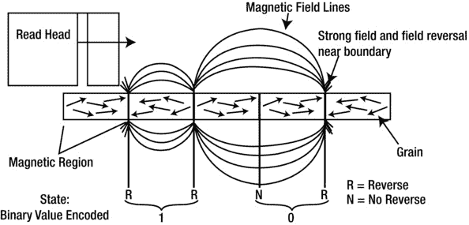
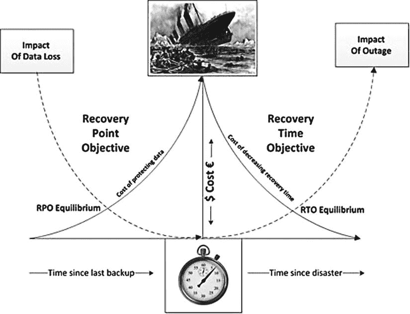

# 第二章：规划你的计划

本章将介绍在创建灾难恢复计划之前必须处理的各种依赖关系。计划本身将包括灾难发生时该怎么做，但在制定计划之前，还有许多重要的步骤需要完成。首先，必须要有制定计划的意愿和资金支持，并且需要业务本身（而不仅仅是 IT 部门）的利益相关者参与。你制定计划的愿望会遇到种种障碍，你需要以不同的方式去消除它们。我将描述每一个障碍，并举例说明如何消除它。

本章结束时，目标是能够制定计划并将其付诸行动。但在拥有计划之前，你必须先规划该计划所需的一切。你需要做到以下几点：

- 获得管理层的批准。

- 在利益相关者之间建立共识。

- 创建业务影响评估。

- 处理地点和人员的物理及后勤现实问题。

# 这里的重点是“要事优先”

这些依赖关系如果不加以解决，要么会阻碍你制定计划，要么意味着计划在真正接受考验时无法或不会奏效。

## 获得管理层的批准

由于我假设您的灾难恢复计划尚不存在，因此第一步是让您的计划获得批准。为了启动 `DR` 规划项目，通常需要向最高管理层提交一份提案。像这样重要的项目应获得最高级别的批准。这是为了确保在流程中投入所需的承诺、资源和管理关注。

提案应说明开展该项目的原因，并可包含以下部分或全部论点：

-   近年来，业务对 `SharePoint` 的依赖程度增加，从而在 `SharePoint` 不可用时，正常服务中断的风险也随之增加。

-   利益相关者之间越来越认识到严重事件可能对业务产生的影响。

-   灾难恢复并非可以临时拼凑的事情。因此，有必要建立一套在灾难发生时应遵循的正式流程。

-   有机会降低因严重事件而产生的成本或损失。这是该计划的实际利益。

-   有必要制定有效的备份和恢复策略，以减轻破坏性事件的影响。

理解灾难恢复计划应包含哪些内容的第一步是进行业务影响评估（`BIA`）。然而，在讨论 `BIA` 之前，我们先考虑一下达成组织共识的一些障碍以及这些障碍背后常见的隐喻。

## 达成共识的障碍

创建灾难恢复计划可能存在许多障碍。有些是实际性的，例如每个企业的资源都是有限的。这些需要用事实和数据来支持你的论点。

一个自相矛盾的反对意见是计划已经存在！这个计划可能庞大而复杂，以至于没有人真正理解它或曾经测试过它。它可能没有明确包含 `SharePoint`。也可能存在出于政治原因反对制定计划的情况。例如，可能有人支持他们认为与 `SharePoint` 存在竞争关系的平台，因此他们反对任何与之相关的事物。应对此类政治操弄超出了本书的范围。

另一个阻碍灾难恢复计划获得批准的障碍是高层管理人员对 `SharePoint` 故障潜在影响的认识不足。这就是为什么，正如我将在本章中概述的，进行 `BIA` 是灾难恢复计划的第一个基本组成部分。它向管理层提供了关于为何需要灾难恢复计划的真实数据。创建灾难恢复计划会消耗资源（时间和金钱），因此 `BIA` 对于表明你试图避免成本、减少损失，而不是增加成本至关重要。

一些创建灾难恢复计划的障碍则更为模糊。这是因为它们与人们思维运作的方式有关，尤其是在处理像技术这样的复杂系统时。我们都有一个容易犯的错误：用简单的隐喻来代替事物本身。结果，我们对管理这些系统时处理固有风险所需的条件做出了天真的假设。

灾难恢复规划通常做得不太好。这是因为业务部门不了解技术。充其量，他们仍然认为这应该简单且廉价，因为复制文件或将数据库备份到磁盘似乎就应该简单而廉价。但现实是，`SharePoint` 是一个庞大、复杂的互依技术系统，维护系统的一个可恢复版本并不简单——如果包含 `SharePoint` 商店中的第三方应用程序，则更是如此。虽然本书将为您提供支持您的系统所需的知识和事实，但您还需要为您的业务构建一些更好的隐喻，以帮助他们说服他们让您创建一个真正能实现其目的的灾难恢复计划。但首先，您必须理解这些隐喻的来源及其作用。

## 薄弱的隐喻

隐喻在计算领域已被使用多年，以简化采用过程并帮助人们理解特定项目的功能。这就是为什么我们的计算机“桌面”上有“文件夹”中的“文档”。这些隐喻仅仅是为了表示硬盘上的数据。`Ars Technica` 的 `John Siracusa` 谈到了接下来发生的事情：

`早在 1984 年，向从未见过 GUI 的用户解释最初的 Mac 界面时，不可避免地会包含对图标的解释，大意是：“这个图标代表你磁盘上的文件。”但令许多人惊讶的是，用户很快就抛弃了任何间接性的痕迹。这个图标*就是*我的文件。我的文件*就是*这个图标。两者之间不是“代表”或“接口”的关系。这种关系对大多数人来说是陌生的，并且当存在与他们所知的现实更简单、更直接的联系时，这构成了不必要的心理负担。`

（来源：`http://arstechnica.com/apple/reviews/2003/04/finder.ars/3`）

禅宗有一个贴切的公案，尽管我认为他们当时并没有想到 `WIMP`（窗口、图标、菜单、指点设备）：

`不要将指向月亮的手指与月亮本身混淆。`

问题在于，如果你不完全理解被指向的事物，用来表示该对象的方便、简单的隐喻本身就会变成那个对象。当这种思维方式应用于规划业务信息的恢复时，它会产生一种危险的麻痹大意，使大量宝贵数据处于危险之中。

## 很久很久以前……

对某些读者来说可能显而易见，但几乎所有商业信息现在都以电子数据的形式存在。我们不去考虑存储介质的脆弱性。我们认为商业信息就像承载它的服务器一样稳固。俗话说，犯错是人，但真正搞砸事情的是计算机。当来自成千上万人数年的数据可能在不到一秒内丢失或损坏且完全无法恢复时，这一点尤其如此。我们很难理解文件并非只是掉到了文件柜后面，我们可以想方设法把它捞出来。

在许多方面，知识、经验和流程的存储构成了你业务的总和——超越了建筑物和人员本身。重建场所或重新招聘员工可能比重建多年的信息更快。

电子信息的脆弱性和重要性被严重低估，主要是因为我们过时的隐喻。我们将这个隐喻与它所代表的事物混淆了。那些并不是真正的文档；它们只是硬盘上铝或玻璃上按某种方向排列的大量磁化材料（参见图 2-1）。



# 排版后的文本

我的一位亲戚有一种独特方式来应对这种脆弱性。每当他浏览到喜欢的网页时，就会将其打印出来，并按字母顺序归档到电脑旁的文件柜中。他抱怨这个过程很令人沮丧，因为网站总在变化。直到我向他介绍了浏览器中书签（又一个隐喻）的概念，他的生活才轻松了许多。但在我看来，从数据留存的角度而言，他或许才是对的！

## 很久以前……

即便有些人已经不再把文件柜的物理概念用于数字文件，他们仍然认为数据保护只能通过某种磁带备份来实现。几年前，备份磁带副本会存储在本地，以满足丢失文件、数据库表等的日常恢复需求。其中部分磁带副本会定期运往异地，通常在那里保存多年，以确保在发生毁灭性灾难导致企业主站点关闭时能够恢复数据。

长期异地磁带存储曾是"执行"灾难恢复的传统方式。如果业务需要在主站点以外的地点重启，这些磁带可被运往新地点；应用环境会被手动重建；数据将被加载到新服务器上；业务运营将从新地点进行，直到主站点能够重新上线为止。

这种模式在某些组织中仍被视为有效，但它不足以应对 SharePoint 场的复杂性和规模。正如你将在后续章节中看到的，SharePoint 场包含许多相互依赖且不断变化的组件。仅靠磁带备份而无灾难恢复计划来重建 SharePoint 场，对任何人来说都是挑战，无论其技术水平如何。再加上系统每秒钟停机的成本，这绝非理想场景。

## 另一个软弱的隐喻：快照

虚拟化使用了另一个被误读的隐喻，它在 SharePoint 场上承诺了无法实现的功能。有些人仍然认为，他们只需对正在运行的 SharePoint 场的虚拟 Web 服务器、应用程序服务器和 SQL 服务器拍摄"快照"即可。他们认为这台魔法相机能在某一时刻捕获 SharePoint 场中的所有信息，从而允许他们在未来任意时间点恢复至该时刻。这种想法过于简单化。

定时作业就是展示 SharePoint 场复杂性的一个例子。SharePoint 场有超过 125 个默认定时作业（`http://technet.microsoft.com/en-us/library/cc678870.aspx`）。它们的运行频率从每 15 秒一次（例如配置刷新作业，它会检查配置数据库中用户配置文件服务的配置更改）到每月运行一次的"我的网站建议电子邮件作业"——该作业会向不常更新用户配置文件的人员发送包含同事和关键字建议的电子邮件，促使其更新配置文件。

定时作业会查询当前时间以确定下次运行时间。这是因为它们并非按照统一时间线运行，而是遵循诸如"运行后，将定时器设置为 90 分钟后再次运行"的简单规则。如果你对这些服务拍摄快照，然后尝试恢复到之前的某个时间点，它们会认为当前时间是快照时间，而非实际时间。显然，这会导致重大问题。更多细节请参见：`http://technet.microsoft.com/en-us/library/ff621103.aspx`。其中指出，在生产环境中不应使用快照是最佳实践，并提供了关于快照如何影响性能的详细信息。

## 更强的隐喻

*"现实不过是幻象，尽管是一种非常持久的幻象"*
——阿尔伯特·爱因斯坦（传）

我要强调的是，正是这些对计算机存储信息的过于简化的看法，导致了灾难恢复计划的失败，因为人们假设备份应该像拍照或录音一样便宜简单。但时代已经改变，事情不再那么简单或便宜。你此刻的目标是为创建灾难恢复计划的项目争取支持。你没有时间让每个人都成为 SharePoint 专家，但你必须将他们软弱的隐喻转变为更强的隐喻。

软弱的隐喻如同迷信；无法用知识和事实来抵消。事实反而会让人的观点更加根深蒂固，因为没有任何事物有百分百正确的观点。要说服人们敞开心扉，更成功的间接方法是改进他们的隐喻；你需要提供更好的隐喻来替代他们原有的认知。

以下是一些更强的隐喻，可能有助于说服他人 SharePoint 是一个复杂系统：

*   **SharePoint 就像一座公园**：需要持续的修剪和规划来管理其生长。想象一下这座公园被摧毁，你必须重建它。需要大量不同信息才能重建。简单的快照远远不够，你也无法简单维护一个不断变化的有机体的副本。
*   **SharePoint 就像一栋办公楼**：如果因自然灾害，你必须将这栋楼里的所有人及物品迁至别处，你会怎么做？这个隐喻很有用，因为无论你在哪个行业，都可能依赖某个物理场所。SharePoint 就是它的虚拟版本。住宅是这一隐喻的另一种变体。
*   **SharePoint 就像人体**：拥有许多相互连接、相互依赖的部分。就像身体一样，如果一个器官衰竭，就会影响整个机体。如果你要用克隆器官从头重建一个人，你不仅需要物理部分，还需要大脑中存储多年的信息。对于 SharePoint，你可以克隆虚拟服务器，但只能是空服务器。数据在不断变化且复杂非常。

如果你能让利益相关者理解 SharePoint 复杂且不断演变的特性，你就可以赢得他们的支持，从而进入更具体的步骤——评估 SharePoint 系统故障可能造成的影响。这是下一步工作。

### 业务影响评估

业务数据是一种资产，具有有形价值。但某些数据的价值高于其他数据。大多数组织实际上并未计算信息的价值，也未计算丢失部分或全部信息对业务造成的成本。在制定灾难恢复计划之前，你必须先规划为何需要它。而要充分理解为何需要灾难恢复计划，你需要进行 BIA（业务影响评估）。这将使你以真金白银的形式了解没有灾难恢复计划的成本。大多数组织会得出的结论是：与灾难发生时所能节省的成本相比，制定和维护 BIA 的成本比例微乎其微。

BIA 应是一份涉及所有关键业务利益相关者的详细文档。他们是使 BIA——进而使灾难恢复计划——取得成功的关键人物。它并非仅由 IT 部门就能制定的东西。这是另一种根本过时的思维方式。内容所有者有责任为其团队制定业务连续性计划。虽然这需要与 IT 部门协作完成，但 IT 部门只是负责满足需求。定义需求是业务部门的职责。

BIA 应识别因运营中断可能导致的财务和运营影响。一些负面影响可能包括：

*   宕机成本
*   收入损失
*   无法继续运营
*   自动化流程中断
*   品牌受损：公司品质感缺失，如第 1 章中的星巴克案例所示
*   可信度与声誉丧失：索尼遭黑客攻击事件便印证了这种影响

## 谁来确定 RTO 和 RPO？

关于灾难恢复规划为何资金严重不足，以及为何传统上 IT 部门是其主要负责人，我已有自己的理论：利益相关者并未意识到其中的复杂性。在大多数情况下，是 IT 部门来制定恢复时间目标和恢复点目标。但如果没有来自业务部门的经验数据输入，他们又如何能准确确定这些目标呢？

因此，目标通常基于通用的 Microsoft 指南或某些武断的决定来设定，比如哪位经理抱怨得最厉害，声称自己的数据特别重要。如果没有业务影响分析，IT 部门就没有经验方法来衡量这些目标（`RTO` 和 `RPO`）。业务用户是其内容的所有者，因此他们也相应承担业务连续性/灾难恢复规划的责任。他们应为其在 SharePoint 内的业务流程指定 `RTO` 和 `RPO`。

## 金发姑娘原则

`RTO` 和 `RPO` 要么基于简单的磁带备份或快照，要么由于过度热情而走向另一个极端，即追求接近零宕机时间。SharePoint 服务器场有时会设定过于激进的 `RTO` 和 `RPO`，因为业务用户认为他们无法容忍任何宕机。这在某些组织中确实如此，例如 `Amazon.com`，其业务存在完全依赖于正常运行时间。另一个例子是空中交通管制，如果飞机在你的机场上空盘旋并燃油不足，那么每一秒都至关重要。这些都是例外，而非普遍情况。`RTO`/`RPO` 越激进，实现该目标所需的技术成本就越高。正如你在第 1 章的“应用场景：事情从来都不简单”中所见，分钟级或小时级的 `RTO`/`RPO` 需要使用 SAN 复制技术，这使得在 SAN 层将数据复制到另一个数据中心的成本非常高。日志传送速度较慢，但也要便宜得多。

灾难恢复规划的目标是你愿意为 `RPO`/`RTO` 支付的费用和你能够承受的损失之间找到完美的平衡点。可以称之为金发姑娘原则：不多也不少。图 2-2 中的图表说明了这一原则。



图 2-2。在 `RPO` 和 `RTO` 方面，时间就是金钱

在图 2-2 中，中心轴代表成本。它还标记了灾难发生的时间点。上方是你的船撞上冰山的那一刻。从那一时刻起你采取的行动就是灾难恢复。时钟在滴答作响，时间就是金钱。在秒表旁边并向右是时间的推进。从泰坦尼克号引出的箭头表示，随着你远离撞击点，成本会下降。换句话说，你能等待恢复数据的时间越长，你的恢复成本就越低。然而，这条下降曲线被一条向上指向“中断影响”的上升虚线曲线所交叉。那是你的组织因 SharePoint 离线而不断上升的成本。你离秒表越远，成本就攀升得越高。

为了说明这一动态，不妨以泰坦尼克号为例。救生艇占用了甲板空间，而船上的空间对乘客以及相应的公司来说非常宝贵，因为航行越舒适，乘客就越多，利润也就越高。当时的普遍看法是，如果一艘如此巨大的船真的沉没，也没有足够的时间让成千上万的乘客全部登上救生艇，因此救生艇无论如何都没用。此外，人们还认为，在如此繁忙的航线上，一旦沉船，会有大量船只前来救援，将人们从水中救起。因此，对利润的追求和对运气的依赖被置于人类生命的价值之上。必须指出的是，白星航运公司（泰坦尼克号的所有者）最终不复存在，被其竞争对手冠达航运公司所收购。可以说，他们没有认真考虑“中断影响”，也没有达成合理的`RTO`平衡点。

在秒表的另一侧是自上次备份以来的时间。能够恢复到灾难发生前几秒或几分钟的时间点，其成本位于成本轴左侧曲线的最高点。换句话说，如果你只能承受丢失几秒或几分钟的数据，那么实现这一目标的成本非常高。但如果你能承受丢失几小时或几天的数据，那么成本就会低得多。

举一个非`SharePoint`的例子，为了保存我写这本书时的备份，我使用了`Jungle Disk`。它基于Amazon Web Storage。我安排了一个定时任务，每晚凌晨 1 点将所有章节和图片所在的文件夹备份到云端。如果那时因网络访问中断而导致备份失败，它会重试直到连接成功。我对最多 24 小时的恢复点目标感到满意，因为如果我丢失了一天的工作，平均也就损失 1200 个单词左右——这是我一天的工作量。我可以以每天 1500 个单词的速度在四天内补回来。`Jungle Disk`成本低廉，因为除了初始上传外，你只需按使用的存储空间付费。对我来说它不太贵，所以我觉得我达到了我的`RPO`平衡点。我的`RTO`也很低，因为我只需去另一台电脑，安装`Jungle Disk`，然后恢复我的备份——不到一小时内，我就能重新开始写作。如果你有兴趣，可以在这里阅读更多关于`Jungle Disk`的信息：`http://aws.amazon.com/solutions/case-studies/jungledisk/`。

本书最重要的一点是，如果你要实施灾难恢复计划，你需要从理解你的需求以及这些需求的后果开始。首先关注那些经常与`SharePoint`相关的众多技术是错误的。我知道我需要保护自己免受潜在硬盘崩溃的威胁。如果丢失了原稿，我不想从头重写这本书。我知道只要不丢失超过一天的工作成果，并且能在一小时左右内恢复写作，我不介意每月花几美元用于备份。这就是我的业务影响分析。一旦我明确了我的参数，我就开始搜索，直到找到满足我需求的技术解决方案。

## 共识

# 良好的 BIA 能推动 RTO/RPO 达成共识

一份良好的业务影响分析（BIA）将促使 `SharePoint` 中的关键业务流程在 `RTO`/`RPO` 上达成共识。要实现这一点，你需要让组织中所有业务部门的代表参与进来。他们的工作是识别本部门执行的关键业务流程，以及这些流程可以中断多长时间而不会对组织产生关键影响。

请注意，标准是`关键影响`。“关键”意味着如果这些流程无法运转，组织也将无法运转并立即停摆。这不仅仅是 `SharePoint` 宕机会带来些许不便的程度，而是会产生真正、可衡量的成本。实际情况是，在 `SharePoint` 恢复之前，通常总会有可以遵循的手动操作流程。诚然，事后重新录入数据会有些麻烦，但节省的成本可能非常可观。

一旦你获得了具体数据，这些业务流程的 `RTO`/`RPO` 将转化为 `SharePoint` 的应用程序和系统 `RTO`/`RPO`，`IT` 部门就能为这些流程提供支持。从 `IT` 部门的角度来看，这为他们提供了需要满足的实际需求。此外，这很可能还有助于识别依赖系统，例如与 `SharePoint` 内优先业务流程相关联的 `Active Directory` 或外部数据源。

如果不利用所有必要输入来制定一份详尽的 BIA，你永远不会知道自己的灾难恢复支出是否真的维持在“恰到好处”的水平。同样，如果你不每隔 6 到 12 个月对其进行审查和重新审视，它就会过时且失去意义。请记住救生艇和泰坦尼克号的教训。

就像那艘船一样，你必须确保所有利益相关者都参与进来并了解风险，以便他们完全知晓在灾难发生时需要做什么。可以把这想象成确保你的乘客知道救生艇演习。要理解演习的重要性，他们需要真正明白“撞击”所带来的影响。

## 人员

要制定灾难恢复计划，实现该计划所需的主要依赖项是人。我已经讨论过完成 BIA、`RTO`/`RPO`、`金发姑娘原则`，最后是达成共识。在灾难发生时，你还需要哪些其他人参与计划？答案当然是执行计划的人。这是你的计划可能尚未开始就失败的另一个关键点。如果最了解你 `SharePoint` 场的人员因灾难而无法工作怎么办？也许灾难是一场流行病，所有 `SharePoint` 管理员都病倒住院或情况更糟。你的计划必须考虑到，制定计划的人可能不是执行计划的人。为此做好准备并妥善测试计划的唯一方法是让独立的第三方来测试你的恢复计划。

测试计划时需要考虑的另一个问题是，计划制定者会因计划的成功运行而拥有既得利益。因此，他们会确保计划测试成功。这也是为什么应由第三方进行计划模拟演练的另一个原因。现在，你已经让所有人就制定计划达成一致，你也有了衡量计划需要达成目标的方法，并且避免了依赖单个人/单组人作为测试和执行计划的单点故障的陷阱。还有其他依赖项吗？

## 物理依赖

灾难发生时的物理依赖项是 `SharePoint` 场本身以及数据。许多企业只为数据实施灾难恢复计划，假设服务器和应用程序环境将通过手动重建。手动重建 `SharePoint` 并非易事。再次考虑复杂系统的隐喻。答案是使用自动化应用程序恢复。提供自动化 `SharePoint` 应用程序恢复的灾难恢复计划，能够比那些仅恢复数据然后依赖管理员手动重建 `SharePoint` 的计划，满足更短的 `RTO`。这些计划也将更可靠、性能更可预测，因为它们将较少依赖于实际执行恢复的 `SharePoint` 场管理员的技能——而在真正的灾难发生时，其中一些管理员可能无法到位。

## 架构影响

请记住，BIA 的主要目标是为 `RTO` 和 `RPO` 目标找到一个平衡点，使组织能够承受影响，并且能够负担解决方案的成本。如果你尚未构建架构，这可能会导致你改变规划 `SharePoint` 架构的方式。你可能会拥有不同 `RTO`/`RPO` 的独立场，因为各业务部门内的业务流程有优先恢复顺序。

从 `IT` 部门的角度来看，这将有助于识别依赖系统，例如与 `SharePoint` 内优先业务流程相关联的 `Active Directory` 或外部数据源。因此，在规划你的计划时，要认识到它将对你的架构产生全面影响。在完成 BIA 之前不要构建。先构建后分析的做法很诱人，但结果将是一个像泰坦尼克号一样的架构——你只能希望不要出任何问题，因为你知道一出问题就是灾难。

## 风险评估

在 `SharePoint` 场及其数据之外，是一个你无法控制的更大世界。但作为灾难恢复预案制定的一部分，你可以评估可能发生哪些会影响你无法实施计划的事件。这意味着你需要根据数据中心所在位置，评估最可能遭遇的灾难类型。如果你所在的地区容易发生海啸、洪水、地震或大面积停电等自然灾害，你可能希望遵循灾难恢复最佳实践指南，将远程恢复站点至少设在距离主站点 200 英里（约 322 公里）的地方。如果这是你的要求，它将影响你为满足灾难恢复需求而实施复制技术的任何决策。例如，微软建议拉伸场的数据中心之间的延迟最差为 1 毫秒，而光纤电缆在传输约 60 英里（约 97 公里）后，由于自身的缺陷，光信号会开始衰减。在规划灾难恢复计划内容时，还可能需要考虑与你组织类型相关的其他特定风险。

要评估风险，你需要做一些研究。信息来源有很多，包括以下方面：

* 系统接口、硬件和软件
* 日志中的数据
* 人员：问！这里会有大量有价值的信息。
* 来自以下渠道的系统被入侵/攻击的历史记录：内部、警方、新闻媒体。
* 来自以下渠道的自然灾害历史记录：内部、警方、新闻媒体。
* 外部/内部审计
* 安全要求
* 安全测试结果

有许多类型的风险应考虑在内。以下列表绝非详尽无遗，但至少展示了风险的可能性范围：

* 自然灾害
  * 龙卷风
  * 飓风
  * 洪水
  * 雪灾
  * 干旱
  * 地震
  * 海啸
  * 雷暴
  * 火灾
  * 地面沉降与滑坡
  * 冰冻条件
  * 污染与环境危害
  * 流行病
* 蓄意破坏

# 灾难恢复规划注意事项

## 威胁与干扰
- 恐怖主义
- 蓄意破坏
- 战争
- 政变
- 盗窃
- 纵火
- 劳资纠纷/罢工行动

## 公用设施与服务中断
- 电力故障
- 燃气供应中断
- 供水中断
- 石油和燃油短缺
- 电话服务中断
- 互联网服务中断
- 排水/废弃物处理系统中断

## 设备或系统故障
- 内部电源故障
- 空调故障
- 冷却系统故障
- 设备故障（不包括 IT 硬件）

## 严重信息安全事件
- 黑客攻击
- 记录或数据意外丢失
- 敏感信息泄露

## 其他紧急情况
- 工作场所暴力
- 公共交通中断
- 骚乱
- 健康与安全法规
- 员工士气
- 兼并收购
- 负面宣传

## 法律问题
此项工作的结果将是确定预防性控制措施。这些措施旨在减少系统中断的影响、提高系统可用性，并可能降低灾难恢复成本。

## 同步性
时间和距离是制定计划时的关键因素。`Synchronous`意为"同时发生"。`Replication`意为"复制数据"。保持最新状态是人类一直以来的做法。在技术出现之前，我们通过口头交流来保持同步。如果我有一段时间没见到朋友，我们会互相分享近况直到"赶上来"；我们交换自上次见面后彼此感兴趣的新信息。因此，这里的关键概念是时间和数据。当你将智能手机连接到电脑时，它们也会同步并交换各自可能新增的信息，直到再次同步；这包括新下载的内容、软件更新、联系人、电子邮件、日历条目等。在这两种情况下，追赶进度都需要一定时间。你上次与电脑交谈/连接的时间越长，同步所需的时间就越长。

像 Facebook 和 Twitter 这样的社交网络技术意味着我们往往能快速了解许多人的大量最新信息，几乎在事件发生的瞬间就能获知。有些更新甚至来自我们并不认识的人；我们只是对他们正在分享的知识主题感兴趣。如果我们持续查看这些应用，就能一直保持同步。其缺点是你必须醒着的每一分钟都盯着屏幕阅读，以确保自己跟上最新动态。当你与虚拟世界保持同步时，现实世界正从你身边流逝。

你可以把交谈/智能手机同步视为并非持续发生，只有在连接时才进行。这个术语是`asynchronous`（异步）。同步间隔的时间越长，所需时间就越长。但在不同步的时候，我们可以自由地做其他事情。Facebook/Twitter 几乎是同步的；它可以实时持续发生，但其代价是无法做其他任何事情。

### 同步复制：镜像
复制是同步数据的过程。它有两种形式：同步和异步。SharePoint 数据主要存储在 SQL Server 中，因此对于同步复制，它可以使用一种称为数据库镜像的技术，使位于不同数据中心不同服务器场上的两个数据库保持相同，就像镜像一样。源数据变化越频繁，镜像为保持最新所需付出的努力就越大。可以将其想象为 Facebook 或 Twitter 上持续不断的更新流。SharePoint 服务器场大约有 20 个大小和用途各异的数据库。有些变化频繁，比如存储内容的数据库；有些变化较少，比如存储场级配置设置的数据库。这会给系统资源带来压力，因此如果使用镜像，你需要规划额外的资源。

### 延迟
回顾一下，SharePoint 农场管理员（不知道这个术语会不会流行起来？）使用镜像等同步复制技术来保持源端和目标端在数据状态上的同步；如果变更很多，这对服务器来说是项艰巨的工作。延迟是另一个因素；它指数据在服务器之间传输所需的时间。如果源端和目标端相距超过约 30 英里，以毫秒计的高延迟自然会导致生产 SharePoint 服务器场出现性能下降。这种情况很常见，而且往往是刻意为之，以确保数据中心不容易遭受相同的潜在物理灾难。

### 异步复制：日志传送
由于光纤电缆会随着距离增加而变慢且可靠性降低，异步复制被更广泛地用于满足远距离灾难恢复（DR）需求。异步复制可以在任何距离上保持源端和目标端同步，但目标端可能会比源端滞后最多几分钟（取决于写入量和网络延迟）。这就像我们之前两个朋友追赶进度，或者将智能手机连接到电脑的例子。如果每天同步一次，那么其余时间就可以专注于其他事情；而且由于每天进行，追赶进度不会花费太长时间，你可以在晚上其他活动较少时进行。

SharePoint 将其大部分数据存储在 SQL Server 中，而 SQL Server 会在日志中跟踪变更。如果你将生产服务器场的日志在夜间复制到另一个数据中心的另一个服务器场，然后将日志中的所有变更应用到那些数据库，两个服务器场就会再次同步。在应用变更之间会存在积压，但这种`日志传送`是异步复制的，因为它是在实际变更发生后过一段时间才进行的。其优点是可以在服务器不太繁忙时进行，因此消耗的系统资源也更少。

异步复制提供了满足 99.9%年度正常运行时间 SLA（服务等级协议）所需的 RPO（恢复点目标）性能，并且以不影响生产应用性能的方式实现。这大约相当于每年 8 小时，因为 99.9%就是每 1000 天中有 1 天，或者说大约每 3 年有 1 天计划外停机。一年有 365.25 天。8 小时是一天 24 小时的 1/3。因此，如果你每 8 小时进行一次日志传送，那就是你在一年中可能丢失数据的最大时长。最坏情况下，恢复点可以回到上次日志传送后的 8 小时。请记住，如果你的主数据中心与备用数据中心距离过近，同一场自然灾害可能导致两者同时瘫痪，那么同步复制的好处就无从谈起了。日志传送成为优良选择的另一个原因是它是一个具有弹性的过程；你可以保留日志，甚至可以将其恢复到生产服务器场以回滚到某个时间点。请注意，在这两种情况下，你的服务器场必须具有相同的架构、补丁等，以确保可以保持同步。在开始制定灾难恢复计划之前，所有这些因素都需要考虑。

## 恢复层级
这听起来可能开始变得复杂，但我用来简化问题的一个方法是，在需要恢复的内容中创建优先级。这有助于将资源集中在最重要的部分。定义恢复层级是一种常用方法，用于在 BIA（业务影响分析）中评估 SharePoint 内各种业务流程的恢复需求。无需为所有主要业务流程区域逐一评估和设定恢复需求，可以定义少量恢复层级。每个层级都有一组与该层级内所有应用环境相关的恢复性能指标。例如，管理层可以定义如下表 2-1 所示的三个层级。

表 2-1. 恢复层级：并非所有内容都同等重要

| 级别 | RPO/RTO | SharePoint 中的业务应用程序 |
| --- | --- | --- |
| 1 | `RPO` 5 分钟，`RTO` 1 小时 | 财务部门网站集，法务部门网站集 |
| 2 | `RPO` 4 小时，`RTO` 8 小时 | 项目网站 |
| 3 | `RPO`/`RTO` 1 天或以上 | 团队网站和我的网站，以及所有其他内容 |

这些数字仅供贵组织参考，因为您的恢复级别会根据业务和法规要求而有所不同。但总体思路是适用的：有一小部分关键内容需要非常低的 `RPO` 和非常短的 `RTO`；然后会有另一组非常重要的网站需要严格的 `RPO`/`RTO`，但不如第一级那么严格；最后很可能还有所有其他网站，它们并不关键，可能只需要在一两天内进行恢复。

此外，根据您的需求，您可能只有两个级别，或者有超过三个级别，但请记住，您不希望的是只有一个级别：显然，并非所有 SharePoint 站点在恢复方面都值得给予最高优先级。您不希望为那些不需要最高恢复要求的站点支付额外的费用。同样，您也不希望让关键应用程序环境与相对不重要的站点一样，由同样的多日 `RPO` 或 `RTO` 标准来支持。

询问最终用户的恢复要求是一个重要步骤，但并非唯一步骤。通常，满足更严格的恢复要求需要更昂贵的解决方案。如果不去考虑成本，大多数最终用户会表示他们希望恢复速度非常快，而实际上他们处理故障的能力可能比他们想象的要容易。事实是，您必须让他们认真思考这个问题，将其作为 `BIA` 的一部分。

## 事后诸葛
在某些情况下，您可能已经选择了您的架构——无论是在本地还是在云中——而现在从 `BIA` 中您知道，您将无法制定一个能够满足 `RTO`/`RPO` 需求的灾难恢复计划。无论如何，`BIA` 应表明，改变现有方案的成本是否低于灾难造成的损失。基于此，您可以争取支持来解决问题，而不是因糟糕的决策而陷入困境，最终只能事后诸葛。

在本地部署的情况下，您可能会说您已经向第三方咨询公司支付了大量资金来设计您的 SharePoint 场，而他们并没有谈到这些。在这种情况下，您如何才能拥有不同的恢复级别？如果他们创建的场具有高于您需求的 `RPO`/`RTO`，那么这就是一个通过更改备份/复制数据的速率和数量来节省资金的机会。您可能需要创建另一个仅用于第一级关键内容的场，并将内容迁移到那里。这个新场会增加成本，但这很可能比丢失数据更便宜，而且您可以辩称，通过降低第二级/第三级数据的 `RPO`/`RTO` 节省了资金。如果他们的架构的 `RPO`/`RTO` 过低，您应该创建一个新的第一级场，专门用于维护关键数据。同样，您这是在避免更大的损失，而不是在花费更多的钱。

如果您使用的是`SharePoint Online Standard`，并且您无法在那里设置不同的`RTO`/`RPO`，只能使用`Microsoft`提供的服务——即每年 12 小时的`RTO`和 24 小时的`RPO`——该怎么办？在这种情况下，您还应该考虑为关键内容选择其他托管方案，例如本地场。这意味着将内容移出云端，并为关键的第一级内容构建一个场。同样，您可以说您是在避免更大的损失，而不是在花费更多的钱。`SharePoint Online Enterprise`提供 1 小时的`RTO`和 6 小时的`RPO`，但这也会花费更多。

这两种解决方案都不简单，但总比明知需要做某事却不去做要好。从某种意义上说，如果您在未考虑灾难恢复的情况下就决定了您的场的位置，那么您实际上是在重新开始。本书将帮助您达到一个更有利的位置。

## 服务水平协议

您的`SLA`可能已经协商好，但现在不能满足您的需求了。它可能太高，从而过于昂贵，也可能太低，这潜在的成本可能非常高！服务水平协议（`SLA`）就是——双方之间记录他们关于所需服务水平达成的共识的协议。它必须是一个动态的文件，以跟踪不断变化的需求和优先级。它不应被视为限制任何一方就调整进行谈判的束缚。在这种情况下，`SLA`应被审查和修改。事实上，`SLA`至少应每年审查一次。建立或重新协商`SLA`的过程本身有助于打开沟通渠道，并确立双方对实际可达成目标的期望。

`SLA`应被视为积极的事物，但它们也可能成为阻碍沟通的钝器。一个好的`SLA`能确保双方使用相同的标准来评估服务质量。一个糟糕的`SLA`被用来在一个已经问题重重的关系中压制投诉，或作为停止讨论的权宜之计。为了有效，`SLA`必须包含两个要素：服务要素和管理要素。

服务要素通过传达以下内容来明确服务：

*   将提供哪些服务。

*   服务可用性的条件。

*   服务的标准。

*   升级程序。

*   双方的责任。

*   成本与服务之间的权衡。

`SLA`的管理要素侧重于如何将协议付诸实施，并衡量其是否有效。没有这些要素，`SLA`就缺乏可执行性，或缺乏一种方式来达成是否有效的共识。这些考虑因素包括：

*   如何追踪服务有效性。

*   有关服务有效性的信息将如何报告和处理。

*   与服务相关的分歧将如何解决。

*   双方将如何审查和修订协议。

建立并维持成功的`SLA`的关键是，协约双方各指定一名负责人，负责创建和审查`SLA`。这可以只是`IT`经理工作的一部分，也可以是某个人的全职工作。创建一个`SLA`需要多长时间，只有真正去做，然后回过头来看，才能现实地回答。它是一个动态的文档，因此可以达成共识，并随着时间的推移而发展。

## 灾难协调

现在您已经为计划完成了大部分准备工作：您已经论证了其合理性，获得了共识，并创建了您的`BIA`和`RTO`/`RPO`。您已经完成了风险评估，并评估了诸如位置和延迟等物理限制。您已经规划并决定了您的恢复级别，并协商了您的`SLA`。那么，您是否已经完成了计划的规划？还没有，但您已经到达了最后的关卡——灾难本身发生时出现的依赖关系。我将在第 3 章中更详细地介绍，但这里提供一些可用于协调灾难的原则。这些原则来自于那些工作可以说是最有压力和混乱的人群：军队。他们开发了`4Ci`来帮助识别在灾难期间，如果您想将计划付诸实施，所需良好指挥架构的关键组成部分。

### 4Ci

## C4ISR与灾难恢复规划

`C4ISR`代表指挥、控制、通信、计算机和情报。虽然这是一个美军术语，但它同样适用于民用领域，涉及如何应对灾难。总的来说，它描述了相关人员应如何协调灾难应对工作，以及通信、领导力和信息的重要性。甚至在从技术角度确定如何满足业务恢复需求之前，你就需要确保人员到位，并形成一个高效沟通的指挥链。俗话说，战争是地狱，如果军事指挥结构能在这种环境下持续运作，那么他们就有东西可以教给我们这些信息技术领域的人，关于如何管理意外和混乱的局面。

### 指挥

这是基于特定知识行使权力以实现目标的过程。请注意，“特定知识”可以指指挥经验或培训，但也意味着做出指挥决策必须基于现有信息。大多数指挥官不愿承认他们的许多决策建立在猜测和运气之上。在`SharePoint`灾难恢复的场景中，关键问题是：“当灾难发生时，谁负责，谁来做最终决定？”

### 控制

这是验证和纠正活动的过程，以实现指挥的目标。控制意味着指挥者要在事态发展、新信息被收集和分析的过程中，保持对局势的掌控。仅仅说出应该做什么，然后如果在半夜发生灾难就回去睡觉是不够的。必须掌握并维持控制，直到情况恢复正常，或者直到可以将控制权委托给其他人。

### 通信

这是在战术或战略单位之间进行有效联络所需的能力。当灾难发生时，它是实时进行的。存在灾难被检测到的时间点，以及灾难实际发生的时间点。灾难通常有一个原因，但会产生多个放大其影响的副作用，使其从一个微小的“侥幸脱险”演变成一连串的问题。这就是为什么通信至关重要。

为了确保通信准确，您的灾难恢复计划必须包含一个呼叫名单。该名单必须保持最新。名单上应为每个关键人员指定后备人员，并记录他们的多种联系方式。应指定一名通信名单管理员，负责监控回复情况，并在必要时联系后备人员。

### 计算机

这指的是计算机系统以及这些计算机系统之间的兼容性。显然，`SharePoint`场及其所有依赖系统在您的灾难恢复中至关重要。这包括网络、`Active Directory`，可能还有`Exchange`，以及第三方数据源等等。这是您灾难恢复计划中最大的领域，因此必须重点关注。

### 情报

这包括信息的收集、分析和分发。当灾难发生时，日志变得非常重要；它们可以告诉您哪里出了问题，以及如何尽快让系统恢复在线。请注意，初始优先级不是弄清楚为什么会发生这种情况。事后分析可以在关键的一级系统和可能的二级系统恢复运行之后再进行。此时，分析日志的目的是找出问题所在，以便尽快修复。如果错误原因无法纠正，那就该采取最后手段了，即从备份中恢复。

## 灾难恢复脚本

当倒计时开始，您进入恢复模式时，许多事情同时发生，混乱是不可避免的。为了使灾难恢复过程更顺利，我建议在您的灾难恢复计划中包含一个详细的脚本或一组分步说明。当然，该脚本应由灾难恢复团队的几名不同成员进行正式审查。

由于无法保证脚本会由编写者本人执行，最好使用带有易于遵循步骤的简单项目符号列表。在真实的恢复场景中，会面临巨大压力，同时处理许多事情。此外，灾难可能随时发生，因此如果在深夜执行计划，混乱程度很可能会很高。

如果可能，尝试预判错误并包含修复步骤。当您处于极度压力和疲劳状态时，简单直接的说明会大有帮助。避免使用在极度疲劳时可能无法理解的术语。如果必须使用技术术语，请添加一个词汇表。

## 最后但同样重要：补给仓库和餐馆

现在看起来这可能不重要，但如果您的员工在现场工作数小时或数天，获得高质量的食物和饮料将有助于他们保持高能量水平，并避免压力和疲劳的负面影响。肾上腺素只能支撑您一段时间。当它耗尽时，您需要时间休息和恢复。让团队休息、进食和补充水分也有利于鼓舞士气、促进团队建设并减轻压力。有时，当人们停止思考问题或后退一步、更非正式地讨论时，最好的想法就会出现。不要低估一份好披萨解决信息技术问题的力量！

除了规划食物和饮料的获取，还要考虑规划购买新设备和线缆的资金/权限。我见过这样的情况：解决方案非常简单，比如一根损坏的线缆，但却花了几个小时才找到一家营业的商店购买替代品。如果是一件更昂贵的设备，请建立一个流程，以便在紧急情况下获得购买新服务器的资金。如果是周五晚上，您真的必须等到周一商店开门才能买到必要的新硬盘吗？

诸如此类的小事会对达成您的`RPO`/`RTO`产生重大影响，所以现在就要为它们做好规划。

## 总结

如本章所示，规划灾难恢复计划时需要考虑许多因素。首先是获得管理层的支持。接下来是让人们从对`SharePoint`过于简单的理解，转变为能够把握其复杂性的认知。这就是更新薄弱隐喻的地方。这一点非常重要，因为利益相关者通常不明白`SharePoint`是一个复杂的系统。

下一步是撰写能够量化为什么需要灾难恢复计划的内容：即`BIA`。这有助于就`RTO`/`RPO`以及灾难恢复选项的成本效益比达成共识。后续章节将更详细地介绍技术选项。规划灾难恢复时另一个需要理解的重要因素是物理限制：位置、延迟和同步类型。

在制定可行的灾难恢复计划时，您最有用的工具将是构建一个反映您需求的架构。这意味着在您的`SharePoint`架构中创建不同的层级，这些层级具有不同的`RTO`/`RPO`，并且相对于其中数据的重要性具有不同的成本水平。

最后，我就如何创建一份良好的服务等级协议以及协调灾难工作的一些初步想法提供了一些建议。关于后一个主题的更多内容，请参见第 3 章。

```
if (condVar > someVal) {console.log("xxx")}
```

