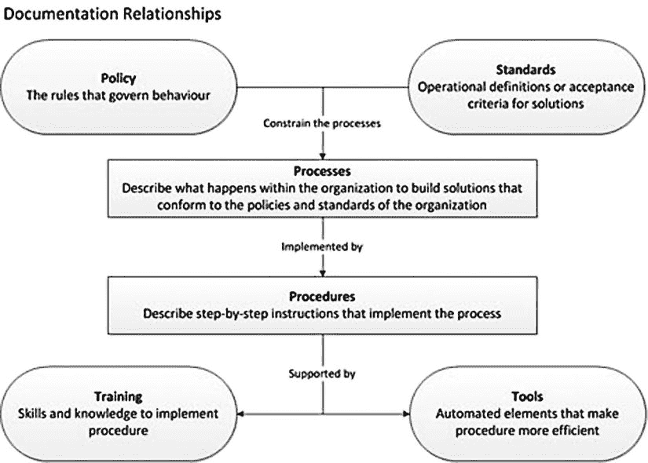
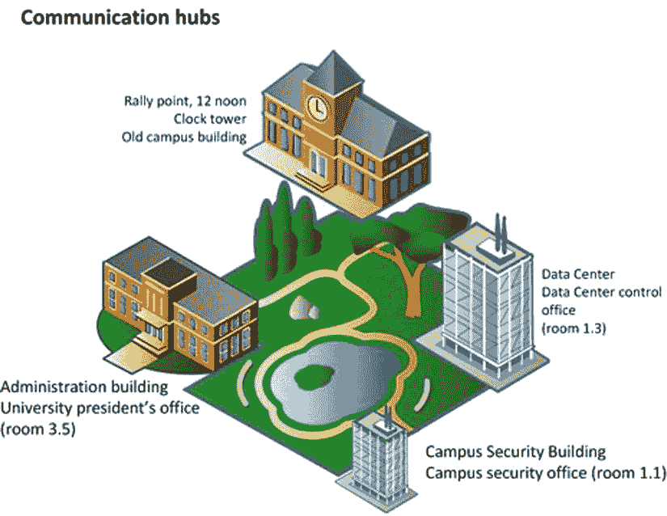
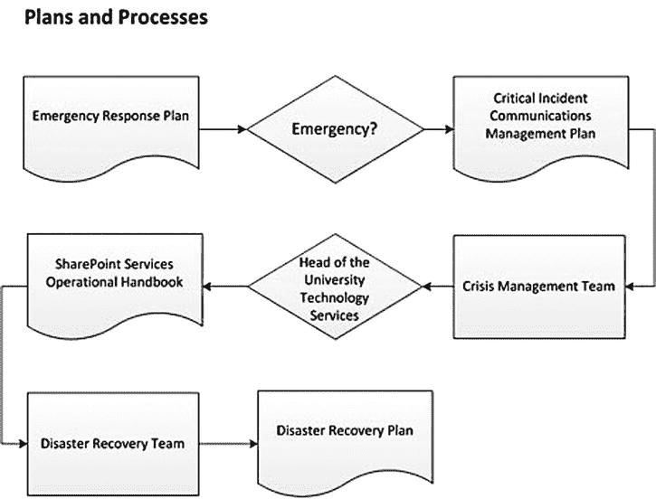

# 第 3 章：激活您的计划

# 本章重点探讨灾难恢复计划启动前的流程制定。

定义清楚“何时应该启动灾难计划”这一流程至关重要。我曾在之前的内容中提到恢复层级等概念，这些有助于你完善计划，但至今我尚未深入具体技术细节——这是有意为之，后续章节会详细展开。当前需要优先传达一个更紧迫的观点：太多计划都依赖某个人能在正确的时间出现在正确的地点，能判断灾难已经发生，并知道如何解决。这句话里埋伏了太多不确定因素。

- 谁来判断灾难确实发生了？
- 谁在整体上处理这场灾难？
- IT 部门中，谁负责处理 SharePoint 服务器场的灾难，而非不可避免的更广泛的 IT 灾难？
- SharePoint 相关人员如何知晓灾难发生？

不清楚这些问题的答案，你的 SharePoint 灾难恢复计划就会像泰坦尼克号沉没后次日清晨的早餐菜单一样毫无用处。如果你的组织没有制定通用的灾难恢复计划，那么 SharePoint 灾难恢复计划无论如何也帮不上忙。现实情况是，IT 灾难不会孤立发生，它往往是更广泛灾难的一部分。可以这么说，当泰坦尼克号那晚撞上冰山时，对正在准备早餐的厨房员工而言是一场灾难，但这并非问题的关键所在。没有人告诉他们发生了什么，也没有人告诉他们摆放餐桌并非当务之急。即便他们有灾难恢复计划，在更大的灾难面前也毫无意义。他们的计划已不再适用。顺便提一句，泰坦尼克号沉没时，厨房员工几乎无人幸存。

读完本章，你将了解需要做哪些准备，以确保灾难来临时，合适的人能在正确的地点就位，并准备好采取行动。

## 欢迎来到纽布里奇大学

为说明你需要掌握哪些流程和步骤来判断何时启动计划，我将虚拟一所大学作为例子。这所大学将设在我的家乡：爱尔兰基尔代尔郡的纽布里奇。这里有许多羊；正如你将看到的，即便是这些看似无害的生物也能引发一场灾难。

我将用这个例子来阐述一些概念，在考虑启动灾难恢复计划前需要做好哪些准备。让我们先从`流程`和`步骤`这对孪生概念入手。

`流程`不同于`步骤`。你可以将`流程`视为一张“待办事项”清单，每个任务都分配给了特定人员或角色。`流程`定义了*需要做什么*以及*谁需要做*。一个`流程`通常涉及多个执行者。

`步骤`则更像一本操作手册。`步骤`定义了如何执行任务，通常只涉及单个执行者。

请牢记这些概念，因为本章的核心就是构建启动灾难恢复计划所需的`流程`和`步骤`。这些`流程`将独一无二，因为你的组织独一无二，有不同潜在灾难需要应对，有不同的办公场所、不同的员工以及不同的 IT 基础设施。我所提出的概念应能帮助你思考那些尚未找到答案的问题。

让我们更深入地审视`流程`这一概念，以及它如何与指导其制定的目标、以及实施该计划的`步骤`相互关联。

## 什么是流程？

`流程`是一系列任务。与你可能预期的不同，`流程`并非单纯一个高层级的 `Visio` 流程图。图表只是对`流程`的草图或描述。`流程`是真实存在的事物，它结合了人员、工具和任务，是一系列行动。`流程`包含若干要素并依赖若干条件。其中最重要的是承担工作的人员的角色与职责。这都与第 2 章中的`4Ci`概念相关联。谁负责做什么？他们如何沟通？

没有任何流程图能捕捉灾难来临时人员需要应对的复杂性。然而，创建`流程`的*过程*本身可能就很有价值，因为它促使人们以更有条理的方式思考。

灾难不是任何人愿意面对的局面；它在根本上就是不可预测的。因此，你的`流程`必须具备弹性。`流程`是一段旅程，而不是目的地。它们被制定出来是为了评估风险并帮助从灾难中恢复。不能指望`流程`与灾难完全匹配；如果真能匹配，那你完全可以完全避免灾难了！

灾难恢复计划成功的关键在于，哪些角色分配给了哪些人。在灾难情况下，不可能记录下每一种可能性中需要做的所有事情。然而，你可以将关键角色分配给冷静、理性、有经验的人员，他们能够分析情况并努力寻求解决方案。你需要优秀的人员担任合适的角色，并为他们配备优秀的后备人员，以防他们无法履职。

`流程`还依赖于适当的工具和设备来支持这些人员完成工作。这些必须提前准备就绪（这将在后续章节中讨论）。学会使用这些工具可能需要额外的培训。

`流程`存在于政策和标准的框架之内。`流程`由定义“*如何*”执行任务以及任务之间关系的具体`步骤`和方法构成。图 3-1 展示了这些关系。

图 3-1. `流程`与`步骤`相关的文档关系

## 我需要定义自己的流程和步骤吗？

你可能需要，也可能不需要。我会尽量避免给出顾问那种高深莫测的答案：视情况而定。出于一些特定原因，你需要为灾难恢复计划定义`流程`或`步骤`。

- 如果你的组织依赖某个`流程`或`步骤`才能运作，你需要对其进行定义。这能让你在一定程度上确信，当需要时，该`流程`会继续被执行。
- 如果只有一个人知道如何执行相关任务，你需要定义该`流程`或`步骤`。这可能也会提出培训或提高自动化程度的需求，以便让更多人能够执行这些任务。
- 如果许多人用多种不同方式执行任务，但其中有一种是更优的方式且你希望被采用，那么你需要定义你的`流程`或`步骤`。

如图 3-1 所示，`流程`和`步骤`基于政策和标准。这些是不断演进的声明或行为准则。

## 定义流程和步骤的好处

首先，从业务管理的角度来看，定义`流程`和`步骤`可以明晰质量、生产力、成本和进度等方面的问题。“无法衡量就无法管理”是管理的核心准则。它还能改善围绕需要完成的工作的沟通和理解。它有助于规划的制定与执行，并能从以往灾难或险兆事故中汲取经验教训。同时，它有助于促进组织范围内`流程`的分析与执行，并为未来的培训和技能评估奠定基础。

## 应用场景：一份灾难恢复计划

这是一个示例灾难恢复计划的开始。到目前为止，您应该意识到，人员、`流程`和程序是基石。当然，在如何恢复 SharePoint 场方面，有一系列技术选择，它们将构成本书其余部分的大部分内容。在此，我将描述灾难恢复计划中对于实施该技术解决方案至关重要的要素。

如果您在泰坦尼克号上，您的灾难恢复过程将包括以下`步骤`：

1. 识别灾难：我们的船撞上了冰山。我们将在两小时内沉没。
2. 通知船员，让乘客穿上救生衣并到甲板上来。
3. 优先让妇女和儿童上救生艇。
4. 在船沉没前将救生艇驶离船只。

这是一组应采取的实际`步骤`。现在，让我们看看如何将其转化为 SharePoint 灾难恢复计划。

## 纽布里奇大学灾难恢复计划

让我们从引言开始。它定义了为什么灾难恢复计划是必要的。在我们虚构的大学案例中，绵羊闯入校园并引发了一系列问题。

### 引言

大学在经历了由绵羊踩踏事件引起的多次灾难后，包括一次建筑物火灾、一次环境污染、灭火系统误排放以及几次电力中断，开始了其规划过程。灾难恢复规划已在多个层面进行。最高层面是涵盖事件识别、总体政策、初步响应、紧急通知与沟通以及危机管理团队的大学总应急响应计划。本文件代表了中央 IT 部门为具体说明在 SharePoint 灾难发生时必须采取的措施所做的努力，因为我们了解到，大学甚至整个 IT 部门的总体灾难计划并未包含 SharePoint 场的恢复。

### 环境与沟通

IT 基础设施可能分布在多个地点。这些地点应接受风险评估，以判断其受损风险。除了物理位置，还有网络本身。应制定`流程`来审查这些地点。同时确保将这些地点告知任何阅读该计划的人——不要假设每个人事先都知道所有房间和建筑物的位置。一张清晰简单的地图是满足此需求的最佳方案。

### 通用设施风险

SharePoint 场并非孤立存在；它们分散在多个校园建筑中，应定期审查这些建筑以发现潜在风险。这些定期审查应包括：由当地消防检查员进行的设施巡视，由火灾和绵羊安全顾问对所有数据中心设施进行的调查研究，以及由保险提供方进行的审查。校园安保或公共安全官员应审查设施的物理安全。他们应特别注意绵羊能够绕过的围栏。应定期与大学的风险管理职员和内部审计职员进行审查。网络安全审计也很重要——不是为了防御绵羊黑客，而是为了防御人类黑客。

### 沟通

多亏了那次绵羊踩踏事件，我们现在知道，在灾难中不能期望标准通信路径能够正常工作。根据灾难的不同，不同的沟通方法效果会更好；因此，我们规划了以下备用方案：

* 多条电话线路：数字、模拟和手机。这些设备将在以下地点提供：
  * 校园安全楼里的校园安保办公室（房间 1.1）
  * 行政楼里的大学校长办公室（房间 3.5）
  * 数据中心里的数据中心控制室（房间 1.3）
* 对讲机和寻呼机将在以下地点提供：
  * 校园安全楼里的校园安保办公室
  * 数据中心里的数据中心控制室

每日中午 12 点，集合地点为旧校园建筑庭院前方的钟楼。此信息已告知核心恢复团队成员，成员名单如下文计划所述。如果没有其他沟通方式可用，此处即应为团队集合的地点。如果建筑物处于危险状态，请与其保持安全距离，但要在能看见钟楼的位置停留，以便团队成员能够相互识别并集合。

在核心恢复团队中，将指定一人负责与大学校园办公室和校外社区进行沟通。

图 3-2 为不熟悉校园的人员显示了大学校园地图。

图 3-2. 校园沟通中心

## 设定优先级

在第 2 章中，我解释了并非所有 SharePoint 数据都同等重要。数据恢复的成本及其重要性将导致一个将 SharePoint 场划分为多个层级的计划。这对每个组织来说都会有所不同。以我们的大学为例，在三个不同的 SharePoint 场中存在三种不同类型的内容。

## SharePoint 恢复优先级层级

我们审查了位于以下地点的现有 SharePoint 系统：

*   旧校园建筑中的研究部门
*   托管在数据中心的大学网站
*   托管在行政楼中的员工和管理内网

我们提出了以下问题来确定数据所属的层级：

*   您团队的主要目的或目标是什么，尤其是在使用 SharePoint 方面？
*   可能发生的最坏情况是什么？
*   已经发生的最坏情况是什么？
*   您每天在 SharePoint 中访问哪些数据，这些数据来自哪里？
*   您每天在 SharePoint 中生成哪些关键数据，这些数据去向何处？
*   什么时候对 SharePoint 的访问最为关键？

基于这些答案，我们将 SharePoint 应用程序添加到第 1、2 或 3 层级。我们还确定了各层级之间的任何依赖关系，以及它们对其他系统（如 `DHCP` 和 `DNS`）的依赖关系。

表 3-1 显示了已被识别并归类到三个层级之一的 SharePoint 应用程序。

表 3-1. 校园 SharePoint 内容的恢复层级

| 层级 | RPO/RTO | SharePoint 平台上的应用程序 |
| --- | --- | --- |
| 1 | RPO 5 分钟，RTO 1 小时 | 研究部门的 `SkyNet` 系统 |
| 2 | RPO 4 小时，RTO 8 小时 | 大学内网管理站点 |
| 3 | RPO/RTO 1 天或更长时间 | 大学网站、学生社团站点和“我的网站” |

## 纽布里奇大学灾难恢复计划

### 系统层级

-   **第一层级：** 我们的分析确定，位于老校区生物技术部门的独立 SharePoint 安装是校园内最有价值的系统。它原本在数据中心，但出于安全原因，必须将其与网络隔离，因为它为 `SkyNet` 的一个研究项目收集了高度敏感且有价值的数据。与 `SkyNet` 的合同每年为大学带来数百万美元的收入。该系统从一个具备自我意识的人工智能软件程序中实时处理数据，因此每一分钟的数据都很有价值。确保它在灾难发生时仍能继续运行是我们的首要任务，这构成了第一层级。程序本身也是这么说的。

-   **第二层级：** 这些是大学内网的管理站点。学生的录取是行政部门执行的最重要流程。由于申请者手动填写表格，这些信息随后被手动添加到 SharePoint 列表中，因此系统中断大约一天不会造成太大负担。即使需要重新输入半天的表格，行政部门的成本也不高，因为他们可以廉价雇佣学生来完成。这些站点托管在行政楼，虽然有计划将其迁移到数据中心。

-   **第三层级：** 这包括学生社团网站和我的网站。这些网站深受学生欢迎，但被归入第三层级，因为它们不可用不会给大学带来任何损失。这些站点托管在数据中心。

### 计划位置与内容

计划的位置必须为需要执行计划的人员所知且可访问。将其与服务器放在同一个房间里是愚蠢的。当然，更不要将其以电子形式存储在 SharePoint 本身中！如果那个房间因任何原因受损或无法进入，你如何访问计划？计划的位置必须安全、众所周知，且每天 24 小时可访问。银行可能很安全，但每周只开放特定时间。选择一个比那更好的地方。

至于计划本身，请确保它包含了组织内外关键人员的联系信息，例如第三方供应商。尝试设想一下，如果计划是由一个对您的网络或服务器一无所知的人来执行的。你需要告诉他们什么？

完整的灾难恢复计划通过纽布里奇警察局的一个保险箱提供给团队负责人。它以纸质形式存储以确保检索速度，而不是使用袖珍 U 盘或其他数字存储介质。它包含以下文档：

-   灾难恢复计划概述
-   操作手册
-   SharePoint 服务器关闭/恢复顺序，包含位置和层级
-   资产报告
-   SharePoint 架构图
-   网络拓扑图
-   网络中断管理流程
-   网络事件问题分类
-   网络分界设备图
-   联系信息：所有 IT 人员及校园关键决策者的家庭和手机号码
-   联系信息：`Nintex Workflow` 支持

所有数据备份均保存在都柏林新街 1 号的备份仓库。

### 获得启动信号

这确实是最关键的问题。灾难很可能不局限于 IT 领域，而是更广泛的决策指挥结构的一部分。IT 部门之外的人员将首先确定是否存在普遍性灾难，然后由他们将此信息传达给 IT 灾难恢复人员或团队。根据灾难的严重程度，该计划可能还会有不同的行动方案。并非所有情况下都能进行*原位*恢复，必须由拥有足够权限的人员决定在其他地方恢复场。

### 灾难恢复计划激活

只有在主要设施或设备未受损的情况下，才可能在目标时间范围内完成所有三个层级的恢复，特别是托管 SharePoint 场的三个建筑：数据中心、行政楼和老校区。受损的设施将需要不同的行动计划，包括按计划更换设施或服务器/设备，而这只能在 48 小时后进行，因为必须先填写保险文件，并由保险公司的评估员检查损坏情况。

紧急情况将根据大学应急响应计划的标准来确定，并根据重大事件通信管理计划发出通知。应遵循 SharePoint 服务运营手册程序。如果发生了 `SSO` 手册中定义的严重系统紧急情况，将启动此灾难恢复计划。启动工作将从召集灾难恢复团队开始。由大学技术服务负责人，或危机管理团队（根据应急响应计划）指定的代表来召集灾难恢复团队。

### 相互依赖性

现在应该清楚的是，为了应对灾难，必须定义复杂的流程和程序之间的相互依赖性（参见图 3-3）。即使在这样的场景中，也包含许多不同的元素。灾难恢复团队甚至要到大学应急响应计划确定紧急情况后才会开始工作；他们如何得到通知在另一份名为《重大事件通信管理计划》的文档中有所说明。最后，团队必须遵循 `SSO` 手册中记录的内容。

图 3-3. 大学中人员与计划的相互依赖性

### 决策者

应该有一份清晰的名单，列出在恢复场相关的决策中发挥作用的人员。这份名单会很长，因为所有 IT 系统都与设施本身以及整个 IT 系统存在相互依赖性。请注意，此处指定的是角色而非个人姓名。这是因为在灾难发生前和发生期间，这些角色可能会发生变化，并且可能没有时间更新灾难恢复计划。

### 灾难恢复团队

一旦灾难恢复团队组建完成，他们将被告知资源和设施的受损情况。该小组将代表纽布里奇大学技术服务部门努力从灾难中恢复。灾难恢复团队的成员将包括以下人员。其他人员将在需要时参与流程：

-   大学技术服务负责人
-   运营总监
-   运营经理
-   数据库应用团队负责人
-   技术支持团队负责人
-   网络通信团队负责人
-   安全与帮助台经理
-   SharePoint 场管理员

### 行动与任务

此灾难恢复团队将根据具体的行动计划采取行动，该计划首先关注依赖系统。在 SharePoint 本身恢复之前，需要有多个其他系统才能使其正常运行：`DNS/DHCP`、电子邮件、身份验证、互联网连接等。一旦这些系统运行起来，重点就可以转向第一层级的 SharePoint 系统。如何具体恢复 SharePoint 系统的细节取决于您制定的计划，并将在本书后面更详细地探讨。

当这些系统恢复并再次激活后，团队和组织的压力会大大减轻，这样他们就可以专注于不那么关键的系统。以这种方式进行也意味着可以很快达到一个里程碑，从而让人感觉控制权已更早恢复。

### 行动计划

# 灾难恢复团队将执行以下任务：

-   建立位置合理的团队指挥中心。如有可能，请使用数据中心的`room 2.1`房间。若此房间不可用，请联系大学技术服务主管或危机管理团队指定的代表，以确定地点。
-   指定一名高级员工作为与危机管理团队联络的唯一联系人。
-   在危机期间，指派一名灾难恢复团队成员担任公共关系代表。该指定成员将协调所有相关的大学技术服务通信，并向危机管理团队定期、持续地报告状态。应以此方式严格控制通信。其他团队成员不得使用`Twitter`、`Facebook`和`blog`等工具非正式地分享信息。
-   根据情况需要，从校内或校外存储地点取回备份磁带和文档。
-   分发已充电的短波无线电、寻呼机和手机用于通信。
-   协调并决定恢复事宜。
-   领导技术工作，将系统和通信恢复至可运行状态。
-   评估硬件的可操作性，或主导采购工作以更换硬件。
-   评估最低处理需求，并将这些需求报告给危机管理团队。
-   确定优先级和计划安排要求。
-   检查数据中心站点及其他大学技术服务设施，评估损坏情况，并与危机管理团队共同决定设施是否完好，或是否必须启用备用设施。
-   协调清理或搬迁活动。
-   报告灾难造成的财务影响。
-   通知第三方供应商和合同关系联系人。
-   每年对本计划进行一次审查，并进行灾后审查。

工作重点将放在所依赖系统的验证和恢复上：

-   验证楼宇系统的运行：灭火系统、空调系统以及配备不间断电源的供电服务。
-   验证电信系统的运行：检查拨打到校内和校外号码以及接听来电的情况。
-   验证语音信箱、`911`服务、报警系统以及其他关键电信服务的运行。
-   更新大学技术服务的电话留言以应对灾难情况。
-   如果不间断电源无法运行，请拨打`xxx-xxxx`联系供应商。
-   验证核心路由器、交换单元和网络支持系统是否正常运行。若否，请拨打`xxx-xxxx`联系签约的网络支持供应商。

按以下顺序恢复系统：
1.  DNS/DHCP/WINS 服务器和域控制器
2.  身份验证/授权
3.  UTS 员工台式机/笔记本电脑
4.  互联网服务提供商连接
5.  备份系统
6.  电子邮件服务
7.  故障票务系统
8.  文件存储服务

## 是时候恢复 SharePoint 了！

此时，灾难恢复团队已使 SharePoint 所需的多个依赖系统恢复正常运行。现在，重点可以转移到第一层 SharePoint 系统。如何具体恢复 SharePoint 系统的细节将取决于您制定的计划，本书稍后将对此进行更详细的探讨。

## 总结

您清楚地看到，在实施 SharePoint 灾难恢复计划之前，必须准备就绪许多流程和程序。这些并非纸面上抽象的事物，而是由特定角色履行的实际任务。它们包括：

-   在正确的地点会合，并使用预定义的方法进行沟通。
-   了解必须遵循的预定义优先级。
-   知道计划的存放位置并能够获取它。
-   提前确保计划包含应有的内容。
-   在正确的时间付诸实施。
-   了解相互依赖关系。
-   知道谁负责什么。

现在，您的 SharePoint 团队不会再像泰坦尼克号的厨房员工一样了！

