# 第 8 章：自行灾难恢复

迄今为止，本书一直从业务利益相关者和基础设施所有者的角度关注灾难恢复和备份。完整的服务器场备份将恢复内容数据库、服务器场设置、解决方案和服务应用程序。这些解决方案仅在整个服务器场丢失时才有用；它们并未从用户的角度解决恢复问题。用户有时只需要恢复服务器场中较小的部分，因为他们的关注点仅在于自己的内容。SharePoint 提供了恢复用户关心的以下元素的选项：

*   列表项
*   文档
*   列表
*   库
*   网站
*   网站集

以下低级别配置和结构元素也可以保留：

*   有权访问一个库或网站的人员列表
*   网站栏和内容类型
*   Web 部件页

SharePoint 将越来越多的内容保留选项交到用户自己手中。这是有道理的：他们可以立即保留一个网站或列表，而不必要求 IT 部门为他们执行此操作。到目前为止，本书的重点是架构师、服务器场所有者和 SharePoint 策略师可以采取哪些措施来实现高可用性和灾难恢复策略。本章表明，备份和恢复内容的手段正日益向用户社区提供。了解本章中包含的信息意味着您可以规划培训和流程，以确保用户能够自行操作。具体来说，对于 `SharePoint 2010 Service Pack 1`，用户现在可以从回收站恢复已删除的网站。这明确表明趋势是让用户自己负责数据恢复，而不是 IT 部门。

即便是企业架构师的工具箱里，偶尔也需要几款小工具来备份和恢复场中的这些小部件。了解如何使用大型工具来备份整个场，只是你应对可能情况的备选方案的一部分。例如，当某个内容所有者请求一个方案来维护他们自己的灾难恢复策略时，就需要用到这些。如果场中的一些小部件丢失了，你可以推荐本章介绍的方案来恢复它们。为了取回一个列表而恢复整个场的副本，实在没有必要。

再次强调，本章的目的是展示这些“自己动手”（DIY）方案，让用户自己承担部分维护重要内容和设置备份的工作。我之所以使用“DIY”，是因为这些工具是用户自己就能使用的，无需场管理员权限。其中一些需要网站集管理员权限，例如将网站另存为模板；但另一些，比如从回收站恢复文件，只需要网站成员权限即可。如果你过去主要从 1 万英尺的架构层面审视 SharePoint，你可能忽略了用户可以使用的一些小巧便捷的选项，因此本章将为你详细阐述这些内容。

`SharePoint`（实际上也是整个微软）成功的原因之一，就在于它将控制权交到用户手中。技术是复杂的，但工具可以通过简单的比喻使其更易于使用。SharePoint 允许用户备份和恢复他们自己的一些内容；这样一来，不仅节省了基础设施端的资源，也节省了用户的时间，因为他们可以更快地恢复所需内容。

此处截图来自 `SharePoint 2010`，仅供示意；后续版本拥有相同功能。

本章将重点介绍以下恢复选项：

*   回收站
*   SharePoint 中的版本控制
*   网站和网站集的恢复
*   Office 作为灾难恢复工具
*   模板

让我们从最简单的场景开始：意外删除文档。

### 回收站

别被表面现象迷惑，当你在 SharePoint 网站上选择删除文档或列表项时，它并没有被完全删除。实际上，该条目只是从列表视图中隐藏起来，并显示在回收站中。在被真正删除之前，它并不会被移走。在此期间，如果你从回收站将其恢复，它会带着完全相同的权限、版本历史和列表项 ID 再次出现在列表中，因为它实际上根本就没被删除。根据网站的设置，真正的删除会在稍后发生。

### 回收站设置

回收站的设置由场管理员完成，这些设置决定了是否存在回收站以及它的工作方式。首先，我回顾一些术语。从逻辑上讲，`Web` 应用程序是 SharePoint 网站所驻留的 `Web` 站点的设置。这些设置包括所使用的身份验证类型以及适用于该 `Web` 应用程序内所有网站集的常规设置，例如区域时区。网站集由一个基于特定模板的根网站及其下的所有子网站组成。它们也共享一些设置，例如组和内容类型。在代码中，子网站被称为 `webs`，而网站集则被称为 `site`。

回收站的启用和配置是在 `Web` 应用程序级别进行的。默认情况下，`Web` 应用程序中的所有网站集都会启用回收站。以下是配置 `Web` 应用程序回收站设置的步骤：

1.  确认执行此过程的用户帐户是 `Farm Administrators` SharePoint 组的成员。
2.  在 SharePoint 管理中心网站上，点击 `应用程序管理`。
3.  在 `应用程序管理` 页面上，点击 `管理 Web 应用程序`。
4.  点击要为其配置回收站设置的 `Web` 应用程序。
    功能区变为可用状态。
5.  在功能区上，点击 `常规设置` 下拉菜单，然后点击 `常规设置`（图 8-1）。

    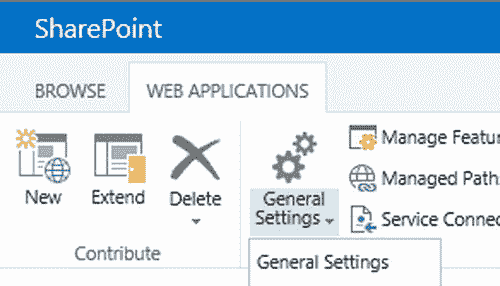

    图 8-1. 选择 `Web` 应用程序后，`常规设置` 选项会出现

6.  在 `Web 应用程序常规设置` 页面的 `回收站` 部分，您可以配置某些设置（图 8-2）。

    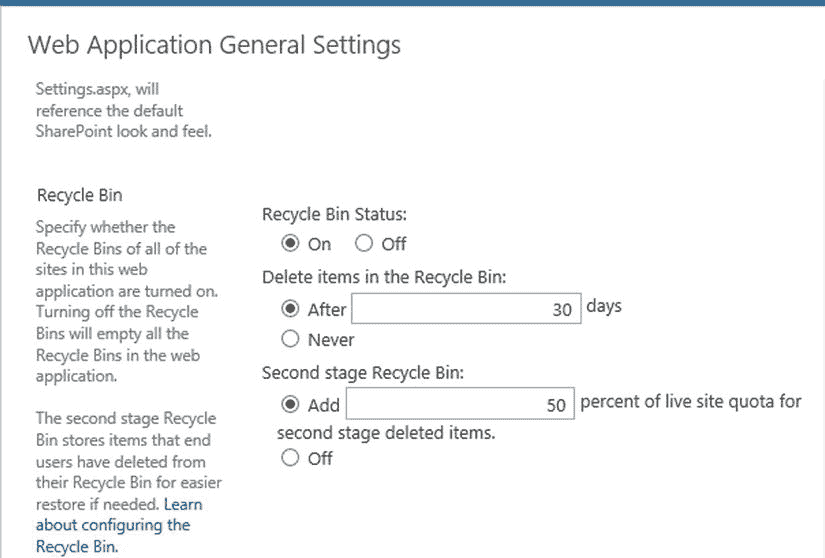

    图 8-2. 回收站的选项

这些选项指的是第一阶段和第二阶段回收站。网站集中的每个网站都有自己的回收站，但如果有条目从那里被删除，它就会出现在第二阶段回收站中。可以把这个第二阶段回收站想象成楼后的大垃圾箱。文档还没有被彻底拿走，但已经不再是你办公桌下垃圾箱里的东西了。这个回收站只有网站集管理员才能访问，大多数用户并不知道它的存在。我曾经遇到过一件事：一个自大的经理给部门所有员工发邮件，想找出是谁删除了一份重要文档。可笑的是，当他发现删文档的人就是他自己后，他试图通过从回收站彻底删除来掩盖痕迹。当我把文档从第二阶段（网站集）回收站恢复后，我特意让他的一些下属知道了这件事，因为我知道他肯定不会主动承认！

### 访问第二阶段回收站

由于第二阶段回收站可能会占用你很大一部分网站配额（默认是 50%；参见图 8-2），你应该知道如何以及在何处管理它。除非你的网站集管理员接受过全面的培训，否则不能指望他们了解这一点。其大小应在配置场时规划和确定。从场容量管理的角度来看，你可以只保留网站回收站，如果愿意，也可以关闭第二阶段回收站。这样做可以让用户自行维护其网站配额，而无需网站集管理员权限。如果他们清空了自己的网站回收站，可以立即从配额中回收空间，而无需等待内容再从网站集回收站中删除。作为高级场所有者，你可能不知道如何访问网站集回收站，以下是具体步骤：

1.  首先，以网站集管理员或更高级别身份登录并进入 `网站设置`（参见图 8-3）。

    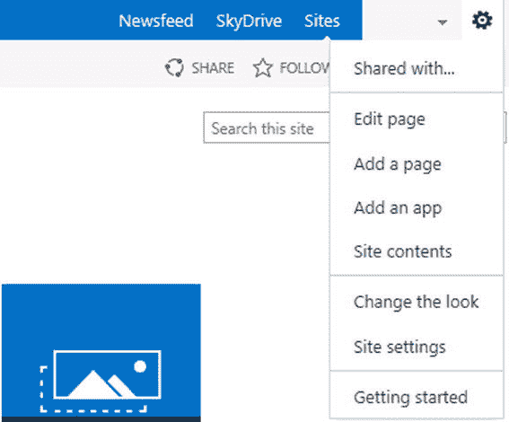

    图 8-3. 通过 `网站设置` 访问网站集设置

2.  然后在 `网站集管理` 下点击 `回收站` 链接（图 8-4）。如果你未以网站集管理员权限登录，即使有网站管理员权限可以访问该页面，此部分也不会显示。

    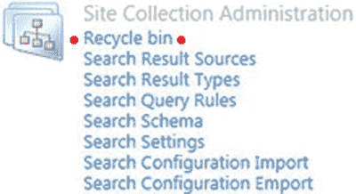

    图 8-4. 如何访问第二阶段回收站设置

3.  现在，你可以查看到已删除条目的若干信息，例如它们原始位置、删除者以及删除时间（图 8-5）。

    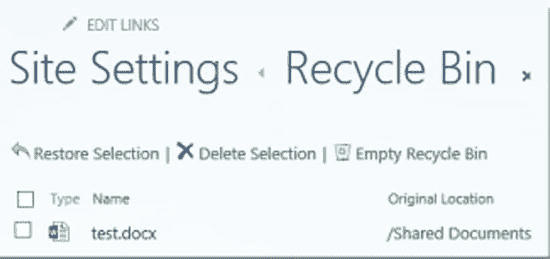

    图 8-5. 删除历史记录

4.  你可以通过这些列来筛选回收站中的项目。你也可以只查看从网站回收站（也称为第一阶段回收站）中明确删除的项目（[图 8-6](#9781430263289_Ch08.

# SharePoint 中的回收站与版本控制

默认情况下，你也能在第一阶段回收站中看到所有内容。


请注意，默认的 30 天期限适用于项目首次删除后的总时间，而非项目在任一回收站阶段中停留的具体时长。

当为某个 Web 应用程序启用了第二阶段回收站后，微软建议你将第二阶段回收站的可用磁盘空间指定为该 Web 应用程序所分配配额的一个百分比（图 8-3）。存储在第二阶段回收站中的项目不计入网站配额；然而，为第二阶段回收站指定的大小会增加网站及其承载内容数据库的总大小。如果未设置网站配额，则第二阶段回收站的大小没有限制。因此，用户可能仍在自己的配额范围内，但实际上在 SQL Server 中使用了远超配额的容量。

例如，如果你为 Web 应用程序分配了 100MB 的空间，那么为第二阶段回收站分配 50% 的配额，则允许第二阶段回收站使用 50MB，而整个 Web 应用程序总空间为 150MB。你可以将第二阶段回收站的配额最高指定为 100%。

## 例外情况

某些例外情况会导致内容不在回收站中。需要特别注意的一点是，通过“数据表视图”删除的内容不会保留在回收站中。“数据表视图”是一种类似 Excel 的列表界面，用于快速编辑多行和多列数据。

你还应注意，回收站仍然会强制执行项目的安全策略。删除内容的用户能够在回收站中看到该内容。如果其他用户没有访问该项目所在位置的权限，他们将无法在回收站中看到这些项目。否则，回收站将成为一个严重的安全漏洞。每个能访问该网站的用户，即使是查看者级别，都可以打开回收站，但他们只能看到自己有权访问的内容。这是因为该项目仍位于其原始位置——只是从那里隐藏起来，并在回收站中显示。如果你删除了一个顶级项目，例如文件夹或列表，并试图查找其内部位置中的某个文档，该项目将不可见。默认情况下，回收站只显示顶级内容，并且没有能力以树状结构或下钻模式显示项目。此外，如果项目在默认的 30 天期限之前就被删除了，或者其超出第二阶段回收站的配额限制，它也不会出现在回收站中。

## 作为恢复工具的版本控制

版本控制是一种功能，它能将文档的每一次先前迭代保存为单独的文件；你可以打开文件在过去某个时刻的副本，而不会丢失当前迭代的版本。在自主灾备（DIY DR）的背景下，这意味着如果用户覆盖或删除了文档的一部分，她可以从文档的先前版本中恢复。这通常被忽视，但它是一种恢复丢失内容的手段。不过，这需要由网站管理员进行配置，并且用户必须勤勉地创建文档版本——而不仅仅是不断点击“保存”。为单个库设置版本控制是通过 `Library Settings`（库设置）页面完成的（图 8-7）。
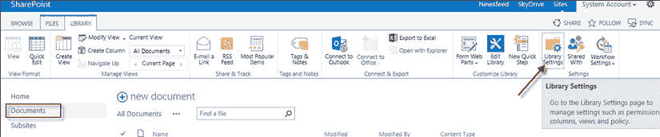

图 8-8 显示了设置页面。
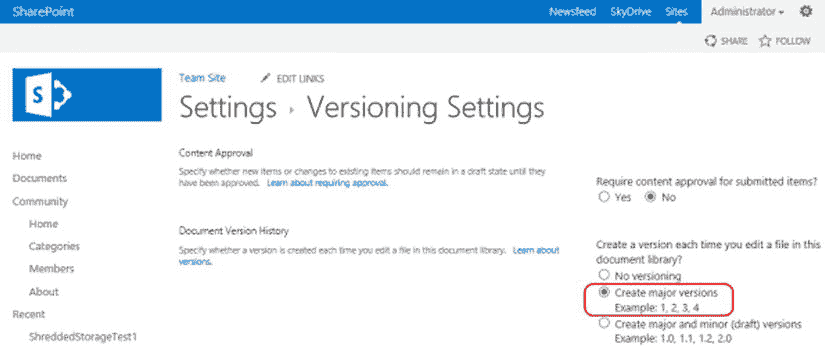

明智的做法是设置保留版本的数量限制，因为在 SharePoint 2010 中，每个版本占用的空间与主文件相同。SharePoint 2013 引入了分片存储，虽然这大大改善了保存增量更改到 SharePoint 时的输入/输出特性，但对上传和下载速度有净负面影响。这可能会积累大量空间。我曾遇到过一个情况，一个 3MB 的 Excel 电子表格的 400 个版本占用了整个网站集的所有配额：1200MB 大约等于 1.2GB。

要求签出功能可确保用户每次想要编辑文档时都创建一个“硬”版本。如果用户打开一个文件并开始编辑，这被称为“软”版本。这是因为直到用户明确签入文档，才会创建新版本。该文件会在后台被签出给他并锁定，但即使更改已保存，也尚未创建新版本。然而，此选项可能会降低对文件的访问速度，因此仅当文档必须拥有这种级别的控制时才应启用。用户培训应说明将版本控制作为一种自主灾备选项的价值。

如果你希望在所有网站上统一设置此功能，则必须创建一个已设置好这些选项的网站模板。什么是最佳设置需要与你的用户协商。最佳实践是确保在不需要时关闭版本控制。一个合理的阈值是保留 10 个版本。当有 3 到 5 个人协作处理一个文档时，这是合理的，因为每个人大约会有 2 到 3 个版本。当添加第 11 个版本时，它将取代第 10 个版本，而最早的版本则被移除。然而，并没有硬性规定。培训用户让他们了解并自行调整这些设置是这里的理想解决方案。这些设置并非旨在集中控制，这就是为什么它们可在库级别进行配置。

## 恢复网站和网站集

SharePoint 背后的理念始终是将决策权下放给用户，就像版本控制一样。网站集的所有者可以相当轻松地删除整个网站集及其所有内容。从用户的角度来看，点击删除网站集的选项后，所有者会看到如图 8-9 所示的消息，该消息警告他们删除的后果。即使在他们点击 `Delete`（删除）后，还会出现另一个提示（见图 8-10）以确认他们确实想要这样做。但偶尔也会发生误操作。
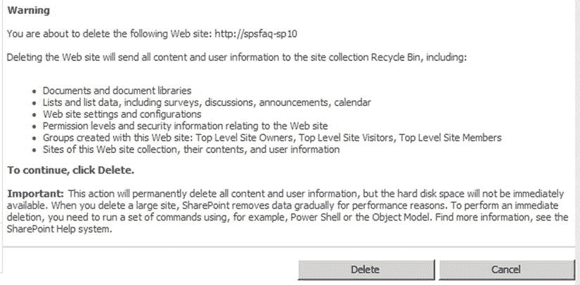
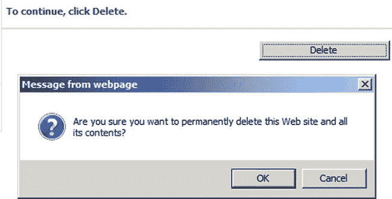

在 SharePoint 2010 Service Pack 1 之前，恢复网站集的唯一途径是让网站集管理员请求场管理员备份内容数据库，并恢复到前一天晚上的状态，从而恢复该网站集——以及同一内容数据库中的许多其他网站集。这不是一个令人满意的解决方案，因为在大多数情况下，它损失的内容比删除的还要多。删除子网站也会显示类似的对话框，但如果需要恢复该网站，同样，唯一的选项是从整个内容数据库的备份中恢复。

然而，SharePoint Server 2010 的 Service Pack 1 增加了将子网站放入第二阶段回收站的功能（图 8-11）。这最清晰地表明备份和恢复已变得更加以用户为中心。
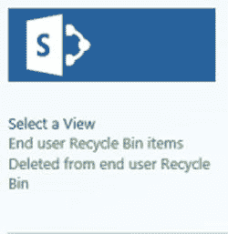

# 使用 SP1 还原网站

## 通过 PowerShell 进行恢复

要使网站集能够通过 PowerShell 还原，你必须在服务器场中至少安装带有 Service Pack 1 的 SharePoint 2010，才能添加此功能。相比之前的情况，这是一个显著的改进，因为现在网站集管理员可以恢复网站，而不仅仅是服务器场管理员。已删除的网站集存储在`SPDeletedSite`对象中。`Get-SPDeletedSite` cmdlet 会列出所有已删除的网站集。当`SPDeletedSite`大于一个时，`Get-SPDeletedSite`返回一个数组。使用以下命令获取计数：

```powershell
(Get-SPDeletedSite).Count
```

现在你只需将其与`Restore-SPDeletedSite` cmdlet 绑定即可。

```powershell
Get-SPDeletedSite | where{$_.SiteId -eq "xxxxxxxx-xxxx-xxxx-xxxx-xxxxxxxxxxxx"} | Restore-SPDeletedSite
```

## 将 Office 用作 DIY 灾难恢复工具

值得一提的是，虽然这不严格属于 SharePoint 范畴，但 Word 通过自动保存和使用所谓的 Backstage 视图，也有助于保护用户的内容。这是你在 Office 中单击“文件”选项卡时的默认视图。向用户记录、培训和展示这些信息，是这些信息被他们了解的最可能的途径。我在此将其作为恢复丢失内容的另一种方法来介绍，以确保完整性。从某种意义上说，它属于组织灾难恢复流程的一部分，因为它是一种恢复数据的方法。在旧版 Office 中，Word 会在你编辑文档时定期在后台保存。这个文件会被保留，以便用户在应用程序崩溃时用它来恢复工作。对于 Word、Excel 和 PowerPoint，Office 2010（以及 Office 365）改进了这一想法。在 Backstage 视图中，Microsoft 会显示你当前编辑会话中周期性的自动保存文件，并允许你比较或将其恢复为最新文档（参见图 8-12）。即使你没有保存文件，这些文件也会保留五天。

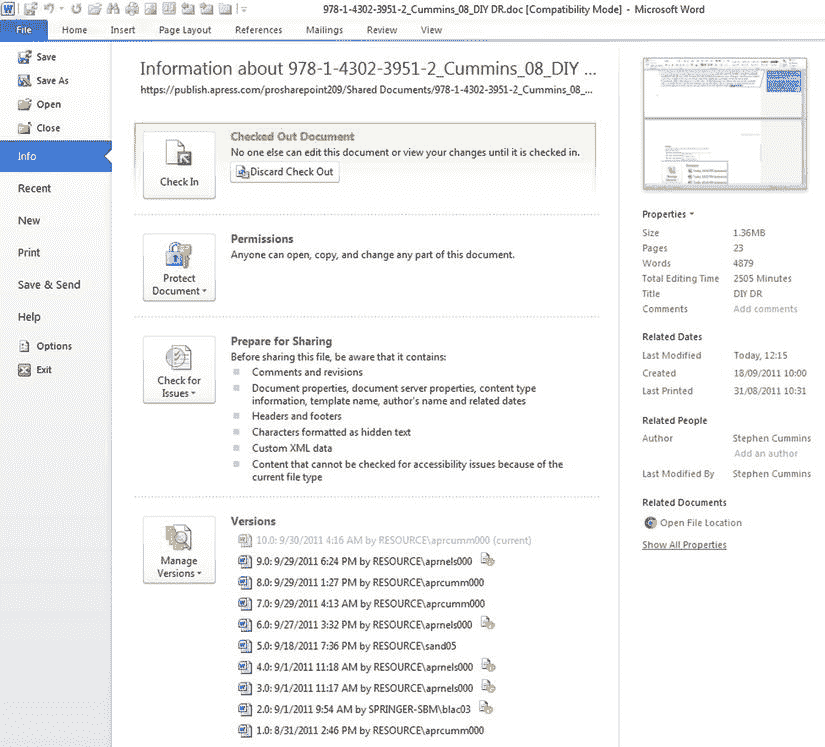

图 8-12. Office 内部的版本控制：本章的 Backstage 视图

当你保存并关闭编辑会话时，这些未保存的版本会被清除。文档保存方式的设置可以在 文件  Word 选项  保存 中找到（图 8-13）。

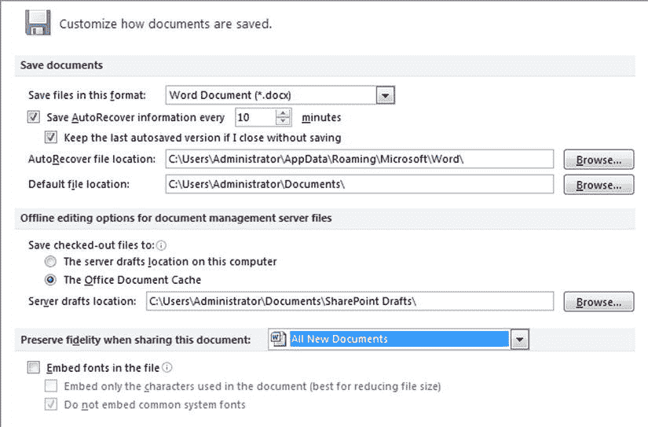

图 8-13. Word 中的保存选项

即使你在未保存文件的情况下关闭编辑会话，Office 现在也会保留最后自动保存的版本。当你再次打开文档时，未保存的版本将出现在 Backstage 视图“信息”窗口的“版本”部分（参见图 8-14）。Office 还允许你直接从 Backstage 视图访问它：在“信息”窗口中单击“管理版本”，然后选择“恢复未保存的文档”（参见图 8-15）。在 Backstage 视图的“最近”窗口底部也有“恢复未保存的文档”链接。

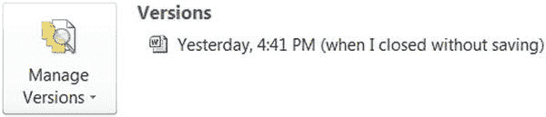

图 8-14. 重新打开一个在 Word 自动保存后未被保存的文件后的“版本”部分

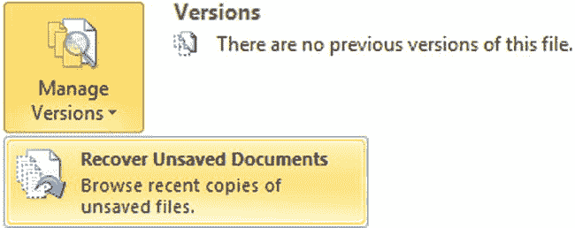

图 8-15. 在 Backstage 视图中，选择“信息”，然后选择“管理版本”，以查看恢复未保存文档的链接

 **注意** 当你单击“恢复未保存的文档”链接时，Office 会带你进入默认的 `UnSavedFiles` 文件夹。但是，你的自动恢复文件位置可能不同。如果你没有看到自动保存的文件，请检查你的保存选项（图 8-13），然后导航到相应位置。

## 使用模板进行内容备份

SharePoint 让用户能够掌握内容保留的另一种方式（尽管是间接的好处）是使用 SharePoint 模板流程。SharePoint Server 中的模板旨在允许你通过复制列表或网站（如果需要，可包含其内容）来重用内容，并允许你在新位置使用相同的内容创建新的列表或网站。此功能也可由任何仅拥有网站所有者权限的用户随时用于对列表或网站进行快速备份，即使这并非其既定用途。因此，如果网站所有者希望获得额外的安全级别，无需服务器场级管理员的干预即可实现。这在需要即时快照时会很有用。

需要注意的是，此方法不会保留“创建者”和“创建时间”，也不会保留网站或列表的访问权限。但它会保留内容和视图，重新创建这些内容通常需要更多时间。另一个警告：Microsoft 已将列表和网站模板的最大大小限制为 10MB（10,485,760 字节）。如果你尝试保存大小超过 10MB 的网站/列表模板，你将收到“列表太大，无法保存为模板。模板的大小不能超过 10485760 字节。”的错误。为了解决这个问题，我看到有人建议在命令提示符下运行此命令：

```cmd
stsadm -o setproperty -propertyname max-template-document-size -propertyvalue 524288000
```

但是，我不建议你这样做。它可能会导致网站恢复过程中出错；有时命令会成功完成，但限制仍然存在。考虑到这些警告，模板仍然是快速备份内容的有用方法，因此我将向你展示如何操作。如果你的网站太大而无法通过此方式保留，那么使用管理中心是你唯一的选择——而且普通用户无法使用此选项。

### 如何创建列表模板

首先，浏览到你想要备份的列表或库，然后单击“库”选项卡（图 8-16）。

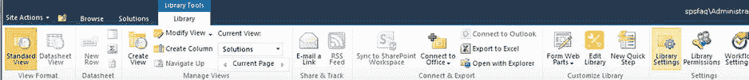

图 8-16. 访问库设置

其次，单击“列表设置”或“库设置”，然后在“权限和管理”下，单击“将列表保存为模板”（图 8-17）。

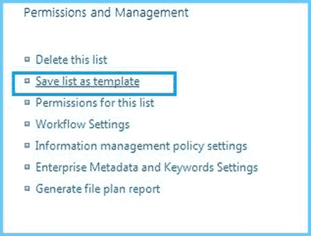

图 8-17. 将列表保存为模板

 **注意** 对于列表或库，操作步骤相同。例如，如果你浏览到一个文档库，设置页面的链接称为“库设置”。对于列表，则称为“列表设置”。按照这个思路，保存模板的链接分别称为“将文档库保存为模板”和“将列表保存为模板”。

单击“将列表保存为模板”链接后，会打开图 8-18 中所示的表单。

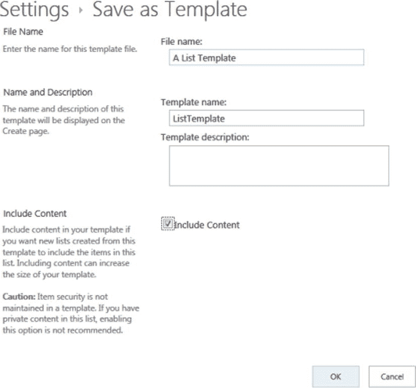

图 8-18. 创建你的模板

填写此表单时，请确保选中“包含内容”复选框。否则，你只会保留列和视图。填写完表单后，单击“确定”；你应该会看到图 8-19 中的消息。然后单击“列表模板库”链接。

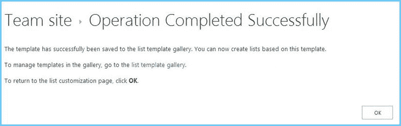

图 8-19. 单击列表模板库链接

单击“列表模板库”链接后，你将进入一个类似于图 8-20 所示的页面。

选择刚刚创建的列表模板，点击“文件”选项卡，功能区将变为如图 8-20 所示。

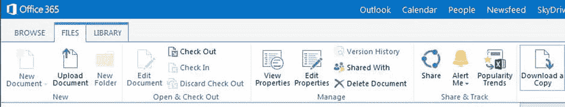

**图 8-20.** 选择模板以更改功能区

点击“下载副本”并将文件（扩展名为`.stp`）复制到一个易于访问的位置。该文件（见图 8-21）现在包含了列表中的所有内容。

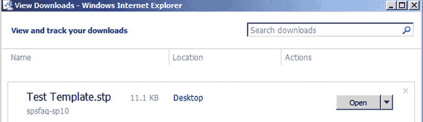

**图 8-21.** 列表的备份

如果只想再次找到该模板，请依次浏览“网站操作”、“网站设置”、“库”、“列表模板”。有了这个`.stp`文件，你就拥有了列表的备份。现在，你可以将其导入到任何列表模板库中，并用于重新创建列表及其内容。只需点击“上载文档”（见图 8-22）即可添加模板并在该网站集中使用。我上传了我的模板，并将其命名为“Book Template Test”。

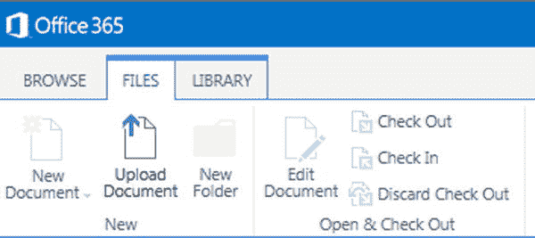

**图 8-22.** 将模板上载到模板库

现在是最重要的步骤：你可以使用此模板来还原列表。你甚至可以通过给它一个不同的名称，将其与现有列表一起还原，以便从中恢复某些内容。只有在列表中不存在于回收站（例如通过数据表视图删除的内容）时，或者当需要恢复早于主回收站或辅助回收站时间限制的内容时，才有必要这样做。这在 SharePoint Online 的情况下可能非常有用。

## 还原列表

为此，请从网站主页点击“添加列表、库和其他应用程序”，然后浏览直到看到列表中新增模板，如图 8-23 所示。

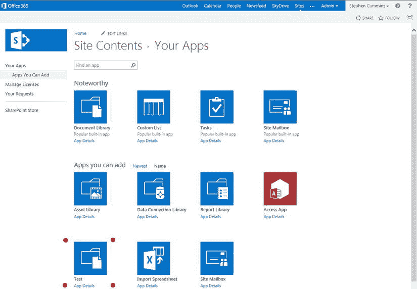

**图 8-23.** 创建新的列表或库以重新创建内容

如图 8-24 所示，你的列表保持了其原先基于的列表类型。我的列表基于文档库，因此它具有相同的图标和结构。


**图 8-24.** 书籍模板测试：包含内容的新列表模板

创建列表后，你会发现所有内容和视图都已恢复。

## 如何创建网站模板

创建网站模板的过程与创建列表模板类似。首先，点击齿轮图标，然后选择“网站设置”。在“网站操作”标题下，点击“将网站另存为模板”（图 8-25）。

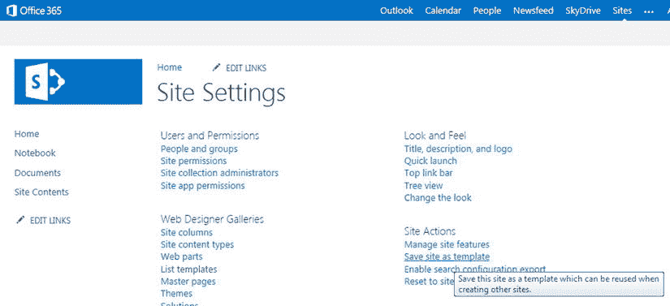

**图 8-25.** “网站操作”下的“将网站另存为模板”链接

点击此链接后，将打开如图 8-26 所示的表单。

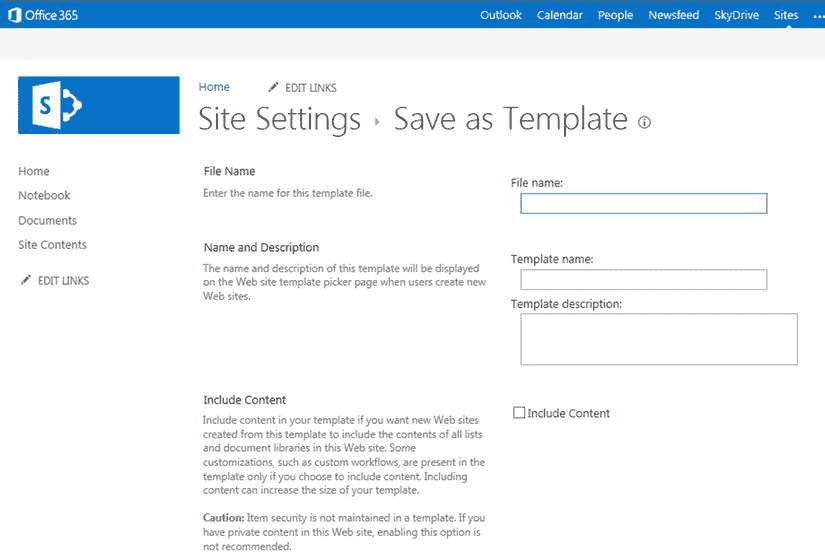

**图 8-26.** 创建模板

填写此表单时，请确保选中“包括内容”复选框。否则，你将只保留列表、库和 Web 部件页面布局。点击“确定”，将显示如图 8-27 所示的消息。然后点击“解决方案库”链接。

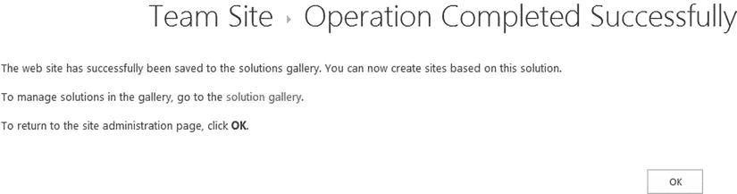

**图 8-27.** 点击“解决方案库”链接

点击“解决方案库”链接后，你将进入如图 8-28 所示的页面。右键单击刚刚创建的网站模板，然后选择“目标另存为”，将文件（扩展名为`.wsp`）复制到一个易于访问的位置。

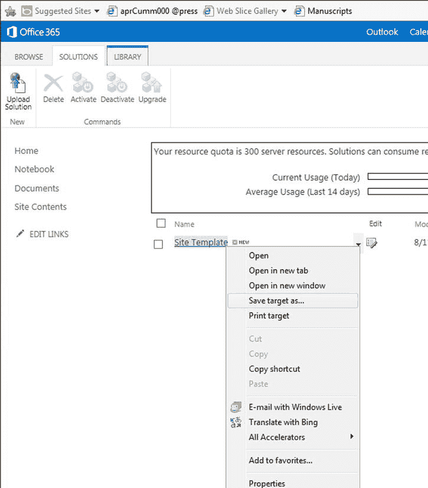

**图 8-28.** 右键单击以单独保存解决方案

该文件现在包含了网站中的所有内容。有了这个`.wsp`文件，你就拥有了网站的备份。现在，你可以将其导入到任何网站集中的解决方案库中，并用于重新创建网站及其内容。只需点击“上载解决方案”即可添加模板并在该网站集中使用（图 8-29）。

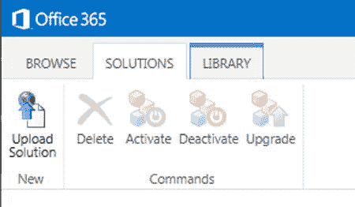

**图 8-29.** 将网站模板上载到解决方案库

## 还原网站

现在是最重要的步骤：你可以使用此模板来还原网站。你甚至可以通过给它一个不同的名称，将其与现有网站一起还原，以便从中恢复某些内容。只有在网站不存在于回收站（例如需要恢复早于主回收站或辅助回收站时间限制的内容）时，才有必要这样做。这在 SharePoint Online 的情况下可能非常有用。

如果你想再次找到该模板，请依次浏览“齿轮图标”、“网站设置”、“Web 设计器库”、“解决方案”。如果网站被删除，你现在可以使用此模板来还原它。为此，请点击右上角的齿轮图标，然后选择“网站内容”。在下一页底部有一个“新建子网站”链接（图 8-30）。

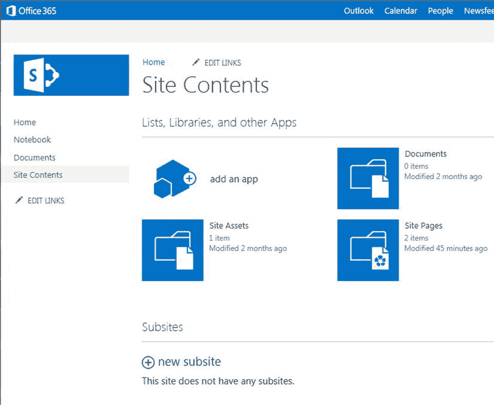

**图 8-30.** 创建新网站以重新创建内容

在“自定义”选项卡下找到你的模板，然后创建你的网站，你将看到所有内容和视图都已恢复（见图 8-31）。

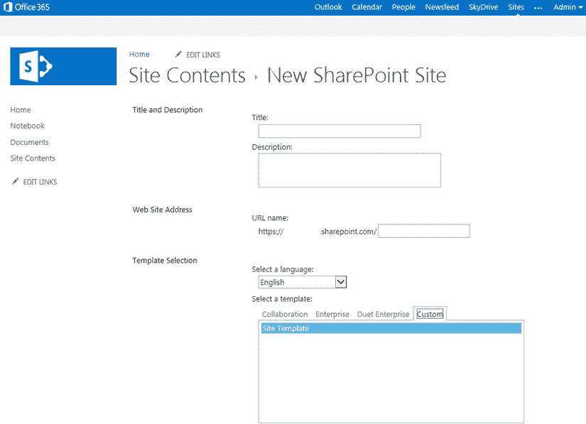

**图 8-31.** 基于模板创建网站

在这两种情况下，这都是将网站或列表重新创建到其他位置（无论是在同一网站集中还是在其他网站中）的一种方法。请记住不要让模板保留在库中，因为用户可能会使用它并创建另一个副本。

## 总结

本章表明，维护有价值内容备份的任务不必是 IT 人员的专属领域。从组织的角度来看，让用户负责并拥有备份自己内容的手段是一个极好的主意，因为它很可能可以节省备份空间和 IT 人员工时方面的资源。IT 通常必须备份用户产生的所有内容，因为 IT 无法知道哪些内容重要，哪些不重要。如果出现问题，IT 部门将面临压力，需要保存正确的内容并能够恢复。如果用户自己拥有这些流程，他们将对该平台有更强的控制感和所有权感，并且觉得自己可以为自己创造保障。这还有一个额外的好处，即释放 IT 部门的资源用于其他任务。它不仅以人员的形式节省资源；使用这些方法快速备份网站或列表意味着不需要在多个位置重复复制大量不必要的数据。这样，虽然有了副本，但这是出于充分理由。用户可以将其视为灾难时的个人救生艇。


