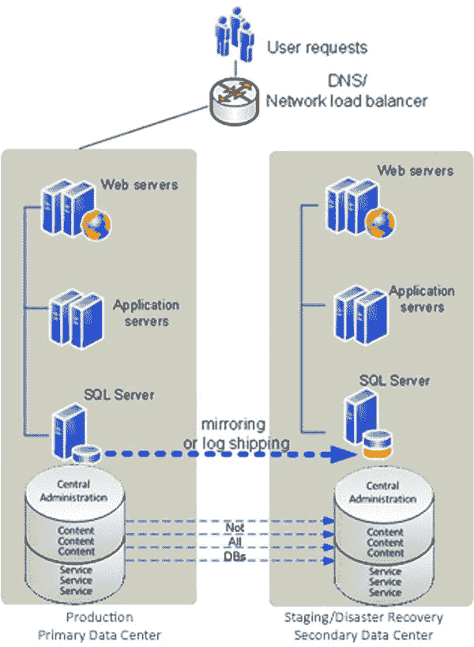
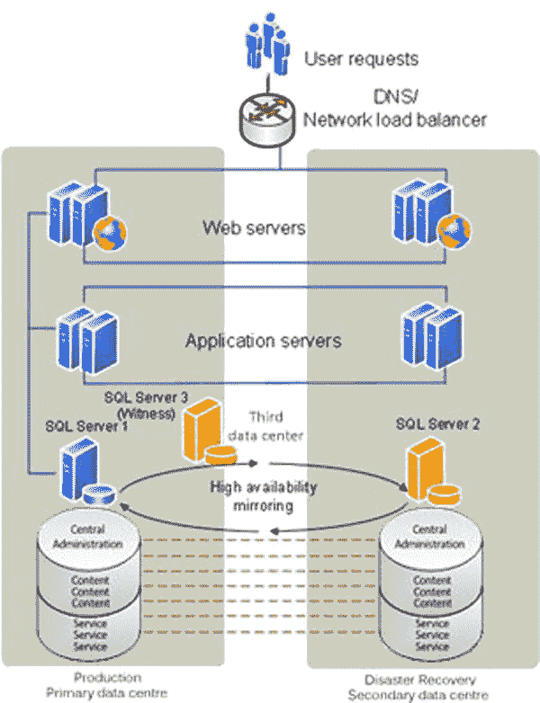
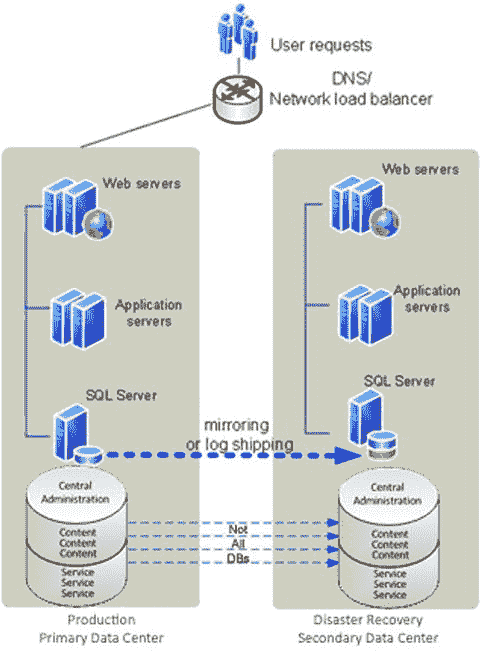

# 经过漫长且详尽的过程，解决方案架构终于达成共识。之所以耗时良久，是因为直接参与人员多达 15 至 20 人（分别来自四家公司）。期间召开了多次会议，产出了大量文档。一份详细设计被制定出来，所有服务器也均已安装并配置完毕。

两个月后，Fancy Flowers 公司的一位项目经理注意到，她关于高可用性和灾难恢复的设想——即拉伸场——并未体现在解决方案架构中。在会议纪要里，她看到大家都同意这个方向。实际上，Clever Consultants 公司的解决方案架构师曾争辩说，跨两个数据中心部署拉伸场只能提供有限程度的高可用性，因为 SAN 仍位于第一个数据中心。如果该数据中心宕机，场也会随之宕机。Super Structure 公司则指出，Fancy Flowers 公司购买的 SLA 是其最高等级，按照该方案进行恢复所需时间过长。解决方案架构中实际给出的方案是在第二个数据中心建立一个灾难恢复场。但 Fancy Flowers 公司坚持要求将此标记为“第二阶段的一部分”，因此该方案虽在解决方案架构中有所描述，却并未在详细设计中真正实施。

在这个后期阶段，Fancy Flowers 公司的项目经理提出异议，称这不是他们当初商定的方案。她认为灾难恢复场的成本没有必要，尽管她对 SharePoint 知之甚少，却仍坚持必须按她的方式执行。Dashing Development 公司选择置身事外，因为 Fancy Flowers 是他们的客户，他们不想失去为其设计定制品牌和 Web 部件这单业务。

现在，讨论在 15 到 20 人之间激烈进行，焦点集中在 SLA 的含义以及应该如何交付服务上。Super Structure 公司提出了第三种方案：日志传送，并将临时场迁移到第二个数据中心，使其兼作灾难恢复场。这意味着需要从零开始卸载并重新安装这个场，因为所有账户和机器名称都包含数据中心名称。此外，日志传送还意味着网络需要更多容量来存储日志。有人提到了镜像，关于 SharePoint 2013 中哪些数据库可以、应该以及不应该进行镜像，引发了大量争论。讨论陷入了僵局，似乎没有人愿意或能够做出最终决定。最终，他们什么也没做。后来，当地一条河流决堤，摧毁了数据中心。由于缺乏适当的灾难恢复计划，所有人相互起诉，这让他们损失惨重，而他们却仍都坚信自己当初是对的。

## 一些术语

在继续之前，我先解释一些在高可用性和灾难恢复背景下有用的术语。

- **SAN**：可由 SQL 或 Windows 使用的存储。
- **延迟**：数据从一台服务器传输到另一台服务器所需的时间。低延迟（1 毫秒）是理想状态。
- **数据中心**：容纳大量服务器的大楼。主数据中心和辅助数据中心通常相距不到 100 公里，因为光纤长度超过这个距离后，效率会开始下降，从而导致延迟增加。
- **复制**：在场之间复制数据。
- **镜像**：几乎实时地制作数据的副本，如同镜子一样。这被称为同步，意味着“同时发生”。由于必须持续进行，这需要大量的系统资源。
- **日志传送**：将 SQL 数据备份到文件服务器，然后将其还原到另一个 SQL 服务器。这被称为异步，因为复制不是即时完成的。通常，日志备份可能在下午 6 点完成，但还原会在六小时后进行。这是因为将 SQL 数据库备份到文件服务器可能需要两个小时，将它们复制到另一个数据中心内的文件服务器需要两个小时，再将数据还原到场中又需要两个小时。
- **热、温、冷备用**：如果备用系统能在几分钟或更短时间内投入运行，则称为热备用。如果需要几分钟或几小时，则称为温备用。如果需要很多小时或几天，则称为冷备用。这些并非精确术语。

## 选项总结

在后面的第 4 章中，我将更详细地探讨这些选择的相对优缺点；我还会解释如何实施它们。现在，以下是本场景中选项的总结。

### 选项 1：日志传送/镜像

这是 Super Structure 公司提出的选项。作为一家 IaaS 公司，他们有 Windows 和 SQL Server 的经验，但缺乏 SharePoint 的经验，因此他们提议将部分数据库进行镜像或日志传送到辅助数据中心，并将原计划用于暂存新代码的场兼作灾难恢复场。此计划包括在两个数据中心内设置独立的 Web 服务器、应用程序服务器和 SQL 服务器。在 SharePoint 中，只有部分数据库可以启用日志传送，并且由于它们是不同的场，配置数据库不会被复制（我将在第 4 章中详述这一点）。在图 1-6 中，您可以看到一些内容数据库和服务数据库正在被复制，而同一场中的服务器位于不同的数据中心。表 1-2 列举了此方法的优缺点。

图 1-6. 具有镜像或日志传送功能的 SharePoint 场

表 1-2. 具有镜像或日志传送功能的 SharePoint 场的优缺点

| 优点 | 缺点 |
| --- | --- |
| 为 SQL Server 提供高可用性和灾难恢复的标准方法。 | SAN 未复制到辅助数据中心。SAN 镜像/复制成本高达数百万美元。 |
| 异步：提供数小时或数天内可用的冷备用。 | 日志不会在主服务器和镜像服务器之间实时复制，因此对性能没有负面影响。 |
| 成本与收益之间的折衷方案。 | 在复制到灾难恢复场期间，需要文件服务器空间来保存日志。 |

### 选项 2：拉伸场

Figure 1-7 展示了 Fancy Flowers 想要的架构。他们并未明确指定镜像技术，因为他们不了解日志传送与镜像之间的区别，但若要实现 SQL 层的最高可用性，镜像会是一个好主意。主数据中心和辅助数据中心均设有 Web 前端服务器、应用服务器和 SQL 服务器。所有服务器都位于同一个服务器场中。然而，此图遗漏了一个重要细节，Super Structure 并未向 Fancy Flowers 说明：SAN。整个服务器场的存储仍位于主数据中心。因此，如果该数据中心不可用，那么此前所做的种种扩展努力都将徒劳无功。复制 SAN 是可行的，但成本极高——远高于在辅助数据中心建立独立的灾难恢复服务器场。但 Fancy Flowers 对此方案志在必得，毫不退让。Table 1-3 展示了此方法的优缺点。

Figure 1-7. 采用镜像技术的 SharePoint 扩展服务器场

Table 1-3. SharePoint 扩展服务器场的优缺点

| 优点 | 缺点 |
| --- | --- |
| 在 SLA 中对应最高级别的可用性。 | SAN 需复制到辅助数据中心。SAN 镜像/复制成本高达数百万美元。 |
| 提供高可用性和灾难恢复。 | 从系统资源角度看，镜像成本高昂。 |
| 同步，因此可在数秒或数分钟内实现热备可用性。 | 对扩展服务器场的支持在 SharePoint 2013 中已被弃用，但目前在有限条件下重新获得支持。SQL Server 与前端 Web 服务器之间的单向延迟必须小于 1 毫秒，且带宽至少为 1 Gbps。 |

### 选项 3：灾难恢复服务器场

选项 3 如 Figure 1-8 所示，与选项 1 几乎完全相同，唯一的区别在于此处的灾难恢复服务器场仅用于灾难恢复目的，并不用于自定义开发的暂存环境。这是 Clever Consultants 最初提出的方案，但因额外成本被 Fancy Flowers 否决。然而，该方案的成本低于 SAN 复制，并且无疑比完全没有灾难恢复要好得多。Table 1-4 展示了此选项的优缺点。

Figure 1-8. 灾难恢复服务器场

Table 1-4. SharePoint 组合式暂存/灾难恢复服务器场的优缺点

| 优点 | 缺点 |
| --- | --- |
| 在 SLA 中对应高级别的可用性。 | SAN 需复制到辅助数据中心。SAN 镜像/复制成本高达数百万美元。 |
| 提供高可用性和灾难恢复。 | 从系统资源角度看，镜像成本高昂。 |
| 异步，因此可在数分钟或数小时内实现温备可用性。 | 成本高于无灾难恢复服务器场。即使未使用，也需为第二个服务器场及其容量付费。 |
| 故障转移后性能水平保持不变。 | 在复制到灾难恢复服务器场期间，需要文件服务器空间来保存日志。 |
| 数据库层通过异步日志传送实现。 | 日志不是在主体服务器与镜像服务器之间实时复制，因此对性能无负面影响。 |
| 不依赖数据中心之间的持续连接。 | 需要维护/修补辅助服务器场以使其与主服务器场保持一致。 |

## 解决方案

这是一个典型场景，原因在于涉及多方人员以及多种技术选项。此处的失败是因为涉及人员过多，且没有一个人具备足够的知识或权威来做出决策。共有四方参与者，各自动机不同，且彼此之间缺乏合作。将灾难归咎于河流很容易，但实际上，糟糕的项目管理才是灾难的真正根源。

组织因缺乏做出技术决策的专业知识而将工作分包给其他公司的情况并不少见。以下是四个参与方的详细信息：

## 案例分析与总结

- **Fancy Flowers**：他们想要最安全的解决方案，但同时要求最便宜的价格。他们不接受灾难恢复成本高昂的现实，也不明白在不了解技术的情况下自行设计解决方案是灾难的根源。作为客户，他们对所有决策拥有否决权；此外，他们在解决方案架构达成一致后又推翻决定，导致了混乱。

- **Super Structure**：他们具备基础设施方面的专业知识，但 SharePoint 需要专家级知识，而这正是他们所欠缺的。当他们需要向 Fancy Flowers 交付 SLA 时，他们退回到了自己熟悉的领域：将 SQL Server 日志传送作为解决方案。

- **Clever Consultants**：他们处于两难境地。他们对解决方案架构负有责任，但却缺乏推动其方案通过的权威。最终，他们妥协了自己最初推荐的灾难恢复服务器场方案，以使解决方案获得批准。

- **Dashing Development**：他们在整个过程中保持中立，并成功避免了任何指责。他们的目标是维持与 Fancy Flowers 的良好关系，因此决定既不帮忙也不添乱。

需要有一个人对整个流程拥有权威，以做出最终决策。这个人应该是 Super Structure 中更高级别的管理者。他们本应确切决定 SLA 中所需的内容，并清晰地列出可供 Fancy Flowers 选择的方案，包括各自的成本及优缺点。他们本可以从 Clever Consultants 那里收集这些信息。可选方案如下：
- 日志传送/镜像
- 扩展服务器场
- 灾难恢复服务器场

有了清晰的选择和各自的成本，Fancy Flowers 本可以做出决策，灾难也就可以避免了。

## 总结

要保护您的内容，您必须了解自己的技术并认识到其对组织的重要性。必须分配角色并承担责任。此外，应该有一种方法来记录未遂事件，以便能够捕捉并处理它们。SharePoint 不仅仅是一个技术平台，它在某种程度上也为用户所拥有。用户和管理层必须在其治理中发挥作用。