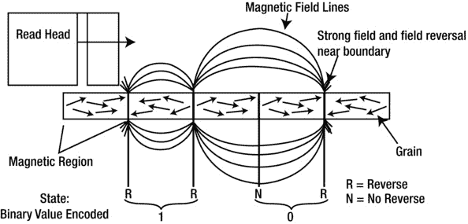

# 这里的重点是“要事优先”。这些依赖关系如果不加以解决，要么会阻碍你制定计划，要么意味着计划在真正接受考验时无法或不会奏效。

## 获得管理层的批准

由于我假设您的灾难恢复计划尚不存在，因此第一步是让您的计划获得批准。为了启动 DR 规划项目，通常需要向最高管理层提交一份提案。像这样重要的项目应获得最高级别的批准。这是为了确保在流程中投入所需的承诺、资源和管理关注。

提案应说明开展该项目的原因，并可包含以下部分或全部论点：

-   近年来，业务对 SharePoint 的依赖程度增加，从而在 SharePoint 不可用时，正常服务中断的风险也随之增加。
-   利益相关者之间越来越认识到严重事件可能对业务产生的影响。
-   灾难恢复并非可以临时拼凑的事情。因此，有必要建立一套在灾难发生时应遵循的正式流程。
-   有机会降低因严重事件而产生的成本或损失。这是该计划的实际利益。
-   有必要制定有效的备份和恢复策略，以减轻破坏性事件的影响。

理解灾难恢复计划应包含哪些内容的第一步是进行业务影响评估（BIA）。然而，在讨论 BIA 之前，我们先考虑一下达成组织共识的一些障碍以及这些障碍背后常见的隐喻。

## 达成共识的障碍

创建灾难恢复计划可能存在许多障碍。有些是实际性的，例如每个企业的资源都是有限的。这些需要用事实和数据来支持你的论点。

一个自相矛盾的反对意见是计划已经存在！这个计划可能庞大而复杂，以至于没有人真正理解它或曾经测试过它。它可能没有明确包含 SharePoint。也可能存在出于政治原因反对制定计划的情况。例如，可能有人支持他们认为与 SharePoint 存在竞争关系的平台，因此他们反对任何与之相关的事物。应对此类政治操弄超出了本书的范围。

另一个阻碍灾难恢复计划获得批准的障碍是高层管理人员对 SharePoint 故障潜在影响的认识不足。这就是为什么，正如我将在本章中概述的，进行 BIA 是灾难恢复计划的第一个基本组成部分。它向管理层提供了关于为何需要灾难恢复计划的真实数据。创建灾难恢复计划会消耗资源（时间和金钱），因此 BIA 对于表明你试图避免成本、减少损失，而不是增加成本至关重要。

一些创建灾难恢复计划的障碍则更为模糊。这是因为它们与人们思维运作的方式有关，尤其是在处理像技术这样的复杂系统时。我们都有一个容易犯的错误：用简单的隐喻来代替事物本身。结果，我们对管理这些系统时处理固有风险所需的条件做出了天真的假设。

灾难恢复规划通常做得不太好。这是因为业务部门不了解技术。充其量，他们仍然认为这应该简单且廉价，因为复制文件或将数据库备份到磁盘似乎就应该简单而廉价。但现实是，SharePoint 是一个庞大、复杂的互依技术系统，维护系统的一个可恢复版本并不简单——如果包含 SharePoint 商店中的第三方应用程序，则更是如此。虽然本书将为您提供支持您的系统所需的知识和事实，但您还需要为您的业务构建一些更好的隐喻，以帮助他们说服他们让您创建一个真正能实现其目的的灾难恢复计划。但首先，您必须理解这些隐喻的来源及其作用。

## 薄弱的隐喻

隐喻在计算领域已被使用多年，以简化采用过程并帮助人们理解特定项目的功能。这就是为什么我们的计算机“桌面”上有“文件夹”中的“文档”。这些隐喻仅仅是为了表示硬盘上的数据。Ars Technica 的 John Siracusa 谈到了接下来发生的事情：

*早在 1984 年，向从未见过 GUI 的用户解释最初的 Mac 界面时，不可避免地会包含对图标的解释，大意是：“这个图标代表你磁盘上的文件。”但令许多人惊讶的是，用户很快就抛弃了任何间接性的痕迹。这个图标*就是*我的文件。我的文件*就是*这个图标。两者之间不是“代表”或“接口”的关系。这种关系对大多数人来说是陌生的，并且当存在与他们所知的现实更简单、更直接的联系时，这构成了不必要的心理负担。*

（来源：`http://arstechnica.com/apple/reviews/2003/04/finder.ars/3`）

禅宗有一个贴切的公案，尽管我认为他们当时并没有想到 WIMP（窗口、图标、菜单、指点设备）：

*不要将指向月亮的手指与月亮本身混淆。*

问题在于，如果你不完全理解被指向的事物，用来表示该对象的方便、简单的隐喻本身就会变成那个对象。当这种思维方式应用于规划业务信息的恢复时，它会产生一种危险的麻痹大意，使大量宝贵数据处于危险之中。

## 很久很久以前……

对某些读者来说可能显而易见，但几乎所有商业信息现在都以电子数据的形式存在。我们不去考虑存储介质的脆弱性。我们认为商业信息就像承载它的服务器一样稳固。俗话说，犯错是人，但真正搞砸事情的是计算机。当来自成千上万人数年的数据可能在不到一秒内丢失或损坏且完全无法恢复时，这一点尤其如此。我们很难理解文件并非只是掉到了文件柜后面，我们可以想方设法把它捞出来。

在许多方面，知识、经验和流程的存储构成了你业务的总和——超越了建筑物和人员本身。重建场所或重新招聘员工可能比重建多年的信息更快。

电子信息的脆弱性和重要性被严重低估，主要是因为我们过时的隐喻。我们将这个隐喻与它所代表的事物混淆了。那些并不是真正的文档；它们只是硬盘上铝或玻璃上按某种方向排列的大量磁化材料（参见图 2-1）。

图 2-1。你的文档实际上只是一些微小的铁屑

