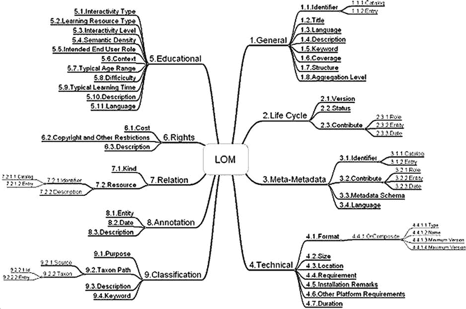
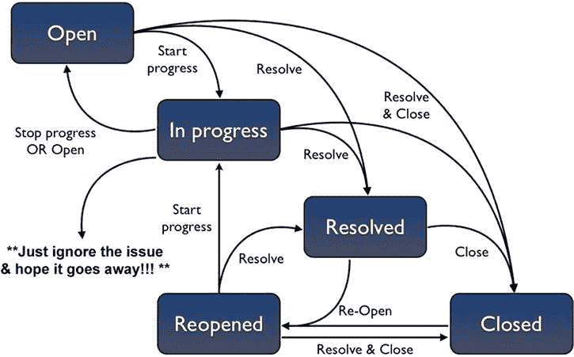
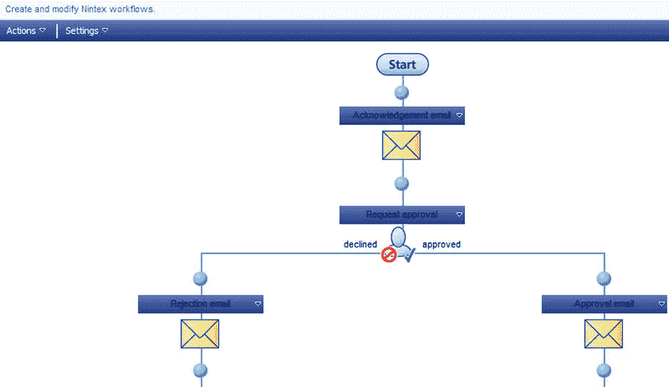
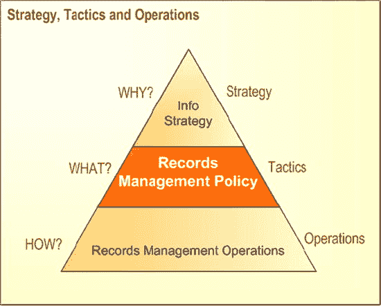

## 第 11 章：最佳实践与最差实践

*原则是完美的表达，而像我们这样不完美的存在无法实践完美，因此我们每时每刻都在实践中设计对完美的妥协边界。*

—莫罕达斯·甘地

`SharePoint` 尚未完全发挥其潜力。部分原因在于完善和优化一个应用程序需要时间，但也归因于其所依赖的技术为其设置的限制和边界。`SharePoint` 受限于`.NET`、`Windows`、`Active Directory`、网络、延迟、带宽、`SQL Server` 和互联网。但实现 `SharePoint` 潜力的主要驱动力，是那些负责其规划、部署和维护的决策者。关于某事物为何如此，你可以有多种视角。总有许多相互关联的原因。虽然我们无法控制 `SharePoint` 平台的硬件、软件、网络和开发限制，但运营者的行为对其成功或失败影响最大。

本章旨在提炼我在多年端到端实施 `SharePoint` 解决方案过程中所见到的最佳和最差实践。我们都有做得好的方面和做得不够好的方面，并且都可以不断进步。`SharePoint` 的成功大多归结于相关的人员以及他们所做的决策。我将这些内容归纳为以下四个主要标题：

- **JFD**：利益相关者追求快速、廉价、短期结果，不惜牺牲质量
- **泥潭**：迁移、元数据、自定义、工作流等
- **变更管理**：并非在服务器场部署后才附加的内容
- **治理**：让合适的人在合适的岗位上，掌握正确的知识

有许多应遵循的小型最佳实践和应避免的不良实践。在本章的过程中，我将解释那些在维护 `SharePoint` 服务器场时造成最大困难的做法。

**图 11-1.** 急于求成永远不会成功

### `JFD`

`JFD` 是我在许多组织中遇到的一种非正式管理风格的缩写。这三个字母代表“Just F***ing Do It”（只管去做）。这是一种基于以下假设的理念：任何以有条理的方式行事的尝试都只是在浪费时间，而最佳方式永远是最快的捷径。直觉飞跃有其可取之处，并且可能非常成功，因为它们避免了群体思维，后者会稀释清晰的好想法并将其降级为妥协的大杂烩。最佳方法可能是 `JFD` 与仔细考虑该方法长期影响的某种结合，以确保它不会导致现在可以规避的问题。

例如，你可以使用网络上可用的第一批硬件来设置 `SharePoint` 并让人们访问，然后你可以雇佣一些开发人员或第三方外部公司来建立一个样板服务器场、备份计划、治理计划和品牌设计。这可以快速完成，尽管成本不菲。这种方法的问题在于，没有进行详细的规划来确定 `SharePoint` 是否以及确实需要用于什么，因为这才是塑造实际解决方案的关键。如果跳过了这一步，结果将是 `SharePoint` 平台注定失败。组织发现自己陷入这种境地的原因并不全是 `JFD` 方法造成的，还与 `SharePoint` 的营销方式有关，即让 `SharePoint` 看起来简单易用。它确实简单易用，但不能只是安装后就不管了。

在许多情况下，`SharePoint` 是在没有任何规划或正式的**征求建议书**（`RFP`）的情况下被选择和安装的。即使发出了 `RFP`，它也是基于同样肤浅的需求，而这些需求不足以执行一个正确的 `SharePoint` 实施。

#### 一个典型的 `SharePoint` `RFP`

`SharePoint` 通常是在进行了一些基本的在线研究后被选中的。然后，组织中的某个人被要求创建一份 `RFP`。`RFP` 本身并非坏事：它们是采购流程的早期阶段。第一步是向供应商发出邀请，通常通过招标过程，针对特定商品或服务（此处为 `SharePoint`）提交提案。`RFP` 流程为采购决策带来了结构性，并旨在提前清晰地识别风险和收益。然而，这里最大的风险被忽略了：`SharePoint` 是否是正确选择？组织是否已经为过渡到它所需要付出的工作量做好了准备？这种风险可以通过组织首先发布`RFI`（信息征求书）来缓解。这向供应商提出了一些技术问题；如果他们提供了良好的解决方案，则被允许提交 `RFP`。

在我们的场景中，第三方公司被邀请提交关于他们如何满足组织需求的提案。这些需求在 `RFP` 中通常只是被泛泛描述，因为在大多数情况下，没有深入了解 `SharePoint` 经验的内部人员不会进行详细的业务分析。以下是一个示例：

> X 公司在许多不同系统中拥有大量数据，并且人员遍布各地。我们也有很多不同的应用程序，这些应用程序的维护成本很高。我们想要 `SharePoint`，以便我们能够拥有一个可以执行所有操作并存储所有内容的应用程序。在你对这一 `RFP`（两周内提交）的回复中，请告诉我们你将如何使用 `SharePoint` 来实现以下目标：

> - 一个供人们存放所有内容的地方
> - 集中式搜索，使人们有一种统一的查找方式
> - Web 内容管理，但不要替换我们的内联网，即使它已经过时且更新缓慢
> - 记录管理，但我们不知道有哪些记录
> - 文档管理，但我们没有任何策略
> - 企业版 Facebook，尽管我们不知道这意味着什么
> - 迁移我们所有的内容，且必须在不中断用户使用的情况下完成
> - 我们也希望将业务流程迁移到工作流中
> - 另外，请向我们发送 `SharePoint` 服务器场架构的详细设计以及你们将如何进行备份

在某些情况下，结果会是第三方公司给出一个千篇一律的回复，因为他们除了列出他们为哪些其他公司设置了 `SharePoint` 并针对这些标准给出泛泛的响应外，别无他法，并附上“需要进一步分析”的附带条件。虽然情况并非总是如此，但当这项工作做得好的时候，回复中会包含为解决这些模糊之处和进一步完善工作说明书（`SOW`）而必须执行的细节。

现实情况是，分析是过程中最重要的部分，而客户很少准备好或被告知，要构建专业的 `SharePoint` 实施，需要客户和第三方咨询公司投入多少前期的时间和人力。第三方咨询公司很少拥有擅长定义分类法和信息架构的优秀人才。他们通常有很多开发人员，这些开发人员被用来为客户创建自定义代码，这带来了将客户锁定在一个难以迁移到下一个 `SharePoint` 版本的解决方案中的风险。这不是理想的情况。尽管也有例外，但在选择咨询公司时，寻找那些拥有强大业务分析技能的公司。

## 良好实践

*一盎司的实践胜过数吨的说教。*

好的，作为高级文档工程师和翻译员，我将遵循您的指示，在保留所有 Markdown 格式的同时，准确地将英文原文翻译成中文。

### 在启动 `SharePoint` 项目之前

# SharePoint项目实施：本末倒置与常见陷阱

在启动 SharePoint 项目之前，每个组织都应确保其拥有足够的预算和时间进行适当的项目规划。对于一个大型组织而言，可能需要与每个团队进行数百场研讨会，以确定他们的业务流程，以及如何使用 SharePoint 来更好地完成这些流程。人们通常假设 SharePoint 就是答案，而第三方公司的任务就是构建一个恰好符合该假设的问题。优秀的咨询公司会引导客户以小规模的方式初步设置 SharePoint，然后尽快将所有权移交给他们，以便他们能够自行了解和掌握这个平台。优秀的咨询公司会支持其客户建立评估用户需求的内部流程，以及如何将这些需求转化为 SharePoint 中开箱即用的解决方案，而不是那些需要自定义代码并因此无法由内部拥有的解决方案。优秀的咨询公司会在为客户构建可扩展、安全且可用的架构之前，确切地确定他们对 SharePoint 的业务需求。他们还会考虑到不同内容具有不同的 RTO 和 RPO，而这些指标在没有进行适当的业务影响分析的情况下是无法定义的。这些信息我在之前的章节中已经介绍过，现在您应该已经熟悉了。

## 本末倒置

SharePoint 是微软历史上增长最快的产品。部分原因是市场需要一种能为用户提供更好、更快信息共享的工具，但也因为微软在大多数企业中占据着独特的地位。这种地位造成了一种情况：在任何人评估 SharePoint 能够且应该用于什么之前，它就已经使用 `JFD` 方法被安装好了：没有准备任何商业案例。以下是微软能够以此方式将 SharePoint 渗透到组织中的主要原因。

图 11-2. 缓慢且低效

### Office 与 Windows

各个版本的 Office 是大多数商务人士使用的主要生产力工具。我们中有多少人能在工作中离开 Word、Outlook 或 Excel？Windows 也是如此；对于大多数企业来说，它是用户唯一可用的 PC 操作系统。SharePoint 与 Office 和 Windows 的集成优于任何第三方产品。这对组织来说是一个极具说服力的驱动因素，可以降低用户不接受的风险。这也帮助微软将 SharePoint 与 Office 和 Windows 捆绑销售，但他们只是通过许可捆绑包间接实现这一点。

### 许可

SharePoint 服务器和客户端访问许可通常与微软的 Office 和 Windows 企业协议捆绑在一起。这意味着许多公司可以以较低或最低的成本获得 SharePoint 许可。缺乏适当的分析意味着 SharePoint 设置、规划的真实成本被忽视了。甚至购买、安装和管理多服务器场硬件的成本也未被考虑在内。一个大型企业可能需要 15 台或更多的服务器。即使是使用 SharePoint Online，也很可能需要设置与 `Active Directory` 的同步，这同样需要硬件。许可可能看起来是免费的，但一个能够满足您业务需求的、可正常运行的 SharePoint 平台并非免费。批量许可是一个被严重忽视的艺术，需要妥善规划：请参阅 `http://www.microsoft.com/licensing/about-licensing/briefs/SharepointServer2013.aspx`。

有了这样的开端，SharePoint 平台的风险只会越来越大。仅仅将 SharePoint 视为一个 IT 产品，而不是业务流程映射工具，意味着从一开始就没有正确认识它。由于这种误解，IT 服务部门承受着让 SharePoint“运转起来”的压力。他们的看法要么是只负责支持基础设施，要么是由业务部门决定用它做什么以及如何使用。即使组织确实拥有支持内部咨询角色的服务部门，他们也几乎不可能拥有内部的 SharePoint 专家。如果他们雇人来支持业务，这个人很少被授权改变业务的运作方式以从 SharePoint 中获得最大收益，因此他们最终成为一个昂贵的支持人员。SharePoint 成了一个没人愿意陷入的泥潭。

## 泥潭

最糟糕的做法起初看起来并非如此。它们看似是实施 SharePoint 的结构化、务实的方法，但它们之所以糟糕，是因为它们建立在对 SharePoint 本质的根本性误解之上。在本节中，我将描述最糟糕的这些做法以及替代的最佳实践。我将最糟糕的做法描述为泥潭，因为现实中泥潭的许多特征与我在此描述比喻性的 SharePoint 泥潭相同。

*   泥潭看起来像正常、平坦、清晰的地面，进入其中似乎非常安全（图 11-3）。
*   它通常位于坚硬、崎岖不平的道路旁边，但泥潭看起来像一条很好的捷径。你会觉得自己选择这条看似更好的路线非常聪明。
*   最初进入时，感觉尚可，脚下有点软，但因为没有明显的障碍，你仍在前进。
*   越往深处走，脚下越软，前进速度也越慢，但你仍然向前走，希望情况会好转。
*   再往前走，你现在已身处泥潭中央，双脚深陷，进退两难。
*   你开始下陷并寻求帮助。任何来帮助你的人也同样陷了进去。
*   最终，一旦你完全消失，泥潭又恢复了平坦诱人的样子，等待下一个寻找捷径的人到来。

图 11-3. 最短的路线鲜为最佳

您在计划实施 SharePoint 时可能陷入的比喻性泥潭也是如此：

*   它们看起来相当简单且安全。
*   虽然存在另一种选择，但显然更困难且更不确定。
*   起初，采用这种方法你会取得进展。
*   你逐渐注意到，为了取得越来越少的进展，需要付出越来越多的努力。
*   最终，你在这种方法上已经走得如此之远，以至于前进或后退的成本都一样高。
*   你所有白费的努力都毫无结果，被迫放弃。你放弃的原因并未得到充分解释，因此其他人最终会犯同样的错误。

让我们看看这种模式如何适用于 SharePoint 实施中最常见的泥潭，从迁移开始，它无疑是其中最大、最危险的一个。

## 迁移

*从最广泛的意义上讲，历史是人类从一个环境迁移到另一个环境的记录。*

—亨廷顿·埃尔斯沃思

实施 SharePoint 应被视为业务任务和流程的迁移，但人们常常错误地将其视为内容的迁移。这是由于对 SharePoint 的本质存在误解。它不像 Windows 那样是一个带有驱动器和文件夹的文件存储系统。这种对 SharePoint 环境的误解是陷入迁移泥潭的第一步。错误的认识是，将内容迁移到 SharePoint 肯定就像将文件和文件夹从一个驱动器移动到另一个驱动器一样简单。如果你解释 SharePoint 实际上是一个协作工具，而不仅仅是一个存储工具，这个观点会被忽视，因为它指向了一条更艰难的道路：分析业务中的所有任务和流程，以及如何将这些映射到 SharePoint 的功能中。

这条路径意味着内容负责人需要做出真正的承诺并投入大量工作，因为一旦流程被确定，就需要在 SharePoint 中创建新的分类法，然后将内容缓慢地手动迁移到正确的位置。业务部门不愿走这条路，所以他们固执地认为迁移到 SharePoint 只是简单的复制粘贴过程。

有一些简单的方法可以将内容迁移到 SharePoint：用户可以通过文档库的 Windows 资源管理器视图拖入文件和文件夹，并从 Excel 导入列表。可以创建一个初始站点结构来反映组织层级，并使用 `AD` 组授予对这些站点的访问权限。此时，进度似乎很快，SharePoint 易于设置的观点似乎得到了验证。但随着更多内容被倾倒进 SharePoint，进度变得缓慢。用户抱怨他们不知道何时以及如何使用 SharePoint，它似乎只是另一个被扔进文件然后被遗忘的地方。站点层级结构也没有帮助，因为站点很快变成了“蜘蛛网”，除非是为了会议议程或公告，否则没有人更新它们或将它们用于任何实际业务任务。人们开始质疑 SharePoint 到底能为业务带来什么好处。

然而，现在 SharePoint 中虽然有了大量真实的业务数据，但 SharePoint 并没有真正为业务做什么。解决方案被视为购买第三方内容迁移工具，并雇用外部顾问来分析 SharePoint 为何未被充分利用。这种方法可能有效，但仍然无法替代一个严肃的计划，该计划应调查 SharePoint 应该用于哪些业务流程，而不是仅仅将其视为一个功能更丰富的内容存储库。

### 最佳实践

现在，公司里的利益相关者感到困惑，不明白为什么 SharePoint 最初的承诺没有实现，于是他们将项目搁置。SharePoint 停滞不前，直到组织中的其他人决定重振它。他们要么避开这个泥潭，要么再次踏入其中。避免迁移泥潭的最佳方法是遵循以下步骤。这些步骤比简单的方法要复杂，但它们确实有效：

*   理解 SharePoint 是一个流程和协作工具。
*   与组织内将作为技术早期采用者的关键团队举办研讨会。
*   在研讨会之前，向团队发放问卷，询问他们想要改进的关键共享和协作流程。
*   将他们的需求映射到 SharePoint 的现成功能上。
*   让用户有机会试点、理解并掌握你为他们设置的内容。
*   将 SharePoint 流程的所有权移交给团队。

如果用户能从将某些内容迁移到`SharePoint`中受益，他们可以自己手动移动。但这很少见。

推广这种方法可能很困难，因为它要求用户直接参与并拥有所有权。因此，有必要向他们展示这样做对他们有什么好处。重点强调这将使他们的生活更轻松，而不是更困难。还要解释内容迁移并不是实施`SharePoint`的方法。这不是最简单的路，但却是最好的路。这也是大多数组织踏入了第一个泥潭。不幸的是，还有其他泥潭需要避免，下一个泥潭并非基于将内容移入`SharePoint`的固有问题，而是基于移动关于内容的信息。

## 元数据

元数据泥潭基于一个错误假设，即所有属性和内容类型必须在系统使用前定义，并且严格、集中管理的元数据必须应用于所有内容。

虽然`SharePoint`确实可以通过托管元数据服务集中管理元数据，并在网站集甚至服务器场之间保持属性和内容类型的一致性，但并非所有内容都必须具有详细的元数据，也并非所有这些元数据都必须预先定义。这是因为某些内容不需要任何元数据，而有些内容只需要用户定义的标签，这些标签不必与中央属性存储保持一致（尽管任何属性都可以提升到该级别）。

最初的选项复杂性导致一些人在规划阶段将所有内容简化为一个分层元数据树，所有内容都将挂载其上。起初，这似乎比启用所有其他元数据选项更简单。当`SharePoint`最初安装时，很明显有很多方法可以为用户提供标记内容的能力。`SharePoint`允许你的用户创建“大众分类法”元数据来标记他们的内容，这些元数据只对他们自己有用，并且只在一个列表或库中保持一致。库可以仅使用元数据进行导航，并且内容组可以使用文档集获得相同的元数据。这些`SharePoint`所有者没有去理解这种复杂性，而是选择了他们的单树方法。

当发现可能存在数百种文档类型，并且需要花费大量时间来识别每一种时，这种方法很快就遇到了麻烦。然后，每种文档类型都需要多个属性，而这些属性中的每一个都可能包含下拉菜单或单选按钮中的多个预定义选项。

很快，他们发现自己陷入了泥潭。他们有成百上千种文档类型和属性，并意识到没有用户希望在上传文档时不得不选择使用哪种。解决方案被视为购买第三方工具并雇用外部承包商编写代码，以自动应用所有这些复杂的元数据。

这似乎奏效了一段时间，直到元数据过时，开发人员不得不进入一个复杂的流程来更新元数据。他们现在意识到无法将更改推送到现有文档。事实证明，他们本应使用`SharePoint`的现成功能，这为用户提供了更灵活的选择和修改元数据的方式。让`SharePoint`不同部分的元数据不一致也是合理的。

遵循这种“大树”方法处理元数据，会给用户提供过多潜在的内容类型，然后是属性，以及在上传文档之前需要选择的下拉菜单或填写的字段。这不可避免地需要一个更改起来非常缓慢的自定义解决方案，因此元数据与用户需求脱节。熵开始起作用，又一个`SharePoint`实施项目陷入了泥潭。

`图 11-4. 元数据映射迅速变得复杂`

## 自定义

`SharePoint`是一个 Web 应用程序，但存在一个错误假设，即修改它就像修改一个标准 HTML 网站一样简单。微软通过推广像`SharePoint Designer`这样的工具，并声称没有经过培训的用户也能轻松使用，从而助长了这种误解，这是有责任的。因此，用户试图自己修改品牌标识甚至标准的`SharePoint`功能。他们最初的尝试是成功的：他们更改了站点徽标和主题，但当他们尝试做更多事情时，他们很快意识到`SharePoint`比最初看起来复杂得多，而且实现看似很小的更改（例如更改搜索框的外观）需要越来越多的时间。`SharePoint`正在倒退，而公司正在构建更复杂的东西来实现同样的目的。

 `图 11-5. 自定义并不总是意味着更好`

现在，他们已经偏离标准`SharePoint`用户界面如此之远，用户要求更高，并坚持要求`SharePoint`的外观和功能完全按照他们的意愿，而非按照其设计初衷。结果，唯一的出路就是签约一家外部公司来进行修改。他们成功进行了修改，但现在系统变得非常复杂，只能由第三方公司的经验丰富的开发人员进行更新。这使得拥有成本高于其业务价值，系统再次停滞不前，直到公司中的其他人再次尝试改进用户界面。

### 最佳实践

这里的关键点是，`SharePoint`是一个已完成的应用程序，并不像网站那样具有可塑性。你越对它进行扭曲，它就越容易出问题。我建议作为经验法则，你 80% 的`SharePoint`实施应使用开箱即用功能。17% 可以是不需要功能或解决方案包的扩展。最后的 3% 可以是自定义代码。这只是一个通用规则，并非适用于所有情况。采用这些比例的原因是管理自定义的成本很高。如果你内部没有进行和维护这些自定义的技能，我建议你不要去做。这看起来可能过于严格，但作为原则，这是一个值得遵循的好原则，也是一个即使你并非总能达到的好的目标。

## 工作流

工作流是另一个看似简单、实则容易陷入的泥潭。最初，使用像`SharePoint`这样的技术来提高工作流程效率的前景颇具吸引力。`SharePoint`提供了内置的工作流模板，还有`SharePoint Designer`、`Visual Studio`以及像`Nintex`这样的工具，它们让创建工作流看似简单。创建工作流被视为一种更好的替代方案，可以避免走改变和改进低效、浪费时间的业务流程这一更为艰难的路径。

起初，通过自定义，基本的业务流程很容易映射到审批工作流（例如），并定义了各个步骤。然后事情变得复杂起来。如果审批人不在，没有正式的委托策略；事实上，甚至没有明确的审批人名单，部门中的任何人似乎都可能批准某事。接着就会清楚，该组织实际上并不了解其业务流程到底是什么。这个流程只是随着时间的推移而有机地发展起来，虽然它实际上不起作用并经常崩溃，但利益相关者坚持认为问题不在于业务流程，而在于工作流技术。再一次，开始寻找昂贵的替代方案。使用`Visual Studio`构建了一个详细定制的工作流，据信，即使业务部门提出新的、相互矛盾的规则来要求其遵循，该工作流也有潜力捕获每一个模糊的意外情况。和之前一样，最终资金和努力都陷入了泥潭，工作流开发团队放弃了。

 `图 11-6. 不合逻辑的业务实践导致不合逻辑的工作流`

### 最佳实践

这里的关键点是，没有技术可以修复有缺陷的工作流程。如果业务流程复杂、低效，最终无法运作，那么工作流只会反映这一点，变得复杂、低效，最终也无法运作。使用`SharePoint`或像`Nintex`这样非常优秀的第三方工作流可视化和创建工具，应被视为改进业务实践、使其清晰高效的机会。那么工作流也将反映这一点。

创建工作流并不是解决糟糕业务流程的方案；试图这样做只会是浪费时间和精力的泥潭。另请注意，`Nintex`的成本并不低。

 `图 11-7. 清晰的业务流程产生清晰的工作流`

## 内部网冲突

在与`SharePoint`相关的问题中，一个绝对要避免的泥潭是没有明确其目的与现有内部网目的的区别。如果你在公司里听到有人问：“我们为什么需要`SharePoint`？我们已经有了内部网？”却没有人能给出明确答案，那你就会知道这是本末倒置的情况，有人在没有清楚了解`SharePoint`能用来做什么的情况下就决定实施了。最初，在内部网旁边设置`SharePoint`看起来很简单；有人说`SharePoint`用于“协作”，而内部网用于与公司共享新闻、模板、政策和流程。过了一段时间，当两者共存了一段时间后，很明显用户正在将内容放到`SharePoint`上，以便与整个公司社区共享。这是因为在内部网上发布任何内容都需要数周时间来提交、审批并为自定义的内部网应用程序格式化页面。更改导航以添加新页面的链接也需要数周时间。结果，企业将文档放在`SharePoint`中，然后通过电子邮件发送文档链接。这就与负责内部网的企业关系部、市场部或任何其他部门产生了冲突。他们想要控制信息。结果，他们要么坚持不在`SharePoint`上共享任何内容，要么坚持只能从其内部网链接到`SharePoint`。进度因此停滞不前。

此时，会引入第三方供应商或承包商来研究如何将内部网迁移到`SharePoint`。现在该组织陷入了迁移的泥潭。现在`SharePoint`和内部网都失宠了，两者都被弃用。

### 最佳实践

我见过的每一个内部网都已过时，并深陷自身的泥潭。它们更新起来过于复杂，用户需要等待很长时间才能进行更改，结果要么过时，要么用途极其狭窄，几乎除了作为公司的华丽内部宣传册之外，没有存在的理由。内部网本身那种一对多的共享模式已经过时，用户期望的是更具参与性的东西，就像他们可以即时贡献内容的互联网一样。引入像`SharePoint`这样具有更强双向内容共享模式的新工具，只会暴露出内部网的弱点。此时，必须做出决定，移除内部网并用`SharePoint`取而代之，因为无论组织想要什么，这都将是不可避免的结局。如果他们不想这样，那么就应该在`SharePoint`落入用户手中、被他们视作规避内部网限制的方法之前，将其屏蔽。

## 记录管理

`SharePoint`确实具有记录管理功能；因此人们试图用它来创建记录管理操作。起初进展顺利；公司查看了`SharePoint`的记录管理功能，觉得似乎可以用。然后就立刻遇到了障碍，因为该公司实际上并没有信息管理策略或记录管理政策（图 11-8）。毕竟，`SharePoint`只是一个工具。和对待工作流一样，它不能替代已有的业务流程。它本身也无法改进流程。

如果你引入第三方，他们可能会告诉你同样的事情，但在实施策略之前，先制定战略和政策的过程是一条漫长的道路，并非`SharePoint`能够为你定义。

图 11-8。`SharePoint`可能是“如何做”的答案，但它无法告诉你“为什么”或“是什么”

### 最佳实践

也许使用`SharePoint`进行记录管理的愿望本身就凸显了这是企业真正需要的，就像工作流一样，拥有`SharePoint`可以被视为一个契机，来定义为什么需要记录管理以及政策应该是什么。在这一点上，`SharePoint`可以用来将政策付诸实施。再次强调，在记录管理方面没有任何捷径。它需要投入大量的前期工作才能建立起来，但`SharePoint`可以帮助将政策付诸实践。

## 企业版 Facebook

*盖奇：扎克伯格先生，我能得到你的全部注意力吗？*

*马克·扎克伯格：[凝视窗外] 不能。*

*盖奇：你认为我值得吗？*

*马克·扎克伯格：[看着盖奇] 什么？*

*盖奇：你认为我值得你的全部注意力吗？*

*马克·扎克伯格：在开始这次作证之前，我必须宣誓，我不想作伪证，所以我有法律义务说“不”。*

*盖奇：好的——不。你认为我不值得你的关注。*

*马克·扎克伯格：我认为，如果你的客户想坐在我的肩膀上，然后自称高大，他们有权尝试——但我没有义务坐在这里听人们撒谎。你得到了我的一部分注意力——你得到了最低限度。我其余的注意力都在`Facebook`的办公室里，我和我的同事们正在做这个房间里没人，包括且尤其是你的客户，在智力或创造力上能做到的事情。*

*[停顿]*

*马克·扎克伯格：我是否充分回答了你居高临下的问题？*

*——《社交网络》（2010），艾伦·索金（编剧），本·麦兹里奇（原著）*

许多公司喜欢将自己的员工视为资源，并相信如果员工分享关于自己、技能和知识的信息，将有助于在公司内部更好地识别资源和促进沟通。对于`Facebook`，该网站对用户免费提供，因为用户本身就是出售给广告商的产品。人们在`Facebook`上投入的一切，对于利用`Facebook`向他们认为的目标客户推销产品的公司来说都是有价值的。规则很简单：如果你免费得到某样东西，那是因为有别人在买单，而你正是他们付费购买的对象。

将其转化为企业环境并非如此简单。必须有激励措施促使员工分享关于自己的信息。由于他们受雇在此工作已有报酬，很快就会发现，在`SharePoint`中构建一个复杂的企业版`Facebook`副本是不够的。组织很快会感到失望，因为员工看不到使用这个企业社交应用的任何理由。它既不能帮助他们完成工作，也不能让他们的工作变得更轻松。结果，它停滞不前，我们又陷入了泥沼。

### 最佳实践

像`Facebook`这样的应用成功的关键在于它们为用户提供了地位和排他性。你的朋友是谁，与你拥有多少朋友同样重要。虽然职场不是大学，但大型组织就像一个大学——通过企业版`Facebook`进行社交是有理由的，因为被那些有权提拔你或给你加薪的人认识，是一个强大的使用驱动力。人气是`Facebook`的推动力，而在企业环境中，很好地展示自己也是在组织内部，甚至可能是组织外部发展的关键。

如果从这种利己的角度向人们介绍企业版`Facebook`，那么他们可能会开始投入时间和精力——因为如果他们真正使用它，它就会对组织变得有价值。但要获得人们的关注，你必须投其所好；你不能仅仅因为你希望他们购买，就向他们推销他们不想买的东西。然而，社交协作正是越来越多人分享信息的方式。`SharePoint`的每个新版本都改进了其实施方式，即使现在还不完美，也值得投资。`Yammer`的集成也增加了更多的互动性。

## 变更管理

正如我迄今为止所阐述的，变更管理对于稳定的`SharePoint`系统至关重要。但围绕变更管理最糟糕的做法之所以出现，是因为最初似乎无需适当的流程就可以简单地修改`SharePoint`。然而，那仅仅是因为`SharePoint`的大部分功能应该是用户驱动的，并且可以通过 `Web UI` 进行更改。而且，最初用户依赖来完成工作的生产数据也非常少。随着`SharePoint`被更广泛地采用并融入企业的日常运作中，对其进行适当的变更管理就变得至关重要。更多的自定义功能很可能已经悄悄出现，这些功能在上线前需要仔细测试。自定义功能越多，风险就越大，因为它们可能开始相互影响。

变更管理的最佳实践是，从一开始，甚至在真正必要之前，就建立一个清晰的流程。这让你有机会在任何缺陷对业务产生重大影响之前，磨练和完善流程。这种方法也给了利益相关者和内容所有者时间来学习和习惯这个流程。例如，用户有时并未意识到，在一个`InfoPath`表单、审批工作流和报告仪表板上线后，对其中一个进行修改会影响其他部分，甚至可能破坏数据。如果没有独立的开发和测试/UAT 环境，修改就只能在上线环境中进行，而所有者只能硬着头皮应对支持电话。这绝不应是做事的方式。确保流程从最开始就被使用，将使其在真正需要时更加有效。

## 上线

`SharePoint`需要管理的最大的变革就是上线的那一刻。这时，用户拥有对系统的完全访问权限，可以正式开始使用。这常常发生得太早，或者没有采用战略性方式。我推荐的最佳实践是分阶段发布。这让你有机会尽早发现问题，同时将对少数用户的影响降到最低。可以将其视为 `Gmail` 或 `Google+` 的测试阶段。产品已经上线，但只有被邀请的用户才能访问。这样，谷歌在向所有人开放之前，就能从真实用户（而不仅仅是测试人员）那里获得反馈。Web 应用可以更容易地以这种方式发布，因为所有内容都在服务器上。只需更改一次，用户就能看到变化，这不像过去必须使用 CD 来卸载/安装软件的测试版。这里的关键考量是不能做出任何会破坏内容的更改。一旦系统上线，你就受到用户及其内容至上的原则约束。

另一个错误是没有从一开始就制定高可用性、灾难恢复和备份计划。许多组织只在系统发展到面临风险时才添加这些措施。你初期的高可用性和灾难恢复计划可能会很简单，但它们必须存在，因为早期系统的故障可能会摧毁用户的信心，而这种信心几乎无法挽回。

## 治理

*家不和，则不立。*

# 关于SharePoint治理的原则

> *——亚伯拉罕·林肯*

关于治理，最糟糕的做法之一是将 `SharePoint` 视为完全由业务部门或完全由 `IT` 部门拥有。在这两种情况下，`SharePoint` 在其治理中都缺乏关键输入。除非内容所有者和基础设施所有者之间定期举行会议，否则 `SharePoint` 作为一个平台将受损。缺少任何一方，`SharePoint` 都无法成长和发展。用户为内容和结构带来变革与增长，`IT` 则提供支持这些变革与增长的容量和资源。两者相互依存。`SharePoint` 必须有明确的所有者，并且他们必须进行沟通。

## 用户为王

由于 `SharePoint` 是一个用户驱动的工具，我见过的另一个最糟糕的做法是过度集中化。这意味着站点创建、授予访问权限，甚至添加内容都由一个小团队控制。这与 `SharePoint` 的设计初衷背道而驰，最终会导致用户沮丧和不采用。如果你的组织需要的是一个集中式内容管理工具，而不是协作工具，那么选择 `SharePoint` 是错误的。培训那些希望拥有和管理站点的用户。给予他们正确运行 `SharePoint` 的指导和鼓励，从长远来看，你将拥有一个更健康的系统。以下是可供传递给用户的一些良好原则。

### 文件夹不可取

需要尽早纠正的用户小陋习之一是在库中创建嵌套文件夹。尝试向用户展示，对内容进行排序的主要方式是列和视图，而主要的导航元素是站点和列表。列表筛选器和元数据导航也提供了动态查看内容的方式。有些人认为，在 `SharePoint` 中，只有元数据才是结构和组织元素，但站点和列表对于将内容放入不同的容器仍然是必要的，这些容器可以面向具有不同访问级别的不同受众。没有哪个组织是完全扁平的，也没有哪个 `SharePoint` 结构可以完全扁平，但文件夹只是文件服务器的遗物，在 `SharePoint` 中很少有必要存在。

### 内部需有技能

> *授人以鱼，仅供一餐之需；教人以渔，则可售其渔具。*
>
> *——佚名*

这看似显而易见，但决定是否应请外部人员对 `SharePoint` 进行修改的黄金法则是：如果内部没有人理解他们是如何做到的，那么你需要招募一个懂行的人。这同样适用于品牌定制和自定义代码。从长远来看，内部拥有技能总是比依赖外部供应商更便宜。如果你负担不起雇佣新人，那就培训现有员工。如果没有人能承担变更的所有权，那么任何新的变更都将依赖第三方，这是低效的。

### 权限继承

> *我也见过孩子们成功克服不良遗传影响的情况。那是因为纯洁是灵魂固有的属性。*
>
> *——莫罕达斯·甘地*

我在用户中发现的最糟糕做法是对权限继承概念缺乏理解。这个概念是指一个对象的子对象将继承与父对象相同的权限设置。因此，将需要相同权限的内容分组是合乎逻辑的；当你按层级排列时，在最高级别授予访问权限，以避免复杂的细粒度权限管理，否则这种管理将变得无法追踪。另一个需要向内容所有者传达的非常重要的权限管理原则是，在 `SharePoint`（实际上在许多系统中），将权限分组到权限组中，将这些权限组与 `SharePoint` 组关联，然后将 `Active Directory` 用户帐户和安全组添加到这些 `SharePoint` 组中。

这种关系结构非常重要，作为系统的架构师，你有责任确保将这一点的重要性传达给用户。

## 总结

归根结底，在 `SharePoint` 的最佳与最差实践方面，不存在完美，也没有任何一种实施是完全糟糕的。但改进和避免明显的陷阱是可能的。本章开头的引文指出，虽然原则是完美的体现，但作为不完美的存在，我们永远无法完全达到。但它们确实给了我们努力的方向，并为我们的努力提供了方向和动力。

首要的是，你必须避免走获取短期成果的捷径、避开脆弱假设的泥沼、拒绝应对变革的消极保守态度，以及杜绝不负责任的治理方式。这四条原则将使你的 `SharePoint` 平台起好步，并确保其在整个航程中不偏离航向。

