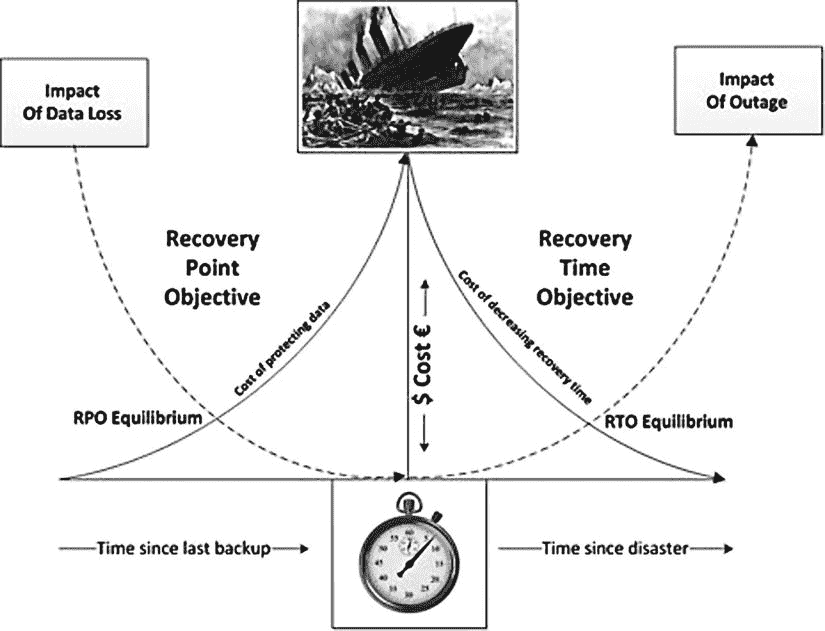

# 排版后的文本

我的一位亲戚有一种独特方式来应对这种脆弱性。每当他浏览到喜欢的网页时，就会将其打印出来，并按字母顺序归档到电脑旁的文件柜中。他抱怨这个过程很令人沮丧，因为网站总在变化。直到我向他介绍了浏览器中书签（又一个隐喻）的概念，他的生活才轻松了许多。但在我看来，从数据留存的角度而言，他或许才是对的！

## 很久以前……

即便有些人已经不再把文件柜的物理概念用于数字文件，他们仍然认为数据保护只能通过某种磁带备份来实现。几年前，备份磁带副本会存储在本地，以满足丢失文件、数据库表等的日常恢复需求。其中部分磁带副本会定期运往异地，通常在那里保存多年，以确保在发生毁灭性灾难导致企业主站点关闭时能够恢复数据。

长期异地磁带存储曾是"执行"灾难恢复的传统方式。如果业务需要在主站点以外的地点重启，这些磁带可被运往新地点；应用环境会被手动重建；数据将被加载到新服务器上；业务运营将从新地点进行，直到主站点能够重新上线为止。

这种模式在某些组织中仍被视为有效，但它不足以应对 SharePoint 场的复杂性和规模。正如你将在后续章节中看到的，SharePoint 场包含许多相互依赖且不断变化的组件。仅靠磁带备份而无灾难恢复计划来重建 SharePoint 场，对任何人来说都是挑战，无论其技术水平如何。再加上系统每秒钟停机的成本，这绝非理想场景。

## 另一个软弱的隐喻：快照

虚拟化使用了另一个被误读的隐喻，它在 SharePoint 场上承诺了无法实现的功能。有些人仍然认为，他们只需对正在运行的 SharePoint 场的虚拟 Web 服务器、应用程序服务器和 SQL 服务器拍摄"快照"即可。他们认为这台魔法相机能在某一时刻捕获 SharePoint 场中的所有信息，从而允许他们在未来任意时间点恢复至该时刻。这种想法过于简单化。

定时作业就是展示 SharePoint 场复杂性的一个例子。SharePoint 场有超过 125 个默认定时作业（`http://technet.microsoft.com/en-us/library/cc678870.aspx`）。它们的运行频率从每 15 秒一次（例如配置刷新作业，它会检查配置数据库中用户配置文件服务的配置更改）到每月运行一次的"我的网站建议电子邮件作业"——该作业会向不常更新用户配置文件的人员发送包含同事和关键字建议的电子邮件，促使其更新配置文件。

定时作业会查询当前时间以确定下次运行时间。这是因为它们并非按照统一时间线运行，而是遵循诸如"运行后，将定时器设置为 90 分钟后再次运行"的简单规则。如果你对这些服务拍摄快照，然后尝试恢复到之前的某个时间点，它们会认为当前时间是快照时间，而非实际时间。显然，这会导致重大问题。更多细节请参见：`http://technet.microsoft.com/en-us/library/ff621103.aspx`。其中指出，在生产环境中不应使用快照是最佳实践，并提供了关于快照如何影响性能的详细信息。

## 更强的隐喻

*"现实不过是幻象，尽管是一种非常持久的幻象"*

——阿尔伯特·爱因斯坦（传）

我要强调的是，正是这些对计算机存储信息的过于简化的看法，导致了灾难恢复计划的失败，因为人们假设备份应该像拍照或录音一样便宜简单。但时代已经改变，事情不再那么简单或便宜。你此刻的目标是为创建灾难恢复计划的项目争取支持。你没有时间让每个人都成为 SharePoint 专家，但你必须将他们软弱的隐喻转变为更强的隐喻。

软弱的隐喻如同迷信；无法用知识和事实来抵消。事实反而会让人的观点更加根深蒂固，因为没有任何事物有百分百正确的观点。要说服人们敞开心扉，更成功的间接方法是改进他们的隐喻；你需要提供更好的隐喻来替代他们原有的认知。

以下是一些更强的隐喻，可能有助于说服他人 SharePoint 是一个复杂系统：

*   **SharePoint 就像一座公园**：需要持续的修剪和规划来管理其生长。想象一下这座公园被摧毁，你必须重建它。需要大量不同信息才能重建。简单的快照远远不够，你也无法简单维护一个不断变化的有机体的副本。
*   **SharePoint 就像一栋办公楼**：如果因自然灾害，你必须将这栋楼里的所有人及物品迁至别处，你会怎么做？这个隐喻很有用，因为无论你在哪个行业，都可能依赖某个物理场所。SharePoint 就是它的虚拟版本。住宅是这一隐喻的另一种变体。
*   **SharePoint 就像人体**：拥有许多相互连接、相互依赖的部分。就像身体一样，如果一个器官衰竭，就会影响整个机体。如果你要用克隆器官从头重建一个人，你不仅需要物理部分，还需要大脑中存储多年的信息。对于 SharePoint，你可以克隆虚拟服务器，但只能是空服务器。数据在不断变化且复杂非常。

如果你能让利益相关者理解 SharePoint 复杂且不断演变的特性，你就可以赢得他们的支持，从而进入更具体的步骤——评估 SharePoint 系统故障可能造成的影响。这是下一步工作。

### 业务影响评估

业务数据是一种资产，具有有形价值。但某些数据的价值高于其他数据。大多数组织实际上并未计算信息的价值，也未计算丢失部分或全部信息对业务造成的成本。在制定灾难恢复计划之前，你必须先规划为何需要它。而要充分理解为何需要灾难恢复计划，你需要进行 BIA（业务影响评估）。这将使你以真金白银的形式了解没有灾难恢复计划的成本。大多数组织会得出的结论是：与灾难发生时所能节省的成本相比，制定和维护 BIA 的成本比例微乎其微。

BIA 应是一份涉及所有关键业务利益相关者的详细文档。他们是使 BIA——进而使灾难恢复计划——取得成功的关键人物。它并非仅由 IT 部门就能制定的东西。这是另一种根本过时的思维方式。内容所有者有责任为其团队制定业务连续性计划。虽然这需要与 IT 部门协作完成，但 IT 部门只是负责满足需求。定义需求是业务部门的职责。

BIA 应识别因运营中断可能导致的财务和运营影响。一些负面影响可能包括

*   宕机成本
*   收入损失
*   无法继续运营
*   自动化流程中断
*   品牌受损：公司品质感缺失，如第 1 章中的星巴克案例所示
*   可信度与声誉丧失：索尼遭黑客攻击事件便印证了这种影响

## 谁来确定 RTO 和 RPO？

关于灾难恢复规划为何资金严重不足，以及为何传统上 IT 部门是其主要负责人，我已有自己的理论：利益相关者并未意识到其中的复杂性。在大多数情况下，是 IT 部门来制定恢复时间目标和恢复点目标。但如果没有来自业务部门的经验数据输入，他们又如何能准确确定这些目标呢？

因此，目标通常基于通用的 Microsoft 指南或某些武断的决定来设定，比如哪位经理抱怨得最厉害，声称自己的数据特别重要。如果没有业务影响分析，IT 部门就没有经验方法来衡量这些目标（RTO 和 RPO）。业务用户是其内容的所有者，因此他们也相应承担业务连续性/灾难恢复规划的责任。他们应为其在 SharePoint 内的业务流程指定 RTO 和 RPO。

## 金发姑娘原则

RTO 和 RPO 要么基于简单的磁带备份或快照，要么由于过度热情而走向另一个极端，即追求接近零宕机时间。SharePoint 服务器场有时会设定过于激进的 RTO 和 RPO，因为业务用户认为他们无法容忍任何宕机。这在某些组织中确实如此，例如 `Amazon.com`，其业务存在完全依赖于正常运行时间。另一个例子是空中交通管制，如果飞机在你的机场上空盘旋并燃油不足，那么每一秒都至关重要。这些都是例外，而非普遍情况。RTO/RPO 越激进，实现该目标所需的技术成本就越高。正如你在第 1 章的“应用场景：事情从来都不简单”中所见，分钟级或小时级的 RTO/RPO 需要使用 SAN 复制技术，这使得在 SAN 层将数据复制到另一个数据中心的成本非常高。日志传送速度较慢，但也要便宜得多。

灾难恢复规划的目标是在你愿意为 RPO/RTO 支付的费用和你能够承受的损失之间找到完美的平衡点。可以称之为金发姑娘原则：不多也不少。图 2-2 中的图表说明了这一原则。

图 2-2。在 RPO 和 RTO 方面，时间就是金钱

在图 2-2 中，中心轴代表成本。它还标记了灾难发生的时间点。上方是你的船撞上冰山的那一刻。从那一时刻起你采取的行动就是灾难恢复。时钟在滴答作响，时间就是金钱。在秒表旁边并向右是时间的推进。从泰坦尼克号引出的箭头表示，随着你远离撞击点，成本会下降。换句话说，你能等待恢复数据的时间越长，你的恢复成本就越低。然而，这条下降曲线被一条向上指向“中断影响”的上升虚线曲线所交叉。那是你的组织因 SharePoint 离线而不断上升的成本。你离秒表越远，成本就攀升得越高。

为了说明这一动态，不妨以泰坦尼克号为例。救生艇占用了甲板空间，而船上的空间对乘客以及相应的公司来说非常宝贵，因为航行越舒适，乘客就越多，利润也就越高。当时的普遍看法是，如果一艘如此巨大的船真的沉没，也没有足够的时间让成千上万的乘客全部登上救生艇，因此救生艇无论如何都没用。此外，人们还认为，在如此繁忙的航线上，一旦沉船，会有大量船只前来救援，将人们从水中救起。因此，对利润的追求和对运气的依赖被置于人类生命的价值之上。必须指出的是，白星航运公司（泰坦尼克号的所有者）最终不复存在，被其竞争对手冠达航运公司所收购。可以说，他们没有认真考虑“中断影响”，也没有达成合理的 RTO 平衡点。

在秒表的另一侧是自上次备份以来的时间。能够恢复到灾难发生前几秒或几分钟的时间点，其成本位于成本轴左侧曲线的最高点。换句话说，如果你只能承受丢失几秒或几分钟的数据，那么实现这一目标的成本非常高。但如果你能承受丢失几小时或几天的数据，那么成本就会低得多。

举一个非 SharePoint 的例子，为了保存我写这本书时的备份，我使用了 Jungle Disk。它基于 Amazon Web Storage。我安排了一个定时任务，每晚凌晨 1 点将所有章节和图片所在的文件夹备份到云端。如果那时因网络访问中断而导致备份失败，它会重试直到连接成功。我对最多 24 小时的恢复点目标感到满意，因为如果我丢失了一天的工作，平均也就损失 1200 个单词左右——这是我一天的工作量。我可以以每天 1500 个单词的速度在四天内补回来。Jungle Disk 成本低廉，因为除了初始上传外，你只需按使用的存储空间付费。对我来说它不太贵，所以我觉得我达到了我的 RPO 平衡点。我的 RTO 也很低，因为我只需去另一台电脑，安装 Jungle Disk，然后恢复我的备份——不到一小时内，我就能重新开始写作。如果你有兴趣，可以在这里阅读更多关于 Jungle Disk 的信息：`http://aws.amazon.com/solutions/case-studies/jungledisk/`。

本书最重要的一点是，如果你要实施灾难恢复计划，你需要从理解你的需求以及这些需求的后果开始。首先关注那些经常与 SharePoint 相关的众多技术是错误的。我知道我需要保护自己免受潜在硬盘崩溃的威胁。如果丢失了原稿，我不想从头重写这本书。我知道只要不丢失超过一天的工作成果，并且能在一小时左右内恢复写作，我不介意每月花几美元用于备份。这就是我的业务影响分析。一旦我明确了我的参数，我就开始搜索，直到找到满足我需求的技术解决方案。

## 共识

