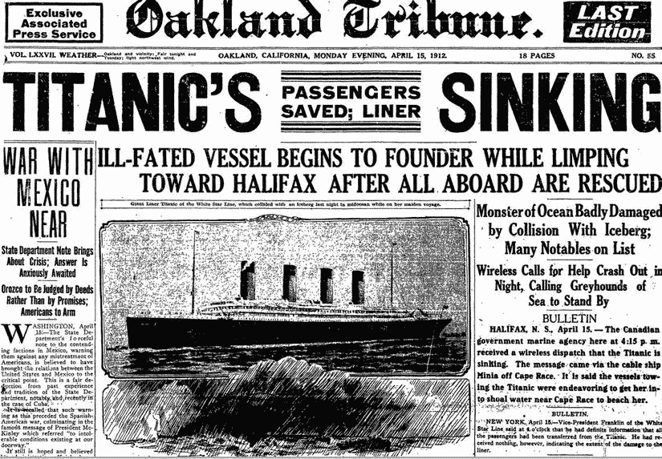

## 最终结论

> *我的基本原则是，你做出决定不是因为它们容易；不是因为它们便宜；也不是因为它们受欢迎；你做出决定是因为它们是正确的。*
>
> *——西奥多·赫斯伯格（美国神职人员，大学校长）*

本章的目的是从前面各章中提炼出关键的指导原则。本书无意规定一条通往高可用性和灾难恢复理想状态的唯一路径。世界上有太多不同的环境、人员和组织，这使得每一次实施都独一无二，尽管相似。就像定制西装一样，你可以制作一个适合所有人的尺码，但很可能穿在任何人身上都不太好看。

我在此的目标是基于我来之不易的经验提供见解和原则。我学到了一些经验教训，并将其应用于我着手每个新的 `SharePoint` 项目，这些是我创建个人 `SharePoint` 架构所拥有的最有用、最有价值的工具。

`SharePoint` 的核心原则是：

*   你必须理解 `SharePoint` 才能管理它；过于简单的比喻是一个陷阱。
*   拥抱 `SharePoint` 中的变革并妥善管理。
*   让你的平台尽可能以用户为中心。
*   业务部门和 `IT` 部门必须沟通和协作。
*   保持流程和程序的最新状态。
*   在恢复中，人员和文档比工具更重要。
*   进行监控以在问题发生前进行预判。

## 各章关键点

### 第 1 章：避开灾难

本章介绍了泰坦尼克号灾难的比喻，这是贯穿全书的一条主线。提及这艘船的原因，部分在于它是一个警示故事：自满可能导致灾难，无论你拥有多少保护措施，灾难仍会发生。但我还想强调它，因为它可能是历史上被研究得最多的人为灾难，因此，我们可以从中汲取大量教训，并将其应用于任何高可用性和灾难恢复规划中。

这场灾难与现代 IT 灾难有许多共同点：

*   多重诱因
*   过度依赖弹性和冗余
*   利润和低成本优先于安全
*   监控不力
*   灾难发生时出现混乱
*   缺乏恢复手段

最终，沉船事件对这艘船的所属公司——白星航运公司的命运产生了巨大的连锁反应。他们专注于建造廉价轮船并快速抵达纽约，而将安全置于次要地位，最终导致其垮台：他们最终被冠达航运公司收购，现已不复存在。你的组织可能也是如此：其现在对 `SharePoint` 的依赖程度可能比最初想象的要高。本章的第一条原则是，不要忽视你的组织在物质层面和品牌认知层面对技术的依赖程度。

# 下一个要点：责任

下一个要点关乎责任。甚至在你的船沉没之前（图 12-1），问题就会被提出。沉没事件自然引发了寻找责任归属的排查，而有些人在这场灾难中显得英勇无畏、舍己为人。一个例子是阿瑟·韦斯特，他离开救生艇去为女儿们取一壶热牛奶，然后在救生艇被放下时顺着绳索爬下去，把暖壶递给她们，随后又爬回船上。他的遗体从未被找到。另一些人则显得自私怯懦，比如 J.布鲁斯·伊斯梅，他催促船长尽可能全速航行，自己却是少数几个坐上救生艇的男人之一。这里的原则是，在管理 SharePoint 时，必须尽早承担责任。你不能只在事情进展顺利时揽功，因为当灾难发生时，将会面临审查，责任也会被分配。

图 12-1. 灾难过后，有人被描绘成英雄，有人则被描绘成恶棍

本章传达的最后一个原则是，仅凭尚未发生灾难来衡量成功是远远不够的。观察员报告“侥幸脱险”事件是许多行业和组织中一种成熟的错误减少技术，也应应用于 SharePoint 系统的管理。总会有线索表明某些事情可能出错。警觉、记录并应对这些“侥幸脱险”事件，是拥有 SharePoint 平台的关键组成部分。

### 第 2 章：规划你的计划

本章的重点是准备的重要性。在制定灾难恢复计划之前，你需要了解你要保护的对象，以便据此设计计划。你必须获得管理层的支持，而要获得支持，有时需要打破对技术的过度简单化理解。你必须进行业务影响评估。这意味着召集业务中的关键利益相关者，详细量化 SharePoint 服务中断在一年中不同时期对各个团队和部门的影响。

获得管理层的批准并对业务需求有更深入的了解后，你就可以为系统的不同部分定义恢复点目标和恢复时间目标。本章的一个关键点是：并非所有内容都需要同样高水平的可用性，组织中应建立多个层级，以便优先恢复最重要的内容，而不是最不重要的内容。泰坦尼克号沉没后，有人指责其按舱位等级优先救援乘客。可悲的是，数据证实了这一点（表 12-1）。

表 12-1. 泰坦尼克号灾难按舱位统计

| 头等舱 | 二等舱 | 三等舱（统舱） |
| --- | --- | --- |
| 总计：319 人 | 总计：269 人 | 总计：699 人 |
| 死亡：119 人 | 死亡：152 人 | 死亡：527 人 |
| 幸存：200 人 | 幸存：117 人 | 幸存：172 人 |
| 幸存比例：63% | 幸存比例：43% | 幸存比例：25% |

这里得到的教训不应是某些人比其他人更值得拯救，而在 SharePoint 的情况下恰恰相反：某些流程和内容对组织更有价值，应优先恢复它们。

本章还强调了灾难中协调的重要性原则：4Ci。这意味着必须有指挥、控制、通信、计算机和情报。如果没有事先规划这些资源的可用性，任何计划都无法付诸实施。员工接受适当的培训在任何灾难中都至关重要，包括泰坦尼克号（图 12-2）。

图 12-2. 泰坦尼克号救生艇及船员，被英国艾尔啤酒永远铭记

制定计划至关重要，但具体规划如何将计划付诸实施，将决定其是否有效。未经演练的船员救不了任何人，包括他们自己。

### 第 3 章：激活你的计划

灾难本质上具有不可预测性，本章的关键原则是，你必须知道何时以及如何激活你的灾难恢复计划。以泰坦尼克号为例，许多乘客以为沉没只是一次演习。船沉得很慢，人们花时间才理解实际发生的情况。灾难发生后，媒体也难以弄清状况（图 12-3）。关于实际发生了什么，以及是否确实有人员伤亡，存在大量混乱信息。

图 12-3. 早期错误头条报道称：“全员获救”

在 SharePoint 中，灾难恢复计划本身总是受到关注，但员工和用户如何知道启用它的时机已到？由谁来做这个决定？如果那个人不在怎么办？灾难时期可能充满混乱；正常流程不再适用（例如在沉船上准备菜单，图 12-4），相关人员可能无法到位。你的 SharePoint 灾难很可能是更大规模的 IT 或网络灾难，甚至是组织整体灾难（例如洪水）的一部分。必须有明确定义的流程和程序。然而，本章的主要原则是，让合适的人在合适的时间出现在合适的地点，是确保你的计划得到正确执行的首要方法。这里的警告是，资源需要集中于应对突发情况的变化，而不是那些不再优先的任务。

图 12-4. 当船开始沉没时，准备菜单不再是首要任务

### 第 4 章：高可用性

帮助你实现高可用性是本书的主要目标之一。第 4 章的关键原则是，不受管理的变更是对系统可用性的主要风险。虽然必须强调构建技术上的高可用平台，但技术故障并非导致故障的主要原因。SharePoint 出问题是因为人们未能考虑到他们所做变更的潜在风险。这有时是由于组织高层人员将某个需求列为紧急事项，然后坚持要求在不考虑后果的情况下进行变更。换句话说，他们“以权压人”。这就是为什么必须建立变更管理流程。

基于每年简单运行时间百分比的可用性目标，确实提供了一个经验性的年度目标，但它们很少包含计划内维护，也无法衡量不可用性的影响。

弹性和冗余是必要的，它们依赖于高质量的硬件和对系统的持续监控，以确保其正常运行。将旧服务器回收到生产场中绝非明智之举。以泰坦尼克号为例，其救生艇上的船名被移除，并被重新用于白星航运公司的其他船只（图 12-5）。

图 12-5. 喀尔巴阡号打捞起的 RMS 泰坦尼克号救生艇

### 第 5 章：服务质量

服务质量是用户满意度与不过度复杂的架构之间一种成本效益折中的方案。

# 复杂架构的成本

复杂架构成本更高，故障点也更多，且变更的灵活性较差。延迟是一个物理极限，单纯增加隐喻中的管道尺寸无法消除它。地球上两地相距越远，数据传输速率就越慢。这是由于光在光纤电缆、中间路由器和交换机中的速度限制所致。若非“泰坦尼克号”在航行至三分之二处撞上冰山，它本可能在 5 天半内穿越大西洋（图 12-6）。这一估算基于其姊妹船“奥林匹克号”曾在此时间内完成航程。如今，从伦敦飞往纽约的航班需要 7 个半小时（尽管协和式飞机曾以不到 3 小时完成该航程）。

图 12-6。泰坦尼克号沉没地点：欲速则不达

通常，组织所拥有的带宽远落后于需求曲线。带宽应按云计算服务、电力公司和自来水公司使用的模式进行计费。更多带宽并非解决所有速度问题的万能药，但确实能有所帮助。

## 第 6 章：退一步思考

本章强调，维护有效的备份主要并非取决于你使用的工具，而是依赖于文档化并经测试的流程与规程。必须持续审查备份和恢复流程，以确保其相关性和可靠性。备份时，不仅要优先考虑对组织最有价值的内容，还应优先考虑手工恢复耗时最长的内容。这包括开发者编写的解决方案以及未在其他地方复制的数据。

恢复测试应定期进行，即便不是每天一次。原本，“泰坦尼克号”计划于 1912 年 4 月 14 日（即撞上冰山当天）进行救生艇演习。然而，由于不明原因，史密斯船长取消了演习。许多人认为，如果演习得以进行，本可挽救更多生命。

## 第 7 章：监控

前一章强调不应过度依赖工具，而本章指出监控工具未得到充分利用，且不应如此。监控在两个层面进行：Windows 和 SharePoint。两者对于健康的环境都至关重要。定期更新 SharePoint 系统及其依赖环境的健康关键指标必不可少。灾难发生前，总是有迹可循，只要有人主动观察就能发现。

虽然“泰坦尼克号”沉没的消息在船上传播缓慢，但它实际上有自己的船上报纸。《大西洋每日公报》每日在“泰坦尼克号”上印刷。该报内容包括新闻、广告、股票价格、赛马结果、社会八卦以及当日菜单。

## 第 8 章：DIY 灾难恢复

本章表明，SharePoint 备份和灾难恢复的责任正从 IT 基础设施所有者转移到用户自身手中。SharePoint 确实提供了许多工具，使用户在灾难发生时能够自行恢复。这样做的主要好处是用户最了解自己的内容，能更快地响应备份需求，知道何时需要保护哪些内容。反之亦然：不需要多次备份的内容就不会被冗余备份。

## 第 9 章：变更管理与灾难恢复

本章的主要原则是，变更是保持 SharePoint 对组织价值的必要条件，但一旦系统投入生产，必须妥善管理变更，以避免系统受损的风险。变更应尽可能采用开箱即用方式，因为这样对整体系统的风险更低，且无需缓慢的变更管理流程即可完成。业务和 IT 部门必须制定策略，将自定义代码和变更控制在最低限度。

## 第 10 章：灾难恢复与云

云在许多方面改变了 SharePoint 的架构和管理方式，因为硬件和软件更多地由第三方控制。将 SharePoint 平台迁移到云端，并不意味着不再需要理解和维护 SharePoint 的灾难恢复计划。为了与现有的 Windows 用户账户集成，你仍需规划并部署额外的服务器和软件。这些将成为你本地灾难恢复规划的重点。

## 第 11 章：最佳实践与最差实践

此处的主要原则是，你必须关注决策的长期结果，而不仅仅是短期利益。你必须避免陷入薄弱假设、应对式变更态度以及不负责任的治理方式等泥潭。

# 总结

*高成就者能迅速发现丰厚的机遇，快速做出重大决策，并立即付诸行动。遵循这些原则，你就能让梦想成真。*
——罗伯特·H·舒勒（美国归正教会牧师、企业家、作家）

网络，尤其是互联网，让全球数百万人的信息沟通变得更快、更便捷。SharePoint 是在组织和企业中实现这一目标的主要工具。SharePoint 在过去十年中取得了长足进步，如今正面临另一个重要转折点，它可能更多地成为一种云解决方案而非本地部署方案。时间会证明一切。保护你的 SharePoint 环境意味着要迅速决定将我书中阐述的原则付诸实践。归根结底，行动胜于言语，因此这似乎是我结束本书、停止发言最合适的时刻。祝你在所有努力中好运。

# 索引

 A

- `Active Directory` 联合身份验证服务 2.0 (`ADFS`)
- `AlwaysOn` 可用性组
- 亚马逊
- 亚马逊云
- 应用级冗余
    - 角色
    - 搜索
    - 服务应用程序
- 应用程序生命周期管理
    - 变更成本
    - 定义
    - 迭代瀑布模型
    - 精益
    - 计划/构建/测试/审查/部署模型
    - `Scrum`
    - 瀑布模型
- 应用程序接口 (`API`)
- 始祖鸟

 B

- 二进制大对象 (`BLOB`)
- 业务影响评估 (`BIA`)
    - 业务连续性规划
    - 达成共识
    - 财务和运营影响
    - 金发姑娘原则
    - 信息价值
    - 人员
    - `RTO` 和 `RPO`
    - 利益相关者
73) 业务影响评估（`BIA`）

C 变更咨询委员会（`CAB`）会议

- 授权/批准
- 变更拒绝
- 评论/问题
- 注意事项
- 建议与决策
- 标准议程
变更管理
- 应用程序生命周期管理（参见应用程序生命周期管理）
- `CAB` 会议（参见变更咨询委员会（`CAB`）会议）
- 定义
- 实施与评估
- 流程流程图
- 审查与关闭
- 调度
- `Sheep Watch` 影响评估
- 子流程
- 测试
客户端访问许可证（`CAL`）
云爆发
云计算
- 敏捷性
- 始祖鸟
- 定制意味着成本
- 灾难恢复（参见灾难恢复（`DR`））
- 负载变化
    - 云爆发
    - 需求
    - 动态资源分配
    - 不可预测的爆发
- 开箱即用（`OOB`）解决方案与完全定制解决方案
- 私有云
- 公有云
- `SharePoint` 时间机器（参见 `SharePoint` 时间机器）
内容备份
- 列表模板
    - 列表备份
    - 书籍模板测试
    - 创建
    - 库链接
    - 库设置
    - 库选项卡
    - 新建列表/库
    - 功能区变更
    - 将列表另存为模板
    - 上传
- 网站模板
    - 创建
    - 自定义选项卡
    - 新建网站
    - 将网站另存为模板
    - 单独保存解决方案
    - 网站设置
    - “解决方案库”链接
    - 上传
内容管理系统
关键影响
D 灾难
- 规避步骤
    - 明确衡量标准
    - 依赖关系
    - 角色与职责
    - 利益相关者与策略
- 完全失败的成本
- `IT` 系统
- 感知
- `SharePoint` 项目
- 成功/失败
灾难协调
- `4Ci`
    - 指挥
    - 通讯
    - 计算机
    - 控制
    - 情报
- 灾难恢复脚本
- 补给仓库与餐厅
灾难恢复（`DR`）
- `IaaS` 与 `SaaS`
- 多租户
    - 管理网站
    - 能力
    - 功能包
    - 主机头网站集
    - 沙盒解决方案
    - 服务隔离
    - 订阅
- 网络与云
- 规划联合
    - `ADFS`
    - 证书
    - 目录同步
    - 联合代理服务器
    - 联合服务器场
    - 林拓扑
    - `WID` 与 `SQL`
- 恢复点目标
- 恢复时间目标
- `SCM`
- 系统完整性
灾难恢复计划（`DRP`）
- 激活
- `BIA`（参见业务影响评估（`BIA`））
- 沟通
- 背景与沟通
- 决策者
- 灾难协调（参见灾难协调）
- 设施风险
- 相互依赖
- 物理依赖
    - 架构影响
    - 事后回顾
    - 恢复层级
    - 风险评估
    - `SLA`
    - 同步性（参见同步性）
- 计划位置与内容
- 政治策略
- [流程与程序](#9781430263289_Ch03.xhtml#cXXX.)

`benefits`
`definition`
`documentation relationships`
`key element`
`proposal arguments`
`restore SharePoint`
`restore systems`

- `setting priority`
- `stronger metaphors`
- `tasks`
- `Upper Management awareness`
- `verification and restoration`
- `weak metaphors`
- `business information`
- `data protection`
- `data representation`
- `electronic information`
- `fragility`
- `off-site storage`
- `snapshots`
- `tape-based backup`

- `DIY DR`
- `content backup` (*参见* 内容备份)
- `low-level configuration`
- `Office`
- `Backstage view`
- `Backstage view’s Info window`
- `Backstage view’s Recent window`
- `last auto-saved version`
- `periodic auto-saved files`
- `Save options`
- `unsaved versions`
- `versions section`
- `recovering sites and site collections`
- `deleting site collection`
- `deleting subsites`
- `with PowerShell`
- `SP1`
- `Recycle Bin` (*参见* 回收站)
- `Site Collection Administrator rights`
- `structuring elements`
- `versioning`
- `Library Settings`
- `site template`

## E, F

- `E-mail alert`
- `action setting`
- `conditions options`
- `counters`
- `Context Switches`
- `Data Collector Set`
- `data logs creation`
- `MBytes and memory`
- `Processor Queue Length`
- `Processor Time`
- `screening`
- `general setting`
- `setting options`
- `task running`
- `triggers setting`

## G

- `Global Assembly Catalog (GAC)`
- `Goldilocks principle`
- `Governance`

## H

- `High availability (HA)`
- `availability zones and regions`
- `failover systems`
- `interlocking elements`
- `load balancing`
- `measuring business impact`
- `multiple data centers`
- `nines`
- `redundancy`
- `active`
- `application-level` (*参见* 应用程序级冗余)
- `data centers`
- `farms`
- `hardware`
- `passive`
- `redundant disaster recovery farm`
- `resilience` (*参见* 弹性，高可用性)
- `R.M.S. Titanic`
- `SAN replication`
- `SharePoint farm considerations`
- `SQL clustering`
- `SQL log shipping`
- `SQL mirroring`
- `stretched farm`
- `time-sensitive businesses`
- `watertight compartments`

## I

- `Infrastructure as a Service (IaaS)`

## J, K, L

- `JFD`
- `licenses`
- `office and windows`
- `practices`
- `Request For Proposal (RFP)`
- `SharePoint installation`

## M, N

- `Microsoft`
- `Monitoring tools`
- `Multiprotocol Label Switching (MPLS)`

## O

- `Office 365 Community`

## P

- `Policy Base Routing (PBR)`
- `Private cloud`
- `Public cloud`

## Q

- `Quagmires`
- `characteristics`
- `corporate Facebook`
- `customization`
- `Intranet conflict`
- `metadata quagmire`

# 422

## 迁移
## 实践
## 记录管理
## SharePoint 实施中的隐喻性困境
## 工作流

## 服务质量 (QoS)
- 批量异步传输
- 业务应用
- 缓存
- 集中式 `vs`. 区域式 `SharePoint` 部署
    - 中心与小型中心
    - 带分支的中心枢纽
    - 服务应用
    - 服务架构
    - 单一枢纽
- 菊花链
- 部署策略
    - 优势
    - 劣势
    - 花团锦簇
    - MPLS 与 PBR
    - 非路径设计
    - WAN 加速器
    - 预热
- 调谐器、管道与 Ping 测试
- 隔离
- `Microsoft`
- 网络管理员
- 认知与原因
- 优先级流量
- 需求
- `RTT`
- `SAN`
- 服务器
- 网站集
- `TCP` 吞吐量
- 测试延迟
- WAN 加速
- 工作流过程

 R
- 恢复点目标
- 恢复时间目标

## 回收站
- 例外情况
- 第二阶段回收站
    - 删除历史记录
    - 场容量管理
    - 第一阶段回收站
    - 网站设置
    - 查看选项
- 设置
    - 应用程序管理
    - 场管理员
    - 常规设置
    - 选项

## 远程 BLOB 存储 (RBS)

## 弹性与高可用性
- 变更管理
- 定义
- 监控
- 本地部署 `vs`. 云端部署
    - `Amazon Cloud`
    - 物理基础设施
    - 建议
    - `SharePoint Online`
- 人员
- 物理 `vs`. 虚拟
- `SQL Server`
    - 容量管理
    - 集群
    - 内容管理系统
    - 日志传送
    - 镜像与 `AlwaysOn`
    - 建议
    - 网站集回收站
    - 存储
    - 事务日志

## 往返时间 (RTT)

 S
- 服务连续性管理 (`SCM`)
- 服务级别协议 (`SLA`)
- 面向服务的架构 (`SOA`)

## `SharePoint`
- 智囊顾问
- 云端部署
    - 管理界面
    - 管理员
    - 隐喻
    - 迁移基础设施
    - 选项
- 敏捷开发
- 数据中心
- 灾难恢复场
- 花团锦簇
- 热备、温备与冷备
- 延迟
- 日志传送/镜像
- 复制
- `SAN`
- 较慢的系统
    - 内容所有者
    - 基础设施
    - 解决方案
    - 技术
    - 高层管理责任
- 拉伸场
- 超级架构

## `SharePoint` 监控
- 维护任务
    - 管理角色
    - 备份
    - 存储
- 可靠性与性能
    - 警报（*见* 电子邮件警报）
    - 事件查看器（*见* 事件查看器）
    - 监控工具
    - `性能监视器`
    - `任务管理器`
- 泰坦尼克号隐喻
- 故障排除
    - 关联 ID
    - 事件日志洪流保护
    - 事件抑制
    - 健康分析器
    - 操作日志
- 定时任务
- 跟踪日志
- 统一日志服务

## `SharePoint Online (SPO)`

## `SharePoint` 平台
- 优势
- 变更类别
    - 配置与结构变更
    - 配置变更
    - 设计层面变更
    - 开发层面变更
    - 服务器场管理员组
    - 列表/库
    - 生产测试
    - 网站管理选项
    - 网站集管理
    - 工具
    - Web 部件页
- 变更管理（*参见* 变更管理）
- 控制访问
- 劣势
- 熵

## `SharePoint` 时间机器
- 优势
- 身份验证
- 内容共享
- 当前版本
- 设计与开发
- 未来改进
- 服务器
- `SharePoint 2001` 用户界面

## 软件即服务 (SaaS)

## `SQL Server`
- 容量管理
- 集群
    - 活动客户端连接
    - 实例
    - 镜像
    - 虚拟化
- 内容管理系统
- 日志传送
- 镜像与 `AlwaysOn`
- 建议
- 网站集回收站
- 存储
- 事务日志

## 同步性
- 延迟
- 日志传送
- 镜像
- 社交网络技术
- 时间与距离

## 系统备份
- `BIA`
- 文件系统
- 规划与准备
    - 代码与内容
    - 依赖项
    - 文档
    - 工具
- `SharePoint`
    - 管理中心
    - 配置设置
    - 外部用户
    - 安装
    - 内部用户
    - 逻辑组件
    - 机器/服务器
    - 性能与容量
    - `PowerShell`
    - 代理组
    - 恢复组件
    - 服务应用程序
    - 独特之处
- `SQL Server`
    - `BLOB`
    - 压缩
    - 事务日志

## System Center Operations Manager (`SCOM`)

 T

## 传输控制协议 (`TCP`)

 U

## 统一日志服务 (`ULS`)

## 用户配置文件复制引擎 (`UPRE`)

 V

## 虚拟化

 W, X, Y, Z

## WAN 优化控制器 (`WOC`)

## Windows Azure 平台

## Windows 内部数据库 (`WID`)

## Windows `PowerShell`