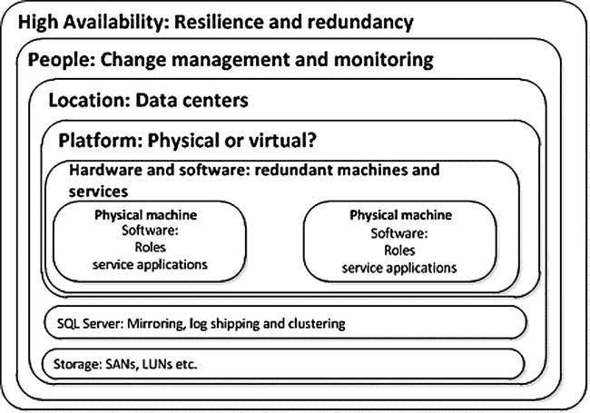
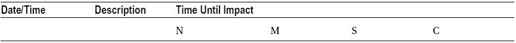

# 高可用性

我曾多次担任 SharePoint 管理员，这份工作非常像救生员或消防员。当一切正常时，你看起来似乎没有被充分利用。管理者希望你忙于做一些事情，从事特定的项目（这样也能让他们看起来也很忙）。只有事情出错时，你对于组织的真正价值才能得到充分体现——在短暂而紧张的时期里，你向经理和他人证明了自己的价值。但我确实见过一些管理员，他们不断制造虚假危机，以便让自己看起来总是在力挽狂澜、解决麻烦。这样做是为了让自己显得重要。

关于 SharePoint 以及许多其他事情，现实情况是：如果你非常擅长你的工作，你可以让系统运行得如此顺畅，以至于看起来毫不费力。那些总是在避免灾难的人，本可以主动增强系统的弹性，使其不至于持续面临故障的威胁。这并不总是意味着增加更多资源。更多资源在前期投入和维护方面成本更高。同样重要的是优化现有资源。SharePoint 应该被持续监控——不仅仅是为了在出现问题时收到通知，也是为了预见灾难并避免它——就像提前转向避开冰山，而不是撞上它，以便展示自己的救生艇演习做得有多好。

高可用性关乎当用户需要 SharePoint 为组织创造价值时，它能够随时可用。保持其可用性是掌管 SharePoint 基础设施和服务器的人员的核心职责。如果你已经完成了业务影响评估，你就会了解不可用所带来的成本。相应地，你已设定了恢复时间目标（`RTOs`）和恢复点目标（`RPOs`）。你还建立了一个流程，用于识别何时发生灾难，并确保合适的人员能够就位处理。你已经将内容划分为不同层级，以便在灾难发生时优先处理关键内容。在定义以最优成本所需的可用性时，这些层级也将发挥作用。本章提供的信息能够帮助你评估 SharePoint 各种不同的可用性方案。本章涵盖的主题包括：

- 高可用性度量与目标（几个九）
- 弹性（使系统抵抗故障的能力）
- 冗余（拥有多个提供相同功能的组件，以避免单点故障）

三者共同构成了保护系统中最有价值资产——信息——的框架（参见图 4-1）。

图 4-1。可用性由相互关联的要素构成

## 高可用性概述

虽然灾难本质上具有破坏性和不可预测性，但尽可能增强系统的弹性以减轻影响甚至避免灾难发生，也是明智之举。正如第 1 章所述，泰坦尼克号拥有 16 个水密隔舱和双层船体，（人们相信）这使其能够承受冰山撞击。事实上，其他船只曾成功幸存于撞击，因此这是一种可靠且经过验证的做法。

您可以采取许多措施来加固您的 SharePoint 服务器场，使其更具弹性，而每种措施都有不同的考量因素。以下是本章将讨论的主要内容：

- 平台：本地部署与云端、虚拟与物理
- 数据库层可用性选项
- 存储选项
- 变更管理
- 监控
- 人员

冗余是指准备一个备用件来替换系统故障部件的方法。我们将从以下层级审视相关选项：

- 数据中心
- 服务器场
- 硬件
- 应用程序

最重要的是，要将高可用性视为对整个组织至关重要的事情。您的核心业务决定了不可用性的影响。对于某些组织来说，实时不间断可用至关重要。这些组织中，信息是其关键资产，且其价值具有高度时效性。例如，如果新闻报道某个国家发生了政变，您可能希望迅速抛售在那里的铜矿股票，因为您认为政治不稳定将对业务不利。如果您获取政变新闻较晚，并且无法足够快地卖出股票，这两件事都可能让您蒙受损失。像 ISP 和电信公司这类以通信为基础的组织也被要求始终可用。在母亲生日后的第二天才给她打电话就太晚了。甚至在线游戏公司也依赖于为客户提供持续访问。以下是一些时效性业务的例子：

- 在线金融交易处理
- 股票市场软件
- 在线游戏
- ISP
- 电话公司
- 新闻服务

对于某些组织而言，影响不仅仅是财务上的。它们的停机时间可能会影响人类生命或我们周围的环境。在这里，价值更难量化，但同样重要——实际上，它常常更为重要。以下是可用性缺失会付出生命代价（而不仅仅是生计代价）的组织示例：

- 石油公司
- 电力公司
- 航空公司
- 医院

您需要通过业务影响评估来了解 SharePoint 在任何时长内不可用的实际成本。其范围可能从无影响到灾难性。对于一艘船来说，沉入海底的任何时间百分比都是糟糕的。

## 衡量业务影响

要了解用户需要何种可用性，您必须询问他们。最实用的方法是通过结构化的问卷调查，因为这有助于获得明确的指标。首先，在问卷的介绍部分收集以下信息：

- 部门名称
- 日期
- 流程名称
- 流程描述

接下来，列出每个流程或流程阶段，在适用的情况下确定流程中的关键日期（例如，工资处理日），并为每个条目分配一个影响时间线。这可以确定达到逐步升级的影响级别所需的时间。捕捉日期也有助于将其与依赖流程联系起来。表 4-1 展示了一个用于捕捉日期和影响级别的示例表单。

表 4-1. 关键日期及影响时间线

请注意“影响时间”下的四列。这些是评估中推荐使用的四个级别。

- N（无）：对任何工作职能没有影响。例如，仅间歇性使用的流程。
- M（中等）：流程对部门本身或具有下游依赖关系的其他部门造成轻微或中等程度的中断。
- S（严重）：流程故障导致部门或具有下游依赖关系的其他部门无法运作。
- C（关键）：流程故障导致组织日常运作中断。

在 N、M、S 或 C 列中，每一行的方框应填入故障发生后达到该影响级别所需的时间长度。这为规划可用性和灾难恢复的人员提供了更多信息，以便在计算 `RTO` 和 `RPO` 时参考。

在问卷的下一部分，要求用户在“影响”、“时间”和“严重级别”标题下，列出该流程故障的运营和财务影响清单。您还应该包含一个部分，要求用户在“系统/流程名称和描述”标题下，列出该流程的上游和下游依赖关系清单。

最后，要求用户提供该流程的任何（或多个）变通处理程序的详细信息。对于每个已确定的变通程序，应提供以下信息：

- 变通程序名称
- 描述
- 上次测试或使用的日期
- 所需硬件
- 所需额外人员
- 所需额外物资
- 可使用多长时间？
- 实施此变通程序需要多长时间？
- 此替代方案能提供百分之多少的生产力？

结合来自组织中多个团队/部门的所有这些信息，将为您提供大量有用的信息。如果您的组织非常庞大，这可能是项艰巨的任务，但为了确保用户生成的关键数据的安全，这是必要的，因此应分配资源来完成此项调查。

## 几个九

您经常会看到可用性以占一年时间的百分比来衡量。例如，99% 的可用性即 365/100 = 3.65。这意味着服务提供商承诺一年内仅允许 3.65 天的停机时间，或一年内正常运行 361.35 天。实际上，99% 被称为“两个九”。理想目标一直是追求五个九，即 99.999% 的可用性，相当于一年仅允许 5.26 分钟的停机时间。将可用性设定为 100% 是不现实的；而且成本也会高得离谱。您的组织可能在达到 100% 可用性之前就耗尽了资金。如果系统达到了五个九的可靠性，但未能为组织节省/赚取足够的钱来证明其合理性，这重要吗？表 4-2 显示了几个九的级别以及每个级别对应的每年最大停机时间。

表 4-2. 几个九的级别及对应的停机时间量

| % 和（9 的个数） | 每年停机时间 |
|---|---|
| 90% (1) | 36.5 天（365 天的 10%） |
| 99% (2) | 3.65 天 |
| 99.9% (3) | 8.76 小时 |
| 99.99% (4) | 52.56 分钟 |
| 99.999% (5) | 5.26 分钟 |
| 99.9999% (6) | 31.5 秒 |

即使是正常运行时间或停机时间也难以定义。在 SLA 中，“计划内停机”不计为停机时间。然而，它仍然是一种停机，并且您可能事先已知晓这一事实并不会改变这一点。如果停机影响到用户，它仍然是停机。例如，`Service Pack` 和补丁的安装需要数小时，可能每个月都需进行；如果服务器场规模较大，所需时间则更长。它们一年内会造成多少停机时间？`SQL 集群故障转移`完成可能需要最多 15 分钟。

你无法预测未来。正如我们在基尔代尔所知道的，意外总会发生。因此，五个九不过是服务提供商的一个赌注或一份保险单。他们的定价策略基于概率，以确保在不可避免的灾难发生时仍能盈利。

系统未能执行其主要功能的程度比可用性更重要，也更难衡量。例如，如果您是一家流媒体公司，其主要产品是一个体育频道，并且您保证 99.999% 的正常运行时间，但您的系统停机的五分钟恰恰是超级碗比赛的最后五分钟，您能真正说满足了用户的需求吗？