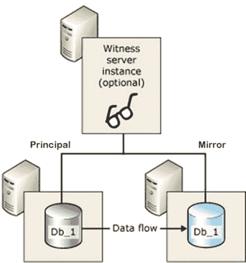
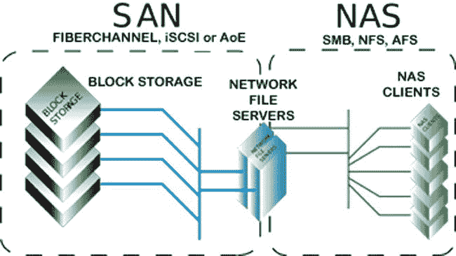

# 此次事件的关键教训是，受影响最严重的用户是那些将所有基础设施都部署在同一个可用区内的用户。`AZ`（可用区）大致相当于一个数据中心，但逻辑划分比物理划分更细致。一个数据中心内可以有多个`AZ`。亚马逊在一个区域内有多个`AZ`。例如，美国东部区域有四个可用区：`us-east-1a`、`us-east-1b`、`us-east-1c`、`us-east-1d`。亚马逊 EC2 的服务等级协议（SLA）承诺 99.95% 的可用性，但这仅适用于跨多个可用区而非跨整个区域的部署。了解您的基础设施 SLA 确实至关重要；不要仅仅指望提供商去了解这些。

如果您确实想在 AWS 上托管 SharePoint 2010，从架构角度来看，主要考虑因素有哪些？延迟将是您需要重点关注的问题。亚马逊使用名为弹性块存储（EBS）的服务进行存储，其托管平台称为弹性计算云（EC2）。EC2 由亚马逊机器镜像（AMI）组成，这些镜像是在亚马逊 AZ 中运行的虚拟机（VM）。您应确保 Web 前端（WFE）服务器和 SQL Server 位于同一可用区，并使用 EC2 上的这个 EBS 存储。对于备份，则应使用简单存储服务（S3），这是一种存储大数据块的廉价方式。您的 WFE 还应配置为使用弹性负载均衡器（ELB）以提供冗余。我要强调的主要一点是，将您的 AMI 放在同一个 AZ 中会降低弹性，而将它们分散到不同 AZ（即使在同一区域内）则会增加延迟，以至于影响性能表现和用户体验。这些 AMI 是无状态的，因此必须连接到 EBS 进行存储。它们是按小时计费的，因此全天 24 小时运行成本高昂。

一个有趣的选择可能是将 AWS 用作开发平台。性能问题不那么突出，并且由于您每天只需在开发人员工作的八小时左右运行 AMI，因此成本得以降低。

## 建议

我的建议是将第二层和第三层内容放在云端，但将第一层内容保留在本地。这样，您既能获得云的灵活性和成本优势，又能完全控制最敏感的数据。通过将最少量的数据存放在昂贵的、用于关键内容的基础设施中，您可以控制成本。这也将使灾难恢复规划更简单，因为您可以首先专注于本地内容。但如果不了解您的具体情况，很难给出比一般性建议更具体的意见。

`SharePoint Online` 在大多数情况下是比 AWS 或其他主要云提供商更好的选择，因为它能轻松地将您的身份验证与 Windows 集成。即便如此，在尝试决定哪种方案适合您的组织时，最佳选择始终是通过试点项目来测试情况。确保试点项目有明确、可衡量的成功标准。例如，检查迁移到云端是否对性能造成任何影响，以及所有用户是否都拥有必要的浏览器和 Windows 版本。在用户的 Windows 帐户与 `SharePoint Online` 之间设置 ActiveSync 是否有很大的开销？当需要为组织中的所有用户执行此操作时会怎样？用户能否从家中访问？您是否需要额外的流程来管理 `SharePoint Online` 帐户的授予？迁移到一个新平台总是具有破坏性的，因此要确保回报值得投资。确保您的 `SharePoint Online` 管理员完全了解如何使用该界面。同时，确保您的开发人员了解为在线平台开发解决方案所涉及的局限性，因为其安全性限制更为严格。我要指出的最后一点是，虽然微软会帮助您将 Active Directory 帐户与 `SharePoint Online` 帐户同步，但如果您选择分离它们，您必须了解再次分离的过程。再次强调，试点项目将能让您更好地理解设置 `SharePoint Online` 所涉及的工作。

## 物理机 vs. 虚拟机

虚拟化为高可用性提供了更多选择。这是因为它可以创建故障转移集群。这些集群是一组物理机器，它们都作为 SharePoint 场的一部分运行，这样即使某个部分（节点）发生故障，整个场也能继续运行。例如，微软的虚拟化软件 `Hyper-V` 使用了集群共享卷（CSV）。使用 CSV，多个虚拟机可以共享同一个逻辑单元号（LUN）（存储磁盘），同时彼此独立地进行故障转移（或在节点间移动）。CSV 为集群存储中的卷提供了灵活性；例如，它允许您将系统文件与数据分开存放以优化磁盘性能，即使两者都包含在虚拟硬盘（VHD）文件中。

虚拟化增加了复杂性，因此需要更多的知识和经验来管理。然而，由于集群技术，它将为您的 SharePoint 场提供另一层弹性和可用性。不过，未来是虚拟化的，因此如果您需要在两者之间做出选择，我建议选择虚拟化。微软支持 SharePoint 进行全虚拟化部署已有数年。虚拟平台允许您更动态地分配资源，并使机器复制更简单。对于开发和测试，虚拟化的一大优势是允许您将机器回滚到先前的状态。我不建议在生产系统上这样做，但对于测试补丁或代码，这非常有用。

## SQL Server

在您的 SharePoint 场中，最难重建的部分是用户内容。这些内容存储在 SQL Server 数据库中。因此，您高可用性工作的重点应放在这些内容上——这并非因为它是您平台中最脆弱的部分，而是因为如果用户需要重新输入数据，恢复它的成本将是最高的。

如前所述，糟糕的容量管理是导致系统不可用的主要原因之一。完成容量规划预测后，请预先将数据库增长到该大小。当它们达到该容量的 75%时，重新评估估算值并获取更多空间。如果内容增长超出预期，这本身就是问题的征兆。如果水正在涌入你的船，解决方案不是把船造得更大！如果没有足够的配额使用，或者用户在 SharePoint 中放置了大量且计划外的内容，你的容量使用量将以你无法提供支持的速度激增。此外，缺乏日志配额可能导致诊断日志或审核日志产生更多详细信息，从而迅速填满你的数据库。

事务日志是 SQL Server 中增长最可能发生的地方。每个存储内容的数据库都有一个相应的日志，用于跟踪对该数据库的所有更改。这是尽可能维护数据保真度的一种方式。在发生大量更改的 SharePoint 内容数据库中，应仔细管理这些日志。你应该将事务日志文件的大小设置为一个较大的值，以避免事务日志文件自动扩展。如果你确实开启了自动扩展，在彻底评估最佳内存大小后，请将其配置为使用内存单元而不是百分比。定期备份事务日志文件，以删除事务日志中的非活动事务。更多关于备份的内容，请参见第 6 章。

同时，关注网站集回收站的大小，并确保有归档或删除不需要的内容的流程。“内容管理系统”中的“管理”一词，既意味着使添加内容的能力更高效，也意味着清除垃圾。由于达到或超过容量会带来可用性风险，应该将其作为风险来处理，而不是将容量视为可以无限增加的东西。诚然，过于严苛的用户配额会适得其反，因为这使用户花费过多时间来删除内容或无法使用系统。例如，当 Gmail 等 Web 邮件产品允许 8GB 时，许多公司却对用户施加了 2GB 的邮箱限制。Exchange Online 现在允许 25GB，我认为这更现实，但这可能表明用户通过电子邮件存储和共享的内容过多，而不是使用 SharePoint。过渡到使用 SharePoint 进行协作应该会减缓邮箱的增长速度。

一旦解决了容量被不必要占用的问题，你就可以专注于保护数据的方法。这里有三个主要的技术选项，可以让你的 SQL Server 更具弹性，从而提高可用性：镜像、日志传送和群集。

### 镜像和 AlwaysOn

我之前已经提到过镜像：主体服务器有一个镜像，该镜像维护其内容的当前副本。位于第三个数据中心的第三个可选见证服务器可以监控主体服务器，如果主体服务器不可用，则由见证服务器将镜像设为主体服务器（请参见图 4-2）。这被称为暖备用甚至热备用，具体取决于切换需要几分钟还是几秒钟。只要 SharePoint 2010 的数据库使用完整恢复模式，它就是支持镜像的。这意味着将恢复模式设置为 FULL 会告诉 SQL Server 将所有已提交的事务保留在事务日志中，直到进行备份。

图 4-2。见证服务器监控主体服务器，并在主体服务器不可用时切换到镜像

数据库的镜像可以通过 SharePoint 管理 UI、`PowerShell` 或对象模型来指定。

有三种镜像类型，根据你的需求具有不同的优势：

*   **高保护**：此选项是同步的，就像 Twitter 一样——持续更新但资源消耗大。故障转移是手动的；没有见证服务器。对任何延迟或性能不佳的容忍度也较低。
*   **高可用性**：此选项与高保护一样是同步的，但包含第三个见证服务器，用于触发故障转移。同样不宽容主体服务器和镜像服务器之间的任何延迟或中断。
*   **高性能**：在此模式下，SQL 会在收到镜像服务器确认写入完成之前，就告诉 SharePoint 对数据库的写入已完成。因此，此模式可以容忍高延迟和低带宽。此模式被称为异步模式；它会尽可能地进行更新，就像朋友偶尔聚餐或你的智能手机同步一样。

这种简单的镜像正在被弃用。在 SharePoint 2010/2013 中使用 SQL Server 2008 时仍支持镜像，但由于在 SQL Server 2012 中，AlwaysOn 是首选的“新”技术，因此正在被弃用。在 SQL Server 2014 中也是如此。

AlwaysOn 结合了 Windows Server 和 SQL Server 的可用性，分为两类：故障转移群集实例和可用性组。故障转移群集实例只是具有多个节点（可能位于不同子网中）的 SQL Server 的一个实例。如果其中一个节点发生故障，SQL Server 可以故障转移到另一个节点。这类似于以前的群集，但更好。

可用性组是镜像 2.0 版本。它们允许多个镜像同时处于活动状态，这意味着你可以对它们运行只读操作。它们可以被分组，这意味着它们将一起进行故障转移。这意味着拥有一个侦听器，如果其中一个数据库变得不稳定，该侦听器将故障转移整个可用性组。SharePoint 甚至不会察觉到它的发生。这一点很重要，例如，因为 Project 在 SharePoint 上工作的方式。Project 有三个数据库，分别用于草稿、存档和发布。如果其中任何一个出现问题，SharePoint 必须将它们作为一个组故障转移到镜像，因为它们都是相互依赖的。

在决定哪个选项适合你的组织时，需要考虑许多因素。考虑一个简单的例子：一家新闻机构，其服务器位于靠近河流的办公室中。有几个变量会影响它选择哪个选项。高保护选项适用于只有两个相距不到 30 英里的办公室的组织，例如大城市中的两个办公室。例如，伦敦的直径约为 27 英里。如果该组织需要高保护，那是因为它们希望确保所有信息都被捕获；但不需要自动故障转移，因此没有见证服务器。假设这家新闻机构在泰晤士河附近有一个办公室。如果河水泛滥，他们可以搬迁到另一个办公室。这可能需要几个小时；在此期间，不需要切换到镜像系统，直到所有员工都迁移到第二个地点，届时再进行手动切换。

高可用性选项是相同的，但这里由见证服务器进行切换。在这种情况下，员工不必搬迁，因为他们位于见证服务器所在的第三个地点。如果发生洪水，服务器会自动切换。

如果该新闻机构的办公室相距超过 30 英里，那么高性能选项将适合他们。

### 镜像

在可用性方面，镜像还有另一个次要优势。由于维护失误是导致停机（计划内或计划外）的主要原因之一，因此镜像是一种很好的 SQL Server 修补方式：先修补镜像，再修补主体。这可以防止停机，因为在修补主体时，用户可以访问镜像。之后再将他们切换回主体。如果镜像修补出现问题，也不会造成服务中断。如果你有一个见证服务器，则应在修补其他两个之前先修补它。由于重启后的机器需要“追赶”进度，因此应在服务器活动量较低的时段进行修补。如果一切顺利，停机时间将只有几秒钟。

### 日志传送

在这里，事务日志（即数据库更改的记录）被异步复制到第二个数据库，可能是在夜间进行。这通常是在遥远的数据中心（可能在另一个国家）完成的。对于 SharePoint Online，日志会从都柏林传送到荷兰，后者充当冷故障转移数据中心。由于移动和恢复数据存在延迟，日志传送是一种灾难恢复选项，而非高可用性选项。然而，它的优点是简单可靠，因此最适合与镜像或下一个选项（群集）结合使用。

### 群集

SQL Server 群集是一项针对 SQL Server 的高可用性技术，现在已成为 `AlwaysOn` 的一部分。可以将其视为 SQL Server 的虚拟化技术。它自身有一整套术语。一个群集涉及在一个或多个节点（服务器）之间共享服务器资源，这些节点拥有一个或多个共享磁盘，这些磁盘被分组到称为资源组的逻辑单元中。包含至少一个 IP 地址、网络名称和磁盘资源的资源组称为虚拟服务器。

每个虚拟服务器在网络上都显示为一个完整的系统。当虚拟服务器包含 SQL Server 资源时，连接到该虚拟服务器的客户端将访问其当前主机节点上的资源。虽然这里经常使用“主动”和“被动”这两个术语，但它们并非固定角色，因为群集中的所有节点都是可互换的。如果当前主机（有时指定为主节点）发生故障，资源组将转移到群集中的另一个（辅助）节点。对于具有两个以上节点或两个以上实例的群集，通过为每个实例选择首选节点所有权顺序来设置故障转移顺序非常重要。辅助节点将成为主节点并托管虚拟服务器。在故障转移期间，活动的客户端连接将中断，但它们可以重新连接到现在由新节点托管的虚拟服务器。但是，客户端必须手动重新连接，并且在故障转移期间正在进行的工作将会丢失。现在大多数商业应用程序都能无缝地处理这个重新连接任务。

群集的目标是通过提供一个带有自动故障转移机制的热备用系统来提高对客户端的可用性。SQL Server 群集不是一种负载共享或扩展技术。在发生故障时，所有群集都会经历短暂的数据库服务器中断。在具有多个节点和实例的大型群集上，客户端在故障事件期间可能会遇到性能下降，但他们不会失去数据库可用性。

### 实例

SQL 群集可以是单实例或多实例。对于单实例，群集中的一个节点在任何时候都拥有所有资源组，而其他节点处于离线状态。如果主节点发生故障，资源组将转移到辅助节点，该节点随之上线。当辅助节点上线时，它将接管资源组的所有权，这些资源组通常包含存放数据库文件和事务日志的磁盘。辅助节点启动后，SQL Server 将在虚拟服务器上启动，并在恢复数据库时向前或向后回滚事务日志中的未提交事务。

这种拓扑以前被称为主动-被动。单实例群集最常用于关键任务应用程序，在这些应用程序中，停机成本远远超过辅助节点离线闲置所浪费的硬件资源成本。

对于多实例，群集中的一个虚拟服务器拥有部分资源组，而另一个虚拟服务器拥有其他资源组。在任何时候，虚拟服务器本身可以由单个节点或多个节点托管，并且对客户端来说就像是单个服务器的命名实例。在这种情况下，它们是虚拟服务器的命名实例，因此得名“多实例”。对于多实例群集（以前称为主动-主动），每个节点的硬件要求更高，因为每个节点在任何时候都可能托管两个（或更多）虚拟服务器。

你应该认为多实例群集比单实例群集更具成本效益，因为没有节点处于离线或等待状态。但是，如果一个节点托管多个虚拟服务器，性能通常会下降。当你需要高可用性而非高性能时，最佳选择是使用多实例。

### 群集还是镜像？

在 SharePoint 2010 的高可用性方面，镜像是当时的新秀，现在已发展成为 `AlwaysOn` 的一部分。群集现在也是 `AlwaysOn` 的一部分，但它存在时间更长，并且具有许多优势。

-   群集技术更为成熟，因此 SQL Server 管理员对其有更好的文档记录、支持和了解。
-   镜像需要在 SharePoint 内部进行配置，而群集更像是一种纯 SQL Server 的可用性选项。这更适合 SQL 和 SharePoint 管理员。
-   群集总是能够自动自我纠正，而镜像则必须有见证服务器或手动切换。
-   镜像资源消耗大，而群集声称没有性能开销。

借助 `AlwaysOn`，这两者可以结合。尽管复杂，但它能为用户提供最佳的可用性。这是通过使用 Windows Server 故障转移群集（`WSFC`）实现的。它们允许你组合多个计算机节点。故障转移群集实例是作为群集应用程序安装到 `WSFC` 上的 SQL Server 实例。`AlwaysOn` 可用性组是在主副本（或 SQL Server 实例）上配置的一个或多个数据库的组，用于实现高可用性。这通常包括一个或多个其他的副本，这些副本将为高可用性数据库的副本提供服务。伙伴数据库可以是可读的或待机的，也可以是异步或同步的。`AlwaysOn` 依赖 `WSFC` 的核心功能来实现其提供的高可用性。

`AlwaysOn` 是使用 SQL Server 配置管理器配置的功能。在启用 `AlwaysOn` 之前，计算机节点必须是 `WSFC` 的成员。

选择镜像、群集或两者结合时的另一个因素是存储成本，这是下一个主题。

### 存储

每台 PC、Mac、智能手机、平板电脑等都有自己的内部存储，形式为硬盘驱动器。近年来，大型组织已转向使用多个服务器可以连接和使用的大型存储设备。现在使用的主要类型是存储区域网络（`SAN`）。它由可以高效分配到需要位置的块组成，并且可以存储任何类型的内容。一种较旧的类型是网络附加存储（`NAS`）。它更像是一个其主要功能是存储的服务器，并且也位于网络上。直接附加存储（`DAS`）则更类似于外部硬盘驱动器。它设置起来既便宜又简单，只需将其插入服务器即可完成。

### 集群与共享存储

集群需要共享存储，这意味着集群中的节点必须位于 SAN 上。这是因为集群中的所有服务器都必须能够访问相同的数据。这使得你的 SAN 成为单点故障，因此它适用于高可用性（HA），但不适用于灾难恢复（DR）。集群也不支持廉价的 DAS（直连存储）。两者都需要大量存储，因此这是一个重要的考量因素。

DAS 存储成本低得多，因为它直接连接到 SQL Server（主体或镜像）。服务器之间没有共享，因此实现更简单、更便宜。NAS 与 SAN 的不同之处在于，NAS 拥有自己的文件系统，而 SAN 没有（参见图 4-3）。对于像 SharePoint 这样的数据库系统，SAN 更优，因为它使系统更容易优化数据的位置和访问。NAS 更适合存储和管理文件。

图 4-3. NAS 拥有文件系统，而 SAN 没有

关于存储和高可用性的最后一点：SAN 存储本身可以被镜像。这意味着你可以拥有一个集群的镜像，但这需要花费数百万美元，因此必须要有充分的理由。

## 建议

在三种选项（镜像、集群和日志传送）中，一些组织（如微软）会组合使用它们。因此，不要将它们视为互斥的选择，尤其是在使用 `AlwaysOn` 时。对于第一层，在 `AlwaysOn` 中同时拥有这三种是理想的选择。对于第二层和第三层，日志传送在许多情况下就足够了，但这当然取决于第二层包含哪些内容。在某些情况下，添加镜像也是可行的，因为它能提高可用性并使维护更容易，同时成本也不会过高。为了帮助你做决定，以下是这些选项的细分。

### 我应该选择镜像还是日志传送？

两者都做。镜像主要用于 HA，日志传送用于 DR。如果你必须选择其中一个，我会选择日志传送，因为如果场变得不可用，它是你的 B 计划。镜像有助于保持其运行，但如果发生数据损坏或数据中心故障，则无法恢复。需要注意的一点是，当组合使用镜像和日志传送时，故障转移可能难以管理。这是因为你的镜像主体服务器同时也是你的日志传送主服务器。然而，在镜像故障转移期间，你的主角色不会自动跟随主体角色。你可以手动管理此情况（我推荐这样做），也可以自动化管理。故障转移后在 SQL 中进行操作可能压力很大，这使得自动化成为一个更具吸引力的选项。

### 我应该选择镜像还是集群？

我会选择集群，因为它是一种基于 SQL 的技术，更具弹性。但如果资金是考虑因素，镜像更便宜，因为昂贵的 SAN 存储成本。集群和镜像的主要区别在于，集群在实例级别工作，而镜像在单个数据库级别工作。因此，从这个意义上说，集群能保护你场的更多部分。资源使用也是一个因素：在集群中，你可以运行主动-主动模式，这意味着你的集群中的第二个节点可以托管另一个（或两三个）数据库实例并执行工作。在镜像中，镜像处于被动状态，直到它变为主体，因此它只是闲置在那里。使用 `AlwaysOn` 实际上会使事情更加复杂。我发现解决方案越简单，出错的可能性就越小。

因此，你的选择是：对于 HA 使用镜像或集群，对于 DR 使用日志传送。

我还应该提到，某些服务应用程序数据库无法进行日志传送或异步镜像。例如，你必须在故障转移场上重新运行搜索；你无法复制搜索索引，尽管它可以通过 PowerShell 进行备份和恢复。此外，一些设置数据库（如 `Business Data Connectivity` 和 `Application Registry Service`）无法被镜像；你只需通过相同配置确保它们具有相同的设置。但这对于 `Application Registry Service` 来说不是什么大问题，因为它仅在将 `Business Data Catalog` 从 MOSS 2007 升级到 2010 时使用。我将在本章后面更详细地介绍如何使服务应用程序可用。

## 变更管理

> “是我负责还是你负责，”一位高级官员怀疑地问他的飞行员，他们即将开始飞往巴格达的旅程，“确保这架机器不会超载？”
>
> “这只能在事故调查中决定。”
>
> ——摘自扬·莫里斯，《告别号角：帝国的撤退》（1978 年），第 357 页。

由于大多数可用性问题是由维护期间的人为错误引起的，一个实用的变更管理流程将有助于防止错误。变更管理关乎确保对生产系统进行任何更改的需求都遵循一个商定的流程。这意味着以下几点：

*   对变更请求有一致的审查和批准标准。
*   利益相关者之间就变更进行充分的沟通。
*   跟踪和记录请求，以便进行历史分析。
*   变更有一个明确的审批路径。

如果你的组织有满足这些需求的适当变更管理流程，SharePoint 也应该遵循这些流程。如果没有，则需要建立一个流程。

犯错的关键原因是没有遵循最小权限原则。这意味着用户的访问权限高于其培训水平和知识所允许的范围。如果用户无需站点集管理员权限或更高级别即可进行更改，则不应需要正式的变更请求。沟通应通过定期的变更委员会审查会议进行。可以使用 SharePoint 列表来跟踪变更请求和审批人。关键在于必须有一个正式的审批流程，而不是临时性的。即使是“紧急”变更也必须满足审查和批准标准，与利益相关者沟通，进行记录，当然还要由对技术有足够了解以做出负责任决策的人适当批准。你肯定不希望这个决定在事故调查中做出。

## 监控

虽然有用于监控 SharePoint 的第三方工具，例如 IBM Tivoli 和微软自己的 System Center Operations Manager (SCOM)，但也有内置工具。这些工具包括：

*   运行状况分析问题和解决方案
*   管理报告
*   IRM 策略使用情况报告
*   运行状况报告（最慢页面、最活跃用户）
*   Web 分析报告

只需使用 Excel 甚至 SQL Reporting Services，就可以构建自定义报告并将其部署到“中央管理”监控。SharePoint 的日志记录服务（使用 Windows 统一日志记录服务 (ULS)）包括一个日志查看器和用于管理日志的 PowerShell cmdlet。最后，开发者仪表板是任何页面底部的一个面板，提供其行为和性能的报告。

关键在于，如果 SharePoint 场的所有者拥有适当的培训和经验，监控就会做得很好。如果你或场所有者不熟悉上述所有选项，则应填补这一知识空白。监控关乎避免灾难和保持系统可用。我将在第 7 章中再次讨论这一点。

## 人员

我提到过，需要为拥有 SharePoint 所有权的利益相关者提供适当的培训。让我们讨论一下与可用性相关的治理。为了创建并保持 SharePoint 平台的可用性，应填充以下角色：

## 角色
*   **架构师**：负责创建适合您组织需求的详细设计平台。
*   **实施者**：负责安装和配置平台。
*   **基础设施所有者**：负责维护硬件和软件。此人将与`Windows Active Directory`、`网络`、`SQL Server`、`存储`以及其他依赖系统的负责人协同工作。
*   **`SharePoint` 应用程序所有者**：负责管理应用程序本身。
*   **`SharePoint` 网站集所有者**：负责管理网站集设置。
*   **网站所有者**：负责管理内容访问权限。
*   **内容所有者**：负责管理内容。

每个角色还应有一个后备人员，以防主要人员不在。我还建议您投资优秀的人才。承包商可以填补空缺，但可能会突然消失，带走他们的知识。如果难以找到具备专业知识的人，请在内部培训员工。`SharePoint`并非那么难。（否则我怎么能做这行 10 年呢？）

为每个角色配备后备人员是迈向弹性的第一步，其出发点是为系统的其他部分提供额外的副本，这样当某个部分出现故障时，另一个部分可以快速接管，将用户访问的中断降到最低。冗余可以在多个层面上实现，这将有益于您的`SharePoint`平台的可用性，我将在下文进行解释。

## 冗余

冗余实际上是弹性的一个子集，但有时被视为实现弹性的主要方式。实际上，仔细想想，采取措施来防止系统冗余部分发生故障难道不是更好吗？硬件故障确实会发生，但不如人和流程导致的故障那么常见。

冗余分为两种类型，取决于是否需要人为干预。
*   **主动冗余**：如果某个设备宕机，系统会自动将工作路由到另一个设备。
*   **被动冗余**：您维护一个备用系统，并在需要时手动切换。

下面是一个通过冗余提供可用性的例子：我在家中有两个`Wi-Fi`网络，一个连接到我的高速有线互联网供应商，另一个连接到较慢、较便宜的移动互联网供应商。我依赖互联网来远程访问我的客户，因此它对我的业务至关重要。我的业务影响分析告诉我，如果我不能访问我的客户超过几个小时，我就无法为他们工作，也就无法赚钱。所以我不能仅仅指望我的互联网连接不会中断。我的流程是：如果我的高速互联网访问中断，我就会切换到较慢、较便宜的选项，仍能保持互联网访问。我的所有设备都知道这两个`Wi-Fi`网络的密码，因此切换对我来说足够快速——只需几秒钟。起初，我同时打开两个`Wi-Fi`网络，但我发现有时设备会连接到较慢的那个，即使快速网络可用，导致我以次优性能做不必要的工作。现在，我关闭第二个`Wi-Fi`；只有当第一个网络不可用时，我才打开它。换句话说，我最初是主动冗余，但后来切换到了被动冗余，因为它给了我更多的控制权。

冗余不应是您`SharePoint`场唯一的可用性策略。假以时日，冗余系统会比没有任何其他形式弹性的系统更具弹性，但高质量的硬件、良好的变更管理和监控更为重要。不要将冗余作为您唯一的高可用性策略。请记住，冗余成本高昂，并且仅靠它自身并不能提供像良好系统管理那样高的可靠性。

以我家的`Wi-Fi`为例，我对我的互联网服务提供商没有控制权。实际上，如果系统宕机，我甚至不会收到通知或关于修复工作的最新进展。我解决这个问题的唯一方法就是拥有第二个供应商。我本可以在宕机的那一刻就开始给他们打电话，但我们都知道那是浪费精力。

在将冗余添加到您的`SharePoint`架构时，要关注风险、影响和故障条件。三层模型将有助于确定优先级。换句话说，船沉了很糟糕，但船上没有咖啡就没那么糟糕。不要为不重要的系统提供与重要系统相同的高成本冗余。

让我们来看看您可以为`SharePoint`场实现冗余的各个层面。

## 数据中心

数据中心是您托管`SharePoint`场的单一地理位置。这也可以是我们组织中的服务器机房，甚至就在您的桌子底下。关键是，它对于您的`SharePoint`平台是一个单点故障。在另一个数据中心拥有一个以上包含`SharePoint`场冗余副本的数据中心成本高昂，但它可以提供可用性和灾难恢复。请记住，一旦第二个数据中心距离超过 30 英里，延迟将使其成为同步复制的糟糕候选方案，因此日志传送是更好的选择。

## 场

出于变更管理的目的，会使用不同的`SharePoint`场。通常有三个，但有时会有四个或更多。一个典型的设置如下所示：
*   **开发场**：由开发人员拥有。虚拟化的，因为这样更便宜，并且可以更快地擦除或回滚。用于编码的简单架构。不一定在网络上。
*   **测试场**：由开发人员拥有。在设计上更接近生产环境。在网络上，但只能由开发人员访问。
*   **预发布/预生产场**：由基础设施拥有。用于用户验收测试和压力测试。生产环境的副本。也用于基础设施人员测试部署和补丁/服务包。
*   **灾难恢复场**：生产环境的副本。有时与预发布场相同。
*   **生产场**：供大部分用户共享内容的实时系统。

请注意，多个场将为您提供更高的可用性，因为它们有助于防止维护或开发错误导致生产环境宕机，因为代码和补丁不是直接部署到实时环境，而是先经过测试。它还允许进行用户验收测试，这有助于控制因用户需求而仓促投入生产的变更。

## 硬件

防止硬件故障是`SharePoint`基础设施所有者的关键技能。以下是保持您场可用性的一些具体建议：
*   使用您可以负担得起的最好的硬件。不要在您的生产环境中使用旧的或二手的服务器。
*   多服务器是一种相对廉价的实现冗余的方式，因此请购买冗余组件。通过多服务器进行横向扩展以避免单点故障。
*   对于所有操作系统和`SharePoint`应用程序驱动器，请使用`RAID 1`。
*   遵循供应商关于维护的建议，并通过发电机或电池确保冗余电源的存在。

## 应用程序级别冗余

在`SharePoint`应用程序本身内部，有许多配置选项可以提供冗余，从而实现可用性。

## 附加服务器与角色

附加服务器不仅能让你横向扩展并提供更多资源，SharePoint 还允许你拥有多个承担不同角色的服务器。最主要的是 Web 前端服务器。它们负责向用户提供构成应用程序用户界面的页面。我建议用户数在 5 万以下时至少部署三台。每增加 2.5 万名用户，就额外增加一台 `WFE`。对于应用程序服务器，我建议至少部署两台，这样每个服务应用程序至少在两台服务器上运行。第二个角色是应用程序服务器。它负责运行诸如用户配置文件同步服务、元数据管理服务和搜索服务之类的服务。将服务器专用于应用程序服务器角色，可以让你更轻松地分配资源并管理服务。例如，如果你有大量内容需要建立索引，你可以将多台服务器专门分配给搜索服务角色。角色是逻辑上的术语，因为 SharePoint 场中的每台服务器在安装后都会承载特定的服务应用程序。然后，你将服务实例分配给这些服务器，以定义它们在场中的角色。

## 服务应用程序

由于 SharePoint 应用程序的功能已变得非常强大，其不同的功能已被拆分到各自独立的迷你应用程序中，并成为 SharePoint 平台的组成部分。这意味着，例如，在与 Active Directory 同步用户配置文件信息时，SharePoint 有一个迷你应用程序，它拥有自己的设置页面、管理员、调度程序和三个数据库。有些应用程序很简单，只需在多个应用程序服务器上部署多个实例即可实现冗余，但有些则更复杂，需要进行更仔细的规划。

SharePoint 通过使用计时器作业来协调服务应用程序的多个实例。它们确保系统在需要时执行所需的任务。例如，如果用户配置文件服务必须每小时运行一次，计时器作业将在第一个可用的运行该实例的服务器上启动，或者在所有应用程序服务器上启动。如果运行计时器作业的应用程序服务器发生故障，当计划执行下一个计时器作业时，它们将在另一台服务器上重新启动，并且日志会记录一个错误。

如果用户在某个服务应用程序运行过程中发生故障，而该应用程序的数据并不存储在数据库中，那么用户将会丢失部分数据。执行此操作的两个服务是 Access Services 和 Excel Services 应用程序。在这种情况下，你唯一的选择是在多台应用程序服务器上安装该服务应用程序。对于其他服务应用程序，数据存储在 SQL Server 中，因此你可以选择在这些数据库上使用镜像或群集，以保持服务应用程序持续运行。

有些数据库你无法进行镜像。它们是：

*   User Profile 服务的同步数据库
*   Application Registry 服务应用程序的数据库
*   Usage and Health Data Collection 服务应用程序的日志记录数据库
*   Web Analytics 服务应用程序的临时数据库

如果这些数据库丢失，只能从备份中恢复并重新附加到服务应用程序，或创建数据库的新实例。这意味着你无法完美地镜像所有数据库，但大多数数据库都是冗余且有弹性的。它们是：

*   Search 服务应用程序的 Search Administration、Crawl 和 Property 数据库
*   User Profile 服务的 Profiles 和 Social 数据库
*   Business Data Connectivity 服务应用程序
*   State 服务应用程序
*   Web Analytics 服务应用程序
*   Word Automation Services 服务应用程序
*   Microsoft SharePoint Foundation Subscription Settings 服务
*   PerformancePoint 服务

## 搜索

搜索需要更周密的可用性规划，因为它有七个不同的组件，并且每种组件都有不同的实现可用性方式。它们是：

*   Query 组件
*   Index 分区
*   Property 数据库
*   Crawl 数据库
*   Crawl 组件
*   Search Administration 组件
*   Search Administration 数据库

这些组件托管在具有特定搜索角色的服务器上。这些角色是：

*   **爬网服务器**：托管 Crawl 组件和一个 Search Administration 组件
*   **查询服务器**：托管 Query 组件和 Index 分区
*   **数据库服务器**：托管 Crawl、Query 和 Search Administration 数据库

它们之间的关系如下：

*   Crawl 组件对内容源进行爬网，并将索引后的内容传递给 Query 组件。
*   Index 分区是 Query 组件的分组。借助它们，你可以将索引分布到多台服务器上。
*   Property 数据库存储有关已爬网内容的元数据，并与一个 Index 分区相关联。
*   Crawl 数据库存储爬网计划以及有关要爬网哪些内容源的数据。
*   Search Administration 组件监视用户操作，并将任何搜索配置更改写入 Search Administration 数据库，该数据库存储常规搜索配置信息。

以下是实现每个组件冗余的方法：

*   **Crawl 组件**：在不同的爬网服务器上运行多个实例。
*   **Crawl 数据库**：可以在 SQL Server 中进行镜像或群集。
*   **Query 组件**：在不同的查询服务器上创建镜像。
*   **Index 分区**：将分区的多个实例分布到多台服务器上，并将镜像的 Query 组件链接到同一个 Index 分区。
*   **Property 数据库**：可以在 SQL Server 中进行镜像或群集。
*   **Search Administration 组件**：拥有多个搜索服务应用程序，因为只能有一个 Search Administration 组件。
*   **Search Administration 数据库**：可以在 SQL Server 中进行镜像或群集。

但是，如果 Index 分区的一部分丢失，用户如何继续搜索呢？你必须在多台服务器上传播同一个 Index 分区的多个实例，以便连接到同一个 Query 组件或其镜像的索引的每个部分都有多个副本。这样，Query 组件始终可以访问整个索引。

## 总结

高可用性不仅仅是通过满足一年中某个百分比的正常运行时间来实现的。它是一个主动的监控和变更管理过程，旨在确保系统不会宕机。它也关乎拥有高质量的硬件。最后，它还关乎在从数据中心到单个服务应用程序组件的架构的每一层都实现冗余。

