# 第五章

## 服务质量

根据我的经验，用户注意到的 SharePoint 性能和响应问题的主要原因，根本不是 SharePoint 本身的过错。它们往往是网络或 SQL Server 问题造成的。在我职业生涯的早期，当尝试排查来自服务台的“SharePoint 很慢”这种模糊信息时，我常常感到沮丧。所有 SharePoint 和 Windows 事件日志都正常。最后，某个网络或 SQL Server 工程师会不经意地提到他们那天遇到了一些性能问题。我现在非常清楚 SharePoint 是如此依赖于这两个层级，因此，如果我认为服务质量问题是由应用程序本身之外的因素引起的，它们是我首先会排查的地方。

## 计算机与网络向基于互联网应用的演进

计算机与网络向基于互联网应用的演进，无疑凸显了它们在追求更面向服务架构（`SOA`）的组织中所扮演的重要角色。这些新服务的质量将是其广泛部署的关键，而服务质量则由贵组织用户的意见决定。最佳的服务质量（`QoS`）并非最高级别，而是最契合不同用户需求的级别。为了提供适宜水平的 `QoS`，SharePoint 管理员需要了解哪些相关的网络参数会影响用户所感知到的质量。

SharePoint 场并非孤立存在；它主要依赖于其所依托的网络。虽然 Windows 网络的高可用性和灾难恢复不在本书的讨论范围之内，但我可以谈谈与 SharePoint 相关的网络 `QoS`。用户对页面的所有请求都通过网络传输。如果网络运行缓慢，那么 SharePoint 也会显得缓慢。如果网络慢到影响用户体验的程度，那么 SharePoint 的感知可用性就会受到影响。通过理解并改进 SharePoint 所处的环境，您可以提高 SharePoint 的高可用性。本章将探讨一些可用于改善您为用户提供的服务质量的方法。其中一些方法包括：

*   广域网优化
*   集中式与区域式 SharePoint 部署
*   缓存

## 为何服务质量至关重要

`QoS` 由多种机制组成，这些机制使网络管理员能够控制网络上的带宽、延迟、延迟变化（抖动）和丢包率的组合，以便：

*   提供诸如 `IP` 语音（`VoIP`）之类的网络服务。
*   为不同部门、应用程序或组织定义不同的服务水平协议（`SLA`）。
*   对跨广域网的流量进行优先级排序。

`QoS` 使网络管理员能够对流量进行优先级排序并在整个网络中分配资源，以确保关键任务应用程序的交付，尤其是在负载繁重的环境中。流量通常根据协议进行优先级排序。那么，对流量进行优先级排序有什么好处呢？

一个简单的比喻是美国高速公路上的高占用率车辆专用道（也称为 `HOV` 或拼车车道）。如果您不是来自美国或者对此不熟悉，那么在一条多车道高速公路上，有一条车道标有白色菱形标志，只允许载有两人或两人以上的车辆通行。

对于业务应用程序，如果 SharePoint 已成为关键任务应用程序，那么您希望给予它高优先级。所有其他流量可以获得同等对待。关键任务应用程序在任何时候都拥有优先通行权。视频和音频流应用程序的优先级较低。带宽消耗型应用程序（例如文件传输）的优先级可以更低。在图 5-1 中，右侧的汽车是 SharePoint 流量，它拥有自己的入口匝道和专用车道（标有白色菱形），可以在车流较少的路段行驶。左侧的汽车代表文件传输、视频和音频文件。

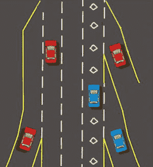

图 5-1。左侧的汽车是低优先级流量，右侧的汽车是高优先级流量

`QoS` 服务种类繁多。排队、流量整形和过滤对于流量优先级排序和拥塞控制都至关重要。这些机制还决定了路由器或交换机如何处理进出流量。`QoS` 信令服务决定了网络节点如何通信以提供应用程序、流或用户组所需的特定端到端服务。凡有拥塞之处，就需要 `QoS`。多年来，`QoS` 一直是广域网的关键需求。在广域网上，带宽、延迟和延迟变化的要求非常苛刻。

随着 SharePoint 作为关键任务应用程序的依赖程度增加，以及占用更多带宽的局域网和广域网语音通话日益普及，局域网 `QoS` 需求也正在显现。由于像 SharePoint 这样的内部网和外部网应用程序快速增长，对整个网络提出了更高的要求，端到端 `QoS` 的重要性也随之增加。

但在我们尝试解决这些问题之前，让我们首先看看用户对服务质量不佳的感知及其原因。

## 服务质量不佳的感知与原因

当用户点击一个链接，而加载时间超过 10 秒时，他们会认为这是 SharePoint 的问题。标准页面的目标加载时间应该是 1 到 2 秒，但如果完成一个简单任务需要加载多个页面，即使这个时间也显得过长。例如，用户需要搜索一个网站，为其添加一个任务，然后更新日历。这个任务本应只花他们 5 分钟，但如果需要渲染 15 个不同的页面，每个页面加载需要 5 秒钟，那么每分钟就有额外的 25% 时间在等待页面出现！这是因为要在 5 分钟内加载 15 个页面，平均每分钟需要加载 3 个页面。如果每个页面加载需要 5 秒钟，那么在 60 秒的基础上就增加了 15 秒，因此是 25%。从感知角度来看，这非常令人沮丧：在一个 5 分钟的任务上多花一分钟以上是不可接受的。

如果加载单个页面需要长达 30 秒，那么您就知道问题不仅仅在于网络或应用程序未经优化。延迟最常见的原因是什么？延迟可能发生在以下任何一个层面：

*   **客户端**：用户设备和浏览器渲染页面所花费的时间。
*   **客户端局域网**：在本地网络上将页面提供给用户设备。
*   **广域网**：通过更广泛的网络传输数据。
*   **服务器端局域网**：从服务器网络传输数据。
*   **服务器**：从服务器访问和传输数据。

所有这些层面的延迟都可能由以下因素引起：

*   **客户端**：
    *   `CPU`/处理器延迟
    *   虚拟/物理内存限制
    *   网卡配置、网络驱动程序和 `TCP/IP` 配置
    *   较旧的客户端应用程序版本
    *   代理服务器配置
*   **客户端局域网**：
    *   交换机配置
    *   过度使用
*   **广域网**：
    *   链路速度（带宽）
    *   延迟（时延）
    *   丢包、重传、超时
    *   网络吞吐量
    *   往返次数
*   **服务器端局域网**：
    *   交换机配置
    *   上行链路争用
*   **服务器**：
    *   `CPU`/处理器延迟
    *   虚拟和物理内存限制
    *   网卡/网络驱动程序和 `TCP/IP` 配置
    *   网络速度（`10/100/1000MB`）
    *   服务器软件层

检查典型的性能延迟会得到类似于图 5-2 所示的结果。延迟的最大部分是由于广域网造成的。

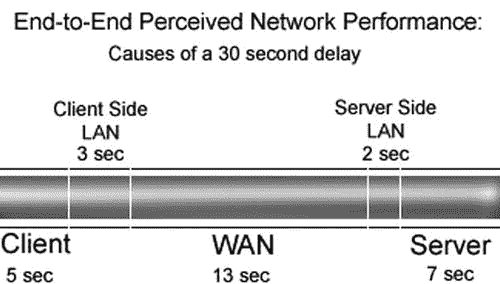

图 5-2。广域网造成最大比例的延迟

虽然任何或所有这些都可能是导致延迟的原因，但最可能的原因是广域网。让我们用一个例子来说明：一位伦敦的经理打开位于悉尼服务器上的一个 SharePoint 页面。悉尼的用户报告说这需要 12 秒，但对于伦敦的用户来说却需要超过 2 分钟。这是为什么？

## 应用场景：鲜花与大象

精致鲜花是一家花卉供应公司。他们有两个办公室，一个在伦敦，另一个在悉尼。买家在伦敦，花卉供应商在悉尼。当鲜花盛开时，供应商会将样品照片上传到精致鲜花公司名为“雏菊链”的 SharePoint 门户。伦敦的买家则打开图片并下订单购买鲜花。

这是 SharePoint 对公司的核心业务价值。买家最关键的需求是图片能快速打开。目前买家抱怨照片打开耗时过长，严重影响了他们在鲜花仍新鲜时迅速下单的能力。照片必须是高分辨率的；平均大小为 `4MB`。

供应商将照片上传至位于悉尼的区域性 SharePoint 服务器。当他们打开照片时，大约需要 12 秒；而在伦敦，打开同样的照片则需要大约 2 分钟。因此，在伦敦打开文件所需的时间要长 10 倍。买家每天需要审核数百种鲜花，因此在等待照片打开的这段时间里，他们的工作效率受到了严重影响。

## 隔离原因

买家需要等待照片从远在悉尼的服务器下载到他们的客户端电脑上。两个办公室运行着相同的服务器硬件、客户端电脑以及客户端软件。这意味着你可以排除这些因素出问题的可能性。接下来需要检查的是两个办公室之间的“管道”，也就是带宽。

两个办公室的可用带宽均为 `3Mbps`（兆比特每秒）。要计算这对应的下载时间，可以这样算：`3Mbps` 等于每秒 `0.375MB`，这意味着 `4MB` 的文件需要 12 秒下载完成。这正是悉尼用户所看到的情况，但伦敦的用户并非如此。唯一的区别在于存储照片的悉尼服务器与伦敦办公室之间的距离。两个办公室之间的单程距离大约为 `10,000` 英里（`16,000` 公里）。这是否导致了延迟？图 5-3 展示了数据传输所经过的路径。

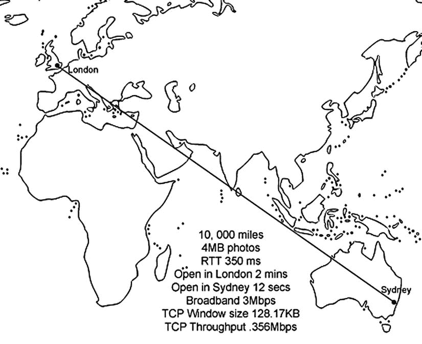

图 5-3。伦敦到悉尼

## Fiddlers、管道与 Ping：测量工具

# 网络带宽与延迟的深入探讨

我相信你见过用“管道”这个比喻来描述带宽。这个比喻描绘的是办公室之间有一条巨大的管道，数据以光速在其中流动，因为这些都是光纤电缆。既然光在一秒钟内能传播 186,282 英里（约 299,792 公里），为什么下载一张兰花的照片需要 2 分钟呢？

现在你应该明白，这个比喻过于简化了。一个更好的比喻可能是水从山坡上流下：它蜿蜒曲折地绕过障碍物，根据不同地形而减慢或加速，甚至有些水流根本到不了终点。

首先，光纤中的光并非在真空中传播，因此它的速度只有光速的 2/3，但真正的延迟来自于数据在多个路由器和交换机之间的跳跃。像 `Fiddler 2`（图 5-4）这样的工具可以让你追踪数据从源到目的地的整个过程（它是一个免费软件，可在 `www.fiddler2.com/fiddler2/` 获取）。

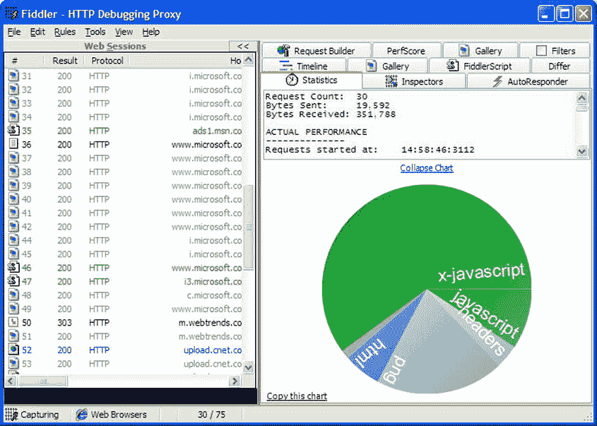

图 5-4。来自 `Fiddler 2` 的指标

`Ping` 是一个测量延迟的工具，它显示从伦敦到悉尼的往返时间 (RTT) 为 350 毫秒。严格来说，延迟测量的是单程时间，而不是往返时间，但在实际应用中，回程路径更为重要。如果你回想一下水从山坡流下的比喻，你会知道沿途会有一些水损失。在通信网络中，成功传递消息的平均速率被称为吞吐量。图 5-5 中的 `Ping` 是从我正在撰写此书的爱尔兰，到位于美国（很可能是弗吉尼亚州）的 Apress 公司（此信息来自 WHOIS 查询）。根据 `www.mapcrow.info` 的信息，这段距离为 4,240.70 英里（6,824.56 公里），不到伦敦到悉尼距离（10,000 英里/16,000 公里）的一半。因此，这个 Ping 时间大致与从悉尼到伦敦往返的 350 毫秒的 Ping 时间相符。

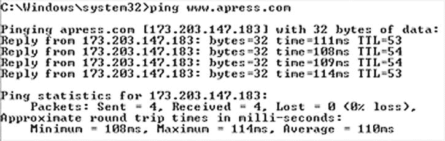

图 5-5。一次 `Ping` 的指标。从爱尔兰到美国 Apress 的平均往返时间：110 毫秒

## TCP 吞吐量

我们需要更深入地探究，才能找出数据长距离传输耗时过长的真正原因。所有网络流量，包括 SharePoint 的流量，都通过超文本传输协议 (HTTP) 传输，而 HTTP 又运行在传输控制协议 (TCP) 之上。真正决定 SharePoint 产生的流量能以多快速度传输的是 TCP。

TCP 对计算机在未向发送方确认的情况下能够接收的数据量设定了限制。可以把它想象成，在不回复任何“请回复”的情况下，你最多能从同一个人那里收到多少份聚会邀请。如果发送方没有收到第一份邀请（数据包）的确认，它会停止发送更多数据，直到收到回复。如果在特定时间后仍未收到回复，它可能会重新发送。为什么它要这样做？为什么不直接假设数据已收到并继续发送？原因和你要求别人“请回复”是一样的：你希望确保消息确实已被收到。正是这种方式保证了 TCP 数据传输的可靠性。

要计算出你的实际吞吐量，可以使用类似图 5-6 的公式。如果你不擅长数学，不必担心；我也不擅长。本书不会包含很多公式。

图 5-6。你能获得的数据量受限于 TCP 缓冲区和延迟

由于这种为了维持通信质量而优先于通信量的等待回复机制，实际可用的带宽可能根本无法用完。对于 TCP 来说，这个缓冲区默认只有 64KB。因此，它会发送 64KB 的数据，然后等待回复；如果收到回复，它会再发送 64KB。你可以看到，350 毫秒的延迟，即每个数据包从悉尼到伦敦需要三分之一秒的时间，这个延迟会累积起来。这个网站可以快速为你计算：`www.speedguide.net/bdp.php`（图 5-7）。请注意，`RWIN` 是 TCP 接收窗口（TCP Receive Window）的缩写，指的是计算机在未向发送方确认的情况下能够接收的数据量。`BDP` 代表带宽时延乘积。

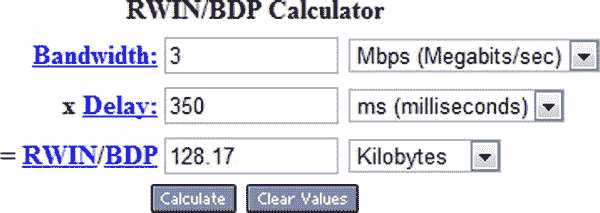

图 5-7。计算 `BDP`。请注意，1,000 千比特等于 1 兆比特，但 1,024 千字节等于 1 兆字节

在这种情况下，3Mbps × 350ms = 128.17KB，这是推荐大小（64KB）的两倍。但这并非你可以控制的因素。Windows Server 2008 会尝试自动寻找最佳的 TCP 窗口/`RWIN`/`BDP` 大小。它从大约 17.5Kbps 开始，最高可达 16Mb。这个数值无法手动调整，因此你必须依赖系统来选择速度和可靠性的正确平衡点。

让我们来计算吞吐量，看看它是否能解释为什么伦敦的下载时间是 2 分钟，而悉尼只需要 12 秒。在图 5-8 中，我们用 TCP 窗口大小 (128,170) 除以往返时间（单位秒，0.35），得到 TCP 吞吐量为 .366Mbps。

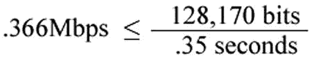

图 5-8。计算 `BDP`

## 带宽与延迟分析

要计算每秒千字节数（Kbps），需要将其乘以 1,024（请记住，1 兆字节中有 1,024 千字节，但 1 千比特中只有 1,000 兆比特），然后除以 8（1 字节中有 8 位）。计算结果为 `45.568Kbps`。按照这个速率，一张 4MB 的照片（即 `1,024 × 4 = 4,096` 千字节）将需要 `87.43` 秒（用 `4,096` 除以 `46.848`）。所以这大约是 1 分半钟。另外 30 秒左右的延迟可能由丢包以及延迟波动造成。请记住，在图 5-2 中，除了广域网（WAN）之外，还有其他延迟原因。伦敦的延迟值为 `0.35 秒` 的往返时间（RTT），其最佳吞吐量接近 9 秒，这与他们所经历的 12 秒相差不远。

## 探索可能的解决方案

显然存在一个问题：服务质量（QoS）对用户来说太低，因为打开一张照片需要太长时间。问题已被隔离：它不在于 SharePoint，甚至不在于一般的 Web 应用程序；问题出在协议栈更底层的 TCP 和网络层。你现在更清楚地理解了为什么会出现问题，并且拥有了一些可以更好衡量问题的指标。你无法控制或改变的硬性指标包括：

*   文件大小：4MB。
*   上传照片的花卉供应商与下载照片的买家之间的距离。
*   供应商上传照片的速度以及买家查看照片的速度。

那么，你能做些什么来提高服务质量呢？大多数人首先会建议增加“管道”的带宽。在针对之前版本 SharePoint 的测试中，微软指出，延迟会影响广域网性能，直到带宽被限制在每秒 512 千比特（`512Kbps`）或更低；一条延迟为 `500毫秒` 的 `T1` 线路，其性能与具有相同延迟量的 `T3` 线路大致相同。为了在广域网上获得最佳性能，微软建议将带宽目标设定为每秒 3 兆比特（`3Mbps`，即双路 `T1`）或更高。既然你已经达到了这个目标，增加带宽对于缩短打开照片所需的时间不会有显著帮助。

如果使用内容部署，将照片从悉尼的网站集夜间传输到伦敦的网站集，情况会怎样？这里的问题在于“夜间”如何界定。周一早上 8 点，当悉尼的工作周开始、生产者正在上传新的花卉照片时，伦敦时间仍然是周日晚上 11 点（早 9 小时）。等到悉尼的生产者在当地时间下午 6 点上传完一天的照片，伦敦才刚刚早上 9 点，而买家们正想查看它们。

并没有夜间传输的窗口期。正如你在图 5-9 中看到的，伦敦总是“落后于”悉尼。如果地球向相反方向自转，或者如果伦敦是一个种植花卉的好地方，那么就会有一个 9 小时的窗口期，可以让照片在悉尼夜间时逐步传输到伦敦。

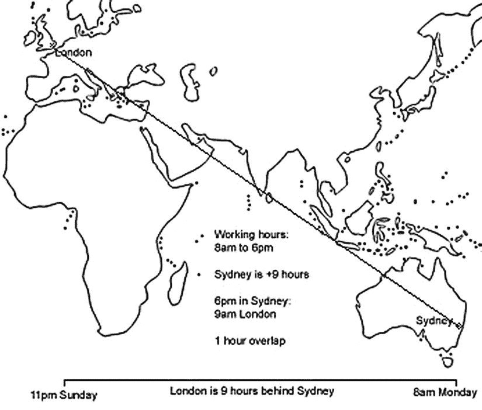

图 5-9。没有时间进行批量异步传输

但现实是，每花一分钟传输照片，就占用了买家评估照片所需的时间。例如，假设周一花商在悉尼上传了 `100` 张照片。他们上传到悉尼的服务器，因此该任务的速度很快。他们一有花朵盛开就立即提供信息，这是最佳时机。每张照片传输到伦敦买家机器需要 `2` 分钟。用户通常不会将查看图像视为下载，但实际就是需要下载。这假设了最佳下载速度、无中断且无数据丢失。所以，`100`张照片 × `2`分钟 = `200`分钟，即 3 小时 20 分钟。如果照片是在悉尼周一工作日结束后（下午 6 点，对应伦敦周一上午 9 点）通过内容部署传输的，伦敦的工作人员仍然要到当地时间下午 12:20 才能看到任何照片。他们还不如自己一张一张地下载照片。他们在本该考虑订购哪些花卉的时间里，白白浪费了 3 小时 20 分钟。

照片大小为 4MB，对于图像来说很大。在大多数网站上，图像会使用专用软件进行优化，使其大小缩减到可能只有 `100KB`。悉尼办公室没有人员、软件或培训来优化这些图像。

由于产品的性质，这个过程必须快速。当他们发送一张盛开的花卉照片时，他们实际销售的是花蕾，因为这样才能保证在运抵英国时有足够时间开放。（顺便提一下，这是一个虚构的场景。我并不知道现实中的真实流程。这里的关键点是说明一个对时间敏感的过程。）

以下是（虚构的）简单的审批和警报工作流过程：

# 广域网加速与部署策略

1.  生产者一旦有了花朵盛开，就用数码相机在田间拍摄花卉的数字照片。

2.  他们将相机连接到卡车上的笔记本电脑，通过车上的 Wi-Fi 连接互联网。

3.  使用 VPN 连接，他们将照片上传到“花点心思雏菊链”门户。

4.  然后，他们添加成本、数量以及任何其他相关细节等元数据。

5.  悉尼办公室收到一封电子邮件警报，通知图片库中有新内容。

6.  他们审核照片和元数据，并将其标记为“可供买家审核”。

7.  买家可以立即在门户上根据所需花卉旁边的“订购”选项下订单。

8.  这通过工作流发送一封电子邮件警报，通知生产者（花卉种植者）开始包装花卉。

9.  同时，它还通知货运航空公司，花卉即将运抵其仓库，并空运至英国。

过去曾尝试增加一个步骤，要求供应商在图像处理软件中打开照片并将其转换为较低分辨率，但未能成功。存在多种浪费时间的问题。有时照片只是通过缩小宽度和高度来减小文件大小，结果在屏幕上变得太小而无法看清；有时上传了错误的图像。问题在于，这些人是花卉种植者，而非照片专家。这也给悉尼办公室带来了负担，他们需要修正照片或要求生产者重新上传图像。这反而比照片加载所需的 2 分钟更严重地拖慢了将照片呈现给买家的过程。需要另一种替代方案。

如果你无法改变地球的自转、花卉的种植和购买地点，也无法改变将照片导入 SharePoint 的过程，那你还能做什么？

## 广域网加速

下一个选项是广域网加速。广域网加速技术是一种设备，有时被称为广域网优化控制器（WOC），部署在数据流量的路径中，旨在加速数据传输。有多个供应商提供此类设备，但它们都结合使用了以下技术。

你现在知道，吞吐量主要由 TCP 接收窗口（`RWIN`）和往返时间（`RTT`，也称为延迟）决定。这些技术如何积极地影响吞吐量？

首先是数据缩减。广域网优化控制器（`WOC`）会实时检查通过广域网发送的所有数据。这些信息存储在每台`WOC`的本地数据存储中。然后，当检测到重复信息时，会向相应的`WOC`发送引用，指示它从本地提供该信息，而不是重新通过广域网发送。这有可能减少超过 90%的广域网带宽。但它最有效的情况是当有成千上万的用户请求相同的页面时。

广域网加速器还提供延迟缓解功能。你知道，每个数据包就像一封邀请函；在收到回复之前，不会发送下一个数据包。这种确认（有时称为`ACK`）会减慢服务器距离较远时的数据传输过程。在这种情况下，往返时间需要 350 毫秒——几乎三分之一秒——这正在拖慢数据传输速度。通过广域网加速，`WOC`像本地邮局一样，更早地确认来自服务器的数据传输。因此，`WOC`可以维持或增加`TCP`窗口大小，从而提高应用吞吐量。所有这些都减少了对跨广域网应用性能的影响。

像这些照片这样的冷传输问题在于，数据仍然必须通过狭小的广域网链路传输。因此，在广域网加速之前，由于广域网延迟，伦敦的一个买家在这条 3Mbps 的线路上最多只能让一个`TCP`会话达到，比方说，2Mbps。但是，加入广域网加速后，这 2Mbps 直接飙升到 3Mbps。此时，该线路无法再传输更多数据。但用户并没有真正注意到差异，因为带宽并没有增加多少，而且你现在还引发了广域网瓶颈。`QoS`开始介入并开始丢弃数据包，这会抑制该用户的`TCP`传输，进而影响伦敦的其他用户/买家。结果，用户没有注意到差异。此外，因为你加速了狭小广域网链路上的瓶颈，买家们仍然在等待照片加载时感到沮丧。

广域网加速器还提供一种称为数据包合并的功能。可以将其视为将许多信件打包成一捆，然后一起发送以加快`RSVP/ACK`过程。某些应用程序被认为是“健谈的”，因为它们使用大量较小的数据包进行通信。这些数据包加起来会消耗大量带宽——这是一种有限的资源。`WOC`可以将在同一两个站点之间传输的多个数据包合并成一个数据包，从而减少应用程序响应时间和带宽消耗。

## 部署策略

广域网加速器（`WOC`）可以放置在流量路径上，也可以放置在路径旁。这些被称为“在路径中”和“路径外”（有时称为“出路径”）。采用“在路径中”设计（图 5-10），`WOC`被插入到广域网路由器和局域网交换机之间。这意味着所有流量都将经过该设备。这种方法的优点是允许自动优化流量。该设备会与其对等端建立自己的`TCP`连接，并且只向其对等端发送可优化的流量。所有其他流量都正常路由。

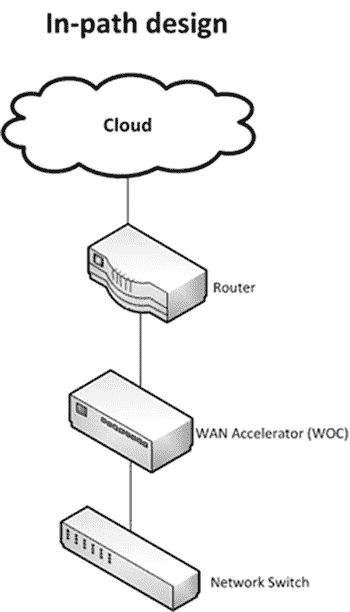

图 5-10. 所有流量都通过 WOC

`MPLS`和`PBR`也是可选方案。多协议标签交换（`MPLS`）是一种网络机制，它借助标签将数据从一个网络节点传输到下一个节点。这些标签标识数据包中的内容，以加快将其转发到正确目的地的速度。可以把它想象成信封上的地址。基于策略的路由（`PBR`）是指网络管理员希望根据其他标准（例如数据包的来源）为数据包设置进一步的路由规则。可以把它想象成使用信封上的回信地址。对于拥有一条`MPLS`网络的远程分支机构，或者拥有两条`MPLS`网络的中大型站点来说，“在路径中”设计是最简单的部署方式。

采用“路径外”设计（图 5-11），`WOC`不位于流量的直接路径上以对其进行优化。必须通过`PBR`语句将流量重定向到`WOC`。这种方法的优点是非侵入性的：它允许通过仅更改配置来从一种模式转换到另一种模式。当然，缺点是它需要更多的配置和良好的应用程序知识（要使用的端口/协议）。因此，“路径外”设计更为复杂。必须注意标准化“路径外”设计，以确保实现全面优化，并最小化对生产流量的影响。

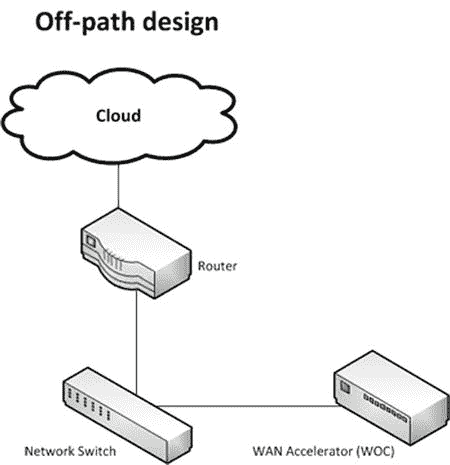

图 5-11. 流量被重定向到 WOC

采用“路径外”设计时，负载均衡器扮演两种不同的角色：

*   **传统负载均衡**：当所有流量通过`PBR`或其他方式重定向到负载均衡器（`LB`）时，`LB`将流量负载均匀地分发给集群中的各个`WOC`。

*   **在路径中负载均衡**：当`LB`内联放置在网络路径上时，它会拦截入站和出站流量。然后，`LB`会以不成比例的流量负载分布将流量发送给各个`WOC`。

就 Fancy Flowers 而言，他们拥有一条连接伦敦和悉尼的`MPLS`网络，因此测试`WOC`的最佳位置是直接放在悉尼出口流量的路径上。在测试广域网加速器之前，Fancy Flowers 团队有一个基准；他们知道在伦敦打开一张照片需要 2 分钟。添加`WOC`后，仍然需要 2 分钟！这是因为文件是冷的，没有被缓存。

例如，如果`WOC`在 Daisy Chain 门户网站上保留了 Fancy Flowers 悉尼分公司的本地主页副本，那么自从伦敦的第一个人访问过那里之后，该页面就会存储在伦敦服务器机房的`WOC`上。随后，任何伦敦用户对该页面的后续访问都会加载得更快，因为请求不必往返悉尼来加载页面、图片、样式表等。这意味着他们节省了伦敦和悉尼之间的带宽，这些带宽可以被其他应用程序使用。一旦页面被缓存，有时被称为“热”页面，就好像页面被第一个“冷”访问者（因为该页面未在`WOC`上缓存）访问后“预热”了一样。

这种情况的问题在于，Fancy Flowers 的伦敦买家几乎总是在访问“冷”页面。这是因为那大约 100 张照片是在悉尼早上上传的，然后由伦敦的 5 名买家在开始工作时查看。没有时间或事先来自伦敦的访问来预热页面。

测试后，Fancy Flowers 认为广域网加速的成本并未带来足够的好处来证明其价值。主要问题在于距离，而广域网加速对于冷文件没有任何益处。

## 折中方案

问题的核心在于距离。最终将伦敦买家打开照片的时间减半的解决方案是，在伦敦和悉尼之间的中途建立一个 SharePoint 门户网站，作为链条上的额外一环。可以通过 Speed Test 网站（`www.speedtest.net`）的交互式地图测试从伦敦到世界各地的`RTT`，该地图可让您从所在位置向世界任何地方执行`ping`操作。部分城市的测试结果列于表 5-1。

表 5-1。从伦敦到不同地点的延迟测试

| 城市 | 从伦敦`ping`的`RTT`（毫秒） |
| --- | --- |
| 开罗 | 80`ms` |
| 迪拜 | 175`ms` |
| 孟买 | 320`ms` |
| 曼谷 | 330`ms` |
| 悉尼 | 350`ms` |

基于此分析，在迪拜选择了一家主机提供商（图 5-12），由其提供 SharePoint 服务器来存储照片。这样做成本低廉，因为只需要为生产商和买家创建少量用户帐户。所需容量也较小——而且比将照片存储在 Fancy Flowers 的`SAN`上更便宜。这还有提高安全性的好处。花卉生产商不再需要直接通过`VPN`访问 Fancy Flowers 网络。

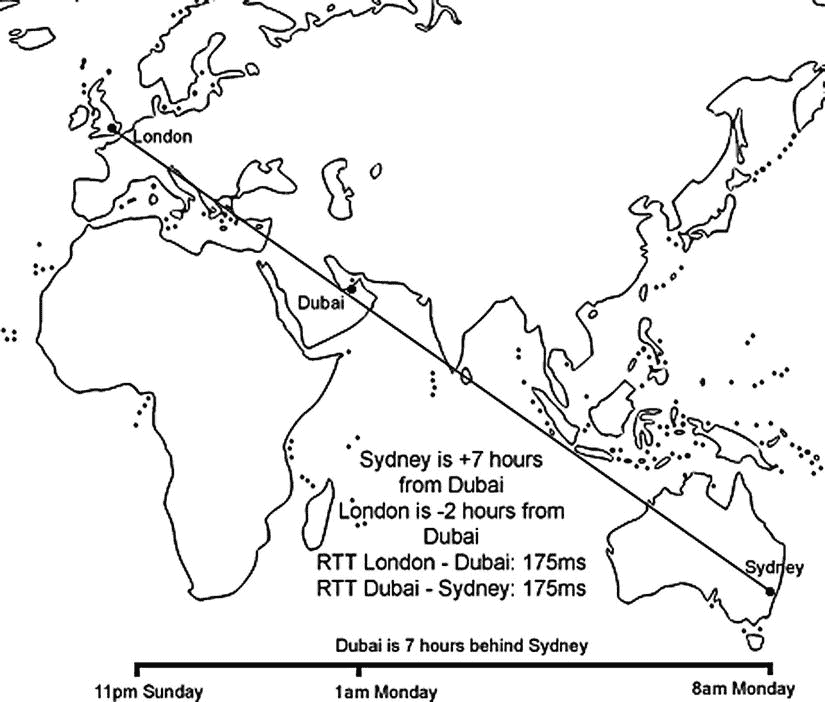

图 5-12。通过在中间增加服务器来降低延迟

供应商上传照片的时间确实增加到了大约 1 分钟。但他们并不认为这很繁重，因为他们知道买家要到他们当地时间的下午 6 点（即伦敦时间上午 9 点）之后才能看到照片。主要优势在于伦敦的买家：打开照片所需时间减少了 50% 以上，买家能明显感觉到差异！

现在让我们来计算新的吞吐量。在图 5-13 中，您将 TCP 窗口大小（128,170）除以新的往返时间（秒）（.175），得到 TCP 吞吐量为 .732 `Mbps`。

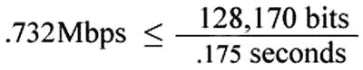

图 5-13。使用新的`RTT`计算`BDP`

再次计算每秒千字节数（`Kbps`）。将其乘以 1,024，然后除以 8。结果是 93.696 `Kbps`。按此速率，一张 4 `MB` 的照片（即 1,024 × 4 = 4,096 千字节）需要 43.71 秒（4,096 除以 93.696）。`QoS`提高了一倍多，网络安全得到提升，甚至还节省了将照片存储在`SAN`上的成本。总体效果显著！

## 集中式部署与区域式 SharePoint 部署

在 Fancy Flowers 的故事中，内容在世界某个地方添加，在另一个地方查看。但通常情况并非如此。大多数协作是在同一地区的人员之间进行的，其中部分内容可能引起组织内更广泛全球社区的兴趣，尤其是通过搜索。本节将探讨在全球范围内分布 SharePoint 架构的优缺点。正如您在 Fancy Flowers 的案例中所见，将内容放在需要查看的人员附近可以提供更高的`QoS`。这是一个很好的通用原则。

SharePoint 中的服务体系结构意味着您可以集中某些服务，同时使其他服务保持区域化。通过将精简版的 SharePoint Foundation 部署加入组合，您可以实现更廉价的本地协作并降低复杂性。适合您组织的选项将取决于您的用户需求以及您希望提供的`QoS`。

表 5-2 列出并描述了可在服务器场之间部署的 SharePoint Server 中的服务应用程序。每种情况的逻辑都是合理的：例如，您希望能够跨服务器场同步搜索数据、元数据或 Web 分析。

表 5-2。哪些服务应用程序可以跨服务器场部署？

| 服务应用程序 | 目的 | 存储 |
| --- | --- | --- |
| 业务数据连接 | 提供与业务线数据系统的连接。 | `DB` |
| 托管元数据服务 | 管理分类法、关键字和标签的中心。内容类型跨网站集同步。 | `DB` |
| 搜索 | 爬网内容并提供搜索查询。 | `DB` |
| 安全存储服务 | 对外部系统进行单点登录身份验证。 | `DB` |
| 用户配置文件 | 管理“我的网站”、用户配置文件页面、社会标签和其他社交网络功能的用户数据。 | `DB` |
| Web 分析 | 提供流量、搜索和库存报告（仅适用于 SharePoint 2010，不适用于 2013） | `DB` |

对于无法跨服务器场部署的服务应用程序，它们通常依赖缓存来跟踪其显示内容时所需的数据，例如 Access、Excel 和 PerformancePoint。State Service 等服务确实需要数据库，但非常特定于服务器场。表 5-3 显示了在多个服务器场中无需同样可用的服务类型。

表 5-3。哪些服务应用程序不能跨服务器场部署？

| 服务应用程序 | 目的 | 存储 |
| --- | --- | --- |
| Access Services | 为 Access 数据库提供浏览器界面。 | 缓存 |
| Excel Services 应用程序 | 为 Excel 电子表格提供浏览器界面。 | 缓存 |
| InfoPath Forms Services | 为 InfoPath 表单提供浏览器界面。 | 缓存 |
| PerformancePoint | 透视数据，提取事实和维度。构建 KPI、记分卡和仪表板。连接到 Analysis Service 多维数据集。 | 缓存 |
| State Service | 存储相关的临时`HTTP`会话数据 | `DB` |
| 使用情况和运行状况数据收集 | 基于收集的场范围数据生成各种使用情况和运行状况报告。 | `DB` |
| Visio Graphics Service | 在 Web 浏览器中查看和刷新已发布的 Visio 图表。 | Blob 缓存 |
| Word Automation Services | 在 Web 浏览器中查看和刷新已发布的 Word 文档。 | 缓存 |
| Microsoft SharePoint Foundation 订阅设置服务 | 为服务应用程序提供多租户功能。 | `DB` |

了解您的服务应用程序是理解如何部署 SharePoint 以实现良好`QoS`和用户体验的关键部分。最简单的并不总是最好的。目标是更好的沟通和更高的生产力，这有时意味着需要不止一个中心。

### 单一中心

单一中心是指 SharePoint 服务器场和所有服务应用程序都从一个位置运行（图 5-14）。这种方法的优点是复杂性较低，这意味着成本较低。缺点是对远离中心（如悉尼）的用户而言`QoS`非常差。这也意味着所有元数据和搜索内容都被整合。然而，总体而言，虽然`IT`部门在管理方面和财务部门在成本方面能获得好处，但这些好处被平台为业务带来的潜在投资回报损失所抵消，因为远离中心的用户将缺乏分享和协作的动力。

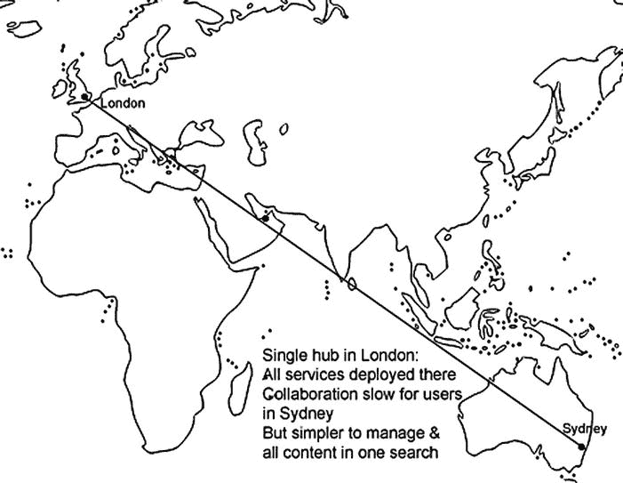

图 5-14。对管理员来说简单，对远程用户来说缓慢

### 中心带分支