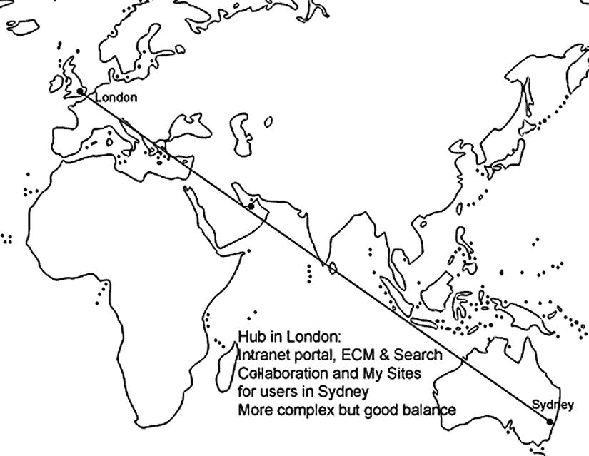
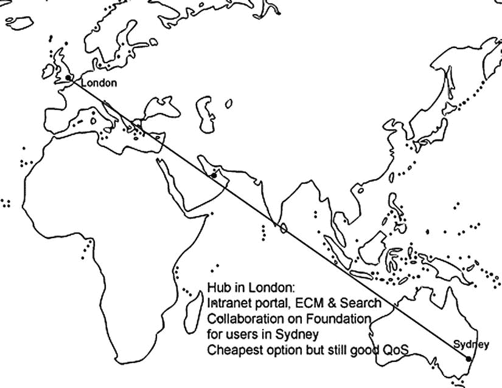
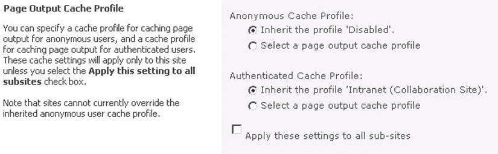

# 中心辐射式架构

中心辐射式架构通过在一个区域（本场景中为悉尼）部署服务器场，为区域用户提供良好的协作服务质量（参见图 5-15）。他们利用此架构进行本地协作。由于大部分社交网络活动也是本地化的，因此他们的“我的网站”也托管在此处。

虽然可以在不同服务器场之间共享用户配置文件，但目前不支持通过广域网链路使用 `User Profile service application`。这是因为该服务需要直接访问数据库。因此，对于本场景中的广域网环境，推荐改用 `User Profile Replication Engine` (`UPRE`)。`UPRE` 是 `SharePoint Administration Toolkit` (`http://technet.microsoft.com/en-us/library/cc508851.aspx`) 的一部分。它可以在用户配置文件服务应用程序之间复制用户配置文件和社交数据（如社交标签、备注和评分）。此复制可以是单向或双向的。

Fancy Flowers 公司决定采用此方法，因为他们发现伦敦和悉尼之间的时差阻碍了知识共享和分支间的良好沟通。他们开发了“我的网站”功能，显示所有员工的动态，以便员工更好地相互了解并进行更有效的沟通。

图 5-15. 更复杂但投资回报率更高

搜索服务也集中在伦敦。这通过联合悉尼索引中的内容来实现，而不是直接爬网内容。联合类似于同时运行多次搜索并将结果显示在同一页面上，但位于不同的 Web 部件中。这使用户更容易识别内容所在的位置。

您可以从中央服务器场直接通过广域网链路爬网内容。SharePoint 中的搜索架构针对通过广域网连接进行爬网进行了优化。您甚至可以将爬网组件放在单独的爬网服务器上。这些服务器将专门用于爬网远程内容，从而减少对整体性能的影响。

由于常规 Intranet 页面更新频率较低、编辑者较少、阅读者较多，因此可以托管在远离用户的位置，但可以使用缓存来加快访问速度，因为页面大多处于“热”状态而非“冷”状态。

仅仅因为您可以跨广域网链路部署服务，并不意味着您就应该这样做。不建议跨广域网部署 Web 分析服务，可能是因为它占用大量带宽，会通过消耗所有带宽对其他应用程序产生不利影响。对于业务数据连接服务，当服务器场靠近数据源时，服务质量最佳。安全存储服务也是如此：确保服务靠近其要进行身份验证的应用程序。

此选项比中心辐射式架构更复杂且更昂贵，但您的组织可能会因此从 SharePoint 中获得更多价值。

## 中心辐射式与迷你中心辐射式

第三种选项是前两种方案之间经济实惠的折衷方案，即仅在地区办事处部署 SharePoint Foundation，如图图 5-16 所示。这为本地用户提供了快速协作的好处，而无需承担 SharePoint Standard 或 Enterprise 许可证的成本。地区办事处越多，越需要考虑此方案。

这些本地办事处中的内容仍可由中心服务器场爬网，但用户需要到中心服务器场进行搜索。本质上，这与仅采用中心辐射式架构相同，但增加了独立的低成本本地协作站点。

图 5-16. 分布式，但成本更低

## 缓存

*你好，我是约翰尼·卡什。*
——他在许多音乐会和公开场合的开场白

在内容消费者与生产者比例高且内容更新不频繁的情况下，缓存的影响最大。SharePoint 通常并非如此，它力求让所有用户成为贡献者，并实现快速频繁的更新。但管理员可以根据用户配置文件设置不同的缓存反应。

如果用户是匿名用户，可以假设内容对他们来说更新频率较低，因此内容保持“热”状态。对于经过身份验证的用户，假设内容更新更频繁（“冷”状态），因此缓存频率较低。SharePoint 提供了多种选项，可通过 Web UI 管理页面输出的缓存，而无需修改后端配置文件（参见图 5-17）。

图 5-17. 通过设置页面轻松设置缓存

## 总结

提高服务质量的主要方法包括：广域网优化、将服务器场设计为内容靠近需要查看的人员，以及缓存不常更新的页面。广域网加速在延迟限制方面的作用是有限的。但 SharePoint 提供了一些选项，可以在用户满意度和不过于复杂的架构之间取得经济高效的折衷方案。

应该明确的是，“管道”是一个过于简单的比喻，加粗管道并不一定是改善服务质量的最佳方法。然而，我确实认为，由于竞争原因，企业宽带的速度落后于家庭市场，这种情况将会改变。例如，我每月仅需支付很少的费用就能使用 20Mbps 的宽带，而许多企业满足于 3Mbps。

此外，宽带的定价方式也不公平，因为企业无论使用频率或使用量多少都要付费。电力和供水并非如此，宽带也应如此。为什么你要为一周 5 天、每天可能仅使用 8 小时的东西支付全天候（24/7）的费用？为什么轻度用户要与重度用户支付相同的费用？