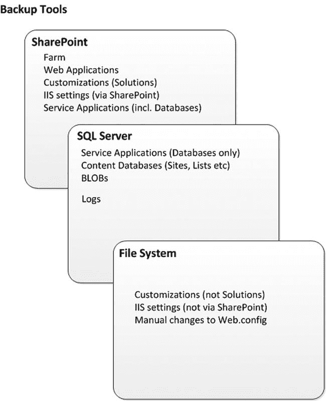
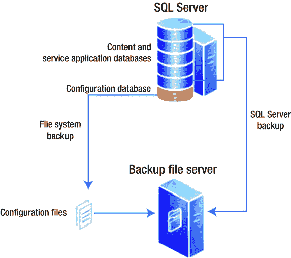
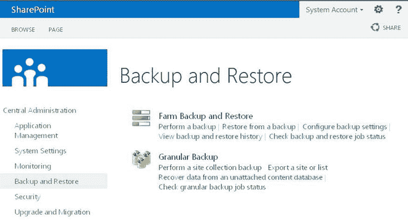
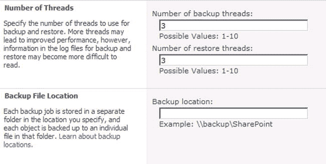
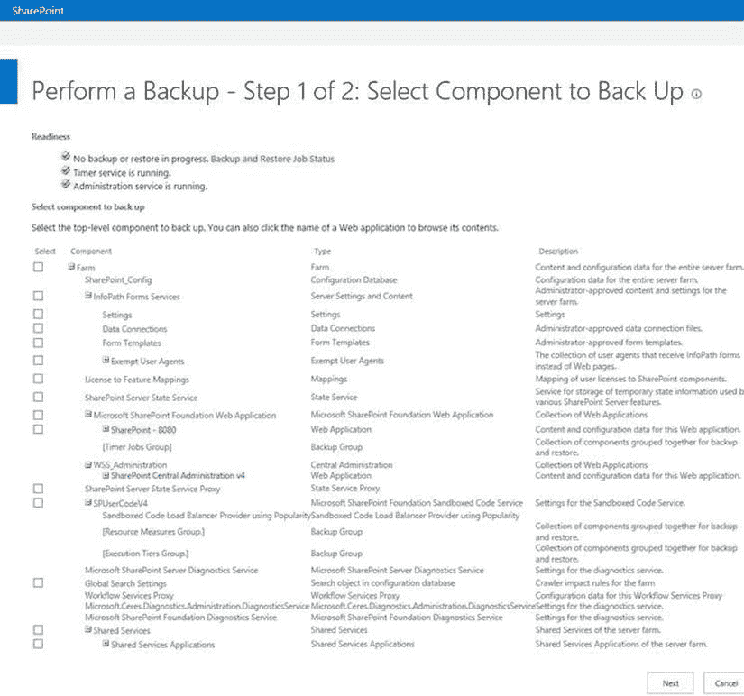
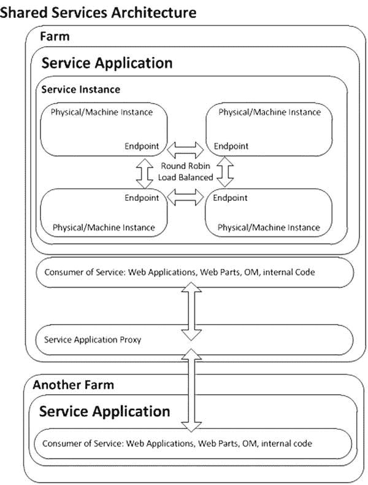
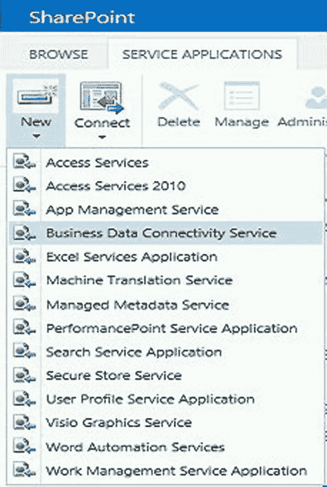
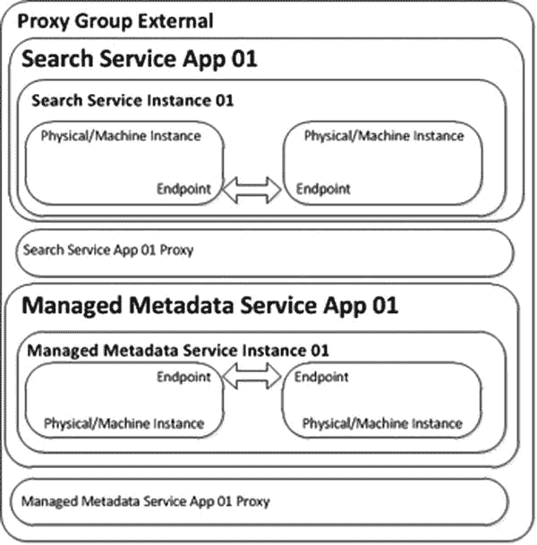
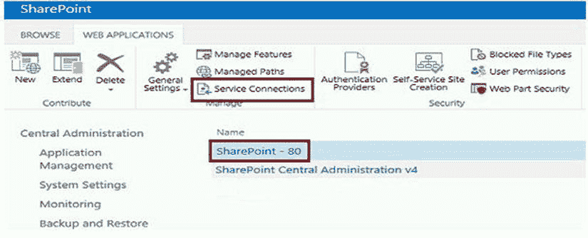

# 退一步思考

备份是继弹性和冗余等高可用性选项之后的第二道防线。如第 4 章所述，您可以在一定程度上防范故障。虽然硬件故障确实会发生，像绵羊之类的灾难也确会发生，但系统不可用的主要原因往往是维护失误。无论您的弹性和冗余计划多么全面，备份始终是必要的，因为磁盘上的数据很脆弱，任何事情都可能破坏它。然而，数字数据相对于物理数据的主要优势之一在于创建精确副本相对容易。仅仅是 0 和 1 的内容可以以几乎完美的保真度进行复制，而复制物理文档则是一个更容易出错的过程。复制数据几乎永远不会让你后悔。
无论系统故障的原因是什么，您都必须有副本或能够重现丢失的数据。主要可重现的是服务器场本身，因为 `SharePoint` 可以重新安装和重新配置；您无需从头重写应用程序。重新安装确实需要时间，但其优势在于可以通过准备一个备用服务器场来提前完成。这种方法会增加成本，因为您拥有硬件和软件，而它们除了等待投入使用外没有其他即时用途。您的 `BIA`（业务影响分析）应该已说服您的利益相关者和管理层接受此类方法的必要性。然而，要正确重现一个服务器场，您必须拥有生产服务器场的详细设计。
换句话说，您必须非常了解您的架构，才能知道要复制什么以及如何复制。本章重点讨论以下内容：

## 备份规划与准备

-   *了解需要备份的内容：* 有些事情需要更频繁地备份，而且更为重要。你知道是哪些吗？你的 `BIA` 是解答这个问题的关键。
-   *依赖关系：* `SharePoint` 是一个复杂的系统，备份必须包含正确还原数据所需的一切内容。你还必须了解还原信息的顺序。
-   *代码与内容：* `SharePoint` 是一个可扩展的平台。你是否已正确捕获所有扩展内容？
-   *备份工具：* 工具可以自动化你捕获的内容，但你必须了解它们的优缺点，因为它们无法替代周密的备份规划。
-   *文档记录：* 这是前述所有步骤的产物。再次强调，文档不能替代认真、负责任的规划与再规划。它仅仅是你对需要备份什么以及如何还原这些内容的理解的产物。

用户创建的所有内容都存储在内容数据库中，这些数据库相对容易备份并附加到现有服务器场，从而让用户能够再次访问其内容。备份它们并非难事。真正的难点在于恢复这些内容所依赖的结构。要充分备份某个项目，你必须理解其内部依赖关系。阅读本章后，你将理解备份涉及的内容：主要是了解如何快速且正确地复制或重现用户所需的一切。但是，虽然你需要内容数据库的副本，但将它们重新附加到服务器场，并不比将服务器场恢复到其被破坏前的状态（硬件、软件、配置和代码方面）更困难。

### 备份规划与准备

备份规划与准备的第一步是知道何时开始。答案相当简单：当从头重建你的 `SharePoint` 服务器场及其内容所需的时间超过从备份中恢复所需的时间时，你就该行动了。你会发现，一旦用户开始使用它，这种情况就会发生。这些用途可能是测试或概念验证，但你必须从一开始就创建备份，因为这将比重新使用一个全新的空服务器来得轻松。虚拟化可以使重建服务器场架构和配置相对直接，但重现用户创建的原始、实时数据则更为耗时。此外，用户讨厌做这种事！
规划如何复制数据、以什么间隔、使用什么工具，以及如何记录文档，这是一个持续的过程。它始于审视你的业务需求、丢失特定内容的影响，以及 `SharePoint` 应用带来的生产力效益。这些都包含在你的 `BIA` 中。

#### 业务影响评估

你最终采用的备份方法将由 `BIA` 提供依据，因为它决定了你的恢复优先级。你必须了解从关键到非关键的不同内容的 `RTOs` 和 `RPOs`。这与高可用性类似，某些内容更为重要，必须获得更高的资源分配。要理解如何备份 `SharePoint`，你首先必须彻底理解其架构，以便识别需要备份的内容。如第 4 章所示，这意味着要收集流程细节及其在一段时间内失败的影响，以及捕获依赖关系和业务特别重要的日期/时间。例如，`SharePoint` 中的薪资网站主要在月底时需要工作，在该时间点发生的故障会比月中发生的故障影响更大。
有些内容用户可以快速手动重现，或者一旦创建完成，可能就再也不会用到。例如，用于规划一次性活动的网站就没有持续的价值。然而，业务流程就像 IT 流程一样：它们是由一系列任务组成的链条。要充分理解、捕获和备份一个流程，有时你必须确保 `SharePoint` 之前和之后的步骤也被捕获。如果业务流程中前置部分（例如捕获工时表）或后置部分（例如创建支付转账）没有被备份，那么仔细备份薪资流程可能毫无价值。在灾难情况下，需要考虑许多依赖关系，这不仅体现在规划中，也体现在计划的执行中。

## 依赖关系

要成功备份你的 `SharePoint` 架构并随后成功还原，需要对使 `SharePoint` 正常运行所需的所有内部依赖关系有详细的理解。备份/还原需求隐含着一个认识，即你的高可用性策略最终将不足以应对所有情况。数据会被损坏，硬件会故障，或者某些其他事件会迫使你从最后备份点重建平台。有时这可能是有计划的：例如，你可能备份服务器场以将其迁移到另一个数据中心。
在前面的章节中，你考察了灾难恢复计划的依赖关系，其中包括以下内容：
-   管理层签核
-   一份 `BIA`
-   利益相关者就 `RTOs` 和 `RPOs` 提供的输入
-   物理限制和后勤规划
你还在示例组织的更广泛的灾难恢复规划背景下，考察了将灾难恢复计划付诸实施所需的条件。
-   由谁来确定灾难实际上已经发生？
-   由谁总体负责处理灾难？
-   IT 部门中由谁负责处理 `SharePoint` 服务器场灾难，以区别于必然发生的更广泛的 IT 灾难？
-   `SharePoint` 人员如何知晓发生了灾难？
你还学习了 `SharePoint` 逻辑架构的部分内容，即服务应用程序。要成功备份和还原 `SharePoint`，你需要更好地理解这些组件，以及 `SharePoint` 中包含或不包含在 `SQL Server` 数据库中的部分。这是因为不同的备份选项能备份一些内容，而非其他。
你在 `SharePoint` 中的核心依赖关系如下：
-   配置，特别是逻辑架构和服务应用程序。
-   存储在 `SQL Server` 中的数据形式的内容，由用户生成。
如果你能够仅备份和重现这些内容，你就掌握了让 `SharePoint` 恢复运行所需的大部分内容。但请记住，`SharePoint` 是一个不断演进的系统，它可能以代码的形式扩展了更多功能——这些部分不包含在配置或 `SQL Server` 中。

## 代码与内容

系统中你无法轻易提前准备好的部分是开发人员编写的代码，以及用户创建且依赖该代码才能存在的内容。例如，开发人员可能编写一个解决方案，其中包括创建站点、列表、内容类型和 `Web` 部件等结构元素。如果不同时恢复这些代码元素，只还原内容数据库是行不通的：在它们所依赖的结构被重新安装之前，它们无法被使用。在没有文档的情况下重新安装服务器场，充其量是一个随意且混乱的过程，而要求用户或开发人员完美地按正确顺序回忆并重新安置所有依赖关系，几乎是不可行的。正如你将看到的，`SharePoint` 的内置工具将捕获解决方案包中的代码和内容数据库中的内容（其中包含用户工作的网站集）。这是个好消息：你需要保存和重现的大部分内容都可以被保存和重现。
如果你已经知道需要备份配置、代码和内容，那么具体该如何操作呢？

## 备份工具

> “拙劣的工匠责怪自己的工具。”
> ——古老的爱尔兰谚语

有一种错误的观念认为，你选择的工具会自动为你备份 `SharePoint`。现实情况是，工具只能帮助你备份用户所需的东西。它可以自动执行任务并提高效率，但选择备份什么以及何时备份，仍然由你决定。你需要选择的三个主要备份工具是：
-   `SharePoint` 的内置备份工具（或第三方工具）
-   `SQL Server` 的内置备份工具（或第三方工具）
-   `Windows` 文件系统的内置备份工具（或最常见的第三方工具）

如图 6-1 所示，例如，如果你使用 `SharePoint` 备份来备份服务应用程序，它会将一些设置备份到文件中，同时也会使用 `SQL` 备份工具（在两者重叠的部分）来备份 `SQL Server` 数据库中的内容。但是，如果你只使用 `SQL Server` 的备份工具，你就只能捕获 `SQL Server` 中的数据，在这种情况下，这些数据库必须附加到恢复/灾难恢复场中的服务应用程序上。另请注意，如果对 `SharePoint` 进行了一些自定义修改，但并非通过 `SharePoint` 本身完成，则必须单独记录和备份这些修改——例如，任何未通过 `SharePoint` 管理中心对 `Web.config` 文件所做的更改。

图 6-1：没有任何一种备份方法能捕获所有内容

## 文档记录

我将描述能够捕获场基础设施各部分的工具，但良好的文档记录仍然是无可替代的。请将文档视为在灾难情况下你将依赖的主要备份形式——你用来恢复数据的工具只是实现该目的的一种手段。最终，记录你或他人在创建和演进 `SharePoint` 场过程中所做的工作，将是恢复该场所需的最重要的事情。内容数据库的备份实际上非常简单。毕竟，它们只是一组表。真正复杂且需要详细记录的是它们必须适配的系统。在你的生产环境设计之初，很可能有两份重要的文档：

- `解决方案架构`：描述了业务需求以及为满足这些需求所做的架构决策。
- `详细设计`：展示了实现该架构的步骤。这应包括屏幕截图和配置数据表，例如服务器名称和服务帐户名称。

这些文档可能因多种原因而不存在。也许是由外部公司安装的 `SharePoint`，而记录安装过程的任务未被包含在内；或者 `SharePoint` 只是因用户需要而在其桌下的服务器上发展起来的，因此没有进行任何规划或记录。无论原因是什么，都错过了记录生产场和其他场是如何安装和配置的机会。同样被错过的可能是，由于网络中的某些特性，这个过程并非一帆风顺。很可能找到了某种变通方法，但关于它的信息要么丢失了，要么只被部分记住。不了解任何陷阱意味着，重新创建生产环境将花费更长时间，因为这些变通方法必须重新摸索。如果这些文档可用，它将非常有用，因为你现在拥有了灾难恢复计划中的第一份文档。如果你没有，请立即着手编写！在你的生产场仍在运行时，尽可能多地捕获有关其设置方式的详细信息。在 `SharePoint` 中需要捕获的主要部分包括：
- 服务器名称
- 服务帐户
- `IIS` 配置：应用程序池及其使用的帐户
- 服务应用程序及其配置方式。重点关注像用户配置文件服务和搜索这样复杂的服务
- 其他管理中心设置，例如出站和入站邮件服务器，以及不同种类日志的捕获频率和大小
- Web 应用程序设置
- 备用访问映射
- 网络拓扑，包括 `DNS` 设置和负载均衡设置
- 管理范围内的任何权限委派，例如管理特定服务
- 任何可用性设置，例如镜像
- 整体拓扑：哪些服务器托管哪些服务应用程序实例和代理（具体内容将在后文详述）

与 `SharePoint` 本身一样，你的组织中的网络和 `SQL Server` 人员也应该为 `Windows` 服务器的安装及其网络配置创建文档，并提供 `SQL Server` 安装和配置的详细信息。例如，`SQL Server` 应该有详细的文档，说明其群集、镜像或日志传送是如何设置的。这些文档将超越微软提供的通用信息，因为它将详细说明具体的服务器名称、配置，并在一定程度上说明配置背后的理由，即如何满足业务需求。互联网上确实有这些方面的通用信息，但我在这里所指的文档是专门反映你组织环境设计的。

如果这些都没有记录在案，那么对你的 `SharePoint` 场来说就是一个严重的风险。不要以为执行原始安装的人会一直有空来进行重新安装，并且他们还记得该怎么做。虽然有些人确实拥有摄影记忆（完美的回忆），但我们大多数人没有。这就是为什么记录 `SharePoint` 场及其依赖项（`Windows Server` 和 `SQL Server`）的安装和配置至关重要的原因。如果之前没有完成，现在必须将其作为备份准备过程的一部分来完成。请记住，你的生产系统正在运行且可访问；如果它出现故障，在你必须重建设置时，你将没有机会再去查找它的设置。

## 使用 SharePoint 进行备份

*“万物皆流，无物常驻。”*
——赫拉克利特，柏拉图在《克拉底鲁篇》中引用

使用内置的 `SharePoint` 备份工具将产生最完整的 `SharePoint` 环境快照。最重要的部分是内容数据库，通过这种方式它们得以保留。每个 `SharePoint` 场都是独一无二的，因为很多部分都只属于该场。例如，服务器名称和 `IP` 地址在你的域中是唯一的，内容也是唯一的。从真正意义上讲，重建一个场是不可能的；你实际上是在创建一个与它非常相似的新场。你希望备份的 `SharePoint` 场的主要部分是配置数据库。它在 `SharePoint` 备份页面中显示为一个选项。图 6-2 中的图表给人的印象是，你可以使用仅配置备份来备份它。然而，它只备份了那些可移植到其他场的配置设置，而不是那些唯一的设置，例如以下内容：
- 防病毒
- 信息权限管理
- 出站电子邮件设置（仅当执行覆盖操作时才会恢复）
- 作为受信任解决方案部署的自定义项
- 诊断日志记录


图 6-2：看起来似乎捕获了所有配置

你可以将其恢复到现有场；如果这些设置没有值，它们将会被设置。但请注意，该列表中缺少了很多内容——最明显的是服务应用程序设置。我将在本章后面部分详细介绍如何保留它们。

## 管理中心中的备份和还原

尽管存在这一告诫，管理中心中的 `SharePoint` 场备份工具仍会像任何其他自动化工具一样，为您捕获尽可能多的 `SharePoint` 内容。正如您在图 6-3 中所见，该工具用于执行备份、还原、更改设置、查看历史记录以及检查当前备份作业的状态。本章提供了 `SharePoint 2010` 的截图，尽管这些页面在 `SharePoint` 的后续版本中外观略有变化，但它们的功能基本保持不变。


图 6-3。主要的 SharePoint 备份和还原选项

图 6-3 中列出的所有选项都假设您已有一个正在运行且可进行备份或还原的场。在灾难恢复场景中，如果您能够恢复至可看到此管理中心页面的程度，那么您就已经恢复了灾害前 90% 的状态。管理中心提供了用于执行整个场、单个网站集、网站、库或列表的单独备份工具。完整的场备份可以从管理中心进行还原，但该工具不提供计划定期备份或还原单个网站集、网站、库或列表的功能。这些操作可以通过使用 PowerShell 脚本来管理。要安排自动化的定期备份，请使用通过 Windows 任务计划程序计划执行的脚本中的 PowerShell cmdlet。接下来我将详细讨论 PowerShell。

## 使用 PowerShell 进行备份

`SharePoint` 本身不包含用于安排备份的工具；这是通过 PowerShell 完成的。也可以通过 `STSADM` 进行备份，但此工具正在逐步弃用，因此建议使用 PowerShell。此外，我建议您使用 PowerShell 而不是管理中心中的选项来执行和自动化备份，因为 PowerShell 命令可以放在脚本中，并通过 Windows 任务计划程序进行计划。成功安排和运行基于 PowerShell 的备份的依赖项与权限和路径相关（感谢 Todd Klindt 提供这些信息）。
- 您的管理中心应用程序池帐户必须对备份位置具有读写访问权限。
- 您的 SQL 服务帐户必须对备份位置具有读写访问权限。
- 如果您通过 `STSADM` 或 Windows PowerShell 运行场备份，您用来运行备份的帐户必须对备份位置具有读写访问权限。
- 该位置必须可从运行备份的 SharePoint 计算机访问。
- 该位置必须可从 SharePoint 尝试备份的 SQL 实例访问。
- 这就是所有示例都使用 UNC 路径（`\\server\share`）而非本地路径（`e:\backups`）的原因。

要通过 PowerShell 执行备份，请执行以下操作：
1. 在“开始”菜单上，单击“所有程序”。
2. 单击“Microsoft SharePoint 产品”。
3. 单击“`SharePoint Management Shell`”。
4. 使用 PowerShell 命令 `Backup-SPFarm` 启动备份。

 **注意** 有关帮助和示例，请键入 `get-help Backup-SPFarm –examples`。

5. 以下脚本将启动到 `e:\backup` 的完全备份。为此，请在记事本中创建一个新文本文件，并添加以下行：
```
Backup-SPFarm -Directory e:\Backup -BackupMethod full
```
6. PowerShell 文件使用 `.ps1` 扩展名，因此请将此文件保存为 `e:\Scripts\BackupSharePointFarm.ps1`。
7. 出于安全考虑，Windows Server 默认不允许运行 PowerShell 脚本。因此，您需要调整执行策略以允许运行它们。为此，请在 PowerShell 命令行中执行以下指令：
```
set-executionpolicy RemoteSigned
```
8. 接下来，在任务计划程序中输入以下命令作为计划的命令行操作，或将其输入到计划运行的批处理文件中：
```
powershell -command e:\Scripts\BackupSharePointFarm.ps1
```
9. 运行该任务的帐户必须具有场管理员权限，或至少具有 PowerShell 权限；否则无法正常运行。

## 加速备份

# 管理中心

然而，管理中心中的 GUI 确实比 PowerShell 命令有一些优势。例如，可以通过增加用于备份和还原的线程数来加快备份速度（图 6-4）。但使用管理中心工具并不意味着您可以避免在备份过程中进行所有规划和思考。例如，您还必须指定备份的位置。我建议您在本地计算机上创建备份，然后将其复制到网络。SharePoint 中 600GB 的备份需要 6 小时，因此请考虑预留时间以避免与其他操作冲突。加快备份速度的另一种方法是先进行一次完全备份，然后仅执行后续的差异备份。您可以在“执行备份”页面上看到这些选项。差异备份速度更快，因为它们只复制已更改的内容，而不是整个场。



图 6-4。这些设置会影响 SharePoint 备份和还原的性能与容量

## 建议

完全备份会对整个场创建新备份。差异备份会创建自上次完全备份以来数据库中所有已更改数据的备份。自然，这意味着您必须首先创建过完全备份。除了速度之外，差异备份的另一个优点是其占用资源更少。这一点很重要，因为备份作业会占用所有可用的 I/O 资源，直到完成，因此时间越短越好。如果您在非高峰时段每周执行一次完全备份，并每晚执行一次差异备份，您将在这两者之间取得良好平衡。这取决于用户添加的新内容量。如果新内容比例很小，您可能只需每月创建一次完全备份。如果条件允许，请将备份执行到与 SQL Server 不同的磁盘上。对于备份，推荐使用 RAID 10，因为它具有快速的写入性能，而 RAID 5 由于需要维护奇偶校验信息而速度较慢。有关为 SharePoint 选择合适 RAID 选项的更多信息，请参阅 `http://technet.microsoft.com/en-us/library/cc298801.aspx`。

## 备份组件

SharePoint 允许你备份构成服务器场的许多重要部分。这些部分如图 6-5 所示。该图强调了将自定义项打包到解决方案包中的重要性，这些包可以通过 SharePoint 进行备份。除此之外，你还可以看到服务器场的主要组件是服务应用程序。因此，让我们更详细地了解一下服务应用程序的组成部分。



图 6-5. 你可以备份的 SharePoint 备份与还原组件

### 保留你的服务应用程序架构

如前所述，要妥善备份某样东西，你必须了解其内部依赖关系。对于服务应用程序而言，首先要理解的是，它们与索引分区一样，是所谓共享服务体系结构中的逻辑容器。SharePoint 拥有超过 20 种可用服务，可以简单地将它们视为驻留在 SharePoint 平台上的微型应用程序。它们都有自己的管理页面、设置、管理员和数据库。它们所属的框架允许 SharePoint 在它们之间分发请求，从而提供负载均衡和冗余。该框架还提供了一个称为服务应用程序代理的接口，允许其他应用程序与之交互。详情请参见图 6-6。由于它们的架构与整个服务器场紧密相连，你必须备份整个服务器场才能保留它们。例如，实例及其端点是特定于计算机的。



图 6-6. 服务应用程序的逻辑组件

当你安装 SharePoint 时，它会提供安装服务应用程序的途径（参见图 6-7）。这样做会在服务器场中的所有计算机上安装该服务，但只有当你在此服务器场中的特定服务器上安装了一个物理实例或计算机实例后，才算拥有了一个实际的服务应用程序。打个比方，办公室管理员将 Word 的安装媒体发布到网络上，但直到用户在个人电脑上安装它，它才算真正可用。



图 6-7. 安装所选服务应用程序之一的新实例

安装服务应用程序后，你可以在多台计算机上安装服务器实例。在图 6-7 中，你并非像标题暗示的那样在安装服务应用程序；实际上，你是在安装它们的实例。如第 4 章所述，这种方法提供了冗余。运行应用程序实例的计算机/服务器被称为应用程序服务器，尽管这只是一个逻辑上的区分，因为服务可以在服务器场中的任何服务器上运行。SharePoint 使用内置的轮询机制来查找应用程序的实例并运行该服务实例，这有助于分发负载。

服务实例之间的连接称为端点。它们是 Windows Communication Foundation (WCF) 的一部分，WCF 是一个用于构建面向连接服务的应用程序的应用程序编程接口 (API)。这些端点具有地址和绑定属性，用于指定数据将如何传输。

每个服务应用程序还都需要一个代理。这与端点的不同之处在于，其目的是将服务连接到使用者，这些使用者可以是 Web 应用程序，甚至可以是其他服务器场中的服务应用程序。例如，你可以通过这种方式将托管元数据服务连接到另一个服务器场，以维护一致的元数据。

服务应用程序代理可以分组，这样当你创建新的 Web 应用程序时，只需将其关联到一个代理组，就能将其与该组中的所有服务应用程序连接起来。例如，一个 Web 应用程序可能供外部用户使用，其代理组包含搜索服务应用程序 01 和托管元数据服务应用程序 01（参见图 6-8）。这个 Web 应用程序的 URL 类似于 `external.something.com`。



图 6-8. 供外部用户使用的服务应用程序组

然后，可以在同一个服务器场上为内部用户创建第二个代理组，其中包含名为搜索服务应用程序 02 和托管元数据服务应用程序 02 的服务应用程序（参见图 6-9）。这个 Web 应用程序的 URL 类似于 `internal.something.com`。这为你的服务器场架构提供了极大的可伸缩性和组织能力。


图 6-9. 供内部用户使用的服务应用程序组

创建 Web 应用程序时，你可以通过从下拉菜单中选择代理组来查看特定组中的代理（参见图 6-10）。然后，你可以选择希望与该 Web 应用程序关联的服务。



图 6-10. 通过代理组对连接进行分组

如果使用代理组，请注意在还原后，必须将服务应用程序代理重新关联到它们各自的代理组。这是因为服务应用程序代理在还原时不会被分配到代理组。所有 Web 应用程序都将与默认代理组关联。如果你需要，必须手动将 Web 应用程序与其他代理组关联起来。

### 服务应用程序的备份

正如你所见，服务应用程序不仅仅是一个数据库。它的许多设置都存储在中级管理数据库中，因为它们是整个服务器场的一部分，或者用于将其连接到其他应用程序。如果该应用程序确实有一个数据库，那么它的一部分设置和数据会存储在那里，但并非全部。因此，推荐的服务应用程序备份方式是进行完整的服务器场备份。即使你在 SharePoint 备份页面上选择了要备份的服务应用程序，你也无法获得完全恢复该服务应用程序所需的一切。

缺少的一个主要组件是，服务应用程序的备份不包括相关的代理。要同时备份服务应用程序和服务应用程序代理，你必须备份整个服务器场，或者连续执行两次备份，一次备份中选择服务应用程序，第二次备份中选择关联的服务应用程序代理。更直接的方法是选择“共享服务”节点（位于图 6-5 的末尾）。如果这样做，服务器场中的所有服务应用程序及相关的服务应用程序代理都将被备份。

表 6-1 显示了不同服务应用程序使用的数据源。在某些情况下，这些是 SQL Server 中的数据库；在其他情况下，当数据位于外部源时，数据仅存储在缓存中，例如 Access 服务和 Excel 服务。许多服务应用程序数据库无法从 SharePoint Server 单独备份。要仅备份服务应用程序数据库，你必须使用 SQL Server 备份。再次强调，服务器场备份将捕获你需要的一切。

表 6-1.

### 服务应用程序的数据库与备份方案

| 服务应用程序 | 数据库或数据源名称 | SharePoint 备份的内容 |
| --- | --- | --- |
| 业务数据连接 | `Business Data Connectivity` | 备份外部内容类型定义。外部数据需要单独备份。如果将数据还原到其他位置，则必须更改外部内容类型定义中的位置信息。 |
| 托管元数据服务 | `Managed Metadata Service` | 如果正在使用标记功能，要在灾难恢复场中成功使用托管元数据服务应用程序，还必须还原用户配置文件服务应用程序的社交标记数据库。 |

## 使用 SQL Server 进行备份

将 SQL Server 作为唯一备份方法的主要限制是，您无法使用 SQL Server 工具（或 Data Protection Manager）来备份服务应用程序。可以使用 SQL Server 备份内容数据库，但请注意，您必须手动重建场的其余部分，如果用户正在等待，这并非良策。如果您正在运行 SQL Server Enterprise，Microsoft 强烈建议您使用备份压缩。有关备份压缩的更多信息，请访问 `http://go.microsoft.com/fwlink/?LinkID=129381`。

将 SharePoint 备份策略的重点放在 SQL Server 上的风险在于：如果您对 SQL Server 的了解胜过对 SharePoint 的了解，您会倾向于认为 SQL Server 备份就是还原场所需的全部内容。我不建议这样做，但 SharePoint 确实依赖于 SQL Server 的以下组件，在规划整体 SharePoint 备份策略时应将其考虑在内。捕获事务日志将捕获 SQL 数据库中所做的更改，而 BLOB 是 SharePoint 在 SQL Server 之外的存储，因此我在此处对两者都进行了引用。

### 事务日志

在 SQL Server 中，每个数据库至少有一个数据文件和一个事务日志文件。SQL Server 将数据物理存储在数据文件中。事务日志文件存储对 SQL Server 数据库执行的所有修改的详细信息，以及执行每次修改的事务的详细信息。由于事务完整性被视为 SQL Server 的基本和固有特性，因此在 SQL Server 中无法关闭事务日志记录。当您使用 SharePoint 管理中心或 Windows PowerShell 备份场、Web 应用程序或数据库时，事务日志会自动备份。

事务日志文件在逻辑上被划分为较小的段，称为虚拟日志文件。在 SQL Server 中，您可以将事务日志文件配置为根据需要扩展。事务日志的扩展可以由用户控制，也可以配置为使用所有可用的磁盘空间。您应避免这种情况，因为它会威胁到场的高可用性。

要使事务日志保持可管理，请遵循以下准则：

- 将事务日志文件的大小设置为较大的值，以防止它们自动扩展。
- 在全面评估最佳内存大小后，使用内存单元而不是百分比来配置事务日志文件的自动扩展。

### BLOB

`BLOBs`（二进制大型对象）用于远程 BLOB 存储 (`RBS`)。`RBS` 是一种在 SharePoint 内容数据库之外存储文件的方法。这样做有多种原因。

- *节省成本：* SQL Server 存储比使用 SAN、NAS 甚至云层更昂贵。
- *提高性能：* 对于较大的文件，上传或下载到 SQL Server 可能会很慢。
- *更轻松地管理数据：* 现在您的存储集中了。
- *满足合规性要求：* 例如，SEC 17a-4 要求组织将某些账户持有人文档存储在特定类型的合规存储层上。

SharePoint Server 备份会备份远程 BLOB 存储，但前提是您使用 `FILESTREAM` 远程 BLOB 存储提供程序将数据放入远程 BLOB 存储中。如果您使用其他提供程序，则必须手动备份远程 BLOB 存储。

### 文件系统的备份

正如 Microsoft 在 TechNet 中指出的那样，场的以下组件不会被备份，因为它们存储在网络服务器上。文件级备份将捕获它们。

- 应用程序池帐户密码
- HTTP 压缩设置
- 超时设置
- 自定义 Internet 服务器应用程序编程接口 (ISAPI) 筛选器
- 计算机域成员身份
- Internet 协议安全 (IPsec) 设置
- 网络负载平衡设置
- 安全套接字层 (SSL) 证书
- 专用 IP 地址设置

这些详细信息最好记录在文档中。如下所示的自定义项也必须作为文件捕获并记录。请注意，使用解决方案和功能来打包这些内容将使它们的重新部署更加高效：

- 母版页、页面布局和级联样式表。这些对象存储在 Web 应用程序的内容数据库中。
- Web 部件、网站或列表定义、自定义列、新内容类型、自定义字段、自定义操作、编码工作流、工作流活动或条件。
- 第三方解决方案及其关联的二进制文件和注册表项，例如 `IFilters`。
- 对标准 XML 文件的更改。
- 自定义网站定义 (`Webtemp.xml`)。
- 对 `Web.config` 文件的更改。

## 工作流

工作流是一种特殊类型的自定义项，您可以对其进行备份和恢复。好消息是，定义数据和工作流历史记录会保留在 SharePoint 备份中。甚至在处理中的工作流状态也会被保留。

| 搜索 | `Crawl`、`Property` 和 `Search Administration` | 如果您的场包含 Microsoft FAST Search Server for SharePoint，您的备份还将备份 Content SSA 和 Query SSA（包括人员搜索索引）。但是，除了标准备份之外，您还必须运行 FAST Search Server for SharePoint 场的备份。 |
| --- | --- | --- |
| 安全存储服务 | `Secure Store` | 在备份安全存储服务之前，请执行以下操作：记录通行短语。访问还原的安全存储服务时需要用到该通行短语。请确保每次更改或刷新主密钥时都备份安全存储服务。当您更改或刷新主密钥时，数据库会自动使用新密钥重新加密。备份安全存储服务可确保数据库与主密钥同步。将通行短语保存在安全位置。 |
| 用户配置文件 | `Profile`、`Synchronization` 和 `Social Tagging` | 托管元数据服务需要社交标记数据库。 |
| Web 分析 | `Staging` 和 `Reporting` | Microsoft 建议在故障转移之前不要在灾难恢复场上运行 Web 分析服务应用程序 (SP2010)。 |
| Access Services | `Cache` | 在灾难恢复场中重建。 |
| Excel Services 应用程序 | `Cache` | 在灾难恢复场中重建。 |
| InfoPath Forms Services | `Cache` | 在灾难恢复场中重建。 |
| PerformancePoint | `Cache` | 在灾难恢复场中重建。 |
| 状态服务 | `State` | 不支持对状态数据库进行日志传送。 |
| 使用情况和运行状况数据收集 | `Logging` | Microsoft 建议不要在灾难恢复场上运行使用情况和运行状况数据收集服务，并且不要对日志记录数据库进行镜像或日志传送。 |
| Visio Graphics Service | `BLOB cache` | 在灾难恢复场中重建。 |
| Word Automation Services | `Cache` | 在灾难恢复场中重建。 |
| Microsoft SharePoint Foundation 订阅设置服务 | `Subscription` | 在灾难恢复场中重建。 |