# 第 7 章


## 监控

*“嗯，足够让路了。”*

——弗雷德里克·弗利特（Frederick Fleet），当被问及如果他有望远镜，能提前多久看到撞沉泰坦尼克号的冰山时

您维持高可用性的能力完全取决于您的监控实践。在我听说或不得不处理过的几乎每个 SharePoint 灾难中，都有某个时刻本可以有人阻止它发生。预防才是管理员真正应该因之获得奖励的——而不是修复本可预防的问题。但这并不是我们通常的思维方式。我们专注于灭火，很少考虑及早发现火情并挽救生命的措施。这是一种代价高昂的思维方式；烟雾报警器比消防车便宜。

让我们用泰坦尼克号的比喻来展示如何改变您监控 `SharePoint` 的方法。监控者是您船上的瞭望员，而不是他们使用的工具。以泰坦尼克号为例，鹰巢中的瞭望员得到了该区域有冰山的报告，但他们没有望远镜——不是因为船上没有，而是因为存放望远镜的储物柜钥匙在一位船员的口袋里，而该船员在航行前已被调离。寒冷的夜晚空气让他们的眼睛流泪，无风使得冰山难以发现，因为没有波浪拍打冰山侧面。结果：当发出警告时，为时已晚。船擦过冰山一侧，开始进水。

将此示例作为您的 `SharePoint` 场的教训，请注意以下几点：

- 瞭望员知道有冰山，因为他们收到了该区域其他船舶的报告。
- 他们有发现冰山的工具（望远镜），但被锁起来了。
- 天气条件意味着他们无法像往常一样迅速发现冰山。
- 当他们确实发现冰山时，已经没有足够的时间避开了。

将其转化为 `SharePoint` 的教训，揭示出以下几点：

- 监控和报告可以预警灾难。
- 人员和工具对于防止灾难至关重要。
- 您无法控制的干预因素可能使情况恶化。
- 知道灾难将要发生并不足以阻止它。您还必须具备阻止它的手段。

## 维护任务

监控始于主动观察，那么让我们从 `SharePoint` 场瞭望员的日常例行任务开始。之后，我将向您展示可以主动预防灾难的每周、每月和每季度任务。

监控主要是一项常规警觉性的任务。您应该将管理角色划分为您定期甚至特定时间执行的任务。除了这个常规日程之外，在您的组织中可能还需要在某些特定日期格外警惕。例如，如果您的业务是电视体育频道，那么您的系统在超级碗期间的工作将非常重要。沿着这些思路，构建您自己的自定义任务列表。

作为 `SharePoint` 管理员，您每天的第一项任务应该是访问门户的主要访问页面，查看它们是否为您正常渲染以及是否速度正常。通过网络上的标准 PC/Mac 访问它们，而不仅仅是直接在服务器上访问。在早上，最好在任何用户登录之前完成此操作。这意味着您要比其他人早一两个小时开始您的一天。在您构建了一些自动警报之后，这将不那么必要，但目前这是一个良好的起点。如果出现问题，您将有机会诊断并修复它——也许在更广泛的用户群体注意到之前，这是最理想的。对于 `SharePoint` 的所有者来说，最耻辱的事情莫过于接到帮助台或高层管理人员的电话说 `SharePoint` 宕机了——而您却对此毫不知情。

## 监控 `SharePoint` 性能与可靠性

你应该每天检查性能瓶颈，并努力在它们影响你的 `SLA` 和用户体验之前发现它们。我将向你展示一些可用于此目的的工具，但请记住，最好的工具是你自己的智慧和主动性。检查门户是否正常运行只是你日常监控职责中最初的一部分。如果你确实看到了问题，你可能只有一两个小时的时间去解决它，然后用户就会注意到。如果你经历过这种情况，你会知道这非常有压力。更好的做法是每天花费精力去识别那些可能在几天、几周或几个月后才爆发的问题。

你的服务器存在于物理空间中。即使是虚拟机也驻留在物理主机上：确保服务器机房安全、温度适宜，并且没有松动或容易被绊倒的电缆，可能也是你的职责的一部分。像这样的小事可能会导致架构最优秀的服务器群宕机。有些日子会有所不同：也许首席运营官（`COO`）要在上午 9 点发布重大公告，因此你可以预期使用量会激增。如果你注意到使用量出现了非正常原因（如公共假日）的下降，这可能是出现问题的一个迹象。反复检查应该成为你的常规工作，你应该从查看前一晚的自动化任务开始你的一天，首先从备份开始。

## 检查备份

你还应该每天开始时确保前一晚的备份已经完成。如果你在一个全球设有办事处的组织工作，你可能还会接收上一班次管理员的交接，在这种情况下，清楚了解他们班次上发生的事情至关重要，这样你才能顺利接手。仔细检查最新的备份。确保一切都在正常参数范围内：备份大小、花费的时间、文件名等等。通过将备份恢复到冗余系统来测试你的备份。这很有用，因为有时用户会删除无法从回收站恢复的内容。一个例子是，如果他们在数据表视图中删除了列表内容。拥有前一晚的备份可以让你快速将用户的内容归还给他们。有时出于安全原因进行这种恢复也很有用。用户有时会声称他们上传了某些内容（实际上并没有），或者没有更改其他人的访问权限。这是查看前一天站点状态的一种简单方法。

## 检查存储

数据从不休眠。它不断变化，生成更多数据，并填满你的磁盘的有限容量。在 `SQL Server` for `SharePoint` 中，数据会在以下位置生成：

-   数据库及其事务日志
-   搜索索引
-   日志

你应该每天查看磁盘卷的增长率。容量不足是导致系统不可用和性能低下的主要原因之一。你可以使用一系列工具来实现这一点：`Windows Explorer`、`Performance Monitor` 或 `Microsoft Systems Center Operations Manager`（`SCOM`）。不要等到最后一刻才订购新硬件。如果增长率表明你的组织将在不到三个月内需要更多容量，现在就订购。获得批准、收到硬件并安装可能需要那么长时间。

## 使用 `Windows` 监控可靠性和性能

你的 `Windows` 服务器是你的 `SharePoint` 服务器群的主要容器。因此，拥有监控其完整性的工具对你的服务器群非常重要。`Windows Server 2008 R2` 提供了多种随时间监控系统可靠性和性能的方法，所有这些都可以通过 `Server Manager` 访问。要打开 `Server Manager`，请转到 `SharePoint` 服务器群中每台服务器上 `Start` 菜单中的 `Administrative Tools` 组。你也可以在 `Start` 菜单的 `Search` 框中搜索它。打开后，它看起来像图 7-1。首先要查看的地方是 `Event Viewer`，位于 `Diagnostics` 下。

这里还有其他的监控工具，比如 `Performance Monitor`，但首先要检查错误日志，因为它可能会显示一些你未曾预料到的东西。

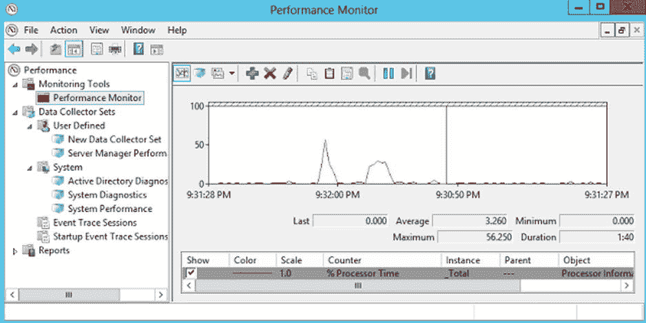

图 7-1。在访问门户主页和备份后，打开 `Performance Monitor`

### 检查事件查看器

`Event Viewer` 是你与硬件、系统和软件（包括 `SharePoint`）进行日常沟通的主要工具。它应该是你检查系统健康状况的主要工具。`Event Viewer` 可以作为 `Administrative Tools` 组中的一个独立应用程序访问（在 `SharePoint` 服务器群中每台服务器上的 `Start` 菜单中），或者通过 `Server Manager` 中的 `Diagnostics` 访问。在 `Event Viewer` 中首先要查看的是 `Summary of Administrative Events`（参见图 7-2）。此部分将显示过去一小时或 24 小时内发生了哪些新错误。这些是你应该首先检查的错误。

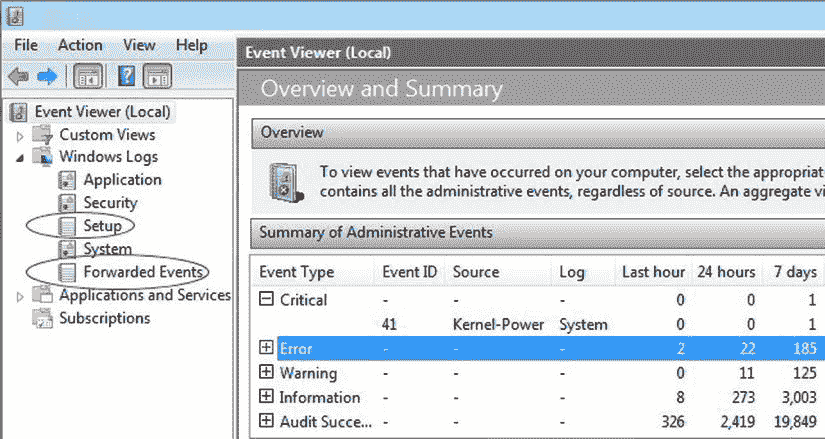

图 7-2。过去 24 小时内的错误

你也可以按照以下步骤按类型（`Critical`、`Error` 和 `Warnings`）筛选事件：

1.  在 `Server Manager` 中展开 `Event View` 文件夹，或者从 `Start` 菜单的 `Administrative Tools` 直接打开 `Event Viewer`。
2.  选择你想要从中筛选事件的日志：最常查看的是 `Windows Logs` 下的 `Application`。
3.  右键单击该日志并选择 `Filter Current Log`。
4.  在 `Log Properties` 窗口中，选中 `Critical`、`Error` 和 `Warning` 复选框。
5.  完成后单击 `OK`。

`SharePoint` 特定的操作日志的路径如图 7-3 所示。

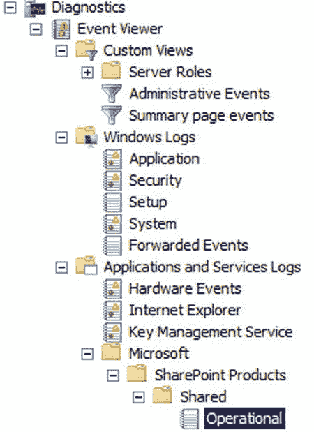

图 7-3。在此处检查特定的 `SharePoint` 事件

`Windows` 不仅允许你被动地获取关于 `SharePoint` 中发生事件的数据；它还可以主动通知你可能导致日后麻烦的事件。它甚至可以以开始完全解决问题的方式对事件做出反应。现在让我们来看看这些工具。

### 创建订阅

# 使用 Event Viewer 和警报监控 SharePoint 服务器

`Event Viewer` 允许你订阅多个服务器上的事件，并附加任务，例如在响应特定事件时发送电子邮件或运行程序。以下是确保你收到 SharePoint 服务器上日志中任何 `Critical` 或 `Error` 事件通知的步骤。第一步是创建一个新的订阅，如图 7-4 所示。

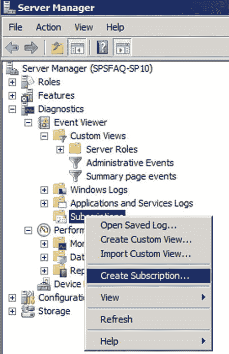
图 7-4。第一步是创建一个新的订阅

接下来，为你的订阅命名，并指定订阅触发事件的详细信息将写入的位置。此时，你还可以为你的订阅指定多个源计算机。将相互发送事件的计算机必须首先进行适当的身份验证。为此，请将你的“主”服务器的计算机帐户添加到你要从中收集事件的所有服务器上的 `Administrators` 组中。这可能需要重启。主服务器只是你用来管理订阅的服务器，因此从逻辑上讲，它应该是你访问 SharePoint 中央管理的那台服务器。在你选择至少一台计算机之前，`OK` 按钮将保持不可用状态（图 7-5）。

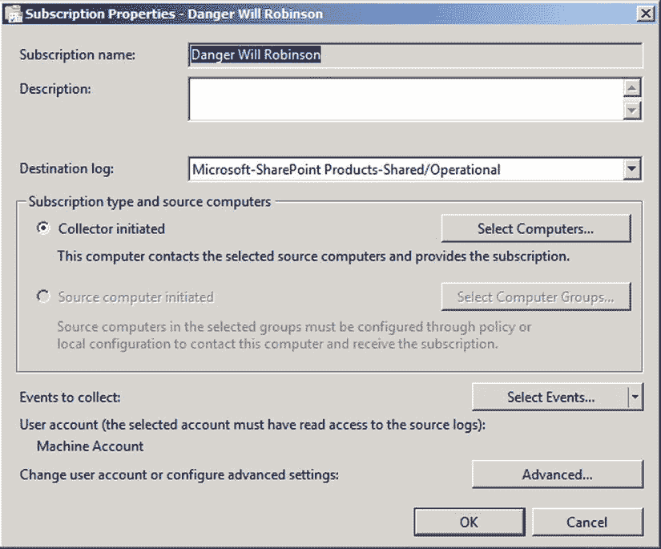
图 7-5。第二步是指定从何处收集数据

接下来，单击 `Select Events` 按钮，单击 `Edit`，然后选择你想从何处收集哪些信息。在图 7-6 中，我选择了过去 24 小时内来自 SharePoint 事件日志的关键、警告和错误消息。你可以尝试进行比这更精细的调整，以满足自己的需求。图 7-7 显示了该订阅。

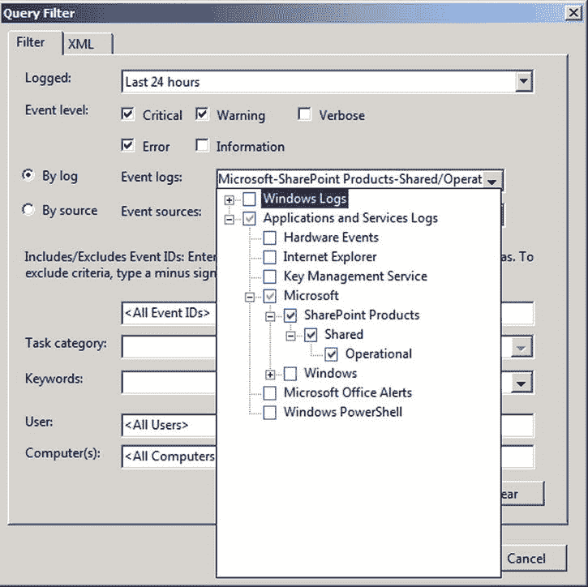
图 7-6. 第三步是指定订阅的条件

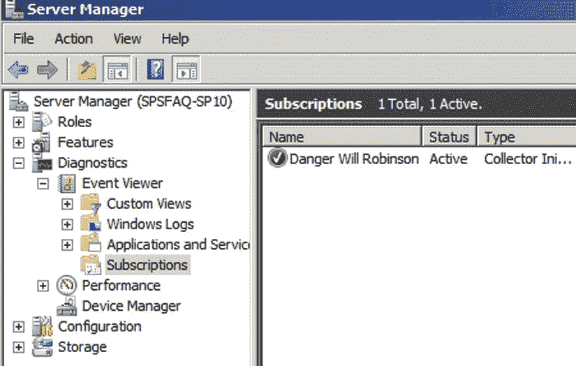
图 7-7. 你的订阅现已显示

你的订阅将自动启动。它捕获内容的详细信息将显示在转发事件日志中，如图 7-8 所示。

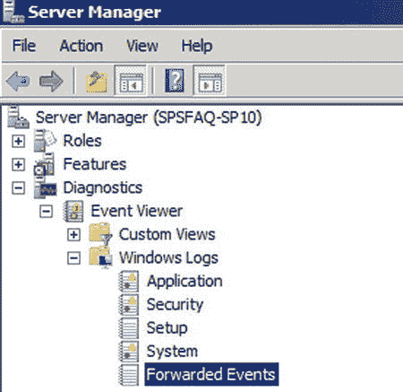
图 7-8. 转发事件显示在 Windows 日志下

你现在有了一种方法可以整合所有 SharePoint 服务器上的特定事件。更多详情可访问：`http://technet.microsoft.com/en-us/library/cc749140.aspx`。如果这已能满足你组织的需求，那么你可能不需要像 SCOM 这样复杂的工具。你订阅的事件是重复出现错误的结果，因为如果你能在所有问题发生之前就预测到，那你的人生肯定会有比管理 SharePoint 更有意义的事情。我过去曾用它来提醒我因未遵循补丁程序而导致的反复出现的问题；你也会建立起自己的配置文件。

## 警报：即时监控

警报功能对于直接从你的服务器接收消息也非常有用。它用于定义一个计数器值，该值将触发警报以发送网络消息、执行程序或启动日志。这对于密切监控你的系统非常有用，而你的日常任务之一就应该是检查这些消息。例如，你可以监控那些不经常发生的异常活动，并在事件被触发时收到警报，比如处理器使用率飙升或系统内存使用超过 80%。与安全相关的事件也是警报服务的良好候选对象：如果未经授权的用户正在访问该机器，你可以立即收到一条消息。

通过警报，某些检查的频率远高于每日检查；它们是即时触发的，但必须提前设置好。你还可以配置警报服务，以便在特定资源低于或超过你设置的某些值、阈值或基线时通知你。计数器日志也可以在控制台中查看，并且计数器日志数据可以保存为 CSV 和 TSV 文件，并在电子表格或报表软件中查看。你可以将日志配置为循环日志，这意味着当日志文件达到预定大小时，它将被覆盖。日志也可以是线性的，你可以收集预定义时间段内的数据。可以根据你设置的参数停止和重启日志。你可以将文件保存为各种格式，例如 HTML，或者将整个控制 `OCX` 导入到 OLE 容器中。注意日志占用过多空间；为它们设置限制，或者将它们放在一个有足够空间的单独卷上，并备份到另一台机器上。它们在服务器崩溃后可能会很有用。

## 设置任务：发送电子邮件警报

因此，你已经整合了来自多台服务器的事件，并指定了你想要了解的事件。当这些事件发生时，你希望 Windows 执行什么操作？你可以让 Windows 运行一个程序、在屏幕上显示一条消息或发送一封电子邮件。你甚至可以指定多个操作。最常见的操作是发送电子邮件，所以我将在此处描述步骤。要安排一个在订阅事件到达时发送警报的任务，请从管理工具中启动任务计划程序。

在“常规”选项卡（图 7-9）上，为你的任务命名，并指定它在何种权限下运行。我已将其设置为无论我是否登录都运行。我也没有以最高权限运行它。不要试图在生产环境中这样做，因为遵循最小权限原则始终是最佳实践，并且此任务不太可能需要管理员（在我的情况下是管理员账户）拥有的所有权限。为了增加安全性，你可以为此专门使用一个权限有限的账户。

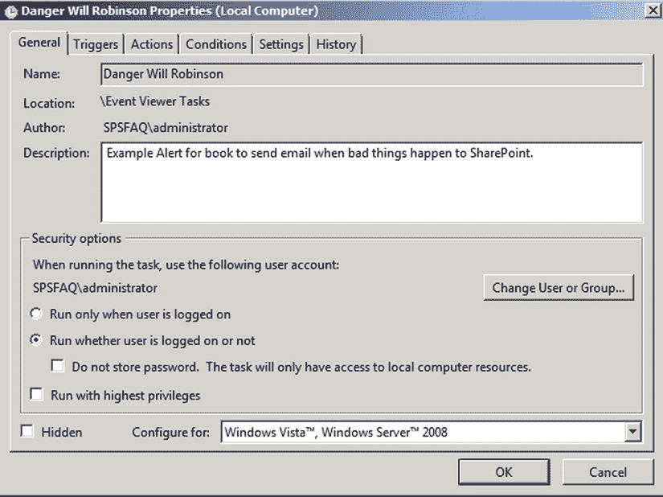
图 7-9. 常规设置

在“触发器”选项卡（图 7-10）上，我点击了“新建”按钮以调出此对话框。在其中，我指定我的任务在每天早上我检查之前运行。这样，当电子邮件发送时，它将包含最新信息，我会在早上 7 点上班前一小时收到它。（根据你自己的时间表进行设置。）我还勾选了“跨所有时区同步”的复选框。如果你希望设置此任务以便其他国家的管理员在早上看到它，这将非常有用。

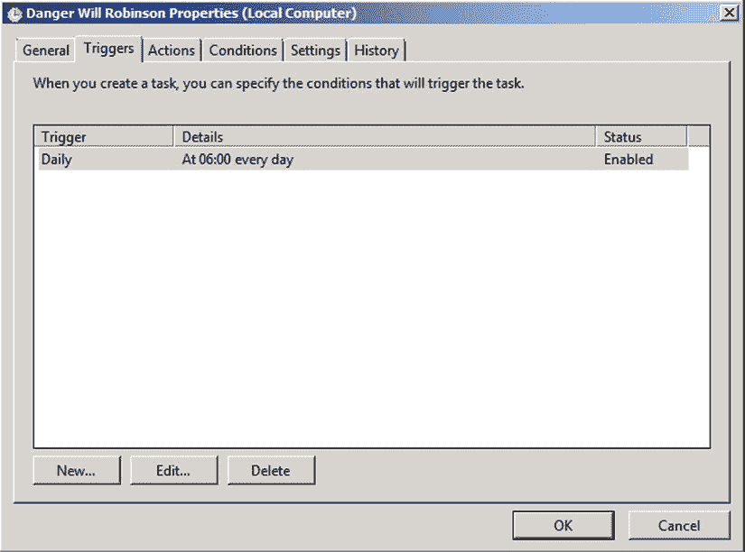
图 7-10. 触发器设置

在“操作”选项卡（图 7-11）上，我点击了“新建”按钮以调出此对话框。在这里你可以选择你的操作。第一个下拉菜单还允许你显示消息或启动程序。在这种情况下，指定发送电子邮件的位置以及要使用的 SMTP 服务器。

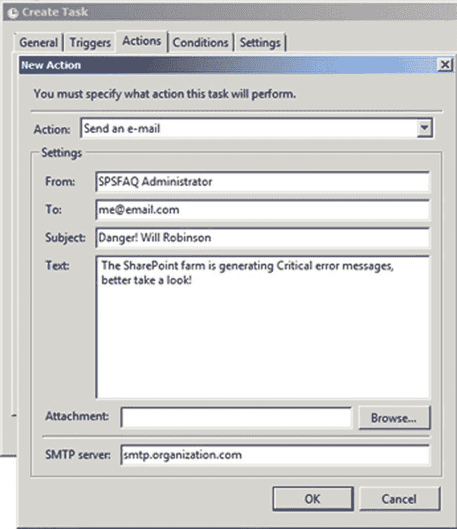
图 7-11. 操作设置

在“条件”选项卡（图 7-12）上，你有一个选项让计算机唤醒以发送电子邮件；如果计算机整夜处于空闲状态，这可能是必要的。否则，保持此处的默认设置。除了触发器之外，如果机器已切换到电池供电或不得不使用辅助 NIC，你可能希望发送电子邮件。

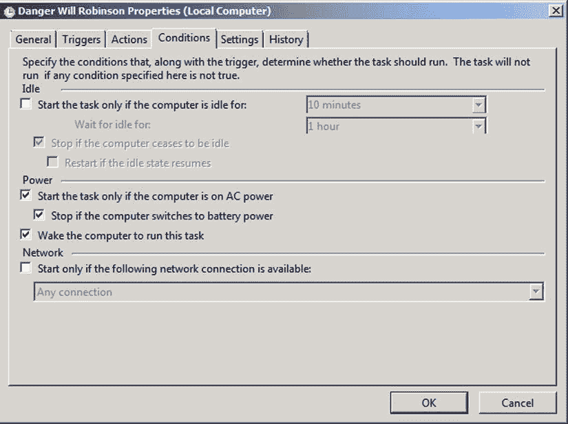
图 7-12. 条件选项

在“设置”选项卡（图 7-13）上，你有关于警报何时以及如何运行的选项。我将其设置为如果失败则重试五次，如果运行时间超过一小时则停止。你还可以创建在运行后自动删除的一次性任务。如果存在多个任务实例，你的选项是（如果任务已在运行）并行运行一个新实例、将一个新实例加入队列，或停止现有实例。

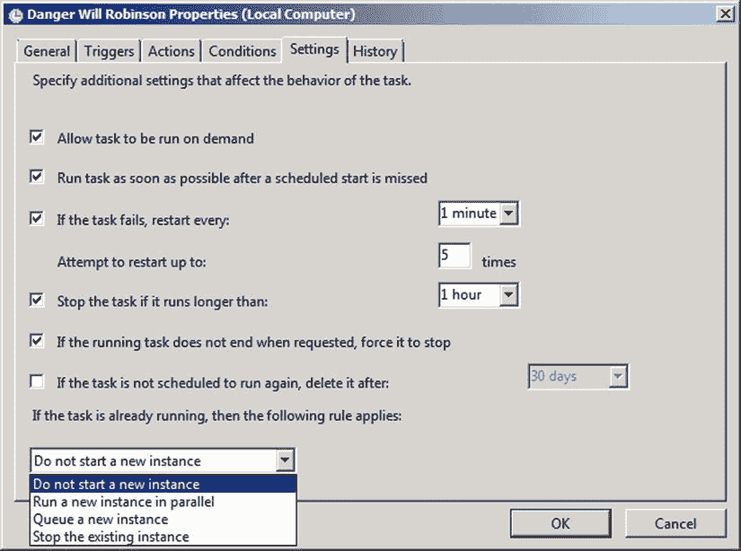
图 7-13. 设置选项

一旦提示你输入管理员密码以创建任务，你就可以手动运行它进行测试（参见图 7-14）。多个任务会尽快提醒你有关 SharePoint 场的问题。可能并非一人在全天候监控，在这种情况下，可以设置警报以在相应时间发送给适当的人。例如，一些组织有员工仅在正常工作时间之外值班，因此可以配置单独的警报，根据日期/时间发送给适当的人。这个功能的好处在于，它有一个简单清晰的图形界面，让你可以创建和管理这些警报。

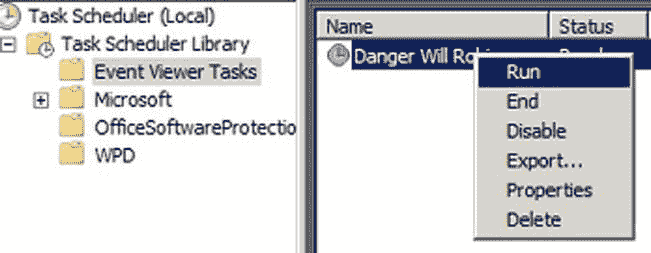
图 7-14. 运行你的任务

你的 SharePoint 系统可能会生成错误，但有时如果硬件使用了过多资源（如内存或处理能力），你也需要得到警报。在这种情况下，你希望收到警报，以便在问题引发应用程序级错误之前就将其捕获。你的目标，就像泰坦尼克号上的双筒望远镜一样，是尽可能远地发现潜在的麻烦，从而为你争取最大的规避机会。

你还可以利用所谓的“数据收集器集”从多台服务器收集数据。我将向你展示如何使用这些数据收集器集来设置事件订阅，以监控内存和性能相关的计数器。

## 使用计数器

内存和性能计数器有助于定位系统瓶颈，它们还能检测服务器上的突发活动（比如因突然的流量激增导致）。这种突发活动可能是预期的，例如在内网上发布重大公告时；也可能是非预期的，例如遭遇拒绝服务攻击。我将向你展示如何配置一些更有用的计数器。以下是设置所谓“数据收集器集”的步骤：

1. 打开服务器管理器控制台。
2. 右键单击“数据收集器集” -> “用户定义”，然后新建一个 -> “数据收集器集”（图 7-15）。
   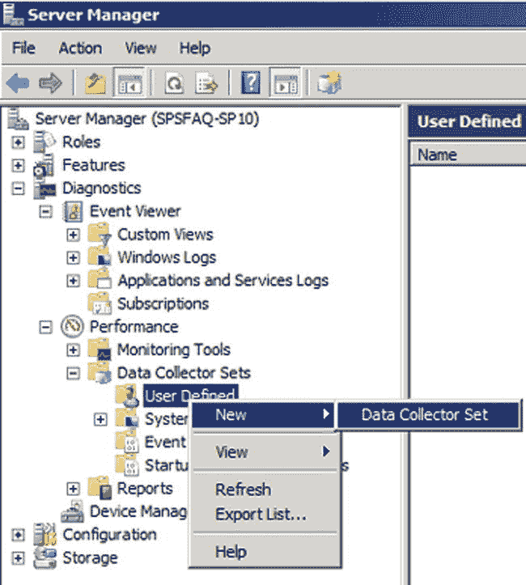
   图 7-15. 创建新的数据收集器集
3. 为数据收集器命名，并选择“手动创建（高级）”。
4. 单击“下一步”后，选择要收集的数据类型。

5. 选择“创建数据日志”和“性能计数器”（图 7-16）。

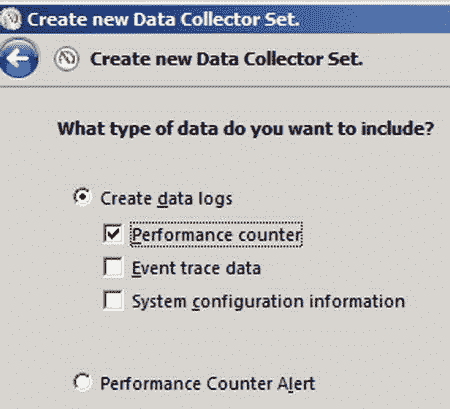
图 7-16. 为性能数据创建日志

6. 在下一个屏幕（图 7-17）中，单击“添加”并选择要监控的性能计数器。在屏幕顶部，你可以选择除本地计算机之外的其他计算机上的计数器。对于每台你想要监控的计算机，将计数器添加到同一个数据收集器集中。例如，如果你计划监控三台机器上的三个计数器，那么总共将有九个元素被添加到该数据收集器集中。

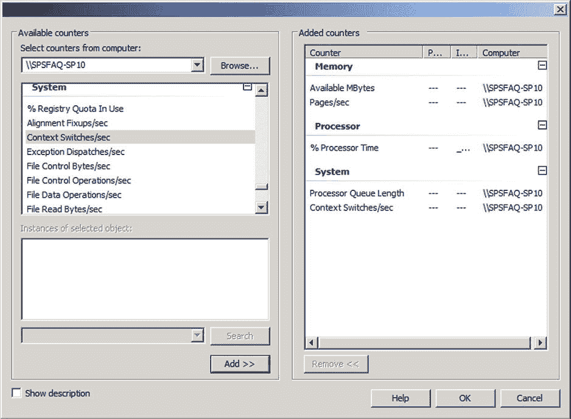
图 7-17. 选择要监控的内容

7. 最后，单击“确定”。你的监控器将创建在以下路径：`C:\PerfLogs\Admin\<数据集名称>\<服务器名 _ 日期 _ 编号>\DataCollector01.blg`

8. 双击此文件以打开监控器。

由于有成百上千个性能计数器可用，设置它们时最大的痛点之一可能就是判断哪些计数器最有用。事实上，对于监控整个服务器的性能而言，只有少数几个可用的计数器是真正必需的。当这些全局服务器计数器提示服务器可能出现问题时，你会发现其他一些计数器也很有用，但你不必一直运行它们。可以将下面这几个计数器视为监控所有服务器的一个良好起点。

### `Processor\% Processor Time`

此计数器是衡量服务器何时积极处理有用工作的整体指标。它测量的是处理器执行非系统空闲进程的时间。当此计数器值很高时，意味着处理器正在积极地处理有用工作，并且你实现了高效利用；只有当用户抱怨与高处理器使用时段相对应的服务器性能不佳时，才需要关注。然而，当此计数器飙升至 100%（在双处理器系统中为 50%）时，可能意味着某个进程正在消耗整个处理器的资源，因此需要引起注意。

### `System\ Processor Queue Length`

此计数器显示当前有多少指令正在排队等待处理器处理。当此计数器值远高于零时，通常表明处理器无法跟上你要求它执行的工作负载。这里的高计数值可能意味着你需要一个更快的处理器，或者减少服务器上运行的服务数量。

### `System\ Context Switches / Sec`

当处理器在其正在处理的等待指令之间切换时，就会发生上下文切换。由于处理器一次只能处理一条指令，上下文切换实现了多任务处理的假象。高水平的上下文切换是有问题的，因为切换处理器正在处理的工作会带来资源开销。在需要处理器同时处理太多操作的情况下，这个数值可能会非常高。通常，在非常旧的应用程序上，或者在许多用户同时运行多个进程的终端服务器上，你会看到非常高的数字。

### `Memory\ Available MBytes` 和 `Memory\ Pages / Sec`

这些计数器对于确定服务器上的内存使用情况非常有用。当服务器处理其工作负载时，它会将元素加载到内存中进行处理。当内存开始填满时，页面会从 RAM 交换到磁盘。由于磁盘子系统明显慢于固态 RAM，交换通常会导致整体性能下降。因此，`Available MBytes` 的计数应大于零，而 `Pages/Sec` 的计数应相对较低。当这些计数器处于这些范围内时，意味着服务器分配了正确数量的 RAM，并且不需要超出可用物理内存的更多内存。在内存可以动态分配给服务器的虚拟化环境中，最佳实践通常是尽量将 `Available MBytes` 的计数也管理得接近于零。这意味着正好为服务器分配了执行其工作负载所需的确切内存量，没有浪费，也没有闲置。

你可以根据需要为磁盘子系统和网络添加其他有用的计数器。对于具有大量数据存储和检索的服务器，磁盘子系统通常可能成为重要的瓶颈。在不使用千兆网络的环境中，网络也可能成为性能瓶颈。请留意这些方面以发现潜在问题，这样当客户想要提升性能时，你就可以提出解决方案。

添加完计数器后，选择足够长的采样间隔（参见图 7-18）。较短的间隔能提供更精细的数据，但捕获数据需要更多资源。当采样的远程计算机较多时，通常需要更长的采样间隔，以防止收集样本的服务器过载。一个好的采样间隔可能是每次采样长达 10 分钟，这样可以在影响相对较小的情况下实现全天候采样。

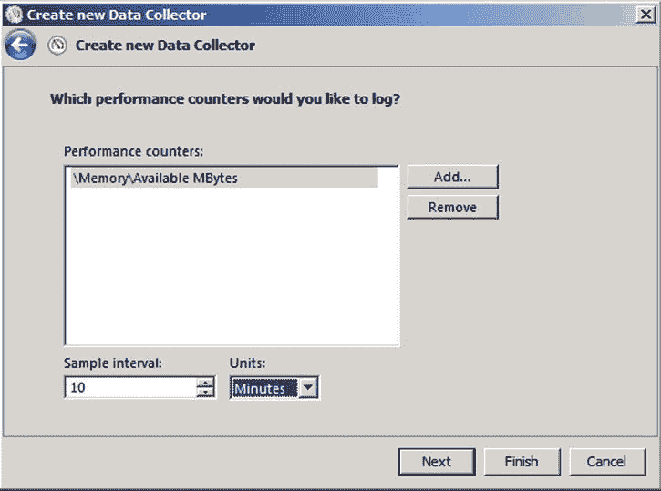
图 7-18. 设置采样间隔

你还可以配置 Windows，使用一个数据收集器集监控多台机器。更多详情见：`http://technet.microsoft.com/en-us/library/cc749337.aspx`。这样做是合理的，因为 SharePoint 服务器场并非孤立的一台机器，它是一个整体的一部分。能够在一个管理界面中查看来自多台服务器的数据也是很有用的。以下是具体步骤：

1. 在管理服务器的事件日志中，单击“订阅”节点。将出现一个窗口，询问是否要启用 Windows 事件收集器服务。单击“是”启动该服务，并将其配置为随计算机自动启动。这将使管理服务器能够从其他计算机收集事件。

2. 接下来，在管理服务器以及任何你想要从中收集事件的其他服务器上，从命令提示符中输入 `winrm quickconfig`。此命令将启用 Windows 远程管理服务 (WinRM)，设置其初始网络配置，并使其可供事件日志使用（参见图 7-19）。

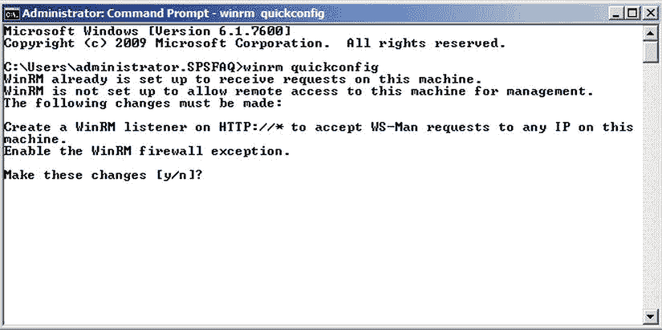
图 7-19. 启用 WinRM

需要相互发送事件的计算机必须首先具备正确的身份验证。为此，请将管理服务器的计算机帐户添加到你要从中收集事件的所有服务器上的 Administrators 组中。这可能需要重新启动。

最后，返回到管理服务器上，右键单击“订阅”节点，然后选择“创建订阅”。在打开的对话框中，输入必要的信息，这些信息用于限定你想要收集的数据类型、数据传输方式以及与事件传输速度相关的任何高级设置。创建订阅的步骤将在本章前面的“创建订阅”部分介绍。

## 检查任务管理器

另一个可以每天检查并为你提供即时反馈的位置是任务管理器。要启动任务管理器，请执行以下任一操作：
- 按 Ctrl+Alt+Delete，然后单击“任务管理器”
- 按 Ctrl+Shift+Esc
- 右键单击任务栏的空白区域，然后单击“任务管理器”（参见图 7-20）。

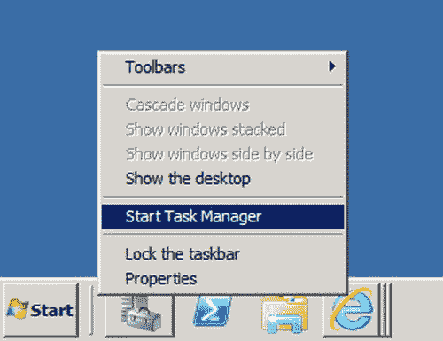
图 7-20. 启动任务管理器

任务管理器是一个你可以每天使用的工具，用于发现系统中的潜在瓶颈和故障点。它尤其有用，因为它可以实时查看计算机的性能。它显示正在运行的程序的状态，并允许你结束无响应的程序。你可以查看 CPU 和内存使用情况的图表和数据；还可以查看网络状态，了解网络适配器的工作情况。如果有多个用户登录到该服务器，你可以查看他们是谁、在做什么，并可以向他们发送消息。如果服务器位于远程位置，并且你只是少数几个拥有此级别访问权限的人之一，那么此功能非常有用。

## SharePoint 的监控工具

*永恒的警惕是自由的代价；权力总是从多数人手中窃取到少数人手中。*
——温德尔·菲利普斯

我用这句话来指代权力或系统资源。这句话对你的 SharePoint 场而言，正如人民的自由总是被少数人以牺牲多数人的利益为代价来窃取一样真实。你已经了解了用于监控场的运行状况的 Windows 工具；现在让我们进一步深入了解 SharePoint 内部可用于监控的工具。SharePoint 管理中心（图 7-21）提供了几个监控工具（即运行状况分析器、计时器作业和报告），以帮助你保持所需的永恒警惕，从而确保场的资源自由。首先，让我们看看如何排查错误，然后再了解信息的来源。

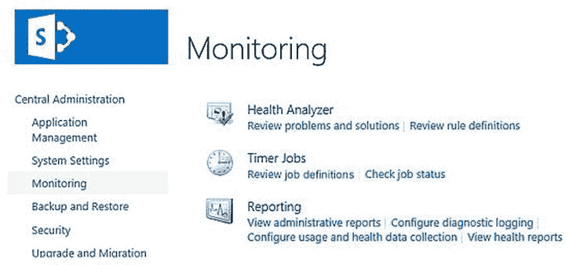
图 7-21. SharePoint 中的监控选项

### 排查错误

尽管设置了所有警报和监控器，但有时仍会发生意外错误，可能会显示为类似图 7-22 中的错误消息。如何弄清楚那个长长的、神秘的关联 ID 的含义呢？

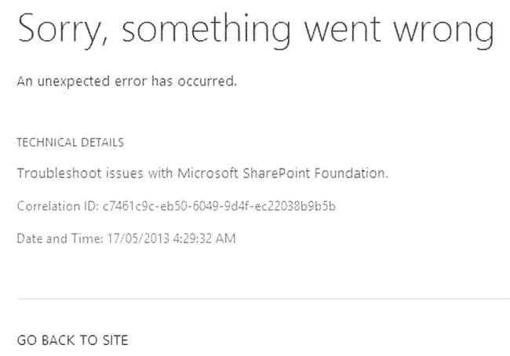
图 7-22. 第一步是找出关联 ID 的含义

你应该首先在服务器管理器（图 7-23）中查看操作日志。在这里你将看到最近与 SharePoint 相关的事件。

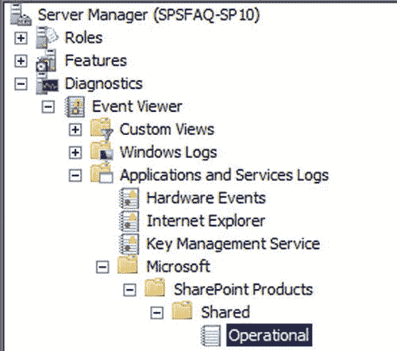
图 7-23. 检查日志

如果错误没有显示在那里，你可以使用记事本直接搜索日志。找到 `C:\Program Files\Common Files\Microsoft Shared\Web Server Extensions\14LOGS`，用记事本打开最新的日志文件，然后搜索关联 ID。请注意，路径中的 `14` 指的是 SharePoint 2013，SharePoint 2010 是 `12`，下一个版本可能是 `15`。你也可以使用 PowerShell 来定位错误并将其输出到文本文件。使用 PowerShell 找到关联 ID 和相应的错误消息。这些命令非常耗费 CPU，因此请谨慎使用。

输出到控制台：

```
Get-SPLogEvent | ?{$_.Correlation -eq "7cf3fec7-4a71-481a-8ad3-c845190e6947"} | select * | Format-List
```

输出到文本文件：

```
Get-SPLogEvent | ?{$_.Correlation -eq "7cf3fec7-4a71-481a-8ad3-c845190e6947"} | select * | Format-List | out-File CorrelationID-Error.txt
```

这将生成一个包含以下文本的文件：

```
Timestamp : 06.05.2010 19:02:44
Continuation : False
Process : w3wp.exe (0x0ECC)
ThreadID : 4972
Area : SharePoint Foundation
Category : Runtime
EventID : tkau
Level : Unexpected
Message : Microsoft.Office.Server.Search.Query.SearchServiceNotFoundException: The search request was unable to connect to the Search Service.
Correlation : 7cf3fec7-4a71-481a-8ad3-c845190e6947
Context : {}
```

现在你拥有了一个可以理解并用于解决问题的真实消息（“搜索请求无法连接到搜索服务。”）。

## 统一日志记录服务
统一日志记录服务 (`ULS`) 是用于记录与 SharePoint Server 和解决方案相关的错误和信息消息的单一集中位置。这意味着当你需要排查问题或监控 SharePoint 应用程序的整体运行状况时，只需查看一个地方即可。它聚合来自以下三个位置的日志：

*   SharePoint 跟踪日志

*   Windows 事件日志（我已经讨论过）

*   SharePoint 日志记录数据库

ULS 查看器是一种实时查看日志的绝佳方式。你可以从 `http://archive.msdn.microsoft.com/ULSViewer/Release/ProjectReleases.aspx?ReleaseId=3308` 下载它，并将其安装到 SharePoint 服务器上。安装后，按 `Ctrl+U`，然后单击“确定”即可实时查看正在添加到日志中的数据（图 7-24）。

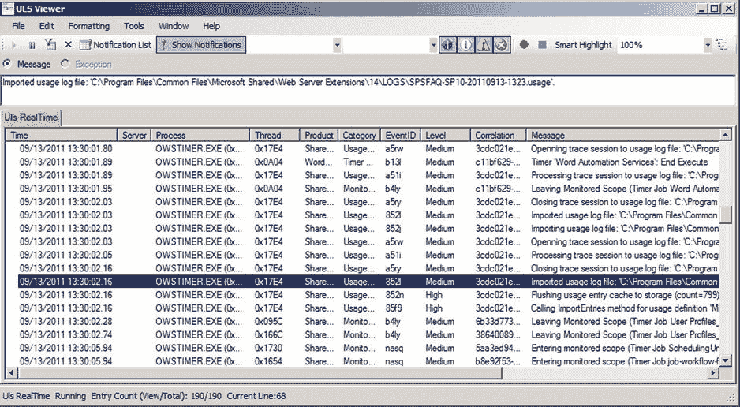

图 7-24. 实时查看日志

尝试“切换关联树”按钮。这是上面截图中最右边的那个按钮。你可以使用示例关联 ID 来跟踪 SharePoint 内部的一系列事件。在一个较大的 ULS 日志文件中，特定错误可能会多次出现，但通过关联 ID，你可以轻松地跟踪它们。另一个好功能是通知。你可以为 ULS 查看器设置通知级别；默认情况下，它会在出现关键消息时弹出通知。

## 运行状况分析器
此工具用于自动监控 SharePoint 场的配置。它很巧妙，因为它不仅能像事件查看器那样提醒你注意问题，还能自动为你修复问题。例如，如果日志设置为详细模式并且即将填满磁盘容量，运行状况分析器可以重置它们。这是因为每个规则实际上都是一个 `DLL`，一个可以执行脚本的已编译程序。它在计时器作业内部运行，因此是全自动的。

当您访问 SharePoint 管理中心时，会注意到它会向您发出警报（图 7-25）。在此示例中，由于问题严重，背景显示为红色；但如果问题不那么严重，背景则会显示为黄色。


图 7-25. 运行状况分析器警报

有超过 60 条规则定义，全部列在运行状况分析器的“复查规则定义”页面（图 7-26）中。每条规则都可以作用于服务器场中的每台服务器，并具有不同的计划。

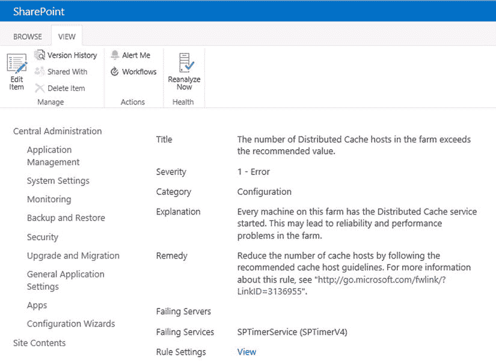

图 7-26. 单击“通知我”以创建运行状况分析器警报

和之前一样，它是通过规则进行配置的，这些规则可以按小时、按周、按月或按需进行评估。您还可以将其配置为通过电子邮件或短信向您发送警报。由于其中某些作业每月仅运行一次，如果您刚刚建立服务器场，您可能希望一次性运行所有作业以查看服务器场的初始运行状况。为此，请运行以下 PowerShell（感谢 Matthew McDermott 提供此代码）：

```powershell
$jobs = Get-SPTimerJob | Where-Object {$_.Title -like "Health Analysis Job*"}
foreach ($job in $jobs) {
  $job.RunNow()
}
```

您还可以在图 7-26 中看到手动重新运行单个规则以检查其当前是否被遵循的功能。这只会将计时器作业排队，等待资源可用时运行，这可能并非即时。在“管理中心”>“监控”部分的“运行状况分析器”下可访问的“复查问题和解决方案”页面（参见图 7-21）会显示您的服务器场可能遇到的任何问题。

## 计时器作业
计时器作业是 SharePoint 的发条机制——系统的齿轮和运动部件。您可以在“管理中心”>“监控”部分的“计时器作业”下访问“复查作业定义”页面来监控它们；您也可以手动运行它们以确保它们正常工作。“检查作业状态”页面允许您查看作业上次运行的时间历史以及它们是否成功。这对于故障排除非常有用。

## 诊断日志记录
您可以为 SharePoint 设置诊断日志记录中的三项设置。

*   事件限制

*   事件日志淹没保护

*   跟踪日志

这些设置可在“管理中心”>“监控”选项的“报告”下的“配置诊断日志记录”中访问。让我们逐一考虑这些设置。

### 事件限制
事件限制使管理员能够根据严重性级别控制 SharePoint Server 记录的事件类型。限制管理分为目标和类别两部分。目标日志条目可以在两个位置报告。第一个是标准的 Windows 事件日志，我之前已经讨论过。管理员可以使用 Windows 事件查看器应用程序来查看条目。第二个是 ULS 或“跟踪日志”，这是一种基于文本的日志格式，专用于 SharePoint Server，并存储在文件系统中。

事件限制调节器可以应用于直接映射到 SharePoint Server 功能的特定类别。这使得管理员能够单独增加 SharePoint 组件的日志记录详细程度，从而管理日志的大小和需要复查的信息量。所有类别的默认设置如下：

*   事件日志：信息

*   跟踪日志：中等详细级别

在正常操作期间，这些设置是详细程度和性能之间的适当平衡。在对 SharePoint Server 进行重大重新配置、安装自定义解决方案或 SharePoint Server 遇到问题时，应调低限制调节器。这确保尽可能多的信息可用于故障排除。

最后，在完成任何故障排除后，可以通过选择限制下拉菜单中的“重置为默认值”选项将日志记录恢复为默认设置。当前未使用默认选项配置的设置将以粗体字体显示。

### 事件日志淹没保护
事件日志淹没保护可防止事件日志被大量重复事件淹没。当启用此功能（默认）时，如果在两分钟内同一事件被记录五次，它将开始裁剪事件。此时，它会抑制额外的条目。再过两分钟后，它会抛出一个摘要事件，描述该事件本应重复的次数。管理员可以修改这些阈值。

### 跟踪日志
跟踪日志是 SharePoint 的标准日志文件。它们是制表符分隔的文本，可以使用任何能够打开文本文件的工具打开，但正如我所提到的，ULS 查看器是查看这些日志的好方法。默认情况下，跟踪日志位于 SharePoint 根目录（在更高版本中也称为 `14` 号配置单元或 `15` 号配置单元等）的 `LOGS` 文件夹中，路径为 `C:\Program Files\Common Files\Microsoft Shared\Web Server Extensions\14`。

## 总结
*Mens sana in corpore sano (“健全的精神寓于健全的身体”)*

——尤维纳利斯，《讽刺诗集 X》

您可以看到有两种方法可以监控 SharePoint：通过通用的 Windows 工具，如服务器管理器中的事件查看器，或在 SharePoint 管理中心进行监控。哪种方法更好？我认为 SharePoint 是精神：它包含由用户和开发者生成的信息。服务器场的硬件、网络和软件是身体：它支撑并承载着 SharePoint 应用程序。如果身体健全，精神也会健全。SharePoint 应用程序非常依赖于网络基础设施，如果 `SQL Server`、`Windows` 或网络出现问题，就会影响 SharePoint。我倾向于将监控重点放在 `Windows` 上，因为那里可能出错的地方更多。如果我无法在那里找到原因，我会通过 `ULS` 查看器深入查看 SharePoint 日志。本章中的信息为您提供了执行同样操作所需的指导和方向。

# 第 8 章


## 自行灾难恢复

迄今为止，本书一直从业务利益相关者和基础设施所有者的角度关注灾难恢复和备份。完整的服务器场备份将恢复内容数据库、服务器场设置、解决方案和服务应用程序。这些解决方案仅在整个服务器场丢失时才有用；它们并未从用户的角度解决恢复问题。用户有时只需要恢复服务器场中较小的部分，因为他们的关注点仅在于自己的内容。SharePoint 提供了恢复用户关心的以下元素的选项：

*   列表项
*   文档
*   列表
*   库
*   网站
*   网站集

以下低级别配置和结构元素也可以保留：

*   有权访问一个库或网站的人员列表
*   网站栏和内容类型
*   Web 部件页

SharePoint 将越来越多的内容保留选项交到用户自己手中。这是有道理的：他们可以立即保留一个网站或列表，而不必要求 IT 部门为他们执行此操作。到目前为止，本书的重点是架构师、服务器场所有者和 SharePoint 策略师可以采取哪些措施来实现高可用性和灾难恢复策略。本章表明，备份和恢复内容的手段正日益向用户社区提供。了解本章中包含的信息意味着您可以规划培训和流程，以确保用户能够自行操作。具体来说，对于 `SharePoint 2010 Service Pack 1`，用户现在可以从回收站恢复已删除的网站。这明确表明趋势是让用户自己负责数据恢复，而不是 IT 部门。

即便是企业架构师的工具箱里，偶尔也需要几款小工具来备份和恢复场中的这些小部件。了解如何使用大型工具来备份整个场，只是你应对可能情况的备选方案的一部分。例如，当某个内容所有者请求一个方案来维护他们自己的灾难恢复策略时，就需要用到这些。如果场中的一些小部件丢失了，你可以推荐本章介绍的方案来恢复它们。为了取回一个列表而恢复整个场的副本，实在没有必要。

再次强调，本章的目的是展示这些“自己动手”（DIY）方案，让用户自己承担部分维护重要内容和设置备份的工作。我之所以使用“DIY”，是因为这些工具是用户自己就能使用的，无需场管理员权限。其中一些需要网站集管理员权限，例如将网站另存为模板；但另一些，比如从回收站恢复文件，只需要网站成员权限即可。如果你过去主要从 1 万英尺的架构层面审视 SharePoint，你可能忽略了用户可以使用的一些小巧便捷的选项，因此本章将为你详细阐述这些内容。

`SharePoint`（实际上也是整个微软）成功的原因之一，就在于它将控制权交到用户手中。技术是复杂的，但工具可以通过简单的比喻使其更易于使用。SharePoint 允许用户备份和恢复他们自己的一些内容；这样一来，不仅节省了基础设施端的资源，也节省了用户的时间，因为他们可以更快地恢复所需内容。

此处截图来自 `SharePoint 2010`，仅供示意；后续版本拥有相同功能。

本章将重点介绍以下恢复选项：

*   回收站
*   SharePoint 中的版本控制
*   网站和网站集的恢复
*   Office 作为灾难恢复工具
*   模板

让我们从最简单的场景开始：意外删除文档。

### 回收站

别被表面现象迷惑，当你在 SharePoint 网站上选择删除文档或列表项时，它并没有被完全删除。实际上，该条目只是从列表视图中隐藏起来，并显示在回收站中。在被真正删除之前，它并不会被移走。在此期间，如果你从回收站将其恢复，它会带着完全相同的权限、版本历史和列表项 ID 再次出现在列表中，因为它实际上根本就没被删除。根据网站的设置，真正的删除会在稍后发生。

### 回收站设置

回收站的设置由场管理员完成，这些设置决定了是否存在回收站以及它的工作方式。首先，我回顾一些术语。从逻辑上讲，`Web` 应用程序是 SharePoint 网站所驻留的 `Web` 站点的设置。这些设置包括所使用的身份验证类型以及适用于该 `Web` 应用程序内所有网站集的常规设置，例如区域时区。网站集由一个基于特定模板的根网站及其下的所有子网站组成。它们也共享一些设置，例如组和内容类型。在代码中，子网站被称为 `webs`，而网站集则被称为 `site`。

回收站的启用和配置是在 `Web` 应用程序级别进行的。默认情况下，`Web` 应用程序中的所有网站集都会启用回收站。以下是配置 `Web` 应用程序回收站设置的步骤：

1.  确认执行此过程的用户帐户是 `Farm Administrators` SharePoint 组的成员。
2.  在 SharePoint 管理中心网站上，点击 `应用程序管理`。
3.  在 `应用程序管理` 页面上，点击 `管理 Web 应用程序`。
4.  点击要为其配置回收站设置的 `Web` 应用程序。
    功能区变为可用状态。
5.  在功能区上，点击 `常规设置` 下拉菜单，然后点击 `常规设置`（图 8-1）。

    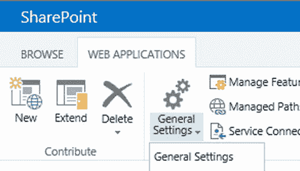

    图 8-1. 选择 `Web` 应用程序后，`常规设置` 选项会出现

6.  在 `Web 应用程序常规设置` 页面的 `回收站` 部分，您可以配置某些设置（图 8-2）。

    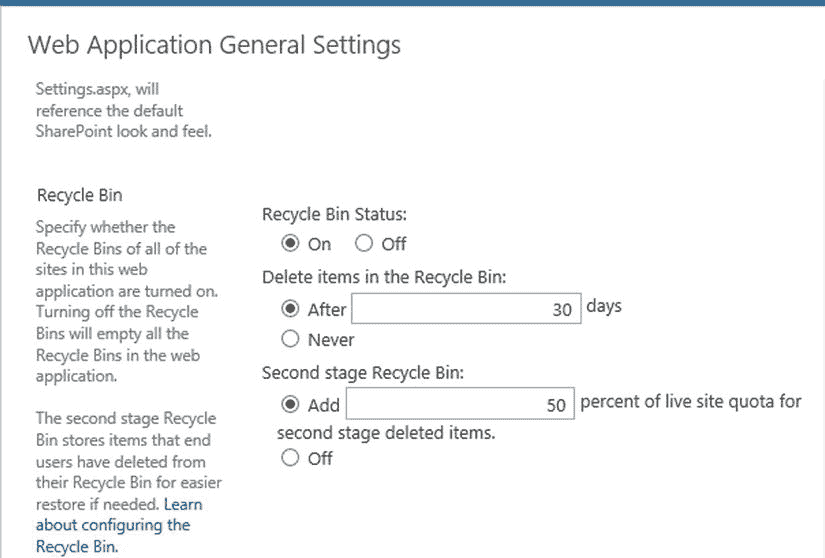

    图 8-2. 回收站的选项

这些选项指的是第一阶段和第二阶段回收站。网站集中的每个网站都有自己的回收站，但如果有条目从那里被删除，它就会出现在第二阶段回收站中。可以把这个第二阶段回收站想象成楼后的大垃圾箱。文档还没有被彻底拿走，但已经不再是你办公桌下垃圾箱里的东西了。这个回收站只有网站集管理员才能访问，大多数用户并不知道它的存在。我曾经遇到过一件事：一个自大的经理给部门所有员工发邮件，想找出是谁删除了一份重要文档。可笑的是，当他发现删文档的人就是他自己后，他试图通过从回收站彻底删除来掩盖痕迹。当我把文档从第二阶段（网站集）回收站恢复后，我特意让他的一些下属知道了这件事，因为我知道他肯定不会主动承认！

### 访问第二阶段回收站

由于第二阶段回收站可能会占用你很大一部分网站配额（默认是 50%；参见图 8-2），你应该知道如何以及在何处管理它。除非你的网站集管理员接受过全面的培训，否则不能指望他们了解这一点。其大小应在配置场时规划和确定。从场容量管理的角度来看，你可以只保留网站回收站，如果愿意，也可以关闭第二阶段回收站。这样做可以让用户自行维护其网站配额，而无需网站集管理员权限。如果他们清空了自己的网站回收站，可以立即从配额中回收空间，而无需等待内容再从网站集回收站中删除。作为高级场所有者，你可能不知道如何访问网站集回收站，以下是具体步骤：

1.  首先，以网站集管理员或更高级别身份登录并进入 `网站设置`（参见图 8-3）。

    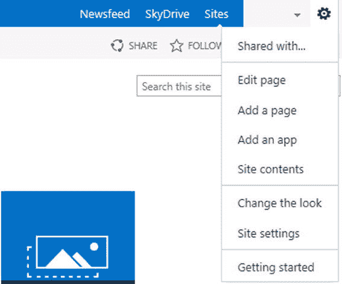

    图 8-3. 通过 `网站设置` 访问网站集设置

2.  然后在 `网站集管理` 下点击 `回收站` 链接（图 8-4）。如果你未以网站集管理员权限登录，即使有网站管理员权限可以访问该页面，此部分也不会显示。

    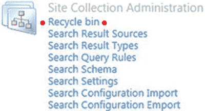

    图 8-4. 如何访问第二阶段回收站设置

3.  现在，你可以查看到已删除条目的若干信息，例如它们原始位置、删除者以及删除时间（图 8-5）。

    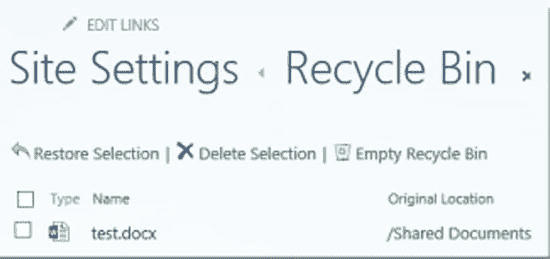

    图 8-5. 删除历史记录

4.  你可以通过这些列来筛选回收站中的项目。你也可以只查看从网站回收站（也称为第一阶段回收站）中明确删除的项目（[图 8-6](#9781430263289_Ch08.