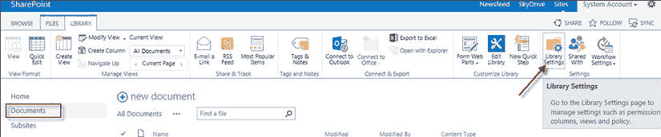
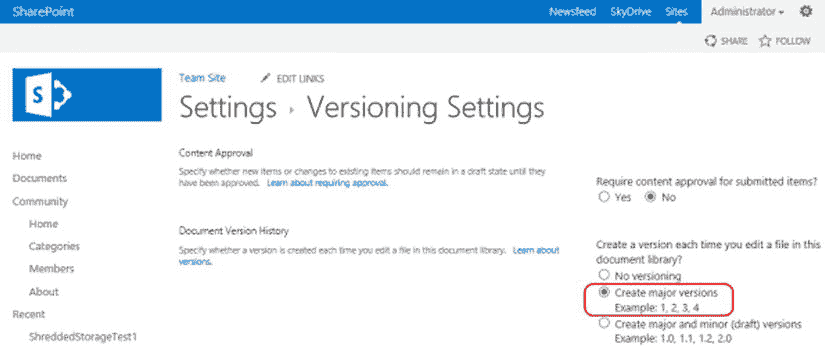
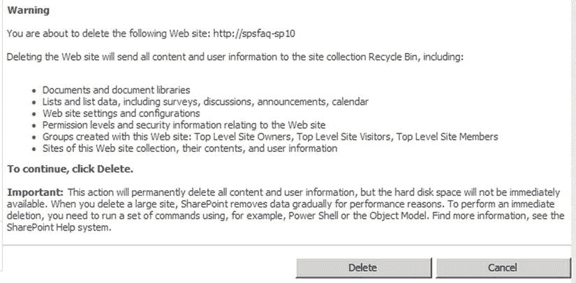
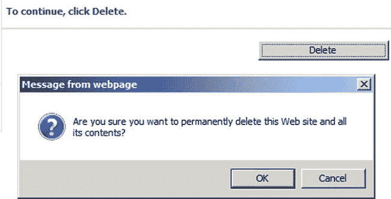
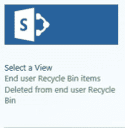

# SharePoint 中的回收站与版本控制

默认情况下，你也能在第一阶段回收站中看到所有内容。

请注意，默认的 30 天期限适用于项目首次删除后的总时间，而非项目在任一回收站阶段中停留的具体时长。

当为某个 Web 应用程序启用了第二阶段回收站后，微软建议你将第二阶段回收站的可用磁盘空间指定为该 Web 应用程序所分配配额的一个百分比（图 8-3）。存储在第二阶段回收站中的项目不计入网站配额；然而，为第二阶段回收站指定的大小会增加网站及其承载内容数据库的总大小。如果未设置网站配额，则第二阶段回收站的大小没有限制。因此，用户可能仍在自己的配额范围内，但实际上在 SQL Server 中使用了远超配额的容量。

例如，如果你为 Web 应用程序分配了 100MB 的空间，那么为第二阶段回收站分配 50% 的配额，则允许第二阶段回收站使用 50MB，而整个 Web 应用程序总空间为 150MB。你可以将第二阶段回收站的配额最高指定为 100%。

## 例外情况

某些例外情况会导致内容不在回收站中。需要特别注意的一点是，通过“数据表视图”删除的内容不会保留在回收站中。“数据表视图”是一种类似 Excel 的列表界面，用于快速编辑多行和多列数据。

你还应注意，回收站仍然会强制执行项目的安全策略。删除内容的用户能够在回收站中看到该内容。如果其他用户没有访问该项目所在位置的权限，他们将无法在回收站中看到这些项目。否则，回收站将成为一个严重的安全漏洞。每个能访问该网站的用户，即使是查看者级别，都可以打开回收站，但他们只能看到自己有权访问的内容。这是因为该项目仍位于其原始位置——只是从那里隐藏起来，并在回收站中显示。如果你删除了一个顶级项目，例如文件夹或列表，并试图查找其内部位置中的某个文档，该项目将不可见。默认情况下，回收站只显示顶级内容，并且没有能力以树状结构或下钻模式显示项目。此外，如果项目在默认的 30 天期限之前就被删除了，或者其超出第二阶段回收站的配额限制，它也不会出现在回收站中。

## 作为恢复工具的版本控制

版本控制是一种功能，它能将文档的每一次先前迭代保存为单独的文件；你可以打开文件在过去某个时刻的副本，而不会丢失当前迭代的版本。在自主灾备（DIY DR）的背景下，这意味着如果用户覆盖或删除了文档的一部分，她可以从文档的先前版本中恢复。这通常被忽视，但它是一种恢复丢失内容的手段。不过，这需要由网站管理员进行配置，并且用户必须勤勉地创建文档版本——而不仅仅是不断点击“保存”。为单个库设置版本控制是通过 `Library Settings`（库设置）页面完成的（图 8-7）。

图 8-8 显示了设置页面。

明智的做法是设置保留版本的数量限制，因为在 SharePoint 2010 中，每个版本占用的空间与主文件相同。SharePoint 2013 引入了分片存储，虽然这大大改善了保存增量更改到 SharePoint 时的输入/输出特性，但对上传和下载速度有净负面影响。这可能会积累大量空间。我曾遇到过一个情况，一个 3MB 的 Excel 电子表格的 400 个版本占用了整个网站集的所有配额：1200MB 大约等于 1.2GB。

要求签出功能可确保用户每次想要编辑文档时都创建一个“硬”版本。如果用户打开一个文件并开始编辑，这被称为“软”版本。这是因为直到用户明确签入文档，才会创建新版本。该文件会在后台被签出给他并锁定，但即使更改已保存，也尚未创建新版本。然而，此选项可能会降低对文件的访问速度，因此仅当文档必须拥有这种级别的控制时才应启用。用户培训应说明将版本控制作为一种自主灾备选项的价值。

如果你希望在所有网站上统一设置此功能，则必须创建一个已设置好这些选项的网站模板。什么是最佳设置需要与你的用户协商。最佳实践是确保在不需要时关闭版本控制。一个合理的阈值是保留 10 个版本。当有 3 到 5 个人协作处理一个文档时，这是合理的，因为每个人大约会有 2 到 3 个版本。当添加第 11 个版本时，它将取代第 10 个版本，而最早的版本则被移除。然而，并没有硬性规定。培训用户让他们了解并自行调整这些设置是这里的理想解决方案。这些设置并非旨在集中控制，这就是为什么它们可在库级别进行配置。

## 恢复网站和网站集

SharePoint 背后的理念始终是将决策权下放给用户，就像版本控制一样。网站集的所有者可以相当轻松地删除整个网站集及其所有内容。从用户的角度来看，点击删除网站集的选项后，所有者会看到如图 8-9 所示的消息，该消息警告他们删除的后果。即使在他们点击 `Delete`（删除）后，还会出现另一个提示（见图 8-10）以确认他们确实想要这样做。但偶尔也会发生误操作。

在 SharePoint 2010 Service Pack 1 之前，恢复网站集的唯一途径是让网站集管理员请求场管理员备份内容数据库，并恢复到前一天晚上的状态，从而恢复该网站集——以及同一内容数据库中的许多其他网站集。这不是一个令人满意的解决方案，因为在大多数情况下，它损失的内容比删除的还要多。删除子网站也会显示类似的对话框，但如果需要恢复该网站，同样，唯一的选项是从整个内容数据库的备份中恢复。

然而，SharePoint Server 2010 的 Service Pack 1 增加了将子网站放入第二阶段回收站的功能（图 8-11）。这最清晰地表明备份和恢复已变得更加以用户为中心。

