# 使用 SP1 还原网站

## 通过 PowerShell 进行恢复

要使网站集能够通过 PowerShell 还原，你必须在服务器场中至少安装带有 Service Pack 1 的 SharePoint 2010，才能添加此功能。相比之前的情况，这是一个显著的改进，因为现在网站集管理员可以恢复网站，而不仅仅是服务器场管理员。已删除的网站集存储在`SPDeletedSite`对象中。`Get-SPDeletedSite` cmdlet 会列出所有已删除的网站集。当`SPDeletedSite`大于一个时，`Get-SPDeletedSite`返回一个数组。使用以下命令获取计数：

```powershell
(Get-SPDeletedSite).Count
```

现在你只需将其与`Restore-SPDeletedSite` cmdlet 绑定即可。

```powershell
Get-SPDeletedSite | where{$_.SiteId -eq "xxxxxxxx-xxxx-xxxx-xxxx-xxxxxxxxxxxx"} | Restore-SPDeletedSite
```

## 将 Office 用作 DIY 灾难恢复工具

值得一提的是，虽然这不严格属于 SharePoint 范畴，但 Word 通过自动保存和使用所谓的 Backstage 视图，也有助于保护用户的内容。这是你在 Office 中单击“文件”选项卡时的默认视图。向用户记录、培训和展示这些信息，是这些信息被他们了解的最可能的途径。我在此将其作为恢复丢失内容的另一种方法来介绍，以确保完整性。从某种意义上说，它属于组织灾难恢复流程的一部分，因为它是一种恢复数据的方法。在旧版 Office 中，Word 会在你编辑文档时定期在后台保存。这个文件会被保留，以便用户在应用程序崩溃时用它来恢复工作。对于 Word、Excel 和 PowerPoint，Office 2010（以及 Office 365）改进了这一想法。在 Backstage 视图中，Microsoft 会显示你当前编辑会话中周期性的自动保存文件，并允许你比较或将其恢复为最新文档（参见图 8-12）。即使你没有保存文件，这些文件也会保留五天。

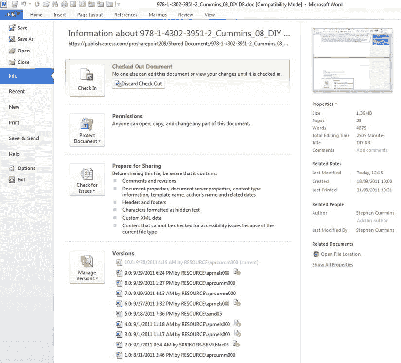

图 8-12. Office 内部的版本控制：本章的 Backstage 视图

当你保存并关闭编辑会话时，这些未保存的版本会被清除。文档保存方式的设置可以在 文件  Word 选项  保存 中找到（图 8-13）。

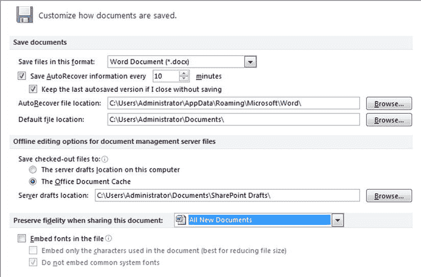

图 8-13. Word 中的保存选项

即使你在未保存文件的情况下关闭编辑会话，Office 现在也会保留最后自动保存的版本。当你再次打开文档时，未保存的版本将出现在 Backstage 视图“信息”窗口的“版本”部分（参见图 8-14）。Office 还允许你直接从 Backstage 视图访问它：在“信息”窗口中单击“管理版本”，然后选择“恢复未保存的文档”（参见图 8-15）。在 Backstage 视图的“最近”窗口底部也有“恢复未保存的文档”链接。


图 8-14. 重新打开一个在 Word 自动保存后未被保存的文件后的“版本”部分

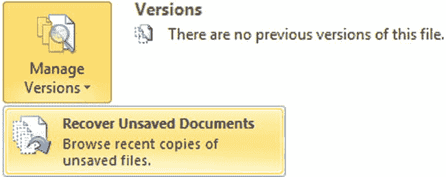

图 8-15. 在 Backstage 视图中，选择“信息”，然后选择“管理版本”，以查看恢复未保存文档的链接

 **注意** 当你单击“恢复未保存的文档”链接时，Office 会带你进入默认的 `UnSavedFiles` 文件夹。但是，你的自动恢复文件位置可能不同。如果你没有看到自动保存的文件，请检查你的保存选项（图 8-13），然后导航到相应位置。

## 使用模板进行内容备份

SharePoint 让用户能够掌握内容保留的另一种方式（尽管是间接的好处）是使用 SharePoint 模板流程。SharePoint Server 中的模板旨在允许你通过复制列表或网站（如果需要，可包含其内容）来重用内容，并允许你在新位置使用相同的内容创建新的列表或网站。此功能也可由任何仅拥有网站所有者权限的用户随时用于对列表或网站进行快速备份，即使这并非其既定用途。因此，如果网站所有者希望获得额外的安全级别，无需服务器场级管理员的干预即可实现。这在需要即时快照时会很有用。

需要注意的是，此方法不会保留“创建者”和“创建时间”，也不会保留网站或列表的访问权限。但它会保留内容和视图，重新创建这些内容通常需要更多时间。另一个警告：Microsoft 已将列表和网站模板的最大大小限制为 10MB（10,485,760 字节）。如果你尝试保存大小超过 10MB 的网站/列表模板，你将收到“列表太大，无法保存为模板。模板的大小不能超过 10485760 字节。”的错误。为了解决这个问题，我看到有人建议在命令提示符下运行此命令：

```cmd
stsadm -o setproperty -propertyname max-template-document-size -propertyvalue 524288000
```

但是，我不建议你这样做。它可能会导致网站恢复过程中出错；有时命令会成功完成，但限制仍然存在。考虑到这些警告，模板仍然是快速备份内容的有用方法，因此我将向你展示如何操作。如果你的网站太大而无法通过此方式保留，那么使用管理中心是你唯一的选择——而且普通用户无法使用此选项。

### 如何创建列表模板

首先，浏览到你想要备份的列表或库，然后单击“库”选项卡（图 8-16）。

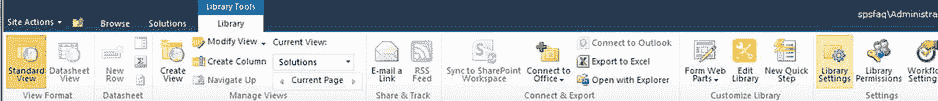

图 8-16. 访问库设置

其次，单击“列表设置”或“库设置”，然后在“权限和管理”下，单击“将列表保存为模板”（图 8-17）。

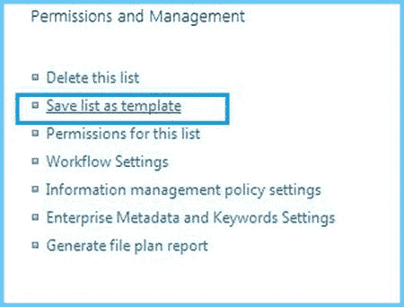

图 8-17. 将列表保存为模板

 **注意** 对于列表或库，操作步骤相同。例如，如果你浏览到一个文档库，设置页面的链接称为“库设置”。对于列表，则称为“列表设置”。按照这个思路，保存模板的链接分别称为“将文档库保存为模板”和“将列表保存为模板”。

单击“将列表保存为模板”链接后，会打开图 8-18 中所示的表单。

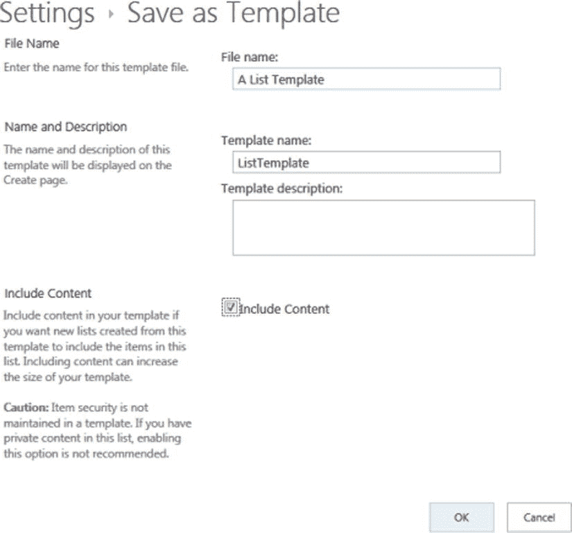

图 8-18. 创建你的模板

填写此表单时，请确保选中“包含内容”复选框。否则，你只会保留列和视图。填写完表单后，单击“确定”；你应该会看到图 8-19 中的消息。然后单击“列表模板库”链接。

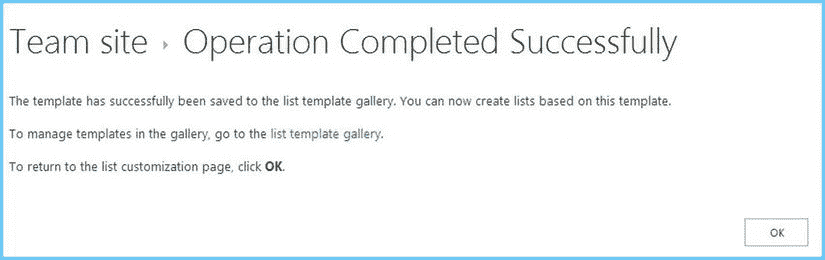

图 8-19. 单击列表模板库链接

单击“列表模板库”链接后，你将进入一个类似于图 8-20 所示的页面。

选择刚刚创建的列表模板，点击“文件”选项卡，功能区将变为如图 8-20 所示。

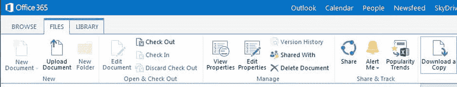

**图 8-20.** 选择模板以更改功能区

点击“下载副本”并将文件（扩展名为`.stp`）复制到一个易于访问的位置。该文件（见图 8-21）现在包含了列表中的所有内容。

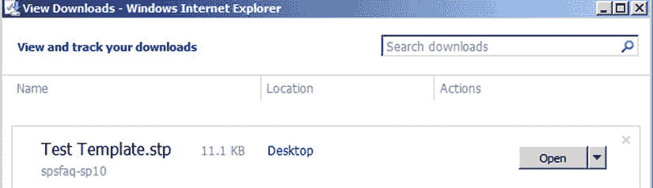

**图 8-21.** 列表的备份

如果只想再次找到该模板，请依次浏览“网站操作”、“网站设置”、“库”、“列表模板”。有了这个`.stp`文件，你就拥有了列表的备份。现在，你可以将其导入到任何列表模板库中，并用于重新创建列表及其内容。只需点击“上载文档”（见图 8-22）即可添加模板并在该网站集中使用。我上传了我的模板，并将其命名为“Book Template Test”。

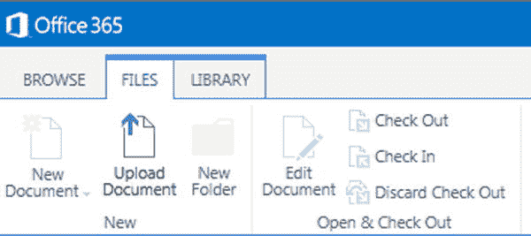

**图 8-22.** 将模板上载到模板库

现在是最重要的步骤：你可以使用此模板来还原列表。你甚至可以通过给它一个不同的名称，将其与现有列表一起还原，以便从中恢复某些内容。只有在列表中不存在于回收站（例如通过数据表视图删除的内容）时，或者当需要恢复早于主回收站或辅助回收站时间限制的内容时，才有必要这样做。这在 SharePoint Online 的情况下可能非常有用。

## 还原列表

为此，请从网站主页点击“添加列表、库和其他应用程序”，然后浏览直到看到列表中新增模板，如图 8-23 所示。

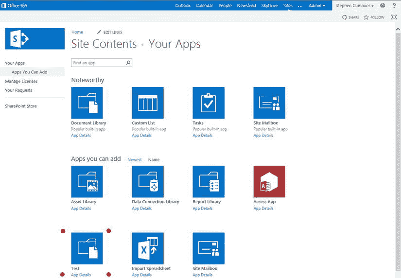

**图 8-23.** 创建新的列表或库以重新创建内容

如图 8-24 所示，你的列表保持了其原先基于的列表类型。我的列表基于文档库，因此它具有相同的图标和结构。


**图 8-24.** 书籍模板测试：包含内容的新列表模板

创建列表后，你会发现所有内容和视图都已恢复。

## 如何创建网站模板

创建网站模板的过程与创建列表模板类似。首先，点击齿轮图标，然后选择“网站设置”。在“网站操作”标题下，点击“将网站另存为模板”（图 8-25）。

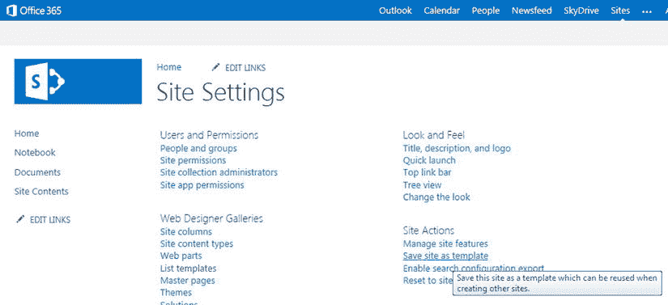

**图 8-25.** “网站操作”下的“将网站另存为模板”链接

点击此链接后，将打开如图 8-26 所示的表单。

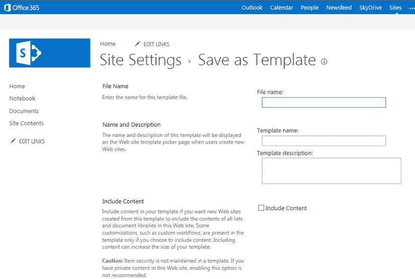

**图 8-26.** 创建模板

填写此表单时，请确保选中“包括内容”复选框。否则，你将只保留列表、库和 Web 部件页面布局。点击“确定”，将显示如图 8-27 所示的消息。然后点击“解决方案库”链接。

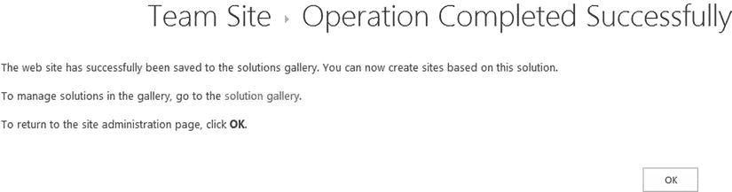

**图 8-27.** 点击“解决方案库”链接

点击“解决方案库”链接后，你将进入如图 8-28 所示的页面。右键单击刚刚创建的网站模板，然后选择“目标另存为”，将文件（扩展名为`.wsp`）复制到一个易于访问的位置。

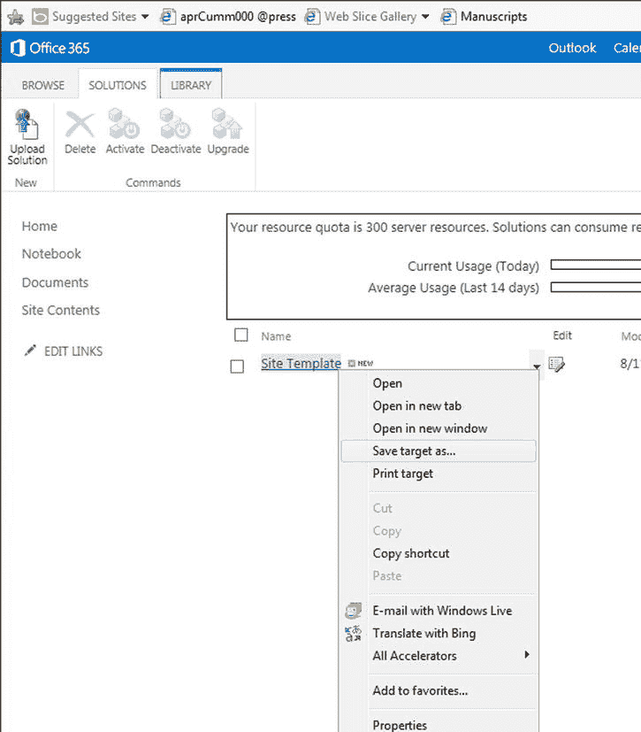

**图 8-28.** 右键单击以单独保存解决方案

该文件现在包含了网站中的所有内容。有了这个`.wsp`文件，你就拥有了网站的备份。现在，你可以将其导入到任何网站集中的解决方案库中，并用于重新创建网站及其内容。只需点击“上载解决方案”即可添加模板并在该网站集中使用（图 8-29）。

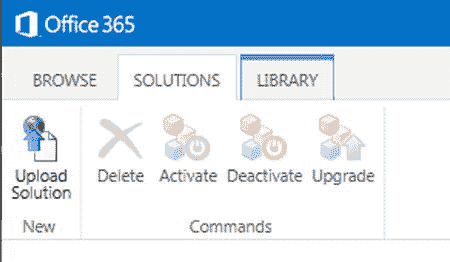

**图 8-29.** 将网站模板上载到解决方案库

## 还原网站

现在是最重要的步骤：你可以使用此模板来还原网站。你甚至可以通过给它一个不同的名称，将其与现有网站一起还原，以便从中恢复某些内容。只有在网站不存在于回收站（例如需要恢复早于主回收站或辅助回收站时间限制的内容）时，才有必要这样做。这在 SharePoint Online 的情况下可能非常有用。

如果你想再次找到该模板，请依次浏览“齿轮图标”、“网站设置”、“Web 设计器库”、“解决方案”。如果网站被删除，你现在可以使用此模板来还原它。为此，请点击右上角的齿轮图标，然后选择“网站内容”。在下一页底部有一个“新建子网站”链接（图 8-30）。

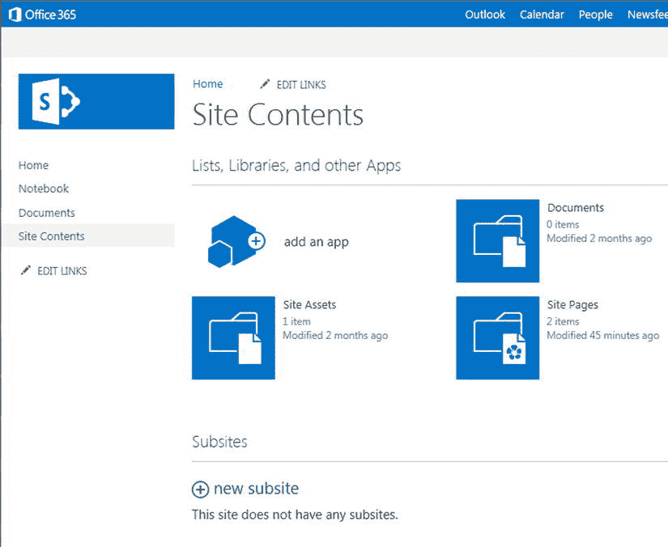

**图 8-30.** 创建新网站以重新创建内容

在“自定义”选项卡下找到你的模板，然后创建你的网站，你将看到所有内容和视图都已恢复（见图 8-31）。

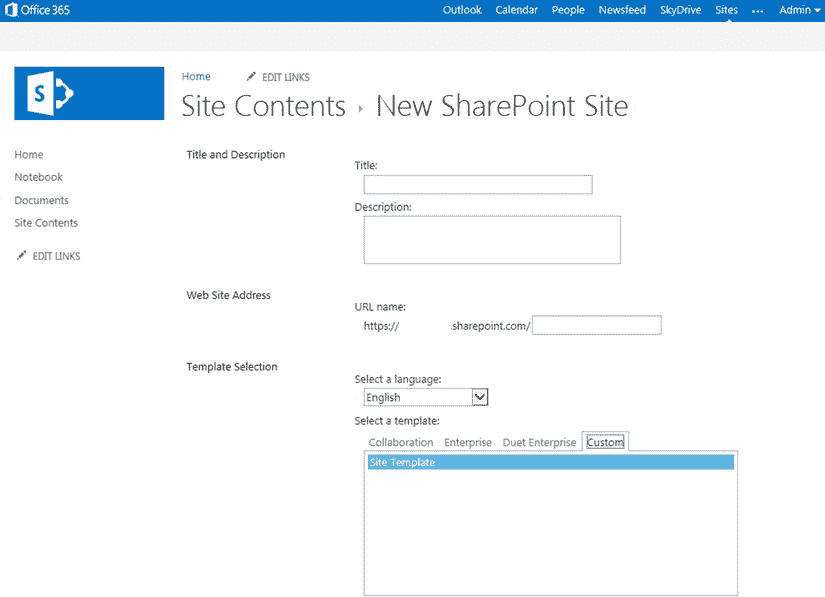

**图 8-31.** 基于模板创建网站

在这两种情况下，这都是将网站或列表重新创建到其他位置（无论是在同一网站集中还是在其他网站中）的一种方法。请记住不要让模板保留在库中，因为用户可能会使用它并创建另一个副本。

## 总结

本章表明，维护有价值内容备份的任务不必是 IT 人员的专属领域。从组织的角度来看，让用户负责并拥有备份自己内容的手段是一个极好的主意，因为它很可能可以节省备份空间和 IT 人员工时方面的资源。IT 通常必须备份用户产生的所有内容，因为 IT 无法知道哪些内容重要，哪些不重要。如果出现问题，IT 部门将面临压力，需要保存正确的内容并能够恢复。如果用户自己拥有这些流程，他们将对该平台有更强的控制感和所有权感，并且觉得自己可以为自己创造保障。这还有一个额外的好处，即释放 IT 部门的资源用于其他任务。它不仅以人员的形式节省资源；使用这些方法快速备份网站或列表意味着不需要在多个位置重复复制大量不必要的数据。这样，虽然有了副本，但这是出于充分理由。用户可以将其视为灾难时的个人救生艇。

# 第 9 章 变更管理与灾难恢复


> *“唯一不变的就是变化本身。”*
>
> ——约翰·F.

## 变更管理与应用程序生命周期管理

在本章中，我将介绍两个流程：一个用于管理 SharePoint 中的非开发性变更，另一个用于审批或驳回针对 SharePoint 环境的开发性变更。评估应对 SharePoint 系统进行哪些调整的流程被称为**变更管理**。通过治理、开发和维护来持续管理应用程序生命周期的流程则被称为**应用程序生命周期管理**。我将为这两个流程提供模板。同时，我还会阐述 IT 部门抵制变更的一些原因、变更的必要性，以及为何变更过多可能比变更过少更突然、更具破坏性的危险所在。

事物总是在变化。组织会进行重组。人们会转换岗位或雇主。业务需求会随之调整，以适应客户不断变化的需求。IT 系统需要打补丁和进行变更，以应对业务不断增长的需求和使用量。变更 SharePoint 并非易事。SharePoint 平台本身很复杂，且与其他系统相互依赖。因此，对其进行变更可能会在 SharePoint 及其依赖系统中产生不可预测的结果。然而，如果将变更仅仅视为系统的风险而试图抵制，最终只会导致系统因某些不可控因素而被迫进行变更。公平地说，变更本身就固有风险，例如：

- 系统不可用
- 性能下降
- 安全性减弱
- 用户不采纳
- 成本增加
- 需要更多培训

同时，变更也带来潜在收益，这基于一个事实：更好的技术应能优化你的任务和流程。这些收益包括：

- 更高的可用性
- 更快的性能
- 更强的安全性
- 更多的用户采纳
- 更低的成本
- 简化的用户体验 (UX) 意味着更少的培训需求

SharePoint 所有者对待变更的态度应当是积极主动的——将其视为一个不断完善和改进的过程。要实现这一点，首先必须建立适当的流程来管理 SharePoint 环境中的变更。如果变更得以妥善执行，它将成为系统的生命源泉，持续提升其对组织的价值。如果变更管理不当，则会导致系统停滞、无人使用，最终成为组织的成本负担而毫无益处。就可用性而言，SharePoint 场面临的最大威胁，正是系统所有者管理变更的能力不足。从某种意义上说，变更就是 SharePoint 的引擎，需要持续注入燃料，才能推动整个系统向前发展，并朝着组织的目标迈进。

## 熵

> *“任何涉及熵概念的方法，其存在本身就依赖于热力学第二定律，在许多人看来无疑会显得牵强，并且可能会因其晦涩难懂而让初学者望而却步。”*
>
> *——威拉德·吉布斯，《流体热力学中的图形方法》(1873)*

如同宇宙中的一切事物，SharePoint 也是一个易受熵影响的系统。我将其定义为“宇宙中所有物质和能量趋向于惰性均匀状态的趋势”。过度的熵是 SharePoint 的敌人：如果熵失控，SharePoint 将失去能量，最终对组织失去效用。归根结底，SharePoint 受制于所谓的热力学定律：即能量与运动之间的关系，或从某种意义上说，是变更与变化之间的关系。

热力学第二定律指出，一般而言，任何系统的总熵都不会减少，除非通过增加其他某个系统的熵来实现。你的 IT 负责人正是遵循这一思路：如果 SharePoint 与用户隔离，其熵值就不会减少。如果你阻止用户对其变更，SharePoint 就不会发生变化。

但是，要保持 SharePoint 的实用性需要付出努力；不能简单地让其保持不变而期望其保持有效。添加内容并不会真正改变系统。必须改变系统中的结构和流程，使其更高效。用户和 IT 负责人必须不断寻找利用 SharePoint 的方法，以使他们的任务更轻松、更快速、更便宜，或者至少更愉快。

此外，要让某样东西持续运转，就必须不断注入能量。你无法在开始时猛推一把，就让 SharePoint“自行运转”。许多企业存在这种假设：在启动 SharePoint 时投入大量精力，它就会自行产生动力并持续运行。然而，遵循熵的定律，它最终会耗尽动力。当它逐渐变得惰性且无用之时，企业便会抱怨这是 SharePoint 的错。熵控制了局面。

由此可见，在特定过程（如化学反应）中降低熵的增加，意味着该过程更高效。如果我们将此应用于 SharePoint 的语境，这对我们来说是个好消息：如果我们能让变更 SharePoint 的工作量减少，不仅能提高效率，还能降低系统中可能导致系统毁灭的熵风险。

基础设施人员中存在一个心照不宣的假设：让业务远离技术，是维持系统稳定性和可靠性的最佳方式。他们试图减少熵。用户的需求被视为对 SharePoint 场完整性的威胁。为了保持场的稳定，IT 部门的作用就是抵制变更。IT 部门认为，从长远来看，他们的行为符合用户的最佳利益，因为 SharePoint 场不会受到不懂技术的非 IT 人员的破坏。这个假设从根本上就是错误的，因为它忽略了一个事实：如果不允许用户向系统注入能量，系统将不可避免地减速并最终停止。

## 应用程序生命周期管理

如前所述，通过治理、开发和维护来持续管理应用程序生命周期的流程被称为应用程序生命周期管理。影响组织处理此流程方法的一个重要因素，是其应用程序开发和变更管理的理念。在某些情况下，人们倾向于采用一种正式的、受到较严格控制的方法。在这样的组织中，自定义开发或打包解决方案通常是首选方案。尽管这在许多情况下可以理解，但像 SharePoint 这样的应用程序为组织提供了另一种选择。

复杂的开发解决方案在成本和维护方面投入更大，但有时是满足业务需求的唯一途径。在本节中，我将考虑的一个内容就是开发解决方案的实际成本。

稍后，我将描述业务内部管理变更的流程（`RFC`、`BIA` 和 `CAB`），以及变更测试和审查。然而，首先让我们看看几种不同类型的开发模型，并思考哪种模型对 SharePoint 的变更最有意义。当然，根据 SharePoint 环境的规模、同时在相同代码上工作的开发人员数量、以及需要同时开发和部署的不同代码片段数量，会有不同的解决方案。然而，一些基本考虑因素常常被忽略或误解，而这些因素对于 SharePoint 环境中灵活且可管理的变更至关重要。它们适用于大多数组织所需的大部分变更。

## 开发模型

将用户需求最终转化为生产环境中的实际使用，可以通过多种方式实现。你可能听说过诸如“瀑布”、“Scrum”和“精益”之类的开发项目理念。

这些为应用程序开发提供了模型；理解这些模型能为我认为在诸多 SharePoint 场景中最有效的变通方法提供重要的背景。我还会在本节中介绍该变通方法。

### 瀑布模型

瀑布模型在开始时收集需求。用户直到最后接近部署时进行测试，才会看到解决方案（参见图 9-1）。该模型发展于过去 20 到 30 年间，始于开发人员需要预约大型机时间来编译代码的时代。它未能与时俱进，因为如今由于更好的编程对象模型，可以更快地开发更复杂的解决方案。该模型要求开发者按照线性顺序依次进行规划、构建、测试、审查和部署。在部署过程中，代码只编译一次。如果解决方案与需求之间存在重大不匹配，就来不及修复了。

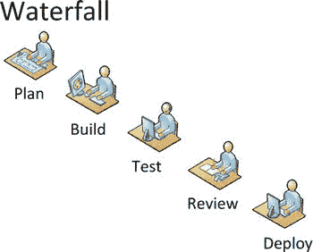

图 9-1。瀑布模型是线性的，如同装配线

### 迭代瀑布模型

迭代瀑布模型是为了应对经典瀑布模型的局限性而发展起来的。这个模型略好一些，但仍然需要大量有风险的前期开发、一些测试，以及最终的部署（参见图 9-2）。像 Office 这类软件就是这样创建的。大约每隔两年就会完成一个新版本。从用户的角度来看，两年等待新功能的时间太长了。

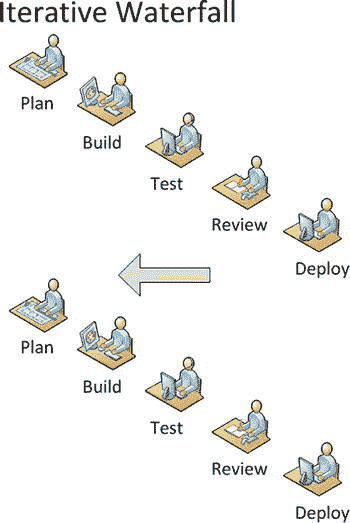

图 9-2。迭代瀑布过程只是重复了瀑布过程

### Scrum 模型

Scrum 模型具有短周期，可以使解决方案尽快变得可用并经过测试，功能逐步添加，直到最终审查和部署（参见图 9-3），其好处是用户可以更早地提供输入，解决方案可以与用户共同演进。

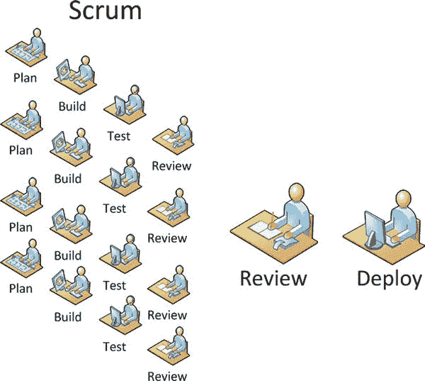

图 9-3。多个独立功能的 Scrum 导致最终的单一部署

Scrum 演变的原因是用户通常直到你向他们展示一些东西才知道他们想要什么。出于这个原因，最难编写的解决方案是报告解决方案——不是因为代码难写，而是因为业务部门通常只知道更深入地查看他们正在产生的数据是个好主意，因为他们知道其中存在他们没有看到的、有价值的信息。问题在于，他们在看到数据之前不会知道什么有价值。Scrum 方法允许解决方案演进，业务部门了解他们可能用该解决方案做什么，并相应地完善他们的需求。

### 精益模型

精益模型将 Scrum 方法更进一步：通过独立创建功能来不断添加产品（参见图 9-4）。如果添加的功能用户不喜欢，可以移除。这与 Gmail 的开发方式类似。功能是增量部署的，但从一开始它就能运行。

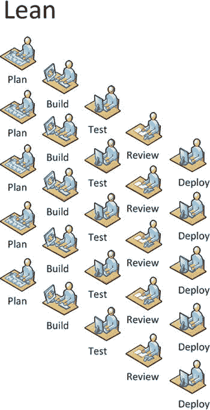

图 9-4。精益模型不断添加独立的新功能

瀑布模型、迭代瀑布模型、Scrum 和精益模型之间的主要区别在于用户被召回评估解决方案的频率。让解决方案演进有助于用户看到可能实现的功能。因此，精益模型现在是最常见的。所有这些方法的主要好处是它们控制了软件变更的过程，从而降低了风险。

SharePoint 在某种意义上属于软件，因为它有被编译和安装的部分。和所有微软软件一样，它已经经历某种构建过程。但虽然它已经构建完成，它也是一个由大量功能组成的平台，这些功能允许开发人员之外的人改变自身与内容之间的关系。必须有一个过程来管理这些变化，但它不能像瀑布模型那样过时和简单。部署 SharePoint 需要什么方法？

## SharePoint 变通方法：构建/规划/测试/审查/部署

规划/构建/测试/审查/部署模型并不完全适合 SharePoint，因为它是一个应用程序，已经内置了许多用于创建解决方案的功能。不幸的是，用户通常不知道这些功能，因此需要聘请开发者介入并编写可能不必要的代码，而从业务角度来看，这具有增加安全性的额外优势，因为变更可以通过严格的变更管理流程进行。

更好的 SharePoint 解决方案是移除构建步骤，而这已经是微软用来创建 SharePoint 的过程的一部分。微软在您安装它之前就完成了整个过程，这为您简化了变更流程。因为组织需要的大部分 SharePoint 功能已经创建，变更过程更多地变成了一种实现而非开发。然而，变更仍应经过仔细研究和规划。它们应在非生产站点或服务器场中进行测试、由用户审查，然后才部署到生产环境（图 9-5）。例如，假设您有一个关联了审批工作流的实时 `InfoPath` 表单，用户希望表单添加新功能，可以根据其他字段的内容自动填充两个字段的值。要实现这一点，可以通过一些研究进行规划，然后将 `InfoPath` 模板的副本部署到测试 SharePoint 站点进行构建。一旦业务部门审查并测试了变更，就可以自信地将其部署到生产环境，而不会破坏现有的实时数据，并且能够正常运行。这是瀑布模型和精益模型的混合。让我们称之为精益瀑布！

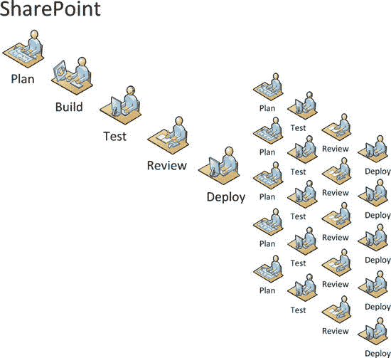

图 9-5。微软负责构建，但 SharePoint 的拥有者仍应规划、测试、审查和部署

## 变更成本

将开发工作（大多数时候）交给微软是有道理的，原因很简单：成本。SharePoint 可能有数千名开发者花费数年的时间，耗费数百万美元的成本。这种程度的支出不是大多数公司愿意承担的。这就是为什么您改变 SharePoint 的方法应该有所不同。

有时组织会有一些变更需求，这些需求只有以不成比例的高成本才能实现。根据我的经验，最常见的例子是业务部门直接与开发者签约以满足其需求，而不是通过基础设施的拥有者请求变更。开发者听取用户需求，并使用 `AJAX`、`C#` 和自定义控件的组合来满足这些需求，从而在几周内完成工作。业务部门满意了，开发者便离开了。数月、数周甚至数天后，用户决定对他们创建的页面进行一个小改动。他们认为这是小事，于是向内部 IT 部门求助。这是 IT 部门第一次得知这些变更。他们甚至不知道业务部门是如何获得访问权限来进行这些更改的；可能来自 IT 部门某个认为既然开发者知道自己在做什么就不会造成任何伤害的人员。无论如何，现在 IT 部门被期望拥有此解决方案，但他们没有关于做了什么、如何做以及为何这样做的文档。他们花费大量时间梳理开发者的代码，并最终做出了更改。

他们意识到，这位开发者本可以使用现成的 OOB Web 部件来完成同样的工作，但很可能他对应用程序本身知之甚少——只知道如何在平台上进行开发——因此他编写了实际上维护成本非常高的代码。用户现在指责 IT 部门，因为每一个小改动都需要花费数小时甚至数天的时间。他们还对连最小的改动都必须由 IT 部门的人来完成感到不满。最终，该解决方案因熵增而失效，不再被使用。它的创建和维护成本都很高，但始终未能跟上业务需求的变化。

# SharePoint 演化与管理

业务方没有做的是考虑该解决方案的拥有成本。他们只考虑了最初雇佣开发者几周的费用。如果他们花时间去了解 SharePoint 的 OOB 功能，本可以创建出自己能管理的东西。学习这些技能的初始成本可能比雇佣开发者更高，但后续的持续成本会更低。这就像我那个热力学系统变得更高效的例子。IT 部门也可以以更低成本为业务部门提供指导和支持。结论是：变革可能代价高昂，但从长远来看，如果初始投入的能量被明智地使用，回报可能会更高。变革必须以协作的方式在业务内部进行管理，以惠及各方。

## 解决方案/问题

解决方案包使得在 SharePoint 中部署和激活代码的过程更加简化和自动化。因此，出错的几率变小了。然而，用户和开发者往往将它们用作更受控的“规划/构建/测试/评审/部署”流程的替代品。解决方案仅有助于部署。此外，它们并不能自动提供增量更新的流程。那些重要的问题很少被问及：如果我们以后想改变这个怎么办？会发生什么？如何尽可能无缝地更改现有的在线系统？解决方案可能会引发问题。它们也受熵增的影响，但现在它们为你的环境增加了更大的复杂性和风险。用户依赖现有的解决方案，但它正逐渐变得不那么有用，因为它没有随需求一起演变。

例如，最近有人请我帮助一个培训页面的所有者对他们的 SharePoint 网站做一些小改动。他们想要一个通往他们想创建的新论坛的链接，还想在主页的 Web 部件中添加一列。我很快添加了论坛和链接，但那个 Web 部件是用 AJAX 创建的，而不是使用 OOB Web 部件或 SharePoint Designer。代码中没有文档或注释，而且联系不上开发者。唯一的解决方案是再雇佣一名开发者一周时间，来完成本应是几分钟就能完成的工作。该解决方案看起来很棒，但拥有它和更改它的成本太高，不切实际。因此，应该始终问一个问题：以后修改这段代码需要付出什么代价？

## 开发环境的发展

与几年前相比，虚拟化技术使得为开发 SharePoint 实例编写代码的环境创建变得简单得多。这意味着组织可以以更低的成本拥有多个开发、测试和 UAT 环境。

一个标准的开发周期如下：

*   用户报告错误或请求更改。

*   开发者可以在其开发环境中并行运行多个构建版本，然后再部署到集体测试环境。

*   其中一些构建版本会部署到用户可访问的 UAT 环境中，用户可以报告错误是否已修复或新功能是否满足其需求。

*   对生产环境的更改现在可以在实施前通过 RFC/CAB 流程。

生产环境的更改可以在预发布/预生产环境中进行测试。

作为一个平台，SharePoint 本应使这种复杂的变更管理变得不必要。理想的情况是 SharePoint 环境中的所有演变都在浏览器或应用程序级别进行。我见过许多 SharePoint 环境，其中所有开发工作都因政策原因而停止，因此用户和业务部门被强制最大限度地发挥 SharePoint 的潜力。这使平台更易于管理，但最终限制了 SharePoint 作为一个平台对业务的价值，这令人遗憾。有时，SharePoint 只有通过自定义代码才能发挥其最大潜力。

虚拟化确实降低了拥有多个环境的成本，但这何时是个头？你最终可能拥有多个虚拟场，每个场都运行着不同开发解决方案的不同构建版本。如果你一次只做一个更改，一套开发/测试/生产环境就足够了。如果你有 50 个更改，你真的想要 50 个虚拟 SharePoint 场吗？保持 SharePoint 活力并不断变化的最佳方式是让用户自己发起并做出更改。这可能需要他们付出努力学习 SharePoint，但与聘请可以将责任委托给他们的外部开发者或培训师相比，这个过程将为他们带来更直接的利益。

## 演化

我们宇宙中的一切都遵循热力学定律。（注意，我说的是“我们的”宇宙，因为我们知道还有其他具有不同定律的宇宙。）但变化总是好的吗？SharePoint 系统中过多的变化会加速熵增，从而导致系统崩溃。这正是 IT 基础设施所有者所抵制的。在未经测试、未进行适当的业务影响评估、也未经过 IT 人员和业务部门评审的情况下更改 SharePoint，可能导致系统迅速崩溃。可以把过多的变化想象成泰坦尼克号船长在乘客和船东要求下以创纪录速度驶向纽约时所承受的压力。这样做会增加这艘船的名气，增加乘客数量，并最终提高整个航行的成功率。然而，从更高、更冷纬度漂来的大块熵之冰突然阻止了那个计划。熵增不仅仅是 SharePoint 因逐渐惰性而面临的风险，也是因变化过快而导致突然的、灾难性变化的风险。

解决方案是以渐进和经过测试的方式演化 SharePoint 平台。这就是演化的运作方式。环境中会产生多种变异，最适应的生存下来并延续下去，而不适应的则消亡。生存意味着你的成功基因传递给后代，然后循环重新开始。环境不可避免地会发生变化，其他物种（甚至是你自己物种的其他成员）会争夺有限的资源，但由于存在多代，变化总能被适应，因为整个物种可以演化以适应变化。

## 谁控制 SharePoint 中的变更？

决定谁应该拥有什么权利来更改什么，是在所有者维护系统完整性、安全性和可管理性的需求与业务需求之间的平衡。这是一个需要强有力的领导者来担当的角色，他们应将业务和 IT 视为一个整体，而不是对立的双方。有时，找出用户或组为何收到访问被拒错误所花费的时间，比直接授予该用户或组更高权限还要长。这解决了眼前的业务需求，但从长远来看，授予过多权限可能导致安全或稳定性问题。从业务角度来看，安全仅用于控制对内容的访问，但从基础设施角度来看，它是为了防止用户对系统进行会产生负面影响的更改——这些影响最终必须由 IT 部门来修复。

有些组织的政策过于严格，这也是事实。这只会导致用户想方设法绕过或破坏规则。IT 部门与业务部门之间必须进行沟通。这就像任何一段关系：双方都必须认识到，他们是同一组织的一部分，必须作为同一个团队行动，而不是对立的两方。根据我的经验，这最终取决于优秀的管理者——那些能倾听双方意见，并在其他各方无法自行做出决定时，为了大家的共同利益而做出决策的人。领导力确实不是能在书本上总结出来的东西。它是一个综合的过程，与其说是科学，不如说是艺术。但其好处显而易见：那些能充分利用技术的企业就会获得优势。

## 变更类别

并非所有变更都是同等的。从技术角度来看，要理解变更的范围，你必须能够确定它属于哪个类别。变更还有业务影响，这与技术影响可能完全没有关系。一项变更在技术上可能非常简单，但可能会产生非常大的业务影响。例如，拔掉服务器机房的冷却系统。但是，如果业务人员必须对某个变更做出决定，他们就必须对技术层面有一些基本的了解。SharePoint 应用程序变更可以分为三类。（此列表不包括平台补丁或服务包，因为它们来自微软或第三方，而非组织内部。）

*   配置

*   设计

*   开发

变更所属的类别取决于用于进行变更的工具以及进行变更所需的权限。变更的风险等级从根本上取决于其对整个系统完整性的潜在影响。影响越小，进行变更所需的权限越低，对工具的限制也越少。以下是进行每种类别变更所需的三种工具：

*   `SharePoint`

*   `SharePoint Designer`

*   `Visual Studio`

在评估一项变更时，你必须了解变更的范围及其对 SharePoint 环境完整性的潜在影响。变更的影响越大，进行变更所需的权限就越高。将这些权限授予不熟悉其变更影响的人，是糟糕的管理做法。应始终遵循最小权限原则：永远不要授予用户超出其使用能力的权限。这些类别有助于你对变更的严重性级别进行分类，并确定应授权谁来进行变更。

### 配置

仅需使用浏览器和 SharePoint 站点页面即可完成的变更是配置变更。这些变更可根据访问页面所需的访问级别进一步细分，而这又取决于对整个服务器场的变更范围。

*   服务器场

*   网站集

*   网站

*   页面

*   列表/库

配置变更直接在生产环境中进行，除非使用 `PowerShell` 脚本来执行变更以最大程度降低人工错误风险，否则这些变更不会自动化。变更可以首先在开发或测试环境中进行，但之后必须在生产环境中手动重新执行。这些变更通常无法一次性批量复制或迁移到生产环境，除非你能够从开发或测试环境备份并恢复到生产环境。这只有在生产内容没有发生任何变化的情况下才有可能。无论文档记录得多好，手动执行变更都会增加开发或测试中执行的步骤无法被准确复制的风险。进行这些变更的人员必须完全理解它们；否则就可能产生误解。

### 服务器场

服务器场管理员组的成员身份在 SharePoint 管理中心授予（参见图 9-6）。该站点用于整体管理 SharePoint 服务器场。

在此进行的变更会影响整个服务器场。例如，你可以添加一个新的爬网服务器，或者更改搜索爬网内容的时间。在此进行变更时，你需要理解变更不仅对用户，还对 `SQL Server`、网络、Windows Server 以及 SharePoint 本身产生的影响。换句话说，在此进行的变更风险很高，应谨慎管理。

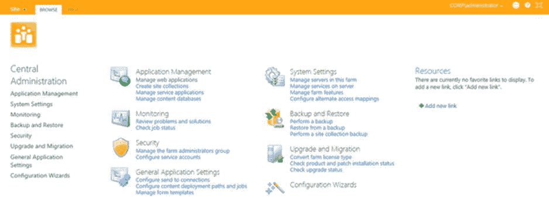

图 9-6。SharePoint 服务器场管理中心

### 网站集

# SharePoint 环境中的变更管理

在网站集级别进行的变更会影响父网站及其下的所有子网站。例如，如果从库中删除了现有的网站模板，则该模板将不再可用于网站集中的任何网站。拥有网站集所有者权限的用户应花时间彻底理解更改“网站集设置”页面上众多晦涩设置中的任何一项所带来的影响（参见图 9-7）。在他们理解之前，必须听取 IT 基础设施部门的观点，即始终以维护系统为出发点。这最初可能与业务需求不一致，但随着网站集所有者知识的增长，他们将代表整个组织的利益行事。

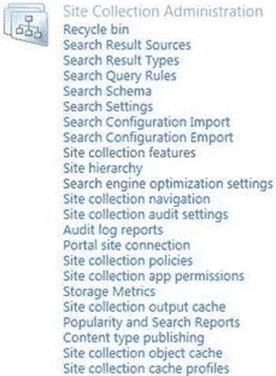

图 9-7。网站集管理选项

## 网站

在网站级别进行的变更会影响该网站及其上的所有页面。例如，如果你更改了网站主题，该变更将显示在该网站所有列表和库的页面上。拥有网站所有者权限的用户应彻底理解更改“网站设置”页面上众多设置中的任何一项所带来的影响（参见图 9-8）。了解这些设置是一个试验和发现的过程。你也可以找到许多在线和书面资源。然而，没有任何一个来源是完整的。以下是我的流程：

*   我如何实现这个业务需求？
*   根据我对书面和在线资料的研究，其他人是如何满足这个需求的？
*   我能否在沙盒化的非生产环境中测试潜在的解决方案？
*   我能否向用户展示并征求他们的反馈？

应用这样的流程可能不会每次都达到完美的结果，但这总比目光短浅地抓住第一个看似可行的解决方案要好。

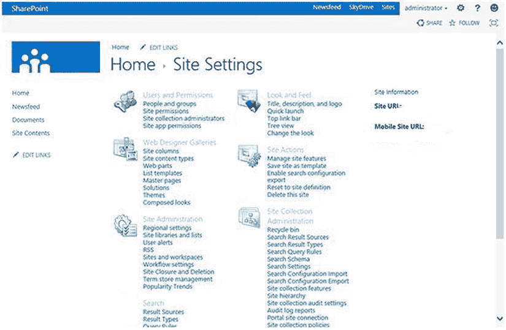

图 9-8。网站管理选项

## 页面

Web 部件框架的设想是通过浏览器即可更改页面属性，例如查看内容搜索 Web 部件的属性（参见图 9-9）。在页面级别进行的变更会影响该页面。例如，如果你将 Web 部件移动到页面底部，所有能访问该页面的用户都将看到此变更。也可以指定一项变更仅对你可见；这是页面的个人视图。与其他变更一样，拥有页面编辑权限的用户应彻底理解其变更的影响。页面通常继承整个网站的管理员作为其管理员；很少有单个页面的所有者是不同的人。具有专业技能的用户甚至可以使用内容编辑器 Web 部件，利用 AJAX 和 Web 服务等技术对页面进行高度交互式的更改，但即使他们操作失败，其影响也仅限于页面级别。

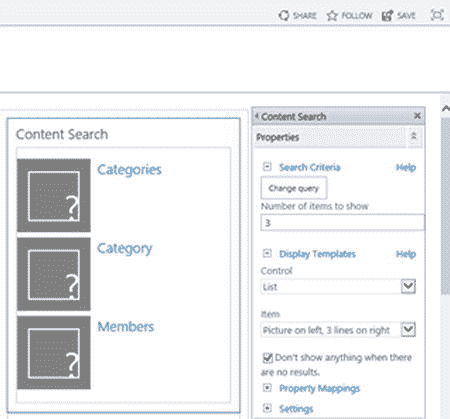

图 9-9。更改 Web 部件页面

## 列表/库

可以授予用户向列表/库添加内容、在列表内创建或修改视图，或向列表添加/删除/修改列的权限。即使是这些微小的变更也可能对其他用户产生重大影响，因为如果某个列被删除，它不会存储在回收站中。

## 元数据导航与用户体验

作为另一个例子，元数据导航设置使得可以利用元数据浏览库中的内容，就像浏览文件夹一样（参见图 9-10）。这可能会让用户感到困惑，除非它满足了让内容更易于查找的先前需求。仅仅因为某个功能可用，并不意味着你应该启用它。

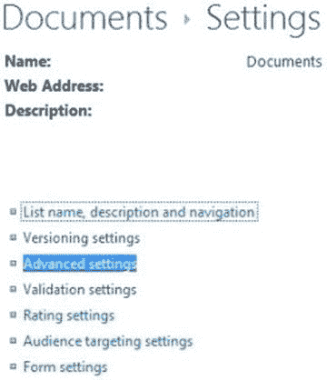

图 9-10. 列表设置

## 受控变更的重要性

仅仅通过用户、网站或服务器场管理员在 SharePoint 用户界面中进行配置和结构更改直接进入生产环境，会引入一个复杂问题：它打破了所有这些方法所共有的循环，即规划/构建/测试/审查/部署。使用 SharePoint，仅通过 Web 浏览器，你就可以对你的 SharePoint 环境和用户做出非常重大的更改。用户拥有的凭据越高，更改的影响就越大。有时，变更可能会产生无法预见的后果，因为用户不知道究竟是谁依赖于他们所拥有的内容。

例如，我曾经需要排查一个情况，即某个网站集内 15 层的网站在一夜之间突然失去了 SharePoint 组。结果，整个组织中的团队都无法访问 SharePoint，数百名感到愤慨的用户向支持部门求助，他们认为自己被个人锁定了。在我到达之前，管理员检查了 Active Directory 和 SQL Server，并开启了微软支持电话，还彻底检查了 SharePoint 的错误。随后，怀疑人为破坏：是黑客删除了这些组吗？最后，部门经理来了；我立刻怀疑他，因为他有在晚上做自己的小型 SharePoint DIY 项目的历史。

此前，他曾尝试使用 `SharePoint Designer` 创建 Web 部件，结果导致门户网站的主页面无法访问。我和他谈了，他坚称自己没有做任何可能导致这个问题的事情。最后，他记得从“他的网站”中删除了一些不应该在那里的用户组。但他没有在其他任何网站上做过这件事。因此，他认为 SharePoint 存在一个错误，等等。结果发现，他在不知情的情况下，从他的网站导航到了网站集设置页面。由于启用了权限继承，他不仅删除了这些组对“他的”网站的访问权限，还彻底地从整个网站集删除了它们，从而移除了整个组织中所有 15 层网站中所有这些组里所有用户的访问权限！

直到今天，那位经理仍然拥有那些权限；不幸的是，他坚持自己需要这些权限，但也坚持认为自己不需要接受培训来理解它们。但这个例子的要点是：变更管理过程依赖于良好的治理，而良好的治理又依赖于用户拥有的权限不超过他们理解如何使用的范围。它还要求拥有权限的用户承担使用这些权限的责任。

## 设计层面的变更

设计层面的变更需要使用 `SharePoint Designer`（参见图 9-11）。`SharePoint Designer` 允许你进行影响网站结构和视觉呈现的更改，因此，虽然拥有 `Designer` 权限的人可以进行这些更改，但它们实际上应该仅在网站所有者的批准下进行，因为它们可能影响所有内容和用户。例如，`SharePoint Designer` 允许你更改网站页面布局模板。此更改将影响门户上使用该页面布局的每一个发布页面。

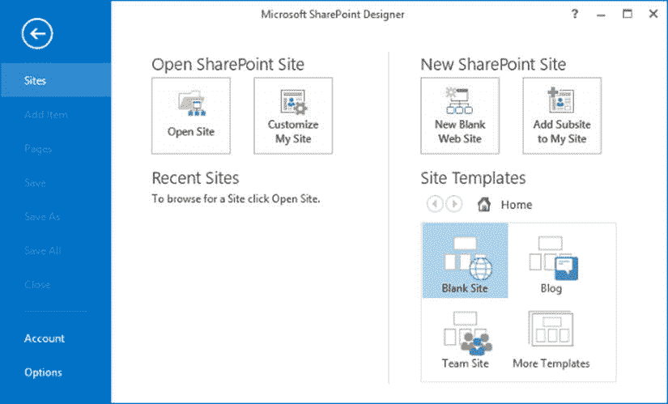

图 9-11. SharePoint Designer

与配置更改一样，`SharePoint Designer` 直接在生成环境中进行更改。与配置更改一样，这些更改可以在开发或测试环境中进行，但更改必须在生产环境中重做。

事实上，这些更改通常无法在单个批次中复制或迁移到生产环境。这增加了开发或测试中所采取的步骤无法被准确复制的风险。如前所述，进行更改的人必须完全理解这些更改，以避免误解。

## 开发层面的变更

虽然我已经指出 SharePoint 应该被视为一个主要通过配置而不是开发来完成的完整应用程序，但 SharePoint 也拥有丰富的环境来扩展它并在其上开发。这并非总是要避免的事情——它只是应该被视为一项其拥有成本已被理解和接受的事情。SharePoint 上的开发可以通过添加内容类型、网站定义、Web 部件和工作流来自动化配置，而这些是通过 Web 用户界面无法很好地完成，或者根本无法完成的。

开发层面的更改可以直接在服务器上进行，但应该制定政策，只部署打包为功能或解决方案的更改。一个 SharePoint 解决方案是一个可部署的包，可以包含功能和程序集。解决方案包是一个基于 `.cab` 的文件，扩展名为 `.wsp`。Visual Studio 2010 SharePoint 项目模板会作为开发项目的一部分为你创建 `.wsp` 包文件。一个解决方案可能包含多个 SharePoint 功能，这些功能提供诸如 Web 部件、列表定义、模块和事件接收器等功能。功能和解决方案需要使用 `PowerShell` 进行部署。

与配置和设计更改一样，`PowerShell` 会将功能或解决方案直接部署到生产环境中。与配置更改一样，它们可以首先在开发或测试环境中进行，然后重新部署到生产环境。由于它们是打包的，因此没有复杂的部署步骤。如前所述，进行更改的人必须完全理解这些更改，以避免误解。

## 在生产环境中进行测试

知道在生产环境中可以毫无风险地做什么，这需要经验。但是，如果你不确定更改的后果，如何降低风险？在 SharePoint 中进行任何更改时，应始终遵循的原则是：如果更改结果不如预期，我能否回滚此更改？如果答案是否定的，请采取规划/构建/测试/审查/部署的方法。请记住，目标是永远不会丢失已经花费大量时间和精力产生的内容。例如，如果你想更改一个 InfoPath 表单库模板，你必须明白，当你更改它时，所有已创建的表单都与该模板相关联，因此可能会受到影响。复制一份模板，将其发布到另一个网站，复制一些测试表单，并首先在那里进行你的更改。你永远无法在做出更改之前确切知道结果，但潜在的影响越大，测试副本就越重要。

## 变更管理

没有任何变更管理流程是完全相同的，但它们都具有一些基本要素。在构建你的变更管理计划时，你可以融入这些要素。它们都有助于使变更具有建设性而非破坏性。它们使你的 SharePoint 系统能够足够快速地演变，而不会屈服于熵。我在图 9-12 的流程图中展示了这些要素。以下是这些要素：

*   某种用于捕获变更请求所需详细信息的表单。
*   有人负责审查初始请求，并确保其提供了所有适当的、正确的详细信息。
*   对变更的业务影响进行评估。
*   变更咨询委员会 (CAB) 将批准/拒绝该请求。

*   必须对变更进行测试和排期。
*   对变更进行审查，并标记为已完成或已撤回。
*   变更请求的所有注释、批准和支持文档都会被存储起来，以备将来复用。

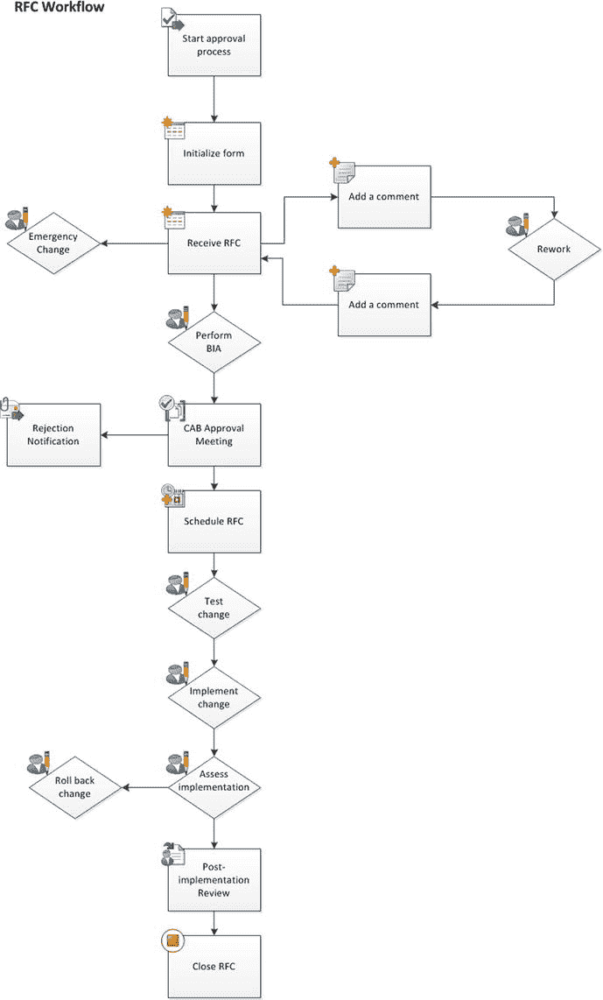

## 变更管理流程

### 影响评估

正确执行这些步骤是您实现高可用性最主动的方法。该流程的核心是变更影响评估。任何熟悉信息技术基础架构库（ITIL）的人都知道影响评估。变更影响评估是一种系统性的方法，旨在发现与变更请求相关的潜在风险。

大多数失败的变更都仅仅是由于没有考虑当前活动以及未能沟通预期活动而导致的。这包括任何提议改变系统配置、操作实践、策略或流程的情况，以及任何将要执行的全新或不同活动。

要使变更影响评估（或简称为影响评估）有效，系统所有者必须探索正常操作与可能引入风险或导致变更失败的任何条件之间的所有差异。如果运用得当，影响评估可以主动管理风险。这是一个简单的想法，可以使用文字处理器或电子表格快速实施。您甚至可以使用 SharePoint 列表。它不需要复杂的软件。然而，它确实需要谨慎遵循正式的流程，以及团队合作。

在 IT 部门之外的大多数组织中，影响评估是相当成熟且正式的活动。特别是世界各地的军事部门在规划变更方面拥有丰富的经验。然而，在许多组织中，大多数 IT 影响评估仅仅是通过电子邮件发送 RFC，然后等待某人对此发表评论，或者更糟的是，由一个权限过大的开发人员在孤立环境中处理"一个小的变更"。另一种流行的影响评估方法是在变更发生前的一两天召开会议，各部门负责人讨论即将开展的工作。

很明显，现有的影响评估不起作用。每年，所有大型智库都报告说，IT 是自己最大的敌人。高德纳公司记录在案，大约 80% 的事件是由失败的变更管理活动导致的（`http://www.gartner.com/id=334197`）。情况本不必如此。变更影响评估在 IT 部门之外广为人知，并且存在执行影响评估的模型。

主要的变更请求流程（如图 9-12 所示）也调用了一个称为"执行影响评估"的子流程（参见图 9-13）。该子流程包含风险管理、工作量估算和测试建议等任务，这些任务可以并行执行。完成后，信息将被传回主流程。

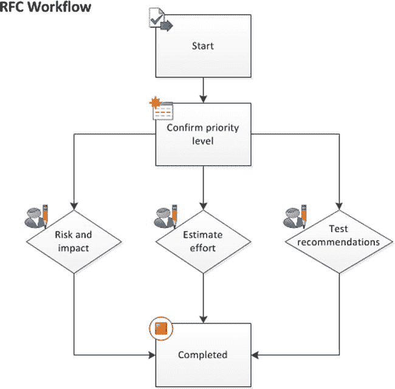

图 9-13。一个变更管理子流程：业务或变更影响评估

虽然影响评估有效且易于实施，但它并非万能药，也不能完全取代现有的变更流程。相反，它只是变更管理流程的一部分。执行影响评估的流程包含以下步骤，我将在下面的示例"羊群观察"中详细说明它们应如何使用。我还将展示此子流程如何融入整个变更管理流程。

### 应用场景：羊群观察影响评估

图 9-13 显示了该流程的步骤以及位于侧边表示旁支流程的步骤。为了描述变更管理流程，我将以一个 Web 部件为例，该部件将被添加到我们位于爱尔兰基尔代尔郡纽布里奇的虚构大学的首页。这个 Web 部件是高级管理层强制要求的。其目的是显示通往校园道路的地图，以警告教职员工何处有羊群阻碍交通。

教职员工可以根据他们在校园建筑窗户旁的观察添加更新。其目标是减少白天以及教职员工驾车回家时校园周边的交通拥堵。

这个 Web 部件被称为"羊群观察"。IT 部门中在其个人开发环境中创建该部件的开发者提交 RFC，请求将其添加到生产门户的首页。该 RFC 是 SharePoint 站点上的一个列表项（参见图 9-14）。

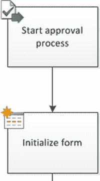

图 9-14。初始提交

当 RFC 被添加时，变更协调员会收到电子邮件提醒。她对其进行了审查，并注意到开发者没有说明该 Web 部件是否将作为解决方案进行部署。她就此添加了一条评论，开发者审查后添加了她自己的评论，确认它确实被打包成了一个解决方案（图 9-15）。该大学规定只能以此方式部署代码，因此必须确认这一点。

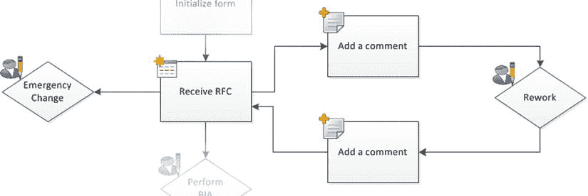

图 9-15。变更协调员审查

变更协调员判定这不是一项紧急变更，并批准其进入下一阶段。"紧急情况"是指任何被归类为高影响的业务中断，无论是由于受影响的用户数量，还是因为涉及对组织至关重要的系统或服务，因此必须立即响应。这不应是糟糕规划的结果！每周三，来自 IT 部门的代表，包括 SharePoint 管理员、SQL Server 管理员和网络管理员会开会。他们的任务是执行流程中的下一步：业务影响评估，即 BIA（图 9-16）。为此，他们执行以下任务：

*   定义所提议变更的范围。
*   确定变更后状态（提议状态）与原始状态的关键差异。
*   聚焦于第 2 步中关键差异可能产生的影响。
*   对第 2 步中关键差异产生的可能影响（第 3 步）进行分类和优先级排序。
*   根据结果做出决策。

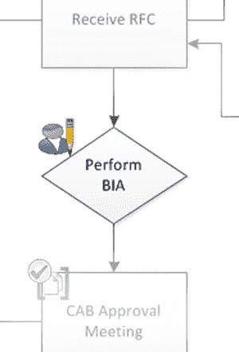

图 9-16。业务影响评估

### 定义所提议变更的范围

在 RFC 中，开发者写道，该 Web 部件作为解决方案安装在门户的根网站集中。它会安装一个 Web 部件，该部件随后应被添加到门户首页。它还会创建一个列表来存储用户提交的羊群报告和照片。她将该 Web 部件的功能描述为一个动态地图，用于显示用户提交的羊群位置和规模。她估计每月将收到 10 到 20 份报告，存储列表和照片所需的容量在 12 个月内将增长到 500MB。她预计该 Web 部件不会过多延迟首页的加载。

### 确定提议状态与原始状态之间的关键差异

IT 团队讨论了主要差异将包括：存储图像所需容量的增加、对首页性能的影响，以及安装 Web 部件所需的停机时间。

### 聚焦于关键差异可能产生的影响

他们将 500MB 的容量纳入当年的容量规划中，并认为可以满足要求。团队中的一名成员与开发者交谈过并看到了该 Web 部件，他表示该部件似乎不会显著减慢门户的速度。性能目标是让首页在 2 秒内加载完毕，而该部件在开发者的笔记本电脑上加载得非常快。该解决方案可以在工作时间之外安装，以尽量减少对用户的影响。

### 对关键差异可能产生的影响进行排序和优先级划分

团队确定主要风险在于列表所需的容量可能比预期增长得更快。然而，由于只需保留当前图像，因此决定如果列表增长过快，可以删除较旧的图像。风险评估和难度评估被确定为低级别，测试建议是先将该 Web 部件安装在测试系统上，以验证安装是否有效。

### 根据结果做出决策

有一个 SQL Server 更新计划于下周六进行，他们决定同时安装该 Web 部件，但需在本周五召开的变更咨询委员会（CAB）审批会议上获得批准。

## 变更咨询委员会（CAB）会议

无论会议是虚拟还是面对面，变更经理都应始终担任所有 CAB 会议的主席。变更经理应在适当时间召开 CAB 会议，以确保所有变更得到及时高效的处理。在变更频繁时期，可能需要每天召开，但通常每周五举行一次。对于复杂、高风险或高影响的变更，或者当重大项目即将交付产品时，有必要召开正式的 CAB 会议。这些会议可用于对变更进行正式评审和授权、审查未完成的变更，并讨论任何即将发生的重大变更。在适合面对面会议的情况下，应制定标准议程。

相关变更信息应提前分发，以便 CAB 成员在 CAB 会议之前进行影响和资源评估。由变更经理召集的 CAB 会议应包括与所审议的 RFC 相关的参会者。这可能包括来自 IT 部门之外的其他业务组和部门的参会者。CAB 对每项变更的授权必须由变更将影响的所有领域的适当代表给出。在我们的示例中，拥有 SharePoint 内容的用户代表以及提出“绵羊观察”Web 部件请求的管理团队代表应出席。

### 标准 CAB 议程

标准的变更咨询委员会会议应精心组织并主持得当，以尽可能提高效率。会议可酌情包括以下内容：

*   审查所有失败的变更
*   审查所有已撤销的变更
*   一份待 CAB 成员评估的 RFC 列表
*   审查所有已实施的变更
*   变更管理流程，包括对该流程所做的任何修订以及对该流程提出的变更（酌情）
*   讨论期间变更管理的成功案例，例如审视因变更管理流程所带来的业务收益（酌情）

### CAB 对每项变更的考虑因素（在授权之前）

这些考虑因素将包括在业务影响评估（BIA）阶段准备的信息，但会以更清晰、更简洁的方式呈现。CAB 成员可能技术知识有限，因此对变更评估的技术方面应以清晰、避免术语的方式提供。

*   风险/影响评估（对业务而言）
*   对基础设施和客户服务的影响（如服务水平协议 SLA 中所定义），以及对容量和性能、可靠性和弹性、应急计划和安全性的影响
*   对运行在同一基础设施上的其他服务（或软件开发项目）的影响
*   资源评估——实施变更所需的 IT、业务及其他资源，包括可能的成本、所需人员数量及可用性、所需时间，以及任何所需的新基础设施元素
*   对组织内非 IT 基础设施的影响
*   不实施该变更的影响/风险/影响
*   变更时间表中正在实施的其他变更
*   技术能力与技术审批

*   财务审批（如需）
*   第三方/供应商参与变更实施的情况
*   业务审批（如需）
*   审查/评估变更优先级

### `CAB` 评论/问题

变更经理必须在 `CAB` 会议纪要中记录 `CAB` 对每项变更的所有评论以及讨论过的任何问题。这些内容不会直接影响流程；它们只是记录当存在不同观点时的个人意见。这些问题可能不会导致变更被拒绝，但会被记录下来并纳入测试或变更本身中。

### `CAB` 建议/决策

变更经理必须在 `CAB` 会议纪要中记录所有讨论过的 `CAB` 建议和决策。某些决策乃至最终的审批可能需要提交到 `CAB` 之外。这种情况不常见，但如果决策被升级处理，仍然会通过 `CAB` 记录并实施。

### `CAB` 授权/审批

一旦变更的所有方面都经过考虑（如前述 `CAB` 考虑因素所述），`CAB` 将授权对变更进行排期，并进入流程的变更构建阶段（图 9-17）。

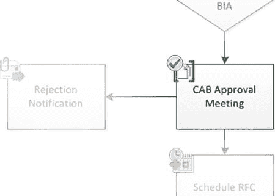

图 9-17. `CAB` 的结果

如果变更已获得 `CAB` 授权，那么 `RFC` 即可进行排期。如果 `CAB` 无法就授权变更做出最终决定，则变更经理需要启动变更升级程序，以确保在更高级别获得授权。在我们的示例中，这可能是大学校长，但这很少发生。变更授权的升级过程应在变更请求中记录——变更经理将详细说明变更升级给了谁，以及最终做出的决定（无论是批准还是拒绝）。

### 变更咨询委员会拒绝变更

如果 `CAB` 拒绝该变更，变更经理必须完整记录拒绝的原因，并确保将决定传达给申请变更的人。在我们的示例中，“绵羊观察”Web 部件已获批准。如果被完全拒绝，提议者可以带着改进后的解决方案版本重新开始流程。

## 排期 `RFC`

`CAB` 会议结束后，审批结果会传达给基础设施所有者。这种沟通可以通过电子邮件、文档或电子表格的形式进行。在测试变更开始之前，可以确定进行变更的最佳时间（图 9-18）。这个时间应与其他已排期的变更相协调，以避免相互影响。同时，这个时间也不应影响其他流程，例如备份。最后，这个时间还应对用户影响最小，同时满足他们的需求。例如，对薪资系统的变更最好在月底前几天进行，以确保在薪资处理完成之前，变更得到充分、正确的部署。

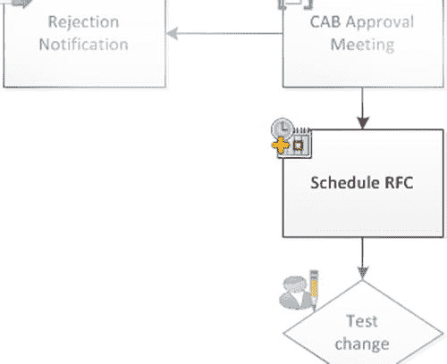

图 9-18. 计划变更

## 测试变更

测试（见图 9-19）必须在尽可能接近生产环境的情况下进行。随着虚拟化的出现，创建可回滚的服务器场副本变得更加容易。即使没有虚拟化，也可以使用过渡环境或预生产环境来进行测试。该环境应尽可能接近生产环境的副本。差异越大，测试遗漏变更问题的风险就越大。因此，测试过程应包括测试变更的回滚流程；现在就应该进行此项工作，而不是等到生产环境中发生意外事件之后。此时应定义成功部署变更的标准。其对资源的影响是否在计划参数范围内？其功能是否符合预期？是否在系统日志或应用程序内产生任何错误？

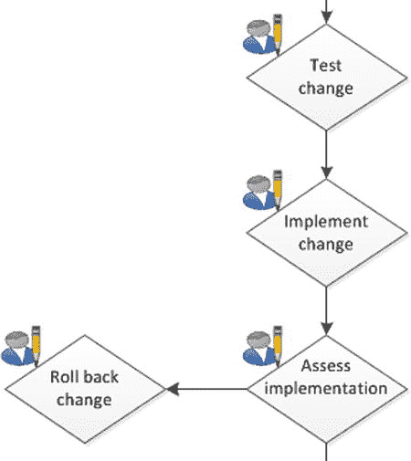

图 9-19. 测试变更、实施变更、评估实施情况，并可能回滚变更

## 实施与评估，或许还需回滚

在某些方面，实施和评估变更的过程与测试过程相同。部署流程以及确保其顺利进行的检查也是相同的：其对资源的影响是否在计划参数范围内？功能是否符合预期？是否在系统日志或应用程序内产生任何错误？如果满足这些标准，则视为成功；否则，必须回滚。这也是一个您应该测试的流程（见图 9-19）。有时变更并未完全按计划进行，但可能仍被保留在生产环境中。不过，这种情况并不常见。通常，会恢复到先前的状态，并重新启动变更请求流程。

## 审查与关闭

此时，在正式关闭 `RFC` 的过程中，应记录部署过程中吸取的任何经验教训。其成功标准应已满足，若未满足，则应记录此信息并通知相关方。例如，如果代码使用的资源超出计划，可以将其退回给开发人员修复，或交给基础设施团队增加更多资源。无论哪种情况，流程都已结束（见图 9-20）。

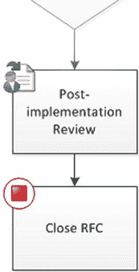

图 9-20. 审查与关闭

## 总结

变更管理是一个协作流程，需要从业务和技术的角度评估变更的影响。变更是 `SharePoint` 的生命线；没有变更，系统将屈从于熵，与用户需求越来越脱节，最终成为业务的负担而非福音。`SharePoint` 确实需要变更管理。最佳方法是：构建软件是微软的任务，而规划、测试、审查和部署配置变更则由用户完成。

自定义代码是个例外，由于其对平台可能产生的影响，必须采用更严格的变更管理流程。解决方案包使部署更加自动化，但它们不能替代完整的应用程序生命周期管理。按照策略，自定义开发应是例外而非规则，因为 `SharePoint` 的精髓在于它是一个用户驱动的工具。自定义代码会增加平台风险，并将控制权从用户和基础设施所有者手中夺走。

`SharePoint` 之所以成功，是因为对其进行变更并不依赖于晦涩难懂、来之不易的专业知识。只需要学习哪些变更可以直接执行，哪些需要在部署前进行规划和测试。

如果一项变能不能立即撤销且对系统或用户无影响，则需要规划和测试。如果变更能够保持在用户操作权限范围内，那么变更速度可以更快，无需诉诸复杂的 `RFC`/`CAB` 流程。没有变更，`SharePoint` 就会消亡，但它也不必保持静止：受控变更，或“精益瀑布模型”，就是解决方案。有了它，`SharePoint` 可以以一种确保持续为组织带来利益的方式成长。