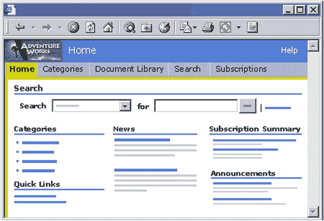
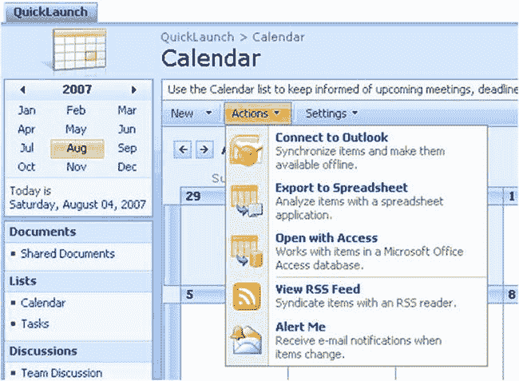
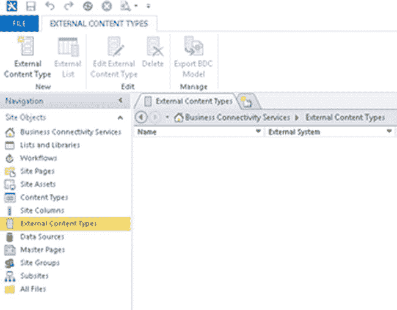
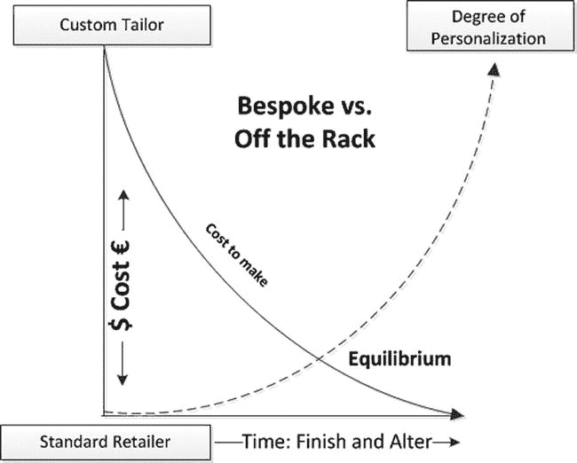

# 灾难恢复与云

云计算终于足够成熟，是时候正确理解它能为 SharePoint 所有者带来何种益处了。尽管基础设施由外部第三方拥有，但贵组织中的 SharePoint 所有者最终仍需为用户内容负责。同时，还需要负责凭据联合和单点登录。云端 SharePoint 可在专用硬件以及多租户环境中使用。无论哪种情况，管理员都必须调整或替换现有的 `HA` 和 `DR` 计划与流程。现在必须用不同的方式来思考这些概念，因为 `HA` 和 `DR` 的某些方面掌握在第三方手中，并且，如果您需要单点登录，还必须管理一大批新的服务器。

与 SharePoint 相关的云主要指的是作为微软 Office 365 一部分的 SharePoint Online，但它也可以指其他云托管公司（如 Rackspace 或 Amazon）提供的服务，他们将为您提供外部物理或虚拟托管服务。这里将重点介绍 SharePoint Online，因为它将是最常见的选择。还有一种选择是混合解决方案，即部分内容在云端，部分在本地。这是目前最常见的情况，因为组织正在逐步向基于云的服务过渡。但在此情况下，这是由于分阶段迁移的结果，而不是为了将宝贵的、关键任务的或敏感的内容更安全地保留在本地，同时将价值较低、非关键任务或不太敏感的信息更廉价地托管在外部。

在本章中，我将探讨：
- SharePoint 如何逐渐演变为更“适配云”的应用程序，
- 云选项（私有云、公有云和混合云架构），以及
- 在云场景下增加弹性和冗余的步骤。

到本章结束时，您将看到单点登录和活动目录同步仍然意味着您需要在您的域中规划、安装和配置新服务器。您也仍然需要在用户的客户端机器上规划、安装和配置软件。您还需要为这些组件打补丁和更新。您不能简单地相信营销承诺。我将首先展示 SharePoint 多年来如何逐步“升入云端”，以及它现在如何几乎已准备就绪。

## SharePoint 时间机器

让我们回顾一下 SharePoint 的过去，看看它是如何演变到如今这个状态的。SharePoint 始于 2001 年，当时商业界终于开始注意到互联网可以增强其组织内部的沟通和共享，类似于世界各地的学术机构多年来使用它的方式。起初，大家一窝蜂地构建的网站只不过是为委托它们的组织制作的精美名片。真正的 Web 应用程序少之又少。当时没有“基础设施即服务”或“软件即服务”的概念。

后来，像亚马逊这样的公司开始通过互联网真正赚钱。亚马逊也是最早看到云托管潜力的公司之一，并因此成为当今该领域的主要参与者。

## 亚马逊的演进与云服务

亚马逊通过运用其在在线零售领域构建大型基础设施的知识，打造了一个云平台，从而投资于超越零售商身份的转型。微软也意识到了互联网的重要性，以及它将像个人电脑取代大型机一样，取代个人电脑成为应用程序的所在地。微软一直致力于寻找通过互联网创建分布式应用程序的方法。`Windows Azure` 平台是这项工作的成果，但我认为微软甚至没有意识到像 `SharePoint` 这样基于浏览器的应用程序能取得如此巨大的成功。在微软被认为在在线世界日益失去影响力的时代，`SharePoint` 是唯一一个收入达到 10 亿美元的速度最快的微软产品。

像谷歌和 Facebook 这样的公司现在面临着寻找像亚马逊那样实现多元化的挑战。否则，它们最终将被更年轻、更精简的竞争对手超越。这两家公司目前仍只有有限的收入来源，并且尚未成功实现多元化。在商业领域，超越自身起源进行适应和变革的能力至关重要。相比之下，与微软同时起步的苹果将在云领域扮演更重要的角色，而亚马逊也将因其适应新机遇的能力而在这个领域变得更加重要。谷歌和 Facebook 仍然仅靠广告盈利。如果人们不再使用它们，它们将迅速消亡。

当我在 2001 年选择专攻 `SharePoint` 时，是因为我认为这是将我的互联网技能成功变现的最佳途径。我已在互联网领域工作了四年，但我意识到创建网站已不再是一个可行的业务方向。有太多小型竞争对手免费做网站，或者有大型公司拥有更多的资源。我希望作为一名独立顾问，拥有宝贵的技能，并且我看到 `SharePoint` 有潜力让我以此谋生。`SharePoint` 花了 10 年时间才达到可以被称为真正互联网应用的程度。然而，它仍然需要弥合一些差距才能充分发挥其潜力，我将在本章稍后部分更多讨论其发展方向。

## SharePoint 的过去

当 `SharePoint` 出现时，与像 `Lotus Notes` 这样更成熟的协作产品相比，它落后于时代。`Lotus Notes` 很好地结合了工作区和电子邮件。`Lotus Notes` 过去是，现在仍然是一个更集中的系统，这就是我认为它被 `SharePoint` 超越的原因。`SharePoint` 还具有与 Windows 和 Office 更好集成的优势。它承诺成为一个完整的网络应用程序，但仍带有编译应用程序的痕迹。你仍然通过光盘购买它，然后由具有服务器管理员权限的人将其安装在服务器上。你自己也为该服务器打补丁。用户确实通过网络浏览器访问该应用程序（图 10-1），因此从这个意义上说，它是一个网络应用程序。但其实现方式的局限性很快就显现出来。用户只有拥有 Windows 帐户才能进行身份验证和访问。他们还需要登录到网络中的计算机上。他们被绑定在那个 Windows 帐户上。他们只能通过使用 VPN 等加密技术安全地扩展网络才能从办公室外访问 `SharePoint`。否则，可以给 `SharePoint` 服务器分配一个外部 IP 地址、一个完全限定域名（`FQDN`），并通过匿名或基本身份验证使其可用，但这非常不安全，任何企业都不愿意这样做。



图 10-1。`SharePoint` 2001 用户界面

### 共享内容

`SharePoint` 中的数据无法轻易在办公室外共享，办公室外的数据也无法轻易共享到 `SharePoint` 中。

它看起来像是一个网络应用程序，但行为却像一个典型的 Windows 应用程序：一旦你将内容放入其中，就无法从其他应用程序访问它，也无法轻易地从其他位置引入内容。像真正简单的聚合（`RSS`）这样的选项是其他公司分享其内容的一种方式，但你必须自己编写 Web 部件和 XSL 来读取 `RSS` 提要（一个 XML 文件）。尽管 `RSS` 自 90 年代中期就已经可用，但 `SharePoint` 直到 2007 年才支持 `RSS`（图 10-2）。现在你可以在其他应用程序中查看 `SharePoint` 列表数据，反之亦然，但这仍然非常基础和薄弱，并且因缺乏简单安全的身份验证机制而受到阻碍。



图 10-2。`SharePoint` 2007 中的 `RSS`

情况逐渐发生了变化，但我仍然认为还有很长的路要走。在应用程序之间（例如 SAP 和 `SharePoint` 之间）共享数据意味着需要构建更多的基础设施并学习诸如 `SPNego`、`BSPs` 和 `WebDynPro` 这样的深奥知识。Web 服务和业务连接服务（`BCS`）有助于数据共享，但这仍然是一个非常技术性的领域。

### 设计与开发

`SharePoint` 显然曾经只是另一个恰好使用网页的 Windows 应用程序，当你尝试用新功能扩展它时，新的代码必须手动直接安装到服务器上。安装、卸载、主动升级或撤销都非常困难。为 `SharePoint` 2001 进行开发意味着编写 `WebDAV` 以及一些 XML/XSL、HTML 和 JavaScript。ASP 页面存在，但只能在 `SharePoint` 2001 的 iFrame 中显示。渐渐地，.NET Framework 和 `SharePoint` 开发平台变得越来越像一个平台。在 2007 年，ASP.NET Web 部件与 `SharePoint` Web 部件并不相同。在 2005 年使用 Visual Studio 进行开发需要添加第三方插件来自动化打包和部署代码到你的 `SharePoint` 场。最后，由于如今的解决方案和功能更加成熟，你可以更容易地将代码部署到 `SharePoint`、撤销和更新它。

前端过去看起来更像一个网站，所以似乎如果你了解 HTML 或 JavaScript 这样的互联网脚本语言，你就可以轻松地自定义它。现实情况是，像导航控件这样的重要部分要么是锁定的黑盒，要么是以不兼容、混乱的方式实现的。渐渐地，通过主题以及对 CSS、AJAX 和 REST 等跨平台网页设计技术的更多支持，`SharePoint` 现在为设计师提供了更多对界面外观的自由掌控。

### 身份验证

```

验证用户身份（身份验证）以及他们被允许做什么（授权）一直是互联网用户需要的东西，并且随着商业世界变得越来越小、联系越来越紧密，它也变得日益复杂。即使在一个单一的、大型的全球性组织内部，在 Windows 内的多个域中为一名员工维护一个唯一标识符也是一项挑战。当你想要与像 SAP 这样的其他系统共享这些凭据时，复杂性会呈指数级增长。将用户迁移到云端，通过创建一个新的访问管理平台来抽象化这种复杂性，但仍然存在将这些凭据与 Windows 中的现有凭据同步的问题。当你的网络与云端保持连接时，这可能会导致更大的复杂性和不安全性。我将在后面进一步讨论这一点。

## SharePoint 的现状

随着 2003 年和 2007 年后续版本的发布，`SharePoint` 逐渐演变和改善。当前版本的 `SharePoint`（2013）变得更加像一个真正的互联网应用程序。它可以用于托管具有匿名页面的网站，支持多种身份验证方法（如基于表单的身份验证），并且可以通过 Web 服务和 `BCS` 更轻松地共享和访问信息。

### 多租户与云中的 SharePoint

更多外部公司提供多租户功能，以便它们能够在同一台场外服务器上以低成本向多个客户提供 SharePoint，且只需最少的设置规划。利用 `BCS` 和 SharePoint Designer，可以更轻松地从其他系统引入数据（参见图 10-3）。



图 10-3 为 SharePoint 创建 `BCS` 连接

最终，Business Productivity Online Services（`BPOS`）以及现在的 Office 365（包括 SharePoint Online）面世了。SharePoint 实际上已经摆脱了其网络应用程序祖先的束缚，实现了成为真正 Web 应用程序的承诺。SharePoint Online 意味着您的 SharePoint 内容托管在您不拥有、也无责任进行修补、备份或日常管理的基础设施上。您可以立即为任何人（甚至包括网络之外的人员）预配新用户帐户，然后只需按月支付帐户许可证费用。SharePoint 从 2001 年在少数几台服务器上简单实现 Exchange 和 IIS，发展为一个庞大而复杂的集合体，包含许多运行众多服务应用程序的服务器。SharePoint Online 的及时出现，是因为企业级 SharePoint 已经变得非常复杂，能够将管理负担转移到场外，对许多组织来说将是一个极佳的选择。SharePoint 终于登上了云端。

对于我们许多 SharePoint 场的所有者来说，习惯 SharePoint Online 需要一些调整。如果我们想了解系统何时会进行更新，必须等待 Microsoft 发布信息，最可能的发布位置是 `http://community.office365.com/en-us/b/office_365_technical_blog/default.aspx`。这些更新的频率不可预测，但很可能是每六到九个月一次。

当您使用 Microsoft 在异地托管自己的基础设施时，您将拥有更多控制权。例如，您可以托管与最新版本不同的 SharePoint 版本。您组织内部用于部署到 SharePoint 的变更管理流程总体上将保持不变，但您很可能会为您的功能和解决方案维护一个在线测试环境（而非本地环境），以使测试环境尽可能接近生产环境。由于 SharePoint Online 仍然相对较新，在编写高级设计文档时，迁移到 SharePoint Online 的主要指导来源仍然是 Microsoft。话虽如此，现在有越来越多优秀的咨询公司在这方面提供技能和经验。

## SharePoint 的未来

在 SharePoint 与云的关系方面，仍有改进空间。主要领域在于与其他系统互操作以共享数据，以及使凭据共享更加无缝。随着更多组织迁移到云，它们将处于共享平台上，这将逐步促进这一进程。因此最终有可能实现，例如，创建两个不同组织都可以使用自己的凭据访问的 SharePoint 站点。最终，借助像 SharePoint 这样的技术，实现诸如拥有一份可以立即与世界上任何医生共享的虚拟医疗记录这样的梦想将变得更加可能。浏览器本身是 SharePoint 向智能手机和平板电脑等不同平台传播的障碍。依赖 WIMP（Windows、图标、菜单、定点设备）界面与 SharePoint 交互，意味着需要大量定制才能使 SharePoint 与触摸屏配合使用。Microsoft 正在响应这一需求；在 Windows 8 中，这种情况已有所改善。

数据中心围墙将取代服务器塔成为集成的障碍，但最终这些围墙也会消失。

与此同时，构建包含云元素的最可用、最具灾难恢复能力的 SharePoint 架构仍然需要仔细规划，但与 10 年前 SharePoint 起步时相比，可能性已经多得多。

## 云的优势

首先，让我们看看将 SharePoint 部署到云中而非本地的理由。在本节中，我将讨论云的容量和敏捷性相关优势。当然，云托管有许多与高可用性不直接相关的好处，我在此不会全部讨论。但请记住，存在一些间接的高可用性优势。例如，低拥有成本意味着 SharePoint 不太可能成为预算削减的牺牲品，从而使低成本成为一种弹性优势。

### 负载变化

> 英雄所见略同，但愚者鲜有雷同。
>
> — 英国谚语

每一个面向公众甚至仅面向内部员工的企业，都必须有一套流程来处理负载变化的问题。您的 SharePoint 服务器必须在无人使用它们时，或者在数百或数千人突然决定同时使用系统执行相同操作时保持可用。本节展示了云如何使解决这种变化性问题变得更加可行。

### 云爆发

负载变化也称为爆发。以火车站的一家咖啡店为例。收银台的员工在火车进站前闲坐无事，然后 300 人排队 10 分钟购买早晨的咖啡因补给。然后那些人离开，员工再次空闲，直到下一班火车进站。服务器也会发生同样的情况：清晨和午饭后负载可能非常高，而一天中的其余时间则很平静。我最近看到的另一个例子是，一家公司让员工可以通过 SharePoint 内联网上的 InfoPath 表单申请一部新智能手机。一旦指向该表单的电子邮件发出，服务器上的负载就会增加 500%，性能下降，员工感到沮丧。

从 SharePoint 的角度来看，这种负载峰值的问题与火车站咖啡店相同。采购和保留服务器（无论是咖啡服务器还是 SharePoint 页面服务器）需要时间和金钱。如果它们 90% 的时间处于空闲状态，那就是浪费资源。对于咖啡店老板来说，理想的情况是能够在早高峰雇佣 20 名服务员，支付他们 2 小时的工资，然后在上午 9:30 让其中 19 人回家。但人们不愿意这样工作，除非他们得到一整天的报酬，而没有任何雇主愿意这样做。

然而，云可以支持启动一组新服务器，然后在不再需要它们时将其关闭。此外，大多数提供商只按服务器运行的时间收费。他们不会对采购流程或存储未使用的服务器收费，因为这些服务器无一例外都是虚拟的，资源可以相对立即地重新分配给另一个客户。

### 管理不可预测性

我给出的关于公司为员工提供智能手机的例子是可预测的爆发，就像知道每个工作日的 8:50 火车会满员一样。在智能手机优惠案例中，云的一个好处是，您可以在第一周启动新的基础设施来支持涌入的负载。大多数云提供商还简化了实时监控，因此随着需求下降，您可以卸载额外的资源，从而只需按需付费。这里的高可用性优势显而易见，不容低估。

然而，爆发往往是不可预测的。正是在不可预测的爆发中，云计算才真正彰显了其可用性、可靠性和弹性。所有云提供商都允许您指定事件，当事件发生时，系统会自动扩展以处理需求。

例如，你可以指定这样的事件：如果前端 Web 服务器的 CPU 负载平均值都超过 50%，云提供商将自动向服务器集群中添加一台新的前端服务器，以帮助应对不断增长的负载。该功能每周七天、每天二十四小时全天候运行，无论身处世界何处。许多企业在本国标准工作时间之外没有足够的覆盖能力，但互联网是全球性的，全年无休，不分国家或宗教假日。无论负载峰值何时出现，集群都会自动扩展以处理新的意外负载，并在负载水平下降后自动收缩。

## 动态资源分配

`SharePoint` 可能因其自身成功而受害。企业中通常存在对协作解决方案（如 `SharePoint`）的积压需求，一旦 IT 能够满足业务需求并匹配其要求，它就会快速增长。这种增长让一些组织感到意外；他们推出一个试点环境，却看到团队争相使用，并要求访问权限。存储空间迅速被填满，因为未考虑实际生产用量，因此没有进行容量规划。用户在没有任何指导的情况下获得站点；有些人将其视为不断缩小的网络容量的替代品，从而将内容倾倒到这一新的存储空间中。

# 云中的 `SharePoint`

相对于行动缓慢的内部采购部门具有显著优势。尽管这并不能替代良好的治理和规划，但云提供商可以分配更多虚拟资源并启动新的虚拟服务器来应对负载，因为它们的容量通常远大于任何单一企业所能产生的负载。这并不是说 `Microsoft`、`Amazon` 或 `Rackspace` 不会超额订阅其容量；它们不可避免地会这样做，但它们也不会浪费资金。超额订阅不同于容量过剩。公平地说，你采购足够硬件以应对需求的问题并没有消失；你只是将其转移给了你的云提供商。没有所谓的无限容量，但云提供商可以动态重新分配资源，从而提供比实际拥有更多的资源。

## 满足需求

让我们以火车站咖啡店老板为例。想象一下，他还拥有车站内的修鞋和干洗服务。咖啡高峰期一过，他就可以将员工重新分配到其他两家业务中，处理堆积的鞋子和衣物。咖啡顾客不需要知道，每天微笑着为他们服务的员工正在为别人清洗西装。云提供商可以向用户承诺资源以满足任何需求，只要不是所有人同时提出资源需求。

## 敏捷性

你可以让用户使用 `SharePoint Online`，所需时间只是规划、申购、安装和配置本地网络 `SharePoint` 服务器场时间的一小部分。当然，如果你想添加品牌定制并与你的 `Active Directory` 账户同步，这会增加时间，但基本思路是，你可以在注册并创建账户所需的时间内，让组织中的所有人都使用上 `SharePoint Online`。这对任何组织都极具吸引力。用户通常是在需要时才提出需求，而不是提前数周或数月。这仅仅是因为他们不知道自己何时会需要什么；他们总是对市场变化（如客户需求）做出反应。反应最快的组织，尤其是在竞争对手之前响应客户需求的组织，将最终胜出。

对于小型企业来说，`SharePoint Online` 的入门成本也合理得多。构建冗余服务器以及开发、预生产和生产服务器场对大多数组织来说成本过高。

我在前几章中描述了所有要求。使用云意味着这些责任主要转移给你的云提供商。回顾一下，仅为了实现大多数 `RTO` 和 `RPO`，你需要以下内容：
- 文档完善的灾难规划及相应的激活流程。
- 多个负载均衡且冗余的前端 Web 服务器。
- 运行服务应用程序实例的服务器的冗余。
- 网络组件的冗余：交换机、`NIC`、反向代理和负载均衡器等。
- 使用群集、镜像和/或日志传送实现的数据库服务器级冗余。
- 存储冗余，例如 `SAN` 复制和带 `RAID` 的磁盘条带化。
- 数据中心冗余，意味着在第二个故障切换数据中心中具备上述所有内容。
- 经过充分测试和文档记录的备份流程。

即使你仅为一个月的一个用户创建了一个 `SharePoint` 站点，大多数云提供商也会包含所有这些内容。这使得人们很容易不想去考虑本书让你考虑的所有信息。

如果你的组织确实购买了所有这些硬件并付出了所有这些努力，却仍然无法满足用户的需求，或者当服务器准备好时用户的需求已经发生了变化，那该怎么办？如果服务器场搭建和部署不正确，从而浪费了资金呢？使用像 `SharePoint Online` 这样的云提供商可以降低试用 `SharePoint` 的成本，从而大大减少潜在损失。一般来说，使用云提供商，你只需按月为使用的资源付费；如果你决定停止使用该服务，你只需支付到当天（或最坏情况到当月）为止的使用费用。

## 云架构

你不能仅根据你提供的服务是托管在本地还是异地来简单分类你的云架构，因为可能是本地或异地云，或两者的组合。在考虑哪种方案更好时，区别在于成本和控制。这对于云中的 `SharePoint` 以及所有现成（`OOB`）解决方案与完全定制解决方案都是如此：成本越高，控制力越强，但完成所需的工作和时间也越多。想想图 10-4 中的例子：如果你让裁缝为你定制一套西装，它完全符合你的要求，但需要投入更多的时间和金钱。风险在于，西装可能在你拿到手时就已过时，或者你在此期间长胖了。如果你买一套现成的西装，它便宜、快捷，且能满足你的基本需求。如果你不喜欢，可以扔掉再买一套，损失不大。你的可用资源和需求之间总有完美的平衡。你的需求越独特，成本就越高。这对 `SharePoint` 和西装都一样适用。如果你目前仅依赖本地部署并想改变，那么你需要考虑组织所需的成本和控制水平。



图 10-4. 定制意味着成本

## 公有云

使用公有云时，你的整个 `SharePoint` 部署都托管在组织外部。这种模式具有前面描述的所有优势。从硬件和软件的角度来看，缺点在于缺乏对基础设施的直接控制，这限制了你在发生故障时的掌控力，以及你定制应用程序的程度。`SharePoint Online` 标准版和专享版（又称企业版）是公有云中 `SharePoint` 的最佳示例。`SharePoint Online` 标准版意味着你的站点与其他客户共享相同的硬件；这也被称为多租户。使用专享版，你拥有自己的硬件，这从安全或合规性的角度来看可能是必要的。