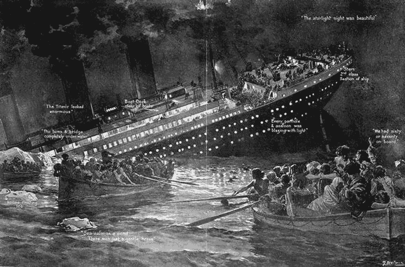
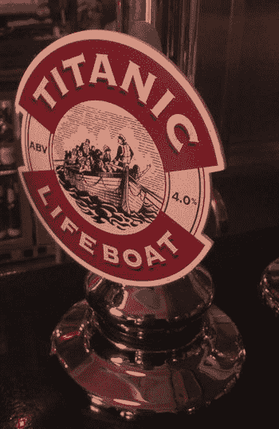
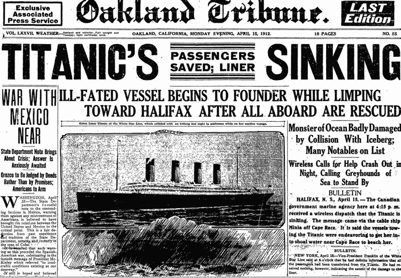

# 下一个要点：责任

下一个要点关乎责任。甚至在你的船沉没之前（图 12-1），问题就会被提出。沉没事件自然引发了寻找责任归属的排查，而有些人在这场灾难中显得英勇无畏、舍己为人。一个例子是阿瑟·韦斯特，他离开救生艇去为女儿们取一壶热牛奶，然后在救生艇被放下时顺着绳索爬下去，把暖壶递给她们，随后又爬回船上。他的遗体从未被找到。另一些人则显得自私怯懦，比如 J.布鲁斯·伊斯梅，他催促船长尽可能全速航行，自己却是少数几个坐上救生艇的男人之一。这里的原则是，在管理 SharePoint 时，必须尽早承担责任。你不能只在事情进展顺利时揽功，因为当灾难发生时，将会面临审查，责任也会被分配。

图 12-1. 灾难过后，有人被描绘成英雄，有人则被描绘成恶棍

本章传达的最后一个原则是，仅凭尚未发生灾难来衡量成功是远远不够的。观察员报告“侥幸脱险”事件是许多行业和组织中一种成熟的错误减少技术，也应应用于 SharePoint 系统的管理。总会有线索表明某些事情可能出错。警觉、记录并应对这些“侥幸脱险”事件，是拥有 SharePoint 平台的关键组成部分。

### 第 2 章：规划你的计划

本章的重点是准备的重要性。在制定灾难恢复计划之前，你需要了解你要保护的对象，以便据此设计计划。你必须获得管理层的支持，而要获得支持，有时需要打破对技术的过度简单化理解。你必须进行业务影响评估。这意味着召集业务中的关键利益相关者，详细量化 SharePoint 服务中断在一年中不同时期对各个团队和部门的影响。

获得管理层的批准并对业务需求有更深入的了解后，你就可以为系统的不同部分定义恢复点目标和恢复时间目标。本章的一个关键点是：并非所有内容都需要同样高水平的可用性，组织中应建立多个层级，以便优先恢复最重要的内容，而不是最不重要的内容。泰坦尼克号沉没后，有人指责其按舱位等级优先救援乘客。可悲的是，数据证实了这一点（表 12-1）。

表 12-1. 泰坦尼克号灾难按舱位统计

| 头等舱 | 二等舱 | 三等舱（统舱） |
| --- | --- | --- |
| 总计：319 人 | 总计：269 人 | 总计：699 人 |
| 死亡：119 人 | 死亡：152 人 | 死亡：527 人 |
| 幸存：200 人 | 幸存：117 人 | 幸存：172 人 |
| 幸存比例：63% | 幸存比例：43% | 幸存比例：25% |

这里得到的教训不应是某些人比其他人更值得拯救，而在 SharePoint 的情况下恰恰相反：某些流程和内容对组织更有价值，应优先恢复它们。

本章还强调了灾难中协调的重要性原则：4Ci。这意味着必须有指挥、控制、通信、计算机和情报。如果没有事先规划这些资源的可用性，任何计划都无法付诸实施。员工接受适当的培训在任何灾难中都至关重要，包括泰坦尼克号（图 12-2）。

图 12-2. 泰坦尼克号救生艇及船员，被英国艾尔啤酒永远铭记

制定计划至关重要，但具体规划如何将计划付诸实施，将决定其是否有效。未经演练的船员救不了任何人，包括他们自己。

### 第 3 章：激活你的计划

灾难本质上具有不可预测性，本章的关键原则是，你必须知道何时以及如何激活你的灾难恢复计划。以泰坦尼克号为例，许多乘客以为沉没只是一次演习。船沉得很慢，人们花时间才理解实际发生的情况。灾难发生后，媒体也难以弄清状况（图 12-3）。关于实际发生了什么，以及是否确实有人员伤亡，存在大量混乱信息。

图 12-3. 早期错误头条报道称：“全员获救”

在 SharePoint 中，灾难恢复计划本身总是受到关注，但员工和用户如何知道启用它的时机已到？由谁来做这个决定？如果那个人不在怎么办？灾难时期可能充满混乱；正常流程不再适用（例如在沉船上准备菜单，图 12-4），相关人员可能无法到位。你的 SharePoint 灾难很可能是更大规模的 IT 或网络灾难，甚至是组织整体灾难（例如洪水）的一部分。必须有明确定义的流程和程序。然而，本章的主要原则是，让合适的人在合适的时间出现在合适的地点，是确保你的计划得到正确执行的首要方法。这里的警告是，资源需要集中于应对突发情况的变化，而不是那些不再优先的任务。

图 12-4. 当船开始沉没时，准备菜单不再是首要任务

### 第 4 章：高可用性

帮助你实现高可用性是本书的主要目标之一。第 4 章的关键原则是，不受管理的变更是对系统可用性的主要风险。虽然必须强调构建技术上的高可用平台，但技术故障并非导致故障的主要原因。SharePoint 出问题是因为人们未能考虑到他们所做变更的潜在风险。这有时是由于组织高层人员将某个需求列为紧急事项，然后坚持要求在不考虑后果的情况下进行变更。换句话说，他们“以权压人”。这就是为什么必须建立变更管理流程。

基于每年简单运行时间百分比的可用性目标，确实提供了一个经验性的年度目标，但它们很少包含计划内维护，也无法衡量不可用性的影响。

弹性和冗余是必要的，它们依赖于高质量的硬件和对系统的持续监控，以确保其正常运行。将旧服务器回收到生产场中绝非明智之举。以泰坦尼克号为例，其救生艇上的船名被移除，并被重新用于白星航运公司的其他船只（图 12-5）。

图 12-5. 喀尔巴阡号打捞起的 RMS 泰坦尼克号救生艇

### 第 5 章：服务质量

服务质量是用户满意度与不过度复杂的架构之间一种成本效益折中的方案。