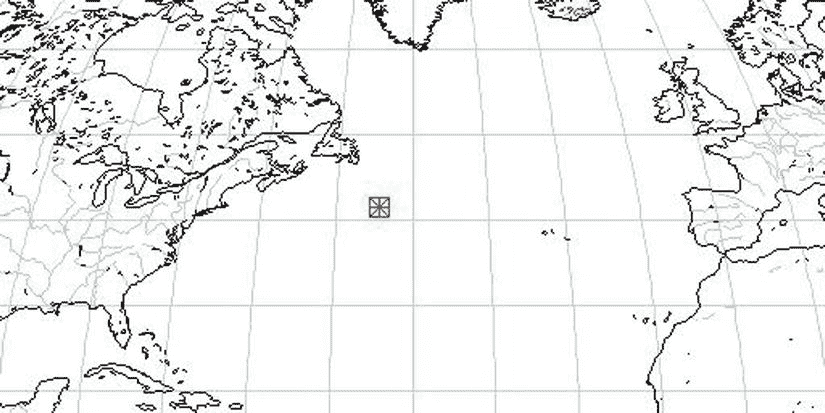

# 复杂架构的成本

复杂架构成本更高，故障点也更多，且变更的灵活性较差。延迟是一个物理极限，单纯增加隐喻中的管道尺寸无法消除它。地球上两地相距越远，数据传输速率就越慢。这是由于光在光纤电缆、中间路由器和交换机中的速度限制所致。若非“泰坦尼克号”在航行至三分之二处撞上冰山，它本可能在 5 天半内穿越大西洋（图 12-6）。这一估算基于其姊妹船“奥林匹克号”曾在此时间内完成航程。如今，从伦敦飞往纽约的航班需要 7 个半小时（尽管协和式飞机曾以不到 3 小时完成该航程）。

图 12-6。泰坦尼克号沉没地点：欲速则不达

通常，组织所拥有的带宽远落后于需求曲线。带宽应按云计算服务、电力公司和自来水公司使用的模式进行计费。更多带宽并非解决所有速度问题的万能药，但确实能有所帮助。

### 第 6 章：退一步思考

本章强调，维护有效的备份主要并非取决于你使用的工具，而是依赖于文档化并经测试的流程与规程。必须持续审查备份和恢复流程，以确保其相关性和可靠性。备份时，不仅要优先考虑对组织最有价值的内容，还应优先考虑手工恢复耗时最长的内容。这包括开发者编写的解决方案以及未在其他地方复制的数据。

恢复测试应定期进行，即便不是每天一次。原本，“泰坦尼克号”计划于 1912 年 4 月 14 日（即撞上冰山当天）进行救生艇演习。然而，由于不明原因，史密斯船长取消了演习。许多人认为，如果演习得以进行，本可挽救更多生命。

### 第 7 章：监控

前一章强调不应过度依赖工具，而本章指出监控工具未得到充分利用，且不应如此。监控在两个层面进行：Windows 和 SharePoint。两者对于健康的环境都至关重要。定期更新 SharePoint 系统及其依赖环境的健康关键指标必不可少。灾难发生前，总是有迹可循，只要有人主动观察就能发现。

虽然“泰坦尼克号”沉没的消息在船上传播缓慢，但它实际上有自己的船上报纸。《大西洋每日公报》每日在“泰坦尼克号”上印刷。该报内容包括新闻、广告、股票价格、赛马结果、社会八卦以及当日菜单。

### 第 8 章：DIY 灾难恢复

本章表明，SharePoint 备份和灾难恢复的责任正从 IT 基础设施所有者转移到用户自身手中。SharePoint 确实提供了许多工具，使用户在灾难发生时能够自行恢复。这样做的主要好处是用户最了解自己的内容，能更快地响应备份需求，知道何时需要保护哪些内容。反之亦然：不需要多次备份的内容就不会被冗余备份。

### 第 9 章：变更管理与灾难恢复

本章的主要原则是，变更是保持 SharePoint 对组织价值的必要条件，但一旦系统投入生产，必须妥善管理变更，以避免系统受损的风险。变更应尽可能采用开箱即用方式，因为这样对整体系统的风险更低，且无需缓慢的变更管理流程即可完成。业务和 IT 部门必须制定策略，将自定义代码和变更控制在最低限度。

### 第 10 章：灾难恢复与云

云在许多方面改变了 SharePoint 的架构和管理方式，因为硬件和软件更多地由第三方控制。将 SharePoint 平台迁移到云端，并不意味着不再需要理解和维护 SharePoint 的灾难恢复计划。为了与现有的 Windows 用户账户集成，你仍需规划并部署额外的服务器和软件。这些将成为你本地灾难恢复规划的重点。

### 第 11 章：最佳实践与最差实践

此处的主要原则是，你必须关注决策的长期结果，而不仅仅是短期利益。你必须避免陷入薄弱假设、应对式变更态度以及不负责任的治理方式等泥潭。

## 总结

*高成就者能迅速发现丰厚的机遇，快速做出重大决策，并立即付诸行动。遵循这些原则，你就能让梦想成真。*

——罗伯特·H·舒勒（美国归正教会牧师、企业家、作家）

网络，尤其是互联网，让全球数百万人的信息沟通变得更快、更便捷。SharePoint 是在组织和企业中实现这一目标的主要工具。SharePoint 在过去十年中取得了长足进步，如今正面临另一个重要转折点，它可能更多地成为一种云解决方案而非本地部署方案。时间会证明一切。保护你的 SharePoint 环境意味着要迅速决定将我书中阐述的原则付诸实践。归根结底，行动胜于言语，因此这似乎是我结束本书、停止发言最合适的时刻。祝你在所有努力中好运。

## 索引

 A

- Active Directory 联合身份验证服务 2.0 (ADFS)
- AlwaysOn 可用性组
- 亚马逊
- 亚马逊云
- 应用级冗余
    - 角色
    - 搜索
    - 服务应用程序
- 应用程序生命周期管理
    - 变更成本
    - 定义
    - 迭代瀑布模型
    - 精益
    - 计划/构建/测试/审查/部署模型
    - Scrum
    - 瀑布模型
- 应用程序接口 (API)
- 始祖鸟

 B

- 二进制大对象 (BLOB)
- 业务影响评估 (BIA)
    - 业务连续性规划
    - 达成共识
    - 财务和运营影响
    - 金发姑娘原则
    - 信息价值
    - 人员
    - RTO 和 RPO
    - 利益相关者

73) 业务影响评估（BIA）  
C 变更咨询委员会（CAB）会议  
- 授权/批准  
- 变更拒绝  
- 评论/问题  
- 注意事项  
- 建议与决策  
- 标准议程  
变更管理  
- 应用程序生命周期管理（参见应用程序生命周期管理）  
- CAB 会议（参见变更咨询委员会（CAB）会议）  
- 定义  
- 实施与评估  
- 流程流程图  
- 审查与关闭  
- 调度  
- Sheep Watch 影响评估  
- 子流程  
- 测试  
客户端访问许可证（CAL）  
云爆发  
云计算  
- 敏捷性  
- 始祖鸟  
- 定制意味着成本  
- 灾难恢复（参见灾难恢复（DR））  
- 负载变化  
- - 云爆发  
- - 需求  
- - 动态资源分配  
- - 不可预测的爆发  
- 开箱即用（OOB）解决方案与完全定制解决方案  
- 私有云  
- 公有云  
- SharePoint 时间机器（参见 SharePoint 时间机器）  
内容备份  
- 列表模板  
- - 列表备份  
- - 书籍模板测试  
- - 创建  
- - 库链接  
- - 库设置  
- - 库选项卡  
- - 新建列表/库  
- - 功能区变更  
- - 将列表另存为模板  
- - 上传  
- 网站模板  
- - 创建  
- - 自定义选项卡  
- - 新建网站  
- - 将网站另存为模板  
- - 单独保存解决方案  
- - 网站设置  
- - “解决方案库”链接  
- - 上传  
内容管理系统  
关键影响  
D 灾难  
- 规避步骤  
- - 明确衡量标准  
- - 依赖关系  
- - 角色与职责  
- - 利益相关者与策略  
- 完全失败的成本  
- IT 系统  
- 感知  
- SharePoint 项目  
- 成功/失败  
灾难协调  
- 4Ci  
- - 指挥  
- - 通讯  
- - 计算机  
- - 控制  
- - 情报  
- 灾难恢复脚本  
- 补给仓库与餐厅  
灾难恢复（DR）  
- IaaS 与 SaaS  
- 多租户  
- - 管理网站  
- - 能力  
- - 功能包  
- - 主机头网站集  
- - 沙盒解决方案  
- - 服务隔离  
- - 订阅  
- 网络与云  
- 规划联合  
- - ADFS  
- - 证书  
- - 目录同步  
- - 联合代理服务器  
- - 联合服务器场  
- - 林拓扑  
- - WID 与 SQL  
- 恢复点目标  
- 恢复时间目标  
- SCM  
- 系统完整性  
灾难恢复计划（DRP）  
- 激活  
- BIA（参见业务影响评估（BIA））  
- 沟通  
- 背景与沟通  
- 决策者  
- 灾难协调（参见灾难协调）  
- 设施风险  
- 相互依赖  
- 物理依赖  
- - 架构影响  
- - 事后回顾  
- - 恢复层级  
- - 风险评估  
- - SLA  
- - 同步性（参见同步性）  
- 计划位置与内容  
- 政治策略  
- [流程与程序](#9781430263289_Ch03.xhtml#cXXX.

`benefits`  
`definition`  
`documentation relationships`  
`key element`  
`proposal arguments`  
`restore SharePoint`  
`restore systems`  
`setting priority`  
`stronger metaphors`  
`tasks`  
`Upper Management awareness`  
`verification and restoration`  
`weak metaphors`  
`business information`  
`data protection`  
`data representation`  
`electronic information`  
`fragility`  
`off-site storage`  
`snapshots`  
`tape-based backup`

`DIY DR`  
`content backup` (*参见* 内容备份)  
`low-level configuration`  
`Office`  
`Backstage view`  
`Backstage view’s Info window`  
`Backstage view’s Recent window`  
`last auto-saved version`  
`periodic auto-saved files`  
`Save options`  
`unsaved versions`  
`versions section`  
`recovering sites and site collections`  
`deleting site collection`  
`deleting subsites`  
`with PowerShell`  
`SP1`  
`Recycle Bin` (*参见* 回收站)  
`Site Collection Administrator rights`  
`structuring elements`  
`versioning`  
`Library Settings`  
`site template`

 E, F

`E-mail alert`  
`action setting`  
`conditions options`  
`counters`  
`Context Switches`  
`Data Collector Set`  
`data logs creation`  
`MBytes and memory`  
`Processor Queue Length`  
`Processor Time`  
`screening`  
`general setting`  
`setting options`  
`task running`  
`triggers setting`

`Event Viewer`  
`characteristics`  
`errors`  
`filtering`  
`Operational logs path`  
`subscription`  
`criteria for`  
`data collection`  
`forwarded events`  
`new subscription creation`

 G

`Global Assembly Catalog (GAC)`  
`Goldilocks principle`  
`Governance`

 H

`High availability (HA)`  
`availability zones and regions`  
`failover systems`  
`interlocking elements`  
`load balancing`  
`measuring business impact`  
`multiple data centers`  
`nines`  
`redundancy`  
`active`  
`application-level` (*参见* 应用程序级冗余)  
`data centers`  
`farms`  
`hardware`  
`passive`  
`redundant disaster recovery farm`  
`resilience` (*参见* 弹性，高可用性)  
`R.M.S. Titanic`  
`SAN replication`  
`SharePoint farm considerations`  
`SQL clustering`  
`SQL log shipping`  
`SQL mirroring`  
`stretched farm`  
`time-sensitive businesses`  
`watertight compartments`

 I

`Infrastructure as a Service (IaaS)`

 J, K, L

`JFD`  
`licenses`  
`office and windows`  
`practices`  
`Request For Proposal (RFP)`  
`SharePoint installation`

 M, N

`Microsoft`  
`Monitoring tools`  
`Multiprotocol Label Switching (MPLS)`

 O

`Office 365 Community`

 P

`Policy Base Routing (PBR)`  
`Private cloud`  
`Public cloud`

 Q

`Quagmires`  
`characteristics`  
`corporate Facebook`  
`customization`  
`Intranet conflict`  
`metadata quagmire`

