# 1. 可视化与 Tableau 简介

电子补充材料 本章的在线版本（`doi:10.1007/978-1-4842-2352-9_1`）包含补充材料，仅供授权用户使用。

> “卓越的图表能以最少的墨水、最小的空间，在最短的时间内向读者传达最多的信息。” —— 爱德华·R·塔夫特，数据可视化领域的先驱

本章将介绍数据可视化以及做好数据可视化的重要性。我们将熟悉市场领先的数据可视化工具之一——Tableau。我们将学习 Tableau 产品线，包括 Tableau Desktop、Tableau Server、Tableau Online、Tableau Reader 等。本章还将详细阐述 Tableau 中的多种文件类型。

想象一下，你需要研究一页又一页的数据，报告你的发现，并得出推论和结论。你为这项看起来乏味、耗时且极其无聊的任务做准备。如果用一些优秀的可视化（数据可视化是数据的图形化或图示化描述）来替代这项任务，让你能够快速高效地发现趋势、揭示之前隐藏的模式，生活会不会轻松得多？

数据可视化就是视觉沟通。它旨在让数据更易于理解、更便于解读和分析。总之，数据可视化有两个重要目的：

-  理解数据（也称为数据分析）
-  进行视觉沟通（将你的发现传达给他人）

数据可视化工具已经走过了漫长的道路，从 Excel 的标准图表到更时髦、更复杂的图表形式，例如地理地图、**迷你图**、热力图、树图、**热力曲线图**等。

## 1.1 为什么需要数据可视化？

想象一下，你的公司决定首次推出一套精美的珠宝系列。这意味着巨大的投资。你需要非常确定你的目标客户。你发起了一项在线调查来了解你的客户。在各种问题中，包括了关于他们的职业/专业以及他们对珠宝风格偏好的问题。这项调查在多个城市进行，你有大量数据需要分析。虽然可以手动完成，但这意味着花费更多时间。节日季即将来临，你需要快速决定风格，以便有足够的时间准备你的系列产品。你决定将调查结果绘制成图表。图表清晰地显示了趋势：人们同时偏好现代风格和保守风格的珠宝。这意味着你的珠宝产品线应该是现代风格和保守风格的结合或融合，因为大多数潜在客户在企业部门工作。调查结果的图形化描述让你能够快速决定你的店铺应该主营哪种风格的珠宝。

这个场景就是数据可视化重要性的一个例证。使用数据可视化有很多理由：

- 你想了解销售额与利润之间的关联。
- 你想预测销量。
- 你想确定业务蓬勃发展的区域和业务萎缩的区域。
- 你想预测市场会对你新产品的推出作何反应。
- 你想了解影响客户行为的因素。
- 你想了解你的学校多年来在阅读、写作和算术这三项关键技能上的表现。
- 你想清晰快速地看到业务的同比增长情况。
- 你想挖掘更深层次的见解。
- 你想用你的数据讲述一个故事。

## 1.2 数据可视化能帮助我们什么？

数据可视化将力量交到业务用户手中，并极大地缩短了将数据转化为洞察的时间。它使决策者能够：

- 快速发现趋势、看到模式并理解复杂概念。
- 看到那些原本会被忽略的事情。
- 研究因果关系。
- 提出一个问题，得到答案，然后还能提出后续问题。
- 对数据提出更好的问题，从而做出更好的数据驱动决策。
- 实现信息图的应用，即用于传达信息的图形。

## 1.3 可视化简介

花点时间看看下面表 1-1 中给出的数据集。它包含了 2012 年和 2013 年 5 月访问每个城市的游客数量的详细信息。

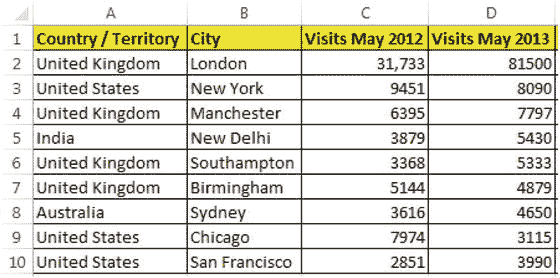

表 1-1. “示例 – 访客量”数据集

相同的数据在表 1-2 中用增加的列来表示。负的“变化百分比”以红色显示。

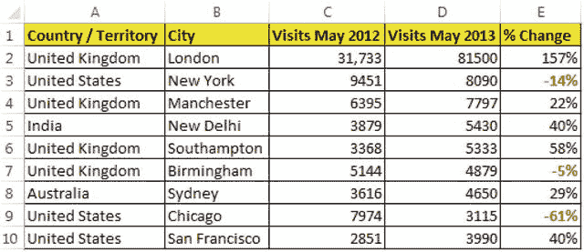

表 1-2. 在“示例 – 访客量”数据集（表 1-1）中新增列“变化百分比”，并对其应用了条件格式

条件格式与颜色相结合，有助于清晰描绘“趋势是什么”，并促进决策。它使读者更容易理解数据，而不是让他们记住好坏参半的数字，并要求他们从一列标准数据中找出重点或问题。

看看图 1-1。它在清晰展示趋势方面做得更好。注解的使用进一步有助于吸引人们对负的百分比变化的注意。

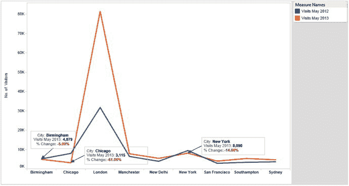

图 1-1. “示例 – 访客量”数据集（如表 1-2 所示）的图形化描述

现在，观看大卫·麦坎德利斯关于数据可视化的 TedEx 视频（17:56 分钟）会很有帮助。

```
at http://www.ted.com/talks/david_mccandless_the_beauty_of_data_visualization 可以轻松理解可视化的力量。该视频强调了以下几点：
```

- 可视化有助于发现模式并看到数据之间的联系。
- 读者发现理解视觉内容非常容易。读者理解起来所需的精力要少得多。
- 一图胜千言。该视频展示了可视化如何将大量信息压缩到小空间中。
- 可视化可以让你更快地找到答案，并轻松提供清晰度。

让我们再看一个例子来认识可视化的力量。

如果我们让你查看大约 10,000 条记录（准确地说是 9,994 条），并告诉我们每个地区哪个类别的销售额最高，你的答案会是什么？更重要的是，你提供答案需要多长时间？

图 1-2 显示了“示例 – 超级商店”数据集的一个子集：

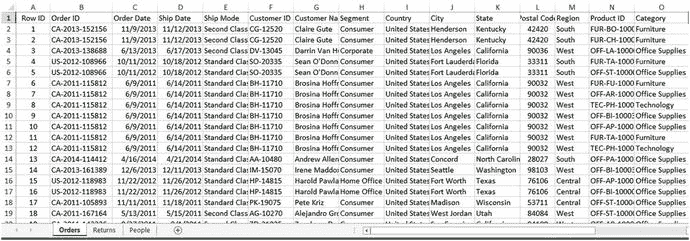

图 1-2. “示例 – 超级商店”数据子集的一个子集

现在，看图 1-3 中的图表，并回答同样的问题。这就是可视化的力量……

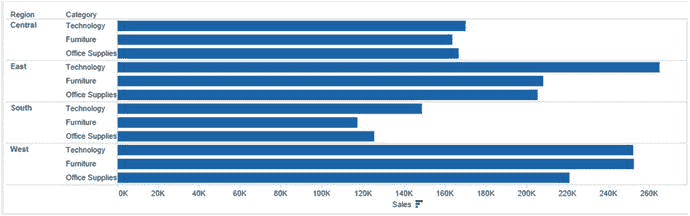

图 1-3. 表示每个地区哪个类别创造了最大销售额的可视化图表

### 1.3.1 哪些领域正在利用数据可视化的力量？

数据可视化应用于许多领域：

- 教育
- 零售
- 银行与金融
- 医疗保健
- 社交媒体
- 体育
- 娱乐等

### 1.3.2 谁在使用数据可视化？

许多企业正在使用数据可视化。以下列举几个：

- 谷歌
- 脸书
- 雅虎
- 思科系统公司
- 德勤
- 通用电气等


### 1.3.3 顶级数据可视化工具

看一看市面上几款主流的报表与可视化工具。

- `Tableau`
- `QlikTech` 公司的 `QlikView`
- `D3.js`（数据驱动文档）➤ 使用 `HTML`、`CSS` 和 `SVG`
- `Chart.js`
- `Tibco SpotFire`
- `IBM Cognos Visual Analytics`
- `Roambi Analytics`
- `Google Charts`
- `FusionCharts`

### 1.3.4 数据可视化发展史

请参考表 1-3 了解“数据可视化发展史”。

**表 1-3.** 数据可视化发展史

| 时间 | 形式 | 用途 |
| --- | --- | --- |
| 2 世纪 | 表格（文本表示） | 以导航工具的形式表示天文信息 |
| 17 世纪（勒内·笛卡尔——法国哲学家、数学家） | 图形 | 开发了二维坐标系来显示数值 |
| 18 至 19 世纪（威廉·普莱费尔——苏格兰社会科学家） | 条形图、饼图等 | 表示定量信息 |
| 1977 年，普林斯顿大学的约翰·图基 | 探索性数据分析 | 探索并理解数据 |
| 1983 年，爱德华·塔夫特 |  | 定量信息的可视化展示 |

### 1.3.5 数据可视化工具应具备哪些功能？

- 支持目标导向的可视化，即绘制实际值与特定期望结果的对比。
- 确保报表和仪表盘能够在正确的时间、以正确的格式、在正确的设备上，送达正确的人员。
- 允许对数据进行操作，如切片、切块、筛选、查询、交互等。
- 能够访问实时或近实时数据源，以便实时或近实时地呈现可行动的信息和洞察。

### 1.3.6 我们来看看 Tableau 如何满足这些期望

以下突出特点使 `Tableau` 成为市场领先的可视化工具：

- `Tableau` 提供多种图形和图表形式，清晰且有说服力地展示实际值与特定期望结果的对比。
- `Tableau` 产品套件中的多种产品，使得使用 `Tableau` 创建的报表和仪表盘能够及时、相对容易地提供给决策者。以下是 `Tableau` 产品线的简要概述：
  - `Tableau Desktop`：用于编写/设计报表的工具
  - `Tableau Server`：可在整个组织内部署和共享报表的平台
  - `Tableau Online`：基于云的安全解决方案，用于共享、分发和协作处理 `Tableau` 视图与仪表盘
  - `Tableau Reader`：免费产品，任何人都可使用它来查看 `Tableau Desktop` 授权用户创建的 `Tableau` 工作簿并进行交互
  - `Tableau Mobile`：支持在移动设备（如 `iOS` 设备等）上访问报表的版本
- `Tableau` 提供多种功能，可用于理解数据、解读数据、运行上下文敏感筛选器、按需排序、进行统计分析等。
- `Tableau` 可连接广泛的数据源，从传统数据源（如 `Excel`、文本文件等）到非传统数据源（如社交媒体数据、`SalesForce`、`Microsoft Azure` 等）。
- `Tableau` 支持您对快速 BI / 敏捷 BI / 自助式 BI 与分析的需求。

### 1.3.7 切换至 Tableau 的理由

您当前的 BI 可视化工具：

- 刷新数据需要几分钟。
- 内存不足。
- 添加一行需要几分钟。
- 迫使您使用较小的数据子集。
- 无法容纳您的业务本应处理的海量数据。
- 不支持在地图上查看数据。
- 要求您预见所有未来需求，对数据探索的支持很少或根本没有。

## 1.4 Tableau 的定位

这是一个自助式分析的时代。对 IT 部门的依赖正在减少。客户需要的是易于使用、可访问性强且易于与现有系统集成的工具。

根据 Gartner 2016 年“商业智能与分析平台魔力象限”，`Tableau` 被置于“领导者”象限。请参考图 1-4。


**图 1-4.** Gartner 2016 年商业智能与分析平台魔力象限

Gartner 魔力象限的 X 轴为“愿景完整性”，Y 轴为“执行能力”。该象限包含四个部分，即“远见者”、“利基玩家”、“挑战者”和“领导者”。

`Tableau` 在执行能力方面排名最高。2016 年是 `Tableau` 连续第四年位列“领导者”象限。

从魔力象限中可以清楚地看到，领导者需要在其当前的执行中表现出卓越，并具备能力与意愿朝着未来的使命前进。


## 1.5 Tableau 产品线

让我们将 Tableau 工具大致分为以下几类：

- 开发工具（`Tableau Desktop` 和 `Tableau Public`）
- 共享工具（`Tableau Server`、`Tableau Online`、`Tableau Reader`）

开发工具将帮助你创建可视化图表和/或仪表板。

共享工具则用于促进以下可视化图表和/或仪表板任务：

- 查看
- 共享
- 交互
- 探索

`Tableau Desktop` 有两个版本：

- 专业版
- 个人版

它们的区别在于可以连接的数据源类型。使用 `Tableau Desktop Professional`，用户可以连接到数据连接页面上列出的所有数据源（如图 1-5 所示）。

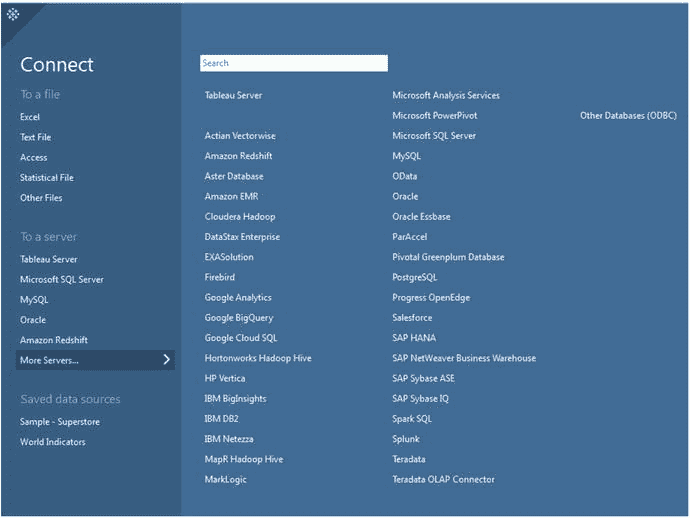

图 1-5. `Tableau Desktop Professional` 的数据连接页面

使用 `Tableau Desktop Personal`，用户只能连接到 `OData`、`Microsoft Windows Azure Marketplace DataMarket` 和 `Tableau Data Extract`（`.tde`）文件；不过，它可以将工作簿保存在本地。它缺少发布到 `Tableau Server`（公共或私有）的功能。

`Tableau Public` 可从 Tableau 网站免费下载。它在其可连接的数据源方面受到限制。仅支持以下数据源：

**连接**

到文件：

- Excel
- 文本文件
- Access
- 统计文件

到服务器：

- OData
- 更多服务器
  - Odata
  - Web 数据连接器

使用 `Tableau Public`，任何人都可以找到你的可视化图表。它不支持将工作簿保存在本地。`Tableau Public` 可以可视化包含多达 100 万行数据的数据集。

`Tableau Server` 部署在组织的内部设施中。它有助于在组织内安全地共享可视化图表。但是，需要共享的工作簿必须使用 `Tableau Desktop` 发布到 `Tableau Server`。然后，获得许可的用户将能够通过网络浏览器在线访问这些可视化图表。它也可以用于共享数据源。

`Tableau Online` 具有与 `Tableau Server` 相同的功能；但是，它由 Tableau 托管在他们的云端。

`Tableau Reader` 可从 Tableau 网站免费下载。它**仅**允许查看或与 Tableau 打包工作簿（`.twbx`）交互。`Tableau Reader` 基本上没有安全性。任何拥有 `.twbx` 文件的人都可以使用 `Tableau Reader` 打开它。

请参考图 1-6。

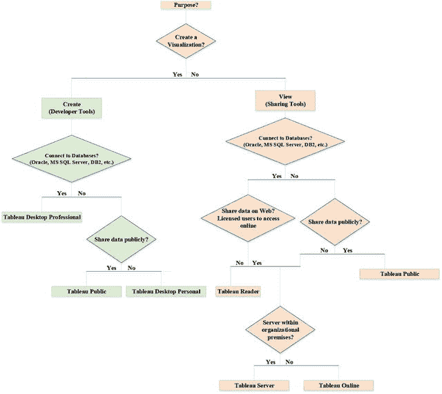

图 1-6. Tableau 产品线

Tableau 产品线一览（如表 1-4 所示）：

表 1-4. Tableau 产品线一览

| Tableau Desktop | • 可以创建包含工作表、仪表板和故事的工作簿。 • 是一款许可产品。有两个版本：`Desktop Professional` 和 `Desktop Personal`。 • 允许将工作簿存储在本地。 • 允许将工作簿、仪表板和故事发布到 `Tableau Server`、`Tableau Online` 和 `Tableau Public`。 |
| Tableau Server | • 通常部署在内部。 • 允许用户直接使用浏览器进行交互。 • 由私人管理。 |
| Tableau Online | • 是云端托管的 `Tableau Server` 版本。 • 服务器由 Tableau 维护。 |
| Tableau Reader | • 允许查看/与 `Tableau` 打包工作簿（`.twbx`）交互。 • 不连接到服务器。 • 不允许修改工作簿。 |
| Tableau Public | • 是 Tableau 的免费产品。 • 限制了处理数据的工作量（行数）。 • 只能连接到 `Excel`、`Access` 或文本文件（无数据库连接性），并且你在 `Tableau Public` 中保存的任何内容都将保存在 `Tableau Public Server` 上，任何人都可以下载（无保密性）。 |

## 1.6 Tableau 中的文件类型

让我们来看看 Tableau 中的以下文件类型：

- Tableau 工作簿（`twb`）
- Tableau 打包工作簿（`twbx`）
- Tableau 数据源（`tds`）
- Tableau 打包数据源（`tdsx`）
- Tableau 书签
- Tableau 数据提取

### 1.6.1 Tableau 工作簿（`twb`）

当你在 Tableau 中保存工作簿时，默认的文件扩展名是 `.twb`。它是一个 XML 文件，包含连接数据源并与之交互的指令。它拥有帮助绘制/创建可视化图表的所有信息，例如显示在工作表或视图中的字段、应用于度量的聚合类型、各种格式化和样式选项等。它还包含有关对工作表或仪表板所做的任何更改的信息，例如使用快速筛选器等。

示例：包含以下工作表/视图的 Tableau 工作簿保存为 `.twb` 文件（如图 1-7 所示）。要创建此工作簿，需要执行以下步骤：

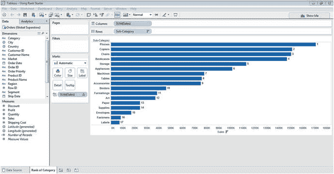

图 1-7. 保存为 `.twb` 文件的 Tableau 工作簿

- 打开一个 Tableau 工作簿。
- 将数据从 `Sample – Superstore.xls` 读入 Tableau。处理 `Sample – Superstore.xlsx` 中的 `Orders` 工作表。
- 将数据窗格下维度区域中的维度 `Sub-Category` 拖放到行功能区。
- 将数据窗格下度量区域中的度量 `Sales` 拖放到列功能区。
- 通过 `文件` ➤ `另存为...` ➤ `.twb` 将文件保存为 `.twb` 文件。

关于图 1-7 的一些细节（如表 1-5 和图 1-8 所示）：

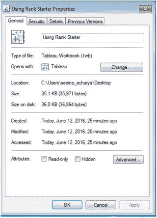

图 1-8. 一个示例 Tableau 工作簿（`.twb`）的属性

表 1-5. 关于一个示例 Tableau 工作簿的详细信息

| 文件名： | `Using Rank Starter` |
| 文件类型： | Tableau 工作簿（`.twb`） |
| 位置： | `C:\Users\Seema_Acharya\Desktop` |

在文本编辑器（如 `Notepad` / `Notepad++` / `WordPad`）中打开 `.twb` 文件。下面是在 `WordPad` 中打开已保存的 `.twb` 文件的内容（部分内容）。

连接部分提供了关于数据源的信息。在上面的示例中，它给出了 Excel 文件的名称和位置，以及所连接的 Excel 工作簿中的工作表名称。

列部分描述了 `Global Superstore.xls` 中 `Orders` 工作表内的列（名称、数据类型及其序号位置）。

XML 文件还包含哪些列构成维度、哪些列构成度量的详细信息：

下面的提取内容提供了所使用的聚合类型、排序顺序和应用的表计算等信息。


### 1.6.2 Tableau 打包工作簿 (.twbx)

`.twbx` 是一种 Tableau 打包工作簿。它是一个将原始 `.twb` 文件与数据源打包在一起的包。可以将其视为一个压缩文件。它包含了在 Tableau 中工作所需的所有必要指令和数据。由于数据已打包或保存在 `.twbx` 文件本身中，即使没有网络或互联网连接到数据源，也可以使用此文件。`.twbx` 文件可以被解包，拆分为 `.twb` 文件和数据源两部分。

**注意**

如果使用底层数据库或服务器，则需要先创建一个 Tableau 数据提取 (`.tde`) 文件，然后才能将其打包到 Tableau 打包工作簿中。Excel 文件或 `.csv` 文件可以直接打包到 Tableau 打包工作簿中。

可视化视图（图 1-9）保存为 `.twbx` 文件。

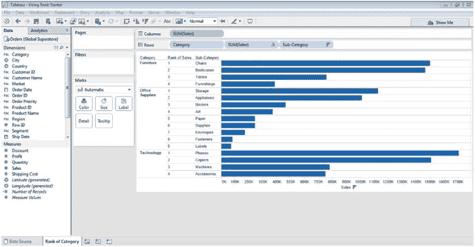

**图 1-9.** 保存为 Tableau 打包工作簿 (`.twbx` 文件) 的可视化视图

关于图 1-9 的一些详细信息（请参考表 1-6 和图 1-10）：

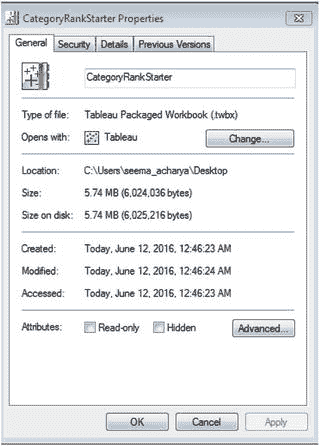

**图 1-10.** 一个示例 Tableau 打包工作簿的属性

**表 1-6.** 关于 Tableau 打包工作簿 (`.twbx`) 的详细信息

| 文件名： | CategoryRankStarter |
| --- | --- |
| 文件类型： | Tableau 打包工作簿 (`.twbx`) |
| 位置： | `C:\Users\Seema_Acharya\Desktop` |

要解包 `.twbx` 文件，请执行以下步骤：

**步骤 1**

右键单击 `"CategoryRankStarter.twbx"` 文件，弹出如图 1-11 所示的菜单。

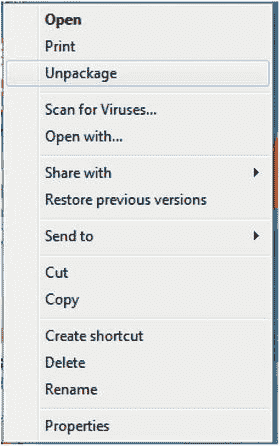

**图 1-11.** 用于解包 Tableau 打包工作簿的“解包选项”

**步骤 2**

点击“解包”以分离 `.twb` 文件和数据源。

### 1.6.3 Tableau 数据源 (.tds) 文件

**它包含什么？**

Tableau 数据源文件包含有关数据源的所有连接信息及元数据。TDS 文件自动作为 TWB（Tableau 工作簿）文件的一部分包含在内，但如果你想要共享特定数据源的连接信息及元数据，也可以将其保存为单独的文件。它是一个 XML 文件，包含以下信息：

*   数据源类型
*   在数据源页面中指定的数据源连接信息（例如，服务器、端口、本地文件（Excel、文本、提取等）的位置以及表）
*   组
*   集
*   自定义计算字段
*   数据桶
*   默认字段属性（例如，数字格式、聚合、排序顺序、数据类型等）

### 1.6.4 Tableau 打包数据源 (.tdsx) 文件

它包含数据源 (`.tds`) 文件中的所有信息，以及任何本地文件数据源（Excel、文本和提取）。此文件类型是单个压缩文件，非常适合与可能无权访问你计算机上本地存储的原始数据的人员共享数据源。

我们在 `"Sample Superstore.xls"` 中存储了一个数据集（如表 1-7 所示）。它包含以下字段：

**表 1-7.** `"Sample Superstore.xls"` 中的数据集

| 字段 | 数据类型 |
| --- | --- |
| Row ID | `#` |
| Order ID | `#` |
| Order Date | 日期 |
| Ship Date | 日期 |
| Ship Mode | Abc |
| Customer ID | Abc |
| Customer Name | Abc |
| Segment | Abc |
| Country | 地理角色 |
| City | 地理角色 |
| State | 地理角色 |
| Postal Code | 地理角色 |
| Region | Abc |
| Product ID | Abc |
| Category | Abc |
| Sub-Category | Abc |
| Product Name | Abc |
| Sales | `#` |
| Quantity | `#` |
| Discount | `#` |
| Profit | `#` |

让我们进行以下更改：

*   将字段名称 `"RowID"` 更改为 `"RowNumber"`
*   将 `"RowNumber"` 字段的数据类型从 `"#"` 更改为 `"Abc"`
*   创建一个组，`"StationaryGroup"`
*   创建一个集，`"Top10CustomersByProfit"`
*   更改 `"Segment"` 的排序顺序，使其成员按以下顺序排列：
    *   Corporate
    *   Home Office
    *   Consumer
*   创建一个计算字段，`"ProfitRatio"`

请参考图 1-12 和图 1-13。

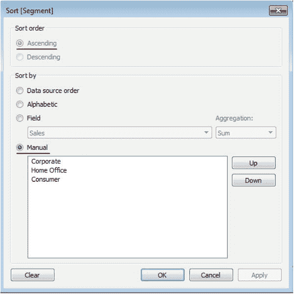

**图 1-13.** 维度 `"Segment"` 的排序顺序已更改

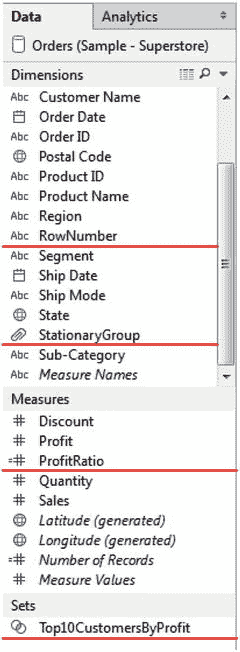

**图 1-12.** 对 `"Sample Superstore.xls"` 中的数据集的更改

将上述更改保存为 `.tds` 文件。选择 **数据** ➤ **订单(示例 – 超市)** ➤ **添加到已保存数据源**。请参考图 1-14 和图 1-15。

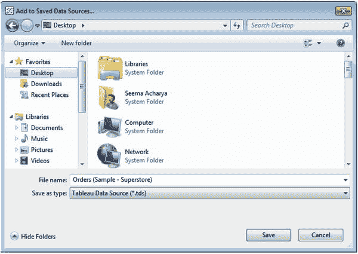

**图 1-15.** 将文件保存为“Tableau 数据源 (`.tds`)”

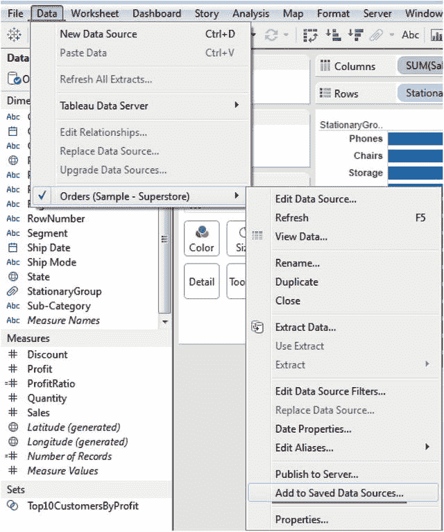

**图 1-14.** 通过选择“添加到已保存数据源…”来保存可视化视图

上述连接以名称“订单 (示例 – 超市)”存储在桌面上。

#### 1.6.4.1 重新连接数据源的步骤：

*   启动 Tableau，转到菜单栏上的 **文件**。选择 **“打开…”**（如图 1-16 所示）。

    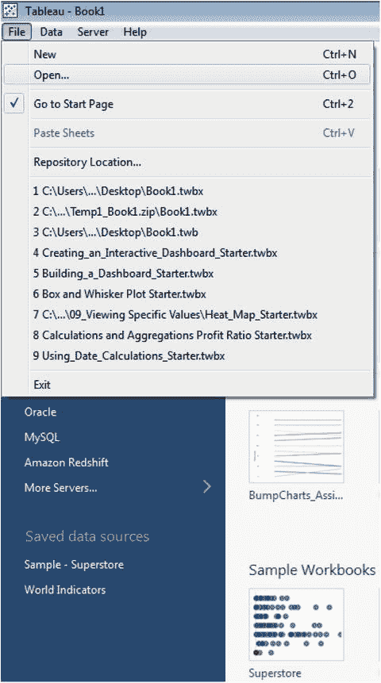

    **图 1-16.** 菜单栏上的“文件 – 打开”选项

*   选择 `.tds` 文件，然后点击 **打开**（如图 1-17 所示）。

    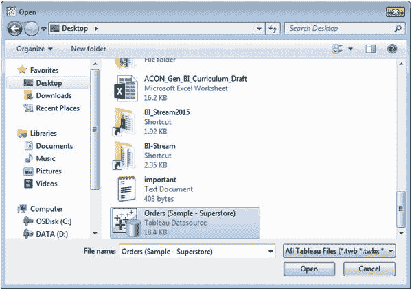

    **图 1-17.** 打开对话框 – 打开选定的 `.tds` 文件

你可以看到，你对连接所做的所有更改都已生效，如图 1-18 所示。

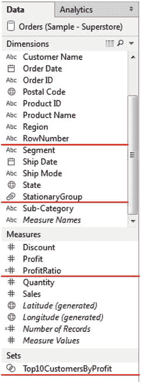

**图 1-18.** 对 `"Sample Superstore"` 元数据的所有更改都可用

### 1.6.5 Tableau 书签

可以将 Tableau 工作簿的单个工作表保存为 Tableau 书签。如果有一个经常使用的工作表，或者只想共享一个工作表而不是整个工作簿，则可以将其保存为书签。可以从任何 Tableau 书签中访问该书签。

要保存 Tableau 书签，请转到

**窗口** ➤ **书签** ➤ **创建书签**（如图 1-19 所示）。

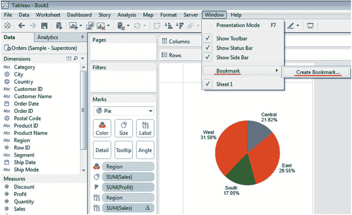

**图 1-19.** 通过选择“创建书签”将文件保存为书签

提供文件名和位置。文件将以 `.tbm` 扩展名保存。默认位置是 Tableau 存储库中的书签文件夹。但是，也可以选择将其保存到任何首选位置。如果保存到 Tableau 存储库中书签文件夹以外的任何位置，该文件将不会显示在书签菜单上。

将书签文件 (`.tbm`) 保存在 Tableau 存储库的书签文件夹中（如图 1-20 所示）。

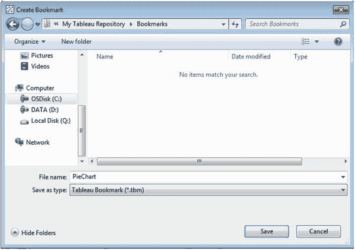

**图 1-20.** 将书签文件保存在 Tableau 存储库中

要将书签插入到新工作簿中：

1.  打开工作簿。
2.  转到 **窗口** ➤ **书签** ➤ **PieChart**（如图 1-21 所示）。

    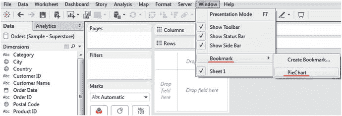

    **图 1-21.** 在 Tableau 工作簿中打开书签

插入 `"PieChart.tbm"` 后，工作表如图 1-22 所示。

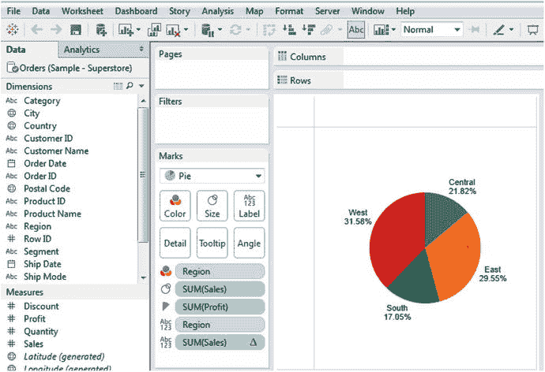

**图 1-22.** 插入 `"PieChart.tbm"` 文件后的工作表


#### 1.6.5.1 什么是书签文件？

它**仅**是当前工作表的快照。其中包含与数据连接、应用于当前工作表的格式设置、计算字段、组等相关信息。但它不存储参数值、当前页面设置等内容。它被用作创建未来工作簿的模板。

您无法从仪表板页面创建书签。例如，将此工作表拖入仪表板。如果我们尝试为仪表板页面创建书签，`窗口 ➤ 书签 ➤ 创建书签` 选项将显示为禁用状态（如图 1-23 所示）。

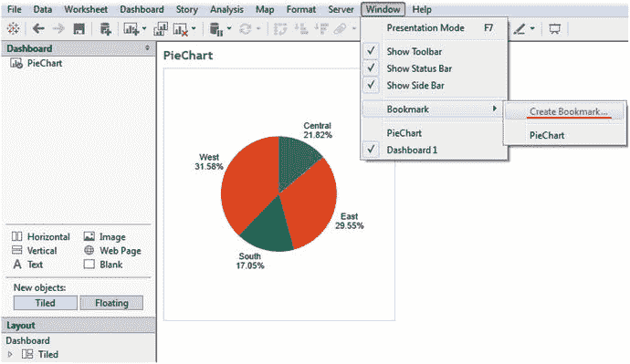

*图 1-23. 仪表板中“创建书签…”选项已禁用*

那么如何将一个工作簿中的仪表板复制到另一个工作簿中呢？在 Tableau 工作簿中打开一个仪表板工作表。右键单击屏幕底部的仪表板选项卡。点击 `复制工作表`（如图 1-24 所示）。

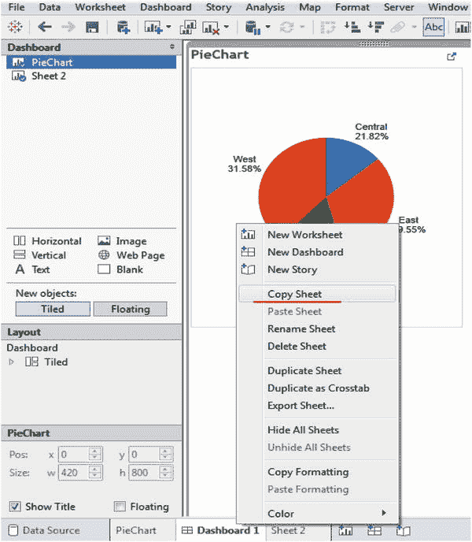

*图 1-24. 仪表板中的“复制工作表”*

打开您希望将仪表板工作表复制到的 Tableau 工作簿。点击 `文件 ➤ 粘贴工作表`（如图 1-25 所示）。

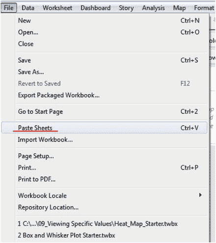

*图 1-25. 使用“粘贴工作表”将仪表板工作表复制到另一个 Tableau 工作簿*

所有工作表连同仪表板一起被复制到新工作簿中（如图 1-26 所示）。

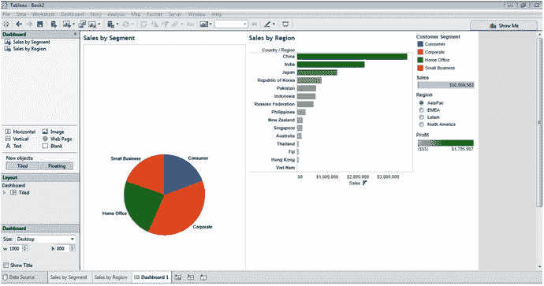

*图 1-26. 仪表板及其工作表被复制到新 Tableau 工作簿*

### 1.6.6 Tableau 数据提取

在 Tableau 中，您可以使用实时数据，也可以使用静态数据。换句话说，您可以基于最新数据进行分析和可视化，或者使用一个提取（本质上是根据所选条件对结果快照进行操作）。

#### 1.6.6.1 何时使用实时连接，何时使用提取？

如果您的分析需要显示正在发生的当前状态，则应使用实时数据连接。但是，如果您的结果需要显示去年或上个季度等时间框架内的数据，则应使用提取。从实时模式切换到提取模式意味着您将处理数据的快照。

#### 1.6.6.2 提取选项在哪里？

连接的提取选项位于 Tableau 的数据源页面上。在图 1-27 中，我们决定使用提取；但是，我们没有设置任何筛选器，因此将选择所有记录（9,994 条）。然而，当底层数据源中的信息发生变化时，任何数据分析或可视化都不会自动更新。

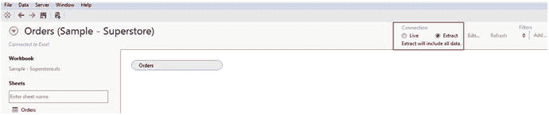

*图 1-27. 数据源页面上的“提取”选项*

现在让我们为提取应用一个筛选器。点击`提取`选项旁边的`编辑`。定义筛选条件，如图 1-28 所示。

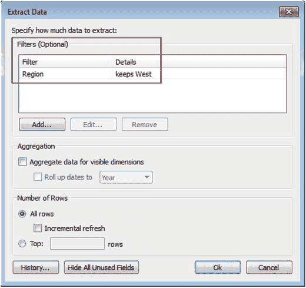

*图 1-28. 为“提取”选项设置“筛选”条件*

定义提取后，当您进入数据表时，系统会要求您保存提取（如图 1-29 所示）。

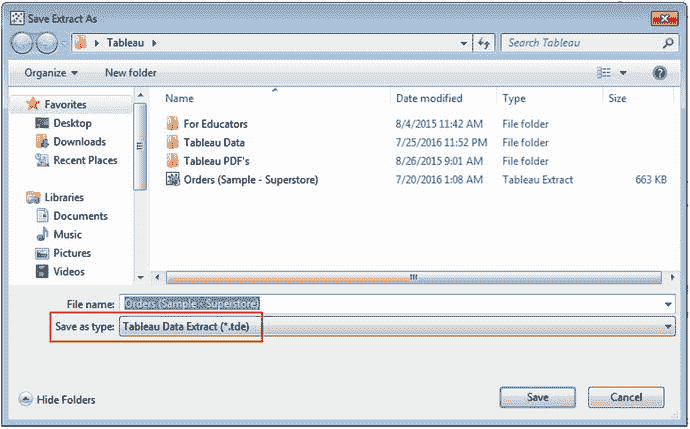

*图 1-29. “将提取另存为”对话框*

保存提取并继续进入数据表。当您处理定义了筛选条件的`区域`维度时，您会注意到只有符合筛选条件的值才会显示（如图 1-30 所示）。

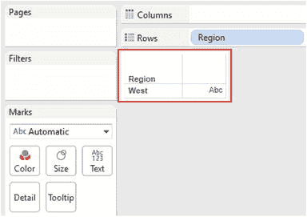

*图 1-30. 符合筛选条件的值已显示*

如果您希望进一步编辑提取中的筛选条件或添加另一个筛选器，请右键单击工作表/视图中的数据源以调出上下文菜单。选择`提取数据`（如图 1-31 所示）。

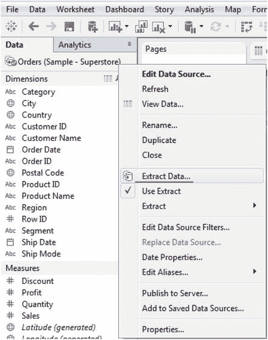

*图 1-31. 编辑提取或为其添加另一个筛选器*

根据需要设置您的筛选条件（如图 1-32 所示）。

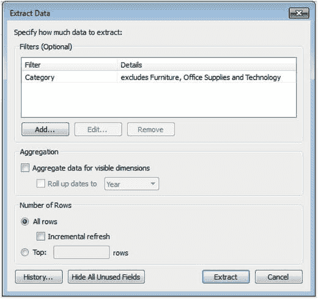

*图 1-32. 设置新的“筛选”条件*

要验证并继续使用提取，请按如下方式执行快速检查：右键单击工作表/视图中的数据源以调出上下文菜单（如图 1-33 所示）。

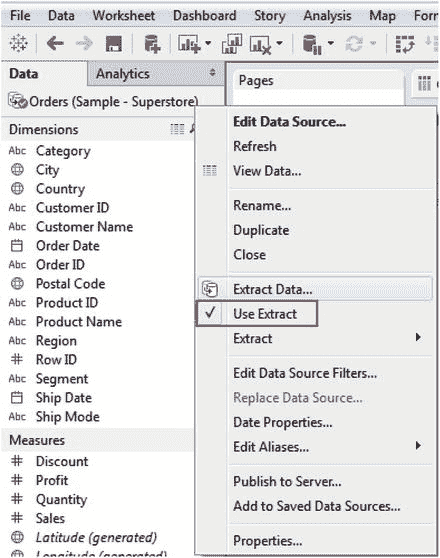

*图 1-33. “使用提取”旁边的复选标记表示正在使用提取*

请注意`使用提取`旁边的复选标记。如果您想停止使用提取并恢复使用实时数据连接，只需点击`使用提取`即可。

要使用`.tde`文件，请遵循以下步骤：

**第 1 步**

在数据源连接页面上，点击`其他文件`（如图 1-34 所示）。

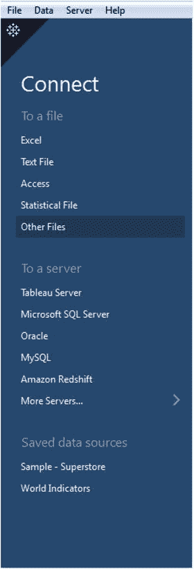

*图 1-34. 数据源连接页面上的“其他文件”选项*

**第 2 步**

找到`.tde`文件（如图 1-35 所示）。

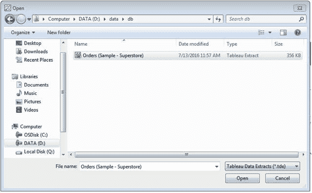

*图 1-35. “打开”对话框窗口，用于定位并打开`.tde`文件*

选择该文件。点击`打开`。输出结果如图 1-36 所示。

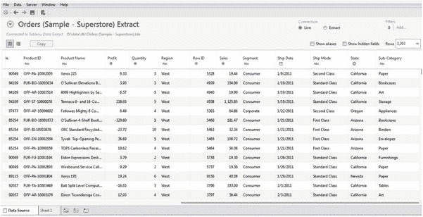

*图 1-36. 显示符合“提取”的“筛选”条件的数据*


#### 1.6.6.3 使用数据提取的优点：

- **便携性**

你的报表和仪表板使用存储在数据库服务器（如 Oracle 或 MS SQL Server）上的数据。你即将乘坐航班，并希望在飞行途中继续处理这些数据。你明白在这种情况下，无法建立与数据的实时连接。此时，使用数据提取就成了救星。如果你选择使用数据提取，就能省去连接数据服务器的麻烦。

如果你有权访问 Tableau Server，就可以在需要时安排数据提取的刷新。

- **性能**

实时连接在 Tableau 部署中不需要大量存储空间，但你必须确保该数据源的速度不会成为性能瓶颈。

另一方面，根据数据的特定特征，数据提取可能需要大量存储空间。此外，你还需要在 Tableau Server 环境中使用更快的磁盘进行处理。

- **优化数据提取**

创建数据提取后，下一个重点应该是优化数据提取。优化意味着 Tableau 将扫描你的数据中的任何计算字段，然后在数据提取中预先计算这些字段。这一定能提升性能，因为每次访问该字段时，无需在本地重新计算每个计算。

如果你的数据源有计算字段，特别是复杂的计算，那么你应该探究一下，看看优化的数据提取是否能在性能上优于实时连接。

- **处理大型文本文件或 Excel 文件时，数据提取尤为适用**

如果你的数据源是一个大型文本文件或 Excel 文件，你会立即从创建数据提取中获益。

文本和 Excel 数据会从源文件中提取出来，并加载到 Tableau 高性能列式数据引擎中，该引擎专为可视化分析而设计。

- **数据提取中的过滤器有助于创建精简的数据子集**

在 `Data > Extract` 下的“提取选项”中，系统会提示你向数据提取添加过滤器（如图 1-37 所示）。

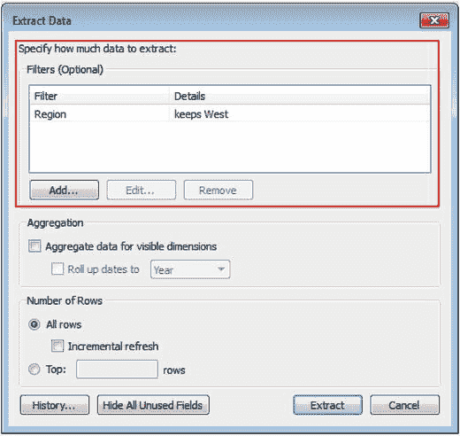

图 1-37. 使用 `Extract Data` 对话框指定要提取的数据量

你的数据源可能非常庞大；但是，你可能不需要整个数据集来完成所需的分析。过滤器有助于从庞大的数据源中精确定位到必要的记录，从而创建一个精简的数据子集。

较小的数据提取需要较少的计算能力。

- **增量提取**

有两种刷新提取中数据的方法（如图 1-38 所示）。它们是：

- **完整提取**：完整提取会用数据源中的一个新文件覆盖 Tableau 数据引擎中现有的数据提取。
- **增量提取**：增量提取将有助于追加自上次创建提取以来新增的记录。例如，如果你的数据提取必须每天刷新，这将特别有用。你可以通过选中 `Data Extract` 对话框中的 `Incremental Refresh` 复选框来实现。

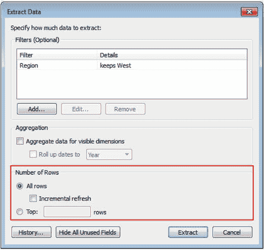

图 1-38. 使用 `Extract Data` 窗口刷新数据提取

- **创建打包工作簿**

如果你正在处理来自 SQL Server 或 Oracle 等数据库的数据，并且需要与未安装 Tableau Desktop（专业版或个人版）的人共享工作簿，则需要在共享前打包工作簿。除非创建数据提取，否则无法打包存储在远程服务器上的数据。

- **发布到 Tableau Public**

如果你想将数据发布到网络上，则必须使用数据提取。

- **数据安全性**

想象一下，你在一家大公司的人力资源部门工作。你负责员工数据库。有些关于员工的信息是绝对不能共享的。然而，有一小部分关于员工技能和能力的信息是可以共享的。你决定使用数据提取来创建一个打包工作簿。数据提取为你提供了 `Hides All Unused Fields`（隐藏所有未使用字段）的功能（如图 1-39 所示）。换句话说，它移除了你在基于该提取的任何可视化中未使用的维度和度量。

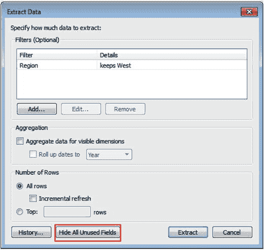

图 1-39. 使用 `Extract Data` 对话框中的 `Hide All Unused Fields` 功能

你创建的数据提取随后可以安全地打包，并且可以放心，你不希望可见的字段甚至不在提取中，因此无法被访问。

使用同一个对话框，你可以通过过滤部分来限制数据集中包含的行（而非列）。

## 1.7 要点记忆

- 数据可视化是数据的图形化或图示化描述。
- 数据可视化帮助用户提出问题、得到问题的答案，并进一步提出后续问题。
- 数据可视化有助于快速发现趋势、识别模式并理解复杂概念。
- Tableau 拥有丰富的产品系列，例如 Tableau Desktop、Tableau Server、Tableau Online、Tableau Mobile、Tableau Reader 等。
- Tableau 中有多种文件类型，例如 Tableau 工作簿（`.twb`）、Tableau 打包工作簿（`.twbx`）、Tableau 数据提取（`.tde`）、Tableau 数据源（`.tds`）等。
- Tableau 有助于创建信息图。
- Tableau Online 是 Tableau Server 在云端的托管版本。
- Tableau Reader 仅适用于 Tableau 打包工作簿。
- 如果数据存储在远程服务器（如 Oracle、MS SQL Server）上，则无法创建 Tableau 打包工作簿。
- Tableau 仪表板无法添加书签。


## 1.8 作业

1.  观看汉斯·罗斯林（Hans Rosling）的 TED 演讲 链接：[`https://www.ted.com/talks/hans_rosling_at_state`](https://www.ted.com/talks/hans_rosling_at_state) 视频标题：“Let my data set change your mindset” 演讲者：汉斯·罗斯林，全球健康专家，数据远见者 时长：19:56，拍摄时间：2009 年 6 月 为何观看此视频？观看此视频，以了解如何通过出色的可视化方式，以通俗易懂的形式呈现数据。
2.  观看汉斯·罗斯林的演讲 链接：[`http://www.presentationzen.com/presentationzen/2012/01/hans-rosling-the-jedi-master-of-data-visualization-.html`](http://www.presentationzen.com/presentationzen/2012/01/hans-rosling-the-jedi-master-of-data-visualization-.html) 视频标题：“US in a converging world.” 演讲者：汉斯·罗斯林，全球健康专家，数据远见者 时长：5:22，来自 CNN 法里德·扎卡里亚的节目 GPS 为何观看此视频？学习如何关注“意义”而非“数据”。
3.  执行以下步骤：
    1.  在“C:”驱动器中创建一个名为“Data”的文件夹。将“Sample – Superstore.xlsx”复制到“C:”驱动器中的“Data”文件夹中。
    2.  基于“Sample – Superstore.xlsx”中的数据创建一个简单的可视化。
    3.  将工作簿以文件名“Sample.twb”保存在桌面上。
    4.  将“Sample – Superstore.xlsx”文件重命名为“Practice – Superstore.xlsx”。
    5.  尝试在 Tableau 中打开“Sample.twb”。
    6.  评论打开“Sample.twb”文件时发生的情况，并解释原因。
4.  执行以下步骤：
    1.  在“C:”驱动器中创建一个名为“Data”的文件夹。将“Sample – Superstore.xlsx”复制到“C:”驱动器中的“Data”文件夹中。
    2.  基于“Sample – Superstore.xlsx”中的数据创建一个简单的可视化。
    3.  将工作簿以文件名“Sample.twbx”保存在桌面上。
    4.  将“Sample – Superstore.xlsx”文件重命名为“Practice – Superstore.xlsx”。
    5.  尝试在 Tableau 中打开“Sample.twbx”。
    6.  评论打开“Sample.twbx”文件时发生的情况，并解释原因。
5.  执行以下步骤：
    1.  启动 Tableau 并连接到 Oracle 数据库。选择您想要使用的表。
    2.  使用从 Oracle 数据库的选定表中获取的数据，创建任意简单的可视化。
    3.  尝试创建一个打包工作簿（`.twbx`）。
    4.  您是否成功创建了打包工作簿？如果是，为什么？如果否，为什么？
6.  阅读白皮书并写出 Excel 与 Tableau 之间的三个差异点。Excel：好用的锤子 – 糟糕的螺丝刀 [`http://www.tableau.com/learn/whitepapers/excel-great-hammer-lousy-screwdriver`](http://www.tableau.com/learn/whitepapers/excel-great-hammer-lousy-screwdriver)
7.  在以下网站阅读一些客户案例： [`https://www.tableau.com/about/customers`](https://www.tableau.com/about/customers)

## 1.9 后续步骤

下一章将详细介绍如何从各种数据源获取数据，例如大数据、NoSQL（MongoDB、Cassandra）、R 脚本（`.rdata`）、关系数据库管理系统（MS SQL Server、MySQL、MS Access DB）等，此外还包括连接电子表格（Excel）、文本文件（`.txt`）等。

