# 2. 处理单一与多数据源

> “我们大多数人需要聆听音乐才能理解它有多美。但通常我们在呈现统计数据时，只是展示乐谱，却没有演奏音乐。” — 汉斯·罗斯林，[Gapminder 基金会](https://en.wikipedia.org/wiki/Gapminder_Foundation#Gapminder%20Foundation)联合创始人兼主席，该基金会开发了[Trendalyzer](https://en.wikipedia.org/wiki/Trendalyzer#Trendalyzer)软件系统

第 1 章让我们熟悉了可视化的基本概念、可视化的必要性与重要性、Tableau 的功能特性、Tableau 产品线以及 Tableau 中的各种文件格式。本章将帮助我们理解如何在 Tableau 中处理单一与多数据源。我们将探讨以下内容：

*   桌面架构
*   Tableau 环境
*   连接到文件
*   连接到服务器
*   元数据网格
*   联接
*   自定义 SQL
*   数据混合
*   数据提取

让我们从桌面架构开始。

## 2.1 桌面架构

Tableau 架构基于 n 层客户端服务器架构（如图 2-1 所示）。Tableau 可充当桌面安装软件、Web 客户端和移动客户端。Tableau Desktop 是一个创作和发布工具。它用于在 Tableau Server 上创建共享视图。Tableau 提供可扩展的解决方案，用于创建和交付桌面、Web 和移动分析。Tableau Desktop 允许用户探索数据并分享洞察。

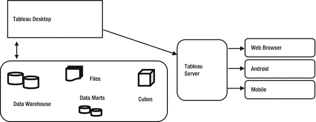

图 2-1. Tableau Desktop 架构

让我们简要讨论 Tableau Desktop 架构的各个层次。

### 2.1.1 数据层

Tableau 的基石是它的数据层。Tableau 允许您在异构数据环境中工作。您可以处理数据库、服务器、数据仓库、多维数据集以及平面文件（如 Excel、Access 等）。在 Tableau 中，除非必要，否则无需将所有数据加载到内存中。Tableau 允许您通过应用数据库功能来回答您的问题，从而利用现有环境。

### 2.1.2 数据连接器

Tableau 提供了多种数据连接器，用于连接数据库，如 Microsoft SQL Server、Oracle、Teradata、Vertica、Cloudera Hadoop 等。此外，还有通用 ODBC 连接器，用于连接任何没有原生连接器的系统。在 Tableau 中，有两种与数据交互的模式：(i) 实时连接 (ii) 内存模式。Tableau 用户可以轻松地在两者之间切换。

### 2.1.3 实时连接

Tableau 的数据连接器允许您利用现有的数据基础设施。这是通过将动态 SQL 或 MDX 语句直接发送到源数据库，而不是导入所有数据来实现的。这意味着，如果您投资了像 Vertica 这样经过分析优化的快速数据库，您可以通过实时连接到数据而从中受益。这会将详细数据保留在源系统中，并将查询的聚合结果发送到 Tableau。Tableau 还可以利用无限量的数据。Tableau 是众多世界上最大数据库的前端分析客户端。每个连接器都针对每个数据源的独特性进行了优化。

### 2.1.4 内存模式

Tableau 拥有一个用于分析的快速内存数据引擎。Tableau 允许您一键连接数据，提取并将其加载到内存中。Tableau 的数据引擎充分利用整个系统，在商用硬件上对数亿行数据实现快速查询响应。由于数据引擎可以访问磁盘存储以及 RAM 和缓存，因此它不受系统内存量的限制。无需将整个数据集加载到内存中即可实现其性能目标。

在以下情况下，内存模式是理想选择：

*   您的数据库对于交互式分析来说速度太慢。
*   您需要减轻事务数据库的负载。
*   您需要离线工作，无法实时连接到数据。

但在以下情况下，实时连接可能更可取：

*   您拥有一个快速的数据库，如 Vertica、Teradata 或其他经过分析优化的数据库。
*   您需要获取最新的数据。

请参阅以下链接，了解内存与实时数据：哪个更好？

[`http://www.tableau.com/learn/whitepapers/memory-or-live-data`](http://www.tableau.com/learn/whitepapers/memory-or-live-data)

## 2.2 Tableau 环境

让我们尝试理解 Tableau 的环境。

### 2.2.1 打开方式

双击桌面上的 Tableau 图标（如图 2-2 所示）。


图 2-2. Tableau 快捷方式图标


### 2.2.2 关闭

点击应用程序右侧的关闭按钮（如图 2-3 所示）。


图 2-3. 关闭按钮

接下来，我们将学习**开始页面**。

### 2.2.3 开始页面

**开始页面**是一个中心位置，用于帮助连接数据源、访问最近的工作簿以及探索 Tableau 社区提供的教程（如图 2-4 所示）。

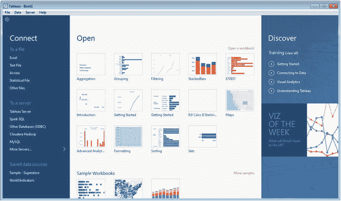

图 2-4. Tableau 开始页面

开始页面包含三个窗格。

1.  **连接：** 使用 `Connect`，您可以连接到各种数据源，例如连接到文件或连接到服务器。您也可以打开已保存的数据源。`Sample - Superstore` 是 Tableau Desktop 版本自带的默认已保存数据源。参见图 2-5。

    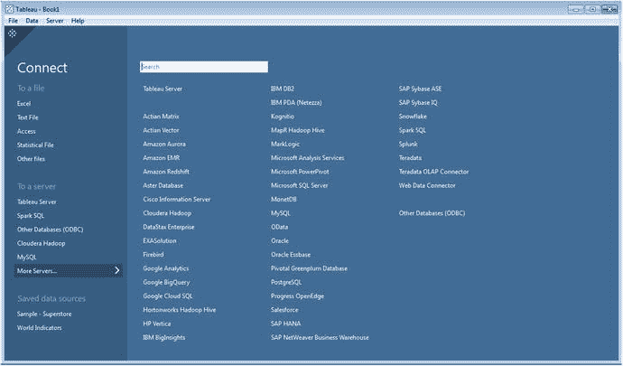

    图 2-5. 连接页面
2.  **打开：** 首次打开 Tableau 时，此窗格为空。当您开始创建工作簿后，您可以在此窗格中看到最近打开的工作簿。您也可以打开示例工作簿来探索 Tableau 的功能。您还可以通过单击工作簿缩略图左上角出现的图钉图标，将工作簿固定在开始页面上。被固定的工作簿会始终显示在开始页面上，即使它们最近未被打开。要移除最近打开或固定的工作簿，请将鼠标悬停在工作簿缩略图上，然后单击出现的 `x`。该工作簿缩略图会立即被移除，但下次打开 Tableau Desktop 时，它会与您最近使用过的工作簿一起再次显示。参见图 2-6。

    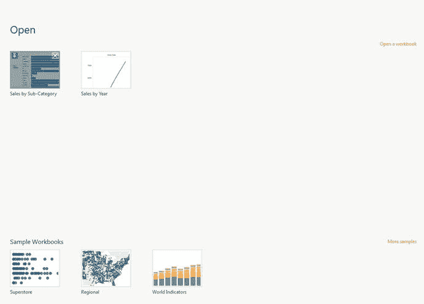

    图 2-6. 显示固定选项的打开页面
3.  **发现：** 您可以查看 Tableau 提供的培训、博客、会议和参考资料等详情。参见图 2-7。

    

    图 2-7. `Discover` 页面

### 2.2.4 数据源页面

您需要先建立与数据的初始连接，才能进入**数据源页面**。您可以按照以下步骤连接到 Excel 文件（`Sample – Superstore`）。

请遵循以下步骤：

#### 2.2.4.1 步骤 1

在开始页面上，在 `Connect` 下，选择 `To a File` ➤ `Excel`（如图 2-8 所示）。

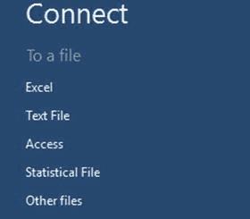

图 2-8. `Connect` 部分

#### 2.2.4.2 步骤 2

将打开 `Open` 对话框。导航到 `Sample-Superstore` Excel 文件所在的文件夹。在 Tableau Desktop 中，默认路径是 `C:\Users\Username\Documents\My Tableau Repository\Datasources\9.3\en_US-US`（如图 2-9 所示）。

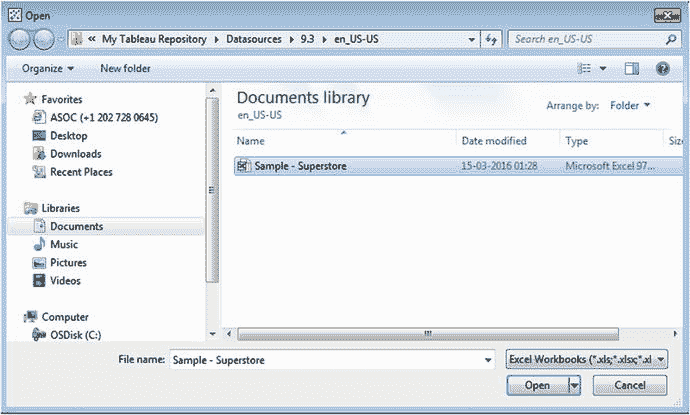

图 2-9. 用于打开 `Sample - Superstore` 的 `Open` 对话框

#### 2.2.4.3 步骤 3

当您单击 `Open` 按钮时，您会看到 `Processing Request` 窗口，如图 2-10 所示。

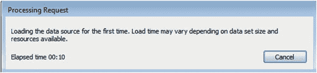

图 2-10. 处理请求窗口

#### 2.2.4.4 步骤 4

现在，您将能够看到 `Data Source Page`（数据源页面）（如图 2-11 所示）。

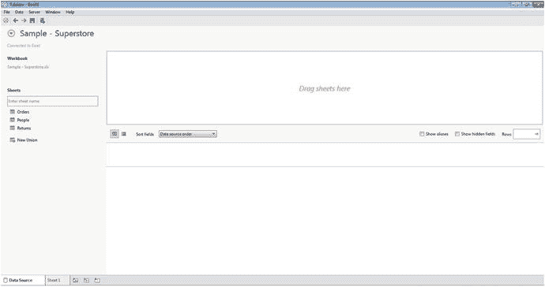

图 2-11. 数据源页面

#### 2.2.4.5 步骤 5

将 `Orders` 工作表从左侧窗格拖到画布区域，如图 2-12 所示。您也可以预览数据。

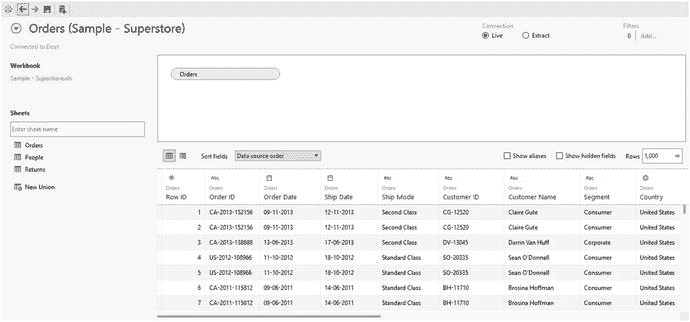

图 2-12. 放置在画布区域上的 `Orders` 工作表

数据源页面有四个主要区域。它们是：(i) 左侧窗格，(ii) 画布，(iii) 网格，以及 (iv) 元数据网格（如图 2-13 所示）。

1.  **左侧窗格：** 显示有关您所连接数据的详细信息。例如，对于基于文件的数据，将显示文件名和工作表。
2.  **画布：** 允许您将一个或多个表拖放到画布区域以设置数据源。
3.  **网格：** 允许您查看数据源中前 1,000 行数据。它还允许您修改数据源，例如重命名字段名称、排序、创建字段等。
4.  **元数据网格：** 允许您单击元数据网格以显示数据源中的字段。

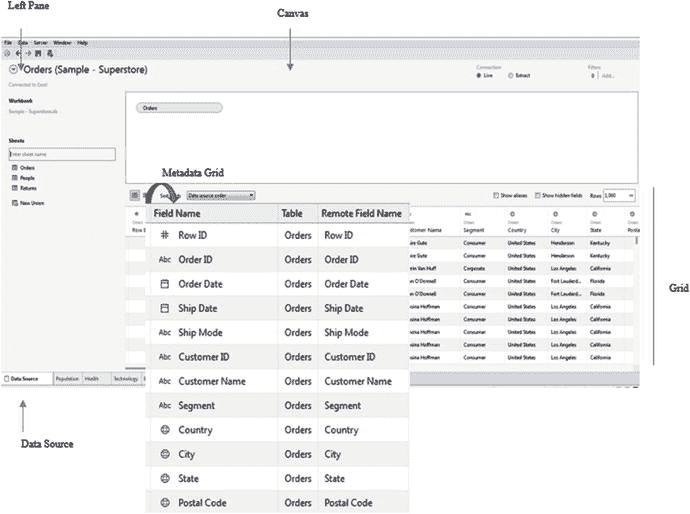

图 2-13. 数据源页面上的四个主要区域

Tableau 提供两种类型的连接：

*   **实时：** 这将允许实时提取数据。
*   **提取：** 这是关于以固定频率提取数据。

### 2.2.5 工作区

工作区包含数据窗格、卡和货架，以及一个或多个工作表。这些工作表可以是工作表、故事或仪表板。卡和货架可用于构建视图（如图 2-14 所示）。

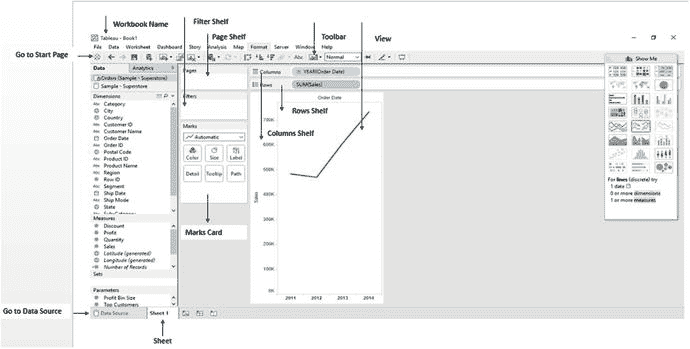

图 2-14. Tableau 工作区

用于创建故事的工作区与用于创建仪表板的工作区有很大不同。

### 2.2.6 工作簿和工作表

Tableau 工作簿与 Microsoft Excel 工作簿非常相似。一个工作簿可以包含一个或多个工作表。这些工作表可以是工作表、故事或仪表板。工作簿是所有工作的容器。工作簿将帮助您组织、执行分析以及保存和分享结果。

*   **工作表** 表示一个单独的视图，包含数据窗格、卡、货架和图例。
*   **仪表板** 表示来自多个工作表的视图集合。
*   **故事** 表示一系列工作表或仪表板的序列，用于传达某些信息。

### 2.2.7 Tableau 中的视觉提示和图标

让我们讨论一下 Tableau 中的一些视觉提示和图标。

#### 2.2.7.1 数据窗格中的数据源

有关数据源图标，请参见表 2-1。

表 2-1. 数据源图标

| 视觉提示 | 描述 |
| --- | --- |
|  | 主要数据源。 |
|  | 次要数据源。 |

#### 2.2.7.2 数据窗格中的字段

让我们讨论数据窗格中显示的图标。

*   离散字段用`蓝色`表示。
*   连续字段用`绿色`表示。
*   用户定义函数用等号表示。

有关数据窗格中的图标，请参见表 2-2。

表 2-2. 数据窗格中的图标

| 视觉提示 | 描述 |
| --- | --- |
|  | 文本值。 |
|  | 数值。 |
|  | 仅有日期值。 |
|  | 包含日期和时间值。 |
|  | 地理数据。 |
|  | 用户定义的集。 |
|  | 数值箱。 |
|  | 组。 |
|  | 关系层次结构。 |
|  | 字段已与另一个数据源的字段混合。 |
|  | 字段未与另一个数据源的字段混合。 |


### 仪表板和工作表窗格中的工作表

让我们讨论一下故事中使用的工作表。

蓝色复选标记表示该工作表已用于一个或多个故事。请参阅表 2-3。

**表 2-3.** 仪表板和工作表窗格中的工作表

| 视觉提示 | 描述 |
| --- | --- |
|  | 工作表。 |
|  | 仪表板。 |

请参阅下方链接了解 Tableau 中视觉提示和图标的更多信息。
[`https://onlinehelp.tableau.com/current/pro/desktop/en-us/tips_visualcues.html`](https://onlinehelp.tableau.com/current/pro/desktop/en-us/tips_visualcues.html)

### 连接到文件

让我们探讨如何连接到以下提及的文件。

*   文本
*   Microsoft Access
*   R 数据文件

#### 连接到文本文件

按照以下步骤连接到文本文件。

##### 连接到文本文件的步骤

##### 步骤 1

在起始页的“连接”下，选择“连接到文件” ➤ “文本文件”（如图 2-15 所示）。

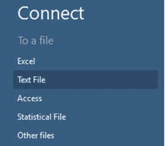

**图 2-15.** 连接到文本文件

##### 步骤 2

将弹出“打开”对话框。导航到包含 `Sample-Superstore` 文本文件的文件夹。选择该文件并单击“打开”按钮（如图 2-16 所示）。

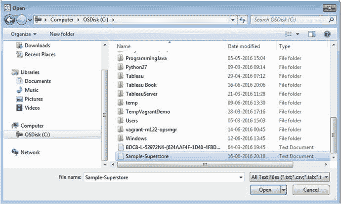

**图 2-16.** 用于打开 `Sample-Superstore` 文本文件的“打开”对话框

##### 步骤 3

数据源页面将打开，如图 2-17 所示。

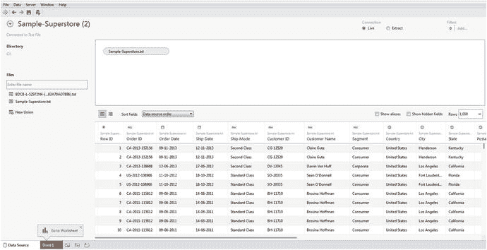

**图 2-17.** 显示连接到 `Sample-Superstore.xls` 数据源的数据源页面

#### 连接到 MS Access

按照以下步骤连接到 MS Access。

##### 连接到 MS Access 的步骤

##### 步骤 1

在起始页的“连接”下，选择“连接到文件” ➤ “Access”（如图 2-18 所示）。

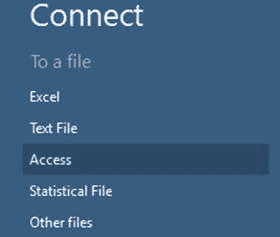

**图 2-18.** 连接到 Access

##### 步骤 2

将打开 Access 连接向导（如图 2-19 所示）。单击“浏览”按钮。将弹出“打开”对话框。

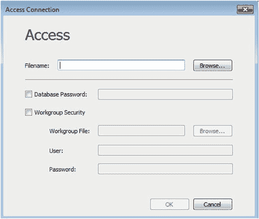

**图 2-19.** Access 连接窗口

##### 步骤 3

导航到包含所需 Access 文件的文件夹。选择该文件并单击“打开”按钮（如图 2-20 所示）以打开一个 Access 文件（如图 2-21 所示）。

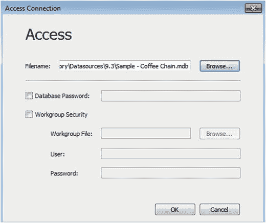

**图 2-21.** 显示所选 `Sample - Coffee Chain.mdb` 文件的 Access 连接窗口

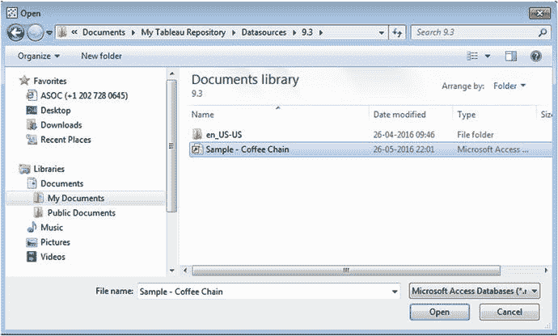

**图 2-20.** 用于打开 Sample - Coffee Chain (Microsoft Access database) 的“打开”对话框

##### 步骤 4

单击“确定”连接到 Access 文件（如图 2-22 所示）。

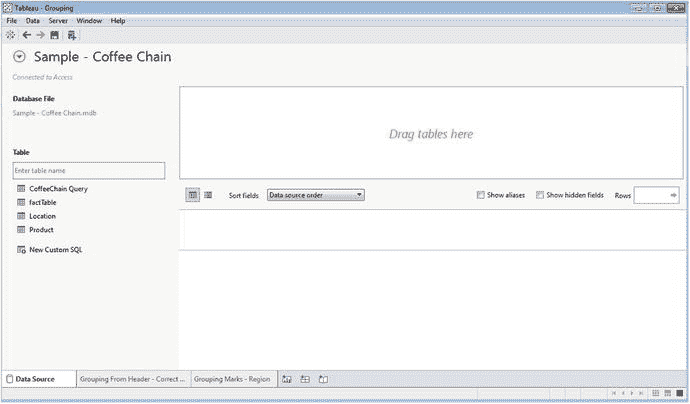

**图 2-22.** 显示连接到 Sample-Coffee Chain Access 数据源的数据源页面

#### 连接到 RData 文件

执行以下步骤，将存储在 `.RData` 文件（在 R 统计编程语言中创建）中的数据导入到 Tableau。

##### 连接到 RData 文件的步骤

我们将查看一个 `.CSV` 文件，该文件将在 R 界面中读取并保存到数据集中。然后，这个数据集将被保存到一个 `.RData` 文件中。Tableau 将读取该文件。

##### 步骤 1

`DataSetIris.csv` 是一个逗号分隔值文件，位于 `D:` 驱动器中。让我们查看 `.csv` 文件中的数据（如图 2-23 所示）。

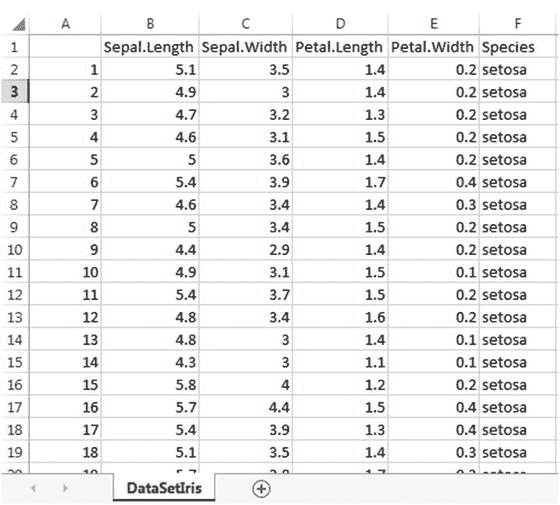

**图 2-23.** `DataSetIris.csv` 数据集

让我们探讨如何创建一个 `.RData` 文件。

将 `DataSetIris.csv` 文件读入 R 的步骤

##### 步骤 2

启动 R 界面。在 R 命令提示符下发出以下命令（如图 2-24 和图 2-25 所示）。

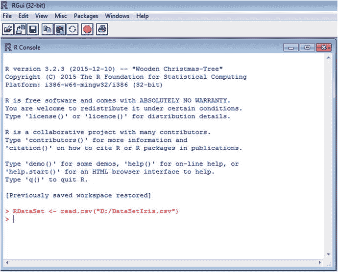

**图 2-25.** R 界面


**图 2-24.** 将数据从 `.csv` 文件读取到数据集 `RDataSet` 中的命令

上述命令创建了一个名为 `RDataSet` 的数据集。该数据集读取了位于 `D:` 驱动器中的 `DataSetIris.csv` 文件中的数据值。

##### 步骤 3

要显示 `RDataSet` 中包含的值，请键入以下命令（如图 2-26 和图 2-27 所示）。

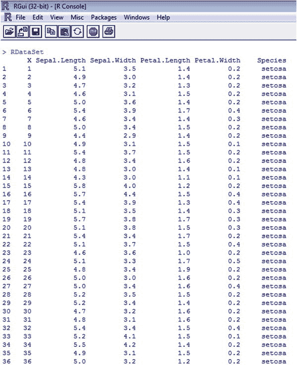

**图 2-27.** `RDataset` 中的数据


**图 2-26.** 显示 `RDataSet` 中数据的命令

该数据集中有 150 行这样的数据。

##### 步骤 4

您可以通过在 R 提示符下发出以下命令来创建 `.RData` 文件。

```
Save (RDataSet, file=“D:/TableauDataSet.RData”)
```

**注意** 数据集 `RDataSet` 已保存到文件 `TableauDataSet.RData`。

##### 步骤 5

启动 Tableau Desktop。在“连接到文件”下单击“统计文件”（如图 2-28 所示）。选择您希望在 R 中打开的统计文件（如图 2-29 所示）。

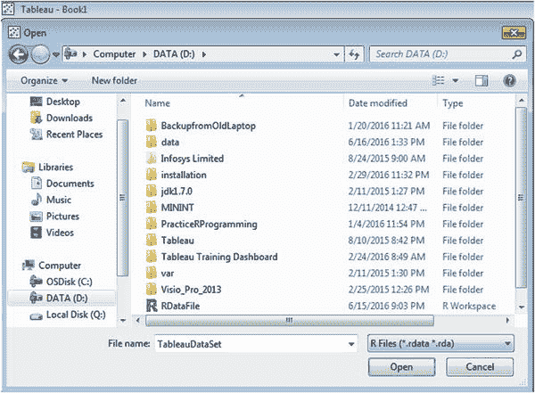

**图 2-29.** 用于打开 RDataFile 的“打开”对话框

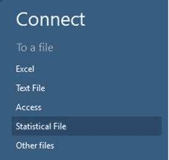

**图 2-28.** 连接到统计文件

##### 步骤 5

现在，您可以在数据源页面中查看 `RDataset`（如图 2-30 所示）。

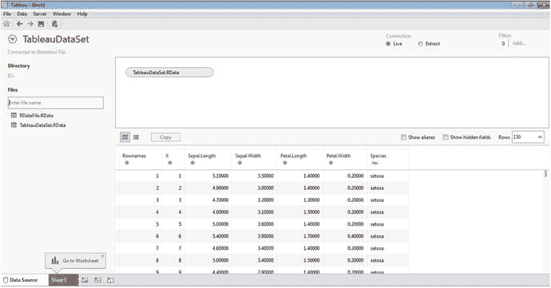

**图 2-30.** 显示连接到统计文件的数据源页面

### 连接到服务器

让我们探讨如何连接到以下数据源：

*   Microsoft SQL Server
*   MySQL
*   非关系型数据库
    *   MongoDB
    *   Cassandra

#### 连接到 MS SQL Server 2014 Management Studio

我们在 MS SQL Server 2014 的 `Test` 数据库中有一个名为 `Employee` 的表。

`Employee` 表中有六条记录，如下所示（如图 2-31 所示）。

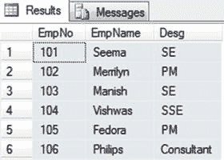

**图 2-31.** `Employee` 表

目标是在 Tableau 中读取这六条记录。

请按照以下步骤操作。


好的，作为一名高级文档工程师和翻译员，我将严格按照您提供的注意事项和示例，将给定的英文文本翻译成中文。


### 连接到 MS SQL Server 的步骤

#### 第 1 步

在“连接”页面上打开一个 Tableau 工作簿。
在“连接到服务器”下，点击 `Microsoft SQL Server`（如图 2-32 所示），弹出显示与 `Microsoft SQL Server` 服务器连接的对话框（如图 2-33 所示）。

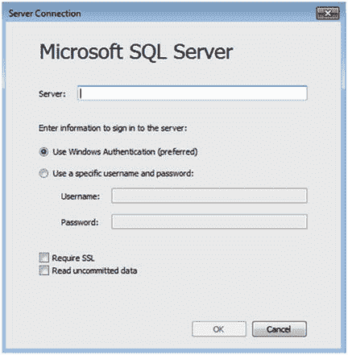
图 2-33. Microsoft SQL Server 连接窗口

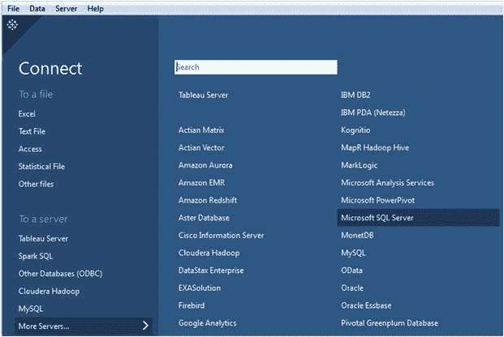
图 2-32. 连接到 Microsoft SQL Server

#### 第 2 步

填写数据库服务器的详细信息，例如“服务器名称”。选择“Windows 身份验证”或提供特定的用户名和密码（如图 2-34 所示）。

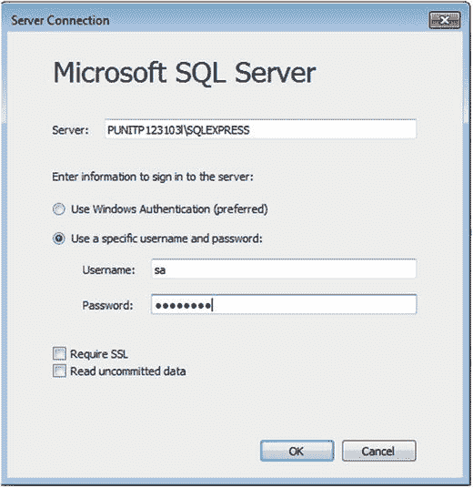
图 2-34. Microsoft SQL Server“服务器连接”详细信息

#### 第 3 步

如果连接成功，则会显示以下屏幕，允许选择所需的数据库（如图 2-35 所示）。

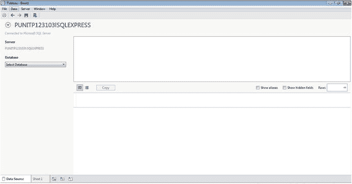
图 2-35. 显示连接到“Microsoft SQL Server”的数据源页面

#### 第 4 步

我们要处理的 `Employee` 表位于 `Test` 数据库中（如图 2-36 所示）。

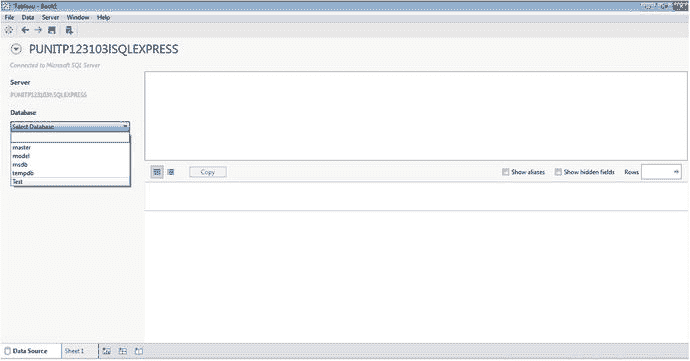
图 2-36. 选择“Test”数据库

#### 第 5 步

目前，`Test` 数据库中只有一个表 `Employee`。将该表拖放到画布区域。选择您希望如何更新记录：“立即更新”或“自动更新”（如图 2-37 所示）。

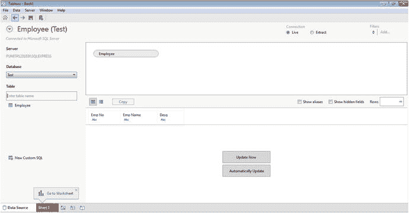
图 2-37. 放置在画布区域上的“Employee (Test)”表

### 连接到 MySQL

按照以下步骤连接到 MySQL 数据库。

#### 连接到 MySQL 的步骤

##### 步骤 1

从下方链接下载适用于 Windows 的 MySQL 安装程序并安装。
[`https://dev.mysql.com/downloads/installer/`](https://dev.mysql.com/downloads/installer/)

##### 步骤 2

转到 `所有程序 ➤ MySQL Server 5.7 ➤ MySQL 命令行客户端`（如图 2-38 所示）。点击 `MySQL 命令行客户端` 以启动 MySQL 服务器（如图 2-39 所示）。

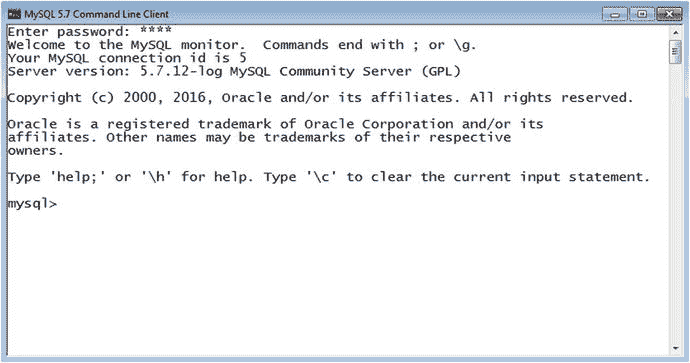
图 2-39. MySQL 命令提示符

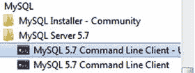
图 2-38. MySQL 命令行客户端

##### 步骤 3

从下方链接下载适用于 Tableau 的 MySQL 驱动程序并安装。
[`http://www.tableau.com/support/drivers`](http://www.tableau.com/support/drivers)

##### 步骤 4

打开 `Tableau Desktop`，在 `连接 ➤ 选择 MySQL` 下操作（如图 2-40 所示）。

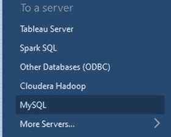
图 2-40. 连接到 MySQL 服务器

##### 步骤 5

将打开 MySQL 连接向导。提供 `服务器`、`用户名` 和 `密码` 的输入，然后单击 `确定` 连接到 MySQL 服务器（如图 2-41 所示）。

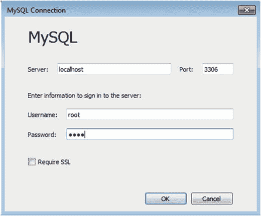
图 2-41. MySQL 服务器连接详细信息

##### 步骤 6

如果连接成功，则会显示以下屏幕，允许选择所需的数据库（如图 2-42 所示）。

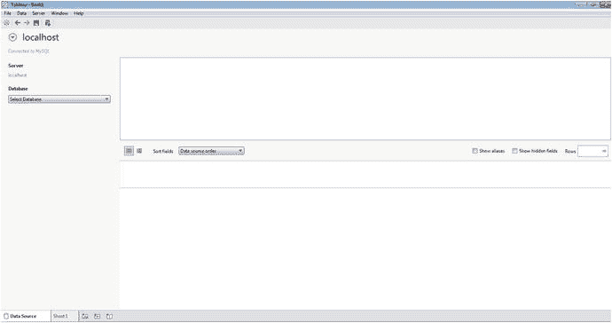
图 2-42. 显示 MySQL 服务器连接成功的数据源页面

### 连接到 NoSQL 数据库

我们来讨论如何连接到 NoSQL 数据库，例如 Cassandra 和 MongoDB。

#### 连接到 Cassandra

按照以下步骤连接到 Cassandra NoSQL 数据库。

##### 连接到 Cassandra NoSQL 数据库的步骤

##### 步骤 1

从下方链接下载适用于 Windows 的 DataStax Community Edition 并安装。
[`https://downloads.datastax.com/community/`](https://downloads.datastax.com/community/)
使用 Apache Cassandra 需要 Java 1.8。

##### 步骤 2

选择 `所有程序 ➤ DataStax Community Edition ➤ Cassandra CQL Shell`（如图 2-43 所示）以启动 Cassandra CQL Shell（如图 2-44 所示）。

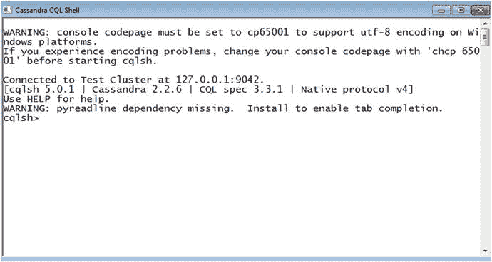
图 2-44. Cassandra CQL Shell

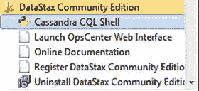
图 2-43. Cassandra CQL Shell 选项

##### 步骤 3

从下方链接下载带有 SQL 连接器的 Cassandra ODBC 和 JDBC 驱动程序并安装。
[`http://www.simba.com/drivers/cassandra-odbc-jdbc/`](http://www.simba.com/drivers/cassandra-odbc-jdbc/)
您可以下载 30 天试用版，`SimbaApacheCassandraDriver.lic` 文件将发送到您的注册邮箱。

##### 步骤 4

要检查 Cassandra ODBC 和 JDBC 驱动程序的安装情况，请选择 `所有程序 ➤ Simba Cassandra ODBC Driver 2.2 ➤ 64 位 ODBC 驱动程序`（如图 2-45 所示）。

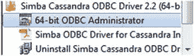
图 2-45. Cassandra ODBC 驱动程序选项

##### 步骤 5

选择 `系统 DSN` 以查看 `Simba Cassandra ODBC DSN`（如图 2-46 所示）。

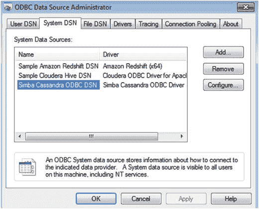
图 2-46. Simba Cassandra ODBC DSN（高亮显示）

将 `SimbaApacheCassandraDriver.lic` 文件复制到 `SimbaCassandraODBC Driver` 的 `lib` 文件夹中。您可以在 `Program Files` 中找到 `SimbaCassandraODBC Driver` 文件夹。

##### 步骤 6

单击 `配置` 按钮以配置 Simba Cassandra ODBC DSN（如图 2-47 所示）。将主机指定为 `127.0.0.1`，然后单击 `测试` 以检查连接性（如图 2-48 所示）。连接成功后，单击 `确定` 按钮。

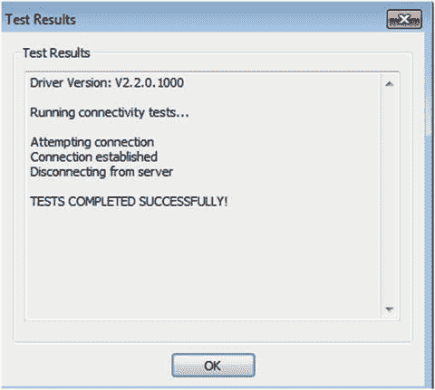
图 2-48. 连接“测试结果”窗口

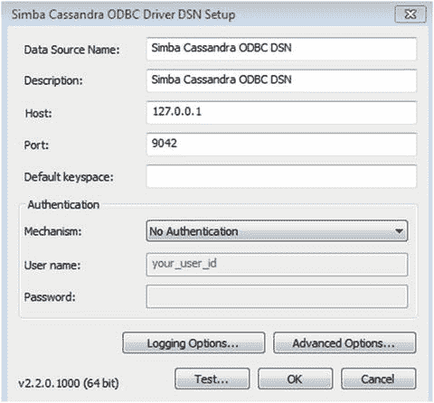
图 2-47. Simba Cassandra ODBC 驱动程序 DSN 设置

##### 步骤 7

打开 `Tableau Desktop`，从 `连接` 中，选择 `更多服务器 ➤ 其他数据库 (ODBC)`（如图 2-49 所示）。

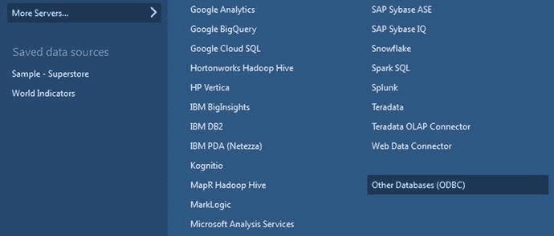
图 2-49. 连接到“其他数据库 (ODBC)”

##### 步骤 8

将显示 `其他数据库 (ODBC)` 连接向导。选择 `Simba Cassandra ODBC DSN`（如图 2-50 所示），然后单击 `连接` 按钮。接下来，单击 `确定` 按钮以连接到 Cassandra 数据库。

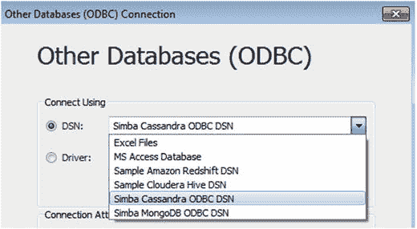
图 2-50. 其他数据库 (ODBC) 连接窗口

###### 步骤 9

如果连接成功，则会显示以下屏幕，允许选择所需的数据库（如图 2-51 所示）。

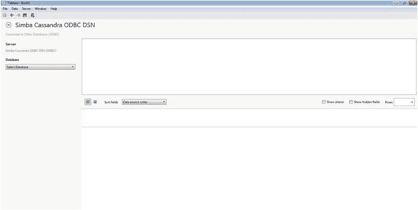
图 2-51. 显示 Cassandra 连接的数据源页面

#### 连接到 MongoDB

按照以下步骤连接到 MongoDB NoSQL 数据库。

##### 连接到 MongoDB NoSQL 数据库的步骤

##### 步骤 1

从下方链接下载适用于 Windows 的 MongoDB 并安装。
[`https://www.mongodb.com/download-center#community`](https://www.mongodb.com/download-center#community)


好的，作为一名高级文档工程师和翻译员，我将严格遵循您的注意事项和示例格式，将给定的英文文本翻译成中文。


##### 步骤 2

要启动 MongoDB 服务器，请打开命令提示符并导航到 MongoDB 的安装文件夹，如图 2-52 所示。

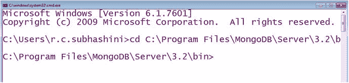

图 2-52. MongoDB 安装目录路径

##### 步骤 3

输入 `mongod.exe` 以启动服务器（如图 2-53 所示）。

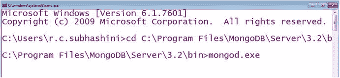

图 2-53. 启动 MongoDB 服务器

您应该会看到一条消息，显示“waiting on port 27017…”。

##### 步骤 4

要启动 MongoDB 客户端，请打开命令提示符并导航到 MongoDB 的安装文件夹，然后输入 `mongo.exe`，如图 2-54 所示。

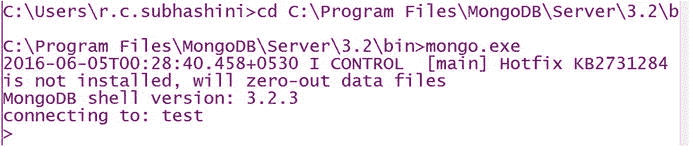

图 2-54. 启动 MongoDB 客户端

##### 步骤 5

从下方链接下载附带 SQL 连接器的 MongoDB ODBC 和 JDBC 驱动程序并安装。

[`http://www.simba.com/drivers/mongodb-odbc-jdbc/`](http://www.simba.com/drivers/mongodb-odbc-jdbc/)

您可以下载 30 天试用版，您将在注册邮箱中收到 `SimbaMongoDBODBDriver.lic` 文件。

##### 步骤 6

要检查 MongoDB ODBC 和 JDBC 驱动程序的安装情况，请选择 **所有程序** ➤ **Simba MongoDB ODBC Driver 2.0** ➤ **64 bit ODBC Driver**（如图 2-55 所示）。


图 2-55. Simba MongoDB ODBC 驱动程序

##### 步骤 7

选择 **System DSN** 以查看 **Simba MongoDB ODBC DSN**（如图 2-56 所示）。

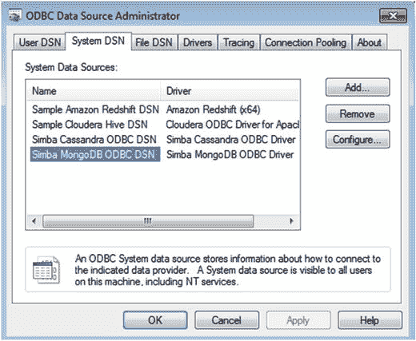

图 2-56. 显示“Simba MongoDB ODBC DSN”的“系统 DSN”选项卡

将 `SimbaMongoDBODBDriver.lic` 文件复制到 `SimbaMongoDBODBC` 驱动程序的 `lib` 文件夹中。您可以在 Program Files 文件夹中找到 `SimbaMongoDBODBC` 驱动程序文件夹。

##### 步骤 8

单击 **Configure…** 按钮以配置 **Simba MongoDB ODBC DSN**。将服务器指定为 `localhost`，端口指定为 `27017`，数据库指定为 `test`（MongoDB 的默认数据库）（如图 2-57 所示），然后单击 **Test** 以检查连接（如图 2-58 所示）。连接成功后，单击 **OK** 按钮。


图 2-58. 连接测试结果


图 2-57. Simba MongoDB ODBC 驱动程序 DSN 设置

###### 步骤 9

打开 Tableau Desktop，在 **连接** 下，选择 **更多服务器** ➤ **其他数据库 (ODBC)**（如图 2-59 所示）。


图 2-59. 连接到“其他数据库 (ODBC)”

###### 步骤 10

将弹出 **其他数据库 (ODBC)** 连接向导。选择 **Simba MongoDB ODBC DSN** 并单击 **Connect** 按钮（如图 2-60 所示）。接下来，单击 **OK** 按钮以连接到 MongoDB 数据库。


图 2-60. 选择“Simba MongoDB ODBC DSN”

###### 步骤 11

如果连接成功，将显示如下界面，允许您选择所需的数据库（如图 2-61 所示）。


图 2-61. 显示 MongoDB 连接的数据源页面

## 元数据网格

单击元数据网格图标（如图 2-62 所示）以打开元数据网格。元数据网格显示数据源中可用的字段。元数据网格有助于分析 Tableau 数据源的结构（如图 2-63 所示）、一次性重命名或隐藏字段（如图 2-64 所示）等。


图 2-64. “重命名”或“隐藏”字段及其他选项


图 2-63. 显示数据源字段的元数据网格


图 2-62. 元数据网格图标

## 连接

关系数据源包含表的集合，表通过特定字段相关联。例如，让我们考虑一个博客网站的架构设计。它包含一个表，用于记录博客条目，例如博客 ID、博客标题、描述、URL、点赞数和发布者等。除此之外，可能还有另一个表用于存储评论的详细信息，例如博客 ID、评论 ID、评论用户、点赞数和评论内容。要分析并回答诸如哪个博客获得了最高点赞数之类的问题，您需要使用共同字段（如博客 ID）来连接两个表。

建立连接后，您可以使用数据源页面连接到多个表，并指定连接以执行分析。

Tableau Desktop 支持不同类型的连接，例如内部连接、左连接、右连接和全外部连接。

### 向数据窗格添加字段

您可以添加或编辑表以添加或删除字段，从数据窗格修改连接操作，以指定数据在分析中应如何呈现。

请按照以下步骤向表中添加字段。

#### 向表添加字段的步骤

##### 步骤 1

在数据窗格上选择一个数据源，然后右键单击以获取 **编辑数据源…** 选项（如图 2-65 所示）。


图 2-65. “编辑数据源…”选项

##### 步骤 2

您将能够查看数据源页面。将所需的表拖到画布区域以执行连接操作（如图 2-66 和图 2-67 所示）。


图 2-67. 放置在画布区域上的“Returns”表


图 2-66. 放置在画布区域上的“Orders”表

##### 步骤 3

单击连接图标以选择/编辑连接操作的类型（如图 2-68 所示）。


图 2-68. 不同类型的连接操作

### 探索不同类型的连接

让我们了解如何使用“Student”和“Grade”两个表在 Tableau 中执行内部连接、左连接等操作。

按照以下步骤在 Tableau 中对两个数据源执行连接操作。

#### 步骤

请遵循以下步骤。

##### 步骤 1

创建一个 Excel 文件并将其命名为 `Sample – Student`。Student 表包含有关学生的详细信息，如下所示（如图 2-69 所示）。


图 2-69. 显示学生详细信息的学生表

Grade 表包含以下详细信息（如图 2-70 所示）。


图 2-70. 显示学生成绩详情的成绩表

##### 步骤 2

连接到 `Sample-Student`。在数据源页面中，拖放 `Student` 和 `Grade` 表（如图 2-71 所示）。


图 2-71. 放置在画布上的“Student”表和“Grade”表


### 2.6.2.2 内连接

`Inner Join`（内连接）基于一个公共字段，从一张表中获取所有在第二张表中存在匹配项的记录。在 Tableau 中，默认情况下，表之间使用`Inner Join`进行连接（如图 2-72 所示）。


图 2-72. “内连接”操作

### 2.6.2.3 左连接

`Left Join`（左连接）从左表中获取在右表中存在匹配的记录。对于右表中没有匹配的记录，将显示`Null`值（如图 2-73 所示）。


图 2-73. “左连接”操作

### 2.6.2.4 右连接

MySQL 数据源支持`Right Join`（右连接）。请参考连接到服务器部分以连接到 MySQL 数据源。创建两个表，即“Student”和“Grade”，其结构与`Inner Join`示例中所示相同。

`Right Join`从右表中获取在左表中存在匹配的记录。对于左表中没有匹配的记录，将显示`Null`值（如图 2-74 所示）。


图 2-74. “右连接”操作

### 2.6.3 并集

在 Tableau 中，“并集”操作支持合并来自不同文件的数据。考虑在`Inner Join`中使用的“Sample – Student”Excel 文件。

按照以下步骤执行“并集”操作。

#### 2.6.3.1 步骤

##### 2.6.3.1.1 步骤 1

单击如下所示的“新建并集”选项（如图 2-75 所示）。


图 2-75. “新建并集”选项

##### 2.6.3.1.2 步骤 2

将打开“并集窗口”。将名称指定为“Student_Grade”，将“Student”和“Grade”工作表拖放到窗口中。单击“确定”按钮以合并两个工作表中的数据（如图 2-76 所示）。


图 2-76. 并集窗口

##### 2.6.3.1.3 步骤 3

您将能够在网格窗口中查看合并后的数据。它还会显示每个字段对应的工作表名称（如图 2-77 所示）。


图 2-77. 并集结果

## 2.7 自定义 SQL

让我们学习编写 SQL 语句来检索适合分析的数据。假设您已连接到具有以下结构的 MySQL 数据源（请参考表 2-4、表 2-5）。

表 2-5. 成绩表

| StudNo | Grade |
|--------|-------|
| 1001   | A     |
| 1002   | B     |
| 1003   | A     |
| 1006   | C     |
| 1007   | A     |
| 1008   | B     |

表 2-4. 学生表

| StudNo | 学生姓名 |
|--------|---------|
| 1001   | John    |
| 1002   | Jack    |
| 1003   | Smith   |
| 1004   | Joshi   |

数据库名称：`student`

### 2.7.1 演示 1

按照以下步骤编写`Custom SQL`。

#### 2.7.1.1 编写自定义 SQL 的步骤

##### 2.7.1.1.1 步骤 1

选择`student`数据库（如图 2-78 所示）。


图 2-78. 选择`student`数据库

##### 2.7.1.1.2 步骤 2

双击“新建自定义 SQL”（如图 2-79 所示）。


图 2-79. “新建自定义 SQL”选项

##### 2.7.1.1.3 步骤 3

将弹出“编辑自定义 SQL”对话框。输入所需的 SQL 语句（如图 2-80 所示）。


图 2-80. “编辑自定义 SQL”语句

##### 2.7.1.1.4 步骤 4

单击“预览结果”以预览输出，然后单击“确定”创建`Custom SQL`（如图 2-81 所示）。


图 2-81. 显示数据预览的“查看数据”窗口

##### 2.7.1.1.5 步骤 5

`Custom SQL Query`（自定义 SQL 查询）显示在画布区域（如图 2-82 所示）。


图 2-82. 放置在画布区域的“自定义 SQL 查询”

##### 2.7.1.1.6 步骤 6

右键单击`Custom SQL Query`，选择“编辑自定义 SQL 查询”（如图 2-83 所示）。


图 2-83. “编辑自定义 SQL 查询”

## 2.8 数据混合

当您希望在分析中使用来自多个数据源的数据时，数据混合是最佳选择。

要执行数据混合，两个数据源中必须存在一个公共字段。在此，我们将考虑“Sample-Superstore Excel 数据源”和“Sample - CoffeeChain Access 数据源”。它们有一个公共字段，即`Market`（`CoffeeChain`）和`Region`（`Superstore`）。

### 2.8.1 演示 1

按照以下步骤执行数据混合。


#### 2.8.1.1 操作步骤

##### 2.8.1.1.1 步骤 1
连接到 `Sample-Superstore` 数据源。

##### 2.8.1.1.2 步骤 2
将 `Orders` 工作表拖放至画布区域。

##### 2.8.1.1.3 步骤 3
连接到 `Sample-Coffee chain Access` 数据源。

##### 2.8.1.1.4 步骤 4
将 `CoffeeChain Query` 拖放至画布区域。

##### 2.8.1.1.5 步骤 5
转到工作表。要创建关系，请选择 `数据` 菜单，然后选择 `编辑关系...` （如图 2-84 所示）。


图 2-84. `编辑关系...` 选项

##### 2.8.1.1.6 步骤 6
`关系` 对话框将打开，如下所示（如图 2-85 所示）。


图 2-85. 显示“主要数据源”和“次要数据源”的`关系`对话框

##### 2.8.1.1.7 步骤 7
点击 `自定义` 单选按钮以创建自定义关系，然后点击 `添加` 按钮以添加字段映射（如图 2-86 所示）。


图 2-86. 已选中`自定义`选项

##### 2.8.1.1.8 步骤 8
在 `添加/编辑字段映射` 对话框中，从主要数据源 (`Coffeechain`) 中选择 `Market`，从次要数据源 (`Superstore`) 中选择 `Region`，然后点击 `确定` 以创建字段映射（如图 2-87 所示）。


图 2-87. `Market`、`Region` 映射

##### 2.8.1.1.9 步骤 9
在 `关系` 对话框中观察映射字段（如图 2-88 所示）。


图 2-88. 显示`Market`、`Region`映射的关系窗口

##### 2.8.1.1.10 步骤 10
从 `CoffeeChain Query` 中，选择维度 `Market` 并将其放置在行架上（如图 2-89 所示）。


图 2-89. 维度 `Market` 被放置在行架上

##### 2.8.1.1.11 步骤 11
现在，点击 `Orders` 数据源。您可以看到维度 `Region` 旁边出现了关系符号（回形针符号）（图 2-90）。


图 2-90. 维度 `Region` 的关系符号

##### 2.8.1.1.12 步骤 12
从 `Orders` 中，选择度量 `Sales` 并将其放置在列架上以构建视图。下面的视图显示了按 `Market` 划分的 `Sales`（图 2-91）。


图 2-91. 按 `Market` 划分的 `Sales` 视图

## 2.9 数据提取
数据源的已保存子集称为提取。数据提取可用于：
- 提升性能：当您只希望处理数据子集时，筛选提取有助于限制服务器负载。
- 使用 Tableau 功能：您可以使用 `Count Distinct` 等 Tableau 功能，这些功能在原始数据源中不可用。
- 提供数据的离线访问：当您无法访问服务器时，可以将数据提取到本地数据源。

### 2.9.1 演示 1
让我们学习如何创建提取。

#### 2.9.1.1 创建提取的步骤
请遵循以下步骤。

##### 2.9.1.1.1 步骤 1
在数据源页面，选择 `提取` 并点击 `编辑` 以打开 `提取数据` 窗口（如图 2-92 所示）。


图 2-92. `提取` 选项

##### 2.9.1.1.2 步骤 2
将显示 `提取数据` 对话框（如图 2-93 所示）。


图 2-93. `提取数据` 对话框

##### 2.9.1.1.3 步骤 3
您可以通过添加筛选器来限制提取的数据。点击 `添加` 按钮以添加筛选器。选择 `State` 字段（如图 2-94 所示）作为筛选条件，然后点击确定。


图 2-94. 已为筛选条件选择 `State` 字段

##### 2.9.1.1.4 步骤 4
`筛选器 [State]` 对话框出现。从州列表中，仅选择 `California`（如图 2-95 所示），然后点击确定。


图 2-95. `筛选器[State]` 对话框，已勾选 `California`

##### 2.9.1.1.5 步骤 5
勾选 `聚合可见维度的数据` 以按默认聚合方式聚合度量。这有助于最小化提取文件大小并提升性能。同时选择 `向上滚动日期到` 以指定日期级别（如年、月），并选择 `行数` 以显示特定行数（如图 2-96 所示）。


图 2-96. 显示提取条件的提取数据窗口

##### 2.9.1.1.6 步骤 6
观察数据网格中关于 `California` 州的详细信息（如图 2-97 所示）。


图 2-97. 仅显示 `California` 州详细信息的的数据网格

##### 2.9.1.1.7 步骤 7
当您转到工作表 1 时，将出现 `将提取另存为` 对话框，用于保存您的提取（如图 2-98 所示）。


图 2-98. 用于保存提取的 `将提取另存为` 对话框

## 2.10 要点须知
- Tableau 拥有一个用于分析的高速内存数据引擎。
- Tableau 为数据库提供各种数据连接器，并为连接任何没有原生连接器的系统提供通用的 ODBC 连接器。
- 并非所有数据库都支持所有联接。
- Tableau 提取有助于提升性能，并提供对数据的离线访问。

## 2.11 下一步
在下一章中，我们将重点学习以下内容：
- 筛选
- 排序
- 分组
- 层次结构
- 集

