# 3. 简化与排序数据

第 2 章向我们介绍了 Tableau Desktop 架构、Tableau 环境、连接到不同数据源、联接、自定义 SQL、数据混合和数据提取。本章将帮助我们理解如何通过以下方式简化、排序和切分数据：

- 筛选
- 排序
- 离散日期和连续日期
- 组
- 层次结构
- 集
- 组和集的区别
- 创建参数

## 3.1 筛选

让我们探索如何使用筛选来简化数据。

### 3.1.1 为什么需要筛选？

筛选允许您显示数据源中满足特定条件的记录。通过应用筛选器，您可以限制视图中的数据，而无需更改底层对象的设计。

#### 设想一下…

您在领先企业 `XYZ Co.` 工作。您负责为所有员工维护一个仪表板。该仪表板向所有员工显示相同的信息，例如部门内的员工人数、本部门所属的项目、其业务部门的运营所在地等。然而，仪表板中有一个报告会显示员工的年度绩效评级。该信息对于每个员工来说是唯一的。由于这是机密信息，您有责任将年度绩效评级的可见性限制为仅属于该员工本人。此场景需要您使用筛选器向每位员工显示相关数据。

### 3.1.2 什么是筛选？

筛选功能允许包含或排除字段中的特定值。你可以使用筛选条件在窗体、报表、查询或数据表中显示特定记录，或者仅从报表、表或查询中打印特定记录。

### 3.1.3 如何应用“筛选”？

Tableau 提供了以下筛选选项：

1. 维度筛选
2. 度量筛选
3. 快速筛选
4. 上下文筛选
5. 级联筛选
6. 计算筛选
7. 数据源筛选

#### 3.1.3.1 维度筛选

维度是分类值。对此类字段应用筛选可让你选择要包含或排除的值。维度筛选包括：

- 基本分类筛选
- 通配符匹配筛选
- 筛选条件
- 筛选限制

接下来，我们将通过几个演示提供逐步指导，展示如何对维度进行筛选。

#### 3.1.3.2 基本分类筛选

你可以使用`常规`选项卡来包含或排除某个字段的值。

##### 步骤 1

连接到`Sample-Superstore`数据源，将数据窗格下方维度区域中的维度`Order Date`拖至列功能区。将层级设置为`Quarter`。将数据窗格下方度量区域中的度量`Sales`拖至行功能区。默认聚合方式为`SUM`。请参考图 3-1。

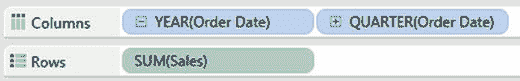

图 3-1. 维度`Order Date`放置在列功能区，度量`Sales`放置在行功能区

##### 步骤 2

将数据窗格下方维度区域中的维度`Category`拖至标记卡上的`颜色`（如图 3-2 所示）。

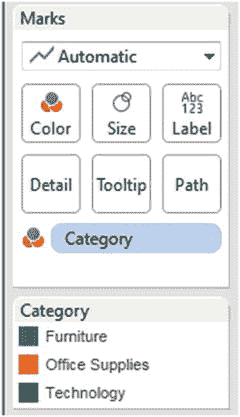

图 3-2. 维度`Category`放置在标记卡的`颜色`上

##### 步骤 3

将数据窗格下方维度区域中的维度`Category`拖至`筛选`功能区。拖放时，系统会弹出筛选窗口。默认情况下，`从列表中选择`处于启用状态，如图 3-3 所示。从列表中选择`Furniture`和`Technology`类别，然后单击`确定`以将筛选条件包含在视图中，如图 3-4 所示。

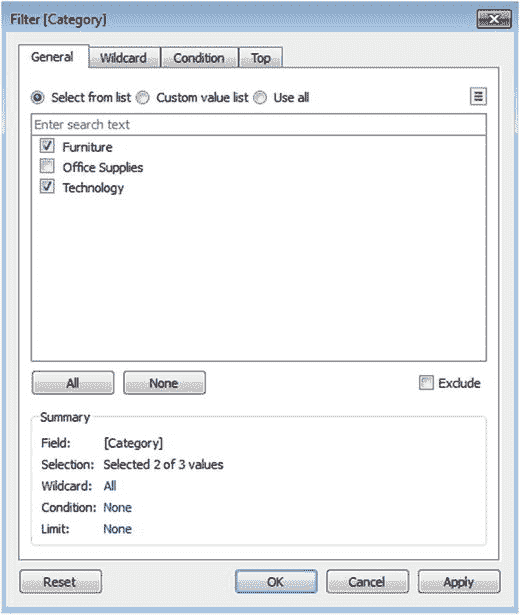

图 3-4. 筛选窗口显示选中的类别`Furniture`和`Technology`

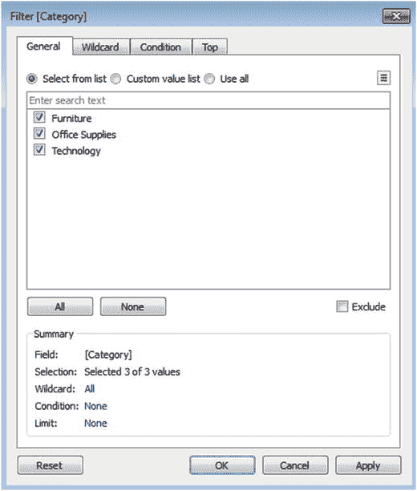

图 3-3. 筛选窗口显示`Category`维度的值

##### 步骤 4

请注意，`Sales`仅按季度显示`Furniture`和`Technology`类别（如图 3-5 所示）。

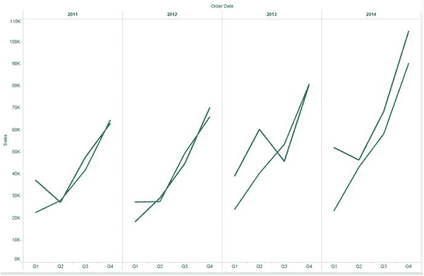

图 3-5. 视图按`Quarter`显示`Furniture`和`Technology`的`Sales`

##### 步骤 5

你还可以编辑筛选条件以排除某些值。要编辑筛选条件，右键单击`Category`字段，然后选择`编辑筛选条件...`选项，如图 3-6 所示。

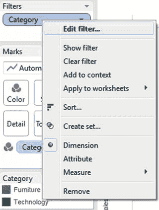

图 3-6. `编辑筛选条件...`选项

#### 3.1.3.3 筛选的通配符匹配

你可以使用`筛选`对话框中的`通配符`选项卡来定义用于筛选的模式。

##### 步骤 1

将数据窗格下方维度区域中的维度`Sub-Category`拖至行功能区，将订单日期拖至列功能区，并将层级设置为`Quarter`。将数据窗格下方度量区域中的度量`Sales`拖至行功能区（如图 3-7 所示）。

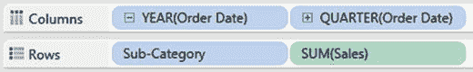

图 3-7. 维度`Order Date`放置在列功能区，维度`Sub-Category`和度量`Sales`放置在行功能区

##### 步骤 2

将数据窗格下方维度区域中的维度`Sub-Category`拖至`筛选`功能区。选择`通配符`选项卡，然后选择`开头为`选项。在匹配值对话框中输入`C`，以包含以`C`开头的子类别值（如图 3-8 所示）。

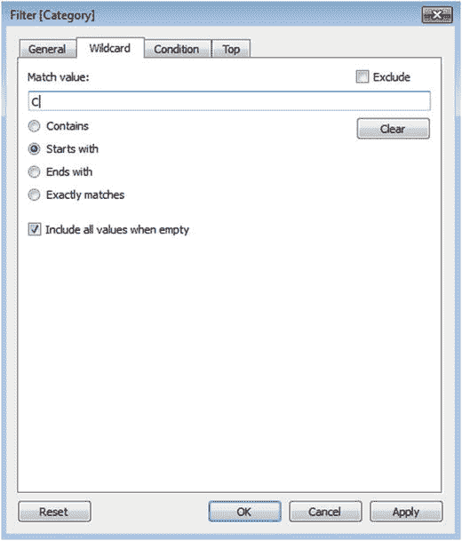

图 3-8. 通配符选项卡显示`匹配值`为`开头为 C`

##### 步骤 3

单击`确定`按钮后，视图将仅显示那些以`C`开头的子类别值。

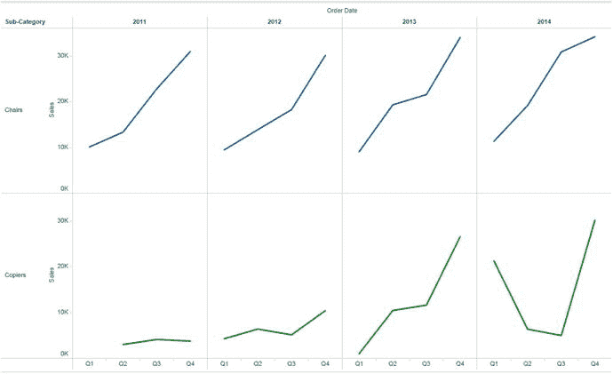

图 3-9. 将通配符选项`开头为 C`应用于`Sub-Category`字段后的视图

#### 3.1.3.4 筛选条件

你可以使用条件选项卡来指定筛选规则。

##### 在筛选中使用条件的步骤

##### 步骤 1

参考通配符筛选演示。在`筛选`功能区中，右键单击`Sub-Category`字段以编辑筛选条件。移除通配符匹配筛选条件中描述的通配符筛选，然后选择条件选项卡来指定条件筛选。例如，你只对显示销售额大于或等于 200,000 的子类别感兴趣，如图 3-10 所示。你可以使用`按字段`来使用内置控件，或使用`按公式`来编写自定义公式。

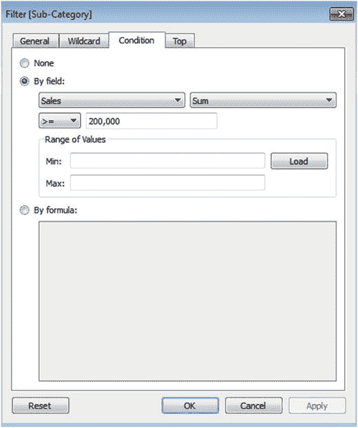

图 3-10. 筛选窗口显示`Sales`字段的条件标准

##### 步骤 2

单击`确定`后，你会看到更新的视图，如图 3-11 所示。

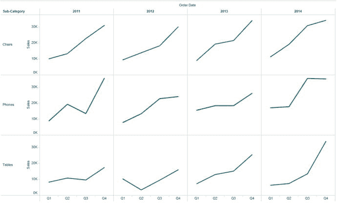

图 3-11. 对`Sales`字段应用条件标准后的更新视图

##### 步骤 3

你还可以使用自定义公式来指定筛选条件。单击`按公式`并输入自定义公式，如图 3-12 所示。

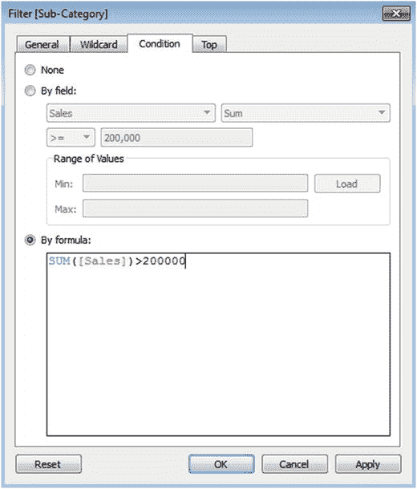

图 3-12. 筛选窗口显示`Sales`字段的条件标准

#### 3.1.3.5 筛选限制

你可以使用`顶部`选项卡来定义一个计算公式，对视图中的数据进行计算。

##### 在筛选中使用限制的步骤

##### 步骤 1

移除`条件`筛选部分中描述的条件筛选，并在筛选对话框中选择`顶部`选项卡来定义公式，如图 3-13 所示。例如，你想按销售额显示前 3 个子类别。

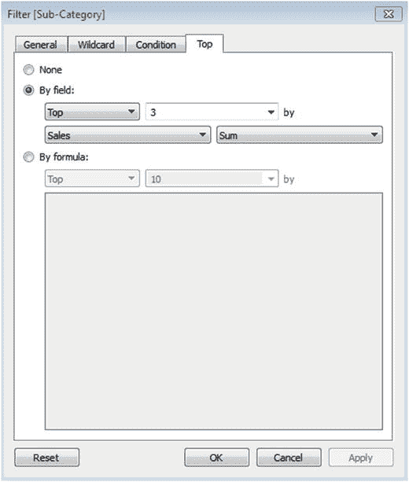

图 3-13. `顶部`选项卡显示按`销售额`显示`前 3 个子类别`的公式

##### 步骤 2

单击`确定`按钮后，视图将更新为按`销售额`显示前三个`子类别`（如图 3-14 所示）。

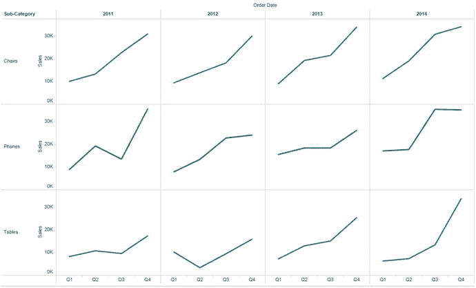

图 3-14. 视图按`销售额`显示`前 3 个子类别`

#### 3.1.3.6 按度量筛选

度量是定量数据。对此类数据进行筛选时，可以选定一个值的范围，将其包含在视图中。它包含基本的定量筛选器。

我们来看几个演示。这些演示将提供逐步指导，展示如何对度量进行筛选。

### 3.1.3.6 基本定量筛选器

定量筛选器允许你选择要包含的值的范围。

#### 3.1.3.6.1 步骤 1

连接到 `Sample-Superstore` 数据源。将数据窗格下维度区域的维度 `Sub-Category` 拖到列 shelf，并将数据窗格下度量区域的度量 `Profit` 拖到行 shelf（如图 3-15 所示）。`Profit` 字段应用的默认聚合是 `SUM`。

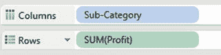

*图 3-15.* 维度 `Sub-Category` 放置在列 shelf 上，度量 `Profit` 放置在行 shelf 上

#### 3.1.3.6.2 步骤 2

将数据窗格下维度区域的维度 `Sub-Category` 拖到标记卡上的 `Color`，如图 3-16 所示。

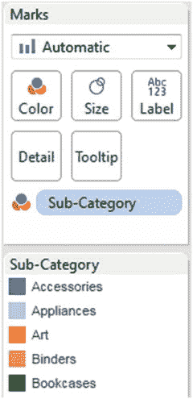

*图 3-16.* 维度 `Sub-Category` 放置在标记卡上的 `Color` 上

#### 3.1.3.6.3 步骤 3

将数据窗格下度量区域的度量 `Profit` 拖到 `Filters` shelf。此时会打开一个 `Filter field` 对话框；选择筛选条件所需的聚合函数，如图 3-17 所示，然后单击 `Next` 按钮。

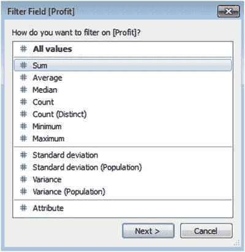

*图 3-17.* `Filter Field[Profit]` 对话框，显示聚合函数列表

#### 3.1.3.6.4 步骤 4

例如，你希望仅显示 `Profit` 值范围在 1,000 到 20,000 之间的 `Sub-Category`。对于此类视图，你可以使用 `Range of values`。使用范围滑块指定值，如图 3-18 所示。共有四种类型的定量筛选器。

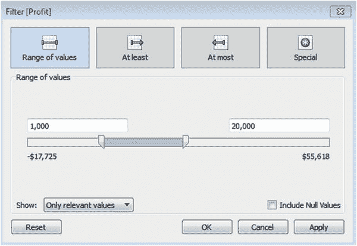

*图 3-18.* `Filter[Profit]` 对话框，显示 `Range of values`

- **Range of values（值的范围）**：包括该范围内最小值和最大值之间的所有值。

- **At least（至少）**：包括大于或等于指定最小值的所有值。

- **At most（至多）**：包括小于或等于指定最大值的所有值。

- **Special（特殊）**：帮助你筛选空值。仅包括空值、非空值或所有值。

#### 3.1.3.6.5 步骤 5

观察更新后的视图，该视图仅显示 `Profit` 范围在 1,000 到 20,000 之间的 `Sub-Category`（如图 3-19 所示）。

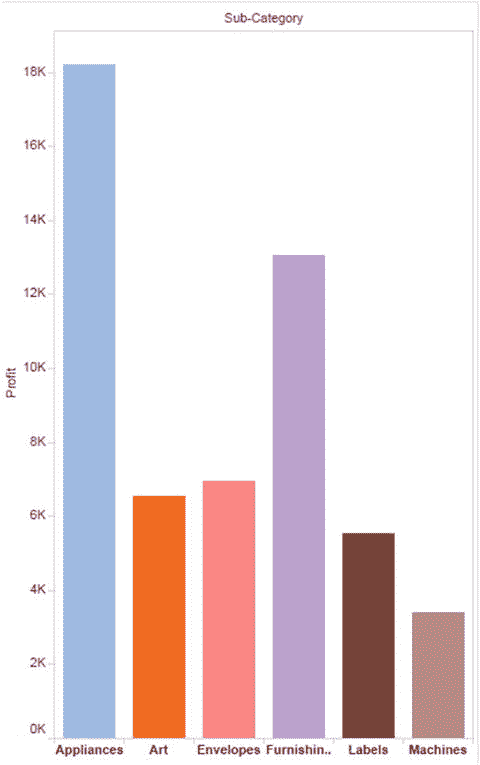

*图 3-19.* 应用范围筛选器后的结果视图（仅显示 `Profit` 范围在 1,000 到 20,000 之间的 `Sub-Category`）

#### 3.1.3.6.6 步骤 6

可以使用左下角的 `Show` 选项在 `Only relevant values` 和 `All values in database` 之间切换，如图 3-20 所示。

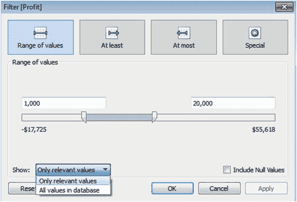

*图 3-20.* `Show` 选项，用于选择 `Only relevant values` 和 `All values in database`

### 3.1.3.7 快速筛选器

快速筛选器可以帮助你直接在视图中修改筛选选择。

#### 3.1.3.7.1 步骤 1

连接到 `Sample-Superstore` 数据源。将数据窗格下维度区域的维度 `Category`、`Sub-Category` 拖到行 shelf。将数据窗格下度量区域的度量 `Sales` 拖到列 shelf（如图 3-21 所示）。

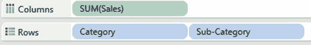

*图 3-21.* 维度 `Category`、`Sub-Category` 放置在行 shelf 上，度量 `Sales` 放置在列 shelf 上

#### 3.1.3.7.2 步骤 2

将数据窗格下维度区域的维度 `Sub-Category` 拖到标记卡上的 `Color`（如图 3-22 所示）。

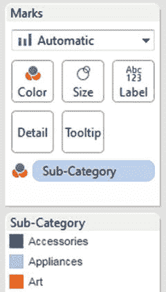

*图 3-22.* 维度 `Sub-Category` 放置在标记卡上的 `Color` 上

#### 3.1.3.7.3 步骤 3

在视图的任何位置右键单击 `Sub-Category` 字段，然后选择 `Show Filter` 选项以显示快速筛选器，如图 3-23 所示。

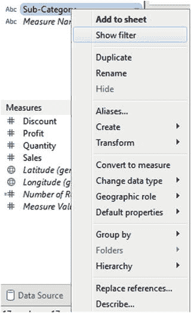

*图 3-23.* `Show Filter` 选项

#### 3.1.3.7.4 步骤 4

观察工作表右侧的 `Sub-Category` 快速筛选器。该筛选器会自动添加到 Filters shelf，如图 3-24 所示。

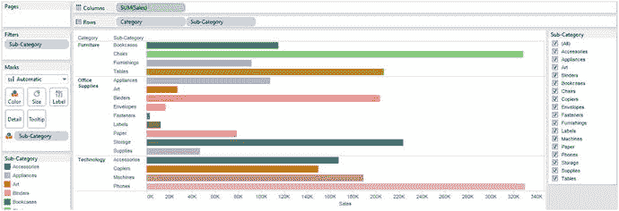

*图 3-24.* 显示 `Quick Filter` 的视图

#### 3.1.3.7.5 步骤 5

你可以通过选择所需的子类别来修改筛选选择，如图 3-25 所示。

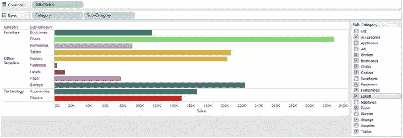

*图 3-25.* 显示所选 `Sub-Category` 的 `SUM(Sales)` 的更新视图

#### 3.1.3.7.6 步骤 6

你还可以通过单击插入符号来编辑快速筛选器的外观（布局模式）和功能，如图 3-26 所示。

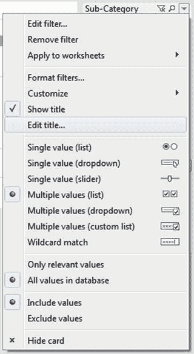

*图 3-26.* 编辑 `Quick Filter` 的选项

布局模式包括 `Single Value (List)`、`Single Value (Dropdown)` 等。

#### 3.1.3.7.7 步骤 7

你可以通过单击插入符号并选择 `Edit Title` 来编辑 `Sub-Category` 快速筛选器的标题，如图 3-27 所示。

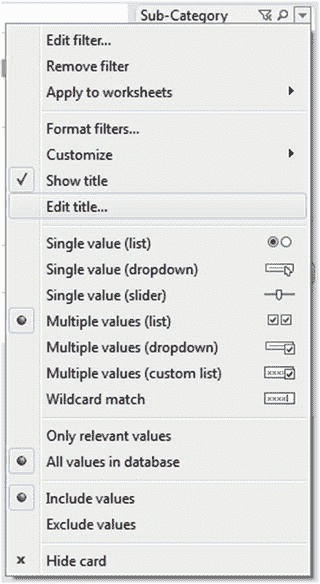

*图 3-27.* 显示 `Edit Title` 选项的下拉菜单

#### 3.1.3.7.8 步骤 8

输入标题，如图 3-28 所示，然后单击 `OK` 按钮。

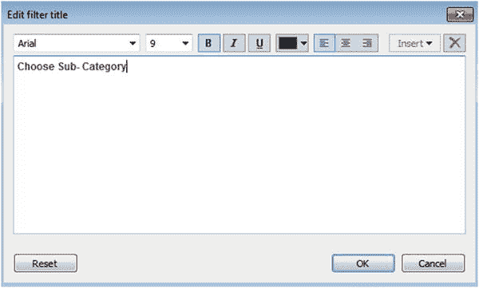

*图 3-28.* `Edit Filter Title` 对话框，用于编辑快速筛选器 `Sub-Category` 的标题

#### 3.1.3.7.9 步骤 9

观察 `Sub-Category` 快速筛选器的新标题，如图 3-29 所示。

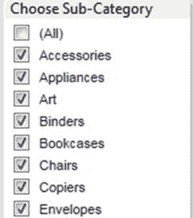

*图 3-29.* 显示快速筛选器标题为 `Choose Sub-Category` 的视图

### 3.1.3.8 上下文筛选器

添加到可视化中的筛选器都是独立计算的，无论其他筛选器如何操作。你可以通过添加上下文筛选器来为筛选器添加上下文。一旦创建了上下文筛选器，所有其他筛选器都将使用这个新的数据集进行计算。

上下文筛选器是一个独立的筛选器；你设置的所有其他筛选器都被定义为依赖筛选器，因为它们只处理通过上下文筛选器的数据。

上下文被计算一次以生成视图。然后，所有其他筛选器都相对于该上下文进行计算。

上下文筛选器：

- 出现在 Filters shelf 的顶部。

- 在 Filters shelf 上以灰色标识。

- 不能在 shelf 上重新排列。

你可以创建一个上下文筛选器来：

- **提高性能**：如果设置了很多筛选器或数据源很大，查询可能会很慢。你可以设置一个或多个上下文筛选器来提高性能。
- **创建依赖的数值或 Top N 筛选器**：你可以设置一个上下文筛选器来仅包含感兴趣的数据，然后设置数值或 Top N 筛选器。

## 3.1.3.8.1 步骤
**目标**：显示每个细分市场销售额排名前 10 的客户。

### 3.1.3.8.2 步骤 1
连接到 `Sample-Superstore` 数据源。将数据窗格下维度区域中的维度 `Customer Name` 拖至行功能区。将数据窗格下度量区域中的度量 `Sales` 拖至列功能区（如图 3-30 所示）。

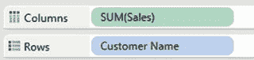
**图 3-30.**
维度 `Customer Name` 置于行功能区，度量 `Sales` 置于列功能区

### 3.1.3.8.3 步骤 2
点击销售额轴，按销售额总和为客户名称排序（如图 3-31 所示）。

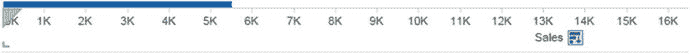
**图 3-31.**
高亮显示用于`排序`的销售额轴

### 3.1.3.8.4 步骤 3
将数据窗格下维度区域中的维度 `Customer Name` 拖至`筛选器`功能区，以创建 `Top N` 筛选器。按图 3-32 所示填写详细信息。

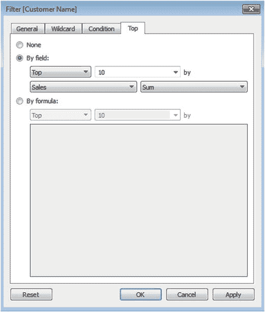
**图 3-32.**
`筛选器[Customer Name]`，以按其`销售额`创建`前 10 名客户`

### 3.1.3.8.5 步骤 4
观察图 3-33 中按销售额显示的前 10 名客户名称。

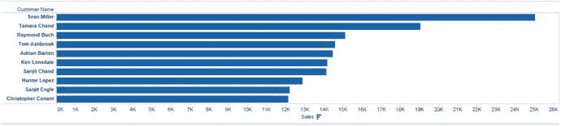
**图 3-33.**
视图显示按其`销售额`排名的`前 10 名客户`

### 3.1.3.8.6 步骤 5
再创建一个筛选器，以按企业板块客户的销售额显示客户。将数据窗格下维度区域中的维度 `Segment` 拖至`筛选器`功能区，选择企业作为板块值，如图 3-34 所示。

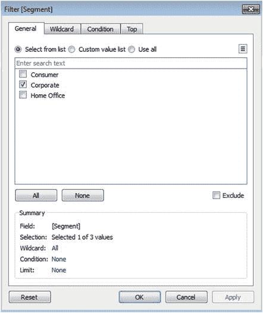
**图 3-34.**
`筛选器[Segment]` 对话框，仅包含`企业`板块

### 3.1.3.8.7 步骤 6
筛选后的视图仅显示一位客户，而非前十名客户（如图 3-35 所示）。这不是我们想要的结果。这是因为所有筛选器都是分别评估的，视图是结果的交集。

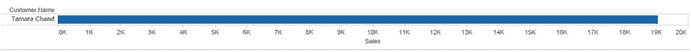
**图 3-35.**
视图显示所选`企业`板块仅有一位客户

### 3.1.3.8.8 步骤 7
要为每个`板块`显示按其`销售额`排名的`前 10 名客户`，请右键单击 `Segment`，然后选择`添加到上下文`，将 `Segment` 设为`上下文筛选器`（如图 3-36 所示）。

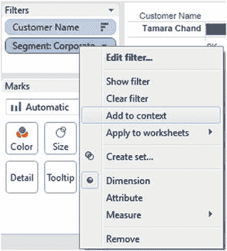
**图 3-36.**
`添加到上下文`选项

### 3.1.3.8.9 步骤 8
更新后的视图显示`企业板块`中按其`销售额`排名的`前 10 名客户`（如图 3-37 所示）。

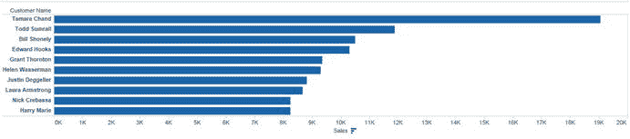
**图 3-37.**
应用上下文筛选器后的更新视图

## 3.1.3.9 级联筛选器
级联筛选器是一组筛选器。级联（或分层）筛选器是指，对第一个筛选器的选择会限制第二个筛选器，使其仅显示相关的值。

### 3.1.3.9.1 步骤
#### 3.1.3.9.2 步骤 1
连接到 `Sample-Superstore` 数据源。将数据窗格下维度区域中的维度 `Segment` 拖至行功能区。将数据窗格下度量区域中的度量 `Sales` 拖至列功能区（如图 3-38 所示）。

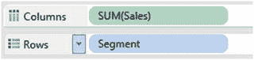
**图 3-38.**
维度 `Segment` 置于行功能区，度量 `Sales` 置于列功能区

#### 3.1.3.9.3 步骤 2
为类别和子类别创建`快速筛选器`（如图 3-39 和图 3-40 所示）。

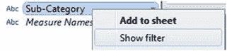
**图 3-40.**
为`子类别`添加`快速筛选器`。

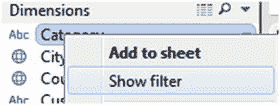
**图 3-39.**
为`类别`添加`快速筛选器`

#### 3.1.3.9.4 步骤 3
类别和子类别的`快速筛选器`已显示（如图 3-41 所示）。

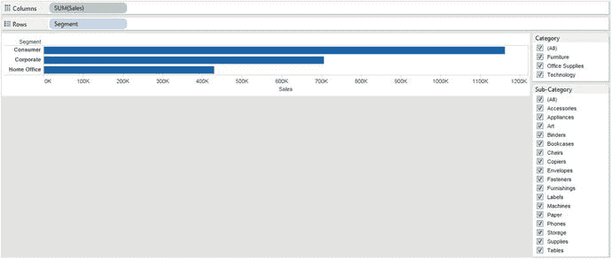
**图 3-41.**
视图显示`类别`和`子类别`的`快速筛选器`

#### 3.1.3.9.5 步骤 4
从`类别`筛选器中仅选择`家具`。点击`子类别`下拉箭头，勾选`仅相关值`选项（如图 3-42 所示）。

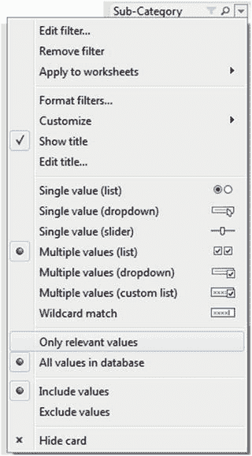
**图 3-42.**
选择`仅相关值`

#### 3.1.3.9.6 步骤 5
`子类别`筛选器显示所有与`家具`类别相关的产品（如图 3-43 所示）。

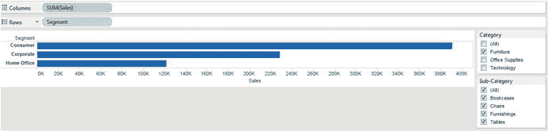
**图 3-43.**
`子类别`显示所有与`家具`类别相关的产品

## 3.1.3.10 计算筛选器
`计算筛选器`允许您对选定的维度成员执行计算。计算筛选器也称为`切片`筛选器。

### 3.1.3.10.1 步骤
#### 3.1.3.10.2 步骤 1
连接到 `Sample-Superstore` 数据源。将数据窗格下维度区域中的维度 `Segment` 拖至行功能区。将数据窗格下度量区域中的度量 `Sales` 和 `Profit` 拖至列功能区（如图 3-44 所示）。视图显示按销售额总和及利润总和划分的各板块（如图 3-45 所示）。

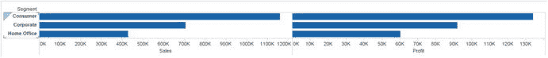
**图 3-45.**
视图显示按`销售额`和`利润`划分的`板块`

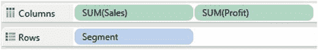
**图 3-44.**
维度 `Segment` 置于行功能区，度量 `Sales`、`Profit` 置于列功能区

#### 3.1.3.10.3 步骤 2
将数据窗格下维度区域中的维度 `Category` 拖至`筛选器`功能区，选择类别`家具`和`技术`，如图 3-46 所示。

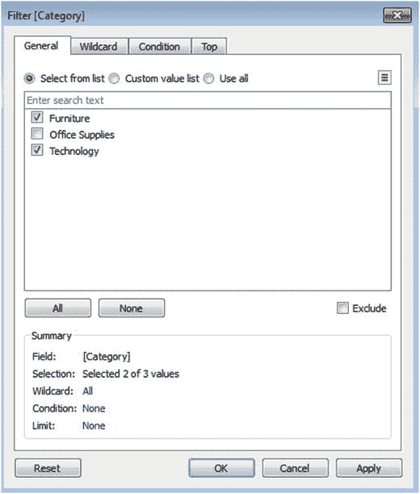
**图 3-46.**
`筛选器[Category]`以包含`家具`和`技术`类别

#### 3.1.3.10.4 步骤 3
当您点击`确定`按钮时，Tableau 会根据图 3-47 中所示每个度量的聚合，自动将适当的计算应用于筛选器的成员。

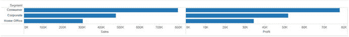
**图 3-47.**
应用计算筛选器后的视图

## 数据源筛选
数据源筛选有助于减少数据源中的数据量。

### 操作步骤
**步骤 1**
连接到 `Sample-Superstore` 数据源。

**步骤 2**
要创建数据源筛选，请点击数据源页面右上角的“添加…”，如图 3-48 所示。

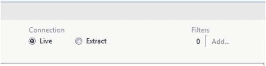
**图 3-48.** 显示“添加…”选项的数据源页面

**步骤 3**

## 编辑数据源筛选

弹出“编辑数据源筛选”对话框，如图 3-49 所示。

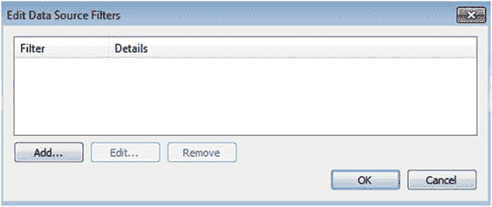
图 3-49. “编辑数据源筛选”对话框

**步骤 4**

点击“添加”按钮来添加筛选，并选择 `Category`（类别）字段，如图 3-50 所示。

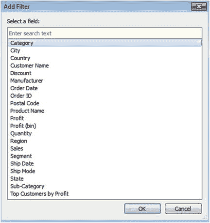
图 3-50. 显示已选中“类别”字段的“添加筛选”对话框

**步骤 5**

点击“确定”后，您会看到筛选字段对话框。选择“家具”类别，如图 3-51 所示，然后点击“确定”。

图 3-51. “筛选 [类别]”以选择“家具”类别

**步骤 6**

接着，您可以在“编辑数据源筛选”对话框中看到“类别”筛选，如图 3-52 所示。

图 3-52. “编辑数据源筛选”对话框，仅保留“家具”类别作为筛选条件

**步骤 7**

观察数据网格中已更新的数据，它仅显示与“家具”相关的数据，如图 3-53 所示。

图 3-53. 应用数据源筛选后的数据网格

请参考以下链接，了解 Tableau 中筛选的执行顺序：

[`https://onlinehelp.tableau.com/current/pro/desktop/en-us/order_of_operations.html`](https://onlinehelp.tableau.com/current/pro/desktop/en-us/order_of_operations.html)

---

## 排序

借助排序功能，您可以按指定顺序排列维度成员。

### 为何要排序？

为了按字母顺序或数字顺序等顺序显示数据。

#### 设想一下……

您就职于一家名为“XYZ”的零售店。该公司希望根据购买量为排名前 10 的客户提供一定比例的优惠。“XYZ”的副总裁要求您生成一份按“销售额”显示“前 10 名客户”的报告。在这种情况下，您可以应用排序来按“销售额”显示前 10 名客户的姓名。

### 什么是排序？

排序允许您按特定顺序排列维度。排序有两种类型：
- 计算排序
- 手动排序

### 如何应用排序？

您可以通过不同方式应用排序：
- 计算排序
- 手动排序
- 嵌套排序

#### 计算排序

当您应用某些程序化规则进行排序时，称为计算排序。例如：按字母顺序对产品名称进行排序。计算排序包括对轴进行排序和对特定字段进行排序。

##### 在轴上进行排序

使用轴上的排序按钮进行快速的计算排序。

**步骤 1**

连接到 `Sample-Superstore` 数据源。将数据窗格下维度区域的维度 `Category`（类别）和 `Sub-Category`（子类别）拖动到行功能区。将数据窗格下度量区域的度量 `Sales`（销售额）拖动到列功能区（如图 3-54 所示）。

图 3-54. 维度 `Category`（类别）和 `Sub-Category`（子类别）放置在行功能区，度量 `Sales`（销售额）放置在列功能区

**步骤 2**

转到视图中的 `Sub-Category`（子类别）字段，将鼠标光标悬停在轴上。将显示一个排序图标，如图 3-55 所示。

图 3-55. `Sub-Category`（子类别）字段的排序轴

**步骤 3**

点击一次可按升序排序；再次点击该轴可按降序对 `Sub-Category`（子类别）字段排序，如图 3-56 所示。

图 3-56. `Sub-Category`（子类别）字段已按降序排序

第三次点击 `Sub-Category`（子类别）轴可清除排序。

##### 对特定字段进行排序

我们来讨论对特定字段进行排序的步骤。

**步骤 1**

连接到 `Sample-Superstore` 数据源。将数据窗格下维度区域的维度 `Category`（类别）和 `Sub-Category`（子类别）拖动到行功能区。将数据窗格下度量区域的度量 `Sales`（销售额）拖动到列功能区（如图 3-57 所示）。

图 3-57. 维度 `Category`（类别）和 `Sub-Category`（子类别）放置在行功能区，度量 `Sales`（销售额）放置在列功能区

**步骤 2**

右键单击 `Sub-Category`（子类别）字段，选择“排序”选项，如图 3-58 所示。

图 3-58. 带有“排序”选项的 `Sub-Category`（子类别）字段

**步骤 3**

打开排序对话框。将“排序顺序”指定为“降序”，将“排序依据”指定为字段，如图 3-59 所示。您可以选择“数据源顺序”，它将根据数据源顺序对数据进行排序。默认的数据源顺序是按字母顺序。“字段”则根据另一个字段的关联值对数据进行排序。

图 3-59. “排序 [子类别]”对话框，显示“排序顺序”为降序，“排序依据”为字段

**步骤 4**

当您点击“确定”后，`Sub-Category`（子类别）字段将根据其 `Sales`（销售额）的总和进行排序，如图 3-60 所示。

图 3-60. `Sub-Category`（子类别）字段已根据其 `Sales`（销售额）的总和进行排序

#### 手动排序

另一种在表中重新排列维度的方式是临时拖动它们。这被称为手动排序。
有两种执行手动排序的方法：
- 使用工具栏和工具提示进行排序
- 通过拖放进行排序

##### 使用工具栏排序

**步骤 1**

连接到 `Sample-Superstore` 数据源。将数据窗格下维度区域的维度 `Category`（类别）拖动到行功能区。将数据窗格下度量区域的度量 `Sales`（销售额）拖动到列功能区（如图 3-61 所示）。

图 3-61. 维度 `Category`（类别）放置在行功能区，度量 `Sales`（销售额）放置在列功能区

**步骤 2**

使用工具栏上的排序按钮对字段进行升序或降序排序，如图 3-62 所示。

图 3-62. 工具栏上的排序按钮

##### 拖放排序

下面我们来讨论执行“拖放排序”的步骤。

**步骤 1**

连接到 `Sample-Superstore` 数据源。将数据窗格下维度区域中的维度 `Category` 拖放到行功能区。将数据窗格下度量区域中的度量 `Sales` 拖放到列功能区（如图 3-63 所示）。

图 3-63. 维度 `Category` 放置在行功能区，度量 `Sales` 放置在列功能区。

**步骤 2**

选择要移动的维度成员，例如图 3-64 所示的 `Technology` 类别。

图 3-64. 显示已选中的类别成员 `Technology` 的视图。

**步骤 3**

拖拽维度成员 `Technology`，并将其放置到目标位置，如图 3-65 所示。

*图 3-65.* 将 `Technology` 字段拖放到目标位置后的视图。

## 3.2.3.7 嵌套排序

下面我们来讨论执行“嵌套排序”的步骤。

### 3.2.3.7.1 步骤 1

连接到 `Sample-Superstore` 数据源。将数据窗格下维度区域中的维度 `Region` 和 `Sub-Category` 拖放到行功能区。将数据窗格下度量区域中的度量 `Sales` 拖放到列功能区（如图 3-66 所示）。

*图 3-66.* 维度 `Region` 和 `Sub-Category` 放置在行功能区，度量 `Sales` 放置在列功能区。

### 3.2.3.7.2 步骤 2

通过单击工具栏上的排序图标，将 `Sub-Category` 按降序排序，如图 3-67 所示。

*图 3-67.* `Sub-Category` 按降序排列。

### 3.2.3.7.3 步骤 3

需求是在每个 `Region` 内对 `Sub-Category` 进行排序，但实际并未实现。排序仅在 `Sub-Category` 层级发生。
你可以借助嵌套排序来实现此目标。

### 3.2.3.7.4 步骤 4a

在数据窗格的维度下，按住 `Ctrl` 键，选中 `Region` 和 `Sub-Category`，如图 3-68 所示。

*图 3-68.* 选中 `Sub-Category` 和 `Region`。

### 3.2.3.7.5 步骤 4b

右键单击选中的字段，选择 `Create`，然后选择 `Combined Field`，如图 3-69 所示。

*图 3-69.* 选中 `Combined Field`。

### 3.2.3.7.6 步骤 5

你可以在数据窗格中看到 `Combined Field`，如图 3-70 所示。

*图 3-70.* 显示 `Sub-Category & Region (Combined)` 字段的数据窗格。

### 3.2.3.7.7 步骤 6

右键单击 `Sub-Category` 并选择 `Clear Sort` 以清除排序，如图 3-71 所示。你可以看到更新后的视图，如图 3-72 所示。

*图 3-72.* 对 `Sub-Category` 字段应用 `Clear Sort` 选项后的视图。

*图 3-71.* 显示 `Sub-Category` 字段的 `Clear Sort` 选项。

### 3.2.3.7.8 步骤 7

将 `Sub-Category & Region (Combined)` 字段从数据窗格下的维度区域拖放到行功能区（如图 3-73 所示）。

*图 3-73.* `Sub-Category & Region (Combined)` 字段放置在行功能区上。

### 3.2.3.7.9 步骤 8

右键单击组合字段，选择排序选项，如图 3-74 所示。

*图 3-74.* 显示用于排序 `Sub-Category & Region (Combined)` 字段选项的下拉菜单。

### 3.2.3.7.10 步骤 9

将打开“排序字段”对话框。选择 `Sort order` 为 `Descending`，`Sort by` 为 `Field`，将字段指定为 `Sales`，聚合方式为 `Sum`，如图 3-75 所示。

*图 3-75.*  `Sort [Sub-Category]` 字段对话框，其中指定了 `Sort order` 和 `Sort by` 选项。

### 3.2.3.7.11 步骤 10

观察嵌套排序，即 `Sub-Category` 在每个 `Region` 内按其 `Sales` 进行了排序，如图 3-76 所示。

*图 3-76.* 显示 `Sub-Category` 在每个 `Region` 内按其 `Sales` 排序的视图。

### 3.2.3.7.12 步骤 11

右键单击 `Sub-Category & Region (Combined)` 字段，并取消勾选 `Show Header` 选项，如图 3-77 所示。

*图 3-77.* 取消勾选 `Show Header` 的选项。

### 3.2.3.7.13 步骤 12

视图得到优化，显示每个 `Region` 内已排序的 `Sub-Category`（如图 3-78 所示）。

*图 3-78.* 显示 `Sub-Category` 在每个 `Region` 内按其 `Sales` 排序后的视图。

## 3.2.4 离散日期与连续日期

下面我们来讨论 Tableau 中的离散日期与连续日期。

## 3.2.5 为什么用、是什么？

请参考表 3-1 来理解离散日期与连续日期。

图 3-81.
离散字段可以排序：此处十二月的销售额最高，二月最低。

图 3-80.
连续日期。

图 3-79.
离散日期。

|   | 离散日期 | 连续日期 |
|---|---|---|
| 定义：韦氏词典 | 各自独立的；构成独立实体 | 在时间、空间或顺序上不间断延伸的特征 |
| 示例 | 假设你是一家领先零售公司的高管。你的数据集包含四年（2010、2011、2012 和 2013）的销售数据。你想确定无论年份，哪个月份的销售额最高。换句话说，这意味着各年份（2010、2011、2012、2013）的销售数据已按月汇总。请参考图 3-79。 | 假设你是一家零售公司的高管。你的数据集包含四年（2010、2011、2012 和 2013）的销售数据。你想确定在四年（2010 – 2014）中哪个月份的销售额最高。请参考图 3-80。 |
| 字段默认类型是什么？ | 当从数据窗格的维度区域将字段拖到行或列功能区时，该字段默认为“离散”。示例：`Customer ID`、`Customer Name` | 当从数据窗格的度量区域将字段拖到行或列功能区时，该字段默认为“连续”。示例：`Unit Price`、`Order Quantity` |
| Tableau 创建 | 轴标题 | 轴 |
| 视觉提示 | 蓝色药丸 | 绿色药丸 |
| 历史背景 | 离散变量只能取有限的一组值。示例：如果从 0 数到 10，有 11 个不同的值。处理离散值时，不会考虑 2.6 或 9.3 等值。 | 连续变量可以取无限的一组值。示例：如果从 0 数到 10，0 到 10 之间有无限多个值。 |

| 排序次序 | 例如：离散日期可以按销售额升序或降序排序。请参考图 3-81。 | 由于连续日期构成一个连续轴，它们默认按时间顺序排列，最旧的日期在最左端，最新的日期在最右端。不允许更改顺序。 |
| --- | --- | --- |
| 首选图表形式 | 条形图 | 折线图 |

### 3.2.5.1 如何在 Tableau 中使用离散日期？

我们来讨论创建离散日期的步骤。

#### 3.2.5.1.1 步骤

#### 3.2.5.1.2 步骤 1

从数据窗格的维度区域将`Order Date`拖到列功能区，如图 3-82 所示。Tableau 默认会在日期类型字段上创建层次结构。从数据窗格维度区域拖拽的字段默认为“离散”。

图 3-82.`Order Date`置于列功能区。

#### 3.2.5.1.3 步骤 2

单击下拉菜单，选择适当的日期部分（`Year` / `Quarter` / `Month` / `Day`），如图 3-83 所示。第一组值构成离散存储桶。下一组值构成连续存储桶。

图 3-83.用于选择适当日期部分的下拉菜单。

离散存储桶如图 3-84 所示。

图 3-84.离散存储桶。

连续存储桶如图 3-85 所示。

图 3-85.连续存储桶。

#### 3.2.5.1.4 步骤 3

让我们按离散的`Month`绘制`Sales`。从下拉菜单中选择离散选项，如图 3-86 所示。

图 3-86.显示`Discrete`选项的下拉菜单。

#### 3.2.5.1.5 步骤 4

在标记卡上选择`Bar`，如图 3-87 所示。

图 3-87.带有`Bar`选项的标记卡。

#### 3.2.5.1.6 步骤 5

将度量`Sales`从数据窗格的度量区域拖到行功能区，如图 3-88 所示。

图 3-88.度量`Sales`置于行功能区。

#### 3.2.5.1.7 步骤 6

将代表`Sales`数据的条形按降序排序，如图 3-89 和图 3-90 所示。

图 3-90.`Sort[Month of Order Date]`对话框，显示`Sort order`和`Sort by`选项。

图 3-89.显示`Sort`选项的下拉菜单。

#### 3.2.5.1.8 步骤 7

最终输出如图 3-91 所示。

图 3-91.按降序排序的`Sales`。

#### 3.2.5.1.9 如何在 Tableau 中使用连续日期？

#### 3.2.5.1.10 步骤 1

从数据窗格的维度区域将`Order Date`拖到列功能区，如图 3-92 所示。Tableau 默认会在日期类型字段上创建层次结构。从数据窗格维度区域拖拽的字段默认为`Discrete`。

图 3-92.维度`Order Date`置于列功能区。

#### 3.2.5.1.11 步骤 2

让我们将`Discrete`日期转换为`Continuous`日期，如图 3-93 所示。

图 3-93.从`Continuous`存储桶中选择`Month`的下拉菜单。

在标记卡上选择`Line`，如图 3-94 所示。

图 3-94.带有`Line`选项的标记卡。

#### 3.2.5.1.12 步骤 3

将度量`Sales`从度量区域拖拽并放置到行功能区，如图 3-95 所示。

图 3-95.显示连续月份的视图。

### 如何在 Tableau 中创建自定义日期？

下面我们来讨论创建自定义日期的步骤。

#### 步骤 1

在数据窗格的维度区域中选择维度`Order Date`。点击下拉菜单，如图 3-96 所示。选择`Transform` → `Create Custom Date`。

`图 3-96. “Create Custom Date” 选项`

#### 步骤 2

在`Create Custom Date [Order Date]`对话框中进行选择，如图 3-97 所示：

`图 3-97. 自定义日期 “CustomDiscreteDateMonth”`

选择`Date Part`创建离散日期，选择`Date Value`创建连续日期。

新的自定义日期将作为维度添加到数据窗格的维度区域中，如图 3-98 所示。

`图 3-98. 添加自定义日期 “CustomDiscreteDateMonth” 后的数据窗格`

这个新维度可以作为常规维度放置在行或列功能区上，如图 3-99 所示。

`图 3-99. 自定义日期 “CustomDiscreteDateMonth” 放置在列功能区上`

### 组

组是构成更高级别类别的维度成员的组合。

### 为何使用组？

使用组可以细化视图，并确定您想要引起注意的确切信息。

### 什么是组？

组允许您组合不同维度的成员以构成更高级别的类别。组对于纠正数据错误非常有用。

### 如何创建组？

下面我们来讨论创建组的步骤。

#### 创建组

创建组以纠正数据错误。

##### 步骤 1

连接到 Sample - Superstore 数据源。

##### 步骤 2

考虑如图 3-100 所示的视图。

`图 3-100. 显示 “Category” 在各州表现情况的视图`

在此视图中，`CA`表示加利福尼亚州，但它显示为单独的条目。您可以通过将`CA`和`California`分组来纠正此问题。

##### 步骤 3

按住`CTRL`键，选择`CA`和`California`，如图 3-101 所示。

`图 3-101. 选中各州，“CA” 和 “California”`

##### 步骤 4

对维度成员进行分组的一种方法是将鼠标移动到选中区域以获取弹出菜单，然后选择回形针图标以对选中的州进行分组（如图 3-102 所示）。

*图 3-102. 显示分组成员图标的弹出菜单*

##### 步骤 5

对维度成员进行分组的另一种方法是右键单击维度成员并选择 `Group`，如图 3-103 所示。

*图 3-103. “Group” 选项*

##### 步骤 6

选中的成员被组合在一起，如图 3-104 所示。这样，您就可以纠正数据错误。

*图 3-104. 分组成员 “CA & California”*

##### 步骤 7

您可以在数据窗格下方的维度区域中看到新创建的组（如图 3-105 所示）。行功能区被替换为新创建的组字段，如图 3-106 所示。

*图 3-105. 显示 “State (group)” 的数据窗格*

*图 3-106. 行功能区上的 “State(group)”*

#### 从数据窗格中的维度创建组

下面我们来讨论如何从数据窗格中的维度创建组。

##### 步骤 1

连接到 Sample - Superstore 数据源并转到一张工作表。

##### 步骤 2

从数据窗格中选择 `Sub-Category` 维度，右键单击它，然后选择 `Create` → `Group`（如图 3-107 所示）。

*图 3-107. 显示 “Group” 选项的下拉菜单*

##### 步骤 3

`Create Group [Sub-Category]` 对话框出现（如图 3-108 所示）。

*图 3-108. “Create Group [Sub-Category]” 对话框*

##### 步骤 4

选择维度成员并单击 `Group` 按钮（如图 3-109 所示）。

*图 3-109. 为 “Sub-Category (group)” 选定的成员*

##### 步骤 5

选中的成员被组合在一起构成一个单一成员。组的默认名称由所有成员名称自动组合而成（如图 3-110 所示）。您可以通过单击 `Rename` 按钮来重命名它。

*图 3-110. 组 “Binders, Bookcases, Chairs”*

### 编辑现有组

下面我们来讨论编辑现有组的步骤。

##### 步骤 1

在数据窗格上选择 `Sub-Category (group)`，右键单击它，然后选择 `Edit Group...`（如图 3-111 所示）。

*图 3-111. “Edit group...” 选项*

##### 步骤 2

`Edit Group [Sub-Category (group)]` 对话框出现（如图 3-112 所示）。

*图 3-112. “Edit Group [Sub-Category (group)]” 对话框*

##### 步骤 3

选择所需的维度成员并将其拖放到现有组中（如图 3-113 所示）。

*图 3-113. 将 “Tables” 添加到组 “Binders, Bookcases, Chairs and 1 more” 后的 “Edit Group [Sub-Category (group)]” 对话框*

**或者**

选择所需的维度，右键单击它，然后选择 `Add To...` 选项（如图 3-114 所示）。

*图 3-114. 用于将成员添加到现有组的 “Add to...” 选项*

##### 步骤 4

`Add to Group` 对话框出现。选择该组（如图 3-115 所示），然后单击 `OK` 以将成员添加到该组（如图 3-116 所示）。

*图 3-115. 显示组 “Binders, Bookcases, Chairs” 的 “Add To Group” 对话框*

*图 3-116. 将 “Tables” 添加到现有组 “Binders, Bookcases, Chairs and 1 more” 之后*

#### 从组中移除成员

下面我们来讨论从组中移除成员的步骤。

##### 步骤 1

要从组中移除成员，请转到 `Edit Group` 对话框，选择该成员，右键单击它，然后选择 `Remove`（如图 3-117 所示）。

*图 3-117. 用于从组 “Binders, Bookcases, Chairs and 1 more” 中移除 “Binders” 的 “Remove” 选项*

### 重命名组

下面介绍如何重命名一个组。

##### 步骤 1

打开 `编辑组` 字段对话框，选择组名，并点击 `重命名` 按钮（如图 3-118 所示）。

*图 3-118. 选择“书柜、椅子、桌子”组之后*

##### 步骤 2

此时会弹出组名的编辑对话框，如图 3-119 所示。输入组的新名称即可完成重命名（如图 3-120 所示）。

*图 3-119. 编辑组对话框，用于修改组名*

*图 3-120. 重命名后的“家具”组*

### 创建层次结构

Tableau 中的层次结构为 Tableau 报表提供了下钻功能。Tableau 允许您非常轻松地创建层次结构。

##### 步骤 1

连接到 Sample-Superstore Excel 数据源。

##### 步骤 2

要为“产品”创建层次结构，请按住 `CTRL` 键，选择“类别”和“子类别”字段，如图 3-121 所示。

*图 3-121. 选择“类别、子类别”*

##### 步骤 3

右键单击“子类别”，选择 `层次结构` ➤ `创建层次结构`（如图 3-122 所示）。

*图 3-122. “创建层次结构…”选项*

##### 步骤 4

出现“创建层次结构”对话框。将层次结构名称指定为“产品”，如图 3-123 所示。

图 3-123. “创建层次结构”对话框，将“名称”指定为产品

### 3.3.5.1.5 步骤 5
观察数据窗格下维度区域中的“产品”层次结构（如图 3-124 所示）。

图 3-124. “产品”层次结构

## 3.3.6 集
“集”是基于现有维度满足特定条件的数据子集。集允许您根据某些条件创建数据子集。集可以是计算集或常量集。

### 3.3.6.1 常量集
在常量集中，成员是固定的，不会改变。

下面介绍具体步骤。

#### 步骤 1
连接到 `Sample-Superstore` Excel 数据源。

#### 步骤 2
创建如图 3-125 所示的视图。

图 3-125. 显示按子类别列出的“销售额”的视图

#### 步骤 3
按住 `CTRL` 键，随机选择六个子类别。将鼠标移到选定区域以获取工具提示。从工具提示中选择 `创建集`（如图 3-126 所示）。

图 3-126. “创建集…”选项

#### 步骤 4
出现“创建集”对话框。将集名称指定为“随机子类别”，并勾选“添加到筛选器 shelf”选项，如图 3-127 所示。然后点击“确定”。

图 3-127. “随机子类别”集的成员

#### 步骤 5
观察数据窗格下新创建的集“随机子类别”，如图 3-128 所示。

图 3-128. “随机子类别”集

#### 步骤 6
从行 shelf 中移除维度“子类别”，然后将集“随机子类别”拖放到行 shelf 上，如图 3-129 所示。

图 3-129. “移除”选项，用于从行 shelf 中移除维度“子类别”

#### 步骤 7
将集“随机子类别”拖放到行 shelf 上时，可以观察到`IN/OUT (随机子类别)`被放置在行 shelf 上（如图 3-130 所示）。这是因为默认情况下，Tableau 会为集创建 IN/OUT 模式。

图 3-130. “IN/OUT (随机子类别)”放置在行 shelf 上

`IN` 用于显示在集中的成员。`OUT` 包含不在集中的成员。此处显示所有选定成员的“销售额”总额。

#### 步骤 8
要显示 `OUT` 成员，请将“随机子类别”放置在筛选器 shelf 上，右键单击它并选择 `显示集的 IN/OUT`，如图 3-131 所示。

图 3-131. “显示集的 In/Out”选项

#### 步骤 9
出现“筛选器 [In / Out of 随机子类别]”对话框，如图 3-132 所示。选择“IN/OUT”选项并点击“确定”。

图 3-132. 带有“In/Out”选项的“筛选器 [In / Out of 随机子类别]”对话框

#### 步骤 10
观察 `IN/OUT` 成员的总销售额，如图 3-133 所示。

图 3-133. 显示 `IN/OUT` 成员总“销售额”的视图

#### 步骤 11
要显示 `IN` 的成员，请右键单击行 shelf 上的 `IN/OUT`，并选择 `显示集中的成员`，如图 3-134 所示，以显示集成员（如图 3-135 所示）。

图 3-135. “随机子类别”集成员的详细信息

图 3-134. “显示集中的成员”选项

### 计算集
在“计算集”中，成员是动态的，当底层数据发生变化时，它们也会随之改变。

#### 步骤
##### 步骤 1
连接到 `Sample-Superstore` Excel 数据源。

##### 步骤 2
创建一个如图 3-136 所示的视图。

图 3-136. 显示按“子类别”划分的“销售额”的视图

##### 步骤 3
在数据窗格下的维度区域中，选择维度“子类别”，右键单击它，然后选择 `创建 ➤ 集`（如图 3-137 所示）。

图 3-137. “创建集……”选项

##### 步骤 4
出现“创建集”对话框。从列表中选择所有成员，并将集名称指定为“销售额大于 30,000 的产品”，如图 3-138 所示。

图 3-138. “创建集”对话框

##### 步骤 5
添加一个条件，以根据计算的结果选择成员。转到 `条件` 选项卡，指定条件如图 3-139 所示，然后单击“确定”。

图 3-139. “销售额大于 30,000 的产品”集的条件

##### 步骤 6
新创建的集“销售额大于 30,000 的产品”出现在数据窗格下，如图 3-140 所示。

图 3-140. “销售额大于 30,000 的产品”集

##### 步骤 7
将新创建的集“销售额大于 30,000 的产品”拖放到行功能区，以根据条件显示 `IN/OUT` 成员，如图 3-141 所示。

图 3-141. 显示“销售额大于 30,000 的产品”集的 `IN/OUT` 成员的视图

## 集与组的区别
### 组
- 可以手动创建
- 不能在计算字段中使用

### 集
- 可以手动创建，也可以使用计算字段创建
- 可以在计算字段中使用

## 创建参数
参数是动态值，可用于替换筛选器、计算等中的常量值。

### 演示 1
我们来讨论如何创建一个参数。

**目标：** 根据“销售额”显示前 `N` 个子类别。

#### 步骤 1
连接到 `Sample-Superstore` 数据源。

#### 步骤 2
将维度“子类别”从数据窗格下的维度区域拖到行功能区。将度量“销售额”从数据窗格下的度量区域拖到列功能区（如图 3-142 所示）。

图 3-142. 维度“子类别”放置在行功能区上，度量“销售额”放置在列功能区上

### 步骤 3

在数据窗格中，右键单击并选择“创建参数……”（如图 3-143 所示）。

**图 3-143.** “创建参数……”选项

### 步骤 4

打开“创建参数”对话框。填写详细信息，如图 3-144 所示。

**图 3-144.** “创建参数”对话框

### 步骤 5

您可以在数据窗格下的 `参数` 区域中看到 `TOP N` 参数（如图 3-145 所示）。

**图 3-145.** 数据窗格中的“TOP N”参数

### 步骤 6

右键单击“TOP N”，选择“显示参数控件”以在视图中显示 `TOP N` 参数（如图 3-146 和图 3-147 所示）。

**图 3-147.** 参数控件

**图 3-146.** “显示参数控件”选项

### 步骤 7

让我们看看如何在筛选器中使用该参数。将维度“子类别”从数据窗格下的维度区域拖到筛选器功能区，选择 `TOP` 选项卡，然后将 `TOP` 值选择为“TOP N”参数（如图 3-148 所示）。

**图 3-148.** 选择“TOP N”参数作为“TOP”的值

### 步骤 8

根据您的选择，将根据其“销售额”显示“前 N 个子类别”（如图 3-149 所示）。单击销售额轴以升序排序。

**图 3-149.** 根据“销售额”得出的“前 5 个子类别”

请参阅以下链接，了解如何创建计算字段：`https://onlinehelp.tableau.com/current/pro/desktop/en-us/calculations_calculatedfields_ex1create.html`

## 要点提示

-   “筛选器”是一个选项，用于排除或包含字段中的某些值。
-   您可以借助“排序”以特定顺序排列维度成员。
-   组是构成更高级别类别的维度成员的组合。
-   Tableau 中的层次结构为 Tableau 报表提供向下钻取操作。
-   “集”是数据的子集，满足基于现有维度的某些条件。

## 下一步

在下一章中，我们将学习更多关于度量的知识。我们将介绍两个新字段：
-   度量名称
-   度量值