# 5. 表计算

> 可视化的目的是洞察，而非图画。——本·施耐德曼，[计算机科学家](https://en.wikipedia.org/wiki/Computer_science#Computer%20science)，[计算机科学系](https://en.wikipedia.org/wiki/University_of_Maryland_Department_of_Computer_Science#University%20of%20Maryland%20Department%20of%20Computer%20Science)杰出大学教授，[马里兰大学帕克分校](https://en.wikipedia.org/wiki/University_of_Maryland,_College_Park#University%20of%20Maryland,%20College%20Park)，[马里兰大学人机交互实验室](https://en.wikipedia.org/wiki/University_of_Maryland_Human-Computer_Interaction_Lab#University%20of%20Maryland%20Human-Computer%20Interaction%20Lab)创始主任（1983-2000 年）

第 4 章介绍了两个新字段，即“度量名称”和“度量值”。我们学习了如何在单个轴上混合多个度量，以及如何使用双轴来增强数据的呈现方式。我们还学习了一些新的图表形式，例如斜率图、组合图（如视图中的条形图和折线图）、棒棒糖图等。本章将帮助我们了解将对视图中绘制的度量执行的表计算。在本章中，我们将探讨以下表计算：

- 销售额的累计总和

- 总计百分比

- 移动平均

- 排名

- 详细级别 (LOD)

- 百分位数

- 同比增长

## 5.1 什么是表计算？

考虑一个 Tableau 视图（见图 5-1a）。对于每个 Tableau 视图，都有一个由视图中使用的维度决定的虚拟表。这些维度可以位于行功能区、列功能区、页面以及标记卡上（颜色、大小、标签、详细信息和路径），换句话说，就是详细级别内的维度。

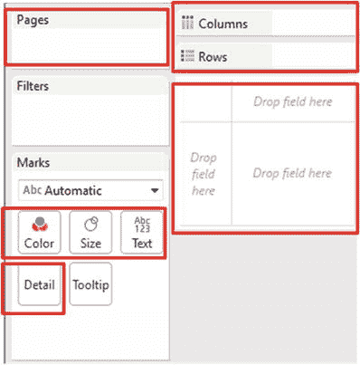

图 5-1a。维度可以放置在详细级别上

表计算是应用于视图中单个度量的所有值的计算/运算。表计算是 Tableau 的计算主力。它们计算传统“按 X 维度切片”领域之外的值。表计算允许用户扩展其数据。表计算是应用于整个表中所有值的计算，并且通常依赖于表结构本身。例如：表计算可用于计算每个月对年度利润的贡献。

有两种简单的方法可以处理表计算：

- 使用快速表计算。快速表计算是常用表计算的集合（例如累计总和、差异、百分比差异、排名、百分位数等）。

- 使用表计算函数从头创建您自己的表计算。

请参考图 5-1b。

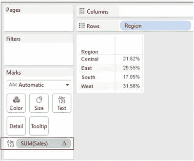

图 5-1b。应用于度量`销售额`的表计算。注意`SUM(销售额)`旁边的三角形标记

在图 5-1b 中，维度`区域`放置在行功能区上，度量`销售额`放置在标记卡上的`标签`上。表计算`总计百分比`应用于度量`销售额`。该表计算是`总计百分比`；因此，当所有单元格值相加时，其总和为 100%。

表计算使用两个字段：分区字段和寻址字段。为了理解表计算，理解这些字段如何工作非常重要。它们本质上定义了表计算“是什么”以及“如何”执行它们。

**分区字段**：此字段用于将数据分区到多个桶中。然后，计算会对这些数据桶进行操作。换句话说，它们定义了计算的范围或分组。范围可以是整个表、窗格、单元格、维度，也可以为更高级的计算进一步自定义。

**寻址字段**：此字段提供了我们希望计算进行的方向。它定义了每个分区的锚点或源点。它定义了计算的根。

示例：计算一段时间内（跨年）按细分市场分区的累计总和。这里`细分市场`是分区字段，`日期`是寻址字段。

**注意**：Tableau 处理计算字段、筛选器和表计算的顺序：

1. Tableau 生成查询并将其发送到数据库进行处理。

2. 数据库处理查询。Tableau 会考虑所有计算字段，包括详细级别计算。

3. 最后，应用表计算。

## 5.2 销售额的累计总和

累计总和是一个数字序列的总和，每次向序列中添加一个数字时都会更新。它也被称为“部分和”。

例如：我们有一个数字序列“5, 2, 4, 7, 8”。要获得累计总和，首先将 5+2 得到 7。然后将 7 加上 4 得到 11，再将 11 加上 7 得到 18，最后将 18 加上 8 得到 26。

### 5.2.1 演示 1

**目标**：计算“销售额的累计总和”（使用表向下计算）。

**使用的数据集**：`示例 – 超级商店.xls`

**预期输出**：如图 5-2 所示。

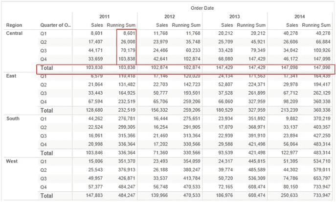

图 5-2。按区域划分的季度销售额

#### 5.2.1.1 步骤

请按照提供的步骤操作。

##### 5.2.1.1.1 步骤 1

将`示例 – 超级商店.xls`中的数据读入 Tableau（如图 5-3 所示）。

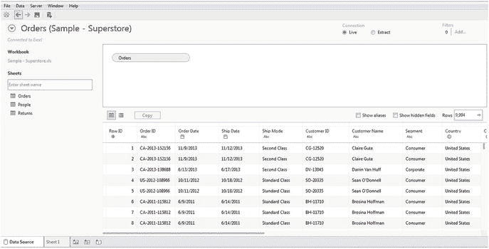

图 5-3。从`示例 - 超级商店.xls`读入 Tableau 的数据

##### 5.2.1.1.2 步骤 2

*表 5-1。在视图中要执行的任务*

| 列功能区 | `订单日期`：将其设置为`离散`。粒度应为`年`。度量名称：`SUM(销售额)` `SUM(销售额)`：添加一个表计算，`累计总和`，并让它计算累计总和，`表向下`。 |
|---|---|
| 行功能区 | `区域` `订单日期`：将其设置为`离散`。粒度应为`季度`。 |

将维度`订单日期`从数据窗格下的维度区域拖动到列功能区。默认情况下它是离散的。这也可以从视觉提示中看出。它是蓝色的。默认情况下，Tableau 中的日期具有定义在其上的层次结构。该层次结构设置为最高级别，即`年`（如图 5-4 所示）。

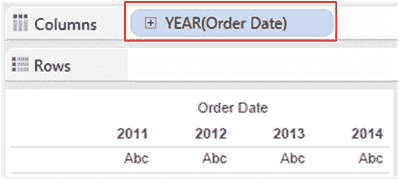

图 5-4。维度`订单日期`放置在列功能区上

##### 5.2.1.1.3 步骤 3

将维度`区域`从数据窗格下的维度区域拖到行功能区（如图 5-5 所示）。

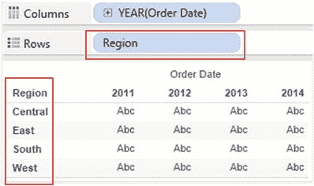

图 5-5。维度`区域`放置在行功能区上

##### 5.2.1.1.4 步骤 4

将维度`订单日期`从数据窗格下的维度区域拖到行功能区上`区域`的右侧。默认情况下它是离散的。这也可以从视觉提示中看出。它是蓝色的。将层次结构设置为`季度`（如图 5-6 所示）。

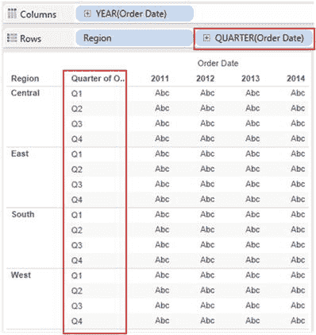

图 5-6。维度`订单日期`放置在行功能区上，`区域`的右侧

##### 5.2.1.1.5 步骤 5

将度量`销售额`从数据窗格下的度量区域拖到标记卡上的`标签`。默认聚合为`求和`（如图 5-7 所示）。

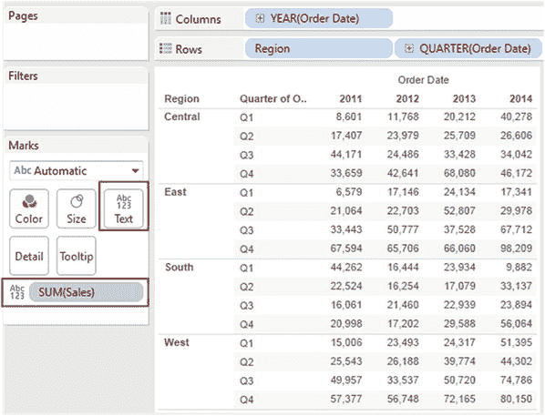

图 5-7。度量`销售额`放置在标记卡上的`标签`上

### 5.2.1.1.6 第 6 步

向度量`Sum (Sales)`添加一个快速表计算`累计总和`，并将`Running Total`设置为`Table Down`（如图 5-8 所示）。

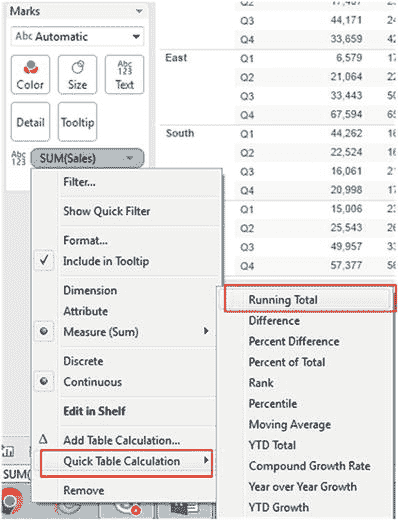

图 5-8. 向度量`Sales`添加`快速表计算`

按图 5-9 所示，在`表计算对话框`中填写数值。

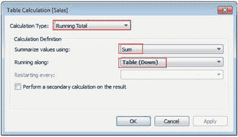

图 5-9. 度量`Sales`的`表计算对话框`

点击`应用`，然后点击`确定`。

### 5.2.1.1.7 第 7 步

再次从数据窗格下的度量区域拖动度量`Sales`，并将其放置到视图区域。默认聚合方式为`Sum`（如图 5-10 所示）。

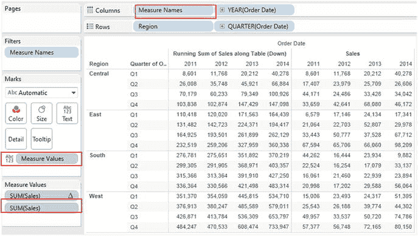

图 5-10. 度量`Sales`再次被放置在视图上


## 5.3 占总计百分比形式的盈利能力

请注意，`Measure Names` 出现在列功能区上。同时，`Measure Values` 出现在标记卡上的标签中。

拖动 `Measure Names` 并将其拉到列功能区上 `Year (Order Date)` 的右侧（如图 5-11 所示）。

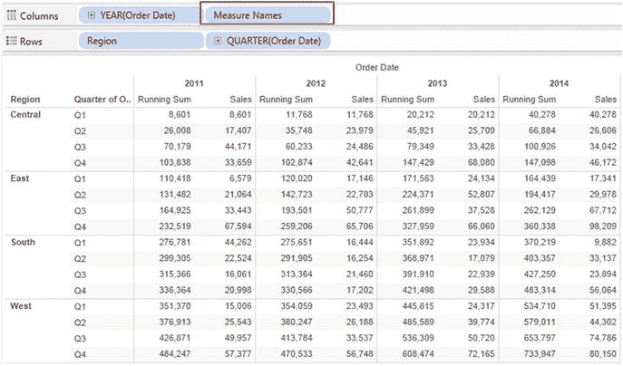

图 5-11. 维度 `Measure Names` 被放置在列功能区上 `Order Date` 的右侧

注意显示的变化。

在度量值区域，将 `Sum (Sales)` 放置在已定义表计算的 `Sum (Sales)` 之上（如图 5-12 所示）。

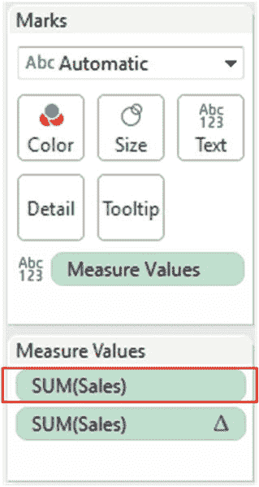

图 5-12. 更改标记卡上`标签`中度量值的顺序

从显示中可以看出，首先对度量 `Sales` 进行聚合，然后显示其`累计总和`。

让我们验证一下计算。为了验证，我们只提取了 `2011` 年和 `Central` 区域的数据。

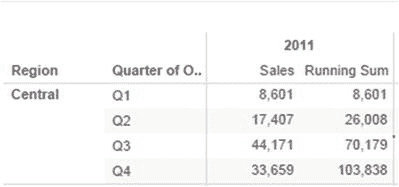

2011 年第一季度的销售额为 8,601。在此基础上加上第二季度的销售额 17,407，得到累计和 26,008。在此累计和 26,008 的基础上，加上第三季度的销售额 44,171，得到新的累计和 70,179。再此基础上加上第四季度的销售额 33,659，得到累计和 103,838。

请注意，`Sales` 的累计和是按 `Table Down` 计算的。

让我们向视图添加小计。为此，从菜单栏选择 `Analysis`，然后单击 `Totals`，并选择 `Add All Subtotals`（如图 5-13 所示）。

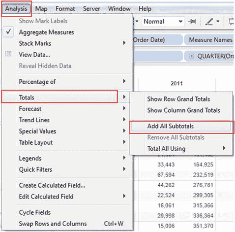

图 5-13. 对视图中的度量应用`添加所有小计`

```
Analysis ➤ Totals ➤ Add All Subtotals
```

最终输出（如图 5-14 所示）：

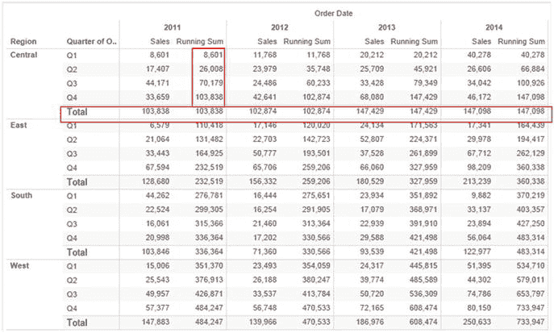

图 5-14. `累计总和` – 演示 1 – 最终输出

占总计的百分比也称为百分比分布。它的计算公式是将一个数量除以总数。例如：要找出以下数字中每个数字的占总计百分比：100、400 和 600，首先将所有数字相加得到总数。总数是 `(100+400+600) = 1100`。然后找出数字 100 占总数 1100 的百分比。可以这样计算：`(100 / 1100) * 100 = 9.090%`。

### 5.3.1 演示 1

目标：展示多个年份（2011、2012、2013 和 2014）中，每个区域每个细分市场每个产品类别的`占总计百分比形式的盈利能力`。

使用的数据集：`Sample – Superstore.xls`

预期输出：（如图 5-15 所示）。

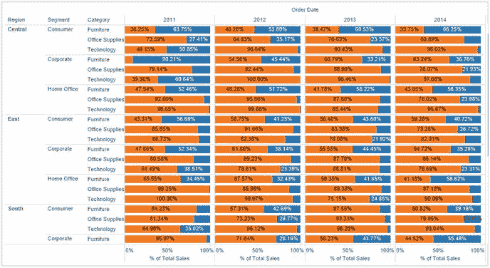

图 5-15. `占总计百分比形式的盈利能力` – 演示 1 – 预期输出

#### 5.3.1.1 步骤

请按照提供的步骤操作。

##### 5.3.1.1.1 第 1 步

从 `Sample – Superstore.xls` 读取数据（如图 5-16 所示）。

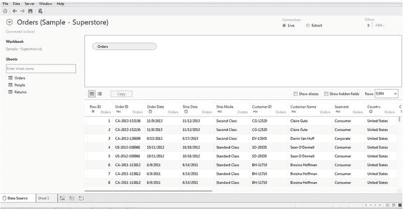

图 5-16. 从 `Sample - Superstore.xls` 读取数据到 Tableau

##### 5.3.1.1.2 第 2 步

表 5-2. 需要在视图中执行的任务

| 列功能区 | `Order Date`（“离散”，粒度设置为“年份”）`Sales` – 聚合设置为“SUM”向度量 `Sales` 添加表计算 `Percent of Total`，并从 `Cell` 汇总值 |
| --- | --- |
| 行功能区 | `Region`、`Segment` 和 `Category` |

将维度 `Order Date` 从数据窗格下的维度区域拖动到列功能区。将其设置为 `Discrete`。同时将粒度设置为 `Year`（如图 5-17 所示）。

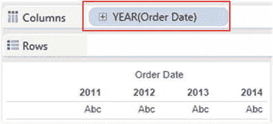

图 5-17. 维度 `Order Date` 放置在列功能区上

视觉提示（`Order Date` 在列功能区上显示为蓝色）表明该维度是离散的。默认情况下，日期类型字段具有已定义的层次结构，默认值是层次结构中的最高级别，在此例中为 `Year`。

将度量 `Sales` 从数据窗格下的度量区域拖动并放置到 `Order Date` 的右侧。保持其默认聚合方式 `SUM`（如图 5-18 所示）。

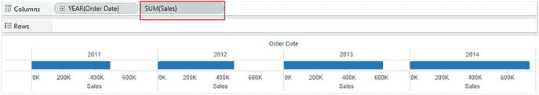

图 5-18. 度量 `Sales` 放置在列功能区上

##### 5.3.1.1.3 第 3 步

将维度 `Region` 从数据窗格下的维度区域拖动并放置到行功能区上。数据涵盖四个区域，即 `Central`、`East`、`South` 和 `West`（如图 5-19 所示）。

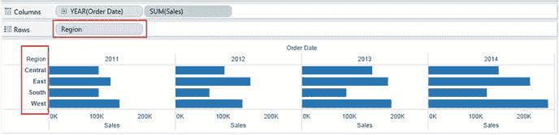

图 5-19. 维度 `Region` 放置在行功能区上

##### 5.3.1.1.4 第 4 步

将维度 `Segment` 从数据窗格下的维度区域拖动并放置到行功能区上维度 `Region` 的右侧。数据涵盖三个细分市场，即 `Consumer`、`Corporate` 和 `Home Office`（如图 5-20 所示）。

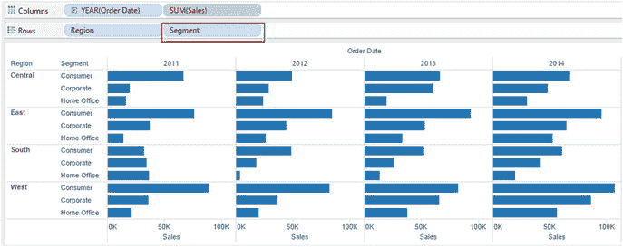

图 5-20. 维度 `Segment` 放置在行功能区上

##### 5.3.1.1.5 第 5 步

将维度 `Category` 从数据窗格下的维度区域拖动并放置到行功能区上维度 `Segment` 的右侧。数据涵盖三个类别，即 `Furniture`、`Office Supplies` 和 `Technology`（如图 5-21 所示）。

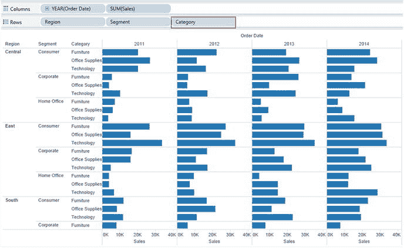

图 5-21. 维度 `Category` 放置在行功能区上

##### 5.3.1.1.6 第 6 步

添加一个表计算 `Percent of Total`。

点击度量 `Sum (Sales)` 的下拉箭头，然后选择 `Add Table Calculation`（如图 5-22 所示）。

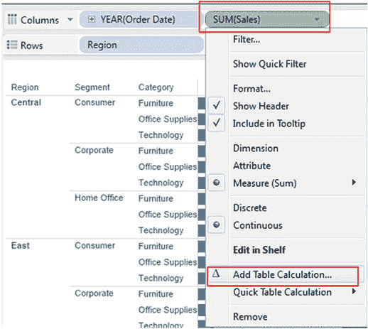

图 5-22. 向度量 `Sales` `添加表计算`

按图 5-23 所示，在`表计算`对话框中填写数值。

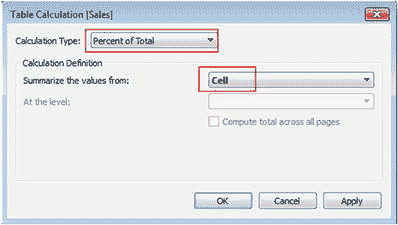

图 5-23. 度量 `Sales` 的`表计算`对话框

点击`应用`，然后点击`确定`。

输出将如图 5-24 所示。

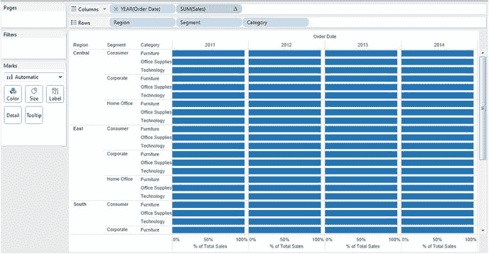

图 5-24. 对度量 `Sales` 应用 `Table Calculation - Percent of Total` 后的输出

##### 5.3.1.1.7 步骤 7

创建计算字段 `Profit or Loss`，如图 5-25 所示。

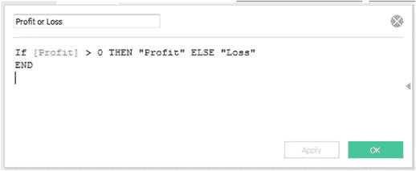

图 5-25. 正在创建的 `Calculated Field - Profit or Loss`

请注意，数据窗格下的维度区域中新增了一个维度 `Profit or Loss`。

##### 5.3.1.1.8 步骤 8

将新创建的维度 `Profit or Loss` 拖放到标记卡上的 `Color` 中（如图 5-26 所示）。


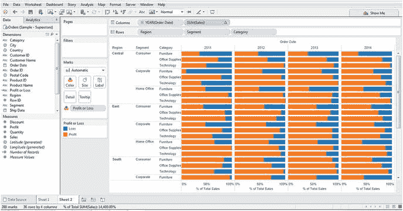

图 5-26. `Calculated Field - Profit or Loss` 被放置在标记卡的 `Color` 上

#### 5.3.1.1.9 步骤 9

按住控制键 (`CTRL`) ，将度量 `Sum (Sales) (我们已在此处添加表计算)` 从列 shelf 拖放到标记卡的 `Label` 上（如图 5-27 所示）。

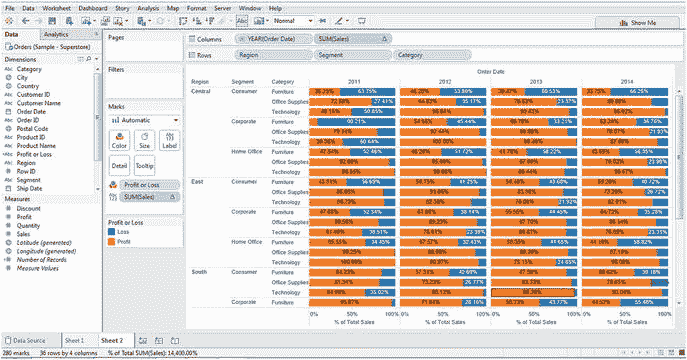

图 5-27. 带有表计算的度量 `Sales` 被放置在标记卡的 `Label` 上

亏损以蓝色显示，盈利以橙色显示。

## 5.4 移动平均

它有多种名称，如滚动平均、运行平均、滚动均值或运行均值。

### 5.4.1 应用场景

* 在金融数据（如股票价格、收益率等）的技术分析中。
* 用于判断市场状况。它应用于时间序列数据，以消除短期价格波动或噪音，并突出长期趋势。
* 用于识别趋势和反转。移动平均是滞后指标。它们从不用于预测新趋势，而是在趋势确立后确认趋势。例如：当股价高于移动平均线且平均线向上倾斜时，该股票被视为处于上升趋势。同样，当股价低于移动平均线且平均线向下倾斜时，该股票被视为处于下降趋势。
* 用于衡量资产动能的强度。这与计算移动平均所选择的时间段有关。
    * 短期动能：<=20 天
    * 中期动能：20 到 100 天
    * 长期动能：> 100 天
* 规划交易策略的宝贵工具。
* 有助于创建许多其他技术指标，例如移动平均收敛发散 (`MACD`) 或布林带。
* 有助于进行随机指标测量。

### 5.4.2 移动平均的类型

**简单移动平均**: 通过对一组给定值取算术平均值来计算。

**加权移动平均**: 用于确保最近的值对平均值的影响最大。它使用线性加权的值。例如：最旧的值权重为 1，次旧的值权重为 2，依此类推……直到最新的值获得最高权重。

**指数移动平均**: 这与简单移动平均类似。不同之处在于，简单移动平均会在新值出现时移除旧值，而指数移动平均则从指定点开始，计算所有历史范围的平均值。

**注意要点**: 移动平均是滞后指标。它们基于市场已经发生的事件。它们不是预测性指标。

### 5.4.3 演示 1

目标：展示度量 `Sales` 在数年（2011、2012、2013 和 2014）内的 `Moving Average`。

输入数据集：`Sample - Superstore.xls`

预期输出：如图 5-28 所示。

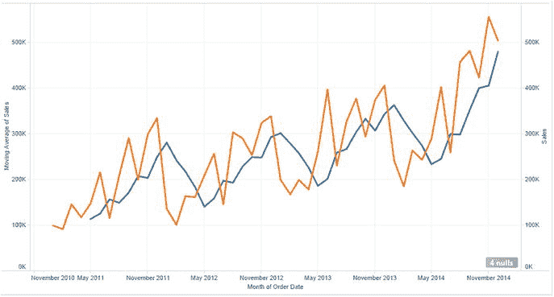

图 5-28. 移动平均 – 演示 1 – 预期输出

#### 5.4.3.1 步骤

表 5-3. 需要在视图中执行的任务

| 列 shelf | `Month(Order Date)` : 连续日期 |
| --- | --- |
| 行 shelf | `Sum(Sales)`，计算类型为 – `Moving Calculation`，使用 `Average` 汇总值 |
| 行 shelf | `Sum(Sales)` |

##### 5.4.3.1.1 步骤 1

将维度 `Order Date` 从数据窗格下的维度区域拖放到列 shelf 上（如图 5-29 所示）。

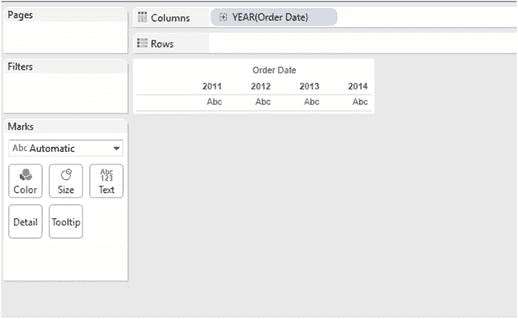

图 5-29. 维度 `Order Date` 被放置在列 shelf 上

##### 5.4.3.1.2 步骤 2

将 `Order Date` 更改为连续月份 (`Order Date`)（如图 5-30 所示）。

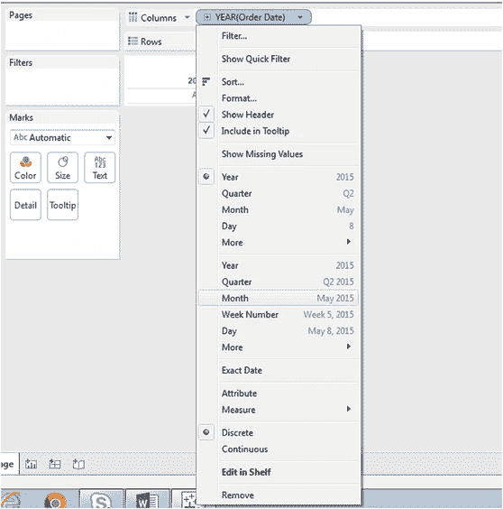

图 5-30. 维度 `Order Date` 正在从离散更改为连续

请注意视觉提示。`Month (Order Date)` 的颜色变为绿色（如图 5-31 所示）。

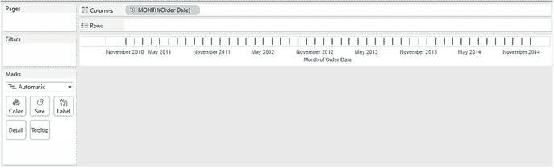

图 5-31. 维度 `Order Date` 已更改为 `Continous - Month`

##### 5.4.3.1.3 步骤 3

将度量 `Sales` 从数据窗格下的度量区域拖放到行 shelf 上（如图 5-32 所示）。

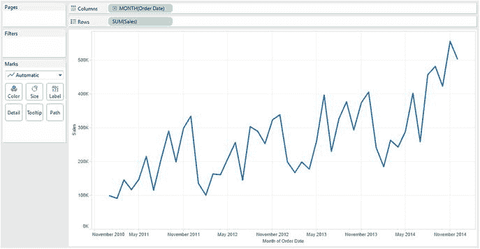

图 5-32. 度量 `Sales` 被放置在行 shelf 上

##### 5.4.3.1.4 步骤 4

点击 `Sum (Sales)` 的下拉列表，选择 `Add Table Calculation`（如图 5-33 所示）。

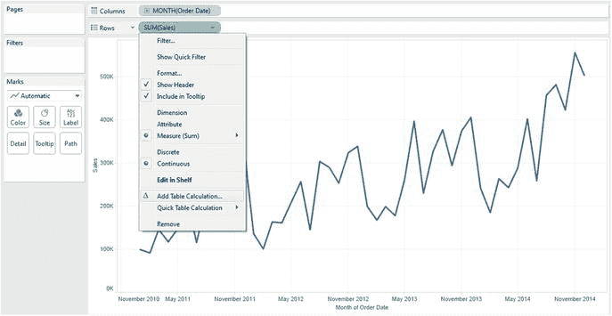

图 5-33. 为度量 `Sales` 添加 `Add Table Calculation`

##### 5.4.3.1.5 步骤 5

在 `Table Calculation` 对话框中填写值，如图 5-34 所示。

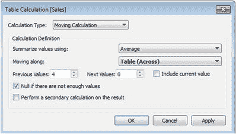

图 5-34. 度量 `Sales` 的 `Table Calculation` 对话框

输出结果如图 5-35 所示。

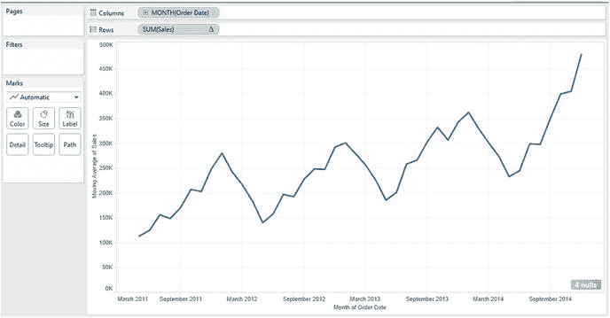

图 5-35. 对度量 `Sales` 应用 `Table Calculation` 后的输出结果

点击 `4 nulls`。这将弹出 `Special Values for [Moving Average of Sales]` 对话框（如图 5-36 所示）。

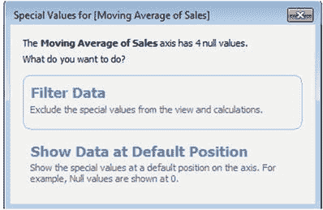

图 5-36. `Special Values for [Moving Average of Sales]` 对话框

点击 `Show Data at Default Position`。输出结果更改为下图所示（如图 5-37 所示）。

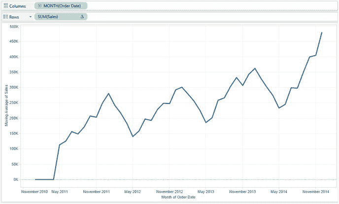

图 5-37. 设置空值后的输出结果

##### 5.4.3.1.6 步骤 6

将数据窗格下度量区域的度量 `Sales`（销售额）拖至相反的坐标轴上（如图 5-38 所示）。

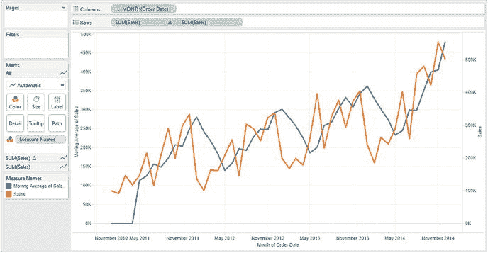

图 5-38. 度量 `Sales`（销售额）放置在行 shelf 上

将次坐标轴与主坐标轴同步（如图 5-39 所示）。

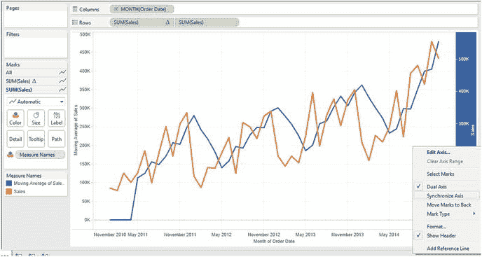

图 5-39. 将次坐标轴与主坐标轴同步

输出结果如图 5-40 所示。

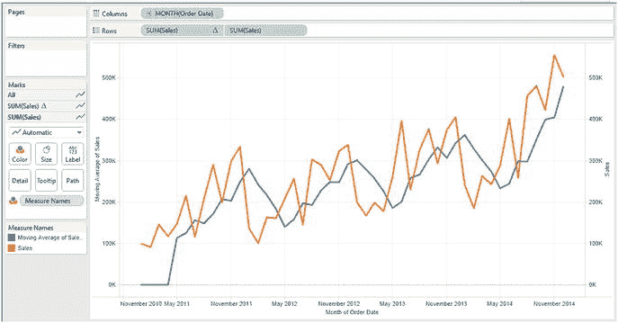

图 5-40. 次坐标轴与主坐标轴同步后的输出结果

让我们验证一下结果：

| 月份 | 销售额之和 |
| --- | --- |
| 2011 年 1 月 | 98898 |
| 2011 年 2 月 | 91152 |
| 2011 年 3 月 | 145729 |
| 2011 年 4 月 | 116916 |
| 2011 年 5 月 | 146748 |
| 2011 年 6 月 | 215207 |
| 2011 年 7 月 | 115510 |
| …. | …. |

移动平均线沿 `Table Across`（表横向）进行计算时，会使用前四个值，并且*不包含*当前值。如果没有足够的数值，则会使用 `Null`。

| 月份 | 销售额之和 | 移动平均 |
| --- | --- | --- |
| 2011 年 1 月 | 98898 |   |
| 2011 年 2 月 | 91152 |   |
| 2011 年 3 月 | 145729 |   |
| 2011 年 4 月 | 116916 |   |
| 2011 年 5 月 | 146748 | 113174 |

| 2011 年 6 月 | 215207 | 125136 |
| 2011 年 7 月 | 115510 | 156150 |
| 2011 年 8 月 | 207581 | 148595 |
| …. | … | …. |

计算移动平均的第一个数据点：

```
= (98898 + 91152 + 145729 + 116916) / 4
= (452695) / 4
= 113174
```

同样地，计算移动平均的第二个数据点：

```
= (91152 + 145729 + 116916 + 146748) / 4
= (500545) / 4
= 125136
```

移动平均的最终输出结果如图 5-41 所示。

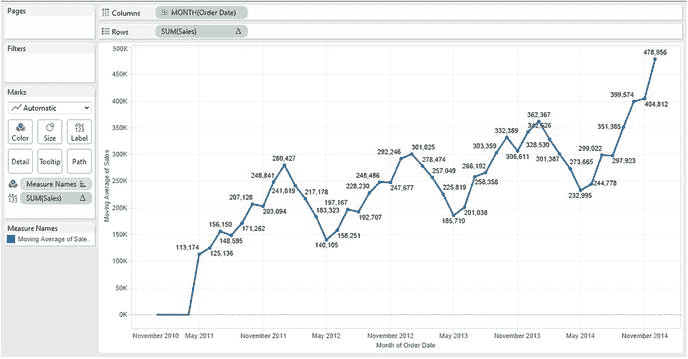

图 5-41. 移动平均 – 演示 1 – 最终输出

### 5.5 排名

`Tableau` 在排名计算中会忽略 `nulls`。它们会显示为空白行。

以下是可供选择的排名类型：

表 5-4. 排名类型

| 排名类型 | 示例 |
| --- | --- |
| 1,2,2,2,5（竞赛型） | 以下是输入集及其按升序排列的排名 输入集：50, 60, 60, 65, 78, 90 排名：1, 2, 2, 4, 5, 6 |
| 1,4,4,4,5（修正竞赛型） | 以下是输入集及其按升序排列的排名 输入集：50, 60, 60, 65, 78, 90 排名：1, 3, 3, 4, 5, 6 |
| 1,2,2,2,3（密集型） | 以下是输入集及其按升序排列的排名 输入集：50, 60, 60, 65, 78, 90 排名：1, 2, 2, 3, 4, 5 |
| 1,2,3,4,5（唯一型） | 以下是输入集及其按升序排列的排名 输入集：50, 60, 60, 65, 78, 90 排名：1, 2, 3, 4, 5, 6 |

#### 5.5.1 演示 1

目标：根据 `Sales Amount`（销售额）对 `Sub-Category`（子类别）进行排名。销售额最高的子类别排名第一，销售额次高的子类别排名第二，依此类推。

输入数据集：`Sample – Superstore.xls`

预期输出：如图 5-42 所示。

表 5-5. 视图中需执行的任务

| 列 shelf | `Sum(Sales)` |
| --- | --- |
| 行 shelf | `Sub-Category` |
| 表计算 | `Rank` 计算方向：`Table (Down)`（表（向下）） 排序顺序：降序 重复值排名方式：竞赛型 (1,2,2,4) |

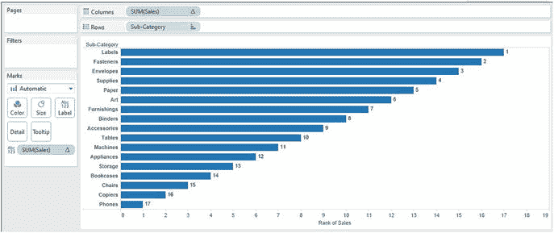

图 5-42. 按 `Sales`（销售额）降序排列的 `Sub-Category`（子类别）排名

##### 5.5.1.1 步骤

###### 5.5.1.1.1 步骤 1

将数据窗格下维度区域的维度 `Sub-Category`（子类别）拖至行 shelf 上（如图 5-43 所示）。

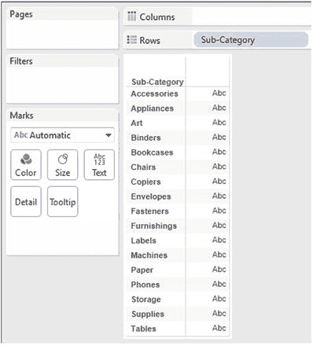

图 5-43. 维度 `Sub-Category`（子类别）放置在行 shelf 上

###### 5.5.1.1.2 步骤 2

将数据窗格下度量区域的度量 `Sales`（销售额）拖至列 shelf 上（如图 5-44 所示）。

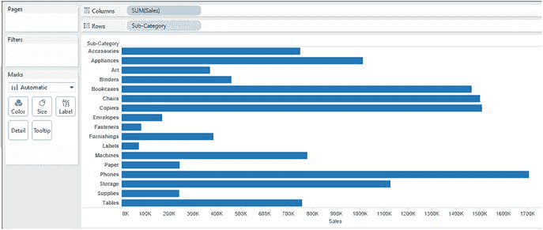

图 5-44. 度量 `Sales`（销售额）放置在列 shelf 上

###### 5.5.1.1.3 步骤 3

按 `Sales`（销售额）的 `Descending Order`（降序）对 `Sub-Category`（子类别）进行排序（如图 5-45 所示）。

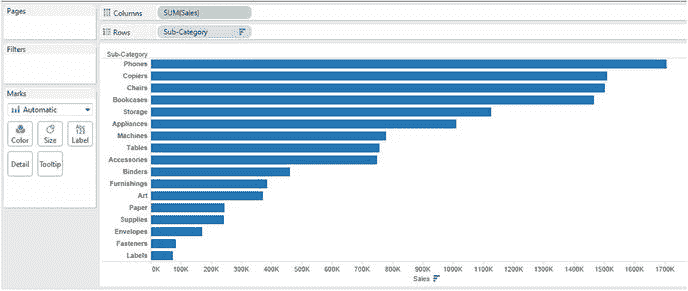

图 5-45. 按 `Sales`（销售额）的 `Descending Order`（降序）对 `Sub-Category`（子类别）进行排序

###### 5.5.1.1.4 步骤 4

将 `Sales`（销售额）拖至标记卡上的 `Label`（标签）（如图 5-46 所示）。

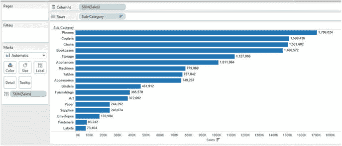

图 5-46. 度量 `Sales`（销售额）放置在标记卡上的 `Label`（标签）上

点击 `Sum(Sales)` 上的下拉按钮，调出 `Add Table Calculation`（添加表计算）（如图 5-47 所示）。

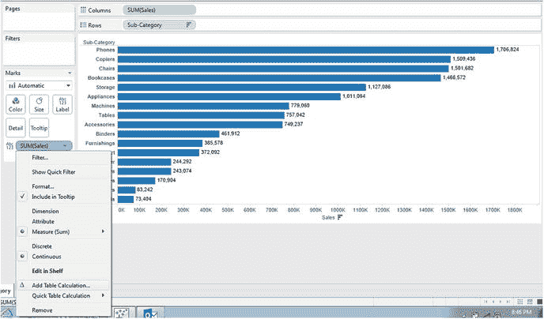

图 5-47. 对度量 `Sales`（销售额）应用 `Add Table Calculation`（添加表计算）

在 `Table Calculation`（表计算）对话框中填入数值，如图 5-48 所示。

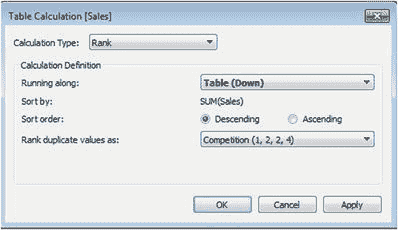

图 5-48. 度量 `Sales`（销售额）的 `Table Calculation`（表计算）对话框

输出结果如图 5-49 所示。


图 5-49. 对度量 `Sales`（销售额）应用 `Table Calculation - Rank`（表计算 - 排名）后的输出结果

###### 5.5.1.1.5 步骤 5

让我们将排名显示为工作表/视图中的最左侧列（如图 5-50 所示）。


图 5-50. `Rank`（排名）显示为最左侧列（预期输出）

如何实现上述效果？

需要将标记卡上 `Label`（标签）中的 `Sum(Sales)` 转换为 `Discrete`（离散型）（如图 5-51 所示）。


图 5-51. 度量 `Sales`（销售额）转换为 `Discrete`（离散型）

###### 5.5.1.1.6 步骤 6

现在，将放置在标记卡上 `Label`（标签）中的 `Sum(Sales)` 拖至 `Sub-Category`（子类别）的左侧（如图 5-52 所示）。


图 5-52. 离散型度量 `Sales`（销售额）放置在维度 `Sub-Category`（子类别）的左侧

###### 5.5.1.1.7 步骤 7

接下来，让我们在行 shelf 上添加一个 `Category`（类别）作为最左侧的列（如图 5-53 所示）。


图 5-53. 维度 `Category`（类别）作为行 shelf 上最左侧的列

每个类别的排名都应当从 1 开始（如图 5-54 所示）。


图 5-54. 预期输出：每个类别的排名都从 1 开始

如何实现上述效果？

###### 5.5.1.1.8 步骤 8

点击 `Sum (Sales)` 上的下拉菜单，调出“编辑表计算”（如图 5-55 所示）。


图 5-55. 针对度量 `Sales` 执行“编辑表计算”。

将 `Running Along` 更改为 `Pane Down`（图 5-56）。


图 5-56. 销售额排名的 `Running Along` 已更改为 Pane (Down)。

点击 `Apply`，然后点击 `OK`。

最终输出如图 5-57 所示。


图 5-57. 排名 – 演示 1 – 最终输出

## 5.6 LOD（详细级别）

详细级别（LOD）是一个非常重要的概念。理解细节的概念有助于理解详细级别。让我们来看一下可以在视图/工作表中添加细节的区域：

*   列功能区
*   行功能区
*   标记卡上的详细信息

细节是由用于细分度量的维度定义的。

**示例：**

将维度 `Region` 从数据窗格下的维度区域拖放至行功能区。

将度量 `Sales` 从数据窗格下的度量区域拖放至列功能区（如图 5-58 所示）。


图 5-58. 维度 `Region` 和度量 `Sales` 分别放置在行功能区和列功能区上。

度量 `Sales`（默认聚合为 `SUM`）按维度 `Region` 进行聚合。

让我们将另一个维度 `Category` 添加到行功能区（如图 5-59 所示）。


图 5-59. 维度 `Category` 放置在行功能区上。

通过将维度 `Category` 放置在行功能区上，我们增加了视图/工作表的粒度，减少了聚合程度。这意味着我们正在增加详细级别。

另一个可以添加细节的区域是标记卡上的 `Details`。将一个或多个维度添加到 `Detail` 按钮或 `Detail` 功能区时，会根据视图或工作表中的图表类型以不同方式影响可视化效果。

**示例：**

将度量 `Sales` 从数据窗格下的度量区域拖放至列功能区。将度量 `Profit` 从数据窗格下的度量区域拖放至行功能区（如图 5-60 所示）。


图 5-60. 度量 `Sales` 和 `Profit` 分别放置在列功能区和行功能区上。

输出如图 5-60 所示。输出是一个散点图，视图上只有一个标记。出现单个标记的原因是该度量尚未按任何维度进行细分。将维度 `Customer Name` 从数据窗格下的维度区域拖放至标记卡上的 `Details`（见图 5-61）。


图 5-61. 维度 `Customer Name` 放置在标记卡上的 `Detail` 上。

图 5-61 中的输出显示度量正在按 `Customer Name` 进行细分。视图为每位客户显示一个标记。这使得视图粒度更高，聚合程度更低。

另一种向视图添加细节的方法是使用 LOD（详细级别）。LOD 表达式提供了一种优雅且强大的方式，可以在单个可视化中回答涉及多个粒度级别的问题。详细级别表达式提供了一种轻松计算聚合的方法，这些聚合不在可视化的详细级别上。然后，您可以任意方式将这些值集成到可视化中。从 Tableau v9 开始，引入了一个名为详细级别（LOD）表达式的新概念。LOD 表达式可用于在不同级别以不同方式表示数据。

**什么时候可以使用 LOD 表达式？**

在以下情况下考虑使用 LOD 表达式：

*   需要在不同于视图中存在的维度/级别的级别上显示数据时。
*   需要获取不受应用于视图的任何筛选器影响的静态计算值时。延伸阅读请参考：[`www.tableaulearners.com/2016/level-detail-expressions-tableau/`](http://www.tableaulearners.com/2016/level-detail-expressions-tableau/)

LOD 有三个可用选项。它们是：

*   `Include`
*   `Exclude`
*   `Fixed`

### 5.6.1 演示 1

**目标：** 演示“详细级别 – Exclude”。

**输入：** `"Sample – Superstore.xls"`

**预期输出：** 如图 5-62 所示。


图 5-62. `LOD Exclude` – 演示 1 – 预期输出

**输出说明：**

视图/工作表应显示按区域、按州和按城市的销售额，同时显示维度 `Region`、`State` 和 `City`。

让我们分解输出：

**按区域的销售额：** 如图 5-63 所示。


图 5-63. 按区域划分的销售额

**按州的销售额：** 如图 5-64 所示。


图 5-64. 按州划分的销售额

**按城市的销售额：** 如图 5-65 所示。


图 5-65. 按城市划分的销售额

挑战在于将上述所有三个输出合并到单个视图/工作表中。让我们看看 `LOD – Exclude` 如何实现上述输出。

#### 5.6.1.1 步骤

##### 5.6.1.1.1 步骤 1

将数据从 `Sample – Superstore.xls` 读入 Tableau（如图 5-66 所示）。


图 5-66. 从 `Sample - Superstore` 读取的数据已读入 Tableau

##### 5.6.1.1.2 步骤 2

将维度 `Region` 从数据窗格下的维度区域拖至行功能区（如图 5-67 所示）。


图 5-67. 维度 `Region` 放置在行功能区上

将维度 `State` 从数据窗格下的维度区域拖至行功能区（如图 5-68 所示）。


图 5-68. 维度 `State` 放置在行功能区上

将维度 `City` 从数据窗格下的维度区域拖至行功能区（如图 5-69 所示）。


图 5-69. 维度 `City` 放置在行功能区上

##### 5.6.1.1.3 步骤 3

创建两个计算字段：`Exclude_Region_Sales` 和 `Exclude_State_Sales`。

`Exclude_Region_Sales`：要按区域获取销售额，我们将排除 `State` 和 `City` 维度（如图 5-70 所示）。


图 5-70. 正在创建计算字段 `Exclude_Region_Sales`

`Exclude_State_Sales`：要按州获取销售额，我们将排除 `City` 维度（如图 5-71 所示）。


图 5-71. 正在创建计算字段 `Exclude_State_Sales`

##### 5.6.1.1.4 步骤 4

将度量 `Exclude_Region_Sales` 从数据窗格下的度量区域拖放到视图/工作表中（如图 5-72 所示）。


图 5-72. 计算字段 `Exclude_Region_Sales` 放置在视图中

将度量 `Exclude_State_Sales` 从数据窗格下的度量区域拖放到视图/工作表中（如图 5-73 所示）。


图 5-73. 计算字段 `Exclude_State_Sales` 放置在视图中

# 5.6.2 演示 2

目标：演示详细级别 – 固定（Fixed）。

`Fixed LOD` 计算不依赖于视图。它们只关注我们在 `Fixed LOD Calculations` 中使用的维度，无论视图中包含或不包含什么。

**输入：** `Sample – Superstore.xls`

**预期输出：** 如图 5-76 所示。


图 5-76.`LOD – Fixed` – 演示 2 – 预期输出

**预期输出说明：**

我们使用 `LOD – exclude` 也能得到上述输出，但我们必须注意视图中存在的维度。我们希望在不考虑视图中存在任何维度的情况下获得上述输出。我们将使用 `LOD – fixed` 来实现这一点。`LOD – fixed` 为我们提供了更高的灵活性，并且可以跨工作表使用。

## 5.6.2.1 步骤

请按照提供的步骤操作。

### 步骤 1

将数据从 `Sample – Superstore.xls` 读入 `Tableau`（如图 5-77 所示）。


图 5-77. 从 `Sample - Superstore.xls` 读取的数据已读入 `Tableau`

### 步骤 2

将维度 `Region` 从数据窗格下的维度区域拖至行功能区（如图 5-78 所示）。


图 5-78. 维度 `Region` 放置在行功能区上

将维度 `State` 从数据窗格下的维度区域拖至行功能区（如图 5-79 所示）。


图 5-79. 维度 `State` 放置在行功能区上

将维度 `City` 从数据窗格下的维度区域拖至行功能区（如图 5-80 所示）。


图 5-80. 维度 `City` 放置在行功能区上

### 步骤 3

创建两个计算字段：`Fixed_Region_Sales` 和 `Fixed_State_Sales`（如图 5-81 和图 5-82 所示）。


图 5-82. 正在创建计算字段 `Fixed_State_Sales`


图 5-81. 正在创建计算字段 `Fixed_Region_Sales`

### 步骤 4

将度量 `Fixed_Region_Sales` 从数据窗格下的度量区域拖放到视图/工作表中（如图 5-83 所示）。


图 5-83. 计算字段 `Fixed_Region_Sales` 放置在视图中

将度量 `Fixed_State_Sales` 从数据窗格下的度量区域拖放到视图/工作表中（如图 5-84 所示）。


图 5-84. 计算字段 `Fixed_State_Sales` 放置在视图中

将度量 `Sales` 从数据窗格下的度量区域拖放到视图/工作表中（如图 5-85 所示）。


图 5-85. 度量 `Sales` 放置在视图中

最终输出如图 5-86 所示。


图 5-86.`LOD – Fixed` – 演示 2 – 最终输出

## 5.6.2.3 演示 3

**目标：** 演示“详细级别 – 包含”。

**输入：** `LOD.xls`

`LOD.xls` 中提供的数据集。


**预期输出：** 如图 5-87 所示。


图 5-87.`LOD – Include` – 演示 3 - 预期输出

**预期输出说明：**

我们希望查看所有客户的“平均交易金额”。同时，我们还希望查看“每位客户的平均交易金额”。

要获得“平均交易金额”，只需将所有客户的交易金额相加，然后除以客户数量（如表 5-6 所示）。


表 5-6. 平均交易金额

要获得“每位客户的平均交易金额”，需要先对每位客户的交易金额进行聚合，然后将所有客户的聚合金额相加。最后将聚合后的总金额除以不重复的客户数量（如表 5-7 所示）。


表 5-7. 每位客户的平均交易金额

让我们看看在 `Tableau` 中实现这一目标的步骤。

## 5.6.2.4 步骤

按照所提供的步骤操作。

### 步骤 1

从 `LOD.xls` 中读取数据到 `Tableau`（如图 5-88 所示）。


图 5-88. 从 `LOD.xls` 读取数据到 `Tableau`

### 步骤 2

创建一个计算字段 `Customer_Average_Amount`（如图 5-89 所示）。


图 5-89. 正在创建的计算字段 `Customer_Average_Amount`

### 步骤 3

将维度 `Measure Names` 从数据窗格下的维度区域拖到列功能区（如图 5-90 所示）。


图 5-90. 维度 `Measure Names` 放置在列功能区上

### 步骤 4

将维度 `Measure Names` 从数据窗格下的维度区域拖到筛选器功能区（如图 5-91 所示）。


图 5-91.`Measure Names` 的筛选器对话框

### 步骤 5

将度量 `Measure Values` 从数据窗格下的度量区域拖到行功能区（如图 5-92 所示）。


图 5-92. 度量 `Measure Values` 放置在行功能区上

### 5.6.2.4.6 步骤 6
将 `Amount` 和 `Customer_Average_Amount` 这两个度量的聚合方式更改为 `Average`（如图 5-93 和图 5-94 所示）。


图 5-94. 度量 `Customer_Average_Amount` 的聚合方式设置为 `Average`


图 5-93. 度量 `Amount` 的聚合方式设置为 `Average`

将度量的聚合方式更改为 `Average` 后的输出结果（如图 5-95 所示）。


图 5-95. 度量聚合方式设置为 `Average` 后的输出结果

### 5.6.2.4.7 步骤 7
按住 `CTRL` 键，将 `Measure Values` 从行功能区拖到标记卡上的 `Label`（如图 5-96 所示）。


图 5-96. `Measure Values` 放置在标记卡的 `Label` 上

为了交叉验证“每位客户的平均销售额”，请执行以下步骤：

将维度 `Customer Name` 从数据窗格下的维度区域拖到行功能区上（如图 5-97 所示）。


图 5-97. 维度 `Customer Name` 放置在行功能区上

将度量 `Amount` 从数据窗格下的度量区域拖到标记卡上的 `Label`（如图 5-98 所示）。


图 5-98. 度量 `Amount` 放置在标记卡的 `Label` 上

在菜单栏上选择 `Analysis`。选择 `Totals`，然后选择 `Show Column Grand Totals`。

`Analysis` ➤ `Totals` ➤ `Show Column Grand Totals`。

请参考图 5-99。


图 5-99. 对视图中的度量显示 `Show Column Grand Totals`

输出结果如图 5-100 所示。


图 5-100. 包含 `Column Grand Totals` 的输出结果

对总计使用 `Average` 聚合（如图 5-101 所示）。


图 5-101. 对视图中的度量使用 `Total All Using - Average`

总计聚合方式更改为 `Average` 后的输出结果（如图 5-102 所示）。


图 5-102. 包含 `Column Grand Total - Total All Using - Average` 的输出结果

这可以通过另外两种方式实现：

```
WINDOW_AVG(Sum(Amount))
```

或者

```
AVG( {Fixed [Customer Name] : Sum(Amount)})
```

`1,050` 这个值与我们为“每位客户的平均销售额”计算的值相匹配。

## 5.7 百分位数

百分位数将数据集分为 100 个相等的部分。百分位数衡量的是从底部开始的位置。它们用于确定个体在群体中的相对位置。换句话说，它们提供了一个个体的排名位置。我们在哪里见过百分位数的应用？它通常用于考试成绩和毕业排名。毕业排名指的是个体在毕业时相对于其他毕业生的位置。

**定义：** 百分位数是一种衡量标准，用于确定低于该衡量标准的总频率百分比。百分位数排名是低于给定分数的分数所占的百分比。

**公式：** 要确定一个分数 `x` 在总分数 `n` 中的百分位数排名，公式为：

`Percentile Rank = ((Number of scores below x) / n) * 100`

**示例：** 在一个 200 名学生的班级中，Mason 排名第 25 位。他在班级中的百分位数排名是：

`(175 / 200) * 100 = 87.5%`

在 `87.5%` 这个水平上，他的分数比班级中 `88%` 的学生都要好。

### 5.7.1 演示 1

**目标：** 计算八年级学生的百分位数。

**输入：** `Percentile.xlsx`

`Percentile.xlsx` 中提供的样本数据集。


**预期输出：** 如图 5-103 所示。


图 5-103. 百分位数 – 演示 1 – 预期输出

#### 5.7.1.1 步骤
按照提供的步骤操作。

##### 5.7.1.1.1 第 1 步
将 `Percentile.xlsx` 中的数据读取到 `Tableau` 中（如图 5-104 所示）。


图 5-104. 从 `Percentile.xls` 读取到 `Tableau` 中的数据

##### 5.7.1.1.2 第 2 步
将数据窗格下维度区域中的维度 `Roll No` 拖放到行功能区上（如图 5-105 所示）。


图 5-105. 维度 `Roll No` 放置在行功能区上

##### 5.7.1.1.3 第 3 步
将数据窗格下度量区域中的度量 `CGPA` 拖放到标记卡上的 `Label` 上（如图 5-106 所示）。


图 5-106. 度量 `CGPA` 放置在标记卡上的 `Label` 上

##### 5.7.1.1.4 第 4 步
向放置在标记卡 `Label` 上的度量 `CGPA` 添加一个名为 `Percentile` 的表计算（如图 5-107 所示）。


图 5-107. 正在将 `Table Calculation - Percentile` 应用于度量 `CGPA`

将 `表计算 – 百分位` 添加到度量 `CGPA` 后的输出结果（如图 5-108 所示）。


图 5-108. 将 `表计算 - 百分位` 应用于度量 `CGPA` 后的输出结果

##### 5.7.1.1.5 第 5 步
将数据窗格下度量区域中的度量 `CGPA` 拖放到文本区域中（如图 5-109 所示）。


图 5-109. 度量 `CGPA` 放置在视图中

计算中使用的公式：

```
(小于或等于当前考虑值的数值个数 / 总数值个数) * 100
```

示例：让我们考虑学号为 1 的学生的 `CGPA` 分数。该学生的 `CGPA` 分数为 `4.6`。有 8 个 `CGPA` 分数小于或等于 `4.6` 的 `CGPA` 分数。

```
(8 / 10) * 100 = 80%
```

现在，为了再次确认公式，让我们考虑另一个学生的 CGPA 值。这次我们考虑 CGPA 值为 3.9。这是学生获得的最低 CGPA 分数。

```
(1/10)*100 = 10%
```

**注意：** 在计算百分位时，`Tableau` 会忽略空值。如果存在空值，它们会在交叉表中显示为空白行，并且不计入计算中使用的总项目数 (%)。

## 5.8 同比增长

通俗地说，同比增长意味着公司今年的财务表现与去年相比。同比增长表现用于衡量公司的业绩是在改善还是在削弱。

计算同比增长率的公式：

- 用今年的数值（销售额或利润）减去去年的数值。这将构成年度的总差额（如果为正数，则表示同比增长，否则意味着亏损）。

- 用差额除以上一年的数值。结果即为同比增长率。

### 5.8.1 演示 1

**目标：** 提供了 4 年（2011、2012、2013 和 2014）的数据。公司高级主管希望得到一个能显示同比增长的可视化图表。

**输入：** `Sample – Superstore.xls`

**预期输出：** 如图 5-110 所示。


图 5-110. 同比增长 – 演示 1 – 预期输出

#### 5.8.1.1 步骤

按照提供的步骤操作。

##### 5.8.1.1.1 第 1 步

将 `Sample – Superstore.xls` 中的数据读取到 `Tableau` 中（如图 5-111 所示）。


图 5-111. 从 `Sample - Superstore.xls` 读取到 `Tableau` 中的数据

##### 5.8.1.1.2 第 2 步

将数据窗格下维度区域中的维度 `Order Date` 拖放到列功能区。将日期层次结构保留为默认值，即 `Year`。将 `Order Date` 保留为 `Discrete`（离散）（如图 5-112 所示）。


图 5-112. 维度 `Order Date` 放置在列功能区上

##### 5.8.1.1.3 第 3 步

将数据窗格下度量区域中的度量 `Sales` 拖放到行功能区上（如图 5-113 所示）。


图 5-113. 度量 `Sales` 放置在行功能区上

##### 5.8.1.1.4 第 4 步

将 `Mark Type`（标记类型）更改为 `Bar`（条形图）（如图 5-114 所示）。


图 5-114. 标记类型更改为 `Bar`

##### 5.8.1.1.5 第 5 步

向行功能区上的度量 `Sales` 添加一个 `Quick Table Calculation – Year over Year Growth`（快速表计算 – 同比增长）（如图 5-115 和图 5-116 所示）。


图 5-116. 应用 `Table Calculation - Year over Year Growth` 后的输出结果


图 5-115. 正在将 `Table Calculation - Year Over Year Growth` 应用于度量 `Sales`

点击视图/工作表底部的 `1 null` 消息，弹出 `Special Values for [% Difference in Sales]`（[销售额差异百分比]的特殊值）对话框（如图 5-117 所示）。


图 5-117. `Special Values for [% Difference in Sales]` 对话框

点击 `Show Data at Default Position`（在默认位置显示数据）。考虑空值后的输出结果（如图 5-118 所示）。


图 5-118. 将空值考虑在内后的输出结果

查看 `Table Calculation`（表计算）对话框。`Year over Year Growth`（同比增长）被计算为相对于 `Previous`（上一个）的 `Percent Difference`（百分比差异）（如图 5-119 所示）。


图 5-119. `Year over Year Growth`（同比增长）被计算为相对于 `Previous`（上一个）的 `Percent Difference`（百分比差异）

##### 5.8.1.1.6 第 6 步

按住 `CTRL` 键，将度量 `Sales` 从行功能区拖放到标记卡上的 `Color`（颜色）上（如图 5-120 所示）。


图 5-120. 度量 `Sales` 放置在标记卡上的 `Colors` 上

将阶跃颜色更改为 2（如图 5-121 所示）。


图 5-121. `Stepped Color`（阶跃颜色）更改为 2

更改阶跃颜色为 2 后的输出结果（如图 5-122 所示）。


图 5-122. 将 `Stepped Color`（阶跃颜色）更改为 2 后的输出结果

##### 5.8.1.1.7 第 7 步

按住 `CTRL` 键，将度量 `Sales` 从行功能区拖放到标记卡上的 `Label`（标签）上（如图 5-123 所示）。


图 5-123. 度量 `Sales` 放置在标记卡上的 `Label` 上

最终输出：如图 5-124 所示。


图 5-124. 同比增长 – 演示 1 – 最终输出

### 5.8.2 演示 2

**目标：**

“XYZ”公司的高级销售主管希望看到一个可视化图表，展示 2011 年和 2012 年的“月环比增长”。

**输入：** `Sample – Superstore.xls`

**预期输出：** 如图 5-125 所示。


图 5-125. “年同比（YoY）增长”——演示 2——预期输出

#### 5.8.2.1 步骤

请按照提供的步骤操作。

##### 5.8.2.1.1 步骤 1

创建一个计算字段 `YearToDisplay`（如图 5-126 所示）。


图 5-126. 正在创建的计算字段——`YearToDisplay`

##### 5.8.2.1.2 步骤 2

将计算字段 `YearToDisplay` 转换为 `维度`（如图 5-127 所示）。


图 5-127. 计算字段 `YearToDisplay` 正在被转换为 `维度`

##### 5.8.2.1.3 步骤 3

### 5.8.2 步骤详解（续）

#### 5.8.2.1.4 步骤 4

将计算字段 `YearToDisplay` 拖放到 `标记` 卡片上的 `颜色` 上（如图 5-129 所示）。


**图 5-129.** 计算字段 `YearToDisplay` 被放置在 `标记` 卡片上的 `颜色` 上

#### 5.8.2.1.5 步骤 5

从数据窗格下的维度区域将维度 `订单日期` 拖放到 `列` 架上。将日期层次结构更改为 `月`。保持其为 `离散`（如图 5-130 所示）。


**图 5-130.** 维度 `订单日期` 被放置在 `列` 架上

将 `标记类型` 更改为 `线`（如图 5-131 所示）。


**图 5-131.** `标记类型` 更改为 `线`

#### 5.8.2.1.6 步骤 6

从数据窗格下的度量区域将度量 `销售额` 拖放到 `行` 架上（如图 5-132 所示）。


**图 5-132.** 度量 `销售额` 被放置在 `行` 架上

#### 5.8.2.1.7 步骤 7

从数据窗格下的度量区域将度量 `销售额` 拖放到 `标记` 卡片上的 `标签` 上（如图 5-133 所示）。


**图 5-133.** 度量 `销售额` 被放置在 `标记` 卡片上的 `标签` 上

#### 5.8.2.1.8 步骤 8

为放置在 `标记` 卡片上 `标签` 中的度量 `销售额` 添加一个 `快速表计算——年同比（YoY）增长`（如图 5-134 所示）。


**图 5-134.** 为度量 `销售额` 添加 `表计算——年同比（YoY）增长`

查看 `表计算` 对话框（如图 5-135 所示）。


**图 5-135.** `表计算 [销售额百分比差异]` 对话框

请注意，`百分比差异` 是在 `订单日期的月份` 级别计算的，并以与 `上一个` 相比的百分比差异形式显示值。

最终输出：（如图 5-136 所示）。


**图 5-136.** 年同比（YoY）增长——演示 2——最终输出

如下验证输出：

| 年份 | 月份 | 销售额    | 百分比差异                         |
| :--- | :---- | :------- | :----------------------------------------- |
| 2011 | 一月   | 13,946   | `((4811 - 13946) / 13946) * 100 = -66%`    |
|      | 二月   | 4,811    |                                            |
|      | 三月   | 55,691   | `((55691 - 4811) / 4811) * 100 = 1058%`    |
|      | 四月   | 28,295   |                                            |
|      | 五月   | 23,648   | `((28295 - 55691) / 55691) * 100 = -49%`   |
|      | 六月  | 34,595   |                                            |
|      |       |          | `((23648 - 28295) / 28295) * 100 = -16%`   |

以此类推…

验证其余值。

### 5.8.3 演示 3

**目标：** 提供了 4 年（2011、2012、2013 和 2014）的数据。公司高级主管希望看到一个可视化图表，该图表仅显示 2011 年和 2012 年的年同比（YoY）增长。

**输入：** `Sample – Superstore.xls`

**预期输出：** 如图 5-137 所示。


**图 5-137.** 年同比（YoY）增长——演示 3——预期输出

#### 5.8.3.1 步骤

请按照提供的步骤操作。

##### 5.8.3.1.1 步骤 1

创建一个计算字段 `2011`（如图 5-138 所示）。


**图 5-138.** 正在创建的计算字段 `2011`

创建一个计算字段 `2012`（如图 5-139 所示）。


**图 5-139.** 正在创建的计算字段 `2012`

创建一个计算字段 `年同比（YoY）增长`（如图 5-140 所示）。


**图 5-140.** 正在创建的计算字段 `年同比（YoY）增长`

##### 5.8.3.1.2 步骤 2

从数据窗格下的维度区域将维度 `度量名称` 拖放到 `列` 架上（如图 5-141 所示）。


**图 5-141.** `度量名称` 被放置在 `列` 架上

##### 5.8.3.1.3 步骤 3

从数据窗格下的维度区域将维度 `度量名称` 拖放到 `筛选器` 架上（如图 5-142 所示）。


**图 5-142.** `度量名称` 在 `筛选器` 架上

选择度量 `2011`、`2012` 和 `年同比（YoY）增长`。

##### 5.8.3.1.4 步骤 4

从数据窗格下的度量区域将度量 `度量值` 拖放到 `标记` 卡片上的 `标签` 上（如图 5-143 所示）。


**图 5-143.** `度量值` 被放置在 `标记` 卡片上的 `标签` 上

最终输出：如图 5-144 所示。


**图 5-144.** 年同比（YoY）增长——演示 3——最终输出

## 5.9 要点回顾

*   表计算有助于从数据中推导出更多见解。例如：(a) 它有助于比较跨时间段（如年同比（YoY）增长）的增长或差异。(b) 它有助于计算库存的累计总和（运行总和）。随着每天添加产品，产品列表会增长。
*   有多种自定义表计算的方法，例如通过其上下文菜单或计算编辑器。要调出上下文菜单，请单击任何字段。
*   表计算通常应用于整个表中的值。例如，要计算运行总和或运行平均值，需要对整个表应用单一的计算方法。

## 5.10 后续步骤

本章使我们熟悉了表计算。下一章将向我们介绍字符串、数值、日期和逻辑函数。


