# 度量名称和度量值

第 3 章通过使用维度和度量，向我们介绍了如何使用工作表和视图。我们学习了如何对维度进行分组、构建自己的维度层次结构，以及创建集以动态选择要在视图中显示的数据。本章将深入探讨对维度和度量的理解。它介绍了两个新字段，即度量名称和度量值。我们将学习如何在单个轴上混合多个度量，以及如何使用双轴来增强数据的呈现。在解释过程中，我们将介绍一些新的图表形式，例如斜率图，以及组合图，例如在同一视图中组合条形图和折线图，以及棒棒糖图等。

## 为什么需要度量名称和度量值？

这些字段由 `Tableau` 自动创建，以便可以快速创建包含多个度量的视图。下面列举几个示例：

- 作为公司的高级执行经理，您希望比较一段时间内不同“客户细分”的“销售额”和“利润”这两个度量。
- 作为公司负责人，您希望评估本业务单元与去年相比的绩效。您希望得到一个清晰、快速显示趋势的可视化效果，无论是业务单元的绩效是增加了、减少了还是保持不变。
- 作为高级销售主管，您希望推断出哪些产品占了销售额的前 50%。

### 什么是度量名称和度量值？

这些是 `Tableau` 的内置字段。“度量名称”在数据窗格下的维度区域底部显示为一个维度。“度量值”在数据窗格下的度量区域底部显示为一个度量。

### 这些字段从何而来？

当您连接到一个数据源时，`Tableau` 会自动创建这些字段，以包含所有的度量名称和值。

**示例：**

考虑下表，该表展示了一个数据源中的数据（见表 4-1）：

**表 4-1.** 样本数据集

| 区域 | 销售额 | 利润 |
| --- | --- | --- |
| 东部 | 100,000 | 20,000 |
| 西部 | 120,000 | 12,000 |
| 北部 | 150,000 | 45,000 |
| 南部 | 110,000 | 11,000 |
| 中部 | 90,000 | 9,000 |

`Measure Names` 容器将包含：

*   `Sales`
*   `Profit`

`Measure Values` 容器将包含：（见表 4-2）

**表 4-2.** 样本 `Measure Values` 容器

| 销售额 | 利润 |
| --- | --- |
| 100,000 | 20,000 |
| 120,000 | 12,000 |
| 150,000 | 45,000 |
| 110,000 | 11,000 |
| 90,000 | 9,000 |

### 演示 1

**目标：** 在 `Tableau` 中，将维度 `Measure Names` 和度量 `Measure Values` 绘制到一个表格中。

**输入：** `Sample - Superstore.xls`

#### 在表格中绘制 `Measure Names` 和 `Measure Values` 的步骤

#### 步骤 1

将 `Sample - Superstore.xls` 中的数据读取到 `Tableau` 中（如图 4-1 所示）。

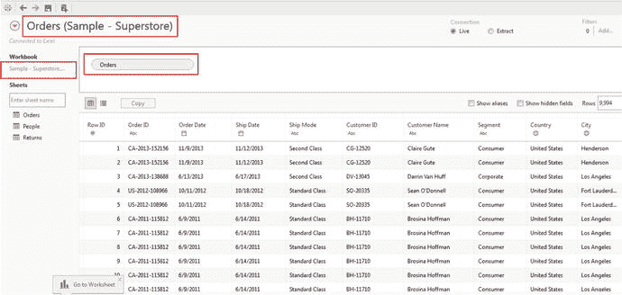

**图 4-1.** 从 `Sample - Superstore.xls` 读取到 `Tableau` 中的数据

#### 步骤 2

将数据窗格下维度区域中的维度 `Measure Names` 拖放到行功能区上（如图 4-2 所示）。

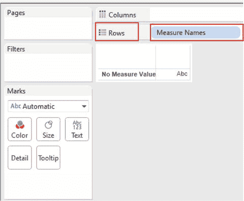

**图 4-2.** 将维度 `Measure Names` 放置在行功能区上

#### 步骤 3

将数据窗格下度量区域中的度量 `Measure Values` 拖放到标记卡上的 `Label` 中（如图 4-3 所示）。

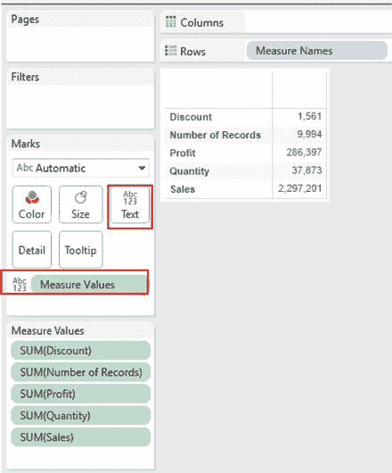

**图 4-3.** 将度量 `Measure Values` 放置在标记卡的 `Label` 上

如果想要按维度 `Region` 查看度量值，只需将数据窗格下维度区域中的维度 `Region` 拖放到列功能区上即可（如图 4-4 所示）。

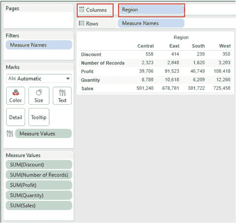

**图 4-4.** 将维度 `Region` 放置在列功能区上

#### 步骤 4

请注意，`Measure Names` 已自动放置在 `Filters Shelf` 上，并且在标记卡下方有一个 `Measure Values Shelf`。让我们为 `Measure Names` 添加一个快速筛选器（如图 4-5 所示）。

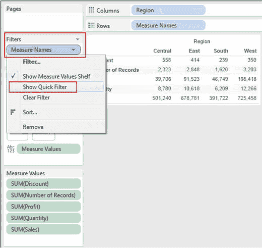

**图 4-5.** 为 `Measure Names` 添加 `Quick Filter`

`Quick Filter` 允许用户选择要显示在视图中的度量。下面是为 `Measure Names` 添加了 `Quick Filter` 后的工作表（如图 4-6 所示）。

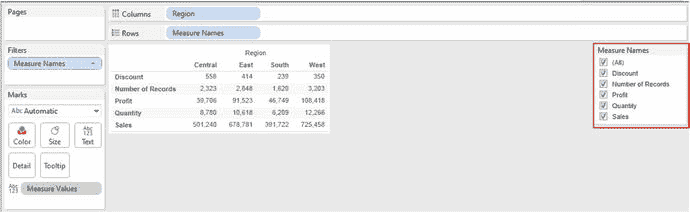

**图 4-6.** `Measure Names` 上的 `Quick Filter`

仅选择度量 `Sales` 和 `Profit` 后的输出结果（见图 4-7）。

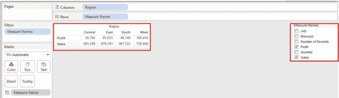

**图 4-7.** 在 `Quick Filter` 中选择了度量 `Profit` 和 `Sales`

### 演示 2

**目标：** 让我们创建一个允许用户动态选择要在视图中显示的度量的工作表/视图。例如，用户可以选择显示`利润`随时间（2011 年、2012 年、2013 年和 2014 年）的变化，或者选择显示`折扣`或`销售额`随时间的变化。

**输入：** `Sample - Superstore.xls`

**预期输出：** 如图 4-8 所示。

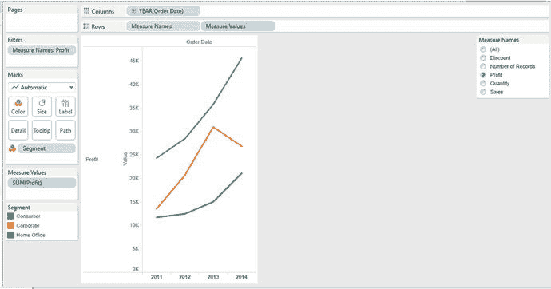

**图 4-8.** 使用 `Measure Names` 的快速筛选器 – 演示 2 – 预期输出

#### 使用 `Measure Names` 的快速筛选器的步骤

#### 步骤 1

将 `Sample - Superstore.xls` 中的数据读取到 `Tableau` 中（如图 4-9 所示）。

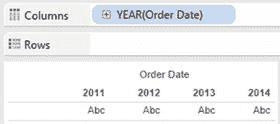

**图 4-9.** 从 `Sample - Superstore.xls` 读取到 `Tableau` 中的数据

#### 步骤 2

将数据窗格下维度区域中的维度 `Order Date` 拖放到列功能区上（如图 4-10 所示）。

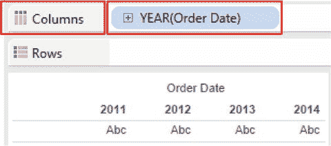

**图 4-10.** 将维度 `Order Date` 放置在列功能区上

#### 步骤 3

将数据窗格下维度区域中的维度 `Measure Names` 拖放到行功能区上。将数据窗格下度量区域中的度量 `Measure Values` 拖放到行功能区上 `Measure Names` 的右侧（如图 4-11 所示）。

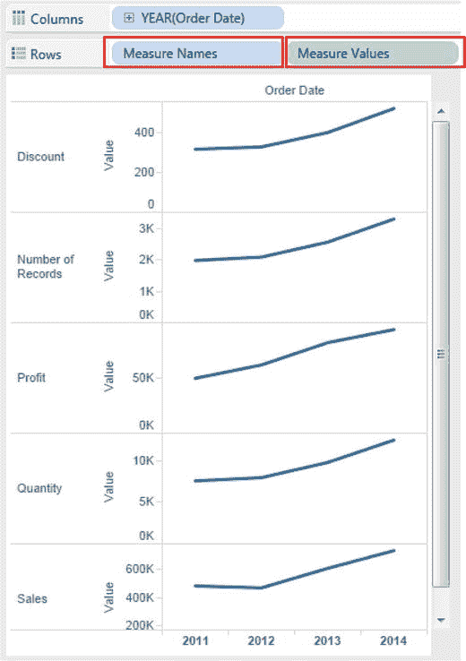

**图 4-11.** 将维度 `Measure Names` 和度量 `Measure Values` 放置在行功能区上

#### 步骤 4

将数据窗格下维度区域中的维度 `Segment` 拖放到标记卡上的 `Color` 中（如图 4-12 所示）。

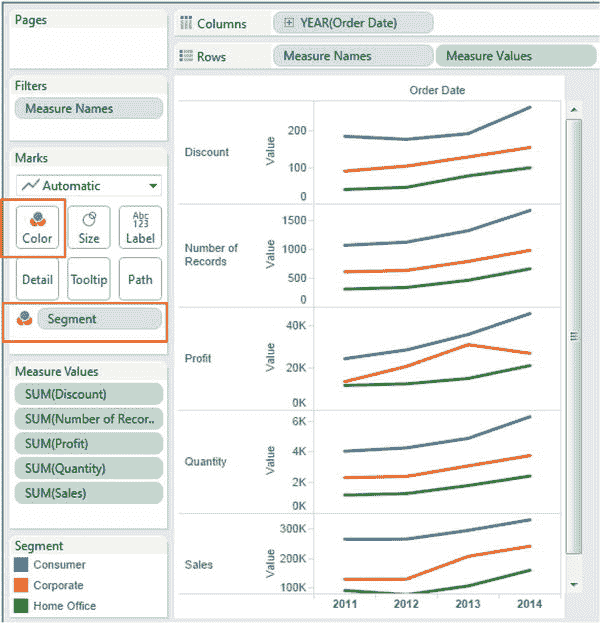

**图 4-12.** 将维度 `Segment` 放置在标记卡的 `Color` 上

#### 步骤 5

请注意，Tableau 已将 `Measure Names` 自动放置在 `Filters Shelf` 上。让我们为 `Measure Names` 添加一个 `Quick Filter`（如图 4-13 所示）。

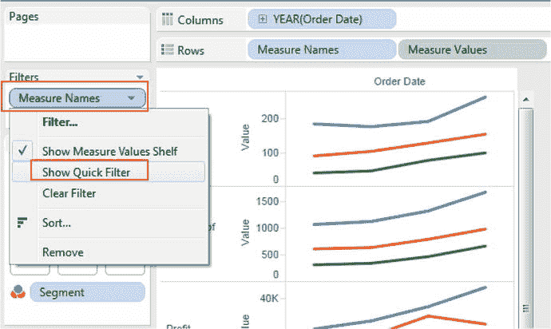

**图 4-13.** 为 `Measure Names` 添加 `Quick Filter`

#### 4.1.2.2.7 步骤 6

更改 `Quick Filter` 设置以显示单个值列表（如图 4-14 所示）。

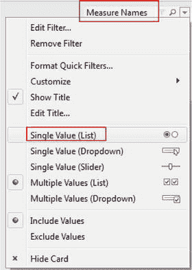

**图 4-14.** 将 `Quick Filter` 更改为 `Single Value (List)`

从 `Single Value (List)` 中选择度量 `Profit`。下面的输出显示了按 `Segment` 划分的 `Profit` 随时间的变化（如图 4-15 所示）。

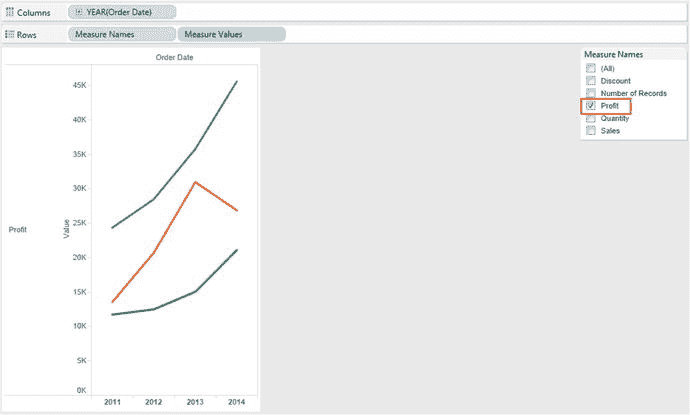

**图 4-15.** 输出显示按 `Segment` 划分的 `Profit` 随时间的变化

通过上一节演示中对多个度量的理解，让我们进一步探索如何将多个度量引入工作表/视图。我们将从在每个单独轴上绘制每个度量开始，然后混合度量并将其绘制在单个轴上，最后尝试使用双轴。度量可以放置在以下位置：

*   单个轴

*   混合度量并放置在单个轴上

*   双轴

### 4.1.3 独立轴上的度量

可以为每个度量创建独立的坐标轴（如图 4-16 所示）。图 4-16 所用的数据请参阅表 4-3。

**表 4-3.** 图 4-16 所用的数据

| 列功能区 | `Quarter(Order Date)` 日期为“离散”类型，其视觉提示为蓝色。描绘离散日期的首选图表形式是“条形图”。 |
| :--- | :--- |
| 行功能区 | `Sales`、`Profit`。两个度量使用的聚合方式均为 `SUM`。 |

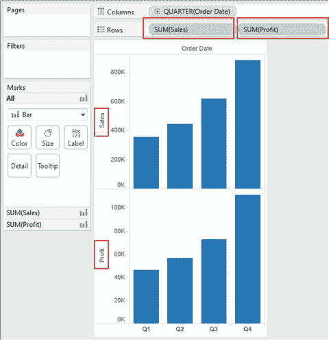

**图 4-16.** 每个度量的独立坐标轴

行功能区上的每个度量都会为表格的行增加一个坐标轴。从图 4-16 和 4-17 可以看出，这里有两个度量（`Sales` 和 `Profit`），它们为表格的行增加了两个坐标轴。`Sales` 和 `Profit` 坐标轴是表格中的独立行，具有独立的刻度。

**注意**

请注意，对于图 4-16 中的可视化图表，状态栏显示为 2 行（每个度量一行）乘以 4 列（一年最多有 4 个季度）。我们使用了条形图来展示度量，这是处理离散日期时的首选图表形式。共有 8 个条形，因此状态栏显示 8 个标记。

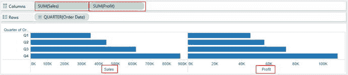

**图 4-17.** 每个度量位于其独立的坐标轴上

**表 4-4.** 图 4-17 所用的数据

| 列功能区 | `Sales`、`Profit`。两个度量使用的聚合方式均为 `SUM`。 |
| :--- | :--- |
| 行功能区 | `Quarter(Order Date)` 日期为“离散”类型，其视觉提示为蓝色。描绘离散日期的首选图表形式是“条形图”。 |

列功能区上的每个度量都会为表格的列增加一个坐标轴。从图 4-17 可以看出，这里有两个度量（`Sales` 和 `Profit`），它们为表格的列增加了两个坐标轴。`Sales` 和 `Profit` 坐标轴是表格中的独立列，具有独立的刻度。

**注意**

请注意，对于图 4-17 中的可视化图表，状态栏显示为 4 行（每个季度一行）乘以 2 列（每个度量一列）。我们使用了条形图来展示度量，这是处理离散日期时的首选图表形式。共有 8 个条形，因此状态栏显示 8 个标记。

### 4.1.4 混合坐标轴

将度量混合，让它们共享一个共同的坐标轴。何时应使用此功能？当需要比较具有相似刻度和单位的度量时，应使用此功能。

#### 4.1.4.1 演示 1

**目标：** 我们创建一个工作表/视图，使用“并列条形图”并排显示每年（2011 年至 2014 年）的 `Sales` 和 `Profit` 两个度量。

**输入：** `Sample - Superstore.xls`。

**预期输出：** 见图 4-18。

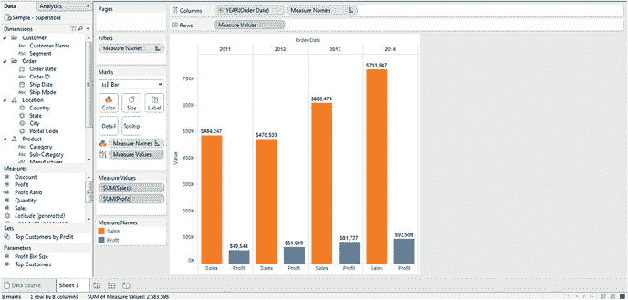

**图 4-18.** 混合度量 – 演示 1 - 预期输出

##### 4.1.4.1.1 使用“并列条形图”并排显示 `Sales` 和 `Profit` 两个度量的步骤

##### 4.1.4.1.2 步骤 1

将数据窗格维度区域中的 `Order Date` 拖放到列功能区上。日期始终以层次结构显示。默认情况下，当我们拖放 `Order Date` 并将其放在行或列功能区上时，它属于“离散”类型（这可以从视觉提示中看出（`Order Date` 以蓝色显示））（如图 4-19 所示）。

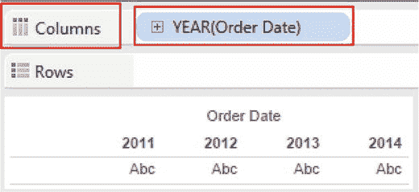

**图 4-19.** 维度 `Order Date` 放置在列功能区上

##### 4.1.4.1.3 步骤 2

将数据窗格度量区域中的度量 `Sales` 拖放到行功能区上。将标记类型更改为“条形”（如图 4-20 所示）。

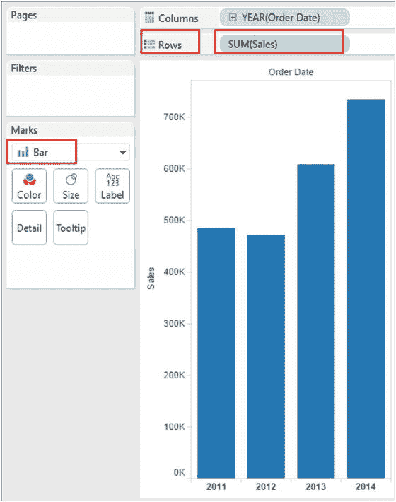

**图 4-20.** 标记类型更改为“条形”

##### 4.1.4.1.4 步骤 3

将数据窗格度量区域中的度量 `Profit` 拖放到与度量 `Sales` 相同的坐标轴上。**注意：** 只有当您看到标尺或刻度图像时才能释放 `Profit` 度量，否则它将会替换行功能区上的 `Sales` 度量。一旦将多个度量放到同一个坐标轴上，您会注意到出现了一个新的维度 `Measure Names` 和一个新的度量 `Measure Values`。在我们的示例中，`Measure Names` 出现在列功能区上，`Measure Values` 出现在行功能区上。共享坐标轴是使用 `Measure Values` 字段创建的。什么是度量名称和度量值？度量名称是一个容器，包含已拖拽到工作表/视图中的度量的名称。在我们的示例中，度量名称容器包含了 `Sales` 和 `Profit` 这两个度量的名称。度量值容器则包含了度量 `Sales` 和 `Profit` 的值，即 `Sum(Sales)` 和 `Sum(Profit)`。（如图 4-21 所示）。

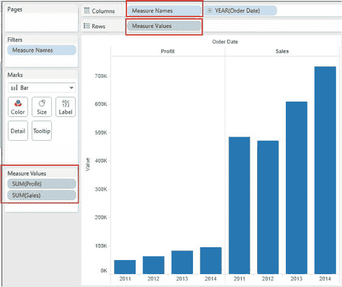

**图 4-21.** 维度 `Measure Names` 和度量 `Measure Values` 分别放置在列和行功能区上

我们希望并排查看 `Sales` 和 `Profit` 的条形图。请注意在图 4-21 中，`Measure Names` 首先显示在列功能区上，接着是 `Order Date`。将 `Measure Names` 移到 `Order Date` 的右侧。输出如图 4-22 所示。

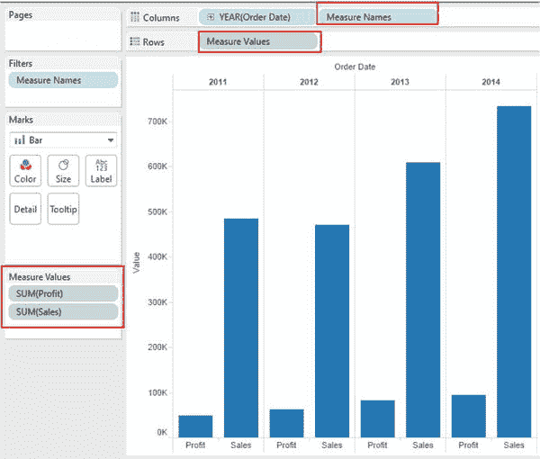

**图 4-22.** 按年份（2011-2014）显示的度量值 `Sales` 和 `Profit`

##### 4.1.4.1.5 步骤 4

让我们更改条形图的显示顺序。目前每年先显示 `Profit` 条形图，再显示 `Sales` 条形图。我们来更改这个顺序。为此，在 `Measure Values` 功能区上，将 `sum(Sales)` 移到 `sum(Profit)` 上方（如图 4-23 所示）。

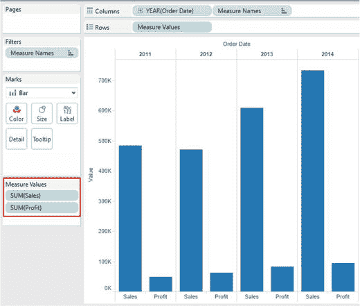

**图 4-23.** 度量值顺序已更改，先显示 `Sales`，后显示 `Profit`

##### 4.1.4.1.6 步骤 5

按住 `CTRL` 键，同时将 `Measure Names` 从列功能区拖到“标记”卡上的 `Color`（颜色）上（如图 4-24 所示）。

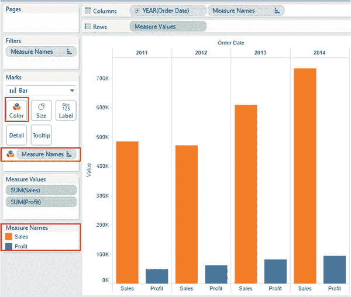

**图 4-24.** 维度 `Measure Names` 放置在标记卡上的 `Color` 上

**注意**

如果在将 `Measure Names` 拖到 `Color` 时**未**按住 `CTRL` 键，`Measure Names` 将从列功能区消失，且视图中将出现堆叠条形图。

#### 4.1.4.1.7 步骤 6

按住 `CTRL` 键，同时将 `Measure Values` 从行功能区拖放到“标记”卡上的 `Label`（标签）上（如图 4-25 所示）。

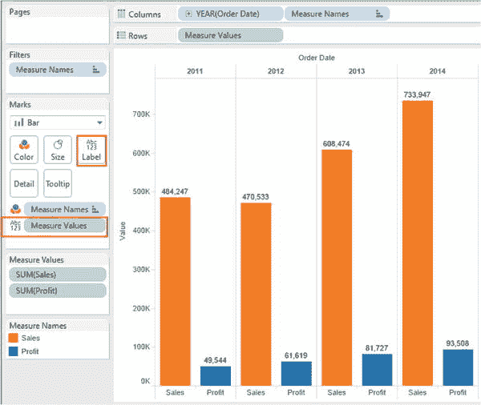

**图 4-25.** 度量 `Measure Values` 放置在标记卡上的 `Label` 上

### 演示 2

**目标：** 在**同一个**轴线上绘制多个度量（例如 `Sales`、`Profit` 和 `Discount`）。

**输入：** `Sample Superstore.xls`。该 Excel 工作表包含 4 年（2011 年至 2014 年）的数据。

**预期输出：** 如图 4-26 所示。

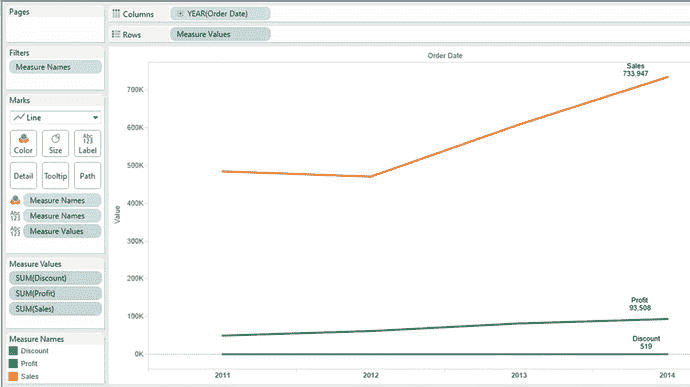

**图 4-26.** 混合度量 – 演示 2 – 预期输出

#### 在同一轴线上绘制多个度量的步骤

##### 步骤 1

从 `Sample - Superstore.xls` 中读取数据到 Tableau（如图 4-27 所示）。

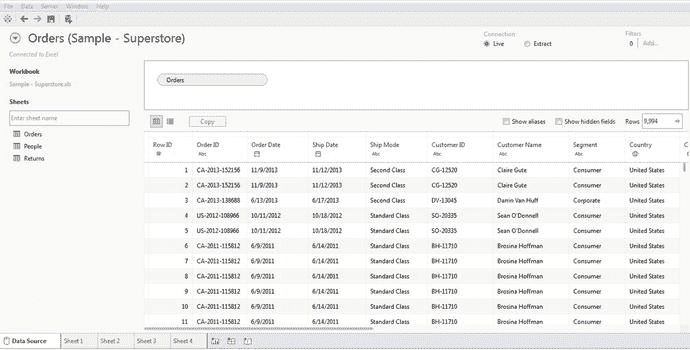

**图 4-27.** 连接到 Tableau 的 `Sample - Superstore.xls`

##### 步骤 2

将数据窗格维度区域的 `Measure Names` 拖至 `筛选器` 功能区。

此时显示 `筛选器 [Measure Names]` 对话框。选择度量 `Discount`、`Profit` 和 `Sales`（如图 4-28 所示）。

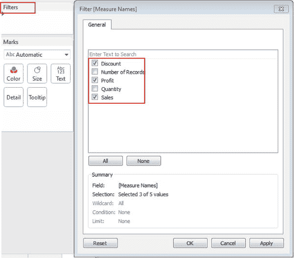

**图 4-28.** 在 `筛选器 [Measure Names]` 对话框中选择度量

点击 `应用`，然后点击 `确定`。

应用筛选器后的输出如图 4-29 所示。

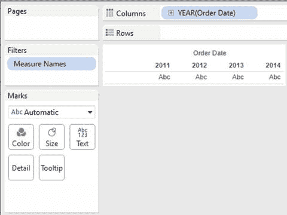

**图 4-29.** 放置在 `筛选器` 功能区中的 `Measure Names`

##### 步骤 3

将数据窗格维度区域中的维度 `Order Date` 拖至列功能区。保留默认的粒度（`Year`）（图 4-30）。

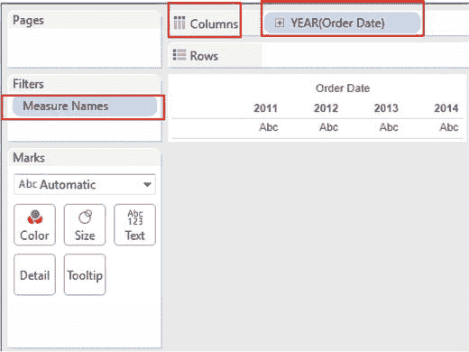

**图 4-30.** 放置在列功能区上的维度 `Order Date`

##### 步骤 4

将数据窗格度量区域中的 `Measure Values` 拖至行功能区（如图 4-31 所示）。

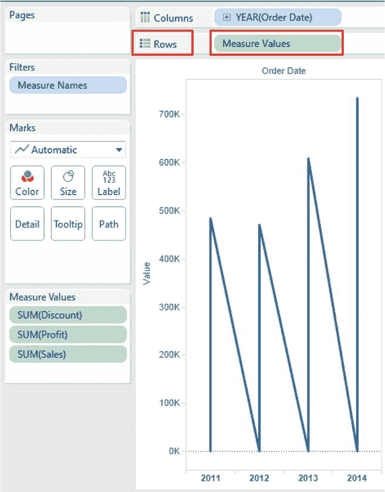

**图 4-31.** 放置在行功能区上的度量 `Measure Values`

##### 步骤 5

将 `标记类型` 更改为 `线`（如图 4-32 所示）。

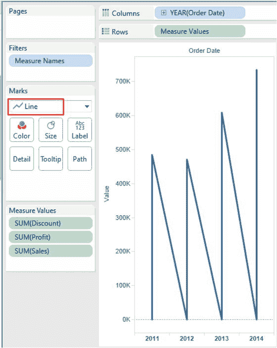

**图 4-32.** `标记类型` 设置为 `线`

将数据窗格维度区域中的 `Measure Names` 拖至标记卡上的 `颜色`（如图 4-33 所示）。

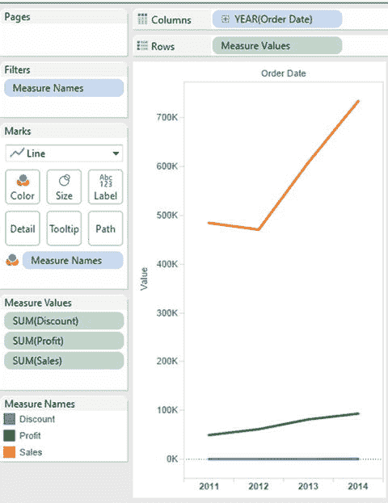

**图 4-33.** 将 `Measure Names` 放置在标记卡的 `颜色` 上

##### 步骤 6

现在让我们应用一些格式。

将 `Measure Names` 拖放到标记卡的 `标签` 上（如图 4-34 所示）。

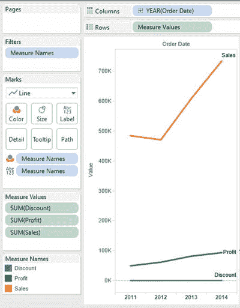

**图 4-34.** 将 `Measure Names` 放置在标记卡的 `标签` 上

将 `Measure Values` 拖放到标记卡的 `标签` 上（如图 4-35 所示）。

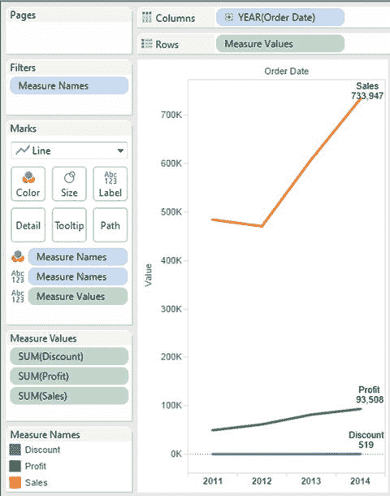

**图 4-35.** 将 `Measure Values` 放置在标记卡的 `标签` 上

将 `适合` 更改为 `整个视图`（如图 4-36 所示）。

**图 4-36.** `适合` 设置为 `整个视图`

### 演示 3

#### 带有堆叠标记的组合轴图表

**目标：** 创建一个带有堆叠标记的组合轴图表。

**输入：**

本节所用数据集的描述：

该数据集是关于 2014 年奥运会的。它包含以下维度：
- `Athlete`：运动员姓名
- `Country`：参赛运动员所在国家/地区
- `Sex`：运动员性别
- `Sport`：运动员参加的体育项目

度量如下：
- `Age`：运动员的年龄。
- `Bronze`：运动员在其参加的体育项目中获得的铜牌数量。
- `Gold`：运动员在其参加的体育项目中获得的金牌数量。
- `Silver`：运动员在其参加的体育项目中获得的银牌数量。
- `Total`：运动员在其参加的体育项目中获得的总奖牌数。

数据子集（如图 4-37 所示）。

**表 4-5. 要执行的活动**

| 列功能区 | 度量值（`总和(Bronze)`，`总和(Silver)`，`总和(Gold)`） |
| --- | --- |
| 行功能区 | `Country` |
| 标记卡：颜色 标签 | `Measure names` (`Bronze`, `Silver`, `Gold`) `Measure values` |

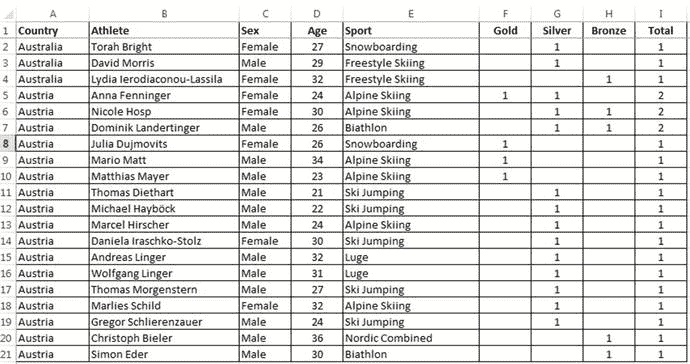

**图 4-37.** 演示 3 的数据子集：带有堆叠标记的组合轴图表

**预期输出：** 如图 4-38 所示。

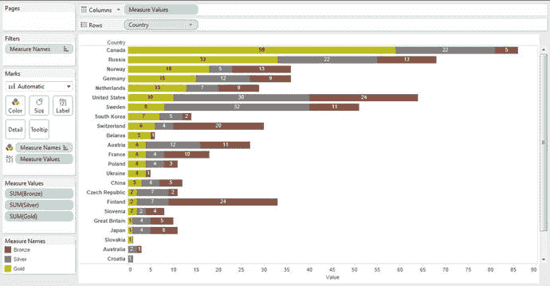

**图 4-38.** 带有堆叠标记的组合轴 – 演示 3 - 预期输出

#### 创建带有堆叠标记的组合轴图表的步骤

##### 步骤 1

将数据窗格维度区域中的维度 `Country` 拖至行功能区。状态栏显示 26 行乘以 1 列（数据集包含 26 个国家/地区的详细信息）（如图 4-39 所示）。

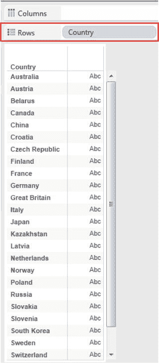

**图 4-39.** 放置在行功能区上的维度 `Country`

##### 步骤 2

将数据窗格度量区域中的度量 `Bronze` 拖至列功能区（如图 4-40 所示）。

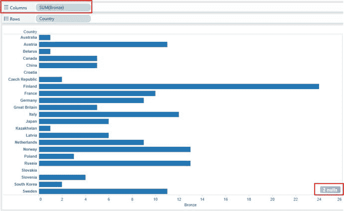

**图 4-40.** 放置在列功能区上的度量 `Bronze`

请注意屏幕右下角的 `2 nulls` 消息。

点击 `2 nulls` 消息。这会弹出 `[Bronze] 的特殊值` 窗口，如图 4-41 所示。

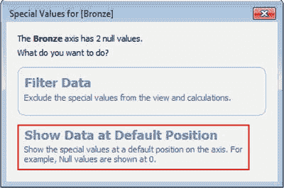

**图 4-41.** 修复 `[Bronze] 的特殊值`

`筛选数据` 会从视图和计算中排除这些特殊值。`在默认位置显示数据` 会在轴线上的默认位置显示这些特殊值。例如，空值显示为 0。

选择 `在默认位置显示数据`。该消息消失。输出如图 4-42 所示。

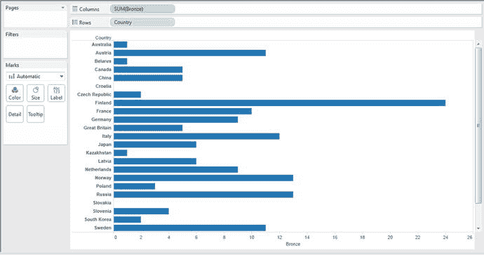

**图 4-42.** 考虑度量 bronze 的 `特殊值` 后的输出

##### 步骤 3

将数据窗格度量区域中的度量 `Silver` 拖至与度量 `Bronze` 相同的轴线上（如图 4-43 所示）。

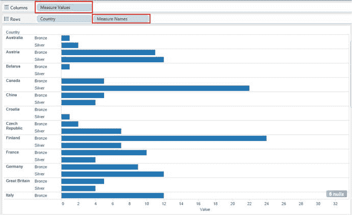
图 4-43. 度量 `Bronze` 和 `Silver` 放置在同一个轴线上

注意列功能区上的变化。列功能区现在包含 `Measure Values`。行功能区包含维度 `Country`，并且在维度 `Country` 的右侧是维度 `Measure Names`。轴线已更改为显示 `值`。

### 步骤 4

将度量 `Gold` 从数据窗格下的度量区域拖出，并将其放置在与度量 `Bronze` 和 `Silver` 相同的轴上（如图 4-44 所示）。

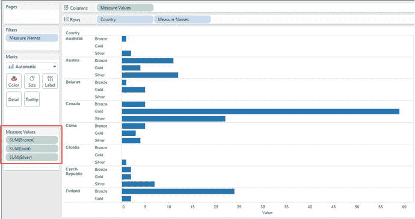
图 4-44. 度量 `Bronze`、`Silver` 和 `Gold` 放置在同一个轴上

观察标记卡正下方的 `Measure Values`。度量的顺序如下所示（见图 4-45）：

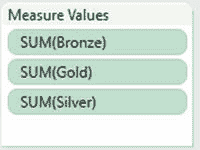
图 4-45. 标记卡下方的度量值

让我们将顺序更改为 `SUM(Bronze)`、`SUM(Silver)`，然后是 `SUM(Gold)`。将 `SUM(Silver)` 拖放到 `SUM(Gold)` 上方（见图 4-46）。

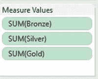
图 4-46. 更改后的度量值顺序

工作表/视图中所反映的更改如图 4-47 所示。

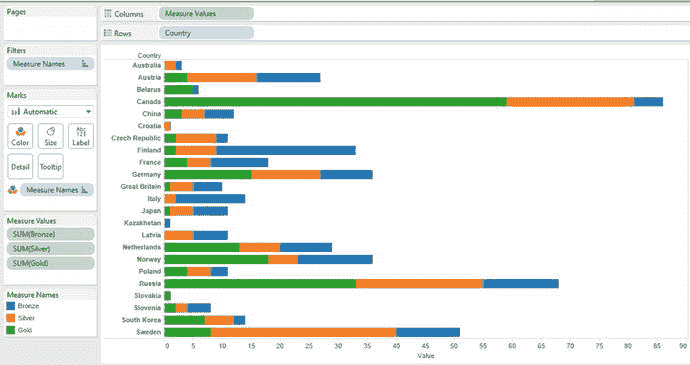
图 4-47. 重新排序度量值后的输出

### 步骤 5

将 `Measure Names` 从列功能区拖出，并将其放置到标记卡上的 `Color` 上（如图 4-48 所示）。

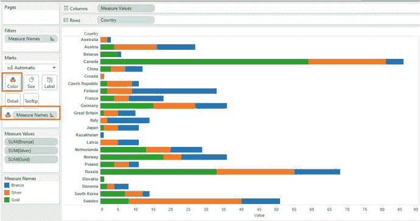
图 4-48. 将 `Measure Names` 放置在标记卡上的 `Color` 上

### 步骤 6

按住 CTRL 键，将 `Measure Values` 从行功能区拖出，并将其放置到标记卡上的 `Label` 上（如图 4-49 所示）。

图 4-49. 将 `Measure Values` 放置在标记卡上的 `Label` 上

### 步骤 7

按度量 `Gold` 的降序对维度 `Country` 进行排序。右键单击维度 `Country`，弹出下拉菜单，选择 `Sort`（如图 4-50 所示）。

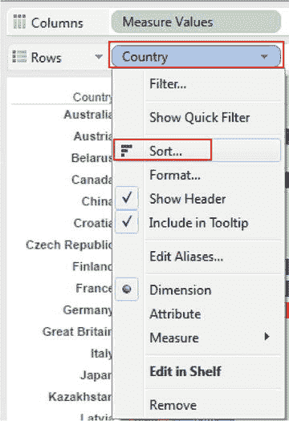
图 4-50. 对维度 `Country` 执行 `Sort` 操作

选择 `Sort` 后，会弹出 `Sort [Country]` 窗口。按图 4-51 所示提供值。

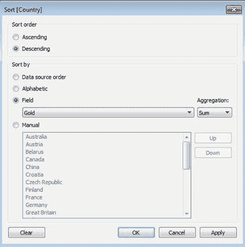
图 4-51. 按度量 `Gold` 的降序对维度 `Country` 执行 `Sort` 操作

点击 `Apply`，然后点击 `OK`。

排序后的输出如下所示（如图 4-52 所示）。

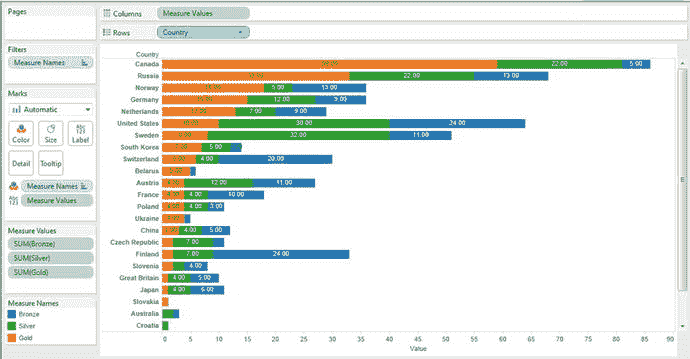
图 4-52. 按度量 `Gold` 的降序对维度 `Country` 排序后的输出

### 步骤 8

现在进行一些格式设置。

更改 `Bronze`、`Silver` 和 `Gold` 条形的颜色。更改所有度量值的数字格式（如图 4-53 和图 4-54 所示）。

图 4-54. 将所选颜色应用到度量后得到的输出

图 4-53. 编辑度量的颜色

为度量 `Bronze` 选择数字格式（如图 4-55 所示）。选择 `Number (Custom)`，并将 `Decimal places` 设置为 `0`（如图 4-56 所示）。

图 4-56. 为度量设置 `Number Format`

图 4-55. 为度量 `Bronze` 选择 `Number Format`

同样地，也为 `Silver` 和 `Gold` 度量更改数字格式。最终输出如图 4-57 所示。

图 4-57. 混合度量 – 演示 3 – 最终输出

从输出结果可以看出，`Canada`、`Russia` 和 `Norway` 的金牌计数分别位列第 1、第 2 和第 3 名。

## 演示 4 (坡度图)

目标：`XYZ` 是一家拥有六个部门的企业。每年年初为每个部门设定目标。年底对每个部门的绩效进行评估。下面给出的数据集显示了 2014 年和 2015 年各部门的绩效情况（表 4-6）。绘制一张图表，展示各部门的绩效是增长、下降还是保持不变/稳定。

表 4-6. 混合度量 – 演示 3 – 数据集

### 输入

### 创建坡度图的步骤

#### 步骤 1

将 `Slope Graph.xls` 中的数据读入 Tableau（如图 4-58 所示）。

图 4-58. 将 `Slope Graph.xls` 中的数据读入 Tableau

#### 步骤 2

将维度 `Measure Names` 从数据窗格下的维度区域拖出，并将其放置到列功能区上。

将度量 `Measure Values` 从数据窗格下的度量区域拖出，并将其放置到行功能区上（如图 4-59 所示）。

图 4-59. 将 `Measure Names` 和 `Measure Values` 分别放置到列和行功能区上

#### 步骤 3

从 `Measure Values` 功能区中移除度量 `Number of Records`（如图 4-60 所示）。

图 4-60. 从 `Measure Values` 功能区移除度量 `Number of Records` 后的输出

#### 步骤 4

将 `Marks Type` 更改为 `Line`（图 4-61）。

图 4-61. 将 `Marks Type` 更改为 `Line`

#### 步骤 5

创建一个计算字段 `Performance`（如图 4-62 所示）。

图 4-62. 创建的计算字段 `"Performance"`

将计算字段 `"Performance"` 从数据窗格下的维度区域拖拽到标记卡上的 `"Color"` 上（如图 4-63 所示）。

图 4-63. 将计算字段 `"Performance"` 放置在标记卡上的 `"Color"` 上

### 4.1.4.4.7 步骤 6

将维度 `"Units"` 从数据窗格下的维度区域拖出，并将其放置到标记卡上的 `"Detail"` 上（如图 4-64 所示）。

图 4-64. 将维度 `"Units"` 放置在标记卡上的 `"Detail"` 上

将维度 `"Units"` 从数据窗格下的维度区域拖出，并将其放置到标记卡上的 `"Label"` 上（如图 4-65 所示）。

图 4-65. 将维度 `"Units"` 放置在标记卡上的 `"Label"` 上

从上图中我们可以得出以下结论：
- 部门 2 和部门 3 的绩效呈现增长
- 部门 1 和部门 5 的绩效呈现下降
- 部门 4 和部门 6 的绩效保持稳定

### 4.1.4.4.8 作业 1

你是一名研究生院的学生。为了清晰地了解需要提升的科目，你绘制了一张图表，来解读研究生四年期间各科目的表现。请绘制一张斜率图，突出研究生院第一年和第四年的表现。

**输入：** `Slope Graph – Assignment.xls`

**预期输出：** 如图 4-66 所示。

图 4-66. 斜率图 - 作业 1 – 预期输出

## 4.1.5 双轴

上一节让你熟悉了如何混合度量并将其放置在公共轴上。然而，如果需要在视图中拥有辅助轴，该怎么做？

### 4.1.5.1 演示 1

**目标：** 作为公司的高级管理人员，你希望加强公司产品和服务的营销策略。了解全年销售过程中的利润情况，将有助于你提出创新的营销策略。请以有助于理解的方式绘制`销售额`和`利润`图表。

**输入：** `Sample - Superstore.xls`

| 列功能区 | `月(订单日期)` 从视觉提示中可以明显看出，日期是`离散`的。颜色为蓝色。表示离散日期的首选图表形式是条形图。 |
| :--- | :--- |
| 行功能区 | `销售额`，`利润`。两个度量使用的聚合是`总和`。 |

**预期输出：** 如图 4-67 所示。

图 4-67. 双轴 - 演示 1 - 预期输出

#### 4.1.5.1.1 演示双轴图的步骤

#### 4.1.5.1.2 步骤 1

从数据窗格下的维度区域中拖动`订单日期`，并将其放置在列功能区上。日期始终以层次结构显示。默认情况下，当我们拖动`订单日期`并将其放置在行功能区或列功能区上时，它是`离散`的（这从视觉提示中可以明显看出）（如图 4-68 所示）。

图 4-68. 维度`订单日期`放置在列功能区上

右键单击`年(订单日期)`。将显示一个下拉菜单。选择`月`（如图 4-69 所示）。

图 4-69. 将`订单日期`的粒度更改为`月`

选择`月(订单日期)`后，显示将更改，如图 4-70 所示。

图 4-70. `订单日期`粒度设置为`月`

#### 4.1.5.1.3 步骤 2

从数据窗格下的度量区域中拖动`销售额`，并将其放置在行功能区上（如图 4-71 所示）。

图 4-71. 度量`销售额`放置在行功能区上

在标记卡中将图表形式更改为`条形图`（如图 4-72 所示）。

图 4-72. `标记类型`更改为`条形图`

#### 4.1.5.1.4 步骤 3

从数据窗格下的度量区域中拖动`利润`，并将其放置在相对的轴（与放置`销售额`度量的轴相对的轴）上（如图 4-73 所示）。

图 4-73. 度量`利润`放置在`销售额`的相反轴上

#### 4.1.5.1.5 步骤 4

同步辅助轴（即放置`利润`度量的轴）（如图 4-74 所示）。

图 4-74. 将辅助轴与主轴同步

**注意：** 始终是`辅助轴`可以与`主轴`同步。如果选择放置`销售额`度量的轴并右键单击以显示上下文菜单，你会注意到`同步轴`功能已禁用（如图 4-75 所示）。

图 4-75. 主轴无法与辅助轴同步

让我们看看将`利润轴`与`销售额轴`同步的输出（见图 4-76）。

图 4-76. `利润轴`与`销售额轴`同步

将`利润`的图表形式更改为`折线图`（如图 4-77 所示）。

图 4-77. 为度量`利润`选择`折线图`作为标记类型

为`利润`度量选择`折线图`的输出（如图 4-78 所示）。

图 4-78. 双轴 - 演示 1 – 最终输出

注意七月份利润的下降。

### 4.1.5.2 演示 2

**目标：** `ABC` 是一家零售店，销售多种产品子类别，例如`手机`、`电器`、`家居装饰`、`纸张`和`艺术品`等。作为高级分析师，你希望了解哪些子类别贡献了前 50% 的销售额。请创建一个有助于理解的可视化图表。

**输入：** `Sample Superstore.xls`

**预期输出：** 如图 4-79 所示。

图 4-79. 双轴 - 演示 2 – 预期输出

#### 4.1.5.2.1 创建双轴图的步骤

#### 4.1.5.2.2 步骤 1

将 `Sample - Superstore.xls` 中的数据读入 Tableau（如图 4-80 所示）。

图 4-80. 演示 2 的数据已读入 Tableau

#### 4.1.5.2.3 步骤 2

从数据窗格下的维度区域中拖动维度`子类别`，并将其放置在行功能区上（如图 4-81 所示）。

图 4-81. 维度`子类别`放置在行功能区上

#### 4.1.5.2.4 步骤 3

从数据窗格下的度量区域中拖动度量`销售额`，并将其放置在列功能区上（如图 4-82 所示）。

**图 4-82.** 度量`销售额`放置在列功能区上

##### 4.1.5.2.5 步骤 4

按度量`销售额`的降序对维度`子类别`进行排序（如图 4-83 所示）。

**图 4-83.** 对维度`子类别`进行排序

如图 4-84 所示，填写`排序对话框`中的值。

**图 4-84.** 填写维度`子类别`的`排序`对话框

排序后的输出如图 4-85 所示。

**图 4-85.** 维度`子类别`按度量`销售额`降序排列

#### 4.1.5.2.6 步骤 5

再次从数据窗格下的度量区域拖动 `Sales`，将其放置在列功能区上（如图 4-86 所示），或按住控制键并点击列功能区中已有的 `Sales` 度量，将其放在 `SUM(Sales)` 的右侧。这将创建 `Sales` 度量的一个副本。

**图 4-86.** 度量 `Sales` 第二次放置在列功能区上

选择列功能区上的第二个度量，点击下拉菜单并选择 `双轴`（如图 4-87 和图 4-88 所示）。

**图 4-88.** 列功能区上的第二个度量 `Sales` 已设置为`双轴`

**图 4-87.** 将第二个度量 `Sales` 设置为`双轴`

#### 4.1.5.2.7 步骤 6

再次选择列功能区上的第二个度量，并执行表计算 `累计求和`（如图 4-89 所示）。

**图 4-89.** 为列功能区上的第二个度量 `Sales` 添加表计算

如图 4-90 所示，在 `表计算 [Sales]` 对话框中填写数值。

**图 4-90.** 在度量 `Sales` 的 `表计算` 对话框中填写的数值

点击 `应用`，然后点击 `确定`。

执行表计算后的输出结果（如图 4-91 所示）。

**图 4-91.** 对度量 `Sales` 执行表计算后的输出结果

将第二个度量的 `标记类型` 选择为 `线`（如图 4-92 所示）。

**图 4-92.** 为第二个度量 `Sales` 将 `标记类型` 设置为`线`

选择第一个度量，并将 `标记类型` 选择为 `条`（如图 4-93 所示）。

**图 4-93.** 为第一个度量 `Sales` 将 `标记类型` 设置为`条`

#### 4.1.5.2.8 步骤 7

从数据窗格下的维度区域拖动 `度量名称`，将其放置在标记卡上的 `颜色` 上（如图 4-94 所示）。

**图 4-94.** `度量名称` 放置在标记卡上的 `颜色` 上

排名前五的子类别贡献了约 55% 的销售额。

### 4.1.5.3 演示 3（使用双轴构建棒棒糖图）

**目标：** 你是 `XYZ` 公司的一名分析师。该公司在多个州设有分公司。你想向领导团队展示每个州各细分市场的销售额。你决定通过在两个轴上使用同一个度量来绘制一个棒棒糖图。

**输入数据：** `Sample – Superstore.xls`

**预期输出：** 如图 4-95 所示。

**图 4-95.** 双轴 - 演示 3 - 预期输出

#### 4.1.5.3.1 构建棒棒糖图的步骤

##### 4.1.5.3.2 步骤 1

将 `Sample Superstore.xls` 中的数据读入 Tableau（如图 4-96 所示）。

**图 4-96.** 读入 Tableau 的演示 3（双轴）数据

##### 4.1.5.3.3 步骤 2

从数据窗格下的维度区域拖动维度 `State`，将其放置在行功能区上（如图 4-97 所示）。

**图 4-97.** 维度 `State` 放置在行功能区上

从数据窗格下的维度区域拖动维度 `Segment`，将其放置在行功能区上维度 `State` 的右侧（如图 4-98 所示）。

**图 4-98.** 维度 `Segment` 放置在行功能区上

从数据窗格下的维度区域拖动维度 `Segment`，将其放置在标记卡上的 `颜色` 上（如图 4-99 所示）。

**图 4-99.** 维度 `Segment` 放置在标记卡上的 `颜色` 上

##### 4.1.5.3.4 步骤 3

从数据窗格下的度量区域拖动度量 `Sales`，将其放置在`列功能区`上（如图 4-100 所示）。

**图 4-100.** 度量 `Sales` 放置在列功能区上

第二次拖动度量 `Sales`，将其放置在列功能区上（如图 4-101 所示）。

**图 4-101.** 度量 `Sales` 第二次放置在列功能区上

##### 4.1.5.3.5 步骤 4

选择列功能区上的第二个度量（`Sum (Sales)`），点击下拉菜单并将其设置为`双轴`（如图 4-102 所示）。

**图 4-102.** 列功能区上的第二个度量 `Sales` 设置为双轴

在列功能区上将第二个度量设置为双轴后的输出结果（如图 4-103 所示）。

**图 4-103.** 设置双轴后的输出结果

##### 4.1.5.3.6 步骤 5

选择列功能区上的第一个度量，并将其设置为`条`形图（如图 4-104 所示）。

**图 4-104.** 将列功能区上第一个度量的图表形式设置为`条`

减小条形的大小（如图 4-105 所示）。

**图 4-105.** `条`的大小已减小

##### 4.1.5.3.7 步骤 6

确认 `Sales`（列功能区上）第二个实例的 `标记类型` 已设置为`圆`。

最终输出结果如图 4-106 所示。

**图 4-106.** 双轴 - 演示 3 - 最终输出结果

棒棒糖图：只有当你的数据范围从零开始时，使用棒棒糖的“棍”才有意义。

## 4.2 要点提醒

-   `度量名称` 和 `度量值` 是 Tableau 的内置字段，使我们能够在工作表/视图中处理多个度量。

-   在可视化单一度量在一段时间内的变化时，请使用坡度图。

-   使用组合图，通过采用最合适的图表形式来呈现度量，从而增强可视化效果。

## 4.3 后续步骤

在本章中，我们学习了 `度量名称` 和 `度量值`。我们学习了如何将每个度量绘制在各自的轴上、混合度量并将其绘制在公共轴上，以及利用双轴在视图中绘制多个度量。下一章将让我们熟悉对度量运行`表计算`。