# 6. 自定义数据

> “通过牢记三个基本原则：克制、精简、强调，你就能在设计出有效的图表、图形和表格时实现简洁。”
> — 加里·雷诺兹（Garr Reynolds），国际知名传播顾问，畅销书作家，其获奖作品包括《演说之禅》与《演说之禅设计》

第 5 章向我们介绍了 Tableau 中的各种表计算。本章将帮助探索和理解 Tableau 中的以下函数：

- 数字函数
- 字符串函数
- 逻辑函数
- 日期函数
- 聚合函数
- 表计算函数

## 6.1 数字函数

Tableau 提供了相当多的“数字”函数。请参阅表 6-1 了解 Tableau 支持的数值函数。

表 6-1. Tableau 支持的数值函数

| 函数名 | 描述 | 示例 |
| --- | --- | --- |
| `ABS(number)` | 返回给定数字的绝对值 | `ABS(-5) = 5` |
| `CEILING(number)` | 将数字向上舍入为最接近的相等或更大值的整数 | `CEILING(5.2345) = 6` |
| `DIV(integer1, integer2)` | 返回除法运算的整数部分。这里 `integer1` 除以 `integer2` | `DIV(13,2) = 6` |
| `FLOOR` | 将数字向下舍入为最接近的相等或更小值的整数 | `FLOOR(5.3143) = 5` |
| `MIN(number, number)` | 返回两个参数中的最小值。两个参数必须为同一类型。如果任一参数为 Null，则返回 Null | `MIN(6,5) = 5` |
| `MAX(number, number)` | 返回两个参数中的最大值。两个参数必须为同一类型。如果任一参数为 Null，则返回 Null | `MAX(6,5) = 6` |
| `PI()` | 返回数值常量 | 3.14159 |
| `POWER(number, power)` | 将数字提升到指定的幂次 | `POWER(6,2) = 36` |
| `ROUND(number,[decimals])` | 将数字舍入到指定位数 | `ROUND(4.1567) = 4` `ROUND(4.6567) = 5` |
| `SQRT(number)` | 返回一个数字的平方根 | `SQRT(25) = 5` |
| `SQUARE(number)` | 返回一个数字的平方 | `SQUARE(5) = 25` |

要了解有关数字函数的更多信息，请参阅以下链接。

[`https://onlinehelp.tableau.com/current/pro/desktop/en-us/functions_functions_number.html`](https://onlinehelp.tableau.com/current/pro/desktop/en-us/functions_functions_number.html)

我们来讨论几个数字函数。

### 6.1.1 CEILING(number) 和 FLOOR(number)

请参阅表 6-1 了解 `CEILING()` 和 `FLOOR()` 函数的描述。

让我们学习如何使用 `CEILING(number)` 和 `FLOOR(number)` 函数。

考虑下面的“培训师反馈”数据集（如图 6-1 所示）。

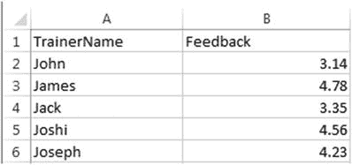

图 6-1. “培训师反馈”数据集

#### 6.1.1.1 演示 CEILING() 和 FLOOR() 函数用法的步骤

执行以下步骤。

##### 6.1.1.1.1 步骤 1

从“培训师反馈”数据集中读取数据，如图 6-2 所示。

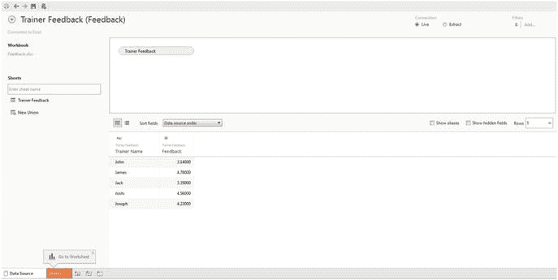

图 6-2. 显示“培训师反馈”数据集的数据源页面

##### 6.1.1.1.2 步骤 2

将数据窗格下维度区域的维度“培训师姓名”拖到行功能区。将数据窗格下度量区域的度量“反馈”拖到标记卡上的“文本”上（如图 6-3 所示）。

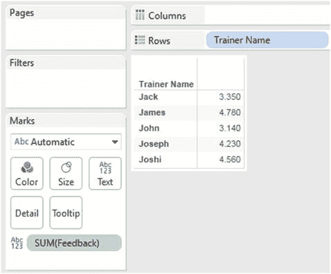

图 6-3. 维度“培训师姓名”放置在行功能区上，度量“反馈”放置在标记卡的“文本”上

##### 6.1.1.1.3 步骤 3

创建一个计算字段“Tableau CEILING”，如图 6-4 所示。

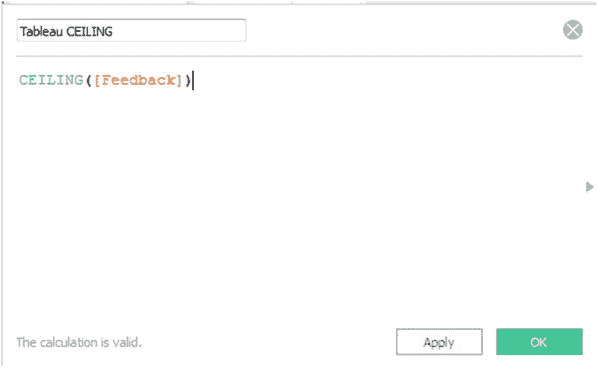

图 6-4. 正在创建的“Tableau CEILING”计算字段

##### 6.1.1.1.4 步骤 4

创建一个计算字段“Tableau FLOOR”，如图 6-5 所示。

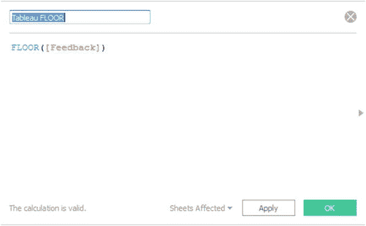

图 6-5. 正在创建的“Tableau FLOOR”计算字段

##### 6.1.1.1.5 步骤 5

双击计算字段将其放置在视图中。观察度量“反馈”的 `CEILING` 和 `FLOOR` 值（如图 6-6 所示）。

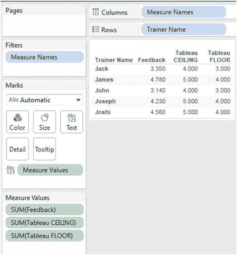

图 6-6. 使用计算字段“Tableau CEILING”和“Tableau FLOOR”的视图

### 6.1.2 MAX(number, number), MIN(number, number)

请参阅表 6-1 了解这些函数的描述。

考虑“学生”数据集（如图 6-7 所示）。


图 6-7. “学生”数据集

#### 6.1.2.1 演示 MAX() 和 MIN() 函数的步骤

执行以下步骤：

##### 6.1.2.1.1 步骤 1

将“学生”数据集中的数据读取到 Tableau 中（如图 6-8 所示）。

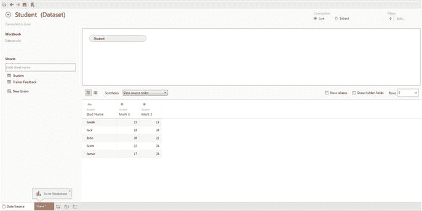

图 6-8. 显示“学生”数据集的数据源页面

##### 6.1.2.1.2 步骤 2

创建一个如图 6-9 所示的视图。

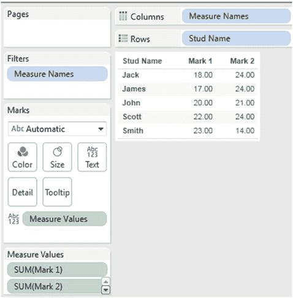

图 6-9. 显示学生成绩详情的视图

##### 6.1.2.1.3 步骤 3

创建一个计算字段“最高分数”（如图 6-10 所示）。

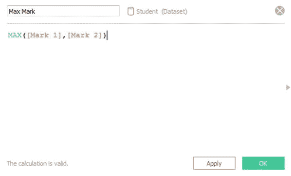

图 6-10. 正在创建的“最高分数”计算字段

##### 6.1.2.1.4 步骤 4

创建一个计算字段“最低分数”（如图 6-11 所示）。

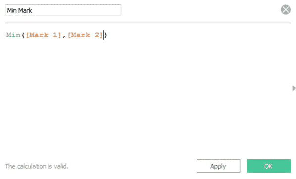

图 6-11. 正在创建的“最低分数”计算字段

##### 6.1.2.1.5 步骤 5

双击计算字段以显示“最高分数”和“最低分数”（如图 6-12 所示）。

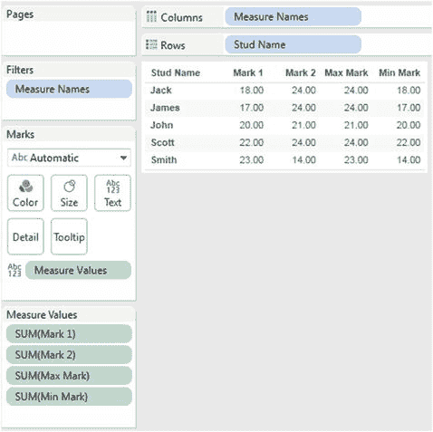

图 6-12. 使用计算字段“最高分数”和“最低分数”的视图

### 6.1.3 ABS(number)

请参阅表 6-1 了解该函数的描述。

考虑“项目”数据集（如图 6-13 所示）。

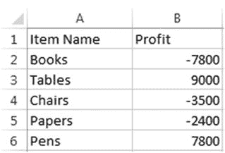

图 6-13. “项目”数据集

#### 6.1.3.1 演示 ABS() 函数用法的步骤

执行以下步骤。

##### 6.1.3.1.1 步骤 1

将“项目”数据集中的数据读取到 Tableau 中（如图 6-14 所示）。

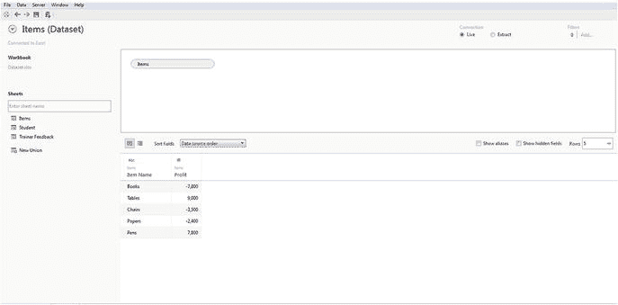

图 6-14. 显示“项目”数据集的数据源页面

##### 6.1.3.1.2 步骤 2

创建一个如图 6-15 所示的视图。

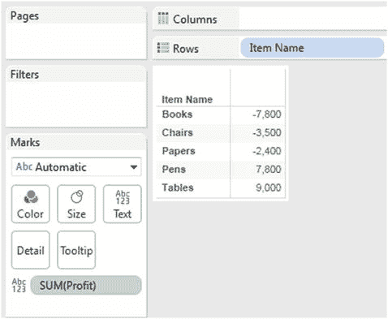

图 6-15. 显示维度“项目名称”放置在行功能区、度量“利润”放置在标记卡“文本”上的视图

##### 6.1.3.1.3 步骤 3

创建一个计算字段“Tableau ABS()”，如图 6-16 所示。

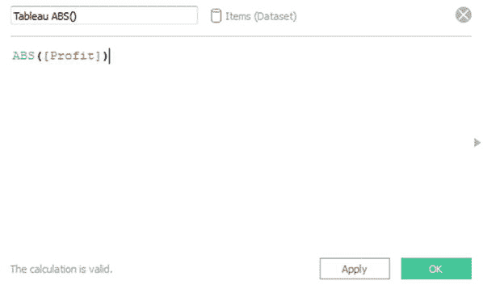

图 6-16. 正在创建的“Tableau ABS()”计算字段

##### 6.1.3.1.4 步骤 4

双击计算字段“Tableau ABS()”将其放置在视图中（如图 6-17 所示）。

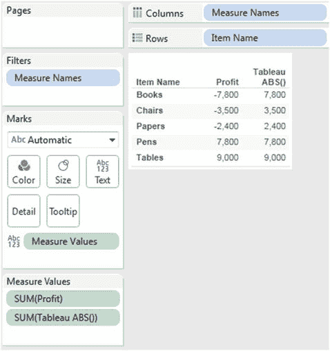

图 6-17. 使用计算字段“Tableau ABS()”的视图


## 6.2 字符串函数

`Tableau` 支持多种字符串函数，以便对字符串进行处理。

字符串函数请参考表 6-2。

**表 6-2.** Tableau 中的字符串函数

| 函数语法 | 示例 | 返回值 |
| --- | --- | --- |
| `Ascii(character)` | `ASCII("T")` | 84 |
| `Char(integer)` | `CHAR(84)` | T |
| `Len(string)` | `LEN("Tableau")` | 7 |
| `Max(a, b)` | `MAX("Tableau", "TABLEAU")` | Tableau |
| `Min(a, b)` | `MIN("Tableau", "TABLEAU")` | TABLEAU |
| `Replace(string, substring, replacement)` | `REPLACE("Visualisation", "sation","zation")` | Visualization |
| `Startswith(string, substring)` | `STARTSWITH("TABLEAU","T")` | TRUE |
| `Upper(string)` | `UPPER("tableau")` | TABLEAU |
| `Lower(string)` | `LOWER("TABLEAU")` | tableau |
| `Left(string, num_characters)` | `LEFT("TABLEAU",3)` | TAB |
| `Right(string, num_characters)` | `RIGHT("COMPASS",4)` | PASS |
| `Trim(string)` | `TRIM(" Visualization ")` | Visualization |
| `Rtrim(string)` | `RTRIM("Visualization ")` | "Visualization" |
| `Ltrim(string)` | `LTRIM(" Visualization")` | "Visualization" |

接下来讨论 Tableau 中的几个字符串函数。

### 6.2.1 拼接

**目标：** 将维度`Customer_ID`与维度`Customer Name`拼接起来。

**公式：** `"Customer ID" + " : " + str([Customer ID]) + " , " + [Customer Name]`

#### 6.2.1.1 演示拼接的步骤

执行以下步骤：

##### 6.2.1.1.1 步骤 1

从“Sample – Superstore”数据集中读取数据。

##### 6.2.1.1.2 步骤 2

创建计算字段`Customer ID + Customer Name`（如图 6-18 所示）。

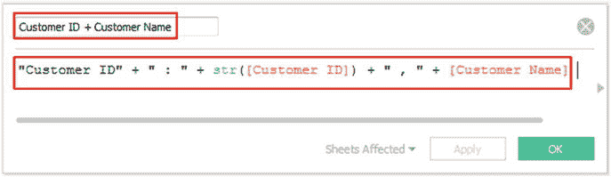

**图 6-18.** 正在创建的“Customer ID + Customer Name”计算字段

##### 6.2.1.1.3 步骤 3

将计算字段`Customer ID + Customer Name`拖拽到行功能区（如图 6-19 所示）。

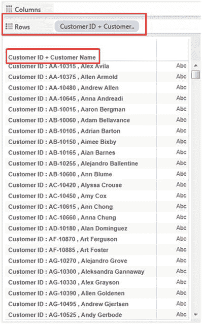

**图 6-19.** 显示“Customer ID and Customer Name”拼接结果的视图

### 6.2.2 Left() 和 Find() 函数

**目标：** 从`Customer Name`维度中提取名字（名字部分）。

**使用的函数：** `Left()` 和 `Find()`

**`Left()` 语法：** `Left(String, Number of characters to extract)`

**`Find()` 语法：** `Find(String, Substring, Start position)`

创建一个名为`FirstName`的计算字段（如图 6-20 所示）。

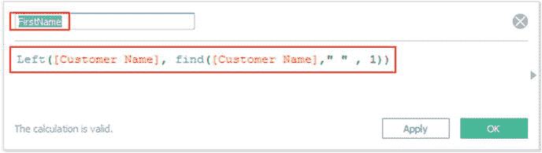

**图 6-20.** 正在创建的“FirstName”计算字段

**公式：** `Left([Customer Name], find([Customer Name], " ", 1))`

结果请参考图 6-21。

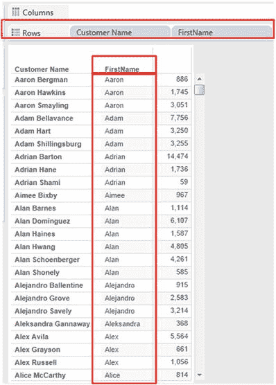

**图 6-21.** 显示维度“Customer Name”中“FirstName”的视图

### 6.2.3 Contains() 函数

如果给定的字符串包含指定的子字符串，则返回`true`。

#### 6.2.3.1 问题描述

下面列出了产品名称列表。我们需要找出那些名称中包含“Wall Clock”一词的产品。显示仅包含“Wall Clock”一词的产品名称列表。

示例：
产品名称                销售额
12-1/2 Diameter Round Wall Clock $ 551
"6" Cubicle Wall Clock, Black $ 125

**输入：** 参考图 6-22。

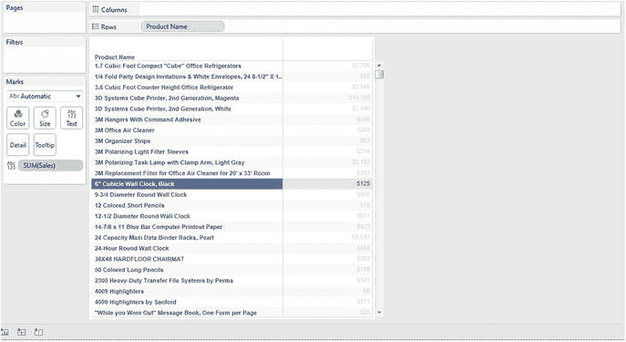

**图 6-22.** 放置在行功能区上的维度“Product Name”

创建一个计算字段`Product-Wall Clock`（如图 6-23 所示）。

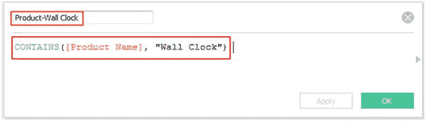

**图 6-23.** 正在创建的“Product-Wall Clock”计算字段

**输出：**

要显示仅包含字符串“Wall Clock”的产品列表，请将维度`Product-Wall clock`拖拽到筛选器功能区，并仅选择`True`（如图 6-24 所示）。

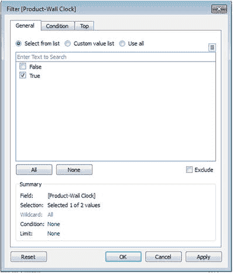

**图 6-24.** “Filter[Product-Wall clock]”对话框

请注意，现在列表仅显示那些`Product Name`包含字符串“Wall Clock”的产品。（如图 6-25 所示）。

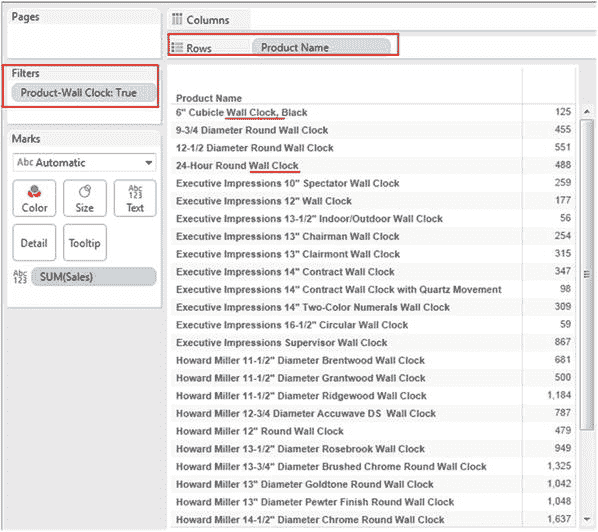

**图 6-25.** 视图仅显示那些“Product Name”包含字符串“Wall Clock”的产品

### 6.2.4 Len() 函数

返回字符串的长度。

**目标：** 计算一个句子中的单词数量。

**提示：** 使用`len()`函数。

例如，计算句子“Tableau is a good data visualization tool.”中的单词数量。

预期输出为 7。

#### 6.2.4.1 演示 Len() 函数用法的步骤

执行以下步骤。

##### 6.2.4.1.1 步骤 1

创建一个计算字段`NumberOfWordsinSentence`（如图 6-26 所示）。

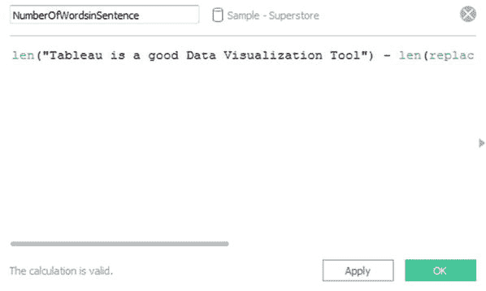

**图 6-26.** 正在创建的“NumberOfWordsinSentence”计算字段

在计算字段对话框中输入以下公式：

```
len("Tableau is a good data visualization tool") - len(replace("Tableau is a good data visualization tool", " ", "")) + 1
```

我们来分析一下这个公式的作用：

我们使用`replace`函数将单词之间的空格替换为空字符串。

`Replace("Tableau is a good data visualization tool", " ", "")`

`replace`函数的输出结果是`"Tableauisagooddatavisualizationtool"`。

我们使用下面的函数统计字符串`"Tableau is a good data visualization tool"`的长度：

`len("Tableau is a good data visualization tool")`

输出结果是 41。这意味着字符串`"Tableau is a good data visualization tool"`中有 41 个字符。

接下来，我们确定字符串`"Tableauisagooddatavisualizationtool"`的长度。

上述操作的输出结果是 35。

让我们再次回顾一下公式：

`len("Tableau is a good data visualization tool") - len(replace("Tableau is a good data visualization tool", " ", "")) + 1`

将函数返回的值代入公式：

- `41 - len(replace("Tableau is a good data visualization tool", " ", "")) + 1`
- `41 - len("Tableauisagooddatavisualizationtool") + 1`
- `41 - 35 + 1`

为什么最后要加 1？这是因为最后一个单词后面没有空格。

- `41 - 35 + 1` 返回 7。

这就是句子`"Tableau is a good data visualization tool"`中的单词数量。

##### 6.2.4.1.2 步骤 2

由于计算字段`NumberOfWordsinSentence`将返回一个数值，默认情况下它会被放置在“数据窗格”下的度量区域中。因为它不需要运行聚合，请将其转换为一个`维度`（如图 6-27 所示）。

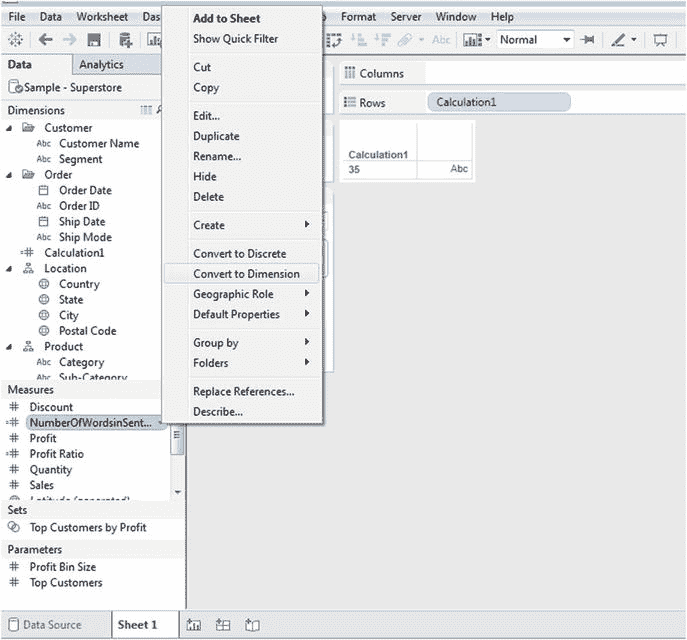

**图 6-27.** 将度量“NumberOfWordsinSentence”转换为维度

##### 6.2.4.1.3 步骤 3

然后将维度`NumberOfWordsinSentence`拖拽到行功能区（如图 6-28 所示）。

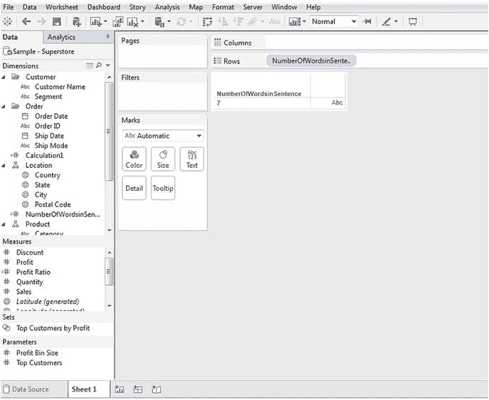

**图 6-28.** 放置在行功能区上的维度“NumberOfWordsinSentence”

## 6.3 逻辑函数

我们来探索几个逻辑函数。

### 6.3.1 CASE

该函数对表达式求值，并依次与值序列（value1, value2 等）进行比较。如果找到匹配项，`CASE`将返回对应的返回值。否则，返回默认值。如果没有默认值，则返回`Null`。


### 6.3.1.1 演示`CASE`的步骤

执行以下步骤。

#### 6.3.1.1.1 步骤 1

从“Sample-Superstore”数据集中读取数据（如图 6-29 所示）。

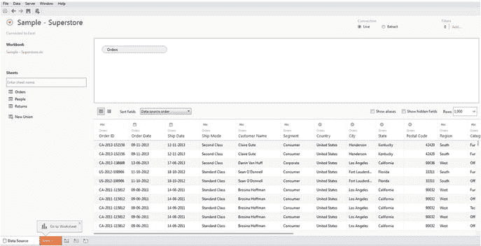

**图 6-29.** 显示来自“Sample – Superstore.xls”的“Orders”数据集的**数据源**页面

#### 6.3.1.1.2 步骤 2

创建一个如图 6-30 所示的视图。

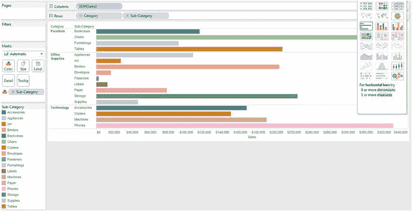

**图 6-30.** 按“类别”和“子类别”显示“销售额”的视图

#### 6.3.1.1.3 步骤 3

创建一个计算字段“运费”(Shipping Expense)（如图 6-31 所示）。

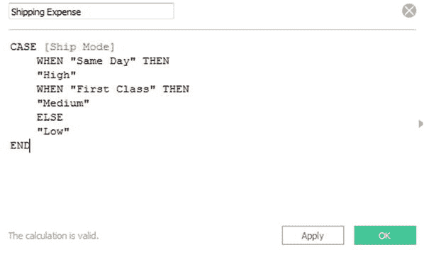

**图 6-31.** 正在创建的计算字段“运费”

#### 6.3.1.1.4 步骤 4

将计算字段“运费”拖到行功能区（如图 6-32 所示）。

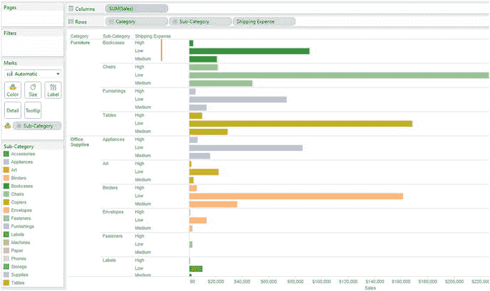

**图 6-32.** 按“类别”和“子类别”显示“运费”的视图

当你需要测试单个值时，`CASE`语句非常有用。但是，它不适合进行比较。

### 6.3.2 `IIF()` 函数

公式：`IIF (test, then, else, [unknown])`

如果测试结果为`TRUE`，则`IIF`返回“then”值。如果测试结果为`FALSE`，则`IIF`返回“else”值。

#### 6.3.2.1 演示`IIF()`函数的步骤

执行以下步骤。

##### 6.3.2.1.1 步骤 1

从“Sample-Superstore”数据集中读取数据。

##### 6.3.2.1.2 步骤 2

构建如图 6-33 所示的视图。

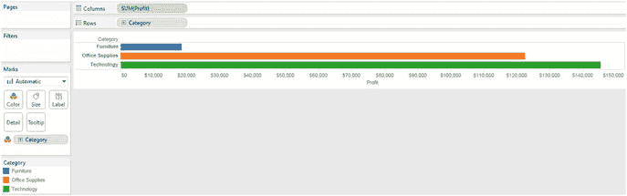

**图 6-33.** 将度量“利润”放在行功能区，将维度放在列功能区

##### 6.3.2.1.3 步骤 3

创建一个计算字段“利润类别”(Profit Category)（如图 6-34 所示）。

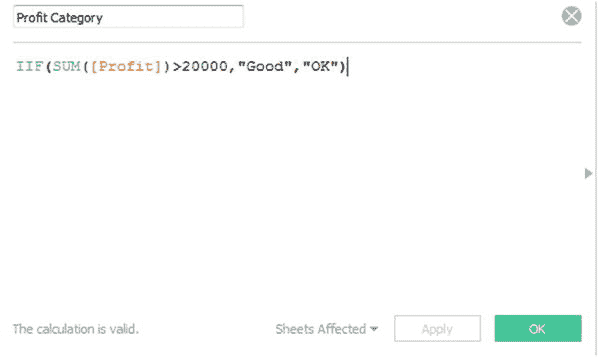

**图 6-34.** 正在创建的计算字段“利润类别”

##### 6.3.2.1.4 步骤 4

将计算字段“利润类别”拖到列功能区（如图 6-35 所示）。

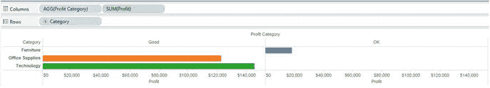

**图 6-35.** 将计算字段“利润类别”放在列功能区

### 6.3.3 `IF ELSE`

公式：`IF test THEN value ELSE value END`

该函数评估一个测试条件，并为评估结果为“True”的条件返回`THEN`值。如果没有条件评估为`True`，则返回`ELSE`值。

#### 6.3.3.1 演示`IF THEN ELSE END`的步骤

执行以下步骤。

##### 6.3.3.1.1 步骤 1

考虑“人口”数据集（如图 6-36 所示）。

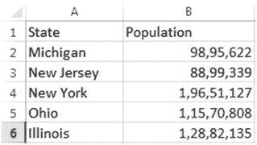

**图 6-36.** “人口”数据集

##### 6.3.3.1.2 步骤 2

从“人口”数据集中读取数据（如图 6-37 所示）。

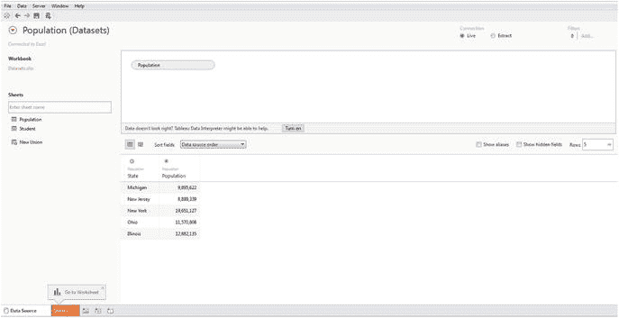

**图 6-37.** 显示“人口”数据集的**数据源**页面

##### 6.3.3.1.3 步骤 3

创建一个计算字段“人口类别”(Population Category)（如图 6-38 所示）。

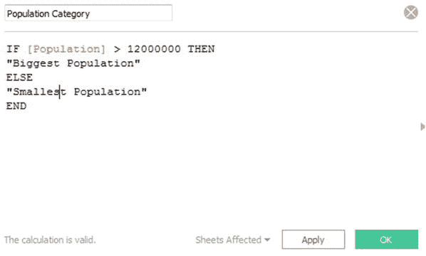

**图 6-38.** 正在创建的计算字段“人口类别”

##### 6.3.3.1.4 步骤 4

将计算字段“人口类别”拖到行功能区（如图 6-39 所示）。

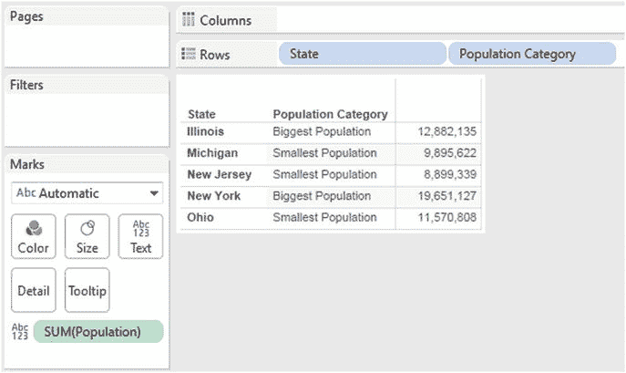

**图 6-39.** 将计算字段“人口类别”放在行功能区

### 6.3.4 `IF ELSEIF`

公式：`IF test THEN value1 ELSEIF test2 THEN value2 ELSE value3 END`

当你需要递归执行逻辑测试时，可以使用`IF`函数的这个版本。

#### 6.3.4.1 演示`IF ELSEIF`的步骤

执行以下步骤。

考虑“学生”数据集（如图 6-40 所示）。

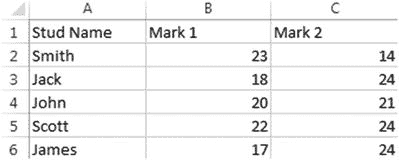

**图 6-40.** “学生”数据集

##### 6.3.4.1.1 步骤 1

从“学生”数据集中读取数据（如图 6-41 所示）。

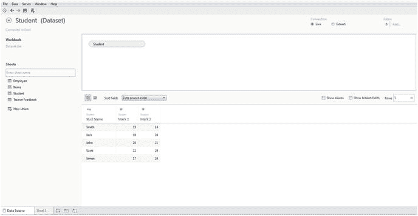

**图 6-41.** 显示“学生”数据集的**数据源**页面

##### 6.3.4.1.2 步骤 2

创建一个如图 6-42 所示的视图。

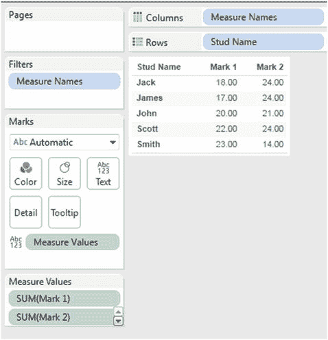

**图 6-42.** 显示学生详细信息的视图

##### 6.3.4.1.3 步骤 3

创建一个计算字段“备注”(Comments)，如图 6-43 所示。

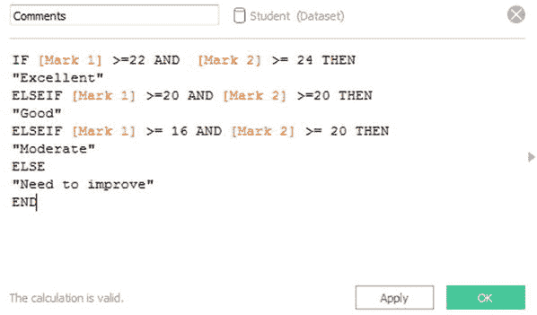

**图 6-43.** 正在创建的计算字段“备注”

##### 6.3.4.1.4 步骤 4

将计算字段“备注”拖到行功能区（如图 6-44 所示）。

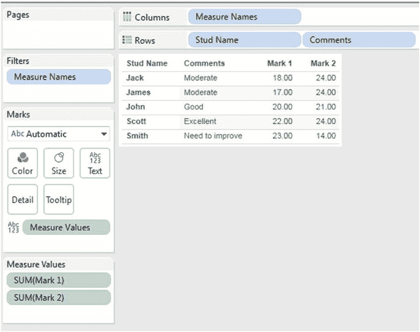

**图 6-44.** 将计算字段“备注”放在行功能区

## 6.4 日期函数

Tableau 提供了多种日期函数。许多日期函数使用`date_part`，它是一个常量字符串参数。

请参考表 6-3 了解`date_part`及其取值。

**表 6-3.** `date_part`及其取值

| `date_part` | 值 |
| --- | --- |
| `'year'` | 四位数年份 |
| `'quarter'` | 1-4 |
| `'month'` | 1-12 或“一月”、“二月”等 |
| `'dayofyear'` | 一年中的第几天；1 月 1 日为 1，2 月 1 日为 2，依此类推 |
| `'day'` | 1-31 |
| `'weekday'` | 1-7 或“星期日”、“星期一”等 |
| `'week'` | 1-52 |
| `'hour'` | 0-23 |
| `'minute'` | 0-59 |
| `'second'` | 0-59 |

### 6.4.1 `DATEDIFF()`

公式：`DATEDIFF (date_part, date1, date2, [start_of_week])`

返回`date1`和`date2`之间的差值，以`date_part`为单位表示。


### 6.4.1.1 演示 `DATEDIFF` 函数的步骤

执行以下步骤。

##### 6.4.1.1.1 步骤 1

从 `Sample-Superstore.xls` 数据集读取数据。

##### 6.4.1.1.2 步骤 2

创建一个如图 6-45 所示的视图。

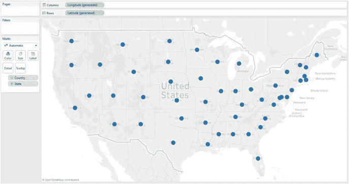

图 6-45. 显示美国各州的视图

##### 6.4.1.1.3 步骤 3

创建一个名为 `Time to ship` 的计算字段，如图 6-46 所示。

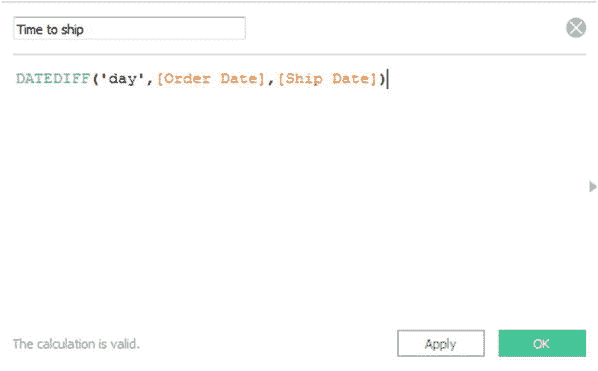

图 6-46. 计算字段 `Time to ship`

##### 6.4.1.1.4 步骤 4

将计算字段 `Time to ship` 拖到标记卡上的 `Color` 处（如图 6-47 所示）。

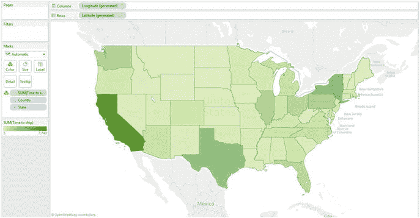

图 6-47. 计算字段 `Time to ship` 放置在标记卡的 `Color` 上

##### 6.4.1.1.5 步骤 5

将计算字段 `Time to ship` 的聚合方式从 `SUM` 更改为 `AVERAGE`（如图 6-48 和图 6-49 所示）。

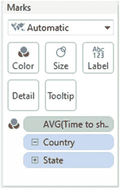

图 6-49. 度量 `Time to ship` 放置在标记卡的 `Color` 上

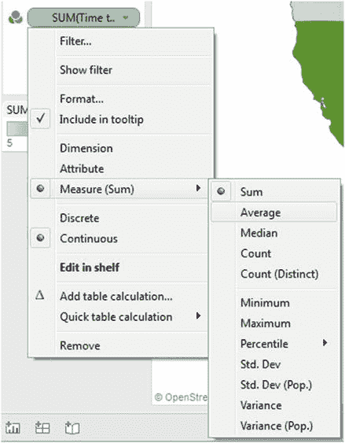

图 6-48. 将度量 `Time to ship` 的聚合方式从 `SUM` 转换为 `AVERAGE`

##### 6.4.1.1.6 步骤 6

右键单击 `AVG(Time to ship)`，选择 `编辑颜色[Avg. Time to ship]` 以编辑颜色（如图 6-50 所示）。

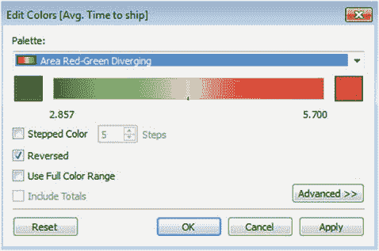

图 6-50. `编辑颜色[Avg. Time to ship]` 对话框

##### 6.4.1.1.7 步骤 7

将计算字段 `Time to ship` 放置到标记卡的 `标签` 上（如图 6-51 所示）。

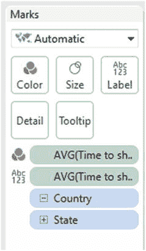

图 6-51. 计算字段 `Time to ship` 放置在标记卡的 `标签` 上

##### 6.4.1.1.8 步骤 8

您可以在可视化中看到计算字段 `Time to ship`（如图 6-52 所示）。


图 6-52. 显示计算字段 `Time to ship` 的可视化

### 6.4.2 `DATEADD()` 函数

公式：`DATEADD (date_part, interval, date)`

返回将指定时间间隔数添加到该日期的指定 `date_part` 后得到的指定日期。

#### 6.4.2.1 演示 `DATEADD()` 函数的步骤

执行以下步骤。

##### 6.4.2.1.1 步骤 1

从 `Sample-Superstore` 数据集读取数据。

##### 6.4.2.1.2 步骤 2

将数据窗格下维度区域中的维度 `订单日期` 拖到行 shelf 上。将层次结构设置为 `年`。右键单击 `订单日期`，选择 `精确日期`，如图 6-53 所示。输出结果参见图 6-54。


图 6-54. 维度 `订单日期` 设置为 `精确订单` 日期


图 6-53. `精确日期` 选项

##### 6.4.2.1.3 步骤 3

右键单击 `订单日期`，选择 `离散`（如图 6-55 所示）。输出结果如图 6-56 所示。


图 6-56. 将 `订单日期` 设置为 `离散` 后的视图


图 6-55. 将维度 `订单日期` 从 `连续` 转换为 `离散`

##### 6.4.2.1.4 步骤 4

创建计算字段 `DATEADD`，用于给维度 `订单日期` 增加一天（如图 6-57 所示）。


图 6-57. 正在创建的计算字段 `DATEADD`

##### 6.4.2.1.5 步骤 5

将计算字段 `DATEADD` 拖到行 shelf 上（如图 6-58 所示）。


图 6-58. 计算字段 `DATEADD` 放置在行 shelf 上

##### 6.4.2.1.6 步骤 6

右键单击计算字段 `DATEADD`，选择 `格式...` 以设置日期格式（如图 6-59 所示）。


图 6-59. `格式...` 选项

##### 6.4.2.1.7 步骤 7

`格式订单日期` 窗口打开。选择格式为 `标准长日期`（如图 6-60 所示）。


图 6-60. `格式订单日期` 窗口

##### 6.4.2.1.8 步骤 8

最终输出如图 6-61 所示。


图 6-61. `DATEADD` 演示 - 最终输出

### 6.4.3 `DATENAME`

`DATENAME` 函数将日期的 `date_part` 作为字符串返回。

公式：`DATENAME (date_part, date, [start_of_week])`

将 `date` 的 `date_part` 作为字符串返回。

#### 6.4.3.1 演示 `DATENAME` 函数的步骤

执行以下步骤。

##### 6.4.3.1.1 步骤 1

从 `Sample-Superstore` 数据集读取数据。

##### 6.4.3.1.2 步骤 2

创建一个名为 `DATENAME` 的计算字段，如图 6-62 所示。


图 6-62. 正在创建的计算字段 `DATENAME`

##### 6.4.3.1.3 步骤 3

将计算字段 `DATENAME` 拖到行 shelf 上（如图 6-63 所示）。


图 6-63. 计算字段 `DATENAME` 放置在行 shelf 上

要了解更多关于日期的信息，请参考下面的链接。

[`onlinehelp.tableau.com/current/pro/desktop/en-us/functions_functions_date.html`](http://onlinehelp.tableau.com/current/pro/desktop/en-us/functions_functions_date.html)

## 6.5 聚合函数

Tableau 支持多种聚合函数。

我们来讨论一下 `ATTR` 函数。

### 6.5.1 `ATTR(expression)`

如果表达式对于所有行只有一个值，则 `ATTR()` 函数返回该表达式的值。否则，返回一个星号。空值将被忽略。


