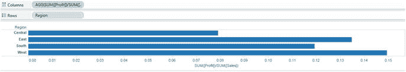
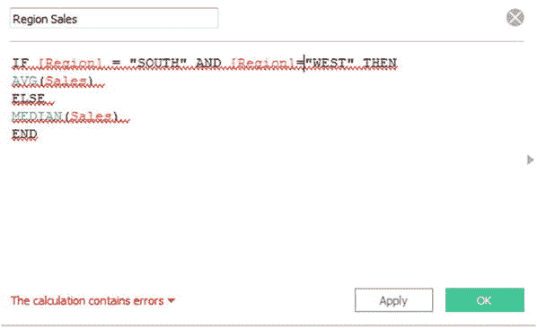
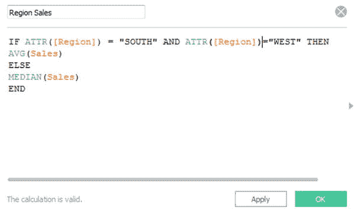
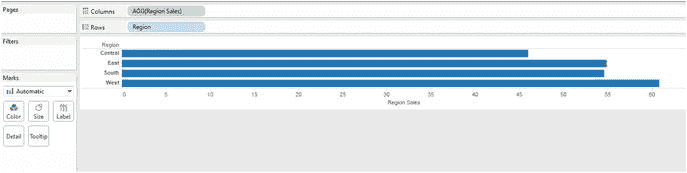

# 演示 `ATTR()` 函数用法的步骤

请执行以下步骤。

## 步骤 1

在“列”功能区上指定 `Sum([Profit])/Sum([Sales])` 计算（如图 6-64 所示）。


图 6-64. 放置到“列”功能区上的计算

## 步骤 2

视图显示聚合是计算的一部分（如图 6-65 所示）。


图 6-65. 聚合是计算的一部分

## 步骤 3

创建一个名为“区域销售额”的计算字段（如图 6-66 所示）。此计算旨在找出“南部”和“西部”区域的“平均值”销售额，以及其他区域的“中位数”销售额。


图 6-66. 正在创建的计算字段“区域销售额”。请注意，该计算包含错误

我们不能在表达式中混合使用聚合和非聚合函数。在这种情况下，我们可以使用 `ATTR` 函数（如图 6-67 所示）。


图 6-67. `ATTR()` 函数与计算字段“区域销售额”一起使用

## 步骤 4

最终输出如图 6-68 所示。


图 6-68. `ATTR()` 函数 - 最终输出

属性检查结果集中所有行的给定字段是否只有一个值。如果所选数据只有一个值，则 `ATTR()` 函数返回该值。如果该数据子集有多个值，则返回星号。

Tableau 使用以下公式计算属性：

```
IF MIN([dimension]) = MAX([dimension]) THEN MIN([dimension]) ELSE "*" END
```